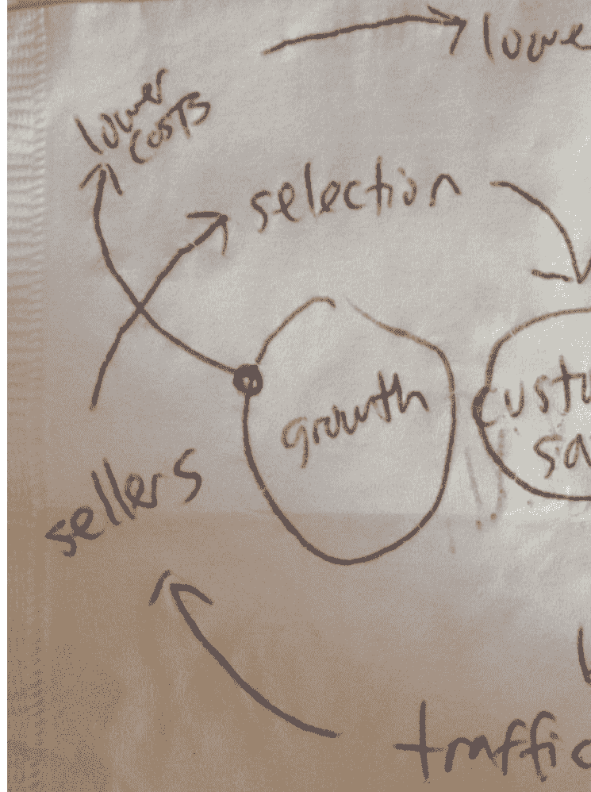

## 152 | 《亚马逊逆向工作法》 驱动增长飞轮

251031
整理：公众号懒人搜索，懒人专属群独享
懒人微信：lazyhelper

欢迎打开《蔡钰 · 商业参考 4》，我是蔡钰。

管理学著作《从优秀到卓越》总结过一个著名的概念：增长飞轮，指的是企业的增长就像一个沉重的飞轮，需要通过无数小决策和行动互相叠加形成推力，推动飞轮一圈一圈地积累势能，最终能够凭借惯性，高速运转起来。

在西方商业管理学界，亚马逊有一个特殊的典故，叫“餐巾纸飞轮”，指的是 20 年前，它的创始人杰夫 · 贝索斯在一张餐巾纸上，画出了亚马逊业务增长飞轮。

亚马逊，是增长飞轮理念的最坚定奉行者与受益者之一。贝索斯当年的餐巾纸画作，今天已经成了全球最著名的商业模式之一。你已经知道了，亚马逊的这个经验，也正在让美团受益。

所以这一讲，我们把亚马逊飞轮当作这个管理工具研究系列的最后一环，展开了解一下。

## 亚马逊飞轮

2001 年前后，亚马逊开始为 4 季度的购物旺季建立了业务回顾周会机制，也就是美团借鉴过去的 WBR，用这个机制来分析和改进经营效率。

既然是业务回顾会，那肯定要复盘经营指标。你想想，一个营收规模接近 30 亿美元的跨国电商平台，系统内的指标数据肯定数不胜数。具体该关注哪些经营绩效指标呢？

当时的杰夫 · 贝索斯，在餐巾纸上画出了回答这个问题的飞轮模型。这张原始草图我给你放在文稿里。它是由两个互相嵌套的飞轮组成的。

第一个飞轮是四个要素的循环：客户体验、平台流量、卖家、选品。它们的关系是，客户体验越好，平台流量就越会增加；平台流量越高，就越能吸引卖家来开店；卖家越多，平台的选品丰富度就越增加；选品越丰富，客户的体验又越好。这四个要素往复循环，就会驱动飞轮越滚越大，它象征的就是亚马逊零售业务的增长。而业务的增长又会驱动第二个飞轮的滚动。第二个飞轮也由四个要素组成：业务增长、降低成本结构、降低商品价格、客户体验。

它们的关系也是循环驱动的：业务越增长，越能降低亚马逊的成本结构；成本越低，商品价格也能越低；价格越低，客户体验越好；客户体验越好，业务增长越多。

这样一来，第二个飞轮也转起来了。你可能会说，这个飞轮看起来也没什么特别的啊？你说得对。但你能说对，是因为你是20年后的先进人类。在当时，贝索斯意识到，降低成本和提升客户体验之间可以正相关，这是很先锋的。在当时，电商和传统零售业普遍认为好体验等于高成本，两者只能二选一。

所以，亚马逊当时总结出这个飞轮后，高管们都非常得意，想把它公之于众。贝索斯却制止了，说这是亚马逊的“秘密武器”。

这组飞轮画出来之前，亚马逊年收入不到30亿美元，卡在某种停滞的状态。但飞轮画出来后，亚马逊随即围绕它的各个要素，来进行业务回顾、优化工作行为，快速进入了正向高速增长。

基于这个增长飞轮而进行的亚马逊业务回顾会，也有一套严谨的会议流程。具体是这样的——定义、测量、分析、改进和控制。

如果你有管理经验，你肯定知道，这就是著名的六西格玛精益管理流程的核心，名字叫DMAIC，也就是以上5个环节的英文首字母集合。

这个会议流程，要求先明确关键指标，追踪数据，分析异常，给出改进方案，最后用控制环节防止会议走题和跑偏。

这5个环节里，最重要的是第一个，找准关键指标，也就是驱动飞轮快速运转的关键输入变量。

## 找准投入类绩效指标

怎么找准关键指标？是不是直接把飞轮中的每一个要素当关键指标来用就可以了呢？你刚才可能发现了，贝索斯画出的两个互相嵌套的飞轮里，“增长”是产出类指标，是结果；而其他都是亚马逊可以着手调整的投入类指标，是过程。

你看，大多数企业在追求增长时，习惯性地问“我们的答案是什么”——收入目标是多少？利润率要达到多少？市场份额要占多少？这些都是产出类指标，是结果。

但亚马逊关心的是“有没有问对问题”——什么才是真正驱动用户体验的关键？是商品数量？是访问量？是库存？还是配送时效？

这是两种完全不同的思维方式。

在20年后的今天，对所有企业、创业者和我们个人来说，建立“问题比答案更重要”的共识已经很容易了。而真正难的是，找到对的问题、也就是找准最有效的投入类指标，用它来指导行动。

我们讲亚马逊的好学生美团时说过，投入类指标也要分级别的。举个例子，像“选品”这个飞轮要素，当指标的话太粗放了。亚马逊早年就尝过粗放指标的苦头。

还是 2001 年，亚马逊飞轮刚刚诞生，开始用来指导团队行动，最初给选品团队选定的 KPI 指标是“新商品的页面创建数量”。公司的逻辑也很简单：新品页面越多，意味着上架的新商品越多，那客户的选择面就越广，体验也应该越好。也就是，驱动下一个飞轮要素“顾客体验”的增长。

结果跑了一段时间，亚马逊发现，平台上的商品品类确实大幅增加了，但销量并没有增长。怎么回事呢？原来，选品团队积极拓展来的新商品，不一定是顾客们需要的商品，用户体验并没有改善。

于是，亚马逊开始修改选品指标，先是改成商品页面的用户访问量。改完发现不行，一个商品页面哪怕很多用户浏览，也可能库存不足，没货可卖。用户体验还是改善不足。

再改。改成“库存商品跟商品页访问量的比值”。改完发现还不行，选品团队倒是很积极去增加库存了，但可能出现有库存、难配送的局面，用户体验仍然没大改善。

再改。改成“两天内可配送的库存商品跟商品页访问量的比值”。改完发现，有效果了。在这个指标的约束下，选品团队的工作行为发生了巨大的变化，团队成员们开始整理亚马逊的搜索数据、关注其他网站和零售平台的差异化爆品，根据这些信息，来确定应当扩展的商品品类和库存。这样选出来的商品，增销也增利。

你看，连亚马逊这么敏捷的公司，都得笨拙地一点点试，可见找对指标有多难。但我们要是再回头看一遍这个指标的修改过程，会发现它确实一步步改善了用户体验：

- 最开始“新商品的页面创建数量”，关注的是新增商品的数量。
- 随后改成“商品页面的用户访问量”，关注的是新增商品是否切中用户需求，也就是“有效需求”。
- 再改成“库存商品跟商品页访问量的比值”，关注的是能满足有效需求的“有效供给”。
- 最后改成“两天内可配送的库存商品跟商品页访问量的比值”，关注的是能高效满足有效需求的“高效供给”。

最后这个指标，亚马逊规定的 KPI 是 95%。

你发现没有，这几次改指标，每一次都在逼着团队更贴近用户的真实需求。这不就是亚马逊 16 条领导力里“客户至上”的具体体现吗？一句价值观口号，就这么水灵灵地变成 KPI 了。

## 总结

以上，我们解释了亚马逊如何用关键投入指标来驱动业务增长飞轮的运转。

我们的人生不也是一个个系统吗？我们的工作、健康、关系、成长，也在互相影响、互相驱动。所以啊，我们也可以找到自己的关键投入指标，比如阅读的深度、休息的质量、思考的频率、对他人的善意。当这些输入不断积累，我们生活飞轮的产出指标，比如成就、健康、收入、幸福，也能得到增长。

到这里，我们也把这个亚马逊管理机制系列讲完了。

20 多年来，从领导力原则、到抬杆者流程、到 6 页纸备忘录，再到 PR-FAQ 与增长飞轮，亚马逊把“思考、表达、决策、执行、反馈”这一整套理性链条，变成了可传承的系统结构。

它近几年虽然没有站在短视频、AI 等风口领域的最前排，但打磨出了一套适配互联网时代的管理哲学，这个贡献不比 OpenAI 和英伟达小。

这套管理哲学不光解释了它一家的成功，还证明了“理性”这种东西也可以被制度化，增长不必依赖天才的灵感，也可以转向可复制、可优化的机制。

随着互联网增速见顶，这套管理智慧会被更多企业借鉴过去，优化自身效率吗？我们可以继续留意。

拜了个拜。

最后，安利小懒的付费群：

懒人专属群（介绍）

📜 懒人专属群持续更新中，已持续运营 6 年，整理超 3000 份各类精选付费文章 & 年费社群干货，全部开放下载。

本资料为付费群内部分享，仅供真实有需要的朋友查阅 🙇‍♂️

## 懒人专属群更新记录：

https://lazy2025.top/blog/record2

懒人专属群更新记录（需梯子，备用）：

https://lazybook.fun/blog/record2