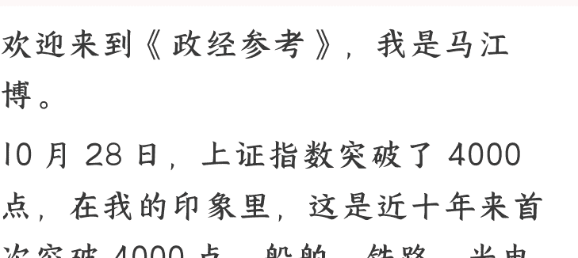

# 216 | 股市突破 4000 点，老登、中登、小登股的分化与命运

251031

整理：公众号懒人搜索，懒人专属群独享

懒人微信：lazyhelper

欢迎来到《政经参考》，我是马江博。

10 月 28 日，上证指数突破了 4000 点，在我的印象里，这是近十年来首次突破 4000 点，船舶、铁路、光电、航天、电池等板块，涨幅明显。另外说一句，中美两国领导人，最终定了在韩国会晤了，新一轮关税战如我们之前所判断的，双方及时刹车缓和了，这对股市也是利好。

所以今天就着 4000 点这个背景，我们来谈一个跟股市有关的话题，就是最近争议非常大的老登股、中登股、小登股的事。这里提到的三个说法，是这次事件引发的戏称，具体含义我后面再解释，我们先简单看下事件背景。

事件的导火索，没有权威报道，据称是一位券商分析师，给某高科技公司做了全年的净利润预测，预测的数字很高，引发了一位投资领域资深人士的质疑。后续这位分析师就把质疑文章转发到朋友圈并配文说：“买你的白酒去吧，老登”。事件的起因大致是这样，我也看了资深人士公开的那篇质疑文章，确有其事。

随后，投资了“老登股”的投资者，和投资了“小登股”的投资者，在各个投资社群、雪球、微博等平台，进行了大量的争论和交锋，不过似乎谁也无法说服谁。

这场争论看似是投资理念之争，但我认为，它背后反映了中国经济转型期的深层分化。今天我们这就来深入分析这场争论背后的信号和趋势。需要说明的是，我这里只是分析现象和趋势，不涉及具体的投资建议。

## 老登股、中登股、小登股

我们首先分析一下老登股、中登股、小登股，以及对应投资者的特征。说明下，我这里借用老登股、中登股、小登股的说法，主要是为了分析方便，并没有冒犯和贴标签的意思。这种分类方法肯定不严谨，也不科学，但它一定程度上提供了一个超越行业分类的分析框架，能帮助我们从资产特征和增长逻辑的角度，重新理解市场的结构性变化。

我根据目前的市场看法梳理了下，老登股的核心板块，是白酒、地产、煤炭、电力、银行、保险、传统中字头央国企、石油化工等。这些产业处于成熟期，甚至有的已经到了衰退期。我分析，它们的增长逻辑从“成长驱动”转向“价值防御”，核心看点是高股息、低估值，以及行业出清后的龙头优势。

它们的商业模式建立在土地财政、人口红利、资源集聚和传统消费文化之上，投资他们的群体，一般是45岁甚至50岁以上的群体，他们往往被认为是信奉格雷厄姆、巴菲特的“老钱”，投资偏好是追求确定性、现金流和低风险。他们尊崇价值投资、偏爱红利策略、追求避险的资金，他们相信“时间的力量”。

中登股，则是医药、军工、新能源、光伏、锂电、电商、平台经济、有色金属等行业的股票。据我观察，这些产业大多处于从成长期向成熟期过渡的关键节点，部分领域已经出现“内卷”。它们是上一轮产业升级的宠儿，但这些产业中，很多也面临技术迭代放缓、市场竞争白热化、行业内卷的“中年危机”。投资这些股票的人，年龄一般在35-45岁之间，经历过移动互联网和新能源的浪潮，信奉“赛道为王”，擅长在产业爆发期捕捉机会。

小登股的核心板块，则是AI、算力、半导体、机器人、量子计算等新兴产业。这些产业往往处于初期，很多公司尚未实现稳定盈利，甚至它们的商业模式仍在探索。而投资这些股票的多为“新生代”，年龄往往在35岁以下，他们不拘泥于传统估值模型，信奉“想象力比确定性重要”。他们的交易逻辑是“抢跑”，在产业趋势明朗之前，提前将未来几年的发展空间，“折现”成当下股价；而对传统产业，则认为它们“太过稳定”，或者“没有想象力”。

我总体看，这是三种不同时代属性、不同世界观、不同逻辑，在同一时空下的激烈碰撞。

## 背后是大分化

接下来，我们穿过现象，进一步谈谈这场老中小登股争论，背后代表着什么。

我认为是一个词，分化。我在之前课程中反复谈过，未来会是一个大分化的时代，而这就是大分化时代的一种具象化的社会缩影，我认为其中至少包含三层分化：

首先显示出的，是不同代际群体在当前环境下的认知分化。

“老登股”的投资者们，他们的青春和事业与中国经济高速发展的“大建设”时代重合，同时他们经历过几轮潮起潮落，所以更相信积累的力量。因此，他们对那些看得懂、摸得着、能持续产生现金流的资产，有天然的亲近感。他们的优势是经历过岁月，但负担可能也是经历过岁月。

“中登股”的投资者们，他们是上一轮“信息革命”和“能源革命”的建设者和受益者。既经历过“风口之上，猪也能飞”的奇迹，也体验过潮水退去后的裸泳。我理解，他们投资中登股，背后也有“中年不惑”的焦虑——既想抓住下一波浪潮不被时代抛弃，但也不能像年轻人那样无所畏惧。

而“小登股”的投资者们，他们是数字时代的原住民，成长于代码、算法和虚拟世界中，对新范式、新生态的接受度极高。我分析，他们没有经历过物质匮乏的年代，对“稳定”的执着远不如前辈，而是成长在中国强大后的蓬勃中，他们是“未来信仰”的信徒。

其实在我看来，这场争论没有绝对的对错。老登股投资者，并不是守旧顽固，他们是在保持对风险和不确定性的敬畏，所以这个“登”也可能是灯光的“灯”；小登股投资者，也不是热衷盲目投机，他们拥有对未来和颠覆性创新的信仰；而中登股投资者的左顾右盼，恰恰是国家转型叠加中年的人生转型之后最真实的写照。

其次，我们进一步延伸，不同群体认知分化的背后，其实是不同经济叙事的分化。

“老登”叙事，是“稳健”的叙事。它根植于过去四十年“水涨船高”的时代，白酒社交、地产繁荣、银行的扩张，都是那个时代的注脚。而在我看来，这里面的风险在于，当旧动能减弱，这份“稳健”在追求未来的叙事中，可能被解读为“夕阳”的余晖。但它的优势在于，经过周期淬炼，这些产业形成了坚固的护城河，高股息和低估值，提供了稀缺的稳定性和安全感。

“中登”叙事，是“突围”的叙事。它们曾经是新动能的代表，但技术扩散和资本涌入，迅速将蓝海变为红海。新能源部分领域的内卷、医药的集采压力、平台经济的人口红利消失，都说明它们已经从“成长故事”进入了“竞争故事”。它们的机会在于，能否通过技术创新或全球化，开辟“第二增长曲线”。但它们的挑战在于，这是一个存量竞争的残酷战场，稍有不慎，便会从“时代宠儿”沦为“昨日黄花”。

“小登”叙事，则是“颠覆”的叙事。它们讲述的是未来的故事，AI、半导体、量子计算这些“从0到1”的星辰大海故事，足够激动人心，也因此吸引了一批渴望在财富总量处于弱势下弯道超车的年轻人。然而，这类股票的风险也如影随形——高估值背后，是技术落地、商业变现的巨大不确定性，这是一条九死一生的荆棘之路。

最后，这种分化，其实也反映出中国经济的两种发展模式。

“老登股”所代表的产业——石油、白酒、电力、银行，大多与中国的传统资源深度绑定，比如山西的煤，贵州的酒，山东的工业，北京的金融街。这些产业的发展模式，是资源驱动、政策驱动。它们代表着一种自上而下的，甚至行政性的结构。

而“小登股”所代表的产业——AI、半导体、机器人等，高度集中在中国的科技创新走廊，比如深圳，“风投之城”合肥，长三角的先进制造业集群。这些产业的发展模式，首先是技术驱动和资本驱动，目前这些领域虽然已经有了产业新贵，但总体上还是一个群雄逐鹿，甚至“不问出身”的不确定、但极具爆发力的结构。

我不评价这两种模式的对错优劣，因为它们是这个国家的一体两面，比如国家现在强调的“新型举国体制”这个词，就是市场和政府的高度结合。

## 几个未来判断

最后谈一谈我对未来的几个进一步判断。

先说一个总体判断，就是分化将是常态，只要中国经济结构转型和科技竞争的大背景不变，“老登股”与“小登股”的分化就会长期存在。

然后我再分别讲下对三类股票板块的趋势判断：

对于“小登股”来说，它们是未来的大趋势，但也将面临残酷的“去伪存真”，目前的“小登股”行情，更多是基于“叙事”和“梦想”的估值扩张。当热潮退去，市场最终会回归到对技术落地、商业变现、真实盈利能力的考验上。届时，相当部分“伪科技”、“蹭概念”的公司将被打回原形，这个过程将比较痛苦。

对于“中登股”来说，机会在于“二次成长”，特别是新能源、创新药等“中登股”，它们的机会不在于回到过去的巅峰估值，而在于能否通过技术创新、出海扩张、模式升级等方式，找到“第二增长曲线”。能够成功转型的公司，有望重新获得成长股的估值。

至于“老登股”，价值则在于“稳定器”和“分红源”，现在谈老登股的全面溃败，可能言过其实，其中部分现金流稳定、分红率高、与民生相关的行业，比如部分公用事业、必需消费品，在经济波动中仍然将扮演“压舱石”的角色，也会是中央“稳字当头”要稳住的目标。它们不适合追求高增长的投资者，但对于风险偏好低、追求稳定现金流的长期资金，仍有吸引力。但指望“老登股”回归昔日的荣光，我认为也不切实际，除非它们能完成“科技化”的蜕变。

我综合判断，未来国家意志将强力引导资本，持续流向“小登股”所代表的“新质生产力”领域，这不仅是产业问题，更是国家安全和战略问题。这意味着“小登股”的波动虽大，但它们的长期趋势与国家战略高度绑定，可能将获得持续的制度性红利。但是对于个人投资者来说，交易要看趋势，更要看市场波动，看清趋势只是入场券，而驾驭波动才是胜负手。趋势决定了你“能否坐上船”，但波动却决定了你“会不会被颠下海”，“小登股”注定是一条荆棘的通天之路。

事实上，许多投资者并不是看错了方向，而是在波动中被收割耗损，跌下了牌桌。因此，对个人投资者来说，交易既要仰望星空，更要敬畏市场，核心是管理好自己的仓位和心态。不过这么多年过去了，我看到的是，虽然都自认为以理性为基础，但终究是性格决定命运。

好，今天的内容就到这里。欢迎你把《政经参考》转发推荐给更多人，让我们一起聚焦政经，举重若轻。我是马江博，下期见。

最后，安利小懒的付费群：

懒人专属群（介绍）

懒人专属群持续更新中，已持续运营 6 年，整理超 3000 份各类精选付费文章 & 年费社群干货，全部开放下载。

本资料为付费群内部分享，仅供真实有需要的朋友查阅 🙈

懒人专属群更新记录：

https://lazy2025.top/blog/record2

懒人专属群更新记录（需梯子，备用）：

https://lazybook.fun/blog/record2