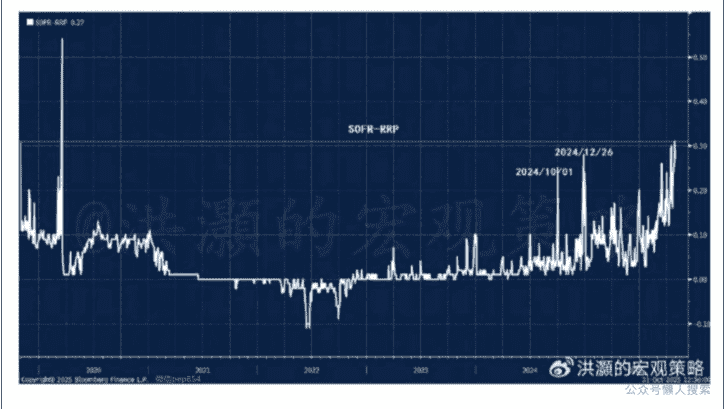

# 美联储释放“兴登堡凶兆”
# 251031 洪灝的宏观策略

整理：公众号懒人搜索，懒人专属群独享
懒人微信：lazyhelper

## 美联储降息如何影响市场

这几天，美股在大型科技股盈利季报的影响下，在历史高位附近大幅震荡。日前，我在我的星球上与读者讨论了标普指数的走势似乎出现了一个近似暮星的技术形态。即蜡烛的实体非常狭窄，并伴随着长长的上下影线。值得注意的是，这颗“暮星”出现在标普六月以来上升趋势走廊的上沿之外。

美中不足的是，当天的成交量并未放量，同时这颗“暮星”的上影线并未远长于下影线。这就是为什么，技术分析更是一门主观的艺术。同时，即便是一些胜率很高的、我经常在我的星球上讨论的技术形态，它们的成功率往往都是在略高于 2/3 左右，并非是完美无瑕、一剑封喉的。

经历了几天的纠缠之后，纳指 100 的走势在几天前跳空高开之后，似乎在它四月以来的上升趋势的上沿之外出现了一个非常罕见的“岛形反转”形态（Island Reversal）。主要指数以这种形态见顶反转的情况非常罕见。然而，也正是因为这种技术形态非常罕见，我认为也值得在此记录一下。

虽然美股指数日前创下了历史新高，然而在指数创下新高之际，指数的宽度，也就是参与指数上涨的个股的比例，却是有史以来最低之一。上一次出现这种类似情况的，是在 2022 年 1 月 3 日。随后，美国资本市场开启了历史上罕见的股债双熊的盘面。记忆中，美国股债双熊的局面应该只出现过三次。

昨夜，尽管美股收跌，VIX 市场隐含波动率也随着市场的下行而下行，但个股的波动率相对于整体市场的波动率却大幅飙升，达到了我们有数据以来的最高。比如，小札在季报后大幅暴跌了逾 8%。这些情况显示，美股市场的波动性暂时不再表现为整体盘面的波动，而是在于个股。当然，标普前十大成分股现在占指数的比重约 42%，为有数据以来最高。因此，如果这些大型科技股出现剧烈的震荡，则难免不殃及池鱼了。

由于市场的宽度不断收窄，参与上涨的股票不断减少，昨天是美股第二天连续出现“兴登堡凶兆”（Hindenburg Omen）的日子。简单地说，这个指标衡量的是市场在上升趋势中或历史高位附近同时大量出现创新高和创新低的股票，而创新低的股票多于创新高的股票。由于这个指标是在 2010 年之后才开发出来的，因此，它在之前历次美国市场危机之中的实战经验有限。

2018 年以来，在这个指标出现之后，随后一个月、两个月、三个月标普的回报都是负的 4%到 6%不等，正收益率在 17%到 30%之间，最大回撤出现在 2020 年疫情期间超过了 30%。由于昨夜是最近几天里第二次出现这个“信号”，那么在交易上还是值得重视的。必须强调的是——对于市场的分析和交易不能只凭一个单一的技术指标。

与此同时，美联储如期降息 25 个基点，并宣布从 12 月 1 日起开始停止缩表，暂停量化紧缩。这是近四十年来第七次美联储在市场还在历史高点附近降息。如果用这个事件作为过滤指标，那么未来一、三、六个月美股的回报都是正收益，胜率为 2/3。显然，如果我们有不同的指标、事件作为技术分析的过滤器，我们可以得到完全不一样的结果。

除了美联储之外，全球各大主要央行也在宽松期。2022 年后全球央行联袂降息的次数已经达到 312 次，并且已经超越了疫情期间，比 2010 那次全球央行在次贷危机后开启的降息周期仅差一次。

如是，在流动性宽裕的背景下出现的一系列凶险的技术指标，是否预示着美股出现新一轮的回调？

以下内容仅 V+会员可见

在观察美股流动性的时候，我们并不能仅仅着眼于美联储的基准利率。毕竟，大量的流动性的定价并非以美联储的基准利率定价。其实，美联储的 SOFR 利率，也就是在回购市场以美债为抵押的贷款利率已经远远地高于美联储的回购利率。

换言之，美联储的资产负债表上的流动性其实是吃紧的。这两个关键利率的价差，很可能是美联储官员同意降息但是也不得不停止量化紧缩的重要原因。上一次出现类似情况的，应该是在 2024 年 12 月，也就是 2025 年美股阶段性见顶前夕。

当时，美联储表上的流动性不足也迫使美联储停止量化紧缩（图一）。顺便提一下，我在 2024 年 12 月 19 日在深圳举行了一场特别的年末分享。当时，我为现场观众坚定地分享了我当时对于美股阶段性见顶的预测。那次会议离美股最终的高点只相差了不到 100 点。

### 图一：美联储表内流动性吃紧

虽然鲍威尔在讲话的时候强调了 12 月降息并非已成定局，但同时又宣布 12 月 1 日将结束缩表。理论上，美联储很快将不得不再次扩表。这是因为美联储表上的回购储备已经归零，也就是疫情期间增发的几万亿美元的流动性已经尽数消耗殆尽。而这些回购储备，是市场认购新增美债发行的资金来源。

由于美国现在债务高企，可以想象，接下来为了填补巨额的财政赤字，美国财政部将不得不继续发行大量的美债。在这些美债在市场里发行的时候，金融机构，比如对冲基金往往用这些债券来做基差交易。它们会从货币基金或银行或券商借钱，放几十倍上百倍的杠杆来进行基差交易。可想而知，由于美国政府发债的需求，对于回购储备的资金需求将持续地上升，回购利率也将继续上升。这就是最近回购利率持续上升的原因之一（图一）。

美联储的重要职能之一就是设定短期利率，但是美联储资产负债表的规模，尤其是回购储备的规模，也同时影响市场上金融机构的放贷能力。2021年时美联储的一份非公开文件显示，美联储的这两个职能是互不兼容的。如果要压低并控盘短期利率，那么美联储将不得不购买大量的短债。因此，美联储的资产负债表的规模必然受到影响。如果全市场能够持有的债券久期要大致保持稳定，这种操作必然导致市场要买入更多的长端美债以平衡。

可以想象，为了控盘短端利率并为市场提供充足的流动性，美联储将不得不扩表。两年美债收益率往往领先美联储的基准利率。如今，两年美债收益率已经开始下行，并将引领美联储再次下调基准利率。同时，这种操作也会把长端美债留给市场需求决定。然而，现在外国央行已经不再是美债购买需求的主力，为了弥补财政赤字而将发行大量的长期美债供应将很可能对于美债长端收益率产生上行压力。这很可能是为什么，在鲍威尔按照发言稿念出十二月降息并非定数的时候，十年美债收益率大幅跳升。

因此，美债的隐含波动率很可能将开始飙升。历史上，美债收益率的见底逆转往往领先美股 0—6 个月（图二）。因此，美股的波动率将开始上升，而明年将是观察美股泡沫开始破灭的重要的时间窗口。

### 图二：美债隐含波动率的见底逆转往往领先美股 0—6 个月。

洪灝 2025.10.31

最后，安利小懒的付费群：
懒人专属群（介绍）

📖懒人专属群持续更新中，已持续运营 6 年，整理超 3000 份各类精选付费文章 & 年费社群干货，全部开放下载。

本资料为付费群内部分享，仅供真实有需要的朋友查阅 🕶️

# 懒人专属群更新记录：
- https://lazy2025.top/blog/record2

# 懒人专属群更新记录（需梯子，备用）：
- https://lazybook.fun/blog/record2