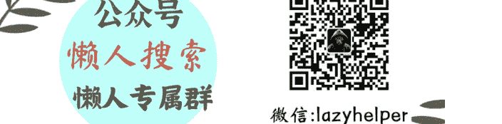

# 川普亚洲行，办了哪些事？

251030 猫哥

整理：公众号懒人搜索，懒人专属群独享

懒人微信：lazyhelper

微信:lazyhelper

川普本次亚洲行已经结束，拿到了哪些成果呢？先看行程：10月24日晚，川普开启了为期1周的亚洲之行。

25日，过境卡塔尔，在美军乌代德基地加油期间，在“空军一号”专机上与卡塔尔首相进行闪电会晤，双方主要讨论了加沙局势，包括停火与战后安排事项。

26日，在吉隆坡与马来西亚总理安瓦尔会晤，出席东盟相关活动，并见证了泰国与柬埔寨的停火协议签署。

27日—28日，转场日本，与日本新首相高市早苗举行会谈并参加相关活动。

29日—30日，马不停蹄前往韩国，与韩国总统李在明会面，并参加 APEC 相关活动。

当然，重头戏就是和我们的釜山会晤。

可以说，少了国内那些糟心事，这次川普亚洲行还是相当滋润，整个行程可以用彩旗飘飘、锣鼓喧天，档期排满来形容。

回国以后，估计又要大写一个“赢”字，贴在民主党脸上，着手处理联邦政府停摆这事了。再看主要成果：首先是投资，日本肯定是大出血，几千亿巨额投资要在川普本届任期内完成。马来西亚也承诺未来十年对美投资700亿美元。

其次是订单，日本承诺采购福特汽车、天然气、大豆。东南亚国家承诺削减对美国汽车、农产品的关税，进口更多美国商品（如波音飞机）。

为此，川普给的胡萝卜是什么呢？

- 对部分东南亚国家的特定商品给予关税豁免。
- 将日本汽车的进口关税从25%的威胁性税率下调至15%。

你看，就这点胡萝卜，换来了投资、订单和稀土供应链1.0版，是不是又赢麻了？

投资和订单都是规定动作，板上钉钉的事，毕竟老美现在仍然是全球一哥，该给的面子还是要给的。但不是核心重点，这次川普御驾亲征的亚洲行，最关键的主要涉及三个方面：

## 第一，拉拢东盟。

很多人不清楚，人家东盟集会，川普为啥去凑啥热闹？

个人认为其核心目的就是冲着我们来的。

要知道，之所以我们对川普发起的关税战，能够游刃有余，其中一个关键因素就是东盟。之前文章有介绍，中美贸易已经从18年峰值（美国占中国贸易总量的20%）下降到了不足10%，并且还能保持增速，究其原因就是新兴市场在扩大，其中东盟是最核心贸易增长点。

现在我们和东盟的贸易已经来到万亿规模，而且还在扩大，如果能发挥搅屎棍作用，削弱东盟和我们贸易规模，也是中美博弈的重要筹码。

川普不缺动机和手段，但就目前形势看，效果微乎其微。因为就在28号川普走后，马上东盟和我们就签署了自贸区3.0版升级协定书。

也许川普心想，好歹让我回国后，发几条推文，再签吧。

## 第二，打造去中国化的稀土供应链。

澳大利亚有丰富的稀土资源，是老美的铁杆盟友。

日本通过十几年的发展，目前稀土自主率达到30%，有一定的技术和资金。

再拉来马来西亚和泰国这些和稀土产业链有点关联的新伙伴（比如澳大利亚的莱纳斯公司就在马来西亚有加工厂，虽然产能小，成本高，但好歹是个现成的，不是0），马上就可以把这几个臭皮匠整合在一堆，搞出一个围绕美国+日本+澳大利亚+马来西亚+泰国的稀土供应链联盟，想着能绕开我们的供应链体系，或者降低依赖程度。

至于效果几何，短期想都不要想，长期看现在还不好说，毕竟我们在稀土精炼，特别是高纯度重稀土分离技术上，掌控了大量核心专利，拥有绝对优势。

但最起码，先凑拢班子临时拼一个稀土供应链1.0版出来。在中美谈判桌上，关于稀土卡脖子这事，也能稍稍建立一点底气，不至于完全束手就擒。

## 其三，抽血日本。

川普这次访日，更像是逼债，石破茂虽然下台了，但新上台的高市早苗要尽快认账，不仅要把前面日本投资采购内容固定下来，还要追加。

这次新签订的美日同盟新黄金时代协议，完全是瘦身版的第二个广场协议。大财阀集团不过作为美国豢养的政客，高市早苗的表现确实可圈可点，完全是一副川普的老迷妹，在现场又蹦又跳。

当然日本这次也不是没得收获：

- 前面说了，支柱产业汽车的关税下调了。
- 修订《国家安全保障战略》等文件，突破“专守防卫”原则。
- 将防卫费占 GDP 比重目标提升至 2.5%，并计划提前实现原定 2%的目标。

虽然要承担更多驻日美军经费，但反过来想，这不是日本心心念念的关键问题吗？

这次老美其实对日本也没下狠手，包括 30 号日本宣布维持利率不变就看的出来。如果要下狠手，就会要求日本左手巨额投资和采购，右手逼迫日本加息阻止资金向我们转移。

历史上的广场协议，日本还是全球第二大经济体，抽血的后果大不了是“失去的 20 年”，现在日本小了几圈，再像以前那样抽血，日本经济根本承受不了，只有原地自爆。

只能说，现在日本对老美还有利用价值，要靠它在东亚牵制我们，贸易上喂点补药，军事上适当解绑。看家护院嘛，总还是要提高点军事威胁能力，但是上贡的内容，一点不能少。

以上就是川普本次亚洲行的核心内容，看似喧嚣，实际上通过拉拢东盟、构建稀土联盟、抽血日本同时提升军事能力，对我们耍脏心眼，增加在釜山会晤前的博弈筹码。

但是，这些东西在大国博弈面前，除了添堵外，个人认为至少从短期看作用不大，并不能左右整体博弈态势。

最后，我们再看一组数据：1—9月，日本对华投资实际投资额同比增长55.5%。新设立外商投资企业48921家，同比增长16.2%。

单9月，根据外汇管理局的官方数据，银行结汇2647亿美元、售汇2136亿美元，结售汇顺差510亿美元。这些都反映一个问题，别看川普在舞台上蹦跶得厉害，东大却在默默拿实惠。

# 最后，安利小懒的付费群：

懒人专属群（介绍）

懒人专属群持续更新中，已持续运营6年，整理超3000份各类精选付费文章&年费社群干货，全部开放下载。

本资料为付费群内部分享，仅供真实有需要的朋友查阅😁

懒人专属群更新记录：
https://lazy2025.top/blog/record2

懒人专属群更新记录（需梯子，备用）：
https://lazybook.fun/blog/record2