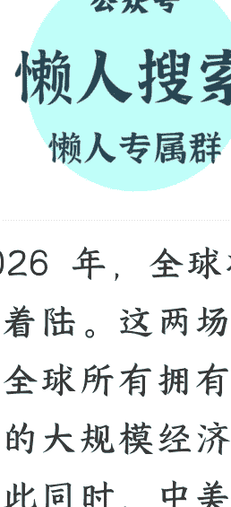

# 2026 年度展望报告：用脸着陆后的狂飙与终场

20260102 作家张原
整理：公众号懒人搜索，懒人专属群精选
懒人微信：lazyhelper1

2026 年，全球将面临两场用脸接地的硬着陆。这两场十年一遇的硬着陆与全球所有拥有合法民选政府的经济体的大规模经济复苏是同时进行的。与此同时，中美两国之间的休战期已经进入了倒计时，东方与西方自从 2023 年开启的本轮 AI 牛市和自从 2024 年开启的政策牛市，也将逼近各自无解的新杀线。天下总以为 2027 年是风高浪急的一年，但殊不知真正的动荡将从 2026 年开始；

先来讲下通缩大国的宏观：就如同过去的每一场底部都存在政策底和市场底一样，曾经的支柱产业地产的泡沫出清与筑底目前仅仅走完了一半，即目前的楼市处于政策底已到，但市场底未至的下跌中继阶段。而整个 2026 年将会是楼市大幅度迈向市场底的关键一年，经过 2026 年一整年的下跌后，到 2027 年的年中基本上房价就已经完成了到 2030 年总跌幅的 85% 左右，彻底进入市场底这个真正的底部区间。笔者在知识星球中早在 2021 年就预言了地产将见顶，现如今还没有逃生的非幸运儿就只能在泥沙俱下中用肉身扛雪崩。

与此同时，受益于海外市场需求增长和减税政策促进之下和 PMI 周期共振催生的短暂美国经济周期性复苏（目前只能看到有 10-11 个月）会令制造业和出口的基本面得到有效的提振。制造业将重回扩张区间，出现短暂的景气，消费也会出现一定程度的弱复苏，经济的基本面会出现最近三年来的首次微弱转好。因此，今年牛市的凶猛程度将不亚于 2025 年，但必须做好 10 月中清场的准备。而我国经济基本面的一次持续复苏，将会持续一整年。这将是步入风高浪急的 2027 年之前的最后一次全民大喘息的机会，实业复苏并不意味着创业环境变好，而是意味着存量出海线的景气会持续一年。

但是，随着贸易战休战一年结束、西大中期选举结束、2027 年地缘风险预期、美国经济复苏年内结束四大利空因素的交织出现，本轮 A 股牛市的新杀线很可能将会在 2026 年的第四季度到来。另一个海外的大新杀线，是早则在 2026 年 2 月末触发、晚则在 2026 年 5 月下旬触发的由英伟达财报引发的美股 AI 牛市第一阶段的终结。

目前我们都身处于 OpenAI 在 2022 年底美股大熊的年末横空出世催生的美国 3 年的 AI 牛市之中，这场牛市用脸着陆的危机此前一直在被推后，但终将在今年上半年到来。由于云侧 AI 和 IDC 数据中心算力的高速增长转为了中速增长，由此导致英伟达的估值在年内必然会出现一次剧烈的重估和下杀，而这最终导致持续了 3 年的美股 AI 牛市的阶段性终结。此次新杀过后，全球 AI 的炒作核心主线将从算力和数据中心转为 AI 硬件消费品 / AI 消费电子线，AI 在财报上的放量和 AI 增效（有关 AI 降本时间线此前在去年的文章《危与机 | AI 代人时间表》终究还是要通过在消费电子和被 AI 赋能的工业品的卖货和出货来实现。端侧 AI 将在此后接棒由算力 + 数据中心构成的云侧 AI 战线继续扛起领全球股市上涨的主线叙事。

本文大致分为中国市场年度走势预判、景气板块年度预判两部分。以下是对中国和海外市场年度走势的预判：

## 中国市场年度走势预判

生拉硬拽的 11 连阳之后，1 月份 A 股将面临一次市场自发的良性调整，但本次调整之后的反弹中走出来的领涨方向将成为 2026 年一整年的主线之一。由于经济数据的部分好转，整体市场氛围和流动性会好于去年最后两个月。12 月结束后，由于海外财报的空窗期，在没有鬼故事的情况下会利好 A 股在接下来的近两个月的走势。部分业绩较好的企业会在 1 月公布自己的年报预告，再叠加机构的年度加仓买盘，因此 1 月的整体风格会比较稳健。建筑业业绩的绩优股与部分预期差板块共振上涨的局面。总体来看 1 月的走势会是伴随着小幅杀跌的震荡上涨。

2 月和 3 月将会是 A 股春季躁动的主要发力期，其中 2 月作为春季躁动的第一阶段将主要炒作年度的经济刺激预期，并且大科技板块随着许多科技公司的年度新品发布会让 2 月成为上半年市场赚钱效应最好的一个月。但要警惕 2 月末的由海外 AI 大裁员引发的局部杀跌，由于英伟达的四季度年报将于 2 月 25-26 日发布，因此 2 月 14 日季度数据出现问题，则一场大规模的杀跌就不可避免。海外卖力线的崩溃将拖累很多人。因此谨慎的读者要在 1 月第四季度报配合出海线为安，最晚也要在春节假期结束后的 24 日、25 日两个交易日大规模降低仓位抵御英伟达可能带来的杀跌。总体预计 2 月的行情将会是以春节假期为界，上半月为行情以持续上涨为主，下半个月是否得以稳住阵脚需要靠英伟达财报数据进行支撑，一旦财报不及预期将会出现大幅杀跌。

3 月的整体市场节奏会是以 3 月 5 日的两会召开为界，之前主要炒作动作政策预期，在会议召开期间会有场外力量进行护盘，在沪指层面会出现连续的托底跌不下去不会有大的情况。如果 2 月底出现了杀跌，则修复主要会出现在 3 月的第一周。如果 2 月底没有出现系统性风险，3 月的持续上涨会让股指的主要指数在 3 月底阶段性见峰，3 月份接棒 2 月份的大科技线炒作的最后冲高很可能会铸就一个科创 50 指数和科创 100 指数在第一季度的最高点出现。政策落地后会进行第二波上涨主要炒作两会提出的对大科技线的新扶持政策，但冲高后的阶段性回落会套住一大批人。整体来看 3 月虽然会将指数推到一个新的高点，但很可能其赚钱效应反而不会如 2 月。总体预计 3 月的行情将会是两种情况，即 2 月末下杀后的 3 月初修复上涨后的先震荡再拉升后再出现平台整理，或者是延续 2 月上涨动能继续冲高后的小幅震荡回落后再继续拉升。需要注意的是，市场的风格切换将会在 3 月末完成。

4 月将会是春季躁动的最高点和冲高估值，作为 1-2 月份春季躁动第一波之后的第二轮上涨，发生于 3-4 月份的春季躁动第二波将主要交易年报绩优股，即会出现与主要炒作短期利好与梦想的 2 月和 3 月不同的市场风格，4 月的市场风格总体上会与 1 月的市场风格比较相似，资金在 2 月和 3 月炒作技术进步的星辰大海之后，会在 4 月重新抱团大块头的业绩利好个股。诸如化工、部分机械设备等板块的估值会迎来上涨，这就与之前纯粹炒作 AI 科技线的风格形成了对照。虽然 4 月许多板块的持续上涨力度会不如 2 月和 3 月，但整体指数的上涨会更加稳健呈现小碎阳拉升的情况。市场到 4 月末会出现一次阶段性的流动性紧缩，伴随着节前效应会导致 4 月的月 K 整体上会出现一个上影线。总体预计 4 月的行情将会是先涨后跌，但上涨的板块会从小盘变为部分大盘股和低位板块，市场风格会与之前的 2、3 月份存在较大的不同。

这里来总结下 2026 年前四个月的市場风格变化预判，即 1 月和 4 月整体上是机构风格和绩优股风格，2 月和 3 月主要是游资和量化风格。1 月主要涨白线的绩优股和机构持有的大块头票，4 月主要涨机构持有的出海线、化工和机械设备等板块。

5 月将会是本轮中类牛市的第一轮大考，在整个 2026 年的前四个月中，1 月受海外利空影响出现的杀跌与 5 月危机相比将会是小巫见大巫。随着英伟达等海外 AI 巨头 2025 年第一季度财报全面展开，AI 相关企业能否将技术优势转化为实实在在的收入和利润将面临首次高速增长转为中速增长的计价检验，一场场内最猛烈的杀跌将会在美股发生并传导到同样在 AI 硬件获利的 A 股。5 月的杀跌将会非常迅猛，如果英伟达财报出现了大问题，则大盘可能会从 4500 点以上回落到 3500 点 -3700 点左右。如果海外财报线问题存在但不大，则市场依旧会回落到 4000 点以下。总体预计 5 月的行情将会是上半年最难做的月份，整体上会呈现出上半月的滞涨与下半月的持续阴跌与猛烈的暴跌交替的行情。

6 月市场大概率延续调整与筑底的态势，并考验前期低点支撑。大宗商品价格可能在本季度逐渐见顶，并对相关周期股形成压制。投资者情绪开始趋于谨慎，会在宽幅震荡中等待更明确的企稳信号。本月的市场风格预计将会以高速波动为主，这主要是由于部分机构的整体移仓和大资金的调仓换股布局下半年行情所导致的，这会令整个 6 月份难以出现稳定的主线带领市场走出震荡风格。总体预计 6 月的行情将会是以震荡筑底为主，市场将基本上完成对 AI 基建对财报盈利能力转化有限的计价并开始寻找新的叙事。

7 月市场将在震荡后开始聚焦业绩利好和政策可能发力的方向，许多业绩预喜的公司会提前发布半年报预告，市场风格将更多地从讲故事转为买入现实，届时海外出口线的利好将会令市场开始重新抱团一些半年报利好的绩优股。伴随着大资金买入现实的是部分游资和量化开始博弈政治局会议对下半年经济工作的调整与政策利好。同时随着上半年的制造业有修复和通缩程度的削弱，在经历了 5 月和 6 月两个月的持续不景气后，7 月的市场将会逐渐出现企稳的势头，部分资金开始交易宏观经济改善的事实而不是预期，消费板块可能会迎来一波短促而剧烈的价值重估行情。整体来讲 7 月的行情将会是在震荡过后的小幅拉升为主。

8 月的市场将会从之前的趋势中翻身，市场会形成迥异于上半年的新主线，笔者认为届时 AI 硬件消费品将接棒 AI 云与 AI 云的基建重新为市场建立信心。8 月的市场将从交易下半年的政策预期和经济基本面改善利好转为交易财报利好和技术进步预期，市场焦点转向基本面和科技进步预期，业绩超预期的公司将获得资金青睐，而业绩不及预期的公司则面临回调压力。部分 AI 硬件大厂的新产品传闻与 AI 应用的新功能出现，将会导致端侧 AI 中的部分标的的出现抱团式的上涨。总体来看八月的行情将会是以上旬和中旬的交易业绩利好和下旬的交易 AI 硬件与端侧消费品为主，指数整体上呈现出在震荡中温和上涨的趋势，个股和板块间的结构性行情将十分活跃。

9 月的市场将重新出现主线，传统的消费电子大开启，市场将迎来下半年行情的最大支柱：AI 硬件消费品。预计主要的 AI 硬件消费品将以 AI 手机和 AI 眼镜为主，其中 AI 眼镜新发布的很多惊艳功能将会令市场重新定价该赛道，并将其列为与手机权重类似的超级消费单品。此外，拥有多功能的 AI 手环、AI 耳机的发布与爆品出现、以及 AI 机械消费终端的惊艳倾向也将会令市场彻底认定 AI 消费电子与硬件也就是端侧大逻辑将取代云侧（AI 云）成为未来的 AI 时代主要增量。9 月的行情将会是手机和电子消费品的总代表出现一轮抢跑上涨，同时部分惊艳的 AI 新功能也会令智能穿戴概念和端侧 AI 终端概念出现量化和游资的抱团个股。总体来看在经历了 8 月完成了的对业绩利好的计价后，九月将会是又一个主要炒作技术进步的星辰大海的月份，但与上半年和去年炒作算力服务器不同的是，九月主要炒作的板块是被 AI 赋能的硬件消费电子产品。总体来看 9 月的 A 股行情将会是以 AI 赋能的消费电子产品为主线的主升浪行情，指数的上涨斜率将会变得陡峭呈现出加速态势，这个月的赚钱效应在下半年居首。

10 月的市场将出现一次下半年的最猛烈冲高后的回落，许多板块已经出现了边打边撤的迹象。下半年 10 月的这次冲高回落将会是类似于上半年 4 月末到 5 月初的冲高回落，可能会形成一个全年乃至本轮牛市的最高点。

10 月的行情在下旬可能将会出现以上涨乏力的问题，市场开始为了规避美国中期选举带来的利空和外部扰动，进而出现了保守和下移的趋势。同时自从 8 月末开启的，横跨八月末、九月、十月前旬的 AI 硬件线和端侧 AI 的炒作形成的一轮主升浪将基本上完成计价开始熄火，多种因素交织之下，市场将呈现出盛世中后期的形态。总体来讲 10 月的 A 股行情将呈现出先冲高后震荡最后回落的趋势，一个上影线的出现将会是再明显不过的撤退信号。

11 月的市场将会重演 2025 年的混沌无主线，在经过端侧 AI 标的主导的主升浪拉升后，整个市场将出现又一次的混沌和抢主线的情况，这个月将会是 A 股美股关注自身大周期和中举动荡乃至阴跌的一个月，整体的赚钱效应将会很不好。结束，与此同时，此时的 10 月妖股抱团，但许多中期选举的内部消息面时期出现外部压力减轻的良好外部环境将面临结束，与此同时中美于一年前达成的贸易战一年休战协议也面临到期，各种外部的恐吓与讹诈将会变多，牛市的整体外部环境将会恶化。再叠加市场对 2027 年东南惊涛骇浪可能到来的计价，在中期选举结束、贸易战休战结束、2027 年东南巨浪集体避险动作三重利空的催化之下，大量的资金将会选择卖出。整体来看 11 月的行情将会是震荡、阴跌与中幅度下跌交替的趋势。

12 月的市场将会出现又一次较为剧烈的调整，由于美国本轮经济复苏在 11 月份将会出现乏力乃至结束的情况，海外市场的走弱就会与下跌的情况与此同时明年的不确定性美元将会令许多投资者将风险资产抛出，进而出现许多板块的无差别杀跌和跳跌情况。与此同时一些不能说的与 2027 年二十大相关的高风险传言和由此引发的政策一致性变化的出现，会导致难以出现有效的经济刺激政策，年末的经济工作会议也难以彻底扭转在 11 月出现的三大利空疑云。在叠加美国经济复苏在 11 月的结束于 12 月公布后彻底成为市场共识，海外需求的减少将彻底令制造业出口大国的长线利好与景气预期彻底打破。因此我们不看好 12 月份的行情，也无法描述一个应该说和不能形容的事物，大家按照我的规划在 10 月中旬，最晚也要在 11 月下旬离场即可。

## 利好板块预判

在讲述 2026 年的好板板块之前，我们先来看一下中美共用逻辑的基本情况。我们知道由于现目前中美资本市场共用同一套大逻辑，因此全球资本市场已经被人工智能定义成了一套共生环的一损俱损一荣俱荣，一旦出现了人工智能的云侧和 DC 叙事难以为继的情况，就必然会造成一场系统性估值的火焰赤壁惨案。

由海外的人工智能线在 2022 年的云侧+IDC 的中速增长将会遭受时间轴的考验，其冲击的令全市场最大，其单次向下的幅度会较 2025 年更加剧烈。因此许多资金会前往大科技线中的其他方向进行对冲，这四个方向是：

- 1. 先来说一下大宗，在大紊乱中，铜价在 2026 年呈现出全球市场极度缺铜的状态，因此在年度策略中多铜与铜相关将会成为一个不错的选择。笔者将在后续文章中详细讲论 2026 年继续看多铜的年度战略的深层根本性原因。张原同志看好铜在 2026 年的表现，同时也谨慎看好金、铝在 2026 年的行情。
- 2. 由电力大国逻辑延伸的由 AI 带来的用电设备方向，以及特高压的情况方向。本方向的景气度有关电网设备老化和用电需求的全面提振，也有 AI 带来的用电设备方向，这个逻辑可以被视为 2026 年的一条确定性的主线，其设备至少都会是中型主线，不排除其发展为与 AI 硬件并行的主线。
- 3. 端侧 AI 的兴起所带来的消费品与 AI 硬件方向。笔者团队认为 2026 年必将是端侧 AI 的爆发元年，在人工智能主线已经炒作了 3 年的情况下，必须出现一个新逻辑给人工智能的变现提供盈利叙事和市场空间支撑，否则应用场景的缺乏将会导致市场主线的崩塌。笔者认为，在 2026 年将会横空出世的端侧 AI 和 AI 消费电子产品将会有：能提供自主执行任务的 AI 手机、能与空间智能深度融合的 AI 眼镜产品和 AI 耳机产品、能自身使用者进行人机协作与会成为端侧 AI 的七大能力点。由于部分硬件厂家已经在研的 AI 端侧应用即将于 2026 年小批量上市，因此预测 2026 年将会成为一个端侧应用百花齐放的试验年。笔者认为在端侧的这条赛道上最终胜出的产品形态将会是高度仿真的机械臂，在 AI 驱动下方便执行的机械手臂高度适配人类社会，且能够有效降低人类的劳动负担，因此会在 2030 年左右与便携式脑机接口产品一道彻底成为端侧 AI 的王牌产品，并以这两大王牌产品为核心，完成对 AI 手机、AI 眼镜、AI 耳机、AI 手环等全产品的整合乃至取代。
- 4. 由 SpaceX 上市和航天大国规划降本所导致的太空经济方向的勃发。太空算力中心与太空产业的商业化将会对可回收火箭赛道、火箭箭体制造和发射构成利好。商业化太空在年初的第一波炒作之后，必然会在年中的另一个时刻出现因 SpaceX 在 2026 年的 5 月到 9 月之间的某个月上市而催生的第一波主升浪行情。

以上就是张原同志完成于 2025 年 12 月 31 日、发布于 2026 年 1 月 1 日的 2026 年全年 A 股月度走势与四大利好板块的年度展望全文。本文仅为个人学术研究成果，不构成任何投资指导。最后祝大家在 2026 年交易顺利，心想事成，幸福美满！

## 最后，安利小懒的付费群：

### 懒人专属群（介绍）

这里是你对抗信息过载的护城河。
已稳定运行 6 年，累计拆解、研读 3000+ 个互联网商业实战案例与行业前沿内参和时政/宏观文章。

我们不搬运垃圾，只做高价值信息的筛选器与放大镜。

### 懒人专属群更新记录：

<https://hk57gvlx7u.feishu.cn/docx/H0kRdZbSbolBR0xkaXtcuVE0nTg>

懒人专属群更新记录（需梯子，备用）:
<https://lazybook.fun/blog/record2>

**【免责声明】** 本资料归档于社群内部知识库，仅供成员课题研究与学术交流，请在查阅后 24 小时内删除。