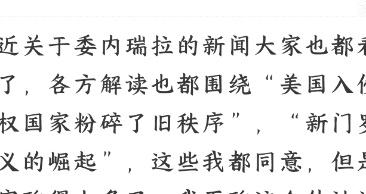

# 委内瑞拉的马杜罗，多少有点自作孽不可活

260104 九边

整理：公众号懒人搜索，[懒人专属群](lazyhelper1) 精选
懒人微信：lazyhelper1

最近关于委内瑞拉的新闻大家也都看到了，各方解读也都围绕“美国入侵主权国家粉碎了旧秩序”，“新门罗主义的崛起”，这些我都同意，但是大家聊得太多了，我再聊这个估计读者也烦了，咱们聊点别的。

对于了解委内瑞拉的小伙伴来说，这次这事这根本不是突发事件，而是一场长达十几年的“慢性自杀”终于走到了终点。这次美军一个突袭就把他带走了，看着是美国厉害，反正我不相信美国能夸张到一支特种部队空降首都，把对方总统给带走了，背后 100% 是马杜罗被自己人卖了。

用孔子的话说，那绝对是“季氏之忧，不在颛臾而在萧墙之内”，这话放马杜罗身上，实在是太精准了。

咱们今天不扯那些虚头巴脑的主义，就单纯从“生意”和“技术”的角度，来复盘一下马杜罗政府是怎么把一手王炸打成烂泥、然后在委内瑞拉变成孤家寡人的。你看懂了这个，就看懂了为什么耶稣来了，都救不了他。

再强调一遍，这篇文章不是说美国做得对，赤裸裸的入侵主权国家无论如何也是错的，但毛主席说，内因永远是决定性的，咱们今天分析下内因（此处加大加黑下划线表示强调）。

委内瑞拉最大的悲剧，就是再很长时间里，不仅老百姓，连统治者都信了一个邪：**只要我们脚下有石油，我们就是大爷**。

大家都知道委内瑞拉石油储量世界第一，比沙特还多。但很多人不知道的是，**石油和石油，是不一样的**。

沙特的油那是“轻质油”，打个井插根管子，那油就跟自来水一样往外喷，那是真正的“流淌的黄金”。

但委内瑞拉的油呢？绝大部分是“超重油”。

那是啥概念？那玩意儿粘稠得像沥青，甚至像这几天的柏油马路。

你要把它弄出来，不是插根管子就行的，你需要注入蒸汽稀释，需要极其复杂的添加剂，需要昂贵的开采设备，弄出来之后还需要极高技术含量的炼油厂进行裂解提炼。

简单说：**沙特卖油是“卖资源”**，**委内瑞拉卖油其实是“卖技术”**。

这就引出了马杜罗政府犯下的第一个，也是最致命的战略错误：**傲慢**。
要把这些像沥青一样的重油变成美元，你需要什么？需要跨国公司的顶尖技术，需要精通石化工程的专家，需要精密的维护体系。

就在过去一二十年里，委内瑞拉搞了一波极激进的“国有化”运动。这个大方向本身咱们不予置评，毕竟谁都想把资源攥在自己手里。但坏就坏在，他们的吃相太难看，手段太粗暴。

他们不仅强行没收了埃克森美孚、康菲石油这些跨国巨头的资产，最愚蠢的是，他们把这些外企里的技术骨干、工程师、管理层，也给清洗掉了。

好了，外资撤了，专家跑了。接管油田的是谁呢？

是马杜罗的亲信，这帮人啥也不会，就会瞎折腾。

这帮人接手后，以为石油是地里长出来的庄稼，不用管它自己就能冒。结果呢？设备坏了没零件修，管道堵了不知道怎么通，炼油厂因为缺乏维护发生爆炸。

你可以各种吹牛逼，但现实不会配合你演戏：委内瑞拉的石油产量，从巅峰时期的每天 300 多万桶，一路暴跌到不足 70 万桶，品质还没法看，谁也不想买。

这就像是你把一家米其林三星餐厅的主厨赶走了，换了个修脚的师傅进厨房，哪怕你冰箱里全是顶级的神户牛肉，最后端出来的也只能是一盘泔水。

**这不是天灾，这是彻头彻尾的人祸。**
是对于工业化、对于专业主义的极度蔑视。

石油产量暴跌，意味着什么？意味着没钱了。

委内瑞拉是一个典型的“单一经济体”，国内除了石油几乎啥都不生产。粮食靠买，甚至连手纸都要靠买。

以前油价高、产量高的时候，政府可以通过撒币来收买人心。大家不用工作，政府发钱发福利，日子过得美滋滋。这种模式培养了巨大的“巨婴心态”。

但当石油这一根支柱断了之后，灾难就来了。

没美元买东西怎么办？印钱！于是我们就看到了人类货币史上的奇观：通货膨胀率百分之几百万。老百姓去买只鸡，得推着一独轮车的钞票。网上经常评价魏玛德国的时候，说当面包卖到 50 万一块的时候，我的枪栓拉的比谁都快。委内瑞拉老百姓如果能吃上 50 万一块的面包估计都偷着乐了。
这时候，马杜罗政府做了什么？他没有去修复生产，而是搞限价，搞配给，甚至派军队去超市盯着不许涨价。结果就是超市老板直接关门，货架空空如也。你都不知道这些年委内瑞拉老百姓怎么过来的，民间跟之前阿根廷似的，全民搞美元结算，如果谁家没有美元，那日子真是苦不堪言，在 21 世纪，坐拥全球最大储油量的国家，老百姓竟然在挨饿。

这就是脆断。一个国家没有任何自身的造血能力，完全依赖外部输血。当输血管(石油收入)被自己的无能切断后，整个社会瞬间崩塌。

当然了，内因确实是根本，但不能否认美国长期的全方位经济制裁 (尤其是切断稀释剂供应、禁止石油出口交易) 是压死骆驼的最后几根稻草。

这次局势突变，很多人惊讶于委内瑞拉军队和高层的“沉默”，甚至是倒戈。反正我是不信美国那么强，一支特种部队就能直接上门把总统带走，我都怀疑是“移交”，也就是已经被控制，移交给美国人了。

这就是所谓的“被带路”。但我认为，这背后有一个更朴素的逻辑：利益链断裂。

任何权力的稳固，都需要利益来维持。马杜罗以前能控制军队，是因为他有钱给军队发高福利，甚至让军方参与石油走私分一杯羹。

但现在呢？石油这头奶牛已经被折腾死了。所谓的“带路”，不过是在给自己找条活路罢了。

那委内瑞拉成这样了，没人帮他们吗？

这也是很多铁铁在后台问我最多的问题：咱们中国是基建狂魔，技术全球顶尖，咱们也缺油，既然马杜罗搞不定技术，咱们为什么不去帮一把？

不是咱们不想帮，是真帮不动，也不敢帮。

首先，咱们是去做生意的，不是去搞慈善的。咱们的石油企业（三桶油）其实在委内瑞拉早就有投资，但亏得那叫一个惨。为什么？因为那里没有“营商环境”。

你想想，咱们的工程师带着技术去了，今天设备刚装好，明天就被当地黑帮偷去卖废铁了；咱们签好了合同，马杜罗政府想改就改，想赖账就赖账；再加上那恐怖的通胀，咱们赚的玻利瓦尔（当地货币）甚至不如擦屁股纸值钱。

基建狂魔确实牛，但基建狂魔需要一个地基，这个地基叫“社会稳定”。

咱们中国这几十年能成事，靠的是什么？靠的是我们有一个稳定的环境，有说话算话的政策，有勤劳肯干的工人。

但马杜罗把这些全毁了。他把整个国家的信用透支光了，把社会秩序搞乱了。在这样一个烂泥潭里，别说是中国，就是神仙来了也得陷进去。

所以，这次咱们的态度非常务实：静观其变。

我们想要的是石油，是一个稳定的能源供应地，而不是一个无底洞。如果马杜罗证明了他没有能力治理好这个国家，没有能力提供一个哪怕是最低限度的安全生产环境，那咱们为什么要拿着纳税人的钱去填那个坑？

## 尾声

委内瑞拉的悲剧，给所有发展中国家都上了一课：

-   第一，专业的事要交给专业的人做，尊重技术，尊重科学，别搞外行指导内行那一套。
-   第二，不要试图用意识形态去对抗经济规律。当你把市场搞死了，把企业搞死了，最后死的一定是你自己。
-   第三，如果中国人来给你们挖矿，这是你们最后的机会，请拿出 100% 诚意来抓住这个机会。

可以说，马杜罗这盘棋，不是输给了美国，也不是输给了反对派，他是输给了自己的傲慢与无能。甚至可以说，被美国带走，然后接受审讯坐牢，可能不是特别坏的结果，我能想出一大堆这类人最后非常非常惨的结局。

其实很多年前，迈克尔·罗斯在《石油诅咒》中指出，委内瑞拉的问题不在于石油本身，而在于国家太依赖石油收入，又缺乏好的制度来管理这笔财富。政府靠卖油赚钱，不用向民众征税，也就少了对人民负责的动力；同时忽视发展其他产业，导致经济非常脆弱。

油价高时大手大脚花钱，油价一跌就陷入危机。再加上把外国石油公司赶走、过度国有化，技术和管理跟不上，石油产量也不断下滑。虽然外部制裁有影响，但罗斯认为，真正让委内瑞拉陷入困境的，是它没能用好石油带来的机会，反而被石油“拖垮”了。

现在的委内瑞拉已经没救了，过去十几年中，跑了 700 万人，一个国家四分之一的人跑了，主要还是年轻人，你们敢想？这种情况下，这个国家还有啥前景？就算马杜罗没了，很长一段时间内都不会有啥起色。

## **最后**，安利小懒的付费群： 懒人专属群（介绍）

这里是你对抗信息过载的护城河。
已稳定运行 6 年，累计拆解、研读 3000+ 个互联网商业实战案例与行业前沿内参和时政/宏观文章。

我们不搬运垃圾，只做高价值信息的筛选器与放大镜。

# 懒人专属群更新记录：

https://hk57gv1x7u.feishu.cn/docx/H0kRdZbSbo1BR0xkaXtcuVE0nTg

## **【免责声明】** 本资料归档于社群内部知识库，仅供成员课题研究与学术交流，请在查阅后 24 小时内删除。