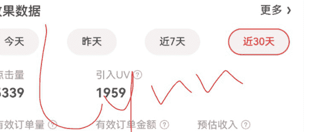
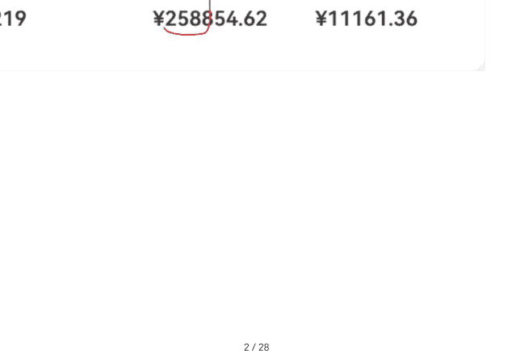
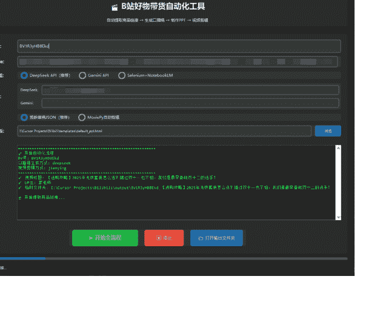

# 从「两块钱」到「五位数商单」，不积跬步，无以至千里

### 260104 副业 SC 精华

公众号懒人搜索，**懒人专属群**独享

懒人微信：lazyhelperl

-- 脚踏实地去赚那看似微不足道的“两块钱”，发自心底地相信“我可以”

## 前言

大家好，我是 Lynn（也可以叫我葱哥），一名 95 后，目前 base 上海。

在很多人眼里，我头上的光环似乎很亮：本科毕业于南京理工大学，硕士就读于悉尼大学。

每天 996 的节奏让我疲于应对工作，剩下的时间就是打游戏、周末出去玩。

隐隐感觉到中年危机，但是却苦苦无法行动起来摆脱现状。

同时也是刚加入生财不到半年的一年级新生：7 月份进入生财有术，8 月份看到 B 站好物深海圈开始招生，当时一位身边的朋友（生财老圈友）推荐，说当年知乎好物很赚钱，B 站好物应该也是类似来钱快的项目，家蒙老师的名气他也知道，所以建议我试试看。

目前也确实 在 B 站好物这个项目上取得了一些小小的成绩，入场 30 天，不接廉价商单，不冒风险投流，几乎零成本，带货 GMV 70w，佣金 2.7w，这个成绩是目前深海圈入场 30 内的双料 topl。

### 天猫双 11

**成交金额**    以下数据统计截至：2025-11-13 11:29:33

¥56,223.92

- 订单明细
- 推广收益
- 奖励活动收益
- 余额流水
- 淘礼金报表
- 商品分析

### 天猫双 11

#### 成交金额
更

以下数据统计截至：2025-11-13 17:21:16

¥ 59,552.71

### 全部订单统计
近 30 日

- 订单明细
- 推广收益
- 奖励活动收益
- 余额流水
- 淘礼金报表
- 商品分析

| 指标 | 数据 |
| :--- | :--- |
| 点击次数 | 227 |
| 付款人数 | 25 |
| 付款金额（元） | 59,552.71 |
| 付款预估收入（元） | 1,027.88 |
| 结算预估收入（元） | 300.37 |
| 有效付款金额（元） | 47,065.71 |
| 有效付款笔数 | 34 |
| 有效付款预估收入（元） | 720.57 |
| 付款笔数 | 40 |
| 平均客单价（元） | 2,382.11 |

数据总览

包含效果数据为 0 的活动

参与活动数量 16

预估奖励金额 ¥656.9

数据总览

包含效果数据为 0 的活动

参与活动数量 10

预估奖励金额 ¥910.6

### 超级补贴效果数据

+ - 今天
- 昨天
- 近 7 天
- **近 30 天**
- 自定义

- **预估活动总收入** ②  ¥496.95
- **预估补贴收入** ② ¥249.12
- **预估佣金收入** ② ¥247.83

- 平台
- GMV
- 订单
- 佣金
- 奖励
- 补贴
- 总收入

**京东**

| 指标 | 数值 |
| :--- | :--- |
| GMV | 589,393.68 |
| 订单 | 484 |
| 佣金 | 23,543.44 |
| 奖励 | 1,567.5 |
| 补贴 | 496.95 |
| 总收入 | 25,607.89 |

**淘宝**

| 指标 | 数值 |
| :--- | :--- |
| GMV | 115,776.63 |
| 订单 | 127 |
| 佣金 | 1,678.00 |
| 奖励 | 0 |
| 补贴 | 0 |

Total

| 指标 | 数值 |
| :--- | :--- |
| GMV | 705,170.31 |
| 订单 | 611 |
| 佣金 | 25,221.44 |
| 奖励 | 1,567.5 |
| 补贴 | 496.95 |
| 总收入 | 27,285.89 |

双十一刚结束的时候，终于有了时间，于是我在深海圈里进行了长达 3 个小时的直播分享，详细介绍了我当前的所有玩法，从选品到文案到 PPT，给大家详细演示了一遍，30 分钟完成剪辑之前的所有流程，颠覆了很多同学对于十几二十分钟长视频制作效率的传统观念。

这里不进行详细的技术讲解，感兴趣的同学可以参考我之前的精华帖：

12 月初的时候，星空大神发了一篇帖子，介绍了当时自己是怎么熬过 3 个月的无反馈期的：

这种心路历程引发了很多人的共鸣，当时桑桑老师在群里问大家都是怎么熬过前期的无反馈期。我说自己当时无反馈。哈哈，这当然是开玩笑。

其实是有一周的（手动狗头）。

虽然我 2 天出单，一周出爆款，但是在前一周的心路历程也并不是一帆风顺的，甚至一开始非常低于预期，所以今天这篇文章，主要就是跟大家聊聊我当时的想法，以及我在这第一个副业项目中的感悟。

职场六年间，我先后在华为、小米、极氪以及某智驾公司担任 AI 图像算法工程师，在外人看来，我就职精英大厂，身处最前沿的技术岗位，拿着百万年薪（这也是深海圈圈友戏称我为百万哥的原因），前途一片光明。但今天，我不想聊那些高深莫测的算法，也不想吹嘘大厂的履历。

我想以一个“跨界创业者”的身份，和大家聊聊一段关于“放下”与“拿起”的心路历程。

这篇文章的主题是：不积跬步，无以至千里。抛开你过去的背景，真正脚踏实地去赚那看似微不足道的“两块钱”，才是通往成功的正道。

## 一、破除精英幻象：在新的领域，你谁也不是

很多时候，阻碍我们进步的往往不是能力，而是那颗眼高手低的心。

### 面对大厂的“感冒”

作为一个 AI 算法工程师，我习惯了处理逻辑、构建模型，内心深处其实潜藏着一种知识分子的清高。今年 8 月报名 B 站好物深海圈时，我的第一反应不是兴奋，而是有些抵触。当我看到手册里要求真人出镜，且不教任何花哨的 AI 自动化玩法时，我甚至动了退出的念头。

因为我的本意是想学自动化和矩阵化，想用 AI 提效，我没有那么多时间手搓模型，别人可能三四天一个长视频，而我可能要花两周才能搓出来一个视频，因为我只有每天晚上 2 个小时的时间，如果两周一个视频，别说挣钱了，连大促节点的汤都赶不上一口热乎的。

（这是我当时和志愿者陈同学的聊天）

当时有点想放弃还有另外一个原因就是我不想露脸，我并不怯场，我甚至每年年年会都是上台唱歌的选手，只是对于这种从没涉足过的领域，有种内省深处的抵触，我想我一个做算法的，难道要去镜头前像个导购一样吆喝吗？那种想做出改变却又畏首畏尾的挣扎，本质上是因为我放不下那个“大厂工程师”的架子。

但我很快意识到：如果我一直背着过去的成绩不放，我将永远无法在新的赛道起跑。无论你过去是总监还是专家，来到一个新领域，你就是一个零基础的新人。而且副业的方式多种多样，不管我是做视频，还是直播，甚至授课，很多时候都需要露脸，所以深思梳理之后，我跟自己达成了一个契约：放下傲慢，起码试着做一个双十一再谈放弃。这种“先下场”的决心，是我打碎“精英幻象”的第一步。

也是迈出的这一步，让我在不露脸不口播的情况下，依然探索出了自己的玩法，并通过不断的迭代和提效，在一个月内将这玩玩法打磨的基本成熟。准确来讲第 1 个视频就开始研究提效，第 3 个视频就开始了半自动化，随后慢慢打磨提示词和尝试新的工具，最后形成了半自动化的 SOP。双十一结束之后也在深海圈内积极分享，于是和陈同学第二次聊天内容就变成了下面这样（深海圈分享前）：

**所以虽然说要战胜自己，迈出第一步，但如果自己有一定的能力的话，还是要学会借助自己本身的优势，可以是技术优势，可以是运营经验，也可以是沟通技巧，任何你有或你擅长的都可以。比如我，当时决定入场后的第一反应是联系有知乎好物经验 + 提前入局的原生（深海圈开课之前就已经凭借自己独创的录屏口播流玩法登上了 B 站带货百万榜）：**

### 二、尊重“微小的正反馈”：熬过那段只有两块钱的时光

很多人做副业失败，是因为他们总想着“毕其功于一计”，看不上小钱。但不积跬步，无以至千里，所有的宏大叙事都是由无数个细小的正反馈堆砌而成的。

这种微小的正反馈对别人来说，可能是曙光，但对我来说，反而是前期最难跨过的心理难关。

### 两块钱的沉默--熬过时薪幻象带来的幻灭感

10 月 7 日的深夜，上海的秋意已浓。此时已是凌晨两点，房间里只有显示器发出的微弱荧光。我刚刚合上电脑，脑海里还残留着剪辑软件中跳动的音频波形。

作为一名 AI 算法工程师，我的生活节奏被 996 的高强度工作填满。每天晚上 22 点下班回家，洗漱完毕坐在电脑前已是 23 点。在接下来的两三个小时里，我必须在极度疲惫中强迫大脑转动：磨文案、选素材、抠剪辑。那种疲劳是穿透骨头的，但我依然坚持迈出了第一步，发布了第一个视频。

两天后的一个午后，我趁着工作间隙打开后台。没有预想中的爆单，映入眼帘的是几笔零星的订单，佣金那一栏赫然写着：“2.00 元”。

那一刻，办公室的喧嚣仿佛瞬间消失，我没有出单的喜悦，反而陷入了长久的沉默。

大家都在说先完成后完美。但当时我就想，就这 2 块钱，完美能有多少？200？2000？

（后来我发现，一个视频做得好，或者出了爆款之后，是可以达到 20000 甚至更高的收益，而且会有源源不断的长尾流量出单，当然这是后话）。

我打开了计算器，算了一笔账，100w / 12（月）/ 21.5（工作日）/ 8（小时）/ 60（分钟）= 8.07¥，每分钟 8 块钱，也就是我敲计算器的这 15 秒，我就已经赚了两块钱。而在这个项目里，为了这两块钱，我付出了整整两个深夜的极度疲惫，放弃了仅有的休息时间。

这种“时薪幻象”带来的落差感几乎是毁灭性的，内心的声音不断拷问：“这样做真的值得吗？这点钱连一分钟的加班费都不够，简直是亏大了。”

但我盯着那两块钱看了很久，心里的另一种声音慢慢升起：这两块钱虽然微薄，但它是我在这个新赛道上迈出的“跬步”。在大厂，我的价值是平台赋予的；而这两块钱，是完全陌生的用户愿意为我的推荐买单的证明，它证明了路径是通的。

心力的磨炼就在这一刻：是看不起小钱而愤然离场，还是尊重这微小的正反馈并持续迭代？我选择了后者，并告诉自己：再坚持几天吧。

一个视频不算什么，既然决定开始了，起码坚持一个完整的双十一周期。

我开始尝试各种策略。为了追求高收益，我曾盲目选择了佣金率极高的耳机支架视频，结果彻底扑街。这给了我一个深刻的教训：不要试图走捷径，更不要自以为是。

我重新回归地气，研究用户痛点，分析流程中耗时最长的点，研究如何用 AI 提效，我试遍了当时市面上主流的、先进的 AI 工具：DeepSeek R1、智谱清言 glm4.6、Qwen3-max、Kimi OK Computer、GPT5、google notebooklm。

最后选取了 google notebooklm 做文案（因为有知识库，不会胡编乱造） + 智谱清言做 PPT（因为有 PPT 模式，审美也还行），将不断的打磨提示词之后，将原本需要 6 小时的流程缩短到 4 小时、3 小时、一直到最后很多人都不敢相信的 0.5 小时。

心力的体现，不在于你在顺境中跑得有多快，而在于你在面对那“两块钱”的微薄反馈时，是否依然愿意为了那一点点进步去复盘、去迭代。每一个巨大的成就，最初都可能只是那几块钱的积累。

### 三、找回掌控感：脚踏实地，让“心力”成为引擎

### 柳暗花明：第三个视频与迟来的破局

真正的转折，发生在 10 月 15 日。那天晚上，我发布了按新思路制作的第三个视频。

没有忐忑不安的频繁刷新，也没有预设的期待，我像完成一个日常任务一样，发布、关电脑、睡觉。第二天，在通勤的地铁上，我像往常一样打开后台。一条新的订单通知静静地躺在那里。我下意识地划掉，但心里那潭沉寂了许久的湖水，似乎被投入了一颗细微的石子。

当晚，当我结束一天的工作，再次查看时，佣金数字已经跳过了 500 元。我盯着屏幕看了好几秒，然后关掉，又打开。数字没变。一种奇异的平静感取代了想象中的狂喜——那不是侥幸心理的兴奋，而是一种“路径通了”的确认。

从那天起，这个视频的数据便稳步攀升，单日佣金再也没有低于过 200 元。更重要的是，它带来了一种稳定、持续、可预期的流量。我忽然理解了什么是“滚雪球”。第一个视频是捏出一个小小的、湿润的雪核；第二个视频是为它裹上新的雪层；而这第三个视频，我终于找到了那个足够长的、坡度正好的雪道，轻轻一推，它自己便开始吸收沿途的冰雪，越滚越大，势能越来越强。

### 掌控感的诞生：从“被流程推着走”到“驾驭流程”

在最初的两周，我是被流程“折磨”的。选题的纠结、文案的枯坐、剪辑的繁琐……每一项都像在泥泞中跋涉，消耗着我本已所剩无几的精力。我的状态是“疲于应付”。

但转折点之后，一切都不同了。核心的改变在于，我从“任务的执行者”变成了“流程的设计者和优化者”。

- **对“时间”的掌控**：我不再觉得“每天 2 小时”是一种令人绝望的匮乏。相反，我把它变成了一个需要精密求解的“效率优化模型”。哪里是瓶颈？剪辑。于是，我把所有能找到的 AI 工具都变成了我的“效率实验室”。深夜的测试不再是负担，而像是我在攻克一个有趣的算法难题。当最终用 NotebookLM+ 智谱清言的组合，将核心流程压缩到 30 分钟时，我获得的是一种巨大的、工程师式的愉悦——我用自己的方式，战胜了时间。
- **对“内容”的掌控**：我不再盲目追逐热点或高佣金。我开始建立自己的“选品逻辑”：从用户真实场景痛点出发，结合产品的差异化和视觉表现力。我也不再追求“全自动”。AI 是帮我提效的副驾驶，但“方向盘”和“审美”必须在我手里。每个视频，我依然会花至少半小时，一帧帧打磨文案的起承转合，寻找最贴合情绪的 BGM，调整每个转场的效果。我知道，爆款从来不是流水线撞大运的产物，而是极致用心的内容与精准时机共振的结果。这种“用心”，是我能完全掌控的部分。
- **对“结果”的掌控**：当第三个视频成功后，我没有停下来庆祝，而是立刻开始复盘：它的标题结构是什么？开头 3 秒抓住了什么痛点？用了什么类型的素材？节奏是怎样的？我将这些“特征向量”提取出来，融入下一个视频的创作中。于是，第四个、第五个视频……数据曲线开始沿着一条昂扬的轨迹向上攀登。到双十一结束时，那条曲线最终定格在"30 天，GMV 70 万 + ，佣金 2.7 万”的坐标点上。这一刻，我感受到的是一种深刻的“确定性”：只要我按照自己验证过的路径，投入足够的心力，结果是可以预期、可以复现的。这不是玄学，这是方法论。

### “心力”：在确定性之上，构建真正的护城河

很多人问我："Lynn，你是因为懂算法才能这么快找到门道吧？”

我的回答是：算法背景，或许帮我更快地理解了平台的“推荐逻辑”；但真正让我拿到结果的，是面对那“两块钱”时没有转身离开的“心力”，是在极度疲惫中依然选择打开电脑迭代工作流的“心力”，是放弃走捷径、坚持打磨每个细节的“心力”。

大厂的履历、光鲜的背景，这些都会随着时间贬值。各种 AI 工具、运营技巧，这些也都会迅速普及和迭代。但你在无数个深夜，为了一个可能无人问津的视频反复较真的那股劲儿；你在看不到即时回报时，依然相信路径并坚持向前的耐性；你把一件小事做到极致、并不断寻求更优解的“心力”——这才是任何人都无法复制、也无法从你身上夺走的、最深的护城河。

工具会迭代，背景会贬值，但你面对困难时的执行力和脚踏实地的韧性和心力，是任何人都抢不走的护城河。

### 最高级的奖赏：自我效能感的回归

最终，当双十一的战报清晰呈现，当我以“双料第一”的成绩在深海圈被大家认识时，我获得的远不止是金钱。

我获得的，是一种久违的、扎实的“掌控感”。在大厂，我的价值被绑定在庞大的系统、复杂的项目和团队的协作中。成功是集体的，焦虑却是个人的。那种“离开了平台你是谁”的隐忧，始终是悬浮在头顶的达摩克利斯之剑。

而在这个从 0 到 1 的副业项目里，每一个订单、每一分佣金、每一次数据的跳动，都清晰地、百分之百地指向我个人的行动：是我的选题，我的文案，我的剪辑，我的坚持。这种“我的双手直接创造了价值”的反馈，强烈而纯粹。

它给了我一种前所未有的“自我效能感”-- 我确信，我可以通过自己的思考和努力，在一个全新的、陌生的领域，独立地解决复杂问题，并取得明确的成果。这种对自身能力的底层信心，是任何一份高薪工作都无法直接给予的、最高级别的心理奖赏。

我不再只是大系统里一颗焦虑的“齿轮”，我成了自己这艘小船的“船长”，亲手绘制航向，亲自感受风浪，也亲眼见证彼岸的抵达。引擎的轰鸣声，来自我内心重新被点燃的、对创造与成长的渴望。我知道，有了这股力量，我将能驶向更远的海域。

### 四、不断上涨的正反馈和信心：多种玩法，放大收益

当双十一的硝烟渐渐散去，我坐在电脑前，看着后台那些依然在缓慢增长的数字，心中涌起的不是满足，而是一种更强的渴望——一套已经被验证的玩法，是否只能用来“赚钱”？它能不能让我变得更“值钱”？

### 从“流量变现”到“价值认可”：第一个五位数的商单

我曾在前面坚定地说“不接廉价商单，不冒风险投流”，这并非清高，而是一种基于精力投产比的冷静计算。在时间极度稀缺的情况下，我必须把每一分钟都用在刀刃上。一个需要反复修改、耗费大量沟通成本、仅能带来几百元收入的商单，其价值远不如我专注做一个具有长尾流量和品牌积累的常规视频。

但规则总有例外，而例外来自于价值的重新定义。

12 月初，我收到了第一条商单询价。对方没有一上来就谈价格，而是详细说明了他关注我的账号已久，欣赏我内容中独特的“理性分析感”和“干净的视觉呈现”，认为这与他们品牌希望传递的“科技美学”调性高度契合。他们想要的不是生硬的广告植入，而是一次基于我个人风格的深度产品解读。

#### 系统性放大：构建收入的“金字塔”

第一个商单的成功，像推开了一扇新世界的大门。它让我开始系统性地思考，如何将“B 站好物”这个项目，从一个“佣金变现”的单点，扩展成一个更稳健的收入结构。

塔基：佣金收入，基本盘。这是我模型的根基。持续用高效 SOP 产出优质内容，获取源源不断的佣金。即便没有商单，这部分收入也能提供安全感和现金流。我继续坚持高客单价、高佣金率的选品策略，确保塔基的每一块砖都足够扎实。

塔身：品牌商单，价值溢出。这是能力的溢价。当你的内容和影响力达到一定阈值，自然会吸引寻求深度合作的品牌。我为自己设立了接单原则：品牌调性契合>产品本身过硬>创作自由度>报价。拒绝成为单纯的广告位，坚持每一次合作都是对个人品牌的一次加持。12 月底锁定的第二笔 4000 元商单，正是这一原则下的再次验证。仅商单收入，就已为“年货节战役”提前锁定了 1.4 万元的收益。

塔尖：知识赋能，经验变现。这是影响力的延伸。在深海圈内的直播分享和精华帖，让我意外地收获了另一种正反馈——帮助他人成功的成就感，以及随之而来的、同行者的真诚认可。这让我开始思考，我那套从“算法思维”演化而来的、极度追求逻辑和效率的副业方法论，或许不仅能做好 B 站好物，也能结构化地提炼出来，未来或许能帮助更多和我一样背景、受困于时间但渴望突破的“跨界者”。这不再只是“赚钱”，而是“创造价值”。

#### 信心是最大的复利：目标的迭代与野心的生长

双十一结束时，我为自己“30 天佣金 2.7 万”的成绩感到欣喜。但仅仅一个多月后，当商单收入、持续增长的佣金以及年货节的预期叠加在一起时，我的月度收益目标已经悄然从“突破 2.7 万”上调至“冲击 5 万”。

这种目标的迭代，并非好高骛远，而是信心在正反馈的滋养下自然生长的结果。当你亲手打通了一个闭环，从 0 到 1 赚到了钱，又从 1 到 10 验证了价值的可扩展性时，你看待世界的视角会彻底改变。你不再怀疑“我能不能”，而是会不断思考“我如何才能更好/更快/更多”。

我不再是那个在凌晨两点，对着两块钱佣金计算“时薪幻象”的迷茫工程师。我成为了一个掌控自己节奏的“跨界创业者”。我依然只有每晚 2 小时，但我现在清楚地知道，这 2 小时可以投入在哪里，能产生怎样的回报。这种对个人时间价值的确信感和掌控感，是比任何账面数字都更珍贵的收获。

## 更进一步

在分享出来玩法之后，部分内容的同质化是在所难免的，同时也一定会侵犯自己的利益，但我还是毫无保留的分享出来了，利他精神是一方面，另一方面就是我也要倒逼自己进一步迭代自己的玩法，0.5 小时的文案+PPT 还不够，2 小时输出完整视频也不够，我想要的是基于我现在主业非常忙的状态下，一键输出视频，这便是我的最终形态，这样我只需要每隔几个小时远程操作电脑点击一下即可。

我也正在为这个目标而努力：

## 五、献给同行者的灯火：抛开借口，即刻启程

如果你还在岸边观望，或者因为自己所谓的“专业不对口”、“没有资源”而犹豫不前，我想把这几句话送给你：
- 1. 给还没开始的人：别怕做不好，先下场。执行力能破解你所有的焦虑，干就完了。你的背景在这一刻并不重要，重要的是你是否迈出了第一步。
- 2. 给快放弃的人：刚开始没有收入是常态。只要你能坚持下去，你就已经 PK 掉了 90% 的人。不要嫌弃那几块钱的收益，那是通往百万目标的必经之路。
- 3. 给追求突破的人：哪怕每天只有 2 小时，只要你锁定目标，微小的光也能聚集成火。关键在于你是否愿意为了那一点点可能性，去付出实实在在的努力。

我很感谢深海圈的圈友和生财团队，是这种连接感给了我最初走出舒适圈的勇气。在这里，你会发现有很多人和你一样，在深夜的灯光下，为了改变命运而默默耕耘。

## 结语

最后我想说：如果把做项目比作深夜在大海中航行。技术和 AI 工具就像是你的船桨和罗盘，它们能让你划得更快、指引方向，但它们无法让你在风暴中坚持下来。真正决定你是否能抵达彼岸、看到日出的，是那颗永不熄火的发动机——也就是你的心力。

不要因为目标远大而感到畏惧，也不要因为起点低微而感到羞耻。只要你内心的引擎还在轰鸣，只要你肯脚踏实地走好每一步，即便最初只有两块钱的微光，也终将照亮通往彼岸的航路。

不积跬步，无以至千里。愿我们都能在平凡的脚步中，走出不平凡的路。

### 关于"从零到 70w+"
30 天 70w+ 2.7w

**最后，安利小懒的付费群：**

**懒人专属群**（介绍）
**公众号**
**懒人搜索**
**懒人专属群**
微软：lazyhelper1

> 这里是你对抗信息过载的护城河。

已稳定运行 6 年，累计拆解、研读 3000+ 个互联网商业实战案例与行业前沿内参和时政/宏观文章。

懒人专属群更新记录：
https://hk57gvIx7u.feishu.cn/docx/H0kRdZbSbolBR0xkaXtcuVE0nTg

【免责声明】本资料归档于社群内部知识库，仅供成员课题研究与学术交流，请在查阅后 24 小时内删除。