# 小红书电商一年多，我的选品、测品、实拍全过程复盘

## 260104 副业 SC 精华

公众号懒人搜索，懒人专属群独享

懒人微信：lazyhelper1

大家好，我是小茗，专注小红书电商领域，目前在生财联合空间

该说不说，生财的风水是真的好（合理猜测亦仁老大找人看过风水💤），我 4 月 27 日进驻联合空间，4 月 29 日数据开始冒头，然后就....一个月零 5 天卖了 100w...

## 详情

审核通过啦～

之前还产生过纠结，马上五一了，过去上个三天班，又放假了

可五一之后去，还要等小半个月，这点时间可做的事情太多了，而且，都自由职业了，哪里还有周末节假日可言

立马开始找房子，加了三个中介轮流帮我找

要么价格不合适，要么房型不合适，要么地理位置不合适

算球，直接拖着箱子去吧，我想杭州肯定不会让我露宿街头 (果然没有让我失望🤓)，昨天一天，搞定!!

#####

从收到通知，上海搬到杭州，到现在坐在工位上一周时间搞定，还是有点执行力在身上的🥺

三个月时间，猛干一波!!🤙

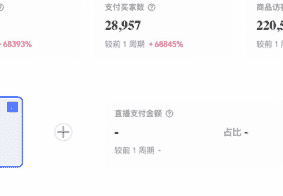

2025 年 4 月 27 日 13:46 杭州市·欧美金...

**经营数据概览 商家经营核心数据汇总**
统计时间：2025-04-28 - 2025-06-02

- 全部
- 主营
- 带货
- **支付金额**：¥1,007,741.90 (较前 1 周期 +70148%)
- **支付订单数**：29,452 (较前 1 周期 +68393%)
- **支付买家数**：28,957 (较前 1 周期 +68845%)
- **商品访客数**：220,578 (较前 1 周期 +41676%)
- **成功**：¥16

- **笔记支付金额**：¥880,395.90 (较前 1 周期 +76197%，占比 87.36%)
- **直播支付金额**：- (占比 -)
- **商家**：¥12 [较前]

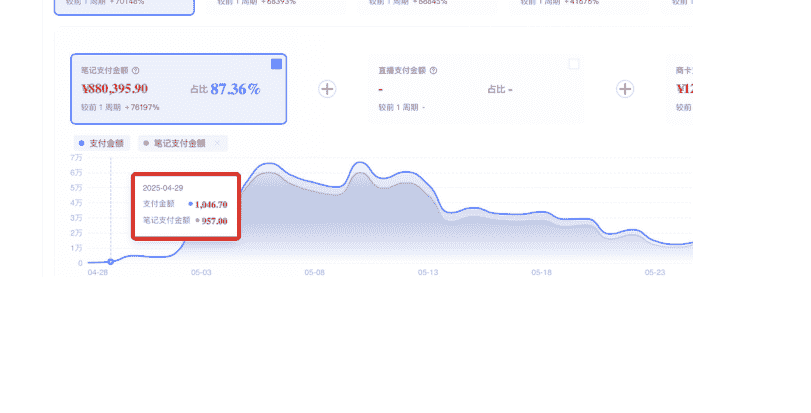

>>> 2025-04-29
>> 支付金额：1,046.70
>> 笔记支付金额：957.00

## 一、打工人成功转型创业者

### 1、卖出 100w 后，惨遭封号

我是一个比较钟情的人，24 年 5 月加入生财，24 年 6 月参加的第一次航海，就是小红书电商，然后就一直做到了现在。

25 年 4 月加入联合空间，然后就爆了 100w。然而，在去年 10 月之前，我还是一个在职场上班的打工人。

人生第一个 100w（虽然不是利润），有点兴奋，原来真的可以赚到这么多；同时又有点不满足，觉得还可以更多。

不过除了赚到钱之外，我觉得更重要的是，卖 100w 的经验和能力，会长在我的身体里，在遇到第二个机会的时候，就能更迅速的抓住。

事实证明，的确如此。

在我卖了 100 个 w 之后，遭遇平台封控，所有的子账号连带店铺号全军覆没，全部遭遇了永封。从单月百万直接归零，高处跌下，大起大落（别说，还真有点刺激）。

然后，我组织一场家庭旅游，带着爸妈去了一趟烟台。一来自己散散心，二来陪陪父母，因为忙起来的时候确实没时间，这次被迫停止，刚好趁这个时间带他们出去，略尽微薄的孝心🙂。

### 小茗你好啊。

第一次带双方父母一起出门

看着鱼总把一切行程安排妥妥当当

突然意识到，不知不觉我们早已成为能抗事的大人

烟台的海风自带幸福感滤镜

是下了车就能感觉到的那种幸福

气温刚刚好，不冷不热

走一段路程就能看见大海

而我，终于也有能力

定下离海边只有 30 米的 190 平大 house

一家人开开心心住在一起

或许，这就是赚钱的意义

回来之后，重整旗鼓，开始起新号，带着之前卖出 100w 的经验和能力，快速通过多账号去打品。

运气比较好，7 月 8 日还在烟台，7 月 19 日新品就开始冒头，半个月又打爆一个品，卖了 50w（大部分营收是在一个半月内实现的）。

### 2、我在联合空间的成长

现在回过头来看，来联合空间，是我今年做的最最最正确的决定，没有之一。

在此之前，我就是自己一个人吭哧吭哧在家干活，偶尔去去书店、咖啡馆，没人交流、没人讨论、没有信息，就像一个离群的孤岛。

我脑海里经常闪现的一个画面，在一片无边无际的大海上，一个孤独的小船在海上漂浮，好像整个世界就只剩下了我一个人，没人告诉我该往哪边走，往哪边走都是对的，往哪边走都是错的。

到了联合空间之后，感受到了浓烈的活人感，大家都是自由职业、创业者，沟通起来特别同频，信息也在不经意间流通着。最关键的是，我打开了对自己想象的上限。搁以前，每个月赚回之前的工资就满足了，现在，周围的人谈论的都是怎么放大，怎么找合伙人，怎么建工作室。

### 那个人为什么不能是我呢？

人是不满足的，当你已经卖出 100w 的时候，能力也已经长上去了，你会想把这 100w 变成利润，只要敢想，就会去寻找路径。

所以在爆单之后，我就找了许老师咨询，如何才能进一步放大

许老师解答：

- 1、小红书店群，把能做的号拉满，自己只做核心业务部分：选品、实拍，其他的都交出去
- 2、想象自己三年后在做什么
- 3、能力拼图：选品能力、实拍能力、店群能力、投流能力、组织管理能力
- 4、直播是另外一项能力，当自己不具备的时候，想要训练出来，也是一个长周期的事情
- 5、要从现在的角色里跳出来，从一个自由职业者，转变成老板
- 6、不懂的业务找人付费咨询，店群肯定是有解法的

也因为许老师知道了我的成绩，生财需要 mini 航海的时候，许老师给子安推荐了我，开启了第一批线下的实操 mini 航海。

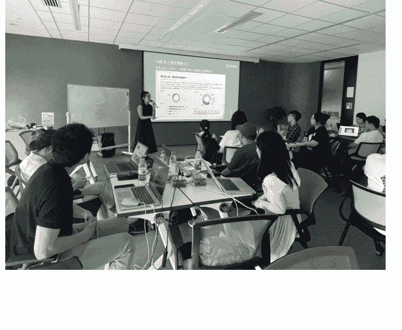

来参加 mini 航海的人当中，有一个夜校的负责人，航海结束后又邀请我去夜校讲课，就这样，我又成为了杭电夜校的讲师。

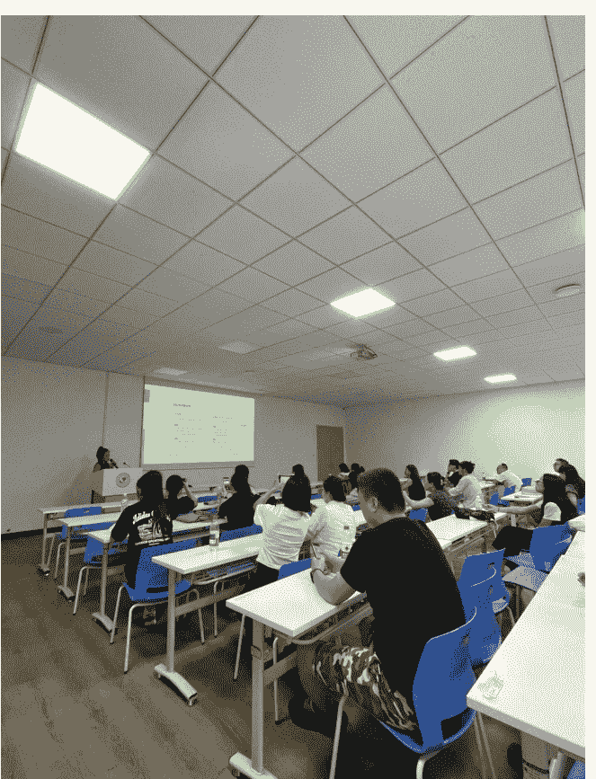

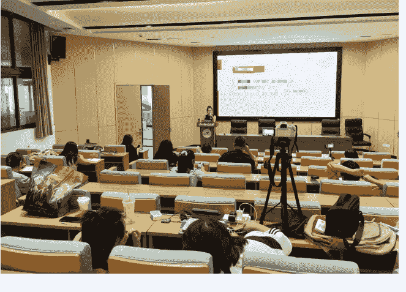

后来，有一次在电梯口遇见了亦仁大大，
聊起了我做的项目和具体情况，刚好符合
生财正在研究的垂直小店，亦仁大大让我
把资料整理一下给他，然后...就在这次的
12 月航海中，被生财官方邀请，成为小红
书垂直小店航海的主教练。（可能这就是
近水楼台先得月[害羞]）

小茗你好啊。

讲了整整两个小时
忘记喝水了，结果嗓子干了😆

不过收到学员的正反馈
还是挺开心的
不枉费熬夜写的 PPT 了

已经在考虑下次直播要不要再加点东西了🤭

教练好，今天的直播太用心了，我是之前学习过小红书实拍电商，而且是付费的，费用还不低，整个交付流程还不如你这一场直播的干货多，所以是真心被感动了，可能没有对比就没有伤害吧，所以感触太深。特来向你道谢，真的是太精彩了😆

感谢教练无私分享

谢谢你哇，我自己也是从小白过来的，也是因为第一次航海之后打开
了我自己的人生可能性，也希望把这些
东西传递给你们

红包就不用了，你加油，期待听到你
爆单的好消息

☺️

加油！！等你好消息!!

现在的我，也不再满足于只当自由职业者的个体，我会想要搞工作室，甚至搞出一个公司

该说 不说，梦想和野心是真的会一步步撑大的

所以，真的很建议大家，不要放弃探索，
要持续不断的下场，把手弄脏，把心沉下来，
认真对待每一次航海，或许就是拧开命运大门的钥匙。

可能不一定第一个航海项目就赚到钱，也可能
尝试了好几个项目都乏善可陈，但做这些项目
的经验和能力，都会长在你的身体里，成为你
日后的养料。

真的，每一步，都算数。

好了，前缀有点长了😊，是时候上点干货了，
那就来吧！！
都是一线实战得来的经验！！保真！！

## 二、小红书电商究竟怎么做

接下来的干货部分，主要从选品、测品、实拍这
三个板块的内容来给大家分享。

### 1、选品原则：近期、低粉、爆款

做小红书电商，最最最重要的，毋庸置疑就是选
品了，选品有很多种方法，但都指向一个原则
“近期、低粉、爆款”

这很好理解，爆品时间越近越好、对标账号权重越低越好、爆款数据越爆越好

#### 账号选品的原则

| 近期 | 时间越近越好 | 24 小时>3 天>7 天内>15 天>30 天 |
| :--- | :--- | :--- |
| 低粉 | 权重越低越好 | 低粉丝号账号>有粉丝无人设账号>有人设账号 100>500>1000>2000>5000 |
| 爆款 | 越爆越好 | 24 小时加购越大越好，笔记点赞越高越好 |

在小红书电商里，有一个很关键的数据指标"24 小时加购”，顾名思义，这个数据的含义是"24 小时内有多少人把这件商品加到了购物车”

24 小时加购数据越高，证明这个品最近热度越高，我们去跟，就有更大的概率能爆起来

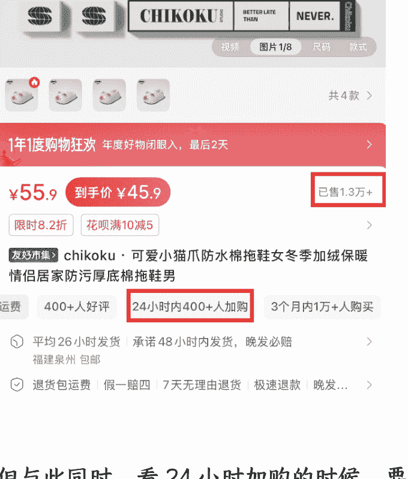

但与此同时，看 24 小时加购的时候，要结合总销量一起来看

一个公式：24 小时加购/总销量，比值越大越好 (因为证明 24 小时内的销量占比高)

一定要注意数据和时间相关性高，比如，今天发布笔记 300 点赞，参考性就比 1 个月前 2000 点赞更高

举例：下面两个产品

- 保暖口罩：24 小时加购/总销量
  = 300/44000 = 0.0068
- 小猫拖鞋：24 小时加购/总销量
  = 400/13000 = 0.0307

就当前数据情况来比较，小猫拖鞋优于保暖口罩

如果只从这两个品里面来选择，那肯定优先测小猫拖鞋

畅快大口呼吸

¥58.8 到手价 ¥35.8

限时 6.5 折

商家券 满 38 减 3

已售 4.4 万+

# 米度狗 · 云羔绒保暖口罩冬天防风防寒女高颜值秋冬季防冻脸 3d 立体男潮款

- 1000+ 人好评 | 24 小时内 300+ 人加购 | 3 个月内 9000+ 人购买
- 平均 22 小时发货 | 承诺 48 小时内发货，晚发必赔 | 退货包运费 | 假一赔四 | 极速退款 | 7 天无理由退货 | 晚发...

已选：【男士加大透气款】奶油白 | 防风...

但选品就这样结束了吗？当然！不是！

当数据调研的样本量不够的时候，是不足以作为决策依据的，可能还有数据更好的，没有被你发现

所以要保持耐心，一定不要止步于此，一定要继续看，继续找，样本量一定要足够大，才能有参考意义

#### 再用两个例子来说明，"24 小时加购”到底该如何判断

A 品，销量 1.8 万单，24 小时加购 300
曾经大爆过，可能前一天几千单，现在
24 小时加购只有 300，那一天销量可能
只有一百、甚至几十，说明该品已经没
落，是之前的爆款笔记在出单

B 品，销量 300 单，24 小时加购 200
当前销量不算多，才 300，但 24 小时加
购就有 200，可能这 200 的销量有三分
之一都是 24 小时内产生的，说明这个品
刚刚爆起来，有热度、有需求

### 2、测品原则：多品轮测

品已经选好的情况下，就可以直接测品
了，那测品的一个核心原则就是：多品轮测

简单来说，就是 A 品、B 品同时测，根据
数据反馈（小眼睛、出单数）来决定留下
谁、淘汰谁

**独立。**

比如：

- 1、A 品，基础小眼睛 50-100，每天出 1 单；
- 2、B 品，基础小眼睛 50 以下，每两三天出 1 单

这时候，留下 A 品，淘汰 B 品，再引入一个 C 品

接下来，A 品、C 品同时测，如此轮测

切忌浅尝辄止，切忌钻牛角尖，不要一个品只发了 20 篇笔记，就草草收场；也不要一个品怼了 500 篇笔记，数据不行还是死磕

### 3、高效实拍

一个账号在你做好所有细节的情况下，依旧存在不确定性。细节又包含了封面、标题、内容、评论区、素材、剪辑、价格、时间等等。

没有绝对的胜负，只有概率的大小，所以我们需要用"用数量抵抗概率”。

当品确定之后，接下来就是模仿对标实拍了。

前面提到“用数量抵抗概率”，那就是我们每天要发更多的笔记数量，也意味着我们需要实拍的素材量非常大。

如何才能做到高效实拍？那一定是前期准备的够充分

分三步走

#### 第 1 步：搭建素材库

前期准备的更充分，拍摄的时候就能更高效

**推荐大家用 Eagle 积累素材库（30 天免费试用，后续需要付费），下载地址：**
https://cn.eagle.cool

Eagle 可以通过建不同的文件夹区分不同素材库，下载浏览器拓展之后，可以直接拖进来，非常方便

**文件夹的设置逻辑：店铺类目→封面/内图→场景分类**

需要注意的是，场景分类需要根据你的产品，针对当前对标所有的场景类型来划分比如下图的杯子店，对标拍摄的场景有：手握、车内、室内、俯拍细节、杯盖揭开如果是卖裤子的，场景分类可能就有：背影、正面、高铁、商场、俯拍、材质细节

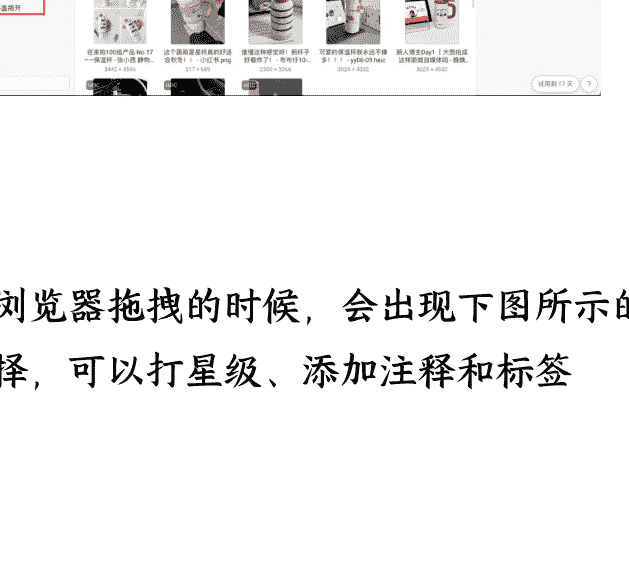

从浏览器拖拽的时候，会出现下图所示的选择，可以打星级、添加注释和标签

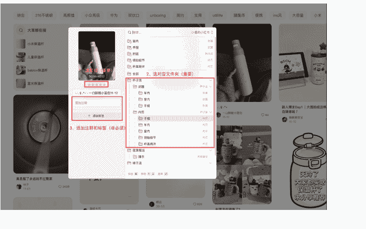

这样做的好处是，可以根据自己的拍摄计划，搜索今天要拍的图，有哪些场景，做到心里门清

比如：我今天的拍摄计划是车里，就可以搜索对应的标签

清楚这个车里这个场景，有哪些角度和构图，应该怎么拍

根据之前的评级，来决定拍摄的优先级，先模仿哪个模板，重要的模板一定优先完成

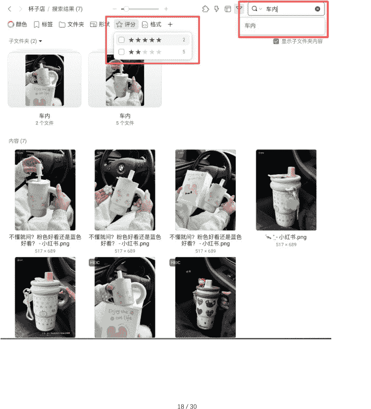

#### 标签的设置逻辑：

- 产品名、时间、场景、角度...值得总结的一切

**比如：**

- 产品名：#西瓜、#月子袜、#红墨镜、#白色工装裤
- 时间：#7 月、#8 月
- 场景：#咖啡馆、#写字楼、#办公室、#家居

**星级设置参考（可以根据各自产品特性设置）**

**素材类爆款：**

- 1 星：10 赞左右
- 2 星：20 赞 -150 赞
- 3 星：200 赞 -500 赞
- 4 星：500 赞 -1500 赞
- 5 星：2000 赞以上

设置需参考对标账号低粉高粉情况

Ps：建议在拖拽保存时就评好分，避免回头检查增加工作量

经过上述一系列的素材库积累

一来能看到爆款素材的共性，什么场景拍的、什么构图、什么道具、什么光线等等，心里门清，后续在拍摄的时候，就知道自己该怎么拍

二来拍摄的时候，可以直接打开 Eagle，
照着对标一比一模仿来拍，因为前面标注
好了优先级，心里清楚了哪些模板要优先
拍，有轻重缓急

#### 拆爆款对标

多大程度能看懂对标，就有多大程度能还
原

##### 第一阶段：看山是山（1:1 模仿爆款）

- 1. 场景：车内副驾
- 2. 穿搭：棕色毛衣、深色牛仔裤
- 3. 姿势：右手拿保温杯，毛衣袖口在大拇
  指第二个关节处
- 4. 光线：左前测光（观察高光阴影的方向），有拉低曝光
- 5. 构图：产品在画面中心偏下，占据两个
  格子
- 6. 镜头：需测试，目测 1,2-1,5 倍
- 7. 后期：增加了小熊、爱心贴纸
- 8. 其他细节：车门切到车窗按钮位置

##### 第二阶段：看山不是山（理解爆款）

第一阶段从很多维度拆解了一张爆款，到第二个阶段，我们需要知道为什么是这个场景？为什么是这个穿搭？为什么手势要这样拿？为什么要这么构图？

- 1. 场景：车内副驾【品质感高级感，有钱人都在用的杯子】
- 2. 穿搭：棕色毛衣、深色牛仔裤【和车内色调一致，画面和谐】
- 3. 姿势：右手拿保温杯，毛衣袖口在大拇指第二个关节处【氛围感】
- 4. 光线：左前测光，有拉低曝光【画面干净的质感】
- 5. 构图：产品在画面中心偏下，占据两个格子【突出产品】
- 6. 镜头：需测试，目测 1,2-1,5 倍【可固定】
- 7. 后期：增加了小熊、爱心贴纸【增加可爱氛围】

**第三阶段：看山还是山**（创造爆款）

当我们理解了爆款之所以为爆款的原因，就可以学会场景迁移，要素不变变产品。

比如，上图在车内副驾拍保温杯，同样的场景和要素，还可以拍手串、鞋子、裤子、玩偶、包包、化妆品、香水、手机壳等等等等。

副驾场景拍完了，我还可以拍主驾场景，任何一个产品，都可以任意组合。

- 产品：保温杯、包挂、首饰、包包、裤子、鞋子、手机壳
- ×
- 搭配：衣服、裤子、香薰、车饰、副驾、主驾

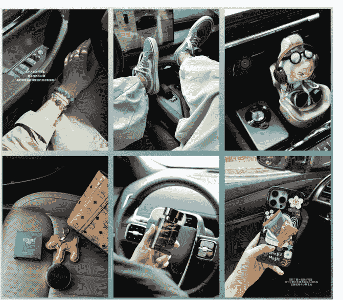

#### 批量化拍摄

小红书红海选品拼的是如何在单位时间内生产更多有效素材，只有这样，才能做出比别人更有结果的事情。

所以，我们一般每周抽 1-2 天，把这一周需要用到的素材全部拍完，而不是每天都找对标、拍摄、制作笔记、发笔记，一定要流水线化，才能提高效率。

用案例来说如何批量化

# 新杯图透👀小奶杯家族新成员➕1!

大家要的没有吸管但是有分享杯盖的保温杯要来咯
配色很萌的小奶瓶，秋冬用来喝热饮太适合咯！
双饮 +316L 内胆，高颜值便携~

# **新杯图透👀小奶杯家族新成员➕1**！

大家要的没有吸管但是有分享杯盖的保温杯要来咯
配色很萌的小奶瓶，秋冬用来喝热饮太适合咯！
双饮 +316L 内胆，高颜值便携～

- 画面元素为：两个保温杯、两杯咖啡，保温杯可以盖上，也可以打开，背景为金属收银台桌面
- 如果保温杯有 10 个颜色，一组拍完可以换不同颜色的杯子
- 咖啡也可以换成星巴克、喜茶、manner、霸王茶姬，又可以拍一组
- 拍摄的时候，角度也可以略微调整，左一点、右一点、上一点、下一点
- 还可以调整为一个保温杯 + 一杯咖啡的组合，每个颜色和不同的咖啡又可以有多种组合
- 上面同样的构图和组合，换个背景，比如木质桌面上，又可以拍一整套

**OLO HOLOHOLO.Life**
关注

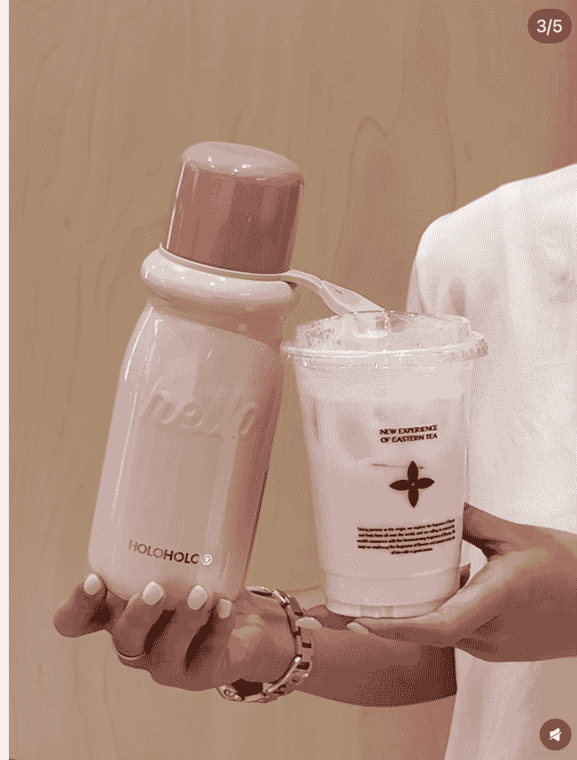

新杯图透👀小奶杯家族新成员➕1！

大家要的没有吸管但是有分享杯盖的保温杯要来咯
配色很萌的小奶瓶，秋冬用来喝热饮太适合咯！
双饮 +316L 内胆，高颜值便携～

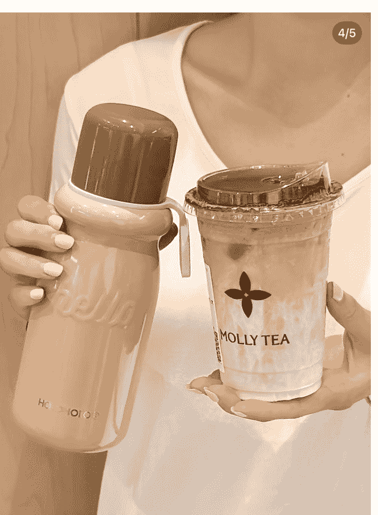

## 新杯图透👀小奶杯家族新成员➕1！

大家要的没有吸管但是有分享杯盖的保温杯要来咯
配色很萌的小奶瓶，秋冬用来喝热饮太适合咯！

双饮+316L 内胆，高颜值便携～

画面元素为：保温杯、咖啡、人、T 恤、木质背景墙面

- 10 个颜色的保温杯，和不同的咖啡、饮料组合，就可以拍出很多组图
- 人物在画面中的比例，可以多也可以少
- 人身上的 T 恤换成不同颜色，又可以再来一组

相同的构图和组合，换成大理石背景、窗帘背景、不同的木质背景，又可以拍一整套

需要注意的是，小红书现在对同质化的管控要求越来越严格，所以在拍摄的时候，同一场景下不能拍摄过多，尽可能变换不同的场景来拍。

## 三、未来的底气

回看这一年多，从那个职场打工人，还是一个下行的地产行业的打工人，到如今敢于谈论工作室、谈论未来的创业者。

我最大的收获，不是账户上的数字，而是那层被撑大的认知边界。

我知道生财有很多圈友，主业可能也面临各种各样的情况，也都想通过搞副业赚点钱，其实说到底，我们想要获得的是未来的底气。

亦仁大大说过一句话：“一个人独自面对商业世界赚钱的能力，才是一个人最大的底气。”

小红书电商或许有红利期，具体的玩法或许会过时，但这种“在废墟中重建”、“在下行周期里上行”的生命力，会伴随我们一生。

把手弄脏，把心沉下来。

愿你我不仅拥有在这个商业世界生存的铠甲，更拥有那颗永远热泪盈眶、永远敢于重塑自我的心脏。

这种底气，谁也拿不走。

最后，安利小懒的付费群：

- 懒人专属群（介绍）

微信：lazyhelper1

这里是你对抗信息过载的护城河。

已稳定运行 6 年，累计拆解、研读 3000+ 个互联网商业实战案例与行业前沿内参和时政/宏观文章。

我们不搬运垃圾，只做高价值信息的筛选器与放大镜。

### 懒人专属群更新记录:

https://hk57gvIx7u.feishu.cn/docx/H0kRdZbSb0lBR0xkaXtcuVE0nTg

【免责声明】本资料归档于社群内部知识库，仅供成员课题研究与学术交流，请在查阅后 24 小时内删除。