# 小红书虚拟类赛道实拍打法 | 年净赚 150 万核心选品运营方法复盘

## 260104 副业 SC 精华

公众号懒人搜索，懒人专属群独享

懒人微信：lazyhelper1

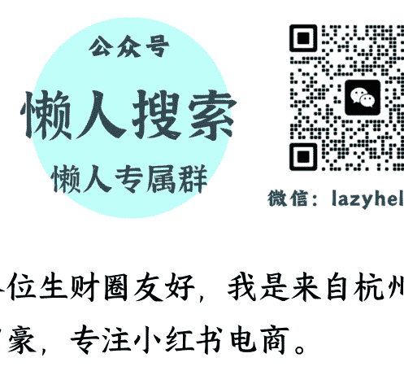

各位生财圈友好，我是来自杭州的航海家书豪，专注小红书电商。

很感谢生财有术这个平台，帮助我在电商创业之路上学习了很多东西，也想把最近的一些实战经验分享给大家。

很幸运，创业 6 年，公司还活着，个人也保持了连续 6 年收入突破百万。

作为生财早期成员，我还有幸获得了亦仁老师的微天使投资支持，这份认可一直激励着我在创业路上不断突破，也推动我不断探索电商新模式。

相信很多圈友都了解我的小红书电商经历，过去 3 年里，我运营了 30 家小红书店铺，通过内容带货实现了千万级营收。但电商人都明白，依赖混剪内容带货始终存在不确定性——平台政策调整、流量算法变化，任何一个因素都可能打乱节奏。

作为公司的创始人，我们从去年开始，我们把重心转向了确定性更强的虚拟产品赛道。

今天重点给大家分享一下选品，做小红书虚拟资料这一行，我见过太多人栽在同一个坑里——闷头做产品，不看市场风向。

很多人花大量时间打磨内容、优化详情页、研究爆款文案，却忽略了最本质的问题：

你做的这个品，真的有人要吗？是不是已经被市场验证过？

说实话，我们团队能在虚拟资料赛道持续出爆品，靠的不是比别人更努力，而是比别人更会选品。

今天这些分享，我会把我们团队沉淀下来的选品方法论完整分享出来。不讲虚的，全是实操经验，希望能帮到正在做虚拟资料的你。

虚拟资料的本质是"卖时机"，打仗嘛，就最重要的是时间点的切入，时机代表需求的爆发！

很多人把虚拟资料理解成"卖内容"，其实不完全对。

虚拟资料的本质是卖解决方案，而且是特定时间节点下的解决方案。

什么意思？

你想想，一个大四学生，什么时候会疯狂搜索"秋招信息汇总"？——9 月前后。

一个备考公务员的人，什么时候会搜"申论规范词"？——省考、国考报名前后。

**一个考研党，什么时候会搜“考研英语作文模板”？——11 月到 12 月冲刺期。**

**虚拟资料的需求是周期性的、有时效性的。**

**这意味着，你选对了品但错过了时机，也白搭。你踩准了时机但选错了品，更白搭。**

**所以选品的核心不是“什么内容好”，而是“什么内容 + 什么时间 = 爆发”。**

## 选品决定流量天花板

**小红书的流量分发逻辑，本质上是内容匹配需求。**

**当平台检测到某类关键词的搜索量在上升，就会把相关内容推给更多人。**

如果你的笔记刚好卡在这个需求上升期，平台会认为你的内容"有价值"，给你更多曝光。

反过来，如果你做的是个冷门品类、或者是一个需求已经过了高峰期的品类，就算你的内容再好，流量天花板也很低。

选品选对了，你是顺风划船。选品选错了，你是逆风拉纤。

## 虚拟资料的竞争格局

说一个残酷的现实：虚拟资料赛道的竞争，本质上是时间差的竞争。

因为虚拟资料的复制成本极低，一旦某个品类被验证跑通，马上会有大量竞争者涌入。

你比别人早一个月发现机会，可能吃到最肥的红利。你比别人晚一个月入场，可能只能喝点汤。

你比别人晚三个月入场，可能连汤都没有。

选品选不好，本质是时间点没切入对，错过时机，吃屎都赶不上热乎的。所以选品的关键不是"选对"，而是"选对 + 选早"。

## 一、内部销量监控工具选品

我们花了十几万块钱，专门开发了一个内部的选品工具，也就是我们公司内部团队协作有一套销量监控工具，传统的选品方法我们需要将各种数据记录到文档里面，而且需要每天盯数据，时间久了我们也会忘记，效率非常低效，我们团队也一直在用 AI 和各类自动化工具对我们业务进行效率提升。

| 序号 | 当日监控状态 | 网盘链接 | 赛道 | 商品名字 | 商品链接 | 店铺名称 | 粉丝量 | 销量 | 商品价格 |
| :--- | :--- | :--- | :--- | :--- | :--- | :--- | :--- | :--- | :--- |
| 1 | 监控完成 | 等待补充 | 中小学 | 幼儿 | 403 抖音大挑战 54 条 PDF 电子版...实物... | 链接 | 嘉喜全科商量的店 | 8102 | ["20250911":, "3"... | 3.8 |
| 2 | 监控完成 | 等待补充 | 中小学 | 幼儿 | 005 图拟家粉·数字启蒙 LUt 音频... | 链接 | 艰难的店 | 10000 | ["20250911":, "3"... | 5.8 |
| 3 | 监控完成 | 等待补充 | 中小学 | 1-6 年级语文/数学/英语知识点] 高考晚... | 链接 | 是外面的妈妈的店 | 64000 | ["20250911":, "1"... | 3.8 |
| 4 | 监控完成 | 等待补充 | 考试 | 考公 | 26 套高考分析公式默写。通案。题型识别... | 链接 | 美是我们要的店 | 1030 | ["20250911":, "3"... | 3.9 |
| 5 | 监控完成 | 等待补充 | 考试 | 软件 | 公考 8 口元 2026 年行政类理论图软件 APP... | 链接 | 苹果的店 | 874 | ["20250911":, "5"... | 9.9 |
| 6 | 监控完成 | 等待补充 | 考试 | | 25 国省考考试真题答案解析历年真题... | 链接 | 上半年的愿行的店 | 903 | ["20250911":, "3"... | 3.99 |
| 7 | 监控完成 | 等待补充 | 考试 | 公考政治理论时政热点图面霜 app 公务员事... | 链接 | Lucky 宇宙学习... | 857 | ["20250911":, "1"... | 15.9 |
| 8 | 监控完成 | 等待补充 | 幼儿 | 中小学 | PPT | 50 款课前小游戏 ppt 电子版 (如下... | 链接 | 恩贝 Nice 的店 | 4038 | ["20250911":, "1"... | 14.8 |
| 9 | 监控完成 | 等待补充 | 幼儿 | PPT | 30 多款课堂互动趣味游戏 PPT 课件...(稍... | 链接 | 小方老师。的店 | 49000 | ["20250911":, "1"... | 88 |
| 10 | 监控完成 | 等待补充 | 英语 | 幼儿 | PPT | 46 款课前小游戏些课件 (如下各... | 链接 | 小布老师。的店 | 14000 | ["20250911":, "2"... | 19.9 |

## ### 我们的选品方法论——数据增长的趋势捕捉爆品

用数据预判，而不是用感觉猜测。

很多人选品靠的是“感觉”——觉得这个品应该能火，觉得那个品市场大。

我们不这么干。

我们团队有一套内部的爆品监控工具，专门用来追踪各品类的销量变化趋势。

我们不看绝对销量，我们看增速。

为什么？

因为绝对销量高的品类，往往已经是红海了，竞争激烈，新人很难切入。

而增速快的品类，说明需求正在起来，但市场还没反应过来，这才是真正的机会窗口。

## ### 核心指标—销量增速趋势

### 实战案例一：秋招求职信息表——抓住黄金窗口期

这个品我们团队因为内容的整理，是在 8 月份开始做的，略微晚了一个月，但是也打爆了。

### 总览

| 商品 | 流量 | 内容 | 店铺 | 服务 | 市场 |
| :--- | :--- | :--- | :--- | :--- | :--- |
| **经营概览更新时间** | 21:29:19 | 全部 > | | | |
| 实时 | 近 1 日 | 近 7 日 | 近 30 日 | | |
| **支付金额** | ¥502.6 | 昨日 289.0 | | | |
| **笔记** | ¥194.9 | 昨日 158.4 | | | |
| **直播** | ¥0.0 | 昨日 0.0 | | | |
| **商卡** | ¥307.7 | 昨日 130.6 | | | |
| **支付订单数** | 53 | 昨日 30 | | | |
| **支付买家数** | 52 | 昨日 30 | | | |
| **商品访客数** | 646 | 昨日 385 | | | |

### 热销商品
| 商品名称 | 支付金额 | 商品访客数 |
| :--- | :--- | :--- |
| 26 届实习/秋招/春招公司招聘信息... | ¥494.90 | 640 |

### 经营数据概况：商家经营核心数据汇总 统计时间:2025-07-01 至 2025-09-30

| 维度 | 近 1 日 | 近 7 日 | 近 30 日 | 转/归属 |
| :--- | :--- | :--- | :--- | :--- |
| 核心数据指标 | 全部 | 自营 | 带货 | |
| **支付金额** | ¥62,488.32 | 数据下滑 • | 数据下滑 • | 数据下滑 • |
| **支付订单数** | 6,260 | 数据下滑 • | 数据下滑 • | 数据下滑 • |
| **支付买家数** | 6,207 | 数据下滑 • | 数据下滑 • | 数据下滑 • |
| **商品访客数** | 32,229 | 数据下滑 • | 数据下滑 • | 数据下滑 • |
| **成功店铺金额** | ¥701.30 | 数据下滑 • | 数据下滑 • | 数据下滑 • |
| **支付转化率** | 19.26% | 数据下滑 • | 数据下滑 • | 数据下滑 • |
| **笔记支付金额** | ¥52,465.18 | 占比 83.96% | 数据下滑 | + |
| **直播支付金额** | ¥6.90 | 占比 0.01% | 数据下滑 | + |
| **商卡支付金额** | ¥10,016.24 | 占比 16.03% | 数据下滑 | 数据下滑 |

### 多账号销量数据监控

9/69

**26 秋招岗位表**（一直更新一年短信发

−−−订阅...−−上架时间：请手动记录−−粉丝量:10000−−价格:59.9

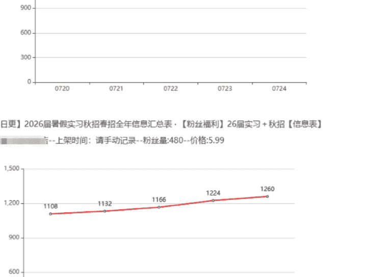

【日更】2026 届暑假实习秋招春招全年信息汇总表 •【粉丝福利】26 届实习 + 秋招【信息表】

−−−订阅...−−上架时间：请手动记录−−粉丝量:480−−价格:5.99

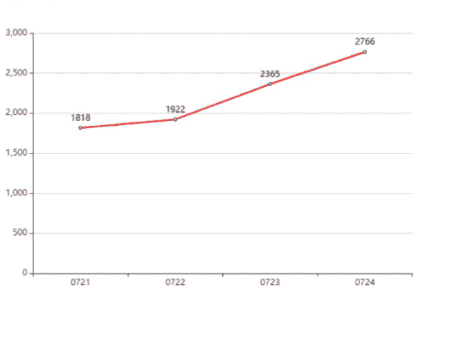

(每天更新！)26 届暑假实习/秋招/春招公司信息网申表，自动秒发

...店−−上架时间：请手动记录−−粉丝量:2226−−价格:9.9

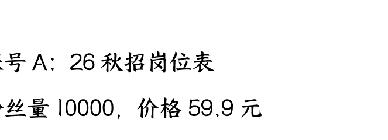

先看我们 7 月份监控到的三组真实数据。

## 数据拆解

**账号 A：**26 秋招岗位表

**粉丝量**10000，**价格**59.9 元

## ### 账号数据详情

7 月 20 日→7 月 24 日：1789 单→1950 单
5 天净增 161 单，日均 32 单，客单价高

## 账号 B：2026 届暑假实习秋招春招全年信息汇总表

**粉丝量仅** 480，**价格** 5.99 元

7 月 20 日→7 月 24 日：1108 单→1260 单

5 天净增 152 单，小账号也能稳定出单

## 账号 C：26 届暑假实习/秋招/春招公司信息网申报表

**粉丝量** 2226，**价格** 9.9 元

7 月 21 日→7 月 24 日：1818 单→2766 单

4 天净增 948 单，日均 237 单，增速最猛

## 这组数据背后的选品逻辑

第一，多账号交叉验证，确认趋势真实性。

我们同时监控了多个做「求职信息表」的账号，发现不管是万粉大号还是几百粉小号，不管是定价 5.99 还是 59.9，都在同步增长。

这说明增长不是某个账号的个别现象，而是整个品种的需求在起来。一个账号涨是偶然，多个账号都涨就是趋势。

## ### 第二，抓住了"双重需求"的叠加窗口

这个品最妙的地方在于，它的关键词不只是"秋招"，还有"实习"。

六七月份，秋招其实还没正式开始，但暑期实习的需求已经很旺了。

大三学生：在找暑期实习

大二学生：在找日常实习

大四学生：在提前准备秋招

甚至大一、准大学生：也在关注实习信息

一份资料，同时覆盖"实习"和"秋招"两个需求，用户群体直接翻倍。

这就是为什么我们看到账号 C 的标题写的是"暑假实习/秋招/春招"——它把所有相关需求都打包了。

## ### 第三，五六月是最佳入场时机

很多人觉得秋招资料应该 8、9 月份才开始做，其实已经晚了。

看数据就知道，7 月份这个品类就已经在放量了。因为：

6 月：大学生开始放暑假，有时间研究实习/秋招

7 和 8 月：暑期实习高峰期，秋招预热期

9 月：秋招正式启动，竞争开始白热化

6 月入场，你吃到的是"实习 + 秋招预热"的双重红利，而且竞争还没那么激烈。

等到 9 月份大家都反应过来了，市场早就卷起来了。

## 我们的实操打法

确认趋势后，我们迅速行动：

### 第一步：确定产品形态

我们选择用飞书多维表格来做这个品。

为什么？因为求职信息表的核心价值是"信息全 + 更新快"。飞书多维表格支持在线更新、多维度筛选，用户体验比 PDF 好太多，也是我们的差异化卖点。

### 第二步：内容结构设计

我们的信息表覆盖：

- 暑期实习信息（打六七月的流量）

- 秋招信息（打八九月的流量）

- 春招信息（打来年的长尾流量）

- 按行业分类：互联网、金融、快消、地产、四大、国企央企......

- 每条信息包含：公司名称、岗位、网申链接、截止时间、薪资范围等。

### 第三步：内容发布节奏

- 6-7 月：主打"暑期实习"关键词

- 8-9 月：主打"秋招"关键词

来年 2-3 月：主打“春招”关键词

同一份资料，换不同的关键词和封面，打不同阶段的流量。

## 这个案例的核心启示

## 选品要看“需求叠加”

单一需求的品类天花板有限，但如果一个产品能同时满足多个相关需求，用户基数就会大很多。“实习+ 秋招 + 春招”就是典型的需求叠加。

## 入场时机要“提前布局”

不要等需求爆发了才入场，要在需求起势的早期就进去。7 月布局秋招，看起来早了，但其实刚刚好。

## 产品形态要有差异化

同样是求职信息表，PDF 是基础款，飞书多维表格就是升级款。能在线更新、能筛选、能协作，用户愿意为更好的体验付费。

## 用户覆盖要够广

这个品能打的用户群体非常广：高三准大学生、大一到大四、甚至研究生。用户基数大，流量天花板就高。

总结一句话：好的选品，是在对的时间，用对的产品形态，打中尽可能多的目标用户。

## 实战案例二：国考申论规范词

这个品我们是拿多账号去打的，多账号全面爆单开花。

## # 经营概览

近 1 日 | 近 7 日 | 近 30 日 | 自然日 | 自然周 | 自然月

### 交易构成 2025-11-01~2025-11-30

+ 全部
自营
带货

- **支付金额**
  - `**2.0 万**`
  - 上周期 +48.18%

- **笔记**
  - 1.8 万
  - 上周期 +52.70%

- **直播**
  - 上周期 -

- **商卡**
  - ¥1,055.9
  - 上周期 -2.41%

- **支付订单数**
  - **3,589**
  - 上周期 +58.04%

- **支付买家数**
  - **3,546**
  - 上周期 +60.02%

- **商品访客数**
  - **1.6 万**
  - 上周期 +27.81%


2025-02 ... 2025-10

### 人群构成 2025-11-01~2025-11-30

+ 首购周期
180 天
365 天

**首购用户金额**
- `**¥18,810.96**`
- 96.24%
- 较前 1 月 +43.79%

**首购用户数**
- **3,416**
- 较前 1 月 +55.56%

| 全部自营账号 | | 11,985 | 1,734 | 823 | 549 |
| :--- | :--- | :--- | :--- | :--- | :--- |
| **核心数据** | | | | | |
| **30,734.34** | 5,559 | 5.46% | 14.83% | 686,546 |
| **18,658** | 4.22% | 9,765 | 0 | |

### 多账号销量数据监控

给大家看一组我们内部监控到的真实数据

这是我们在 11 月初监控到的两个做「申论规范词」的账号销量走势。

先看左边这个账号：

粉丝量只有 332，价格 3.8 元

11 月 1 日销量 1936 单，11 月 9 日涨到 3228 单

9 天净增 1292 单，日均出单 143 单

再看右边这个账号：

粉丝量 21000，价格 28.88 元

10 月 31 日销量 2267 单，11 月 9 日涨到 3636 单

10 天净增 1369 单，日均出单 137 单

除了上面 2 个号，最早我们 9 月份已经开始监控了，已经有账号都开始跑起来了

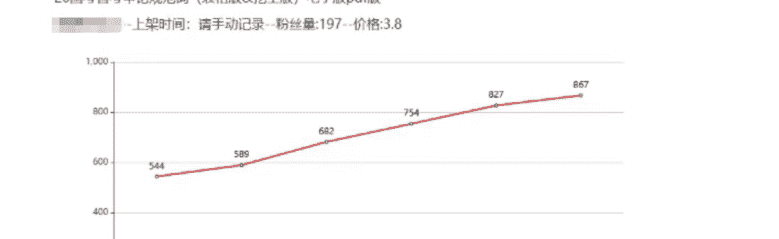

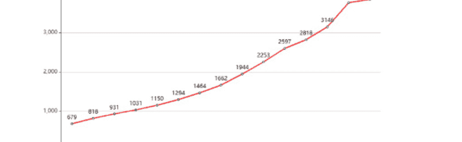

## ### 数据验证下的选品定品逻辑

第一，增长曲线非常健康。

两个账号的销量都呈现稳定上扬的趋势，不是那种突然爆一下就没了的"脉冲式增长"，而是持续、稳定地往上走。这说明需求是真实存在的，而且在持续放大。

第二，大小账号都在涨。

左边账号才 332 粉丝，右边账号 21000 粉丝，体量差了 60 多倍，但都在增长。这说明什么？说明这个品类的增长不是靠粉丝量带起来的，而是整个市场需求在起来。具有普适性，不是个例。

第三，高价低价都能卖。

3.8 元的能卖，28.88 元的也能卖。说明用户对这个品类的付费意愿强，价格敏感度没那么高，利润空间可观。

当我们同时监控到多个账号、不同粉丝量级、不同价格带都呈现出类似的增长趋势时，基本可以确认：这是一个正在起势的品类，而且窗口期还在。并且结合国考考试时间，于是我们迅速跟进，整理了一份结构化的申论规范词资料，从政治、经济、文化、社会、生态五大维度分类整理，配上使用场景和例句。

结果：上架第一周就开始稳定出单，后续持续放量，成为我们考公产品线的一个核心爆品。

## ### 交叉验证

选品不能只看一个账号，要交叉验证。

当你发现多个账号、不同体量、不同价格都在同一个品类上增长时，这个信号的可信度就非常高了。

一个账号涨，可能是偶然。多个账号都在涨，那就是趋势。

### 实战案例三：考研英语作文模板，一个月打爆单品

这个品是我们最近打爆的一个大爆款品，不到一个月的时间，单品打爆，一个品赚 10 万 +

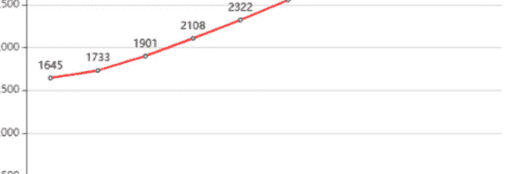

### 多账号销量数据监控

这个品我们最早 10 月 31 日开始监控了一个卖考研作文模版的目标账号，监控了 10 天后，每天的销量增长速度非常厉害，而且也很稳定


## 数据复盘

"**监控对象**：2026 考研英语作文专用模板+英语真题卷

**粉丝量**：2948（中小账号）

**价格**：9.9 元

**监控周期**：10 月 31 日→11 月 9 日（共 10 天）

**销量变化**：

- 10/31: 1645 单
- 11/01: 1733 单（+88）
- 11/02: 1901 单（+168）
- 11/03: 2108 单（+207）
- 11/04: 2322 单（+214）
- 11/05: 2555 单（+233）
- 11/06: 2782 单（+227）
- 11/07: 3013 单（+231）
- 11/08: 3272 单（+259）
- 11/09: 3460 单（+188）

10 天净增 1815 单，日均出单 181 单。"

## 这组数据为什么让我们果断入场？

第一，增长曲线极其健康。

你仔细看这条曲线——几乎是一条完美的斜向上直线，没有断崖、没有波动、没有回落。

这说明什么？说明需求不是偶发的、不是被某个热点带起来的，而是刚需驱动的稳定增长。

考研是确定性事件，12 月底考试，11 月正是冲刺期。考生对"作文模板"的需求是真实的、持续的、可预期的。

## **第二，日增速在加快**

再看每日增量：88→168→207→214→233→227→231→259

前几天日增 88 单，后面稳定在 200-260 单。增速不仅稳定，还在加快。

这意味着需求还在上升期，远没到顶。现在入场，正好赶上最肥的那波流量。

## **第三，小账号也能跑出这个数据**

这个账号才 2948 粉丝，算是中小体量，
但日均能出 180+ 单。

说明这个品类不吃粉丝量，内容对了就能卖。对新手友好。

## **我们的决策过程**

### 10 月 31 日：开始监控

10 月底，距离考研还有两个月。我们判断考研相关资料的需求应该开始起来了，于是把几个做考研资料的账号加入监控列表。

### 11 月 1 日 -11 月 9 日：持续观察

我们没有看到数据就冲，而是耐心观察了 10 天。

#### 为什么要等 10 天？

因为 1-2 天的数据可能有偶然性，连续 5-10 天的数据才能验证趋势的真实性。我们要的是"确定性"，不是"赌一把"。

### 11 月 10 日：决策入场

#### 10 天数据验证完毕:

- ✓ 增长稳定，没有回落
- ✓ 日增速在加快，需求还在上升
- ✓ 小账号也能跑量，门槛不高

三重验证通过，果断开干。

## **我们的执行动作**

#### 第一步：快速出品

考研冲刺期时间紧迫，我们没有追求完美，而是先出一个 MVP 版本。

##### 核心内容:

- 英语一/英语二作文模板（大作文 + 小作文）
- 按话题分类：社会热点、科技发展、文化
传承、环境保护等
- 每个模板配'填空式'使用说明，降低使用门槛

#### 第二步：差异化卖点

市面上作文模板很多，我们的差异化在哪？
- 紧跟 2024-2025 热点：AI、新质生产力、银发经济等当年热门话题
- 填空式设计：不只是给模板，还教你怎么往里填内容
- 配套真题演练：模板 + 真题打包，用户感知价值更高

上架后不到一个月，单品打爆。
因为我们入场时机刚好卡在需求上升期的前半段：

### 11 月中旬入场

### 12 月上旬达到销量高峰（考前最后冲刺）

#### 第三步：内容发布策略

- 标题关键词：26 考研、英语作文、作文模板、保底提分、冲刺必备
- 发布时间：晚上 9-11 点（考研党的活跃高峰期）
- 封面设计：突出'模板'、'保底'、'提分'等焦虑点

##### 12 月底考研结束，需求自然回落

完美吃到了整个冲刺期的红利。

## 打品总结

### 确定性事件是选品的锚点

考研、考公、秋招、高考……这些都是确定性事件，时间节点固定，需求可预期。围绕这些事件布局，比追热点靠谱得多。

### 用数据验证，不要用感觉猜

我们不是“觉得”考研作文模板能火，而是用 10 天的数据验证了它确实在涨。数据不会骗人，感觉会。

### 入场时机要卡在“上升期前半段”

太早入场，需求还没起来，冷启动难；太晚入场，竞争已经白热化，红利被吃完了。

最佳入场点是：数据已经验证需求在涨，但还没涨到顶。

我们 11 月中旬入场，距离 12 月底考研还有一个多月，刚好卡在上升期的前半段。

### 速度比完美更重要

冲刺期的流量窗口就那么长，与其花一个月打磨完美产品，不如先出一个 80 分的版本抢占市场，后面再迭代。

总结一句话：选品的本质是"在确定性机会面前，用数据验证，然后快速执行"。

我们内部有一个"三重验证"的选品标准：

- 第一重：需求验证——这个品类的搜索热度是不是在上升？用户真的在找这个东西吗？
- 第二重：时机验证——现在是不是这个品类的需求爆发前期？而不是已经过了高峰期？
- 第三重：竞争验证——目前这个品类的竞争程度如何？我们有没有差异化切入的空间？

只有三重验证都通过，我们才会投入资源去做。

## 二、人性选品

前面讲的三个爆品案例，都是基于"确定性事件"的选品逻辑——考研、考公、秋招，时间节点明确，需求可预测。

但今天要分享的这个方法，完全不一样。

它不是基于"事件",而是基于"人性"。

不看这个数据，一个打擦边的小说账号

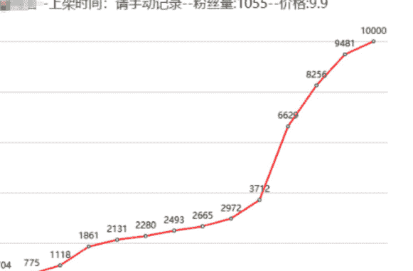

### 惊人的监控数据

先看我们监控到的一组数据

- 监控对象：某高风险品类账号
- 粉丝量：1055
- 价格：9.9 元
- 监控周期：11 月 21 日→12 月 5 日（共 15 天）
- 销量变化:
    - 11/21：704 单
    - 11/24：1861 单
    - 11/27：2493 单
    - 11/30：3712 单
    - 12/02：6629 单
    - 12/04：9481 单
    - 12/05：10000 单

15 天从 704 单飙升到 10000 单，净增 9296 单，日均增长 619 单。

你再看这条曲线——前半段是稳定爬坡，
后半段直接起飞，近乎垂直拉升。

这种增长曲线，我做了这么久虚拟资料，
很少见到。

### 数据背后逻辑

但当我们深入分析这个账号在卖什么的时候，
发现了问题：

这是一个打擦边球的品类，风险极高。

虽然数据漂亮得吓人，但我们不能碰。原因很简单：

- 随时可能被封号
- 违规成本太高
- 不可持续

但我们没有就此放弃，而是问了自己一个
问题：

这个品类为什么能爆？它满足的是用户的
什么需求？

答案是：情感需求，或者说得更直白一点
——人的七情六欲。

这个品类之所以能 15 天卖出近万单，不是因为它的内容有多好，而是因为它精准击中了人性中最底层的需求。

### 人性选品法核心逻辑

这让我们意识到一个更深层的选品思路：不要只看"品类"，要看"品类背后满足的人性需求"。

- 传统选品思路是：什么品类在涨？→我也去做这个品类
- 人性选品思路是：这个品类为什么涨？→它满足了什么人性需求？→有没有更安全的方式满足同样的需求？

### 人性选品法模型

- 第一步：发现异常增长的品类
- 第二步：分析底层需求
    + 这个品类满足的是什么人性需求？
- 第三步：需求迁移
    + 有没有更安全、合规的品类能满足同样的需求？
- 第四步：快速验证
    + 小成本测试，数据验证

### 实战：从擦边品类到校园言情小说

回到我们的案例。

我们发现那个高风险品类本质上满足的是年轻人的情感需求——对爱情的幻想、对亲密关系的向往、对情绪价值的渴求。

那有没有一个品类，能满足同样的需求，
但完全合规、零风险？

答案是：校园言情小说。

#### # 想想看：

- 高中生、大学生是主力用户群
- 这个年龄段对爱情充满幻想
- 校园言情小说是承载这种幻想的最佳载体
- 而且完全合规，没有任何风险

本质上，擦边内容和言情小说满足的是同一种人性需求，一个是违规品，一个是安全品

### 执行验证

想清楚这个逻辑后，我们立刻行动：

#### 第一步：快速建号

新开一个账号，定位"校园言情小说推荐/合集"。

#### 第二步：内容测试

整理了几份校园言情小说合集，包含：

- 甜宠文（轻松、无虐、HE）
- 暗恋文（青春、心动、纯爱）
- 双向奔赴文（双强、势均力敌）

#### 第三步：发布测试

按照小红书的内容逻辑，做了几条笔记：

- 封面：突出"甜"、"上头"、"熬夜看完"等情绪关键词
- 标题：打"高中生"、"大学生"、"宿舍"等场景标签
- 内容：书单推荐 + 片段截图 + 情绪渲染

结果：发布不到一个星期，直接爆单。
后台显示：实时订单 137 单，支付金额 272.6 元，转化率 14.8%。
系统直接推送了「现货爆单通知」。

**实时** **近 1 日** **近 7 日** **近 30 日**

**支付金额** **¥ 272.6**

**支付订单数** **137**

**成功退款金额** **¥ 25.9**

**商品访客数** **929**

**商品访问量** **1,321**

**支付买家数** **137**

**加购人数** **32**

**可提现余额** **¥ 19.6**

**支付转化率** **14.8%**

**买手支付金额** **¥ 0.0**

**广告支付金额** **¥ 0.0**

待发货 **0**
待售后 **1**
违规项 **0**

- 发布商品
- 全部商品
- 笔记中心
- 店播中心
- 活动报名
- 广告推广
- 全部订单
- 全部工具

> 客服账号处于“在线”状态
> 若无需接待买家，可切换为忙碌状态
> 去切换

**现货爆单通知**

12:17:18

店铺在【2025-12-11】的现货支付订单已满足现货爆单标准。如在【2025-12-11】至【2025-12-18】期间的爆单订单满足“履约好标准”，您可享受爆单豁免权益，爆单订单可通过订单标记筛选查看。详情见[现货爆单权益细则]

### 为什么校园言情能爆？

复盘这个案例，校园言情小说能爆，有三个核心原因：

#### 原因①：精准击中目标用户的情感需求

高中生、大学生正处于对爱情最向往的年龄。

他们可能没有谈过恋爱，但对爱情充满幻想。校园言情小说就是他们的"精神食粮"——在小说里体验心动、暗恋、表白、在一起的全过程。

这是刚需，而且是高刚须。

#### 原因②：用户基数极其庞大

中国有多少高中生和大学生？几千万。
这几千万人里，有多少喜欢看言情小说？
保守估计，至少几百万。
用户基数大，流量天花板就高。

#### 原因③：复购率高

言情小说不像考研资料，用完了没了。
看完一本还想看下一本，看完甜宠想看虐恋，看完校园想看职场......
用户会持续消费，复购率极高。

### 人性选品法的底层心法

这个案例给我们的启发，远不止"校园言情小说能卖"这么简单。
更重要的是，它验证了一种全新的选品思路：

- 心法①：从"不能做的品"里找"能做的品"
- 许多高风险品类之所以数据好，是因为它们击中了人性的底层需求。
- 高风险品类是“需求探测器”，帮你发现真正的市场机会。

- 心法②：人性需求是永恒的

考研、考公、秋招，这些需求是周期性的，有时间窗口。

但人性需求——对爱情的向往、对情绪价值的渴求、对娱乐的需要——是永恒的，没有淡旺季。

基于人性的品类，天花板更高，生命周期更长。

- 心法③：年轻人的钱最好赚

高中生、大学生虽然消费能力有限，但他们：

- 时间多，刷手机频率高
- 决策快，看到喜欢的就下单
- 传播强，喜欢分享给朋友

几块钱的客单价，对他们来说毫无压力，但你的销量可以堆得很高。

### 如何用 AI 批量生产言情小说爆款内容

校园言情小说能跑通之后，下一个问题就是：内容从哪来？靠自己写？效率太低。 靠搬运？风险太高。

我们的解决方案是：用 Claude 批量生产原创内容。今天把我们团队沉淀的一整套 AI 创作流程分享出来。

### 一、先搞懂：什么样的言情小说能爆？

在讲创作流程之前，先要理解一个底层逻辑：用户买的不是"小说"，而是"情绪体验"。

她们想要的是：心动、上头、甜到失眠、意难平、磕到昏厥......

所以选题的核心不是"写什么故事"，而是"给用户什么情绪"。

### 二、爆款选题的四大方向

我们测试下来，这几类选题最容易出爆款：

- 方向①：禁忌感话题
    - 核心情绪：刺激、心跳加速、偷偷摸摸的快感
    - 爆款类型:
        - 青梅竹马（从小一起长大，突然心动）
        - 死对头变恋人（明明互看不顺眼，却控制不住靠近）
        - 假戏真做（假装情侣，最后动了真心）
        - 契约恋爱（有条件在先，感情在后）
    - 为什么能爆？ 禁忌感自带张力，用户会忍不住想看"他们最后怎么在一起的"。
- 方向②：身份反差话题
    - 核心情绪：反差萌、意想不到、上头
    - 爆款类型:
        - 高冷学霸×开朗学渣
        - 校园风云人物×透明小人物
        - 表面高冷实际恋爱脑
        - 人前禁欲人后黏人
    - 为什么能爆？ 反差制造惊喜感，用户喜欢看"原来他/她私下是这样的"。
- 方向③：暗恋单箭头话题
    - 核心情绪：心酸、隐忍、意难平、双向奔赴的惊喜
    - 爆款类型:
        - 暗恋多年终于表白
        - 以为是单箭头其实是双向暗恋
        - 毕业才敢说的暗恋
        - 同桌/前后桌暗恋
    - 为什么能爆？ 暗恋是最普遍的青春记忆，用户容易代入，产生强烈共鸣。
- 方向④：极致甜宠话题
    - 核心情绪：甜、苏、上头、磕死我了
    - 爆款类型:
        - 日常撒糖小甜饼
        - 男主只对女主温柔
        - 偏执占有欲男主
        - 娇气女主×宠溺男主
    - 为什么能爆？ 纯粹的情绪价值，不烧脑，看完心情好。

### 三、爆款选题公式

总结下来，爆款选题有一个通用公式:

```
爆款选题 = 人设反差 × 关系张力 × 情绪钩子
```

- 人设反差：两个角色之间要有明显的性格/身份反差
- 关系张力：他们之间要有"不应该在一起"或"很难在一起"的障碍
- 情绪钩子：要有一个让用户"想看下去"的悬念或情绪点

# #### 四、AI 创作全流程

搞懂了选题逻辑，下面进入实操环节。

##### 1：确定选题方向

先从上面的四大方向里选一个，然后用这个提示词让 Claude 帮你细化：
我理想写一篇校园言情短篇小说，目标读者是 18-25 岁的年轻女性。

方向：[暗恋/甜宠/禁忌感/身份反差]

请帮我生成 10 个具体的选题创意，每个选题包含：
1. 一句话概括故事核心
2. 男女主人设
3. 核心冲突/张力点
4. 情绪卖点（甜/虐/上头/意难平）

要求：
- 设定在大学校园
- 男女主都是成年人
- 要有反差感和新鲜感
- 避免烂大街的老套剧情

##### 2：生成故事大纲

选定一个选题后，用这个提示词生成大纲：

# 选题：[你选定的选题]

请帮我生成一个完整的故事大纲，包含:

# 1. 人物设定

- 女主：姓名、年龄、性格、外貌特点、人物标签
- 男主：姓名、年龄、性格、外貌特点、人物标签
- 关键配角（如有）

# 2. 故事背景

- 时间设定
- 地点设定
- 两人的初始关系

# 3. 剧情主线（分 5 个阶段）

- 相遇：如何认识/重新建立关系
- 试探：关系的微妙变化、暧昧期
- 冲突：阻碍两人在一起的矛盾点
- 转折：关系突破的关键事件
- 结局：HE 收尾

# 4. 3 个名场面设计

- 最甜的一幕
- 最虐/最揪心的一幕
- 最上头的一幕

# 5. 金句预埋（3-5 句）

- 适合截图传播的台词

#### 3：分章节扩写

大纲确定后，开始分章节扩写。

重点：不要让 AI 一次性写完整篇，要分章节写，这样质量更高。

提示词模板：

# 基于以下大纲，请撰写第 [X] 章内容。

基于以下大纲，请撰写第 [X] 章内容。

[粘贴你的大纲]

[粘贴你的大纲]

【故事大纲】

[粘贴你的大纲]

[本章要点]

【本章要点】

对应的 [相遇/试探/冲突/转折/结局] 阶段

需要完成的剧情点：[具体说明]

情绪基调：[甜/虐/暧昧/心动]

名场面：[如果有的话]

【写作要求】

1. 字数：3000-4000 字
2. 视角：第三人称，但女主的内心独白
3. 风格：轻松、甜、有代入感
4. 对话占比：40%-50%，对话要自然、有个性
5. 要有细节描写：眼神、小动作、心理活动
6. 章节结尾要有钩子，让读者想看下一章

##### 4：优化“名场面”

名场面是传播的关键——用户截图分享的往往就是这些片段。

用这个提示词优化名场面:

以下是我小说中的一个重要场景，请帮我优化，让它更"上头":

# 【原始场景】

[粘贴你的场景]

# 【优化要求】

+ 1、增加细节描写 (眼神、呼吸、心跳、小动作)
+ 2、放大情绪张力
+ 3、对话要更有"苏感"
+ 4、结尾要有"意犹未尽"的感觉
+ 5、优化后的场景要适合截图传播

请给出 3 个不同风格的优化版本:
- 版本 A: 极致甜
- 版本 B: 暧昧拉扯
- 版本 C: 虐中带甜

##### 5：生成"钩子片段"

钩子片段是用来发小红书笔记的————让用户看了就想买全文。

##### 提示词:

基于以下故事，请帮我生成 5 个"钩子片段"，用于小红书推广。

# 【故事梗概】

[简单描述你的故事]

# 【要求】

+ 1. 每个片段 300-500 字
+ 2. 要截取最"上头"的部分
+ 3. 片段要在关键处戛然而止，让人想看后续
+ 4. 适合配文案"看完这段我直接睡不着了"

# 【片段类型】

- 片段 1：初次心动的瞬间
- 片段 2：暧昧期的拉扯
- 片段 3：最甜的对话
- 片段 4：误会/虐心片段
- 片段 5：表白/在一起的名场面

### 五、批量生产的效率技巧

#### 技巧①：建立人设库

不要每次都从零开始设定角色，建立一个"人设库"：

### 【男主人设库】

1. 高冷学霸型：表面冷漠，实际闷骚，只对女主温柔
2. 阳光运动型：开朗外向，直球表白，狗狗系男友
3. 禁欲清冷型：话少，行动派，占有欲强
4. 痞帅张扬型：表面吊儿郎当，实际专一深情
5. 温润学长型：温柔体贴，默默守护，暗恋多年

### 【女主人设库】

1、软萌可爱型：单纯善良，容易脸红，反应慢半拍
2、独立学霸型：外表高冷，内心戏多，嘴硬心软
3、开朗话痨型：社牛属性，大大咧咧，恋爱后变娇气
4、倔强别扭型：死鸭子嘴硬，喜欢嘴上逞强
5、软糯奶凶型：平时软萌，吃醋时奶凶奶凶的

#### 技巧②：建立场景模板库

高频场景可以形成模板：

- 图书馆偶遇
- 同桌/前后桌日常
- 宿舍卧谈会讨论他
- 被堵在墙角
- 醉酒后说真心话
- 雨天同撑一把伞

每个场景写一个 3000 字的模板，后续改改人名和细节就能用。

#### 技巧③：一个故事多种包装

同一个故事，可以换不同的“壳”来包装。一个故事核心，换三个壳，就是三个产品。

### 六、内容质量自检清单

每篇内容完成后，用这个清单自检：

- - [ ] 人设是否有记忆点？（不能太平淡）
- - [ ] 男女主之间是否有足够的张力？
- - [ ] 是否有至少 3 个“上头”的名场面？
- - [ ] 对话是否自然、有个性？
- - [ ] 是否有适合截图传播的金句？
- - [ ] 情绪节奏是否有起伏？（不能全程平淡或全程高能）
- - [ ] 结局是否让人满足？（HE 要甜到位）
- - [ ] 章节结尾是否有钩子？

### 七、从内容到产品的打包策略

最后，内容生产完了，怎么打包成产品？

#### 策略①：单本定价

- 短篇（1-2 万字）：3.9-5.9 元
- 中篇（3-5 万字）：6.9-9.9 元
- 长篇（8 万字+）：12.9-19.9 元

#### 策略②：合集定价

- 5 本短篇合集：9.9 元
- 10 本短篇合集：19.9 元
- 主题合集（全是甜宠/全是暗恋）：12.9 元

#### 策略③：连载钩子

先免费放出前 3 章，后续章节付费解锁。这种方式转化率最高，因为用户已经被钩住了。

## 三、空白市场选品法：如何成为第一个吃螃蟹的人

前面分享的选品方法，不管是数据跟随法还是人性洞察法，本质上都是“跟着已有信号走”。

我再讲一个不一样的——空白市场选品法。

简单说就是：主动发现用户有需求、但市场还没人做的品类，抢先入场。

这种方法风险更高，但回报也更大。做对了，你就是品类开创者，吃到最肥的红利；做错了，就是炮灰。

想像我们这个时代品，目前市面上没有几个同行在做，我们这个月单店已经 5 万+GMV 了。

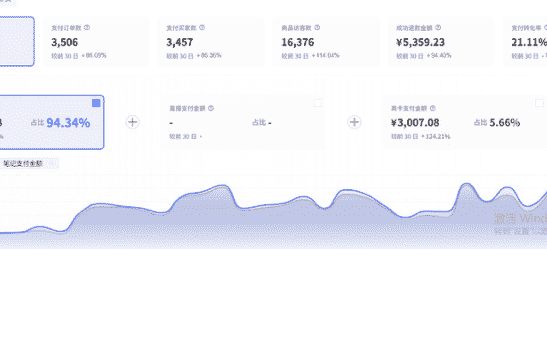

### 空白市场的机会在哪里？

很多人选品喜欢看“什么在涨”，然后跟进去做。但问题是，当一个品类已经有明显增长数据的时候，往往意味着已经有人在做了，你进去就是跟随者，要和先发者抢市场。

空白市场不一样。空白市场的特征是：需求已经存在，但供给还没跟上。

用户在找，但找不到；用户想买，但没人卖。这种信息差，就是机会。

### 如何发现空白市场？——评论区挖掘法

我们团队发现空白市场的核心方法，就一个字：看评论区。

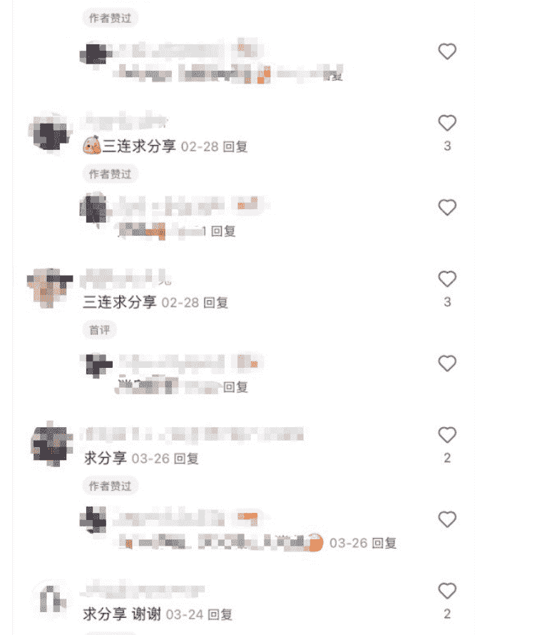

### 用户的真实需求，不在搜索框里，在评论区。

### 具体怎么看？

#### 第一，关注高互动内容的评论区

当一条笔记互动量很高的时候，评论区往往会出现大量用户的真实反馈。

#### 重点看这些需求信号：

- "求链接"
- "怎么买"
- "有没有 XX 版本"
- "博主能不能出一个 XX"
- 大量用户 @博主求资料

这些都是"需求信号"——用户在明确告诉你，他们想要什么。

+ "求链接"
+ "怎么买"
+ "有没有 XX 版本"
+ "博主能不能出一个 XX"
+ 大量用户 @博主求资料

这些都是"需求信号"——用户在明确告诉你，他们想要什么。

#### 第二，看需求的普遍性

单条评论说"求链接"可能是偶然，但如果：

- 同一条笔记下很多人在求
- 不同笔记下都有类似的需求
- 需求表达很具体、很迫切

那这个需求大概率是真实的、普遍的。

#### 第三步：验证市场饱和度

发现需求后，下一步是看：有没有人在做这个品？

去搜索相关关键词：

- 如果搜不到什么结果 → 可能是真空白
- 如果有人在做但很少 → 可能是蓝海
- 如果已经有很多人在做 → 红海，慎入

### 三、空白市场选品的风险

必须说实话：空白市场选品，失败率是比较高的。你看到的"需求信号"，可能是真需求，也可能是伪需求。

#### 风险①：需求是伪需求

用户在评论区说"求链接"，可能只是随口一问，真让他付费，他又不买了。

有些需求确实存在，但用户基数太小，做出来也卖不了多少。

#### 风险③：没人做是因为有坑

有时候一个品类没人做，不是没有人发现，而是因为有合规风险、内容生产成本太高、或者其他隐性问题。

所以我们内部有一句话：空白市场选品，你可能是第一个吃螃蟹的人，也可能是第一个炮灰。

### 四、如何降低风险？——小成本快速验证

既然风险高，那怎么降低风险？核心原则：小成本试错，快速验证。

#### 第一，不要一上来就 all in

发现一个空白市场机会，不要立刻投入大量时间精力去做一个"完美产品"。先出一个最简版本 (MVP)，快速测试市场反应。

#### 第二，用数据说话

测试发布后，看几个核心指标：

- 有没有人收藏/点赞？(需求是否存在)
- 有没有人下单？(付费意愿如何)

### 五、我们的实战经验

说实话，我们用这个方法测了很多品，失败的不少，但也测出了几个持续在爆的品。

有一个品，就是我们在评论区发现的——当时看到很多用户在求某类资料，搜了一圈发现几乎没人在做。

我们花了两天时间快速出了一个版本，上架测试。结果第一周就开始出单，后来持续放量，到现在还在稳定出单。这就是空白市场的魅力：一旦你踩中了，就是独占红利。因为你是第一个做的，用户搜索这个关键词，只能找到你。

#### 心法①：评论区是金矿

用户的需求写在评论区里，学会"翻译"这些需求信号。"求链接"、"怎么买"、"有没有 XX"——这些都是机会。

#### 心法②：没人做 ≠ 不能做

没人做可能是真空白（机会），也可能是有坑（风险）。关键是做好调研，判断清楚再入场。

#### 心法③：小成本试错，快速验证

不要赌，要测。用最小成本验证需求真伪，跑通了再放大投入。

#### 心法④：接受失败是常态

空白市场选品，失败率本来就比跟随法高。调整心态，用成功品的利润覆盖测试成本，长期来看收益大于风险。

### 最后一句话：

空白市场选品，本质上是在"不确定性"中寻找"确定性"。你不该可能每次都对，但只要对一次，回报可能是跟随法的 10 倍。敢于做第一个吃螃蟹的人，才有机会吃到最肥的肉。

另外这种方式不但适用于虚拟资料，也适用于实物带货，比如这个账号粉丝、笔记。

### 只有这篇，但是条条笔记几十个赞，而且评论区对这种品的热度又很高，有很大概率是蓝海品


### 公众号懒人搜索、懒人专属群分享

## 笔记

📍 100 种办公室低卡零食 Day 7

📍 100 种办公室低卡零食 Day 6


📍 100 种办公室低卡零食 Day 5 轻食兽低 GI 饼干

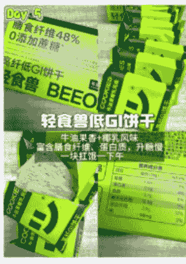

📍 100 种办公室低卡零食 Day 4 果丹皮

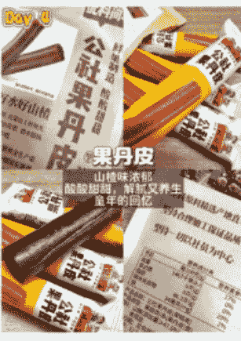

📍 100 种办公室低卡零食 Day 3 紫薯芋泥饼

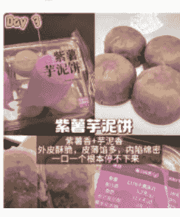

📍 100 种办公室低卡零食 Day 3 麻酱毛肚

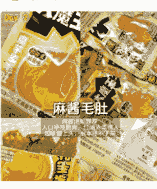

## 四、实战案例复盘

选品这件事，早一步是先驱，晚一步是先烈。

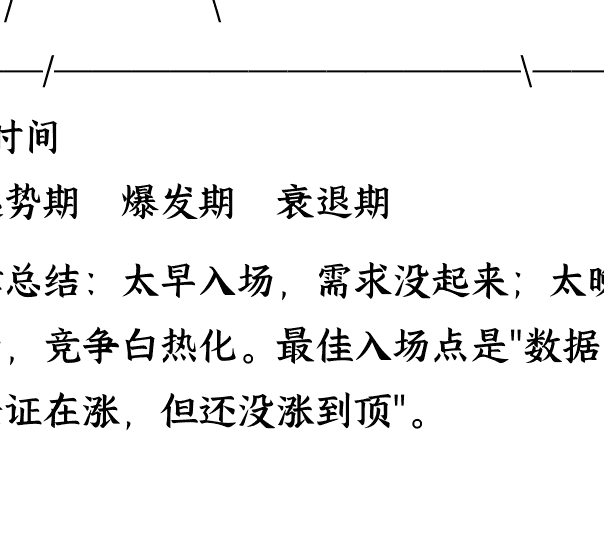

回顾我们团队过去半年的选品实战，有三个品打得特别漂亮——秋招求职信息表、国考申论规范词、考研英语作文模板。

我现在把这几个案例放在一起复盘，你会发现我们背后的选品逻辑是完全一致的。

### 三个爆品数据统筹分析

- ### 爆品①：秋招求职信息表（7 月监控，7-9 月爆发）
核心发现：大号小号都在涨，高价低价都能卖，需求具有普适性。

- ### 爆品②：国考申论规范词（9 月开始监控，11 月全面爆发）
核心发现：粉丝量相差 60 倍，增速却几乎一致，说明是品类红利而非个人能力。

- ### 爆品③：考研英语作文模板（10 月底监控，11 月打爆）
核心发现：连续 10 天稳定上涨，日增速从 88 单加速到 259 单，需求还在上升期。

### 三个爆品共性规律

把三个案例放在一起看，你会发现它们有惊人的相似之处：

## 规律①：都是"确定性事件"驱动

规律总结：我们打的都不是"热点"，而是"确定会发生的事件"。时间节点固定，需求可预期，比追热点靠谱太多。

## 规律②：都经过"多账号交叉验证"

规律总结：我们从不因为"一个账号涨了"就冲进去，必须看到多个账号、不同体量、不同价格都在涨，才确认是真趋势。

## 规律③：都卡在"上升期前半段"入场

需求曲线示意：


规律总结：太早入场，需求没起来；太晚入场，竞争白热化。最佳入场点是"数据已经验证在涨，但还没涨到顶"。

### 我们的选品决策模型

经过这三个爆品的实战，我们沉淀出了一套"三重验证"选品模型：

| 三重验证选品模型 | |
| :--- | :--- |
| **第一重：需求验证** | 多个账号是否都在涨？增长是否稳定？ |
| **第二重：时机验证** | 现在是上升期前半段？还是已经过了高峰？ |
| **第三重：竞争验证** | 市场竞争程度如何？有没有差异化空间？ |
| **决策结果** | ✔ 三重验证全过 → 果断入场<br>✘ 任一不过 → 继续观察或放弃 |

### 三个案例的关键数据对比

### 复盘总结：选品的本质是什么？

做了这三个爆品之后，我们对选品有了更深的理解：

## 选品不是"猜"，是"算"

传统选品靠感觉、靠经验、靠跟风。我们靠数据。当你能持续监控市场、量化增长趋势、交叉验证信号，选品就从"玄学"变成了"科学"。

### 选品的核心是"时机"

同样一个品，7 月做和 9 月做，结果可能天差地别。

我们追求的不是"选对品"，而是"在对的时间选对品"。

### 选品的壁垒是"系统"

单次选对可能是运气，持续选对一定是系统。

我们连续打出三个爆品，不是因为我们比别人聪明，而是因为我们建立了一套可复制的选品系统：监控→验证→决策→执行。

## 五、打品思路核心运营方法

你不需要一个卖一整年的品，你需要的是一整年都有爆品在卖。

提前 1-2 个月布局，在需求上升期入场，在高峰期收割。

### 全年爆品日历——让你月月有爆款，天天在出单

讲了这么多选品方法，最后我想分享一个我们团队最核心的运营思维：不要追着一个品死磕，要追着时间节点打品。

### 一、一个让我们少走很多弯路的认知

很多人做虚拟资料，都有一个执念：我要找一个"长线品"，做一次，卖一年。这个想法没错，但有两个问题：

第一，真正的长线品很难找。大部分能持续卖一整年的品类，要么竞争已经非常激烈，要么天花板很低。

第二，过度执着于长线品，会让你错过眼前的机会。当你还在苦苦寻找那个“完美长线品”的时候，别人已经用季节性爆品赚了好几波了。

后来我们换了一个思路，一切都通了：把全年的季节性爆品串起来，本身就是一个长线生意。

3 月打求职，6 月打实习，9 月打秋招，10 月打考公，11 月打考研，12 月打新年、期末考试……

每个月都有品可打，每个月都有钱可赚。

你不需要一个卖一整年的品，你需要的是整个年都有爆品在卖。

### 二、全年爆品日历

我们内部有一张“爆品日历”，核心逻辑就是：什么季节打什么品，提前多久布局，什么时候收手。

核心原则：提前 1-2 个月布局，在需求上升期入场，在高峰期收割。

### 三、我们的打品节奏

有了这张日历，我们团队的打品节奏是这样的：

#### 阶段一：提前布局期（需求高峰前 1-2 个月）

这是最关键的阶段。当大多数人还没意识到某个品类要火的时候，我们已经开始准备了：

- 监控对标账号数据
- 准备内容素材
- 测试发布节奏

提前布局的好处是：当需求真正爆发的时候，你的账号已经有了基础权重和内容沉淀，能吃到最大的流量红利。

#### 阶段二：快速拉爆期（需求高峰期）

需求起来之后，全力冲刺：

- 加大发布频率
- 多账号矩阵同步推进
- 快速迭代内容，测试什么封面、什么标题转化最高

这个阶段的目标就是一个字：快。

快速抢占流量，快速出单，快速拉高销量。

#### 阶段三：收尾维护期（需求高峰后）

当需求开始回落，我们不会死磕。很多人的问题是：一个品做起来之后舍不得放手，即使已经过季了，还在拼命更新、拼命推广，结果投入产出比越来越低。

我们的做法是：过季了就"苟着"。

**具体操作：**

- 不再大量更新笔记
- 每周保持 3-6 条内容，维持账号活跃度
- 团队精力转移到下一个应季品
- 账号不要丢，但也不要占用太多时间。让它安静地躺着，等下一个周期。

#### 阶段四：周期循环

等到来年同一时间，这个品的需求又会起来。因为你的账号一直在养着，权重还在，内容还在，用户搜索的时候还能搜到你。

- 更新一下内容（比如"2026 版"）
- 重新加大发布频率
- 配合新一轮的需求高峰

同一个品，年年都能卖。

### 四、为什么这种打法效率最高？

#### 效率点①：不浪费时间 在低效期

很多人的时间浪费在哪？——在需求低谷期还在拼命推一个已经过季的品。

我们的做法是：需求低谷期果断收手，把时间投入到下一个即将爆发的品上。

永远在需求上升期投入，永远在需求高峰期收割。

#### 效率点②：人员分配更合理

如果你死磕一个品，团队就被绑死在上面了。但如果你跟着爆品日历走，团队的节奏就很清晰：

- 这个月全力打考公
- 下个月全力打考研
- 再下个月全力打新年

每个阶段都有明确目标，团队执行效率最高。

#### 效率点③：账号资产持续积累

我们做的每一个季节性账号，都不会丢掉。考公账号、考研账号、求职账号、新年账号……每个账号都是资产。

今年做完，明年还能用。明年做完，后年还能用。

账号越来越多，资产越来越厚，生意越做越轻松。

### 五、思维升级：季节性爆品 = 长线生意

回到开头那个问题：要不要找长线品？

我的答案是：不用刻意找。

当你把全年的季节性爆品串起来，你会发现：

- 1-2 月有新年品在卖
- 3-4 月有春招品在卖
- 5-6 月有实习品在卖
- 7-8 月有秋招预热品在卖
- 9 月有秋招品在卖
- 10-11 月有考公考研品在卖
- 12 月有考研冲刺和新年品在卖
- 月月有爆品，天天有订单。

这不就是长线生意吗？只不过，它不是“一个品卖一年”，而是“一年有很多品在卖”。

本质上，你拥有的是一个“全年爆品库”，这个库本身就是你的长期资产。

## 六、写在最后

做了这么久虚拟资料，我最大的感悟是：

选品能力决定了你能赚多少钱，打品节奏决定了你能赚多久。

很多人选品能力不差，但节奏感很差——该冲的时候不冲，该收的时候不收，该换的时候舍不得换。

结果就是：明明选对了品，却没吃到最大的红利。

我们团队能做到"月月有爆品，天天在出单"，核心就是这套节奏打法：

- 提前 1-2 个月布局：在别人还没反应过来 的时候，我们已经准备好了
- 需求高峰期全力冲刺：集中火力，快速拉爆
- 过季后果断收手：不恋战，不死磕，精力转向下一个战场
- 账号持续养着：等下一个周期，周而复始

跟着时间走，跟着需求走，你就永远在风口上。

如果让我用一句话总结这整篇选品方法论，那就是：

选品的本质，是在对的时间，用对的方法，打对的品。

- 数据跟随法，让你看到"对的品"
- 人性洞察法，让你找到"隐藏的品"
- 空白市场法，让你发现"别人没看到的品"
- 全年爆品日历，让你永远在"对的时间"

把这些方法串起来，你就有了了一套完整的选品系统。

不是碰运气，不是靠感觉，而是靠系统、靠方法、靠节奏。

希望这篇分享能帮到你。

去实践，去验证，去打出属于你的爆品。

做小红书电商，我发现 95% 的人都是死在了不自信，总觉得自己没经验没基础，怕自己学不会，其实学新技能新生意，最重要的是要自信，当你觉得自己行，你才真的能学会。

大多数时候，限制我们的并不是我们的能力，而是我们不敢去尝试。

与大家共勉！

最后，安利小懒的付费群：懒人专属群（介绍）


### 这里是你对抗信息过载的护城河。

已稳定运行 6 年，累计拆解、研读 3000+ 个互联网商业实战案例与行业前沿内参和时政/宏观文章。

我们不搬运垃圾，只做高价值信息的筛选器与放大镜。

懒人专属群更新记录：
https://hk57gvlx7u.feishu.cn/docx/H0kRdZbSbolBR0xkaxcuVE0nJg

【免责声明】本资料归档于社群内部知识库，仅供成员课题研究与学术交流，请在查阅后 24 小时内删除。