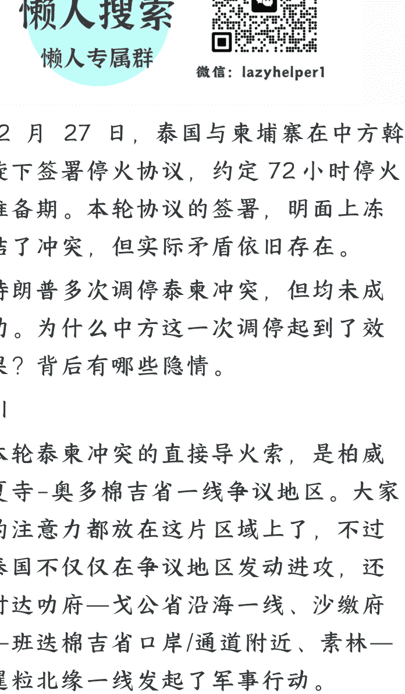

# 泰柬停火，有什么隐情？

2026 年 01 月 04 日 文/卢克文工作室嘉宾 云梦竹

整理：公众号懒人搜索，懒人专属群_精选

懒人微信：lazyhelper1

12 月 27 日，泰国与柬埔寨在中方斡旋下签署停火协议，约定 72 小时停火准备期。本轮协议的签署，明面上冻结了冲突，但实际矛盾依旧存在。

特朗普多次调停泰柬冲突，但均未成功。为什么中方这一次调停起到了效果？背后有哪些隐情。

## 01

本轮泰柬冲突的直接导火索，是柏威夏寺—奥多棉吉省一线争议地区。大家的注意力都放在这片区域上了，不过泰国不仅仅在争议地区发动进攻，还对达叻府—戈公省沿海一线、沙缴府—班迭棉吉省口岸/通道附近、素林—暹粒北缘一线发起了军事行动。这些行动的目的，在于突破扁担山脉。该山脉是双方的地理分界线，也是横跨在双方国境线上的天然长城，泰国的军事行动，均有突破这道天然长城的意味。

首先是素林—暹粒北缘。素林府一侧靠近泰国东北部交通体系，具备较好的道路与后勤保障基础；暹粒北缘一侧则紧贴柬埔寨西北部人口与经济要地的外围。乃是天然的交通枢纽。古迹吴哥窟、大吴哥都位于暹粒市北郊。

泰国占领此处高地之后，其远程火力对暹粒构成了威胁。暹粒旅游业对于柬埔寨十分重要，此处被占，等于柬埔寨的部分钱袋子，被泰国捏住了。

在泰柬边境的西段，尤其是泰国沙缴府一线、泰军控制了波贝口岸周边缓冲区，将巡逻线与临时阵地往前推进了一大步。这一地区军事价值极为重大，是泰国和柬埔寨最重要的陆上通道之一，有多条公路在此处交汇。

截止到停火协议时，泰国已经夺取了 Ban Khlong Phaeng、Ban Nong Chan 和 Ban Nong Ya Kaew 三个地区。

一旦在该区域站稳脚跟，泰国就能极大压缩柬埔寨西部地区军事调动的空间，让柬埔寨陷入劣势。如果未来泰国准备扩大冲突，那么这个地区就是天然的进攻通道。

但停火对泰国也不亏，因为停火没有要求泰国从占领土地上撤离，泰国极可能将占领土地事实化。泰国在本轮军事冲突中，最大的收获不在于占领了争议土地，而在于其逐步突破了扁担山脉这道天然屏障，拿到了地形优势。

## 02

自 2016 年南海对峙之后，东南亚各国的整体战略取向，经历了一条清晰的路径：由亲美，转向中立，最终走向刻意的模糊化。

以新加坡为例。尽管其境内长期驻扎美军力量、并向美国海军和空军开放设施，但新加坡政府却反复、公开重申其支持一个中国政策。这种看似矛盾的状态，本身就是东南亚战略模糊化的缩影。

印尼同样如此。一方面不断深化与华盛顿的防务合作；另一方面却积极欢迎中国资本参与本国基础设施建设，甚至包括新首都项目。

对抗中国，会引发直接而迅猛的经济冲击；过度靠向中国，则可能遭遇美国的惩罚性报复。

保持沉默与模糊，则能够争取回旋空间。

因此，整个东南亚的外交逻辑，围绕着一个核心原则展开：置身事外。美国来了是客，中国来了，也是客。东南亚各国通过这种模糊姿态，在中美之间维持平衡。

曾有一位东南亚官员私下对智库人士坦言：最理想的政策，就是确保国家完整、避免被卷入大国博弈。欧洲长袖善舞，因为他们不知道自己在餐桌上还是在菜单中，而东南亚清楚自己在菜单中，所以竭力避免被关注。但东南亚国家不会、也不敢明说。

在阅读多份东南亚智库研究后，我们不难发现，几乎所有学者都以极其含蓄的方式，反复提及一个方向——东南亚，乃至东盟，理应像当年的第三世界国家组织那样团结起来，在大国竞争中争取自身利益。

值得注意的是，这种话语往往只敢“点到为止”，不敢直接表达。这本身，就说明了东南亚国家在现实压力下的集体无力感。然而，随着近几年中美两国国力的此消彼长，情况正在发生变化。

随着特朗普新国家安全战略的施行，美国有了“战略撤退”的迹象，东南亚各国逐渐意识到，中美之间原本的平衡，已经被打破。

这一变化，在地区冲突的处理方式上表现得尤为明显。

无论是缅甸内战，还是柬泰冲突，双方最终选择的谈判地点，往往都在云南。而在柬泰第一次冲突后，特朗普曾高调宣称“斡旋成功”，但泰国将自身国家利益，置于美国领导人的外交面子之上，随后发动了第二轮攻势。

作为对比，在中方介入斡旋之后，即便发生了诸如“柬埔寨 250 架无人机突破边境”这样的高度敏感事件，泰国依旧选择维持停火框架。

这至少说明，在东南亚地区的朴素认知中，中国的斡旋与承诺，被视为更具现实约束力，也更值得尊重。

当战略平衡被打破，中国也将面临一个问题，就是泰国的国家利益。

## 03

### 泰国正处在一个历史十字路口上。

目前，中国推动的一带一路建设成为东南亚地区的经济引擎。对于东南亚各国而言，中国选择从哪条通道连通印度洋继而链接中东，就意味哪条线上的沿线国家具备强大的经济优势。

东南亚整体的战略态度模糊，给了一些中国企业空间。希望进入西方市场的中国企业，可以在东南亚设厂，以此规避关税及其他经营风险。而希望摆脱中国产地，又渴望中国供应链的西方企业，也可以在东南亚设厂。

而泰国谋求的，正是成为这种枢纽国家。泰国官方不止一次地宣布，希望成为“区域中心”。

泰国的野心，不止于经济枢纽，还想当政治枢纽，大家知道塔利班和美国是在哪里进行第一轮谈判的嘛？是卡塔尔。在卡塔尔你可以联系上任何的中东武装组织。卡塔尔 21 世纪的根本作用就是做中东的外交枢纽。

基辛格提出过一个观点：处于地缘交汇处的小国，要么成为大国沟通的枢纽，要么就是大国交锋的战场。

成为沟通枢纽，意味着你挨揍或者被迫选边站的概率降低，利益能够最大化，毕竟和事佬大家都得给个面子。所以，泰国试图成为东南亚的沟通枢纽。

无论是美国的霸权主张，还是中国的影响力，都不具备主导东南亚的现实条件，地区需要调解者、连接者，泰国瞅准了这个生态位。

问题在于，凭什么？泰国有什么资本？

在香港电影黑社会中有这么一个桥段，当 Timmy 仔听到自己不可以在大陆做生意后，非常愤怒地质问石副厅长为什么别人可以，石副厅长回答“他是‘新记’的办事人，同时他也是爱国的。”

Timmy 仔气愤地说，“我也可以谈，我也可以爱国！”

这段话的潜台词，Timmy 仔听懂了：你要成为当地的话事人，你才有爱国的资格。

看懂了泰国桥梁国家的未来地缘构想，就能明白泰国在冲突中的军事外交操作了。泰国需要展现自己的军事力量，但又不能破坏当地的稳定，所以只夺取了要害的争议地区，并没有拿下如波贝这样的核心边境城市，使得局面不可挽回。

泰国通过撕毁特朗普斡旋的停火表现自己有破坏当地平衡的能力，又严格遵守中国斡旋的停火，展现尊重大国权威的意愿。可以说，泰国已经展现出一点潜质了。

但是从大国视角来看，我们更希望没有这种枢纽国家存在。毕竟，多一个中间商，就意味着多一点成本。

短期内，咱们和泰国，不会有太大的矛盾，但长期来看，如何处理与泰国这个中间商的矛盾，如何协调利益分配，将是我们的难题。

## 最后，安利小懒的付费群：

懒人专属群（介绍）

这里是你对抗信息过载的护城河。

已稳定运行 6 年，累计拆解、研读 3000+ 个互联网商业实战案例与行业前沿内参和时政/宏观文章。

我们不搬运垃圾，只做高价值信息的筛选器与放大镜。

## 懒人专属群更新记录：

【免责声明】 本资料归档于社群内部知识库，仅供成员课题研究与学术交流，请在查阅后 24 小时内删除。