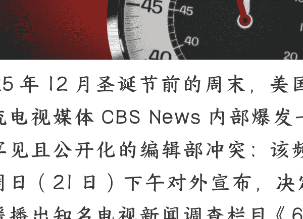

## 《60分钟》调查报道被撤

## **260104 新闻实验室**

整理：公众号懒人搜索，*懒人专属群*精选

懒人微信：lazyhelper1

是政治干预，还是节目未达到播出标准？

2025 年 12 月圣诞节前的周末，美国主流电视媒体 CBS News 内部爆发一场罕见且公开化的编辑部冲突：该频道周日（21 日）下午对外宣布，决定暂缓播出知名电视新闻调查栏目《60 分钟》最新一期中的一段调查报道。

该段报道聚焦的是萨尔瓦多的 CECOT 监狱。特朗普政府将数百名委内瑞拉移民遣送至该监狱后，产生了一系列的人权与法律争议。多家媒体披露，这一决定发生在节目已完成制作、通过内部编辑与法务审查、并且已做出预告宣传之后。

临时停播的决定，引发了编辑部震荡与外界对“政治压力是否进入编辑流程”的质疑。此事件也成为美国新闻自由面临空前挑战的又一案例。

### 政治干预，还是未达到播出标准？

《华尔街日报》本周一的一篇报道，试图揭开这次临时停播前发生了什么。

在这段时间被按下暂停键之前，节目组其实已经走完了大部分制作与上线流程。

按惯例，《60 分钟》的调查段落会在播出前安排内部放映审看。周四（12 月 18 日）下午的审片环节，今年 10 月新上任的总编辑 Bari Weiss 没有赶上。但当天晚些时候，她补看了成片，并把一系列修改意见发给制作团队，要求对内容做进一步调整。制作团队随后尝试按照她的反馈做处理。

与此同时，CBS 在周五已经为这条名为“走进 CECOT"的报道打出预告，宣传重点是记者 Sharyn Alfonsi 对部分被遣送后又获释的移民进行采访，这些受访者描述监狱环境严酷、管控极端。也就是说，从外部观众的角度看，这条调查报道已进入准备播出的状态。

Sharyn Alfonsi 是《60 分钟》的一位资深电视调查记者，2015 年加入该团队，此前已有近 20 年电视新闻从业经验。

但在该节目的制作进入最后关头时，Weiss 对两点产生担忧：其一是报道在她看来仍有“质量与完整性”需要补强；其二是“征求回应”的环节，她希望团队继续加大力度，让关键当事方——尤其是政府相关人士——以更明确、更正式、最好能“上镜”的方式表态。

节目组方面则认为，他们此前已向国土安全部、白宫、国务院寻求过回应并收到答复，同时也呈片多处呈现政府立场、并指出部分政府部门没有回应或给出了拒接采访的反馈。然而，即便如此，Bari Weiss 依旧没有允许节目播出。到了周六，记者 Alfonsi 接到通知，这段原定周日播出的内容将不会按计划播出，撤稿决定也就此正式落地。

对于停播决定，记者 Alfonsi 于周日发出了一封内部邮件，直指撤稿决定带有政治考量，强调报道已通过内部审看与法务把关，事实准确。

***据美联社报道***，她在邮件中写道，

“政府的沉默本身就是一种表态，而非否决权。拒绝接受采访是旨在扼杀报道的战术手段。若政府拒绝配合便成为压制报道的正当理由，我们等于主动交出了让他们随时能切断任何不便报道的‘终止开关’。”

Alfonsi 的邮件迅速被多家媒体跟进报道，这一新闻编辑部内部的冲突登上了多家媒体的头版。

总编辑 Weiss 随后公开回应称，暂缓播出并非因为立场，而是因为她认为该段落“还没准备好”，需要进一步采访、补强证据链，并尽更大努力让关键当事方以“记录在案”（on the record）的方式回应。她把做出停播决定定义为新闻标准问题：在同类题材已被其他媒体报道过的情况下，《60 分钟》要播就必须更扎实、更独家、更经得起质疑。Weiss 还承诺，未来仍会播出完善后的版本。

以上就是事件的当事人对暂缓播出的不同态度。那么这就衍生出了以下两个问题：

*   第一，在新闻业务层面，被采访对象拒绝出镜回应时，节目可以播出吗？
*   第二，总编辑 Weiss 的撤稿理由，是否带有政治考量？

### 采访对象不愿回应，节目可以播出？

从西方新闻行业的实践标准来看，采访对象（包括政府部门或官员）如果拒绝直面镜头发声，**报道通常仍然可以播出**。行业主流规范更强调的是：新闻机构要 **尽责地提供回应机会**，并在播出时 **明确说明对方拒访/未回应**；而不是把“必须上镜”设为硬门槛。否则，拒访者就会获得事实上的“否决权”，这反而违背新闻独立性原则。

#### 1) 为什么“拒绝上镜”不应自动阻止播出：回应权是“机会”，不是“条件”

行业伦理的基本要求是：被批评或被指控的一方应当有机会回应，但这是一项记者应尽的努力义务，并非对方必须配合的前置条件。**美国记者协会** (SPT) 伦理准则的表述是：记者应当“勤勉地寻求”报道对象，让他们有机会回应批评或不当指控。(Diligently seek subjects of news coverage to allow them to respond to criticism or allegations of wrongdoing.)它强调的是记者的主动与勤勉，而不是给拒访者设置一把能卡住报道的锁。

把这条准则落到操作层面，行业里常用的“no-surprises”实践会进一步追问：你给了对方多久时间？用了哪些联系渠道？尝试了多少次？这些因素共同构成“是否公平地提供回应机会”的可核查标准。

#### 2）能播出的前提：你要证明“尽到努力”，并对观众“讲清楚对方拒访”

在很多编辑室里，决定“能不能播”的关键不是被采访人“有没有上镜”，而是两个更可检验的点：（a）记者是否做了充分的征求回应努力；（b）是否在播出中透明呈现对方拒绝确认或拒绝接受采访。

路透社的《新闻手册》就要求：如果某个机构不愿意确认信息，要在稿件中明确说明这一点。也就是说，拒访不是报道的终点，但必须成为报道的一部分——观众需要知道你联系了谁、对方怎么回应（或拒绝回应）。

#### 3）把以上规范套回这起 CBS 争议：分歧其实是“门槛”设在哪儿

### 用上述标准回看 Alfonsi 与 Weiss 的冲突，争议焦点就更清晰：

如果节目组已经多渠道联系、给出问题点与期限，并在片中呈现“政府拒访/拒评或书面回应”，那按照行业通行准则，即使政府不出镜，报道也通常可以播出。

反过来，如果总编辑把“必须上镜”设为硬门槛，那么任何一方只要拒绝面对镜头，就能拖住播出，这会把“回应权”变成“否决权”，容易触碰新闻独立性的底线。

因此，从业内通行的职业伦理出发，拒绝上镜并不会自动让报道不能播；能不能播，取决于新闻机构是否尽责地提供回应机会、是否透明告知拒访/未回应，以及事实核查是否足以支撑报道。

### 这次撤稿是出于政治考量吗？

既然在新闻业务标准上，“缺少政府部门的相关回应就无法播出”这种说辞站不住脚，那 Alfonsi 提出的“这次撤稿是出于政治考量”又是否合理？

这个答案，并不像上面那个业务问题那样，会有比较清晰的行业准则或相关证据。在下结论之前，可以先把梳理一下 CBS News 的母公司派拉蒙在过去半年里，所经历的一连串与特朗普相关、且都带着“政治—商业”双重属性的事件。

今年 7 月，派拉蒙同意支付 1600 万美元与特朗普就《60 分钟》节目采访剪辑争议的诉讼达成和解。该诉讼源于去年的一期节目，当时节目组采访了民主党总统候选人贺锦丽。特朗普对其提起 200 亿美元的高额诉讼，指控节目通过剪辑，美化了贺锦丽，对自己不利。

虽然派拉蒙赔了这笔钱并不等于承认报道失实，却足以让外界意识到：在当下美国的政治语境里，一档新闻节目可以被拖进高额的法律与商业成本里。

而在和解仅仅一个月后，特朗普政府的美国联邦通信委员会 FCC 就放行了 Skydance Media 与派拉蒙的并购。该并购完成后，甲骨文创始人拉里·埃里森的儿子大卫·埃里森，成为了派拉蒙的新老板。如会员通讯 893 期提到的，拉里·埃里森与特朗普的私交很好，他从 2016 年开始就支持特朗普的多项政策，特朗普也支持他牵头收购 TikTok。

简单来说，经过一番操作，之前得罪过特朗普的 CBS News 来了一个和总统关系不错的大老板。而这个大老板又给 CBS News 带来了一个新的小老板，也就是现在的总编辑，同时也是《The Free Press》的创始人 Bari Weiss。在人事安排上，Bari Weiss 可以直接向大卫·埃里森汇报，而不用通过 CBS 的总裁。

Weiss 10 月就任 CBS News 总编辑时，其任命就在 CBS 内部引发过争议。《卫报》的一篇报道提到，部分记者担心公司的所有者正将该电视台推向更保守的方向。而 Axios 则指出，虽然 Bari Weiss 一直自称中间派，却持偏保守的立场——例如她坚定支持以色列，并批评“黑人的命也是命”运动。

在此次她叫停《60 分钟》片段后，围绕 CBS 是否出现自我审查的指控就迅速发酵。

之所以这样，和 Weiss 过去塑造的公众形象有关——一个主流新闻编辑室的挑战者。她曾先后就职于《华尔街日报》和《纽约时报》的评论版块，在 2020 年离开《纽约时报》时公开批评主流媒体的新闻室文化与舆论压力正在挤压选题边界，把新闻变成迎合特定受众的表演——在她的叙事里，媒体需要摆脱“无形审查”，重新建立公信力。

之后，她在 Substack 上创办了 Newsletter《Common Sense》，并发展为《The Free Press》，以订阅制经营、强调“对主流叙事保持怀疑”，“面向更广的中间受众”来聚拢读者与付费用户。在今年 10 月被派拉蒙收购前，《The Free Press》已经取得了 150 万订阅和 17 万付费订阅的优异成绩。

另外，就在上周二 (12 月 16 日)，特朗普还专门发了一条推文批评《60 分钟》和 CBS。他称“对于那些认为我与 CBS 新东家关系密切的人，请明白自从所谓的‘收购’以来，《60 分钟》对我施加的压迫远比以往任何时候都更甚。如果他们算是朋友，那可真不敢想象敌人会是什么样子！”

而就在这条推文发出几天后，Bari Weiss 做出了这次临时撤稿的决定。我们不清楚，她是否直接受到了总统或埃里森家族的压力，但综合来看，就算 Weiss 的决定不单纯是听命于总统或老板而行事，至少也有政治风险管理的考量。

### **中美媒体撤稿对比**

聊完了这次《60 分钟》的撤稿风波，笔者还想补充一段过去在国内某央媒工作时，亲历的一次类似事件。

当时，笔者和笔者的团队通过严谨的现场调查，发现了西部某省在建设一座中小型水电站时，存在环评造假的情况。该项目的环评报告中显示，在电站上游的淹没区内，有一种国家二级保护植物，数量一共有 6 棵。

可当我们的拍摄团队乘坐小船，沿河而上时，同行的植物专家告知，目之所及之处，都有至少 20 余棵同类植物。当时，已经开始了清理砍伐库区的工作，一些比汽车轮胎还粗的国家级保护植物，已经被砍倒。

拍摄到这些核心证据之后，我们将节目编辑完成，传回总部，编辑完成，并通过了审片，等待播出。

然而，当时和我们一起同行的一位科研人员，并不了解播出前保密的重要性，在其朋友圈进行了提前预告。

结果，他的朋友圈被人截图，发给了地方的宣传部长，又找到了省级的宣传部长，后者直接联系了该央媒新闻中心的负责人。要知道，央媒虽然级别高，但新闻中心主任，还是比省委宣传部长要矮一截的。于是这条已经做好的节目，就被这位负责人，通知了当时的栏目，直接撤下了。

相比于 CBS News 这次的撤稿事件闹得满城风雨，在中国媒体中，这样的临时撤稿，不但简单直接，也要安静得多。

### **最后，安利小懒的付费群：**

#### 懒人专属群（介绍）

微信：lazyhelper1

📖 这里是你对抗信息过载的护城河。

已稳定运行 6 年，累计拆解、研读 3000++ 个互联网商业实战案例与行业前沿内参和时政/宏观文章。

我们不搬运垃圾，只做高价值信息的筛选器与放大镜。

懒人专属群更新记录：

https://hk57gvlx7u.feishu.cn/docx/H0kRdZbSbolBR0xkaXtcuVE0nTg

>【免责声明】本资料归档于社群内部知识库，仅供成员课题研究与学术交流，请在查阅后 24 小时内删除。