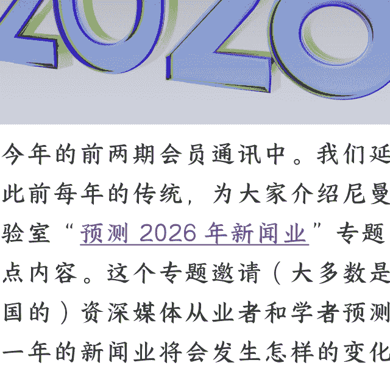
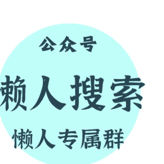

# 预测 2026（上）

## 260104 新闻实验室

整理：公众号懒人搜索，懒人专属群精选  
懒人微信：lazyhelperl

> 当 AI 能够以极低的成本生产巨量的内容时，人性的价值反而被推高了。

在今年的前两期会员通讯中，我们延续此前每年的传统，为大家介绍尼曼实验室“预测 2026 年新闻业”专题的重点内容。这个专题邀请（大多数是美国的）资深媒体从业者和学者预测新一年的新闻业将会发生怎样的变化——当然，预测未来是非常困难的事情，很多人写的与其说是预测，不如说是他们认为新闻业应该走向的方向。

从这两百多篇预测文章之中，我重点选择一些我认为最有相关性和启发性的内容进行介绍。

## **AI 重构新闻编辑室**

新闻业关于 AI 的讨论已经跨越了最初的惊叹与恐惧。大家不再仅仅将 AI 当成生成内容的工具，而是开始将其视作重构新闻编辑室底层架构的基础设施。

Newsroom Robots Lab 的创始人 Nikita Roy 认为，AI 将重写新闻编辑室的架构。传统的“搜索 - 点击 - 阅读 - 行动”模式正在崩溃，取而代之的是“提问 - 回答 - 行动”的模式。也就是说，用户越来越少直接阅读媒体文章，越来越多直接从 AI 获取信息。同时，媒体生产的内容将会越来越多是给 AI 生产的（AI 会迅速抓取和使用其中的信息），而不是给人生产的。

这就意味着，媒体的整个生产模式应该发生颠覆性的变化。她写道，在 2026 年，“新闻机构将从生产型工作流程，转向动态、持续在线的知识环境。团队将围绕维护动态结构化信息展开协作，这些信息能在 AI 驱动的路径中无缝呈现。这标志着新闻编辑室正开启转型之路——不再是每日新闻的工厂，而是为 AI 时代量身打造的现代化信息引擎。”

当然，这段话还是比较抽象，不是很好理解。到底什么叫“现代化信息引擎”？它指的是媒体变成专注于打造知识库的机构吗？这些知识被 AI 拿去之后，怎样保证媒体能够获取合理的回报？我本人也没有太想明白，但 Nikita Roy 的论述无疑能激发我们的思考。

另一些与 AI 相关的预测则更加具体。Kawandeep Virdee 和 Huellas Media Lab 创始人 Tesenia De Moya Correa 都提到了 Vibe Coding。这是一种通过自然语言提示词来构建产品原型甚至直接编写应用程序的方式，它降低了技术门槛，让不懂代码的记者和编辑也能快速构建定制工具。这种“非技术人员的技术创新”被视为 2026 年新闻媒体创新的重要驱动力。

与此同时，美联社的工作流解决方案高级 AI 产品经理 Ernest Kung 预测，大型媒体将加速对 AI 智能体（AI Agents）的实验。这些智能体不仅仅是聊天机器人，它们可以作为“机构知识智能体”（institutional knowledge agent）——在重大突发新闻事件中，自动从媒体的过往档案中检索历史报道，并与设计智能体协作，生成包含文本、图片和视频的内容包。这种自动化不再是简单的效率提升，而是对过刊档案的保存和活化。

然而，对于 AI 带来的商业回报，The Logic 的 CEO David Skok 泼了一盆冷水。他预测，只要 Google 的搜索爬虫和 AI 训练爬虫在功能上仍然捆绑在一起，媒体就无法获得有意义的 AI 授权收入。因为对于媒体来说，为了获得流量必须允许被抓取，而这就意味着免费提供了 AI 训练数据。除非这两者分离，否则 2026 年出版商将无法从内容授权上获得大额的回报。

### 人的溢价

随着生成式 AI 的普及，互联网正在被所谓的"AI Slop"（AI 生成的垃圾内容）淹没。Engadget 的高级记者 Karissa Bell 警告说，这不仅是 Google 搜索流量下降的问题，而是所有分发渠道都被低质量、高产量的 AI 内容堵塞了。新闻机构不仅要与算法搏斗，还要与无限生成的垃圾内容争夺注意力。

在这种背景下，独立研究者 Alexandra Borchardt 提出了一个残酷的"5% 挑战”。她引用一位编辑的话说，媒体的内容中其实只有 5% 是真正的原创报道，其余的都可以由 AI 完成。2026 年，媒体必须面对这个现实：要么找出那不可替代的 5% 并将其扩大，要么被 AI 吞噬。这意味着“复制粘贴式新闻”时代的终结，记者必须回归到 AI 无法涉足的领域：面对面的采访、深度的调查和植根于社区的报道。

当 AI 能够以极低的成本生产巨量的内容时，人性的价值反而被推高了。多位预测者认为，2026 年将是新闻业重新发现“人”的一年。

其中一类人，就是记者。他们的价值将被重估。

独立新闻顾问 Ryan Kellett 提出了一个引人注目的 类比：新闻业正在进入“词曲作者时代”。就像 Taylor Swift 向大众普及了母带版权和词曲版权的区别一样，记者们开始意识到他们拥有对自己创作内容的权利，这应独立于媒体的发行权。以往，记者的文章都被视为版权由媒体所有的职务作品。然而，随着我们进入内容创作者时代，记者们可能会像音乐家一样，要求对自己的作品拥有更长久的所有权和收益分享。

这种向个体转移的趋势得到了西北大学梅迪尔新闻学院教授 Terry Gilbert 的印证。他指出，媒体将最终学会真正重视个体记者，因为大量受众的注意力是追随着个体创作者，而不是媒体机构的。他预测，未来的新闻机构可能更像是一个松散的创作者联盟，或是像图书出版社那样为明星记者提供编辑、法律和营销支持，而不是传统的雇佣与被雇佣关系。

《华尔街日报》的社交媒体高级编辑 Tulia Munslow 进一步阐释了这一点：受众想要的是那个你想邀请参加晚宴的有趣、聪明的人，而不是一个面目模糊的机构品牌。当记者离开机构时，受众往往会跟随记者而去。因此，媒体必须学会如何作为“人才中心”来运作，支持记者建立个人品牌，而不是试图压制它。

这种对“人”的渴望也体现在对真实体验的追求上。受众体验专家 Annemarie Dooling 观察到，人们正在取消媒体订阅，转而将钱花在线下体验上。她预测，2026 年媒体将转向沉浸式体验，通过面对面的活动和社群建设来对抗数字世界的虚无。Creator Spotlight 的主编 Francis Zierer 也认为，线下活动是媒体商业模式的出路，因为没有什么比一场精彩的派对更能巩固受众关系了。

如果他们的预测准确的话，那对于我在做线下空间来说真是好消息。类似的，Library Newsroom Project 的创始人 Terry Parris 也预测，新闻业将建立物理空间的存在。随着数字信息的泛滥和不可信，人们会重新重视那些看得见、摸得着的实体空间。图书馆、公园、自助洗衣店将成为新的新闻分发点和生产点。这种“在场”的行为本身就是一种建立信任的机制。

### 地方新闻的重塑

上面提到的这些在 AI 背景之下的变化，对于地方新闻来说有着特别的意义。

比如，Hunterbrook Media 的出版人 Sam Koppelman 预测：地方调查报道将再次赚钱。因为 AI 只能基于已有的信息进行整合，它无法挖掘被掩盖的真相、无法用无人机去拍摄污染工厂、无法在酒吧里从线人那里听到新消息。因此，那种老派的、基于实地考察的一手信息将成为 AI 时代最稀缺的资源——就像稀土矿物一样珍贵。顺便说一句，会员通讯 752 期曾经介绍，Hunterbrook 的模式就是利用这些独家调查信息进行投资或诉讼，从而获得回报，而不是依赖点击量。

虽然地方新闻的危机依然严峻，但解决思路正在发生根本性的转变。越来越多的预测者认为，本地新闻机构不应再仅仅把自己视为内容的发布者，而应成为社区的基础设施。

斯坦福大学 TSK 新闻奖学金研究员 Eric Ulken 指出，本地新闻必须拥抱其作为“消费品”的角色。除了崇高的公共服务使命，新闻机构必须提供具体的、可感知的价值，比如帮助人们决定去哪里吃饭、如何度过周末、或者了解附近的建筑项目。这种实用性是建立信任和付费意愿的基础。

News Machines 出版人 Ulrike Langer 进一步描绘了这种愿景：本地新闻机构将利用 AI 技术，从单纯的报道者转变为社区信息公用事业机构。它们不仅报道校董会会议，还会提供可搜索的决策数据库、活动日历和邻里互助网络。这种基础设施化的转变，将让新闻机构在社区生活中变得不可或缺。

南加州大学 Annenberg 新闻与传播学院教授 Robert Hernandez 也强调新闻与社区生活的重要联系。他说，那些被寄予厚望的亿万富翁、高尚的慈善机构或鼓舞人心的民选官员都不会来拯救新闻业。未来的希望在于此时此地的新闻人与社区建立的直接联系。

### 后平台时代的生存策略

长期以来，新闻业与大型科技平台之间维持着一种脆弱的共生关系。但随着 Google 搜索流量的断崖式下跌和社交媒体对新闻内容的降权，这种关系在 2026 年将彻底终结。（当然，这是在西方语境下。在中国语境下，新闻业早就是栖身于平台之中。）

Capital B 的首席受众官 Akoto Ofori-Atta 提出了“算法防御”（Algorithm-proofing）的概念。在她看来，新闻机构必须假设搜索和社交媒体明天就会消失，并以此为前提构建受众策略。这意味着回归最原始的连接方式：印刷版通讯、短信服务、甚至是在老年中心朗读新闻。对于服务黑人社区的媒体来说，这不仅是策略，更是生存必需。

The Pivot Fund 的创始人 Tracie Powell 更是预测，2026 年，新闻业对网红（Influencers）的痴迷将会过时。随着年轻人大规模逃离主流社交平台，转向更私密、更小型的社区，依赖网红进行分发将变得不再有效。

未来的公民信息系统将建立在社区拥有的网络之上，而不是硅谷的算法之上。

在这种“后平台”时代，Chartbeat 的 CEO John Saroff 预测，媒体品牌将重新成为核心资产。当被动分发（依靠算法推荐）结束时，只有那些受众愿意主动寻找的品牌才能生存。这意味着媒体必须投资于自身的品牌建设，而不是追逐算法的波动。

对于上面这条预测，我觉得那更多是一种美好的期待，但很可能离现实很远。我个人的悲观预测是，内容的被动分发非但不会结束，而且会愈演愈烈，AI 工具会让大部分人变得更加被动。当 AI 把媒体生产的内容嚼碎了再重新输出，并且隐去媒体名字的时候，“受众主动寻找媒体品牌”这件事恐怕压根就不会发生。

（未完待续，下期通讯将继续介绍其他预测主题。）

最后，安利小懒的付费群：懒人专属群（介绍）  
https://hk57gvlx7u.feishu.cn/docx/H0kRdZbSbolBR0xkaXtcuVE0nTg

# 这里是你对抗信息过载的护城河。

已稳定运行 6 年，累计拆解、研读 3000+ 个互联网商业实战案例与行业前沿内参和时政/宏观文章。

我们不搬运垃圾，只做高价值信息的筛选器与放大镜。

# 懒人专属群更新记录：

https://hk57gvlx7u.feishu.cn/docx/H0kRdZbSbolBR0xkaXtcuVE0nTg

# 【免责声明】

本资料归档于社群内部知识库，仅供成员课题研究与学术交流，请在查阅后 24 小时内删除。