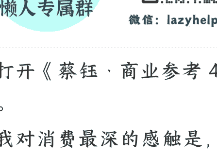

## 195｜年度趋势：政治热情驱动消费

260105  
整理：公众号懒人搜索，《懒人专属群》精选  
懒人微信：lazyhelperl

欢迎打开《蔡钰 · 商业参考 4》，我是蔡钰。

今年我对消费最深的感触是，消费行为学已经不足以理解市场了，得上“消费政治学”才行。

你可能还记得，上半年专栏刚启动时，我们说，需求端的觉醒快过了供给端。我们还说，中国市场出现了阵营消费、阵营经济的趋势，人们在消费时要划分阵营，要在“我们”这里卸防，在“他们”那里赢。

而到了 2025 年下半年，阵营消费的趋势进一步深化，政治热情成了阵营消费当中非常明显的驱动因素。

我展开给你讲讲。

### 需求端的政治热情

前几年有句话，叫“你花出去的每一笔钱都是在为你想要的世界投票”。这句话刚出现的时候，大家觉得很新鲜、很震撼。但现在，已经当作常识在身体力行。

我们这里说的“政治”，既包括主流意义上的政治事件，会出现在报纸时政版的那种，比如 TikTok、安世半导体被其他国家抢夺，日本首相妄议台湾，吸毒记录可以封存，美国“斩杀线”等等，也包括非常规的政治议题。

有哪些例子呢？我们随便举几个，有些你在专栏里见过：

- 7 月，宗家的娃哈哈遗产争夺战，影响了民众对娃哈哈品牌的好感度。有第三方数据平台显示，7 月 14 日、15 日，电商平台娃哈哈日销量近乎腰斩，从 1 万 -1.2 万区间下滑至 5000-7500 区间。宗家长女宗馥莉，先是因为所谓跟“外籍私生子”争夺股权而得到民心，随后又因为“涉嫌转移国有资产”而失去支持。
- 小米汽车，今年在产品竞争、过度营销和安全事故几个维度上，处理事情的方式都引发了一些用户的质疑。这让“国民大哥”雷军的口碑下滑，雷军、卢伟冰等高管的个人微博评论区也成了舆论主战场，不再是往年好评一边倒的模样。
- 暑期档电影《浪浪山小妖怪》，本来是一部预期和实际品质都很高的作品，还顶着“国产动画”的特殊光环。但是因为营销里鼓吹个体觉醒和逃离家庭，导致口碑滑坡，影响票房，出品公司上海电影的股价也跌去了 1/3。

11 月，一款名叫“哈基米南北绿豆”的豆浆爆火出圈，上线 48 小时就售罄，抖音单链接销量超过 15 万袋，工厂的预售发货排期甚至排到了 2 个月之后。

一杯豆浆而已，凭什么？

凭的是，它意外地成了一个“立场符号”。“哈基米”这个词，本来是个指代小猫的可爱网络梗。但豆浆品牌在营销时用了它，就被一些动物保护人士指责“用虐猫梗蹭流量”。这下好了，事情的性质变了。大众的逆反心理被激发，为了保护“玩梗自由”而激情下单，把豆浆订单当弹药，对抗动保阵营的指控。

你看，政治不一定是宏大叙事和新闻联播，也可以是人们在共同生活环境里，关于“谁说了算”和“利益怎么分”的阵营博弈。人们想要通过自己作为一个消费者的力量，去影响事情的走向，去惩罚他们认为错的一方，奖励对的一方。

甚至 2025 年底，“美国斩杀线”这个爆款议题，也是先从中国的民间发酵，再引起中国现代国际关系研究院、美国白宫和《纽约时报》的重视。白宫和《纽约时报》不用介绍了。中国现代国际关系研究院是什么身份呢？它是中国最重要的国际研究智库。你看，一个网络热点，自下而上进入了最严肃、最核心的政策视野。

而民间的这种“政治讨论”热情，几乎贯穿了 2025 年全年：

- 关于“吸毒记录封存”的公共政策讨论，你有没有在朋友圈表态？
- 关于小红书大对账和“美国斩杀线”的社会分析，你有没有参与转发？
- 还有，电影《哪吒 2》《南京照相馆》、农村题材的电视剧《生万物》、迪士尼的《疯狂动物城 2》，你有没有为它们参与过争论？
- 今年流行的《玉盘》《故香风》《没出息》等歌曲，网上“洪康熙”和“红楼梦悼明”的考据狂欢，也都是大众在用情绪去解构情绪、用共识去对抗共识。
- 就连 2025 年 B 站的年度弹幕，也是一个带有价值立场的词——致敬。这个词在 2025 年的 B 站弹幕里被发送了 2282 万次，发过这个词的用户超过 459 万人，其中 80% 是 00 后。

这些现象，都不是传统的商业营销能解释的，都可以算是大规模、自发性的“消费政治实践”。

### 供给端的政治回避

面对消费者如此汹涌澎湃的“政治热情”，企业和品牌们有怎样的反应呢？

我的观察是，大部分公司，处在一种回避问题的状态。

消费公司们当然知道要追热点、搞营销。这边搞搞性别议题，那边蹭蹭霸总文学；漫展、马拉松、中医市集，哪里热闹去哪里。

但效果呢？总给人一种强烈的错配感。打个简单比方，就像一个爷爷面对已经进入青春期的孙辈，还想用滑滑梯、小白兔来哄他开心。孙辈可能出于礼貌笑一下，但心里会叹口气，觉得爷爷老了。

企业和消费者之间，出现了这种尴尬的“代际错位”。消费者已经在严肃地审视价值观、争论社会规则，企业却还在提供一些萌萌的、浅浅的情绪贴纸，提供“去政治化”的浅层娱乐。

有时公司们能摸准市场一时的情绪，但未必理解这情绪背后，年轻人到底在坚持什么、反对什么。

所以，就连最成功的情绪价值玩家泡泡玛特，在捧红 Labubu 之后，也得在年报里承认，无法保证“我们将能够设计及开发受消费者欢迎的产品，或我们将能够保持成功产品的受欢迎程度”。

企业和品牌，出于各种原因，怕犯错也好、怕惹麻烦也好，有意无意地回避了消费者最核心的价值诉求。这就让消费者最显性的诉求，成了房间里的大象，一边对它视而不见，一边抱怨“消费在降温”。

这是 2025 年消费领域最大的供需错配。

带来的结果是什么？

一方面，在社会系统里，商业力量在民众生活中退居到了次要地位。——这话我们在发刊词里说过。

另一方面，在具体生意中，今天的品牌建设和运营动作里，光有凶萌、霸总、亲和、搞笑这类肤浅人设，粘不住思想已然进阶的消费人群。

消费者到底要什么？

消费者在要求，公司和品牌打开自己：把决策过程打开，把日常行为打开，让民众审视和评判，企业骨子里真正相信的是什么。

消费者要通过这来判断，你的价值观是不是稳定，是不是真的值得被当作自己人，纳入共同阵营。

### 正向实践

那么问题来了：政治和价值观的水这么深，这么容易翻船，企业和品牌不碰不行，碰了又风险巨大，到底该怎么办呢？

哎，就是很难啊。

不过 2025 年，我在市场上看到了两个靠谱的答案。有两种价值内核，在今年反复被验证是安全且有凝聚力的。

它们就像汹涌海面上的坚固岛屿，让立足的公司和品牌能得到认可、得到安全。

第一个价值内核，叫“团结”。

团结是什么？是共享创造，也共享果实。责任与共、利益与共。最典型的例子是胖东来。

胖东来卖东西，不走性价比。它给员工们远超市面的高工资、超长假期，这是内部团结；对外，它把经营方法、商品信息也全部公开，还帮同行整改门店，这是行业团结。它还善待顾客、善待邻里、善待社区，这是生态团结。这两年，它也被挑出过一些毛病，但大家维护它的声音总比指责它的声音大。
还有一家公司，也巧妙地奉行了“团结”。谁呢？携程。携程这家公司，专栏提得很少，但它可以说是中国当前所有互联网企业里，掌门人对参政议政最为积极的一家。他的董事长梁建章，一直在推动中国的刺激生育计划，而这个议题跟携程的主业还没有直接利益关系。梁建章呼吁社会鼓励生育的同时，携程自己对这个议题也身体力行。在企业管理，给生孩子的员工发大额奖金、允许在家办公、额外设亲子假期等等。这也让携程做到了知行合一。

生育对谁有好处？对整个中国社会的长期发展有好处。团结大众，也团结未来。这也间接帮携程在今天的大市场上，获得了部分好感。

第二个价值内核，叫“普惠”。

普惠，是我们在 171 讲（《时代》2025 最佳发明的中国产品）提过的《时代》杂志对今天中国创新最大的惊叹。普惠要靠巨大的、成体系的工业能力来支撑。而这正好是所有中国企业都可以共享的。它当然也可以成为大多数中国品牌的候选价值内核。

我要提到的奉行普惠的公司，你可能会有点意外，是蜜雪冰城。

蜜雪冰城，也花了很多力气打造品牌，有雪王的卡通形象，有华与华给它改编的魔性歌曲。

但蜜雪冰城真正粘住民众的，难道真的是雪王公仔、“你爱我我爱你”的魔性旋律和小票上的网络小说吗？

不是的。它真正打动民众的，是普惠这个身体力行的价值观，是它反复写在招股书和年报里的那个关键词，“高质平价”。

它致力于让所有人都喝上品质及格、价钱划算的美味奶茶。这件事，它在中国做，在海外也做。这才让它在偶尔爆出门店卫生问题时，总会被消费者原谅，总会得到网友那句“它不嫌我穷，我不嫌它 low"。

普惠，才是它团结消费者的根本。

你会发现：

团结和普惠，都不是那种高高在上、指点江山的“政治主张”。它们非常朴实，就落在如何对待具体的人，如何分配具体的利益上。这帮企业回应了最大公约数的社会关切，能穿越复杂的舆论场，获得广泛认同。

### **总结**

所以啊，团结和普惠，也供你在给品牌定内核时参考。

如果你还留意到了别的也经受住了市场检验的品牌价值观，欢迎你发在留言区，给我一些启发。

这一讲我们聊的是，2025 年，消费正在成为普通人用来参与社会、表达态度、争夺话语权的工具之一。

消费者为什么会变成这样？这股力量又会把商业带向何方？接下来两讲，我们会继续探讨。

再见。

## 最后，安利小懒的付费群：

### 懒人专属群（介绍）

这里是你对抗信息过载的护城河。

已稳定运行 6 年，累计拆解、研读 3000+ 个互联网商业实战案例与行业前沿内参和时政/宏观文章。

我们不搬运垃圾，只做高价值信息的筛选器与放大镜。

### 懒人专属群更新记录：

> https://hk57gvlx7u.feishu.cn/docx/H0kRdZbSbolBR0xkaXtcuVE0nTg
>
> 【免责声明】本资料归档于社群内部知识库，仅供成员课题研究与学术交流，请在查阅后 24 小时内删除。