# 从 0 跑通亚马逊 CPS MVP：GMV 7000+ 美金，项目细节全流程分享

## 260105 副业 SC 精华

公众号懒人搜索，懒人专属群独享

懒人微信：lazyhelper1


微信：lazyhelper1

## 引言

圈友你好，我是千寻，见字如面，提前祝各位新年 (除夕) 快乐。

在我初中的时候，我读过一本书《穷爸爸富爸爸》，刚看到书名，我当时一度以为是“一夫多妻”题材的小黄书。

后面通读下来，确实第一次让我有小小的震撼，我的财商刷刷的 up+。

当然了书中的例子我们很难去模仿，但是却像一把火点燃了我的小脑瓜。

书中有句话我记忆特别深刻：“想要变成富人，你需要不断的去购买资产，资产会源源不断产生现金流。”

从那以后，我一直在寻找一种通过资产赚钱的方式，市面上有基金、股票、房产等等，

这些虽然也是资产，但是需要的资金很多很多，才能看到不错的收益。

而我毕业了做程序员打工三年的经历，虽然也赚了不少钱，但是每天都要上班，让人身心疲惫，尤其是下雨天下雪刮风天，那真的让人觉得好命苦，后来我就辞职了……

直到 2025 年年底，我从西安旅居来到了广州过冬天，过来之前，我要处理各种琐事，比如给小猫咪找个新家、打扫家里的卫生、准备必备的物品、然后加上坐飞机落地，休息和恢复，整整三四天，我都没有去做我的项目，

但是让我惊讶的是，我打开后台，我最近所做的项目在我完全没开电脑这几天，居然出单了。

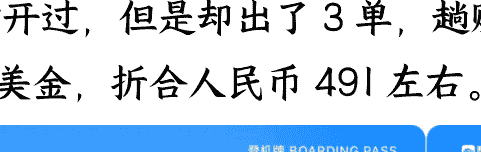

我是 12 月 9 号来的广州，8~11 号，电脑都没打开过，但是却出了 3 单，趟赚 70.23 美金，折合人民币 491 左右。


此刻，我才意识到，这不就是我的心心念念的可以持续产生现金流的资产嘛，每天不用太花心思，就能躺赚。

于是就有了今天这篇文章，下面我将详细的去讲讲这个项目的流程和我的感悟，我将一步一步手把手带你去了解这个神奇的“资产”项目。

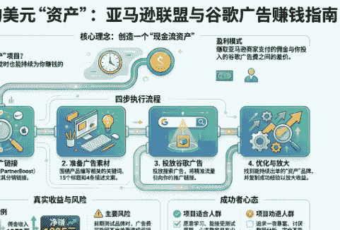

## 项目拆解

## 项目收益

先说下总体情况，我是 11 月中旬开始做这个，11 月 19 号终于出了第一单，我非常开心，后面继续投入更多的时间进去。

| 日期 | 点击 | 订单 | 转化率 | GMV | 佣金 |
| :--- | :--- | :--- | :--- | :--- | :--- |
| 2025-11-26 | 48 | 0 | 0.00% | $0.00 | $0.00 |
| 2025-11-24 | 83 | 1 | 1.20% | $309.11 | $24.72 |
| 2025-11-23 | 79 | 1 | 1.26% | $154.57 | $12.36 |
| 2025-11-22 | 4 | 0 | 0.00% | $0.00 | $0.00 |
| 2025-11-21 | 2 | 0 | 0.00% | $0.00 | $0.00 |
| 2025-11-20 | 26 | 0 | 0.00% | $0.00 | $0.00 |
| 2025-11-19 | 1 | 1 | 100.00% | $62.99 | $6.29 |
| 2025-11-13 | 55 | 0 | 0.00% | $0.00 | $0.00 |
| 2025-11-12 | 25 | 0 | 0.00% | $0.00 | $0.00 |
| 2025-11-11 | 1 | 0 | 0.00% | $0.00 | $0.00 |
| 2025-11-09 | 8 | 0 | 0.00% | $0.00 | $0.00 |
| 2025-11-08 | 28 | 0 | 0.00% | $0.00 | $0.00 |
| 2025-11-07 | 8 | 0 | 0.00% | $0.00 | $0.00 |
| **Total** | **4980** | **51** | **1.02%** | **$7,097.49** | **$521.07** |

截至目前 1 月 02 号，我跑通了项目的 MVP，GMV 7097.49 美金 佣金 521.07 美金，

这里数据其实偏少，因为从用户下单到收货完成，佣金到账存在延迟，所以只会显示三天前的数据。

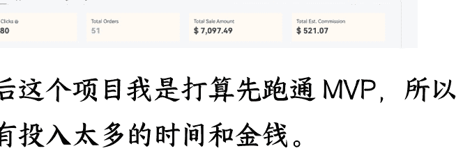

然后这个项目我是打算先跑通 MVP，所以没有投入太多的时间和金钱。

但是项目的上限很高很高，月入万刀的人大把，后续我也会继续投入更多的时间和钱去做这个项目，放大收益。

## 项目流程

这个项目其实特别简单，就三个步骤。

### 一、申请推广品牌

首先我们要去【联盟平台】申请分销链接，我这边用的是 Management Platform - PartnerBoost，简称【PB】上面大部分都是亚马逊的店铺分销，我们要拿到【分销店铺的链接】、【分销地区】。

点击【Get Link】获取【分销链接】。

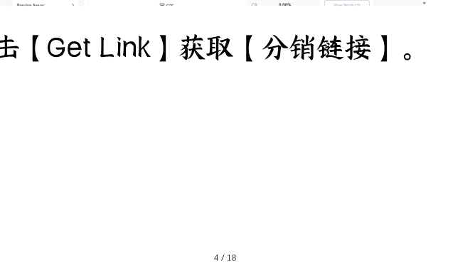

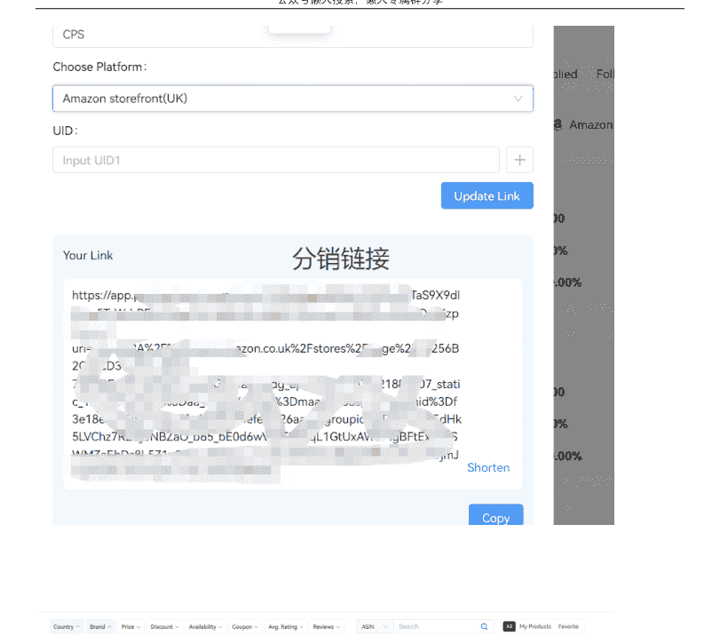

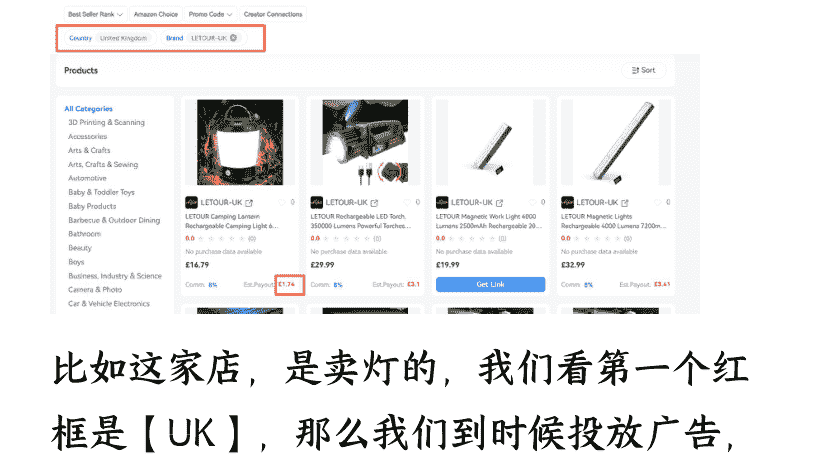

比如这家店，是卖灯的，我们看第一个红框是【UK】，那么我们到时候投放广告，就要投放到英国去，

#### 常见的国家代码：

- CN — 中国
- US — 美国
- UK/GB — 英国（标准是 GB）
- JP — 日本
- KR — 韩国
- FR — 法国
- DE — 德国
- CA — 加拿大
- AU — 澳大利亚

### 二、编写广告素材

然后我们就可以开始写广告素材咯

广告素材分四个板块：

- 关键词
- 标题
- 描述
- 投放链接

前三个板块都要严格围绕你选择的品牌和商品去写，这个要靠多积累，你写多了就会写出好的广告。

数量和长度要求：

- 关键词若干。
- 标题写 15 个，每个 30 字符内。
- 描述写 4 条。每个 80 字符内。

第四个投放链接，就是你访问分销链接后在浏览器地址栏生成的链接，一般是亚马逊域名开头。

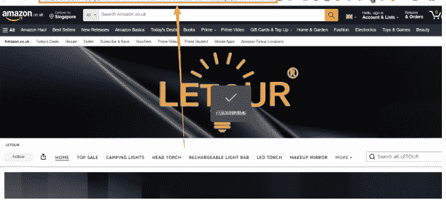

### 三、广告投放

然后我们去谷歌广告，把上面写的广告素材投放即可。

```
http://www.ads.google.com
```

下面是投放的具体步骤，考虑到网络环境的纯净，我单独用一台笔记本专门做这个项目，因为没有装国产软件，所以不方便截图传输，我就直接拍摄屏幕了。

#### 1、选择投放目标

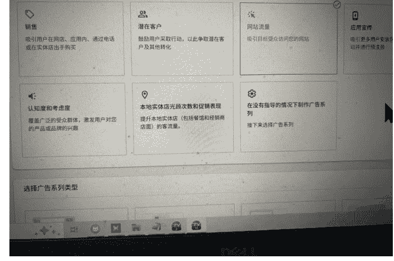

这里我们选择网站流量，其实就相当于你们平时发视频写笔记获得流量，而我是通过付费广告获得流量。

#### 2、选择广告类型

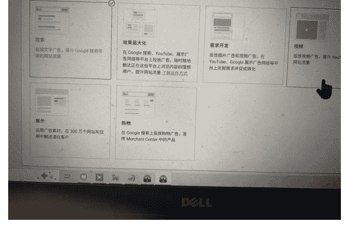

然后我们要获得的流量是谷歌的搜索流量，比如上面那个品牌，当用户搜【LET0UR】以及类似关键词的时候，就会弹出我们的广告，这些可全都是精准流量呐。

#### 3、选择转化目标

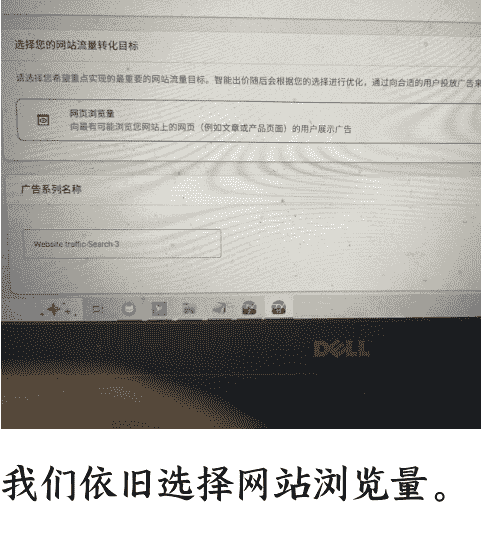

我们依旧选择网站浏览量。

#### 4、设置出价

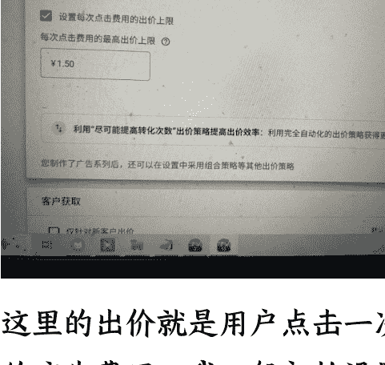

这里的出价就是用户点击一次广告，消耗的广告费用，我一般初始设置 1.5 人民币，如果没有出单就慢慢往上加。

#### 5、选择推广方式

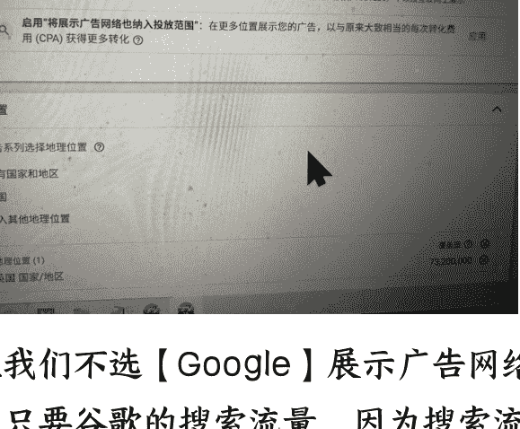

这里我们不选【Google】展示广告网络，我们只要谷歌的搜索流量，因为搜索流量是最精准的流量。

然后地理位置，看投放哪里就选哪里，这里选错了，你广告费就白花了。

#### 6、选择语言

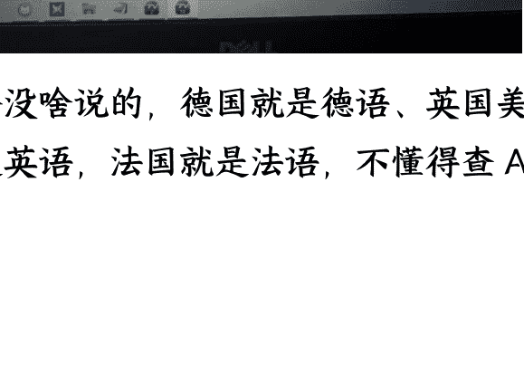

这个没啥说的，德国就是德语、英国美国就是英语，法国就是法语，不懂的查 AI。

#### 7、填写关键词

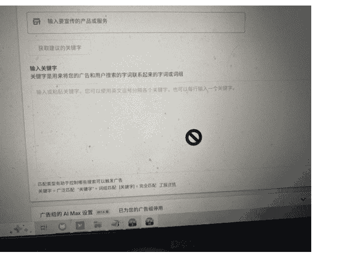

这里就是填写，你刚刚写的关键词，至于怎么写，就要靠你多尝试了。

#### 8、填写最终链接

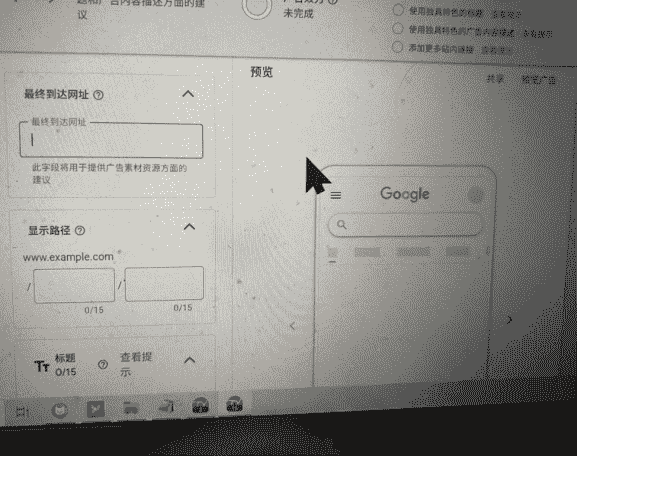

这个我们在【二、编写广告素材】里讲过了，就是【投放链接】。

#### 9、填写标题

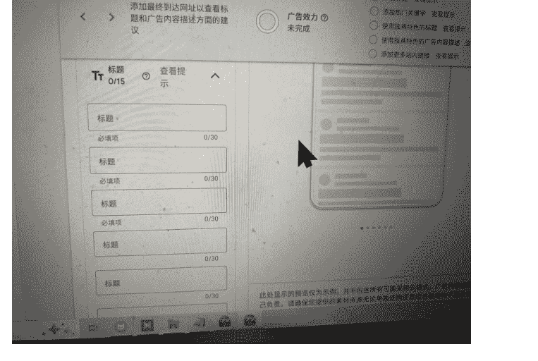

#### 10、填写描述

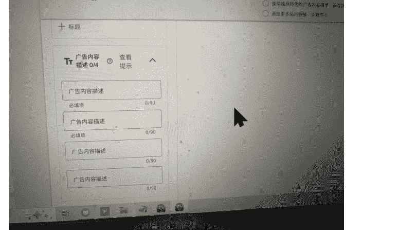

#### 11、发布广告

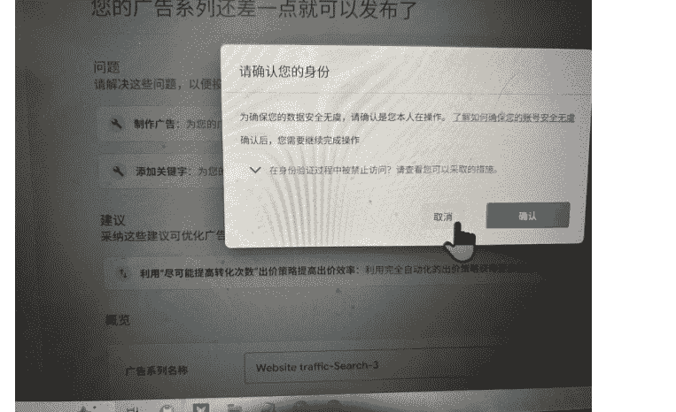

这里一般会过身份验证，填写个验证码就发布了。

### 四、出单刷量

投放完成后，我们要在不同 IP 下，刷 20 次，后续每出一单，继续要刷 20 次。

刷量就是访问 20 次【分销链接】。

这一步是为了让后台的数据更加真实。

刷量的必要性：

因为咱们是邪修的打法

首先谷歌广告是不允许你直接投放分销链接

因为分销链接他会跳转到最终链接

谷歌是不允许你投放的链接有跳转行为

所以我们投放的是最终链接

但是最终链接有问题 用户访问最终链接

联盟平台后台是没有点击数据的

那么就会出现一个情况 联盟平台发现你没有点击数据却出单了 这是一个异常情况，

很可能不会给你结算佣金

我们刷这个量 就是为了去刷这个分销链接，让联盟平台后台有点击数据

至此，咱们整个流程就全部完毕了。

### 五、日常任务

后续我们每天要做的事情就是，多选一些

好的品牌，然后再看看谷歌广告每天的消耗情况，如果 7 天没出单就加点出价预算，如果还是不出单就换品牌。

前期基本都是测试品牌，如果遇到品牌持续出单，那这个品牌就是你的资产，你只需要保证广告余额充足，google 广告会在你睡觉、吃饭、打游戏的时候，持续源源不断的给你赚钱。

最后出几个问题来捋一下，看你听懂了没！

#### 问题一：赚钱到底赚谁的钱？

> 答：亚马逊商家卖出商品给你的分佣减去你广告费的差价。

#### 问题二：流量从哪来？

> 答：谷歌付费投流，搜索来的精准流量。

#### 问题三：怎么放大收益？

> 答：创建多个谷歌广告账户，你的谷歌账户越多，你的流量就会大，流量越大，你的出单就会越多。

#### 问题四：有风险吗？

> 答：当然有，但是风险可控，在谷歌账户里充值钱是可以随时提取出来，这里主要的风险在于前期测品，比如你选了一个品牌，然后投放，结果不出单，只有点击，那这里消耗的广告费就会亏损。

解决方案：这通常是因为你对选品以及写广告素材没有经验导致，所以要不断的学习提升自己的选品能力和写广告素材水平。

还有一个亏损的点，就是有的品，用户用了优惠券或者用户退款，这些都会让你损失广告费。

解决方案：多选品，因为大部分品很少会遇到用优惠券或者退款的情况，你指望某个品一定出单，那是不现实的，但是你选一堆品在一起，盈利的品会远远覆盖亏损的品。

#### **正所谓你想吃苹果，只种一棵果树，那你吃苹果得看天意，**

但是如果你种一片果园，那你就可以每天稳定吃到苹果了。

这就是用数量抹平概率。

最后，分享以下我目前在跑的一个“资产”品牌：

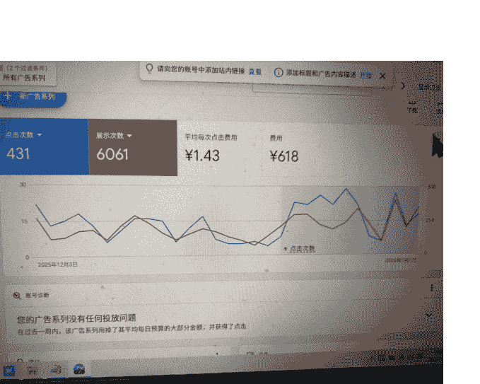

#### **2026 新的一年，我们一起赚美刀！！！**

这个谷歌广告消耗的广告费是人民币 618 元。

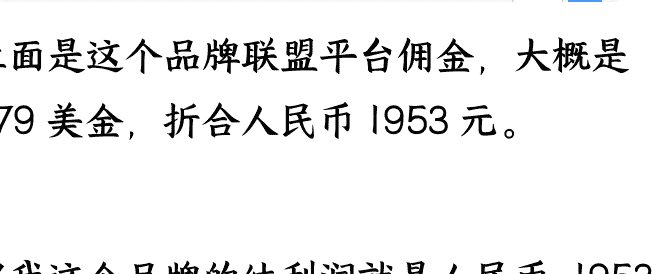

上面是这个品牌联盟平台佣金，大概是 279 美金，折合人民币 1953 元。

那我这个品牌的纯利润就是人民币 1953-618=1335 元

这还只是一个品，我目前只测出了两个品，如果测出 10 个品，这个利润可以 \*10

以此类推，你们还觉得月入万刀是遥不可及的梦吗？

## 劝退人群：

- 指望“一夜暴富”的人：它更像是搭建系统、滚雪球，而非暴利项目。
- 完全不能承受亏损的人：测试阶段出现浮亏，是很正常的过程。

### 这个项目更适合这样的人

- 能接受测试周期的人：前期需要不断试品牌、试素材，不一定一上来就赚钱。
- 有一点基础资金的人：广告是要先花钱的，一般建议准备好一笔“可亏得起的测试预算”。
- 愿意学习的人：选品逻辑、关键词、广告优化，都是越做越熟练的技能。
- 心态稳定、能复盘的人：遇到没出单，会冷静看数据、优化模型，而不是情绪化加预算或放弃。

这是一个有学习曲线、回报上限高、也有不确定性的项目。

而非“短期投机”，经过长期的学习和实践它才会慢慢变成真正的“资产”。

这篇到此就结束了，如果有什么问题可以在【生财评论区】提问，看到有空会回答。

这个项目看起来简单，其实做起来真的是如履薄冰，层层门槛，细节也特别多，这里因为篇幅原因，没办法把每种情况都写出来，但是我们有一个不出单不罢休的心，逢山开路，逢水架桥，多问问 AI 和大佬，没有任何问题是解决不了的，太阳底下没有新鲜事，你所遇到的问题都有答案。

## 2026 新的一年，我们一起赚美刀！！！

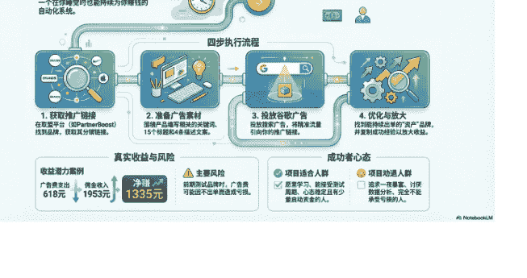

最后，安利小懒的付费群：

懒人专属群（介绍）

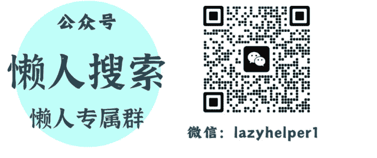

这里是你对抗信息过载的护城河。

已稳定运行 6 年，累计拆解、研读

3000+ 个互联网商业实战案例与行业前沿

内参和时政/宏观文章。

我们不搬运垃圾，只做高价值信息的筛选器与放大镜。

### 懒人专属群更新记录：

https://hk57gvIx7u.feishu.cn/docx/H0kRdZbSbolBR0xkaXtcuVE0nTg

【免责声明】 本资料归档于社群内部知识库，仅供成员课题研究与学术交流，请在查阅后 24 小时内删除。