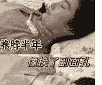
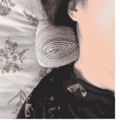
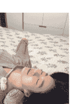
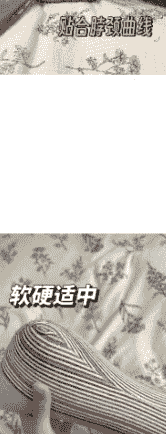
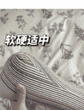
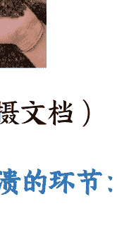

# 艺术生从 0 做小红书电商，借助 AI 自动化、情绪提示词，实现 40 倍增长，我的一些实战经验 6 月 05 日 副业 SC 精华 公众号懒人搜索，[懒人专属群](http://text.chat)独享 懒人微信：lazyhelper1

大家好，我是雨杰，加入生财 3 年多，人在武汉，目前是自由职业，之前跟着航海做视频号带货，现在主要做小红书电商垂直小店。今年 3 月，我从 0 开始学习小红书电商，并借助 AI+ 自动化，实现了：

- 6 月份单店 GMV:1 万+
- 7 月份单店 GMV 翻倍：2 万+
- 8 月份单店 GMV10 倍增长：12.7 万+
- 9 月份单店 GMV40 倍增长：44 万+
- 目前单店每月 GMV 稳定在 17w 左右

在这之前，我并没有独立做电商的经验。

我**以前**是美术生，大学是工业设计专业。

毕业后有 6 年金融产品经理工作经验。

能取得这个结果，生财有术对我的帮助非常大。无论是看生财精华帖提升认知，还是参加航海获得一些真实手感，还是通过生财认识到一些很真诚分享的老师，我都觉得受益良多。非常感谢生财。

前几天，我看到亦仁老师发的垂直小店的超级标 https://t.zsxq.com/tVmTf ，而我做的事情和工作流程，和这个帖子里讲的内容比较契合：小红书、电商带货、AI 自动化。

所以，今天来分享一下，我做这个项目过程中的一些经验和思考，希望能给到大家一些参考。

# 文章大纲——

- 1 我为什么选择了小红书电商赛道？
- 2 小红书选品的思路
- 3 如何制作高质量笔记？
- 4 我如何低成本找摄影师，拍出高点击率的照片
- 5 一个让我近乎崩溃的环节：客服
- 6 AI 情绪提示词，40 倍增长，单月 44 万

## 7 生财有术是一个宝藏

### 1 我为什么选择了小红书电商赛道？

3 月份，我选择做小红书电商。

在当时，视频号电商红利期已过，进入后半场，剧情 + 付费的模式，普通个体要拿到成绩比较难。

于是，我看了大量生财精华帖，也和很多老师请教，调研市面上的各个项目，结合自己的优势，我最终选择了入局小红书。

我选项目的判断标准是这样的：

- 1、项目是否处于红利期，新手入局机会；
- 2、有大量个人成功案例；
- 3、项目能力需求与我的属性点契合：我擅长实拍，有审美，对电商文案有一定理解；
- 4、非短期项目，能持续健康经营，而非与平台对抗；

根据以上 4 点，最终我选择了小红书电商。

在了解项目的过程中，我和身边做视频号的朋友打电话，了解他们的现状。

朋友们有的在做快手，有的在做公众号流量主，在交流的过程中，一位在生财认识的朋友，向我推荐一篇半糖老师的公众号文章。她分享了自己做小红书电商的经历。

从她的字里行间，我感受到自己认识的电商人身上从未有过的松弛：她在这个浮躁时代，没有去追红利、赚快钱，她花了很多的心思去思考如何去优化工作流，从选品开始，就有非常清晰的判断标准和自己的思考，我发现她有着独到的眼光、识别核心要素、并耐心耕耘的心力。

看完后，我很希望能有这样的一种状态。

所以，我鼓起勇气联系了半糖老师，和她学习如何做小红书。

因为，小红书项目，我已经确定好了。而这位老师，她的价值观，和行事风格，是我想要追求的样子。

两者都非常契合，我就一定要抓住机会。

于是，我就开始了。

### 2 小红书选品的思路

确定要做小红书后，我开始紧锣密鼓准备账号，开店。

因为有之前做视频号的基础，所以在初期准备账号、设备、开店流程等基础事项上，我很快就完成了。

具体的一些操作细节，大家可以去看小红书电商生财的精华帖，或者航海手册里，里面非常详细。

这里我就不多赘述。

很快，我遇到了小红书电商新人一定会碰到的第一座大山——选品

小红书电商垂直小店的模式主要是做跟品代发

#### 为什么有的品是爆款？

#### 我做了能爆吗？

我带货的内容形式是否有竞争力（这个品属于颜值品，拍的漂亮是王道，还是有功效，得强调给用户解决实际问题）

用户为什么要在小红书去购买，而不是去淘宝拼多多？

选品的本质，是对这个品背后的人群需求的洞察和理解。

但以我目前的经验，和对行业的敏锐程度，很明显无法做到这一点。

### 分享一个趣事 ——

在初期选品时，我刷了一整天，只选出了 1 个品，一个中古画框。就把它加入了购物车。

我的思路是这样的，碰到一个自己觉得能卖的品，就把它加入购物车，方便我后续找到。

但我发现，这个品对拍摄场景的要求非常高，它的笔记图是这样的：装潢精致的卧室里，阳光从侧面的飘窗撒进来，映衬这个这个画框熠熠生辉。

我扭头看了一眼我家的卧室，完全不符合这个图片里的场景。如果我要卖这个品，还需要专门去找地方拍摄，成本就很大，复杂度也提升了很多。我叹了一口气，默默的从购物车里，删除了唯一的这个品。

这件事给了我一个启发 —— 我们每个人的小红书刷到的信息，是自己的信息茧房，你爱看什么，小红书就疯狂给你推什么。如果不打破信息茧房，就很难看到真实的用户需求。

于是，我换了一个全新的小红书号，有意识搜索关键词，比如礼物，饰品，摆件，好看（颜值品会有的关键词），以及痛点、

失眠、祛湿、气血、瘦，养生等（功效品用户会搜的词汇，视频号养生品的经验发挥作用了）

再去选择“可购买”的笔记，终于选了 10 个品。

我觉得我看到了曙光。

个人的经历是有限的，我不可能同时测 3 个以上的品

我需要清晰的对目前的选中的品，做一个清晰的优先级划分。

那要怎么做呢，思路是这样的 ——

- 1、可实拍性，即自己的拍摄条件是否能和 对标一致甚至超过对标；
- 2、代发渠道是否有现货；
- 3、产品要简单直接。意思是，这个产品不会有歧义，比如，一把梳子就是一把梳子，用来梳头的，大家不会问我：这个梳子是用来干嘛的。相反的一类就是复杂的品，比如需要拼接的玩具，用户会问：这个可以拼成什么形状，该怎么拼，万一拼不好怎么办。会有很多售后问题。新手初期不建议选这种复杂的品。

- 4、是否低粉爆款/评论区狂求链接，说明该品在站内的需求烈度；
- 5、单品毛利率不低于 50% 或者一单利润 10 元以上，确保自己有利润

选品的时候我们可以把找到的品，归纳到这样一张表中，进行横向对比，即可快速筛选出可以去测试的品了

我只需要做简单的判断，然后提高测品效率就好

比如上面这个表，产品 6、5 个条件都满足，我就直接选择它来卖。这样出单的概率就更大。

### 3 如何制作高质量笔记？

选完品之后，接着就是要思考，如何批量制作高质量的笔记？

一篇小红书笔记，通常由 4 部分组成——

- 1、封面及内页图片
- 2、标题
- 3、正文
- 4、话题（标签）

以上 4 个部分，按照重要程度排序是：封面>标题>正文>话题

我们重点展开封面和标题，因为这 2 个部分是决定用户是否点进来的核心：

富贵老师说，小红书对笔记的推流模式，每篇笔记都会平等获得 1000 曝光，笔记在用户的发现页，与同屏幕的 4 个笔记进行对比，用户注意力在每篇笔记上停留 1.5s 的时间，你的笔记能否让用户留意，点开，就看你的封面和标题了。

其他 2 个正文和话题，所有的小红书都类似，我就不展开了。

封面和标题，我的做法是一比一复刻。
我是这样做的:

1 将做这个品的对标账号，和小红书站内同类品的所有笔记（包含笔记链接、标题、博主、赞数。）爬下来，形成一个对标笔记库;

2 再将这个笔记库，按照赞数从高到底排序，我们重点参考前 20 条高赞笔记。

| 笔记链接 | 标题 | 博主名称 | 赞数 |
| :--- | :--- | :--- | :--- |
| https://www.xiaohongshu.com/use... | | | 7868 |
| https://www.xiaohongshu.com/use... | | | 1893 |
| https://www.xiaohongshu.com/use... | | | 1083 |
| https://www.xiaohongshu.com/use... | | | 1008 |
| https://www.xiaohongshu.com/use... | | | 871 |
| https://www.xiaohongshu.com/use... | | | 747 |
| https://www.xiaohongshu.com/use... | | | 727 |
| https://www.xiaohongshu.com/use... | | | 688 |
| https://www.xiaohongshu.com/use... | | | 654 |
| https://www.xiaohongshu.com/use... | | | 570 |
| https://www.xiaohongshu.com/use... | | | 567 |
| https://www.xiaohongshu.com/use... | | | 529 |
| https://www.xiaohongshu.com/use... | | | 467 |
| https://www.xiaohongshu.com/use... | | | 458 |
| https://www.xiaohongshu.com/use... | | | 397 |
| https://www.xiaohongshu.com/use... | | | 385 |

参考方式如下——

1 将封面提取出来，整理好，用于后面给摄影师参考，来拍照片。确保拍出来的照片风格，和原笔记的风格保持一致。（这部分是我花比较多时间的地方，下一部分会单独展开讲，因为我觉得这是我能拿到结果的一个很重要的环节）

- 2 将标题提取出来，使用 AI 提取关键词，方便后续改写、拓展出更多笔记内容；

今年 6 月份生财的航海家流量大会上，我听完了富贵老师的分享，里面也提到利用 AI 提出关键词，拓展出更多笔记的内容。我就参考她的这个提示词，生成了我的更多标题。（第 6 部分会重点分享）

### 4 我如何低成本找摄影师，拍出高点击率的照片

前两天明白老师来武汉找我玩，我们一起坐车，我说，我等会要先把拍摄物料（样品 手机 道具）给到摄影师。

然后，他对这个过程很好奇。我们就聊了一会。

这个对话过程，就能很清晰的展示出，我做这件事的逻辑，和思考——

明白老师：你找摄影师拍照，要花多少钱？

我：150-200 块左右。

明白老师：一共拍多少张？

我：5000 张左右。

明白老师：5000 张？？？才 150 块？？怎么这么便宜？

我：其实很简单的，拿着手机按快门就好了。

明白老师：竟然不用相机？就直接用手机？是不是用相机像素会更高一些？

我：其实刚好相反，因为小红书的图片，需要 live 图，用手机更方便一些。

明白老师：竟然还有这样的工具？厉害了。我听你说，现在这个摄影师，是你选了很多久的。你之前找过几个摄影师？

我：找了十来个，最终我发现，这个摄影师和我最契合。

明白老师：怎么就算找契合？你的判断标准是什么？

我：第一，要离我家近，因为这样有事情我就能及时和对方沟通。第二，对方需要有一定审美，我只需要提供产品的场景，他就能自己拍。

明白老师：摄影师怎么知道，产品该拍什么样子啊。你会告诉对方吗？

我：是我的，场景、角度、灯光，这些我都会提前写成一个文档，交给摄影师。给你看看（图片在下方）

明白老师：这个确实好细致。那既然你都整理的这么详细了？为啥要找摄影师拍？

你自己拍可以吗？

我：其实是可以的。

明白老师：那你怎么不自己拍？

我：我想要解放自己的时间，让自己把注意力放在更重要的事情上。

#### 拍摄计划 - 荞麦枕 -2025 年

##### 一、拍摄前准备

#### 套stens

|  (待选) |
|---|
| (待选) |

| **拍摄道具**
| 模板 1：花睡衣、素描被套、按摩梳、荞麦壳、杀手帽
| 模板 2：粉色睡衣
| 模板 3：软质枕头、格子枕套、绿草床单枕套、灰色睡衣、木质托盘、席子
| **备用统计** |

### 拍摄数统计

| **102 日需要的图片数量** | 7 | 6 | 7 | 4
| **2 每天需要的图片数量** | 140 | 120 | 140 | 0
| **3 测试 (3天) 的图片数量** | 4200 | 360 | 4200 | +

## **拍摄角度 1：侧躺，枕普通软枕头**

- • 灯光：自然光
- • 首图标图：让脖子回家
- • 需要 P 图加文字

## **拍摄角度 2：躺平，双下巴拼图对比**

- • 灯光：卧室顶光
- • 构图：脖子部分位于画面正中心
- • 正确睡姿明显美颜了！

## **拍摄角度 3：躺平，脖子与枕头贴合细节展示**

- • 构图：枕头和脖子位于中心偏右
- • 需要添加文字：三角设计 拉伸脖颈曲线～

## **拍摄角度 4：躺平，舒展上半身**

- • 构图：枕头和脖子位于视觉中心，能拍摄到旁边的柜子
- • 灯光：卧室顶光
- • 明显美颜了！

## **拍摄角度 5：躺平，展示侧面脖子和枕头贴合弧度**

- • 构图：枕头和脖子位于视觉中心，能拍摄到旁边的柜子

- • 灯光：卧室顶光

- • 需要 P 图划线，2 行文字：人体工程学设计，贴合脖颈曲线

- • 床头柜放一个花瓶，花的颜色与画面呼应

- • 明显美颜了！

## **拍摄角度 6：枕头特写**

- • 手拖住枕头
- • 文字：软硬适中

## **拍摄角度 7：捧起荞麦壳**

- • 灯光：有阳光打过来

- • 看起来很健康天然，放了枕头在里面说明这两者相关

## **（我给摄影师的拍摄文档）**

### 5 一个让我近乎崩溃的环节：客服

在小红书，有一个一直很火的品，每段时间都会出现一个爆品，大家估计都刷到过，荞麦颈椎枕

这个品在小红书的需求巨大，带最好的店铺，在当时单品销量已经到 60w+ 单，同时，有低粉的账号也跑出来了，我也打算试试；

带这个品的过程中，除了发现它的内容制作成本高，同行卷的厉害，我还遇到了一个困难：客服。

在带货初期，我是自己做客服。

我发现很多客户，他们对产品的要求很高，会问很多问题，提出很多对产品不满意的点。

单子

我遇到了一个客户，对产品不满意，给了我差评。当时我主动联系客户，了解了原因，想要和她协商一下，看看能不能用补偿、退货等方式，争取让客户取消差评（这个处理方式不成熟，取消差评各位直接仅退款即可）

但这个客户反馈说，产品有瑕疵，要留下产品，而且要全部退款。

但我全额退款后，她又不遵守约定，继续以取消差评为挟，让我再发一个新的。

我当时整个人都不好了，非常难受，觉得天都塌了，一整天什么都不想做。

我想不通，这个世界上怎么会有这样的人，怎么会发生这样的事情。

后来，我和一个做电商的朋友哭诉这个客户的离谱操作，感叹世界之大，我之前从来没有见过这样的事。

朋友安慰我说，你会遇到很多自己意料之外的客户，这是再正常不过的事情。

我因为这个客户的售后难过了 2 天，这两天工作完全提不起精神。以至于我这两天，一篇笔记也没发，也不想和摄影师沟通拍照的事情，连饭都不想吃。

我就突然感觉到，处理售后，和客户沟通这件事，我做起来很比较耗费心力。

我会因为客户的善意而感动，也会因为客户的恶意难受很久，这非常影响我拔剑的速度。

于是，在有稳定的利润时，我果断做了一件事：把客服外包出去，保护好自己的心力。

虽然客服外包的回复，只是按照一些常规模板来复制粘贴，肯定是不如自己用心去回复的效果好。

但在我看来，这仍然是一件性价比极高的事情。

因为，虽然用客服，会损失一些客户转化和满意度，降低一点利润。

但节省下来的时间，我可以用在其他事情上，比如写笔记，做封面，调研选品之类，这些地方增长的点，大大可以把前面的损失，弥补回来。

我现在每天有更多的时间，去思考选品和做内容，不再经常被客服消息打断我的工作了。

我觉得轻松了很多。

如果也有被客服困扰的同学，可以试着去外包这部分工作。

把自己珍贵的心力、注意力、精力，投入到更重要的事情上。

## **6 AI 情绪提示词，40 倍增长，单月 44 万**

在小红书商业模式中，选品定生死。

在这件事上，我之前一直都不温不火。

迎来历史性转机的，是在 3 月份出现的一个品。

我们称他为 A 品（抱歉，不方便透露具体的产品）

从 3 月份开始做时，这个产品就只是静静的躺在我的测品表中，偶尔出单，好像要爆的样子，但又没有爆。我有点想要放弃，但又有一点不甘心。所以，就一直留院观察。

# 6 月份，我收到了晓文哥和鹏师的邀约，一起参加了 6 月广州的生财航海家新流量大会。

在大会上，我听了富贵老师的分享，刷新了我的认知。

我发现，原来做小红书内容，和我之前做产品经理，有异曲同工之处。

我感觉自己的大脑里，某两个地方的神经元，突然连通了。

于是，我回去结合富贵老师的提示词，做了 2 个重点的优化：

-   我开始借助 AI 去分析，消费者购买 A 产品时，背后到底有怎样的情绪。
-   他们是焦虑、恐惧、还是欣喜？
-   他有哪些未被满足的需求？
-   他们想解决问题时，会有什么行为？
-   他们的痛点、痒点、爽点是什么？

然后，根据这些分享出来的内容，我做了 2 个优化点——

## 1 我在自己的笔记内容中，埋入了更多用户会搜索到的关键词，这样用户在搜索关键词的时候，就能更大概率看到我的笔记。于是，我整体的流量也有了大的增长。

这部分关键词来自对标爆款笔记，通过 AI 提示词去提取，提示词如下：

> 你是一位消费者评论分析专家，请从以下标题中，提取出"高频 + 高情绪"的关键词与句型，用于识别用户真实的感受与表达偏好。

请一步一步完成以下任务：

提取重复出现的功能相关词汇、情绪相关词汇标注出带有情绪色彩的表达 (含痛点、痒点、爽点)，判断哪些词汇/表达与预设产品一致总结建议 (哪类表达值得用于创意或产品优化)

## 2 (2) 标题、内容里面，在功能之外，我还加入了一些情绪类的词，这样更能引发痛点共鸣，转化率也提高了。（见上图）

我根据富贵老师的提示词，优化了标题中关键词的内容，让标题增加了更多的情绪词。

于是，命运的齿轮开始转动......

-   6 月份，1w+
-   7 月份，2w+
-   8 月份，12.7w+
-   9 月份，44w+

...

虽然冬季是这个品的淡季，但近期单月销量也一直稳定在 17w 左右。

### 货款账单

| 日期 | 订单数 | 收入 | 支出 | 净利润 |
| :--- | :--- | :--- | :--- | :--- |
| 2025/09 | 18841 | 461899.76 | 13705.19 | +448194.57 |
| 2025/08 | 5436 | 132245.66 | 4709.43 | +127536.23 |
| 2025/07 | 1043 | 25581.31 | 809.65 | +24771.66 |
| 2025/06 | 443 | 10372.39 | 218.67 | +10153.72 |
| 2025/05 | 289 | 6396.89 | 232.80 | +6164.09 |
| 2025/04 | 9 | 45.39 | 0.00 | +45.39 |
| 2025/03 | 3 | 57.90 | 0.00 | +57.90 |

没有更多了

> 如果不是意外，我大概率会一直把这个产品卖下去。

因为不依赖经验、网感、高超的运营技巧，才能卖出去，而是：

-   它乖巧懂事，内容创作简单，我不用耗费过多精力
-   它聪明伶俐，在测品初期，偶尔给我一点甜头，让我没有放弃
-   它温顺听话，没有违规没有售后，退货率也很低

...

所以，我想要和它天长地久的一起走下去。

## 7 生财有术真是一个宝藏

以上就是，我做小红书电商垂直小店的一些经验。

这个阶段积累的一些知识、技能、审美、供应链、工作流程、AI 自动化、提示词等，我感觉自己成长非常大。

对于小红书电商，12 月份我来杭州，也请教了富贵老师，她给了 2 个可以拓展的方向：做宽和做深

做宽，通过目前这套流程，拓展大健康用户群体下，有其他需求的产品，复制更多的垂直小店。

做深，围绕 A 品痛点的人群，拓展周边的一些产品，提高客单价。

接下来，我会在这 2 个方向，继续深耕，希望 2026 年，可以获得不一样的结果。

最后，我想说，生财有术社群真的是一个宝藏。

因为生财，在初期选项目的过程中，我能快速找到大量的可选项目

因为生财，在确定项目在动手实操的过程中，我能搜索到大量前人经验去学习，链接到不少同路的朋友

因为生财，在项目过程中，我通过航海家大会，链接到做内容的很多老师，学到很多方法、思路

大家一定要用好生财。

祝大家在新的一年，都能找到自己适合的项目，和让自己满意的生活方式。

## 最后，安利小懒的付费群：

### 懒人专属群（介绍）

这里是你对抗信息过载的护城河。

已稳定运行 6 年，累计拆解、研读 3000+ 个互联网商业实战案例与行业前沿内参和时政/宏观文章。

我们不搬运垃圾，只做高价值信息的筛选器与放大镜。

### 懒人专属群更新记录：

https://hk57gvlx7u.feishu.cn/docx/H0kRdZbSbolBR0xkaXtcuVE0nTg

> 【免责声明】本资料归档于社群内部知识库，仅供成员课题研究与学术交流，请在查阅后 24 小时内删除。