## 传术师分享 - AI 时代个人出海赚美金

# 260106 副业 SC 精华 > 公众号懒人搜索，懒人专属群独享

懒人微信：[LazyHelper1](mailto:lazyhelper1)

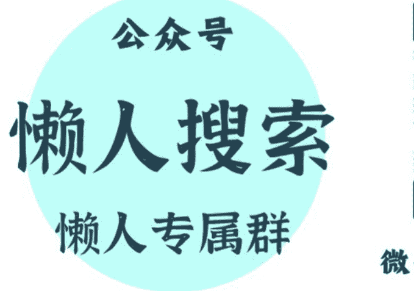

### 一、林悦己自我介绍

**加入生财后的 20 个月**

24 年 3 月底加入生财，一个月后，流量放大了十倍，副业稳定一万以上，8 个月赚到第一个工作以外的第一个六位数。

24 年年底开始接触 AI 编程，跨年前参加了第一场传术师聚会。

Cursor 航海以后参加龙珠悬赏，拿到第一篇龙珠贴。

因为帖子被亦仁哥跟小排老师邀请来杭州开始了我的 AI 出海之旅。

25 年之前非 AI 行业，非互联网，非产品，非技术，总之就是各种非，116 天大力出奇迹，硬生生跑通了 AI 产品出海的 0-0.1，第二个产品 9 天开单。

9 月底决定放下 AI 产品，投身海外 AI 自媒体，

国庆 TikTok 起号，百万爆款以后，上线了第三个产品上线 3 小时出单。

TikTok 3 个月 7.5K 粉。

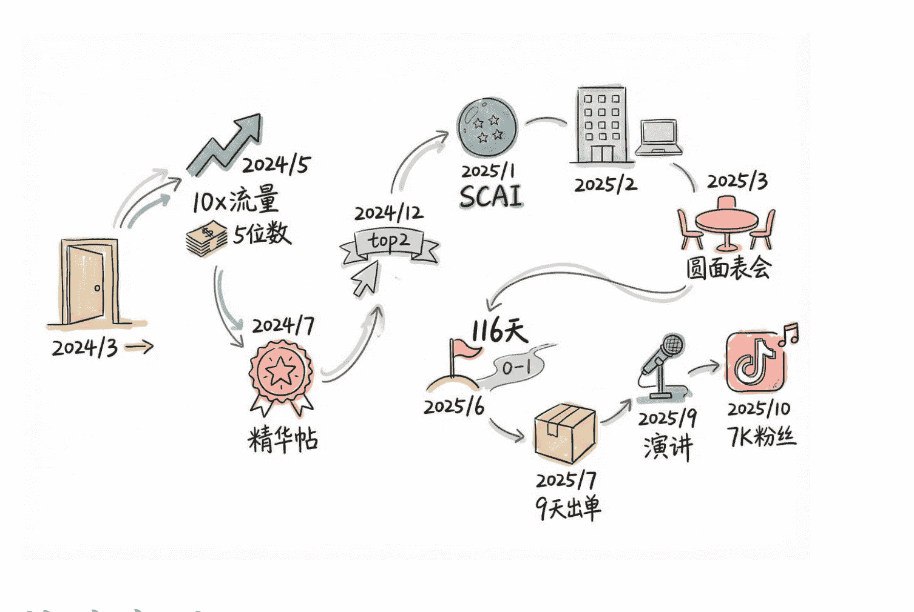

### 快速索引

#### 我的三次出海项目

- 聊天记录分析：龙珠悬赏帖，116 天出单心路历程
- 灵魂伴侣画像：从产品到流量
- Sora2.0 邀请码：上线 72 小时收入 100 刀
- 需求验证：30 分钟验证需求
- AI 编程：网站拆解手把手教学，Creem 支付
- 自媒体进度：垂直小号内测 summary，海外自媒体 1 个月

### 二、从 AI 产品到 AI 自媒体

#### 1. 产品三角：如何判断自己能不能做？

做 AI 编程出海有一个三角，你必须衡量自己在哪个角非常能打。

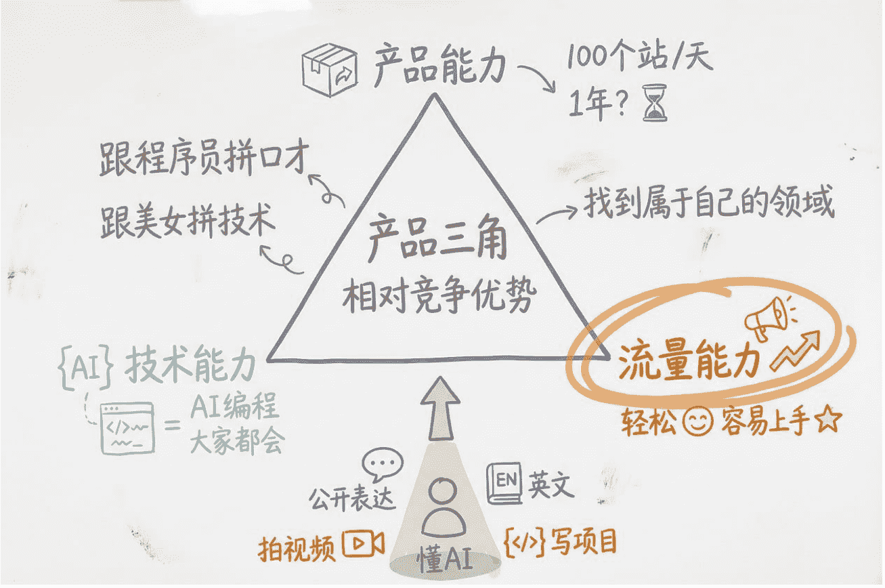

**产品能力 (Product):**

> 定义：把 Idea 变成产品 (App/Web) 的能力。
>
> 现状：产品能力需要时间积累。我的老师让我每天看 100 个产品，拆解人家怎么做的。我一天看不多 100 个，我看 20 个，一个月也看了五六百个。但相比那些五年、十年的产品经理，我还有很长的路要走。

**技术能力 (Tech):**

> 定义：实现产品的手段。
>
> 现状：技术平权。利用 Cursor、Claude 等工具，普通人能达到 60 分水水平。AI 能力越来越强（25 年底肯定比年初强），简单的功能实现不是壁垒。这是差距最小的一个角。

**流量能力 (Traffic):**

> 定义：把产品卖出去的能力。
>
> 个人感悟：我跑通后发现，我既没有产品积累，也没有技术基础，唯一有的就是流量能力。

非均衡发展：我们上学时总说要“均衡发展”，但在商业里，与其把短板补到 90 分（这可能要花 10 倍努力），不如把长板（流量）打到 120 分。如果你单点打爆流量，会有大把懂技术、懂产品的人来找你合作（分佣/联创）。

劝退：如果这三个角你一个都不占，建议冷静一下，好好考虑要不要做这件事。

#### 2. 地图思维：必须跑通 0-1 闭环

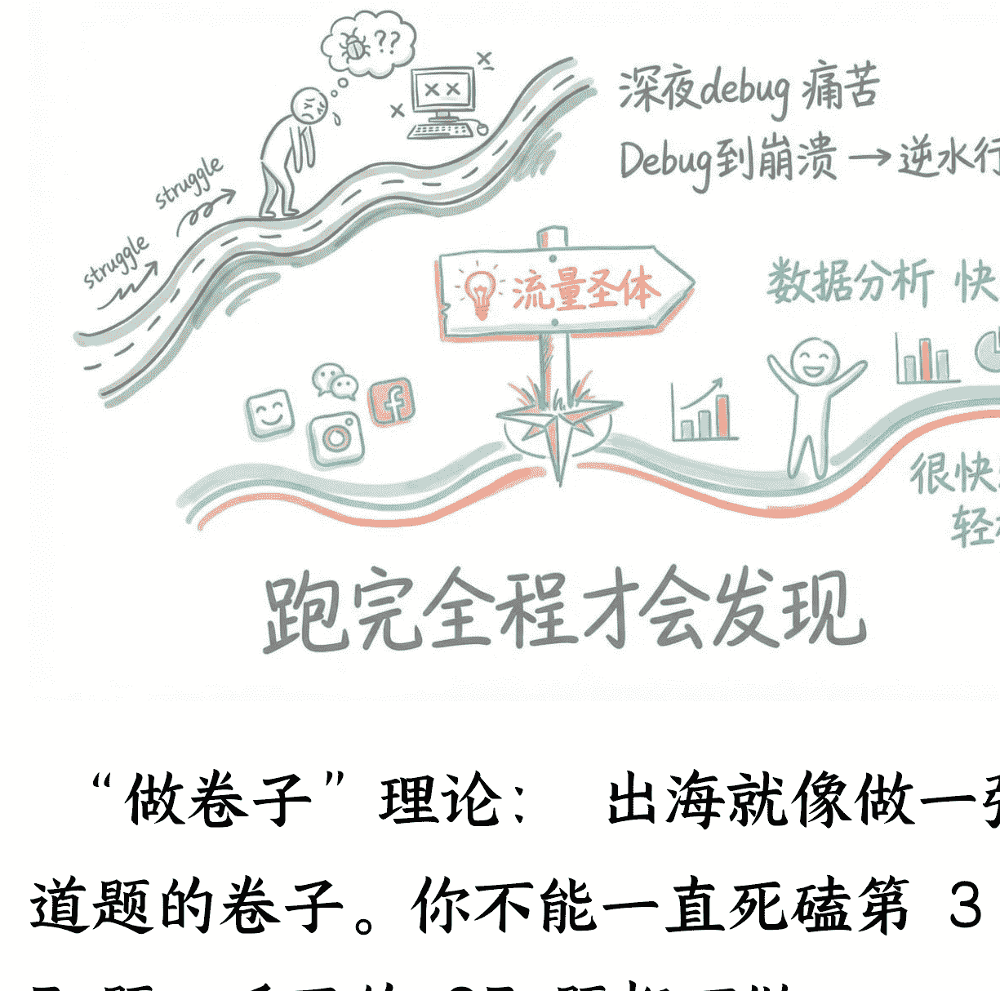

“做卷子”理论：出海就像做一张 100 道题的卷子。你不能一直死磕第 3 题、第 5 题，后面的 95 题都不做。

必须交卷：哪怕这道题不会（蒙一个），也要跳到下一题，直到把整个卷子做完。只有跑完整个流程（从 Idea 到卖出去），你才知道自己的技能点在哪里——哪里是优势，哪里做得非常痛苦。

#### 3. “真需求”的陷阱与流量获取

很多人看了梁宁的《真需求》，觉得只要需求是真的，产品做出来了，就一定能赚钱。这是一个巨大的误区。

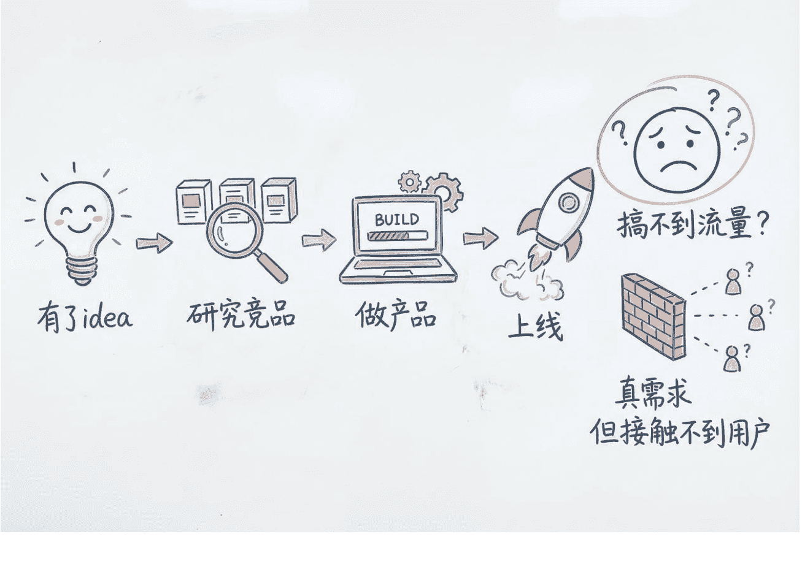

触达即一切：

- 即便你的需求是真需求，产品也完美解决了痛点，甚至市面上已经有人靠这个赚了 100 万，但只要你接触不到你的用户，你就卖不出去。

- 案例：假设你的产品目标用户是"20 岁单身女性”。

如果自己就是这个群体，或者在国外留学身边全是这样的人，很清楚的她们在哪、喜欢什么，就能卖。

如果是一个完全不了解这个群体的“大哥”，根本想象不到她们每天在刷什么（是 TikTok 还是 Instagram）、关注什么话题。找不到她们出现的“鱼塘”，产品做得再好也是自嗨。

流量获取的两种逻辑：

- 主动出击 (流量派)：明确用户画像 (User Profile)，去她们聚集的地方 (TikTok、IG、Reddit) 蹲守、伪装、投流、发内容。只要能触达，就能转化。
- 被动等待 (SEO 派)：像哥飞老师那样，做好关键词覆盖，等待用户主动搜索。这需要极强的关键词策略，且生效周期长 (3 个月起)。

#### 4. 逆向思维：流量即资产，产品是收款工具

**注意力战争**：用户时间恒定。"我不发就是损失"。我不发内容，你的注意力就被别人抢走了。只要我发，就可能抢占你 10 秒钟。

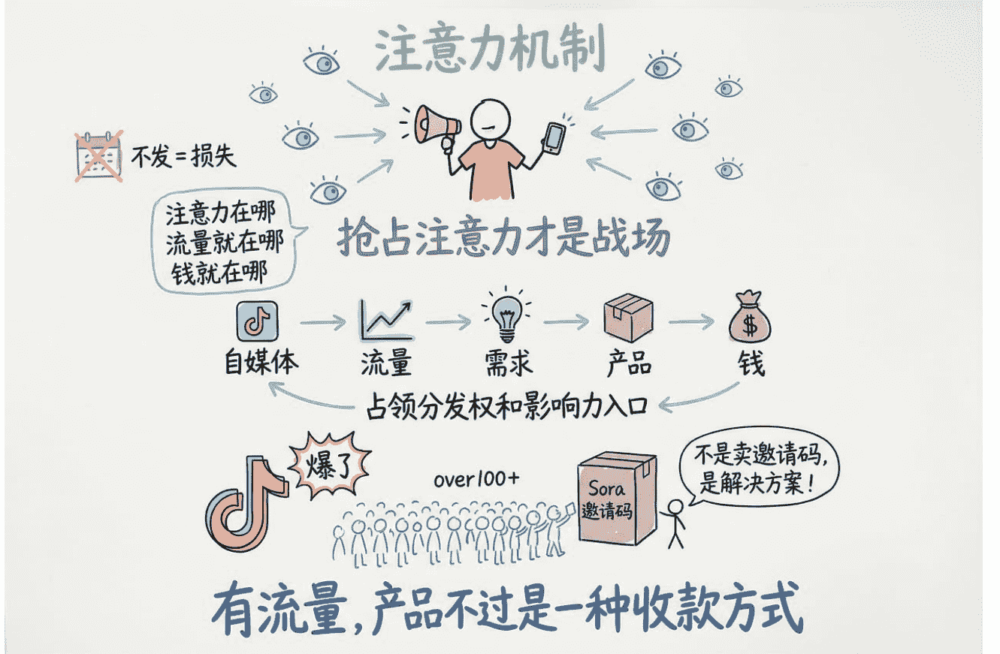

**垂直小号策略**：做泛流量不值钱，做垂类才值钱。当我圈住了“独立开发者”这群人，就能卖资讯、卖课、卖铲子。

**Sora2.0 案例 (经典复盘):**

- **起因:** 国庆期间 Sora2.0 发布，全网求邀请码。
- **动作:** 我发视频教大家“怎么用 ChatGPT 找邀请码”。
- **结果：** 视频百万播放，私信爆满求码。
- **变现：** 我意识到这是商机，当晚花 2 小时搓了一个网站，挂上收款链接，卖“邀请码获取渠道”。
- **收益：** 2 天卖了 100 多刀。
- **结论：** 有了流量，产品不过是一种收款方式。我不是乔布斯那种改变世界的人，我只是想赚钱。流量能挖掘出需求，满足大家的需求，得到一定报酬（钱），这个链路非常合理。

### 三、出海方向全解析

#### 1. 什么是出海？

出海是，走出国门，做全世界的人的生意。用产品、内容或服务，去赚海外用户的钱。

这里面的核心只有三件事：海外用户、外币收入、可持续。

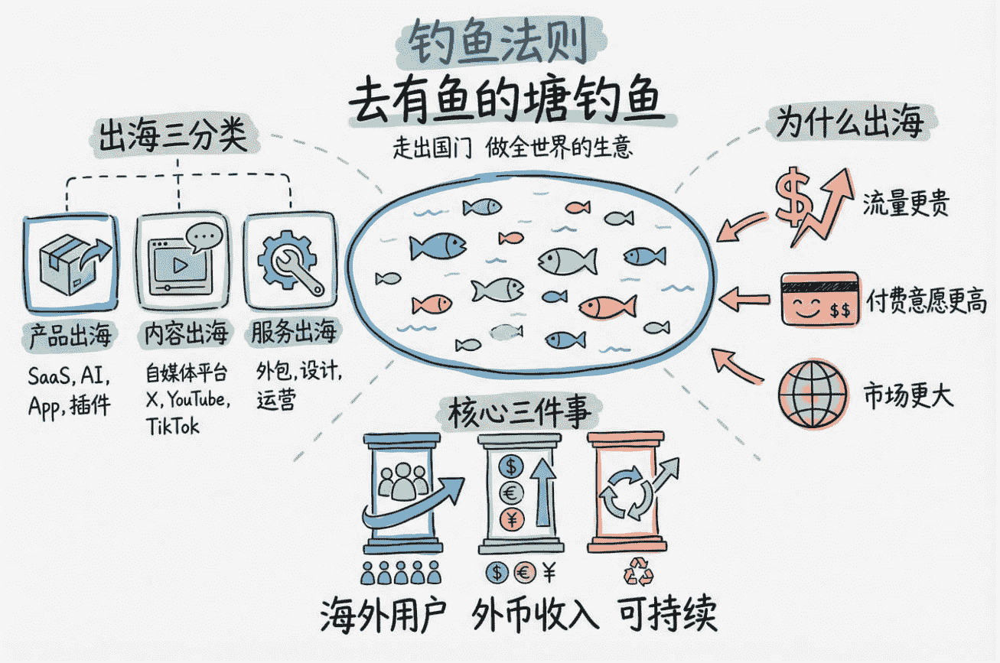

**出海的分类**

- 产品出海：SaaS, AI 产品，App, 插件....
- 内容出海：各种自媒体平台 (X, YouTube, TikTok...)
- 服务出海：各种外包服务，设计，运营，技术....

**为什么要出海？**

- 流量更值钱：Google Ads 数据显示，美国的点击（CPC）是几美元，印度/东南亚可能才几美分。欧美流量更贵。
- 付费意愿更高：海外用户有很好的付费习惯（买软件、订阅），国内还需要教育。
- 市场更大：全球市场绝对大于单一的中国市场。

**盈利模式**

- SaaS / AI 产品 / App / 插件：订阅收入，一次性买断，按量付费
- 自媒体平台：广告分成、订阅、affiliate（联盟分佣）、赞助、卖自己的产品（SaaS, 课程, 工具, 社群）
- 服务出海：项目制，小时制、工资

### 四、海外自媒体

#### 海外常见平台

-  **X**：社交平台，讲究互动和圈子
-  **TikTok/Shorts**：短视频机制，爆款机制，粉丝多少并不是决定生死，只看内容本身
-  **YouTube 长视频**：搜索逻辑，粉丝向内容
-  **IG**：审美在线，生活方式，氛围感（我想成为这样的人，梦想生活）

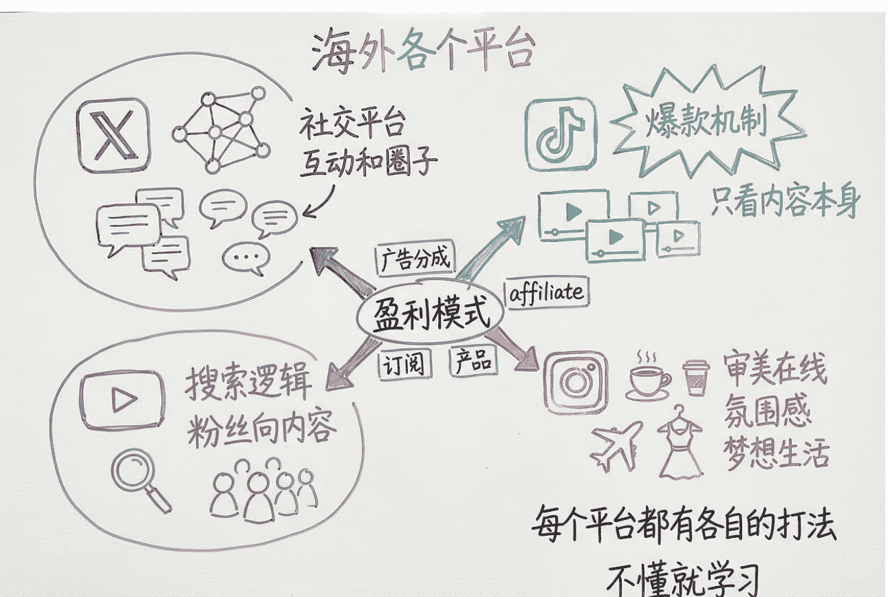

每个平台都有各自的打法，不懂就学习，找不到方法和路径，容易浪费时间，还怀疑赛道有问题。

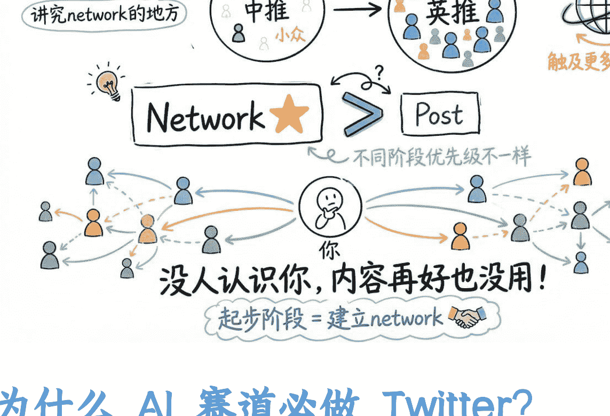

#### 为什么 AI 赛道必做 X？

- 源头活水：X 是 AI 的第一手信息来源。国内 AI 资讯号大多是"搬运"X。好的食材只需要简单的烹饪，X 就是那个高端食材库。
- 人群精准：独立开发者、技术大佬都喜欢在这里 Build in Public。
- 杠杆效应：小排老师这种大 V，发一张图都有几万人看。如果你也是个 KOL，推自己的产品很容易。

#### X 如何找准定位：4-3-2-1 细分赛道法则

不要一上来就说"我要做 AI"。

1.  写出 4 个你最了解的话题。（如：AI、个人成长、写作、健身）
2.  为每个大话题写 3 个子话题。（写不出来说明你不熟悉）
3.  排除法：删掉 2 个你不熟悉或变现难的。
4.  终极选择：留下 1 个（如 AI 工具）。

**Step 0 (原点发散)**:确认了"AI 工具”这个原点，可以发散出 AI 视频、AI 绘图、AI 编程... 这就是你的内容库。

#### 门面装修 (Profile)

-   **Banner**: 它是你的广告牌。Google 大佬会放产品，KOL 会放 Slogan。不要留白。
-   **Avatar**: 决定第一印象。
    -   案例：圣诞节前我把头像戴了个圣诞帽，那段时间点击率明显提升。
-   **风格**: 如果走专业路线，至少看起来是专业的。
-   **Bio 公式**:
    -   Who: 我是谁？
    -   What: 我做什么？
    -   What have I done: 成就？(MRR $10K)
    -   Why follow: 关注我有啥用

### 运营核心：Network First（混圈子）

在 0-1000 粉阶段，发推文就像在沙漠里喊话。建立 Network 才是核心。

#### A. 寻找“锚点”

找到赛道里的 50 个关键人物。

**实操：** 搜 `@OpenAI`，看简介里写了 "Researcher @OpenAI" 的人；利用 福布斯 AI Top 100 榜单 顺藤摸瓜。

#### B. 高质量互动（不做无效互动）

-   拒绝："Awesome", "666"。

**必杀技 1：交作业**
大佬发了 Prompt，你实操并返图：“亲测好用！这是我生成的图”。极易获得转发。

**必杀技 2：Meme (梗图)**
在一堆文字评论里，一张好笑的图非常显眼。

**必杀技 3：Quote (引用转发)**
附上你的总结：“学到了！这篇关于...的观点非常..."。

###  Twitter Blue (蓝标) 值不值得买？

- 必须买！ ($8/月)
-  **Grok**：马斯克的 AI，可以实时读取 Twitter 数据，做竞品分析神器。
-  **数据分析 (Analytics)**: 这是最重要的。只有会员能看详细数据，没有数据无法复盘。
- 防折叠：评论区回复排在前面。

#### Twitter AI 账号 list

思路：AI 三大巨头--->OpenAI, Anthropic, Google---->官方账号 + 相关人群

如何获得相关人群：使用 AI 浏览器，使用 Grok 搜索 bio 包含"OpenAI"的人（其他也一样的方法）

- 人传人现象：关注的这些人会 repost, quote 的人的内容，关注
- 福布斯 top100 的账号 + AI 三大巨头的账号
- 分享：AI 相关 list

### TikTok“邪修”玩法与工具流

很多时候，“不会英语”只是不想做的借口。

只要搞定了科学上网的环境问题，基本就成功了 80%

整个逻辑跟国内的自媒体自媒体平台一样

- 大力出奇迹，关键在于愿力有多大，给大家分享一些 AI 领域的邪修吧

#### 3.1 录屏 +AI 配音：资源分享

https://www.tiktok.com/@github.awesome
- **@github.awesome** GitHub Awesome
- 5 Following | 28.5K Followers | 182.3K Likes
*   ⚗ GitHub Daily Discoveries
*   Full videos on YouTube: @GithubAwesome
*   📧 phantomparadoxon@gmail.com
*   🔗 linktr.ee/githubawesome.com/

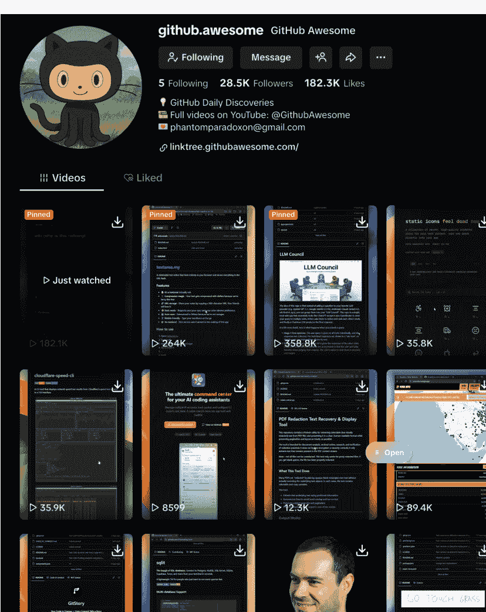

#### 3.2 PPT 类型：纯图起号

https://www.tiktok.com/@prompttlab
@prompttlab
- 21 Following | 7109 Followers | 68.5K Likes
- Leave a follow 👇
- For the best results, you need the best prompts 💬

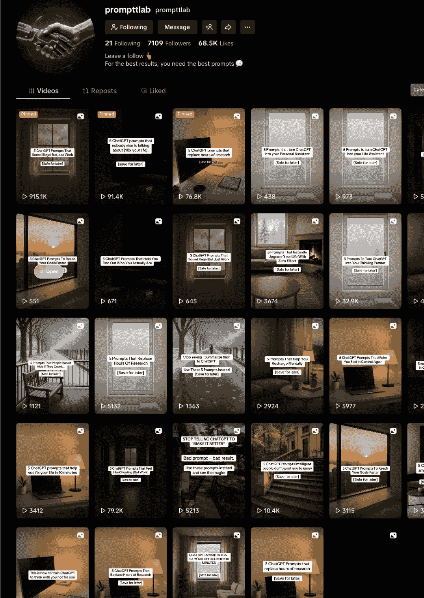
https://www.tiktok.com/@promptdrill
https://www.tiktok.com/@aihubspace

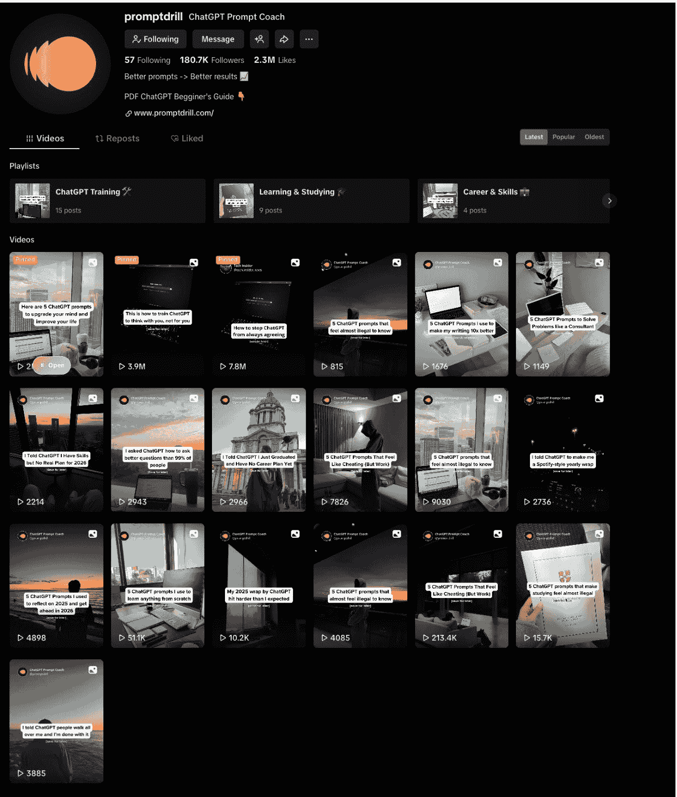
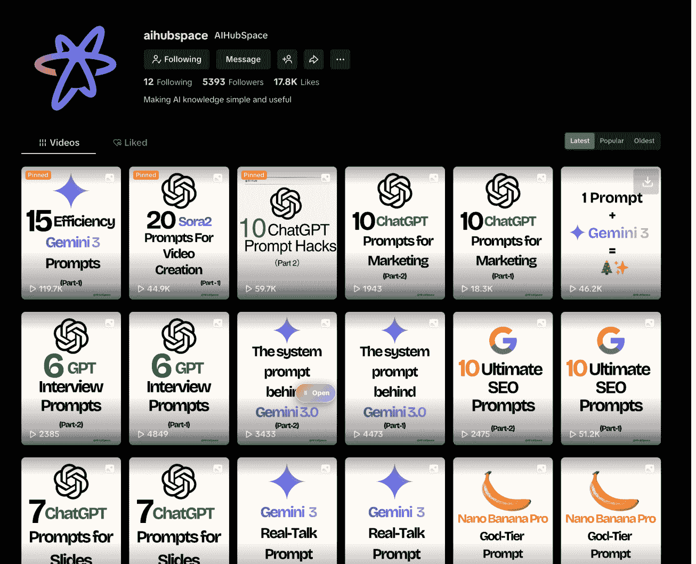
https://www.tiktok.com/@periciacards

#### 3.3 产品推荐夹带私货

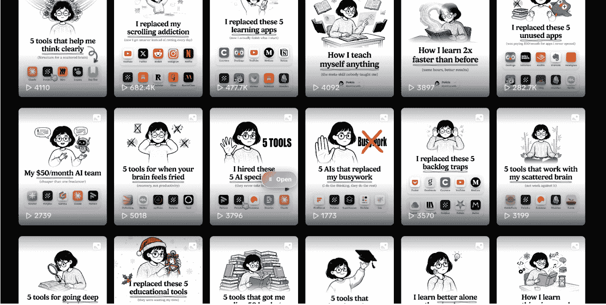

#### 3.4 视频 + 提示词

```
https://www.tiktok.com/@itsdreamai
```
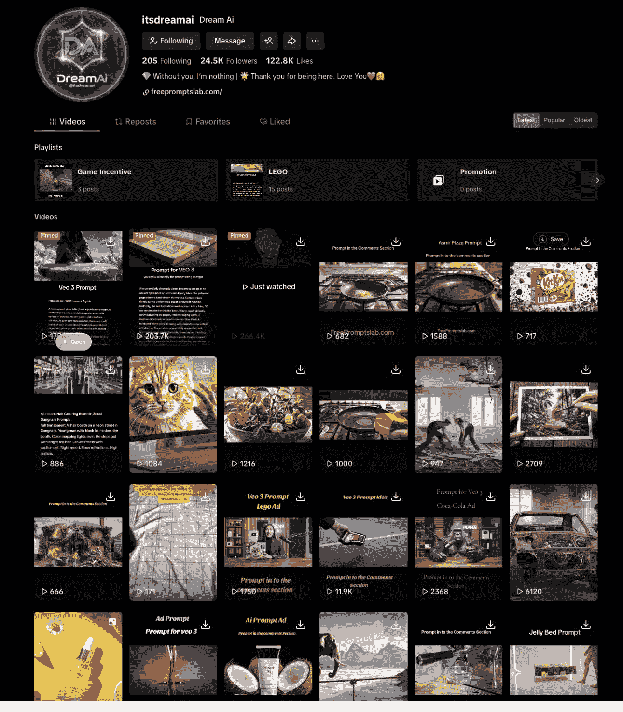

#### 3.5 不出镜

```
https://www.tiktok.com/@theaitriggerr
```
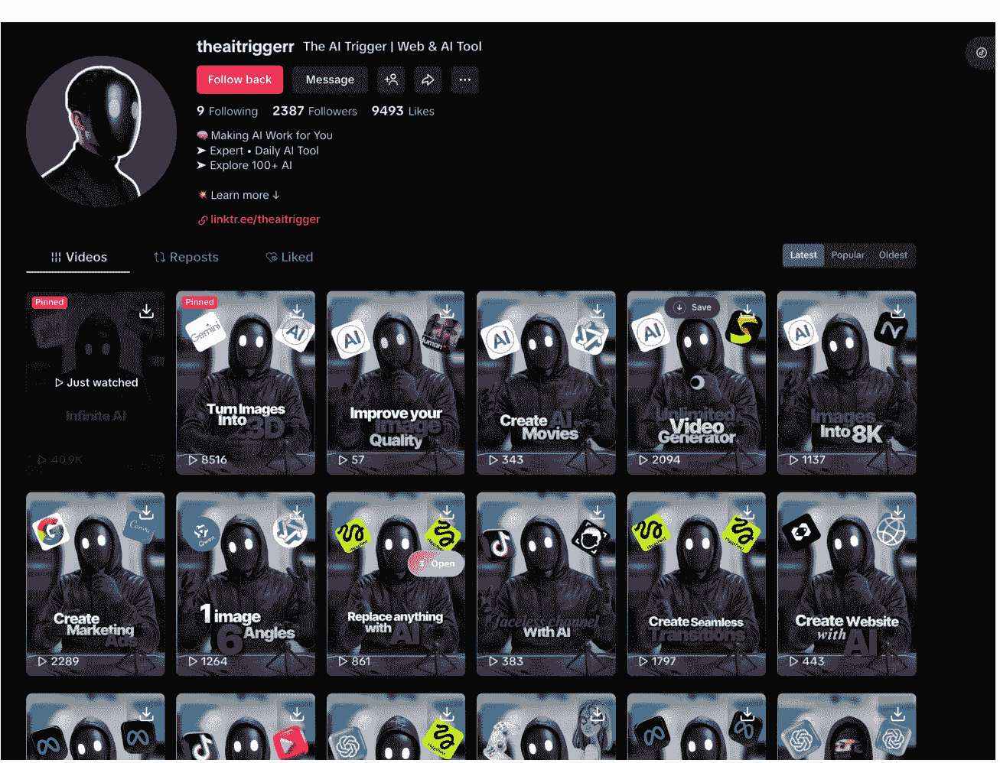

### 五、不会用 AI，本质是和效率作对

#### 一、我自己日常用的 AI 工具

-   **ChatGPT**：对话最多，教练，口语搭子，所有事儿都问
-   **Comet/atlas**：AI 浏览器，这是啥，看评论区在聊什么（介绍 10 个用法）
-   **AI Studio**：编程，快速出 demo
-   **Claude Code/Codex/Antigravity**：编程，Coding，做产品
-   **Gemini**：新功能上线关注，教育优惠赶紧上车
-   **Notebooklm**：出 ppt，看文献，整理 Infographic
-   **Evolink.ai**：所有主流生图生视频的模型
-   **YouMind**：资料收集，加工信息，公众号专用，YouTube 学习）
-   **Grok**：深夜陪聊（可以当推特爬虫用）
-   **AlphaXiv**：看文献 paper
-   **FlowWith**: 多模型对比，翻译多语言，自动化 agent
-   **Gemini CLI**: 本地文档整理秘书（免费）

#### 二、公众号内容工业化生产

核心理念：高端的食材（优质信源）+ 简单的烹饪（SOP）= 美味佳肴。

**Step 1: 高端食材（信息源）**

- 原则：跨媒介（视频/音频转文字）、跨语言（英文转中文）。
- 信源：YouTube 和 podcast 上优质的希来源
- 积累：找到 50 个这样的优质频道。

**Step 2: 提取个人风格**

- 痛点：AI 写的东西有"AI 味”。
- 解决：喂给 AI 你自己写的 100 篇日更，提取文风，或者爬取你喜欢的博主（如刘小排 R）的 100 篇文章，提取他的风格。
- 产出：得到一个`个人风格.md`。

**Step 3: 拆解爆款结构**

- 动作：找到低粉爆款文章（说明内容本身硬）。
- 分析：让 AI 拆解骨架：钩子怎么下？中间怎么铺垫？
- 产出：得到一个 包含文章结构的提示词 prompt。

**Step 4: 整理配图风格**

- 动作：保存喜欢的图片，看起来就想收藏的图片
- 分析：丢给 ChatGPT
- 分析我发给你的图片风格，只分析风格，不包含内容，输出中文和英文两版格式如下
    - 1. 风格名
    - 2. 具体的风格特征拆解（不包含内容本身）
- 产出：得到一个 blog 配图风格.md

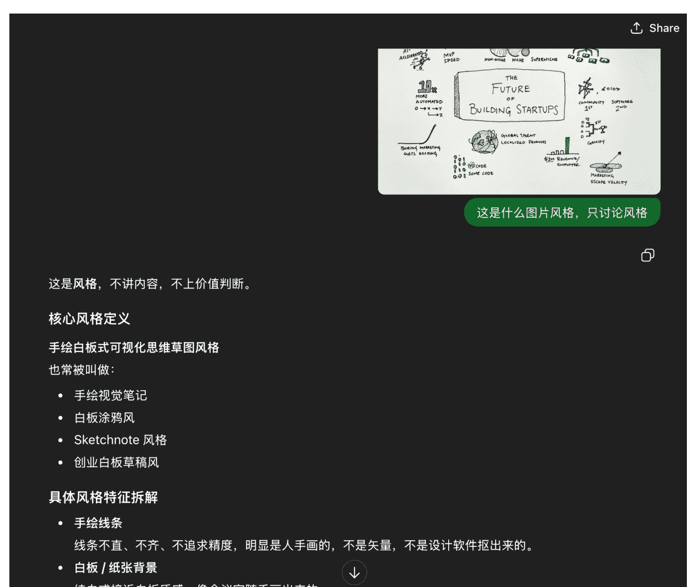

**Step 5: 工业化生产**

Input: 直接使用 chrome 插件，一件提取视频内容。
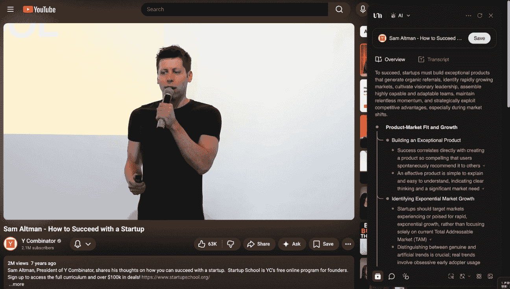

Process: 请根据 [逐字稿]，采用 [个人风格]，按照 [爆款结构]，配图使用 blog 配图风格写一篇公众号文章。

**Step 6: 一键发布，自动排版**

- 工具：利用 YouMind 一键渲染排版，复制到公众号后台。
- 效率：全套流程熟练后，5-10 分钟即可产出。

**风格名** 具体的风格特征拆解（不包含内容本身）中文和英文两版

- **中文**
    - 手绘白板式视觉思考草图风格
- **常见别称**
    - 手绘视觉笔记风
    - 白板涂鸦风
    - 思维草图风
    - 创业者白板草稿风
- **English**
    - Hand-drawn Whiteboard Visual Thinking Style
- **Also known as**
    - Sketchnote style
    - Whiteboard doodle style
    - Visual thinking sketch style
    - Founder-style brainstorming sketch

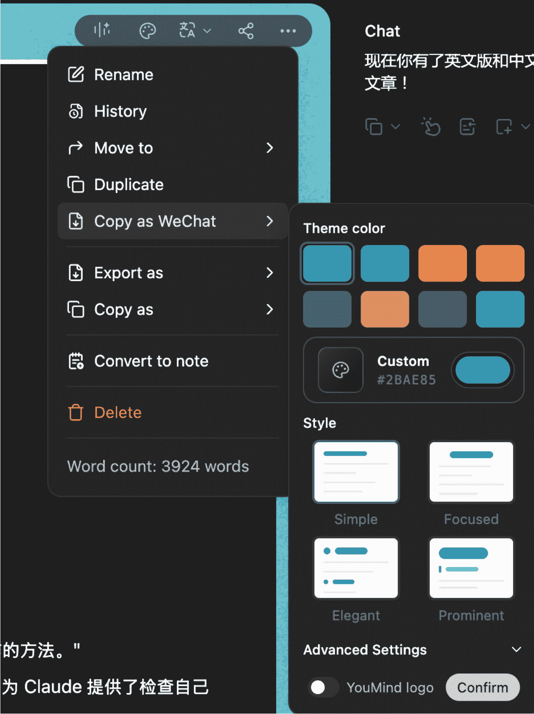

### 六、回顾 2025 的碎碎念

2025 年的 review 计划写，但是没写，结果 5 个小时的分享，似乎把我 25 年的东西又都串了一遍，

满腔热血扎进 AI 出海，就是要干不做出来不罢休，死磕到底 116 天出单

验证方法论，第二个产品快速闭环

纵观全局，接受现实，换个轨道去 AI 自媒体

10 月 -12 月几乎没有怎么出来活动，全身心投入在海外自媒体上，一方面是要学习的东西很多，另一方面是挑战也很大。

### 最后，安利小懒的付费群：

#### 懒人专属群（介绍）

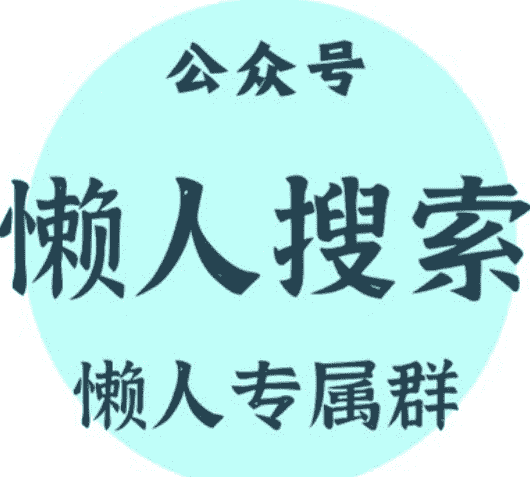


微信：lazyhelperl

这里是你对抗信息过载的护城河。

已稳定运行 6 年，累计拆解、研读 3000+ 个互联网商业实战案例与行业前沿内参和时政/宏观文章。

我们不搬运垃圾，只做高价值信息的筛选器与放大镜。

#### 懒人专属群更新记录：

https://hk57gvlx7u.feishu.cn/docx/H0kRdZbSb0lBR0xkaXtcuVE0nTg

【免责声明】本资料归档于社群内部知识库，仅供成员课题研究与学术交流，请在查阅后 24 小时内删除。

即使是开局拿到一个很不错的结果，在后面的日子里也都是摸着石头过河，不敢松懈，也不想让流量掉下来。

但开局的顺利就是不可能永远维持，12 月一整个月都是我的瓶颈期，流量突然下滑，怎么都上不去的时候，尝试各种方式，拆解，迭代，分析，人的状态很差，情绪也很低落，塞了很多东西进脑子，但是却没有时间整理和输出。元旦跟 SCAI 的兄弟姐妹们去跨年，意外的是，2026 年的第一天，视频量回来了，小爆一条，流量恢复了一些。

犯过的错，踩过的坑，吃过的苦，好像都会被自己忘记，如果不是看自己写的这些内容，真的很难回忆起那些恨铁不成钢的 moment，很难共情在半夜 bug 修不好想哭的瞬间。

2025 年非常感谢亦仁哥的橄榄枝，感谢小排老师的欣赏和鼓励，感谢大哥天团大哥们的悉心教导，感谢 SCAI 的兄弟们的陪伴，感谢生财这块土壤，让我这个种子能够顺利发芽！
人是环境的产物，环境很重要，圈子很重要！

2026 年，希望能成功风口上的那头🐷！