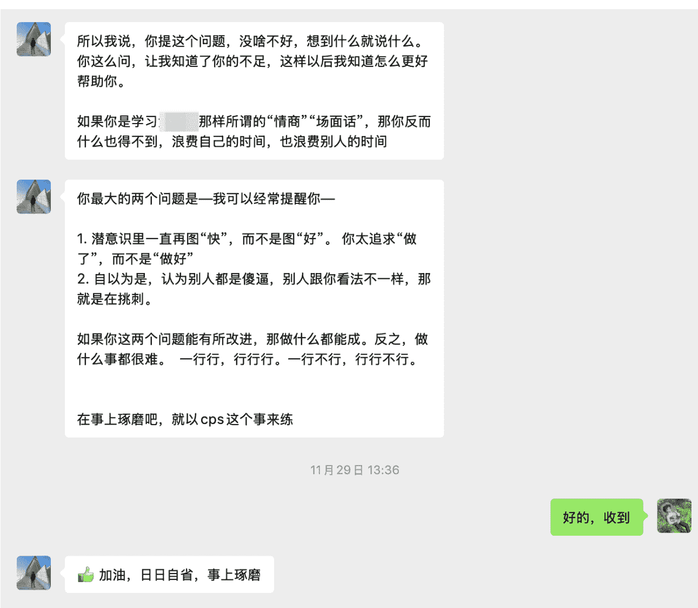
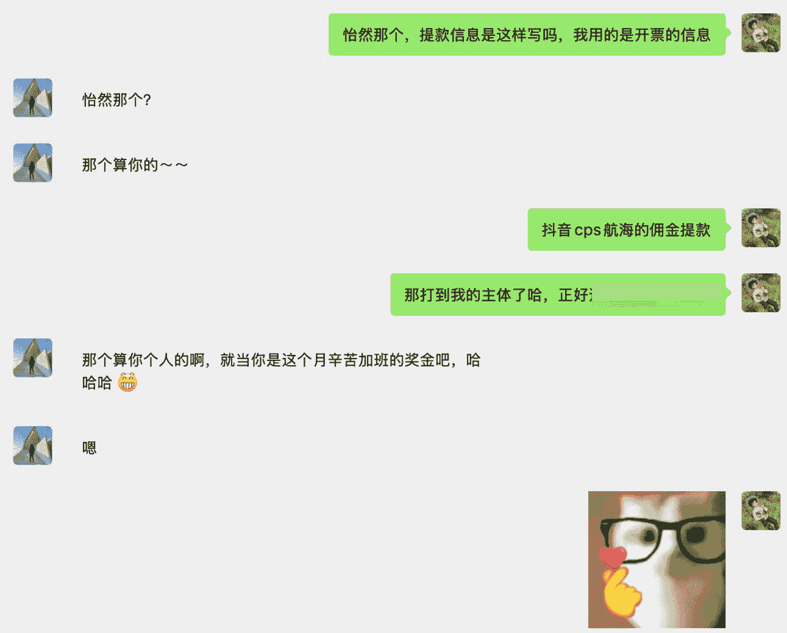
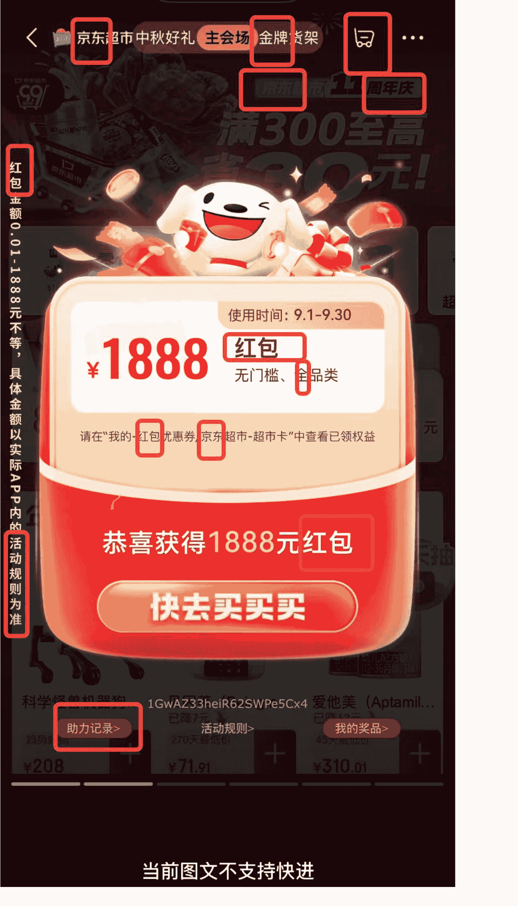
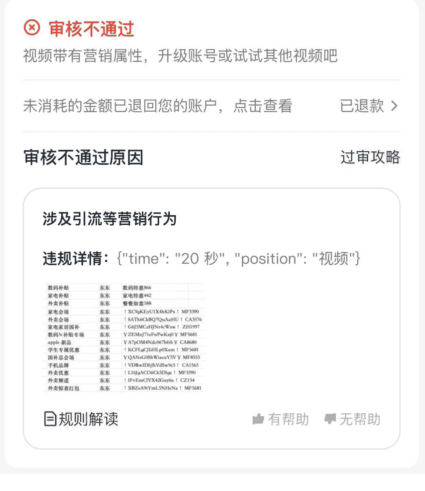
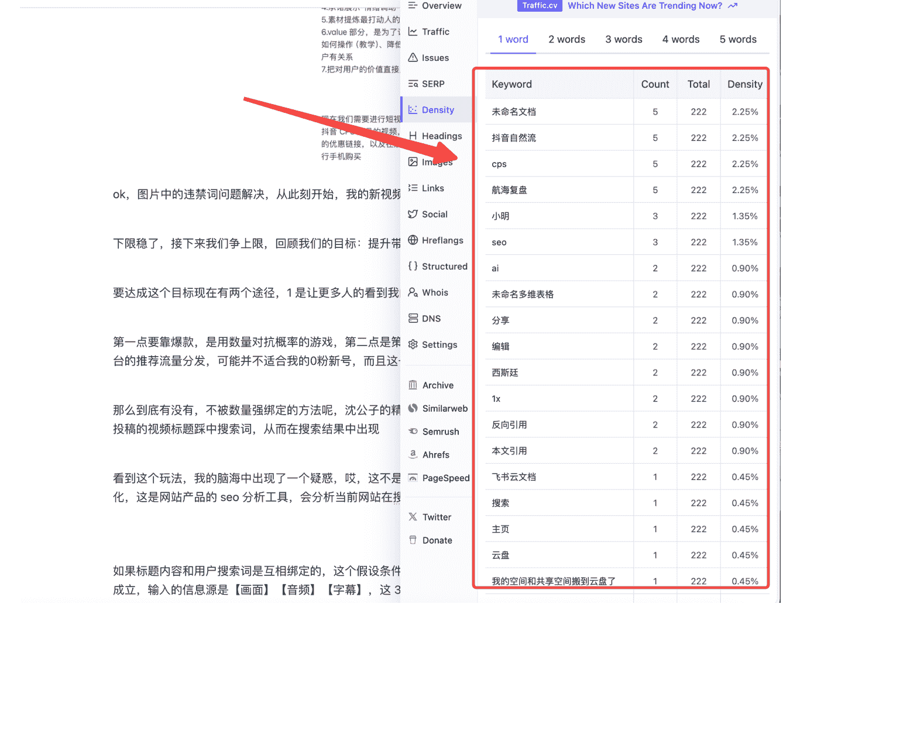
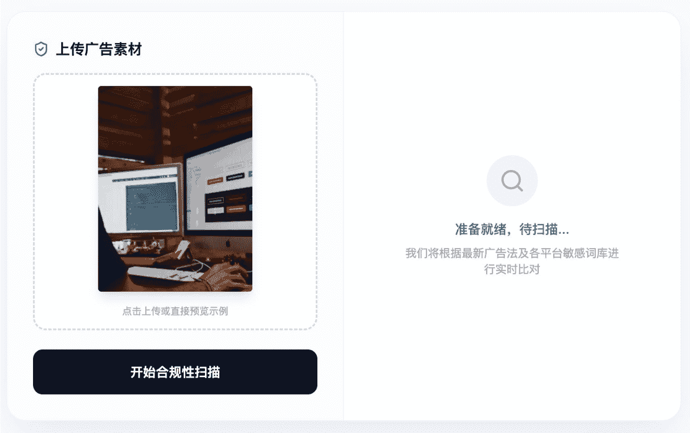
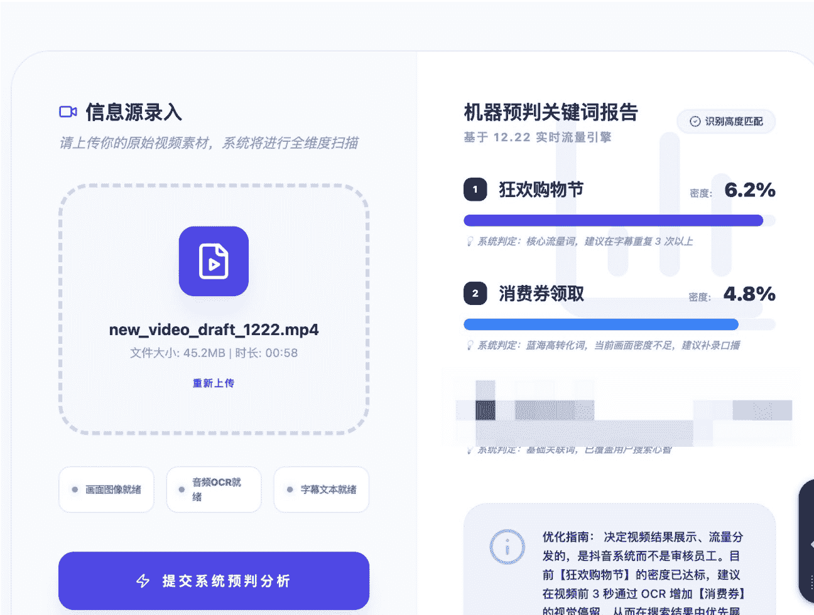
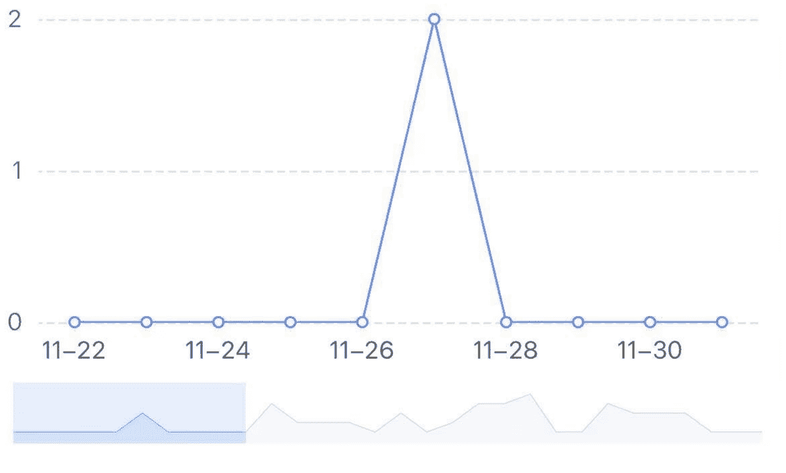
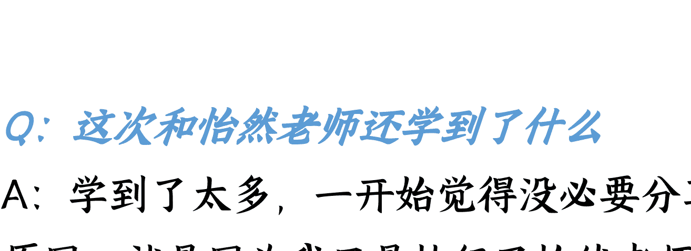

# 新手起步，21 天 480 万 GMV，长尾滑行 600 万 GMV，搜索流量确定性玩法

260106 副业 SC 精华

## 个人介绍

大家好，我是小明，小排的员工。
现在自封，怡然老师大弟子头衔。
03 年出厂，毕业时长 1 年半，喜欢烘焙、钢琴、旅游。

今年四月，加入生财有术社群，小排给我交的钱😄。如果加入你不是生财有术的会员，那可能是你老板没有努力，让他反思下盈利能力和认知边界。

25 年 11 月份，我和小排说，想搞一搞事情，他推荐了怡然老师的抖音自然流 CPS 航海，在他的精神物质双重支持下，我全力以赴地投入到这个项目中，认真学认真做。

## 开始前

## 结束后

## 完整经历

## 活动介绍：这个项目是什么

我尽可能，把我在本次航海中的实录经历、思考总结，完整地阐述。

首先我不是抖音的用户，除了信息查询，没有刷短视频的习惯，并且我没有做过短视频营销，没有网感。我的基础和绝大多数人一致，完全的新手。

## 项目逻辑与介绍

抖音 CPS 这个项目，核心逻辑是让用户看到你的视频，跟着你视频的教程操作，输入你分销信息（密令词、短链），从而在他的设备中植入你的分销 URL。用户如果产生了符合条件的购买行为，那么本次购买会被电商平台视为你引发的增值动作，从而你获得分销佣金。

由于怡然老师的团队业界顶尖，所以能拿到很多平台方的密令词，让散客推手也能享受密令词权益，并且通过万单宝平台 https://wandanbao.com/，让我们拿到了“内部价”，比官方分佣更高的比例，比如说某品牌扫地机器人分佣 12%。万单宝这个产品其实是一个新的风口，让 CPS 这件事可以让每个人通过自然流视频去盈利。

前几天看公告，万单宝发布了散客申请密令词的通知，有兴趣体验这门生意的快去 https://wandanbao.com/。

## ## 高比例返佣单品

京东平台的支持。

## II 基础设施配置是拉满的水准

接下来说，我们所做的视频类型，可以分为，曼波与口播两大类。

不打无准备之仗，在 12.1 航海前，阅读了一期全部精华帖，推测出了项目的大概，先梳理了视频中能讲什么，以及视频制作的思路。

接下来以我的播放量进程及遇到卡点为划分依据，完整还原本次航海历程。

## ## 50 播放阶段：视频营销入门 0 经验，违禁词成为最大阻碍

11.27 开通了 5 个抖音账号，按照航海手册中的教程，随便拍一个视频，流量测试，看看能否达到 50 播放。

我对着我自己 DIY 的电脑介绍参数和性能，用抖音自带的录像，介绍显卡是什么，用了什么补贴，多少钱拿下了。

5 个号接连切换接连录制，发了 5 个视频，过了 3 天没管。3 天后基本上每个视频都有 500 播放，其中有一个账号，评论区大家讨论起来了，有人说太值了，有人说配的不行，有人求套餐，这个评论区有 20 多条评论的视频，播放量是 6000。

这个时候我感觉，好像也不过如此，这不是有手就行吗，后面我带个口令，标题里面再添加分销短链，不就大功告成了哈哈。

然后，12.1-12.4，这四天，我咔咔做视频，一天做 10 条，一单也没出，是的，0 GMV ☠。

视频大多数停在了 50 播放以内，这期间我的 GMV 是 50 块钱，为什么是 50，因为我在点外卖自刷☠。

这期间我找到了很多参考案例，尝试了，真人出镜口播、数字人录播、用明星口播、曼波、录屏、手指录屏、图文、小视频 + 动图、be like、用 AI 做出来的视频（后面才知道抖音上最好不要发海外政治人物，TT 可以）。

我之前没有做过视频营销，这个时候意识到，我一定有什么问题，导致我播放量这么低。

先找了 AI，和 Gemini 一条条的问，这条视频强在哪里，我为啥没有过 50 播放，但是由于我实在是不懂短视频，给到模型的有效信息不够，比如没有说清楚营销内容的边界判定是什么、抖音的风控规则，导致模型不能给我有建设性的回答。

AI 走不通，只能去问高手了，我去问上一期的沈公子、旺仔肖肖酥，请他们帮我查看视频，非常感谢他们愿意帮我分析问题，可能是当时还不熟，太拘谨，上一期的高手们没有犀利的指出我的问题。

走投无路下，我抱着忐忑的心情，添加了怡然老师微信，加上后一顿火力输出，给老师发了 4 个还是 6 个视频，当时在想，怡然老师这种大神，高不可攀，发她四个，这样就能帮我查看一个了，所以我把最重要的视频放在了第一个位置，但是，怡然老师居然，把我发的视频全看了一遍，很认真的一项项地指出了我的问题，她简直就是天使🙂。

### 12 月 3 日 下午 11:09

> （聊天记录内容）：
>
> 材的话，它可能有一定的偶然性，因为整个画面里没有很确定性强的一些句子或者信息能够把用户吸引过来看
>
> 你看直播啦 我那个其实就是因为看了你的素材跟大家讲的。我下午看到你发的视频了，但那会比较忙没回你
>
> 嗯嗯收到
>
> 怡然：第二（条的话）整体内容挺信息挺少的，就是这种素材如果你是有对标的原素材的...
>
> 然后第三条，你看一下你的那个口令复制过去，京东打开是没有红包那个会场的，所以可能描述和你内容不太符合，你应该是转成另外一个会场了
>
> 明白了，这个有点尴尬🤦‍♂️谢谢怡然老师🌹🌹🌹
>
> 第四个视频有些音画不同步，也是音频有些不连贯，生成音频的时候注意下文字的分割

这些是细节问题，然后整体上 看完之后我作为一个用户我没有觉得很被吸引到，开头没有被吸引到愿意看下。

首先说视频质量，怡然老师点出了我视频的很多质量问题，比如说，每个画面给用户的确定性信息不够、人声有爆破音、情绪不到位、音画不同步、优惠手段不聚焦等等，这些细节内容是大家需要认真注意和学习的。怡然老师让大家的第一个视频学习对标视频，原因大概是在学习的过程中能有效注意到这些细节。

## 这里分享下，这次沟通学到的几点视频优化项

- 1. 评论要有说服路人的真实力
- 2. 找对标素材不要找偶然爆的
- 3. 画面要有确定性强的信息，吸引用户
- 4. 会场链接务必正确
- 5. 音画不同步剪辑问题
- 6. 视频内容不吸引人，除了操作流程外的部分需要多找优秀视频学习
- 7. 模拟目标用户，做到自己看了想下单的程度
- 8. （直播）注意违禁词
- 9. （直播）CTA 部分要加强效果

质量低影响了用户留存数据，但不是播放量 50 以内的核心原因。

配合当晚的直播，我发现了导致 50 内播放的核心原因：违禁词。

没有超过 50 的播放，基本上锁定违禁词问题，但是我的字幕内容已经很严格的筛选了。那肯定是还有什么我没发现的问题，我就对照着参考视频，一个个截图的看，发现，哎，他画面中这京东搜索框怎么和我不一样，他这张图上怎么这么多马赛克...这时意识到，抖音可能有一些 OCR 手段，能够识别图片素材中是否存在违禁信息。

ok，找到问题了，于是我对着我的素材库，把图片素材全部处理了一遍，可能是风险的一个都不放过。

| 文件名 | 修改日期 | 大小 | 类型 |
| :--- | :--- | :--- | :--- |
| 必剪音频 | 12/8/25 上午 11:43 | -- | 文件夹 |
| 参考视频 | 12/2/25 下午 4:03 | -- | 文件夹 |
| 数码主会场活动素材 | 12/15/25 下午 7:39 | -- | 文件夹 |
| 通用表情包 | 昨天 下午 3:27 | -- | 文件夹 |
| 主播被坑素材 | 12/2/25 下午 7:14 | -- | 文件夹 |
| img_v3_02sl_57cb...-50d694a440eg.png | 12/4/25 下午 6:11 | 9 KB | PNG 图像 |
| 京东 app.png | 12/1/25 下午 11:13 | 890 KB | PNG 图像 |
| 京东活动界面.png | 12/1/25 下午 11:15 | 839 KB | PNG 图像 |
| 京东家电红包.png | 12/7/25 下午 11:36 | 1.6 MB | PNG 图像 |
| 京东省钱卡.jpg | 12/2/25 下午 7:12 | 204 KB | JPEG 图像 |
| 京东数码 3c 活动.mp4 | 12/1/25 下午 11:17 | 837 KB | MPEG-4 影片 |
| 京东双十二补贴证明.png | 12/7/25 下午 11:29 | 186 KB | PNG 图像 |
| 京东图标.png | 12/4/25 下午 3:25 | 312 KB | PNG 图像 |
| 联想 logo.png | 12/1/25 下午 11:22 | 47 KB | PNG 图像 |
| 领券巨省 1.jpg | 12/15/25 下午 5:45 | 501 KB | JPEG 图像 |
| 领券巨省 2.jpg | 12/15/25 下午 5:45 | 481 KB | JPEG 图像 |
| 领券巨省 3.jpg | 12/15/25 下午 5:45 | 399 KB | JPEG 图像 |
| 领券中心优惠图 1.png | 12/2/25 下午 7:16 | 444 KB | PNG 图像 |
| 领券中心优惠图 2.png | 12/2/25 下午 7:17 | 406 KB | PNG 图像 |
| 领券中心优惠图 3.png | 12/2/25 下午 7:18 | 616 KB | PNG 图像 |
| 某东抽奖界面.png | 12/2/25 下午 7:23 | 775 KB | PNG 图像 |
| 年底隐藏消费券.jpg | 12/15/25 下午 5:37 | 148 KB | JPEG 图像 |

在这时我来到了【我知道我有什么问题】的阶段，肯定就会存在【我不知道自己还有什么问题】，如何发现自己不知道的问题？大佬的帮助过于珍贵，不能浪费在这种无休止的细节上，我要去用巧劲去撬动外部力量支援我。

于是我把图片素材，2 秒一张，拼成了一个长视频，充了 30 块钱，投抖 +，让官方的人来审核，让他们看我现在的图片素材到底还有没有问题，如果有问题，那到底是哪张有问题。可能人工审核和机器判定的边界不一样，但对于我这个笨鸟来说，我必须要知道什么是边界。

## 审核不通过

视频带有营销属性，升级账号或试试其他视频吧。

审核不通过原因：涉及引流等营销行为。
违规详情：`{"time": "21 秒", "position": "视频"}`。
审核不通过。

该视频暂未通过审核，可更换视频重新下单。

审核不通过原因：违反相关平台规则。
违规详情：素材涉及无资质新闻/伪新闻的内容，如：搬运/二次创作媒体机构或政府机构发布的新闻视频内容、模仿新闻报道发布的内容等形式，暂不适合上热门，请修改，谢谢。

怡然老师在第一次直播中讲过，越自然的视频，可能流量越好，以及提到：不要让抖音觉得你这是一条广告，你做的是一条帮助用户解决问题的内容，所以我明确知道了，抖音生态定义的，广告营销的边界是什么，那么后续我就能快速走上正轨。

在航海期间，怡然老师、海宇老师的直播，一定要好好听，每次的内容都需要做个自己能看懂的笔记，将讲的要点有效实践的百分比，决定了自己视频的质量高低。

## 第一次直播要点

- 1. 找对标一模一样 (除了人脸外一模一样)
- 2. 一图一事一数字
- 3. 使用第三者视角来叙事，增加真实性
- 4. 承诺展示 - 情绪调动 - 分享引导
- 5. 素材提炼最打动人的地方
- 6. Value 部分，是为了证明 Hook 是真的，包含：如何操作 (教学)、降低学习成本、必须要和用户有关系
- 7. 把对用户价值直接点破

现在我们需要进行短视频脚本的创作，我们在做抖音 CPS 账号的视频，原理是吸引用户，粘贴我的优惠链接，以及在京东中输入我的优惠码，进行手机购买。

## 500 播放阶段：布局搜索流量，用有效数量累计筹码

OK，图片中的违禁词问题解决，从此刻开始，我的新视频，播放量都在 50 以上了。

下限稳了，接下来我们争上限，回顾我们的目标：提升带货的 GMV 和佣金。

要达成这个目标现在有两个途径，1 是让更多人的看到我的视频被我转化，2 是让更多精准的用户群体看到视频。

第一点要靠爆款，在有效迭代的前提下，用数量对抗概率的游戏，第二点是策略思维，我要做什么动作才能吸引更精准的用户，只依靠平台的推荐流量分发，可能并不适合我的 0 粉新号。

那么到底有没有，不被概率强绑定的方法，让我能确定性的获得大量搜索流量呢？沈公子的精华帖给了我思路，核心内容是，先找到蓝海搜索词，然后让投稿的视频标题踩中搜索词，从而在搜索结果中出现。

看到这个玩法，我的脑海中出现了一个疑惑，哎，这不是类似于网站的玩法吗，要定位用户的搜索词，然后做 SEO 优化，这是网站产品的 SEO 分析工具，会分析当前网站在搜索引擎眼中的关键词到底是什么。

这时我做了一个大胆假设，

如果标题内容 与用户搜索词是互相绑定的关系，这个假设条件成立。

结合违禁词的坑让我发现了抖音的 OCR 及视觉手段。

那么视频内容本身，和用户的搜索词绑定的递进假设也会成立。

视频作品输入给系统的信息源是，【画面】【音频】【字幕】，这 3 者构成了视频本身内容的全部，那么按照做网站 SEO 优化的方法，我也对字幕、视频文本内容进行分析，做了一个小工具预判抖音搜索引擎的识别结果。

让机器判断我的关键词是什么，机器分析的关键词是啥，不靠人为臆测关键词密度。

高低 [高低？]，直接用机器识别结果作为依据，因为决定视频结果展示、流量分发的，是抖音系统而不是审核员工。

## 素材违规审核

## 关键词密度分析

从此刻开始，在保障质量的前提下，尝试野蛮玩法，我做视频之前，会先拉取前一天抖音的实时搜索数据，也要看过去七天的趋势。注意不要有滞后性，因为这时距离双十二已经没几天了，然后我上传自己的视频内容，通过模型去帮我找【直接适合】【边缘适合】【其他高价值】的词，大模型本身的语义向量梯度下降算法，决定了在这个场景中的任务处理，注定比人类更快更对。

| 排名/关键词 | 昨日搜索次数 | 操作建议 |
| :--- | :--- | :--- |
| • vivo x300 | 4,395 | 主标题核心覆盖 |
| • vivo x300 pro | 3,242 | 副标题/首评引流 |
| • 手机国补 | 10,295 | 口播 + 画面锚点 |

| 扩展词汇 | 昨日搜索次数 | 匹配逻辑 |
| :--- | :--- | :--- |
| 双十二狂欢购物节 | 24,984 | 时效/大促 |
| 消费券 | 8,364 | 利益点 |
| vivo 降价 | 15,420 | 消费决策 |
| 国补手机型号 | 8,290 | 政策红利 |
| 双十二买手机划算吗 | 12,400 | 决策犹豫 |
| vivo x100 国补 | 5,630 | 精准竞品 |

因为我不是专业营销者，不知道什么词是搜索量高的，所以我选择用语言模型（AI），根据我的视频内容去让搜索词主动出现在我面前，解决【我不知道自己不知道】的那部分视野盲区。

后面每个视频，聚焦 3 个搜索词，围绕这 3 个词在字幕/口播/音频/画面中提升密度，提升抖音工具认可为止，先看下我其中一个账号，截止 12.22 的数据，主要看被搜索数据。

## 经营数据

部分数据次日更新 | 近 30 日 ▼

### 作品 ②

投稿 1150%

播放量 70453%

完播率 -69.8%

8.26%

互动指数 4.66%

点赞量 194140%

作品搜索 3043991%

弹幕量 0

封面点击 23.21%

这是我的搜索数据每日波动情况，因为我 通过反向让高价值搜索词找到我的方法，发现了几个更高价值的词，比如说【狂欢 购物节】【消费券】，这是以我的认知不知道的搜索词，但是押题成功。

12.23 数据，搜索流量 109w。

**主打的双十二词，12.12 迎来了高峰**

## 数据中心

## 经营数据

## 作品

弹幕量

12.20 渡过双十二大促，新视频变更关键词，搜索流量开始回升。

## 经营数据

**12.20 渡过双十二大促，新视频变更关键词，搜索流量开始回升**

也许是短视频这个行业，抄袭成本很低，所以同质化很严重，动不动 1:1 复刻。

但就是因为大多数人无脑操作，所以我在画面、音频、字幕细节中，通过小工具实现的密度提升小巧思，没有在目光所及的抄袭视频中见到过。

聚焦视频内容本身，关键词以巧妙的方式让系统识别到，我的关键词密度更高，只要其他内容条件没有做错，我就会比其他人更容易获得搜索流量，所以在双十二期间，如果你搜索某几个词，出现在第一或者首屏，大概率是我在 12.11 前后新做的视频。

其他条件，可能包括视频剪辑技巧、号的养成等等，因为我不懂短视频行业，实际上做的不太好，提升空间很大。

比如我的账号经常让我实名人脸认证，我评论还触发违规，自己的评论有时别人看不到；以及我的内容做的一般，完播率很低，30-45 秒的视频，优质完播率应该在 33%，而我只有 8%，所以实际上怡然老师的这个航海，会有来者，能取得更好的结果，只要认真的，带脑子的执行怡然老师的每一句话。

这个时候，我具备了以下几点优势

【搜索排名高】【没有违禁情况】【内容质量及格】

于是我开始密集的更新，同时尝试数据不错的场景，比如说单人出镜、单人配合表情包呈现、录屏展示操作等等，直到我发现了一个场景，用啥账号发，都是 500 以上的播放，然后我围绕这个场景做了很多条视频。

## 10w 播放阶段：收割搜索，批量小爆款加持权重

### 首先说一说，这个场景是如何发现的

怡然老师第二次直播，为了引导大家思考，对着镜头，手举手机，打开京东订单，展示了以旧换新 2000 多买的 Iphone 17 Pro，并且用手指滑动屏幕。我立刻关注直播间弹幕，发现很多人在发：“这是真的吗？原来还能这么玩？”

居然有用户正反馈，妥妥的机会啊，怡然老师的这个举动居然获得了用户正反馈！这是被验证过的绝佳素材，于是我迅速出击，当晚还原录了一条。

第一条因为我的情绪不到位，效果很差，后面请怡然老师帮我看，怡然老师直接指出我的声音情绪问题，太平了。后续我也努力尝试提升激昂效果，嗷嗷叫，但是叫不出来，我实在是受不了嗷嗷喊，所以我干脆录制完后换音色，用个激昂的男声代替我自己的声音，然后这条视频突破了 500 大关，来到了 1000。

## 此刻我的优势变成了以下几点

- 【搜索排名高】【没有违禁情况】【内容质量优质】

这时发生了一个小插曲，我在更新的 5 个账号，其中有 3 个出现了异常流量，完播率 100%，什么互动行为都没有，后来怡然老师帮我分析，这是被同行转到了什么群中，产生了大量的无互动流量，这一波让我这三个账号，发任何视频流量都是 0，被抖音判定成恶意刷流了

## 作品数据详情

**切换作品**

总览

### 流量分析

### 流量上涨较多

播放量 **1491**

播放量较往期上涨 487.01%，对比往期有所提升，您的表现非常出色，其中 **平均播放时长** 和 **平均播放占比** 数据表现很棒。

**查看优化建议**

### 内容吸引力

**完播率**

92.38%

比往期 +574.57%

**平均播放时长**

**55** 秒

比往期 +515.1%

**2s 跳出率**

**3.02**%

比往期 -89.29%

**5s 完播率**

**93.06**%

比往期 +127.48%

**平均播放占比**

**100**%

比往期 +255.61%

### 观看趋势

**留存分析**

**低谷 1**

75% 50% 25% 00:00

00:10 00:15 00:20 00:25 00:30

当前作品

同类作品

**推荐学习以下热门同类作者视频**

### 流量分析

### 流量上涨较多

播放量 **2058**

播放量较往期上涨 2174.03%，对比往期有所提升，您的表现非常出色，其中 **平均播放时长** 和 **平均播放占比** 数据表现很棒。

查看优化建议

### 内容吸引力

**完播率**

### 50.69%

比往期 +588.61%

**2s 跳出率**

### 23.85%

比往期 -43.52%

**平均播放时长**

### 33 秒

比往期 +412.01%

**平均播放占比**

### 100%

比往期 +396.99%

**5s 完播率**

### 60.13%

比往期 +104.38%

### 观看趋势

**留存分析**

**跳出**

[图片]

**低谷 1** 推荐学习以下热门同类作者视频

这是我在做这次航海中的第一次正向信号，做的东西居然被同行认可了，说明我做对了，那么我要迅速围绕这个场景去做，就做这一个，我仅剩的 2 个账号，就用这个场景，每个号一天发 4 条

在 12.10 的时候，事情发生了转机，我围绕这个场景发的第 3 条视频，播放量破万了，并且出现了 40 多条评论，怡然老师在直播中说过，视频火时的征兆是出现评论，还在第三次直播中提到过，你要让抖音认为你是一个问题解决方

所以我在评论区正面回应用户的质疑，为什么便宜，如何能更便宜，依据是什么，原因是什么。然后我的评论区聊着聊着，进化了，用户会把下单截图发在我的评论区，让我帮他们看值不值，还有没有其他补贴能拿，这样擦火花，擦着擦着，这个视频 10w 播放了，并且因为评论区氛围很好，转化也很可观，那一天我的 GMV 好像达到了 50w 还是多少

接着，我有越来越多的 10w 视频出现了，并且搜索流量在每一个视频中都有很大的占比，可能抖动判定为是优质视频后，更容易把视频放在搜索流量的池子中赛马，从而登上搜索首屏/第一的位置。这时先更新下，我已有的优势条件

- 【搜索排名高】【没有违禁情况】【内容质量优质】【评论区氛围好】

我用我比较成功的那个号发视频，基本是 3000 起的播放量，3000 左右的 80% 都是搜索流量，10w 左右的基本上推荐流量

占大头，因为我定位的搜索词，在抖音每一天加起来也不超过 20w 的搜索量

[图片]

- 点赞率 0.34%
- 评论率 0.11%
- 分享率 7.67%
- 收藏率 0.21%
- 弹幕量 0
- 不感兴趣率 0.01%

| 抖音 App | 来源占比 | 对比 7 日 |
| :--- | :--- | :--- |
| 搜索 | 90.7% | +53.9% |
| 个人主页 | 6.5% | +4% |
| 合集 | 1% | +0.6% |
| 消息页 | 0.9% | -0.8% |
| 其他 | 0.7% | 0% |

## 作品数据详情

总览 流量分析 观众分析

**点赞率** 0.91% 比往期 -25.09%

**评论率** 0.5% 比往期 +130.87%

**分享率** 7.86% 比往期 +1207.06%

**收藏率** 0.42% 比往期 -1.49%

**弹幕量** 0 比往期 --

**不感兴趣率** 0% 比往期 +0%

## 互动趋势

**点赞** **弹幕**

当前作品 同类作品

## 流量来源

| 抖音 App | 来源占比 | 对比 7 日 |
| --- | --- | --- |
| 搜索 | 91.8% | +55% |
| 个人主页 | 4% | +1.6% |
| 消息页 | 2% | +0.4% |
| 合集 | 0.9% | +0.5% |
| 其他 | 0.8% | +0.3% |

展开更多

搜索流量是最精准的，我的 GMV 波动和搜索流量几乎完全一致。你通过上面我展示的 3 个视频数据，就能清晰的看到，搜索流量有多香，因为用户本身在搜索前，就已经拥有了一些行动意愿

**如果你运气好，可能这个用户他看不看你的视频，都会产生购买行为，但是不好意思，我的视频在你的搜索结果中出现了，你点进来了，你实操了，那你的购买中的佣金就给我吧**

于是，让平台认可你的视频是优质的，同时去让抖音系统判定你的视频和用户的搜索词足够匹配，保持常态化更新，结果自然就有了

流量的分发，用户的特性，如何进行匹配？流量处理，这需要自己实战和理解，大家可以看我的上一篇帖子，虽然不是精华，但是展示了我个人底层的思考逻辑，理解出 1 个底层逻辑，就能演化出 n 种模式，这可能也是生财有术中，道与术的关系，术天生具备可量化可复刻的特征因易传播，但是我相信亦仁老师也会推荐大家在道的层面去理解本质

## 数据总结：大促期迎来搜索流量的爆发

- 12.11 那天，单日 GMV 突破 100w
- 12.12，单日 GMV 突破 170w

模型帮我定位的，双十二前的实时搜索数据中，【狂欢购物节】这个词的搜索次数很高，大多数同行打的是【双十二】【双十二福利】这两个词，所以我规避和科班的竞争，在双十二那一天我迎来了搜索高峰

如果是在非大促时间点，逻辑其实是相通的，波动不会那么剧烈，就像上文展示的 12.20 后我的搜索流量，更换搜索词依旧稳步的流量增长

**12.13-12.14** 这两天也是双十二优惠的持续期间，大家尽可能要在大促时间点保持高密度更新，这是事半功倍的时间点。但是我选择这两天停更，因为 12.13 恰逢双子座流星雨

12.13 晚上，去北京柳沟看星星，从 10 点到凌晨 1 点，和重要的女孩，躺在雪地里看了 20 多颗流星，希望能和她成为彼此重要的人

我低估了 -10°C，全身上下就穿了 3 件衣服，在雪地里再躺到凌晨 2 点就要牺牲了，于是半夜起炭烧烤，岁月静好

[图片]

[图片]

[图片]

**12.13-12.14** 我没有更新视频，怡然老师提醒我要注意评论区维护，权衡利弊下，我选择评论区设置为互相关注可评论，两天，也就是不允许用户评论。即使是这样，GMV 的数据还在涨，由此可见，短视频的核心是内容，其他都是小毛毛雨，聚焦内容优化（音效、字幕、画面）是最正确的方法

**12.14** 后，我的更新遇到了新的挑战。挑战：小爆款被同行大批次 1:1 复刻，影响了账号流量

可能是因为这段时间太多人在做，太多 1:1 被复刻的视频出现，也有可能是我一直聚焦在这一个场景做视频，导致我的新视频从 5000 播放下滑，回到了 500 左右的播放量，同时这时我观察粉丝，出现了 100 多位同行账号

我观察了下复刻的视频，在作者的作品区中，复刻我的点赞量确实高于他的其他视频，为了保护这个业界生态，分享账号会带来恶意流量，就不进行截图展示了

为了保证我的流量平稳运行，我先拉黑了全部的关注我、点赞我的同行账号（比如叫什么羊毛攻略），因为他们会干扰我视频的流量分发

接着怡然老师在直播中讲到过，要用控制变量的思维保持变化，于是我在视频中加入了小道具、换台词、添加滤镜、变化背景等等，慢慢数据就开始回升，然后大胆更换场景

在视频的点赞中，明显看到同行出现的概率降低，此时又出现了一个新场景的 5w+ 播放，是我用双机位展示下单的场景，可惜已经来到了停船上岸的时间点，GMV 的提升有一定滞后性

## 截止 12.22 停船的数据，GMV 是 478w，没有突破 500w，我觉得应该留点遗憾，我很满意

## 经营数据

## 作品

投稿直播>

投稿数 1150% 25

播放量 70453% 135.2 万

完播率 -69.8% 8.26%

互动指数 4.66%

点赞量 194140% 9712

作品搜索 3043991% 103.5 万

**弹幕量** 0

**封面点击** 23.21%

抖音自然流 CPS

航海排行榜

- [No.1] 小红书 (西斯廷 7 号员工) 478.54W
- 站场 CP 253.22W
- 3 站场 CP 244.84W
- [No.1] 星辰 208.06W
- [No.1] 小老板立天冠军奖 134.21W
- [No.1] 月亮 52.81W
- GMV

更新：12.28 在写本篇文章的时候，GMV 滑行到了 520w，没有更新视频，没有任何动作，全靠原有视频的搜索流量

[图片]

[图片]

## 真需求判断

在参加抖音 CPS 航海的同时，我也是深海圈 AI 产品的助教

在深海圈 AI 产品航海中，大家常常在讨论，如何找需求？什么需求是真的？在以往的航海沟通中，我们聊的内容主要是小排老师的那张经典表情包

过去我们的行动都是在水下进行，不太希望彼此知道我们都在悄咪咪做什么，聊如何找需求可能过于抽象。这次因为排行榜，暴露在了水面上，是一个难得能公示的，如何找需求、做产品的宝贵机会

今天我执行，我师父小排教的，一种粗暴直接的方法，也是更为现代化的玩法

小排老师经常和大家说，如果没有发现需求，就参加生财有术的航海，参加中肯定就能发现一些还没解决的问题，然后做产品。我在本次活动中对我遇到的问题，开发了自用小工具，进行解决了以下三点问题

1. 图片素材中批量的违规词识别
2. 上传我的视频内容，让 AI 去找搜索量高的词，让低竞争词主动找到我

3. 用分析工具，判断在系统眼中，我的视频内容中的关键词和搜索词是否足够匹配，达成排名提升的效果

[图片]

[图片]

如果，您愿意为这个工具，每个月付费 99 元人民币

请在这里点赞，保持诚信，不要干扰判断～

点赞组件，需要登录飞书查看↓□↓□↓□（或通过鱼丸建联）

还记得小排老师对需求的判断标准吗？愿意付费的才是真需求，不付费的都是开发者自嗨

确定是真需求后，下一步怎么办？很简单，直接权衡人效，如果一个工具一个月赚不到 2 万，没有做的必要，所以当人数达到 200 后，以我的习惯，才会开始正式上线这个工具，并保证服务质量，没到 200 那就继续当自用工具

这就是做 Micro SaaS 的风格，直接判断，不要弯弯绕绕，直接去要钱，自己都不敢就是伪需求，验证出来是伪需求那就节省了大量的开发时间，没有损失。如果你对 Vibe Coding 感兴趣，希望能发现日常生活中的问题并且有做工具的能力去解决它，可以了解下深海圈 AI 产品，体验下深海圈课程专属的快速开发脚手架 https://sistine.dev/

这里也很推荐深海圈 AI 产品一期学员，打火机的产品 https://evolink.ai/_060001 提供给 C 端用户，一单也是批发价的 API 服务，我有幸目睹了她万丈高楼平地起的每一个时刻，她的需求挖掘以及产品流量行动值得关注学习

## 经验总结

经验总结这个部分，为了保证我能将自己的经验完整阐述，就采用模拟 QA 的形式来写

A: 一定是，认真听怡然老师的每一句话，并且严格执行。不要因为怡然老师平易近人，就觉得她的答疑和帮助都是理所当然，一定要珍惜怡然老师的任何指点。在认识怡然老师前，对怡然老师有所耳闻。小排曾经的一个下属产品经理，后面是抖音最早的产品经理之一，他对怡然老师的评价是，怡然老师比他更懂抖音

在航海期间的种种迹象，还有反向思考怡然老师的话，不难发现，怡然老师的思考逻辑中有一种流派倾向的感觉，可能怡然老师在日常中，会习惯总结流派总结方法论。在本次活动中，研究怡然老师为什么这么说，背后有什么思考，理解怡然老师的逻辑内核，这实际上是比学习怎么做 CPS 这门生意是更加重要的

## Q: CPS 的成功构成要素占比

A: **70%** 的有效视频数量 + **20%** 的内容本身 + **10%** 的策略玩法

这是怡然老师在直播间，替圈友问的问题，我现在的答案和当时一样。甚至苛刻一点来说，有效视频数量和内容本身，本身就是一体的，不要想有的没的抖机灵，比如说什么同城关闭开启的，聚焦在内容本身比什么都重要

## Q: 有没有投流

A: 没有

火过的视频为什么不能加热助力呢？首先怡然老师说过，投流视频的内容玩法和自然流视频，玩法不一样，一个是广告 + 内容，一个是纯广告打法，所以效果不一定好。还记得我花 30 块白嫖审核人员检查素材吗，那 30 的余额后面投了一个视频，效果巨差，视频数据和假的一样。在活动中我们只做抖音自然流就好了

## Q：是否在其他平台中发视频

A: 没有

虽然怡然老师在直播中说过，一份视频可以在抖音外的平台发，B 站快手视频号，需要抖音先发。但是我觉得怡然老师之所以这么回答，是因为一个视频确实一鱼多吃可能会带来一些小单，所以她不能说大家只发抖音。

但是我们要设想，这次活动为什么叫抖音自然流？只选择了抖音一定是有原因的，所以我只聚焦在抖音上，任何偏离主线的任务统统杀掉，这是一个指数线性递增的世界，目标外的事情都是干扰项，什么都要等于什么都得不到

## Q：收益怎么样

A: 我不喜欢公示我的收益，但是可以分享我的订单和比例

得益于怡然老师团队的业界实力，我们蹭到了很多专属的密令词，我的玩法是充分利用怡然老师团队密令词丰富的优势，在一个视频中让用户输入 1 口令 + 2-3 密令词，导致这个用户很容易在多会场被我绑死，所以我的订单很精彩

## 手机品类

佣金一般在 1%-3%

*   Apple/苹果【12 期免息】iPhone 17 Pro Max 512GB 深蓝色 支持移动联通电信 5G 双卡双待手机
*   Apple/苹果【12 期免息】iPhone 17 Pro 1TB 星宇橙色 支持移动联通电信 5G 双卡双待手机
*   一加 Ace 6T 12GB+256GB 闪速黑 oppo 第五代骁龙 8 165Hz 超高刷电竞屏 学生游戏智能手机 国家补贴
*   荣耀 500 超级标准版 肖战同款 2 亿人像全能实况 青海湖电池 5G AI 学生 新款拍照手机 12+256 月光银
*   荣耀 X70 8+256 竹韵青 金标十面抗摔 8300mAh 青海湖电池 IP69 防水 荣耀绿洲护眼屏 AI 手机 国家补贴
*   Apple/苹果 20W USB-C 充电器 type-c 充电器苹果手机充电器原装手机快充头 苹果 17 手机充电器
*   Apple/苹果【12 期免息】iPhone 17 Pro Max 256GB 银色 支持移动联通电信 5G 双卡双待手机
*   荣耀 X70 8+128 竹韵青 金标十面抗摔 8300mAh 青海湖电池 IP69 防水 荣耀绿洲护眼屏 AI 手机 国家补贴
*   vivo X300 Pro 16GB+1TB 自在蓝 蔡司 2 亿 APO 超级长焦 蓝图影像双芯 5 年持久流畅 OriginOS 6 AI 手机
*   小米 14 徕卡光学镜头 光影猎人 900 国家补贴 第三代骁龙 8 16+512 白色 5G 手机国补
*   小米 (MI) REDMI Turbo 4 Pro 第四代骁龙 8s 7550mAh 长续航 12GB+256GB 黑色 小米红米 5G 手机
*   vivo X300 12GB+256GB 幸运彩 蔡司 2 亿超级主摄 蔡司 APO 超级长焦 5 年持久流畅 OriginOS 6 拍照 AI 手机

## 家电品类

佣金一般在 5%-10%

**TCL 京东联名款一级能效波轮 8KG 大容量洗衣机全自动家用宿舍租房家电国家补贴 20% 以旧换新 B80L2R** 康佳电视 85G10 85 英寸易 AI 电视机 MiniLED 液晶智能平板 惊鸿芯片 576 分区低反屏 以旧换新家电国家补贴 **创维壁纸电视 A7F 85 英寸超薄壁画艺术 miniLED 智能平板家电液晶以旧换新 国家补贴** 海尔（Haier）出租房滚筒洗衣机全自动家用 超薄家电国家补贴 10 公斤大容量 京东自营 MATE29S 一级能效 以金正（NINTAUS）高温高压蒸汽清洗机清洁机家用厨房空调家电油烟机清洗消毒擦玻璃神器清洁机油污净

## 十九世纪人类第二伟大的发明

佣金一般在 1%-2%

**党的十九届 福利产品 [10572]** 【隐形 Feel】杜蕾斯正品避孕套超薄 3 只装男用超薄安全套套成人用品店情趣用品套 byt 默认规格

**杰士邦 零感超薄玻尿酸天然橡胶胶乳避孕套** 10 只/盒

**杰士邦超凡持久 003 延时避孕套黄金颗粒安全套**男专用持久防早泄敏感套套【第 2 件 0 元】纯黄金持久 10 只

**杜蕾斯**（durex） 巧克力味避孕套口爱套套口交安全套女性泰国狼牙男情趣用品套礼盒

**大人糖小水球玻尿酸避孕套** 安全润滑超薄空气情侣夫妻成人用品指套 003【长效润滑】1600mg 倍润款【赠 1 只】

**杰士邦超凡持久 003 延时避孕套黄金颗粒安全套**男专用持久防早泄敏感套套【第 3 件 0 元】纯超凡持久 8 只

**杜蕾斯**（6AR）避孕套安全套超薄尊享三合一 18 只男女用套套成人计生情趣用品

**【杜蕾斯｜润薄玻尿酸】**原生膨润尽情体贴丨天然乳胶避孕套 52mm3 只/盒丨避孕套安全套丨B22

**杜蕾斯**（the）玻尿酸避孕套安全套超薄 18 只女性润滑计生情趣成人用品

**杜蕾斯**（aurex） 超薄玻尿酸 3 只尝鲜避孕套安全套女性润滑快潮成人计生用品

**杰士邦 003 玻尿酸避孕套超薄隐形裸入安全套**女性秒喷套套零感润滑水光套 003 高潮裸入【17 只】003 超薄玻尿酸

**冈本**（OIAMOTO） 避孕套进口超薄超润滑 3 片男女用裸感安全套套成人情趣计生用品

**杰士邦避孕套超薄安全套** 颗粒情趣狼牙套螺纹延时女性秒喷套套计生用品【店长强推】五合一 32+ 敢做敢爱 3

**杰士邦避孕套超薄安全套** 敢做敢爱 10 只男用女用套套计生成人用品【韧薄润滑】敢做敢爱 10 只

**杰士邦避孕套超薄 3D 大颗粒安全套** 2 只赠品已包含主品螺纹凸点套套情趣用品成人计生用品【赠品】3D 大

**冈本超薄超润滑娇薄安全套套装** 计生成人情趣用品进口超薄套套避免套【10 包装】SKIN 超薄超润滑

## 扫地机器人

佣金一般在 5%-10%

**驭将通达科沃斯扫地机器人配件** T50 PRO 拖布抹布清洁液滤芯滚刷盖板边刷集尘袋支架滤网尘盒耗材 **尊享耗材 canawant 灰明款洗地机器人 U300MAX 上下水版扫地机热活水滚筒扫拖烘一体热水洗拖布高温自清洁**【国家补贴】 **加大扫把碱箕** 家用软毛组合单个扫地撮箕扫帚加厚头发套装笵帚 **扫把套装两件套**【浅灰】 **佳帮手折叠扫把簸箕套装** 扫地扫帚两件套家用旋转笵帚防风梳齿型备箕 **云鲸**【国家补贴】扫地机器人 J6 热活水履带洗地机 扫拖一体自动清洗全自动洗拖吸尘擦地机 **水箱班** **科沃斯 T80S 扫地机器人** 扫拖洗烘一体自动清洗滚筒洗地机器人热水洗拖布 **DEX62 国家补贴** **科沃斯**（ECOVACS） 扫地机器人耗材套装（适配 T80S 系列）【配件】

## 人类第一生产力

佣金一般在 1%-2%

第六感延时避孕套超薄苯佐卡因持久延时安全套男士套套成人用品情趣用品【情趣颗粒】持久颗粒 10 只（享蒲恋情趣内衣性感诱惑辣妹透视制服小胸显大约会战袍 2025 新款大码睡衣热辣玫瑰【包臀裙 +T 裤】大码【建姬欲女性高潮理想信念液人体润滑剂私处水多增强欲望尿喷神器房事情趣用品
姬欲情趣内衣吊带黑丝袜性感床上一次纯欲调情夫妻刺激高档 sm 羞耻战袍
赤尾面具套瞬滑不干超薄避孕套玻尿酸男用加戏安全套情趣用品成人专用【赠品链接，不单独售卖】面具套 1
诺丝 001 避孕套超薄 0.01 隐形裸入男安全套玻尿酸润滑成人情趣计生用品【白金超薄避孕套】16 只
[杜蕾斯]【避孕润滑】杜蕾斯大胆爱 3 只/盒计生情趣安全套情趣成人用品 A010
第六感，狼牙套加长加粗刺激型持久带刺大颗粒情趣女性潮喷狼牙棒用品【全家福】狼牙套 4 只
杰士邦情趣大颗粒避孕套带刺狼牙棒女性秒喷套套安全套延时高液狼牙套【纯爆爽大颗粒】12 只：大颗粒 8 杰士邦 润滑油润滑油成人房事免洗可舔润滑 人体润滑剂 成人情趣性用品【热卖组合】水润 + 火热
冈本 (OKAMOTO) 避孕套进口 003 白金超薄 3 片 男女用润滑安全套套成人情趣计生用品

具体的分佣比例，关注 https://wandanbao.com/

ps：为啥套那么多，我也想问哈，没发擦边视频哈

## Q: 这次和怡然老师还学到了什么

A: 学到了太多，一开始觉得没必要分享的原因，就是因为我只是执行了怡然老师说的每句话而已，多说无益

在参加航海前，小排让我好好学习，兔老师和我说，建议我这次要好好做，说她和怡然聊过，怡然很不简单，她的先胜后战理念，和他人不一样。曾经我的观念是，我要做最难的事情，能力增长为第一要务曲线，但最近我也在反思，这种观念是不是过于苦行僧了，我自己也会崩掉

我也在思考，要不要后续先做能胜利的事情，再去做深做实，产品做久了，已经习惯了负反馈导向思维，尝试了下正反馈导向的事情，感觉很不一样

## Q：怡然老师和小排老师有什么共同点

A：都是长期主义者，明确什么要做什么不做

怡然老师在本次航海中，多次强调让我们聚焦在内容本身去优化，没有提到，个别博主倡导的评论区截流、对打等等，并且怡然老师对自己团队的管理也是长期主义，比如她团队的分手日记；小排老师也是长期主义者，在做产品时会选择有 20 年增长机会的用户问题去做，不倡导截流、蹭别人品牌的搜索词等等

他们很坚定的，放弃短视小利，重心聚焦在长期高价值事项。他们不是站在道德制高点盛气凌人，而是选择了所有道路中收益最大的那一条。就像怡然老师为什么开这次航海一样，因为察觉到了抖音的流量分发向自然流侧倾斜，同时判断自然流散客推手的盈利趋势会持续向好，所以开了这条船，并且做了散客推手能享受内部价的万单宝 https://wandanbao.com/

## Q: 这次航海有没有帮助到我的主线

A: 有，而且是补全了一块我缺失的拼图

我的主线是，做出能有指数爆炸递增机会的生意产品，我自认为的能力要求是 5 个关键词，engineering，product，design，market，influence，在 2025 年前，engineering 对我这个文科生来说几乎是空白，借着 ai coding 崛起的东风和小排的课程，我自认为今天在 Micro SaaS 领域，除了算法我不行，其他的包括数据库设计、架构优化、服务链路这些我都没问题，并且开发的脚手架，被很多人应用到了实际生产中并且他们陆续出单，也佐证了这一点。

怡然老师的航海让我发现了我在 product 和 design 中的盲区，也就是我不知道自己不知道。做产品他的反馈链路太长，除非是用户规模量很大的产品目前还是少数，上个新模型效果不好，今天付费量少了多少能清楚的看到。但是做视频就能很迅速的知道用户在第几秒流失，知道自己有什么问题，所以这次对我有很大的隐形提升，可能会在未来的某一天才会显化

influence 其实有点像大家理解的 ip，这个我倒是不急，因为 ip 这种东西是后置性产生的结果，一定是我自己先配，才会拥有，我相信一定会在某一天获得，但不是现在。所以按照能力条件拆分，就可以清晰的看到怡然老师的航海对我的帮助有多大

## Q: 为什么有几句加粗的语句

A: 这是和我师父学到的一点

细心的朋友可能发现了，我在正文中有几处加粗，一定是我的问题，这不是自我 pua，而是在面对任何困境中，我们能做的有效解决手段之一。

我在任何场景下，都不想当受害者，视频播放量低也是，我要当能够影响结局的变量，我如何成为变量，那一定是我去努力干预结果走向我期望的样子，所以当下如果我没有干预成功，那一定是我已知 + 未知的问题导致的，所以在遇到视频播放量很低时我只找自己原因

### 小结

最后，想给大家分享 12.13 的双子座流星雨，星空中转瞬即逝的线条，就是流星，绚烂且短暂，但胜在频发

## 最后，安利小懒的付费群：

## 懒人专属群（介绍）

❉这里是你对抗信息过载的护城河。

已稳定运行 6 年，累计拆解、研读 3000+ 个互联网商业实战案例与行业前沿内参和时政/宏观文章。

我们不搬运垃圾，只做高价值信息的筛选器与放大镜。

## 懒人专属群更新记录：

https://hk57gvlx7u.feishu.cn/docx/H0kRdZbSboIBR0xkaXtcuVE0nJg

> 【免责声明】 本资料归档于社群内部知识库，仅供成员课题研究与学术交流，请在查阅后 24 小时内删除。