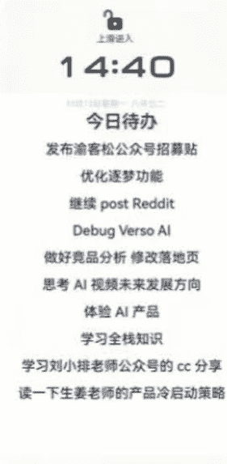
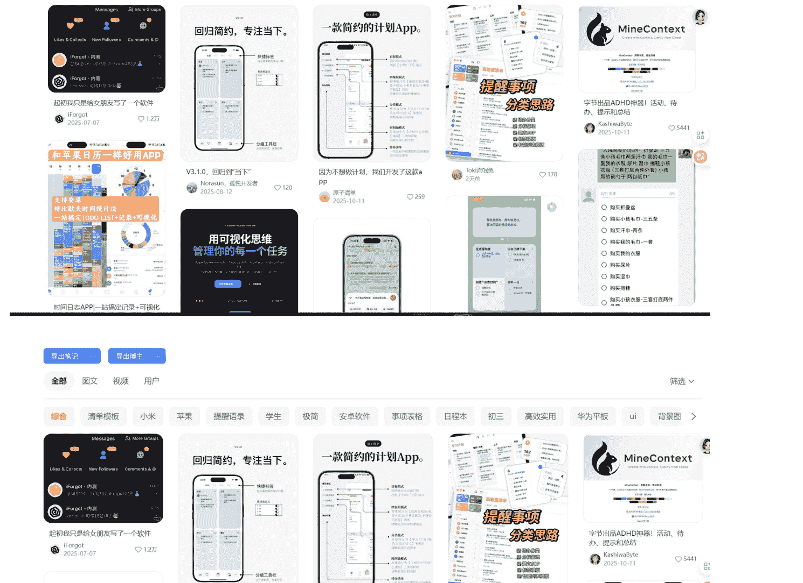
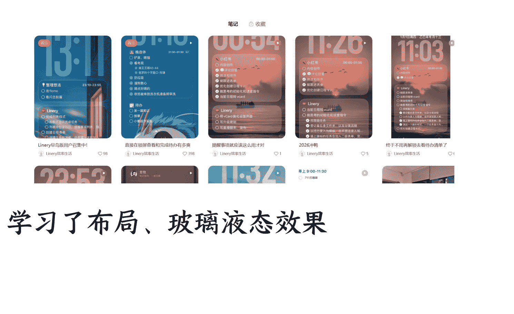
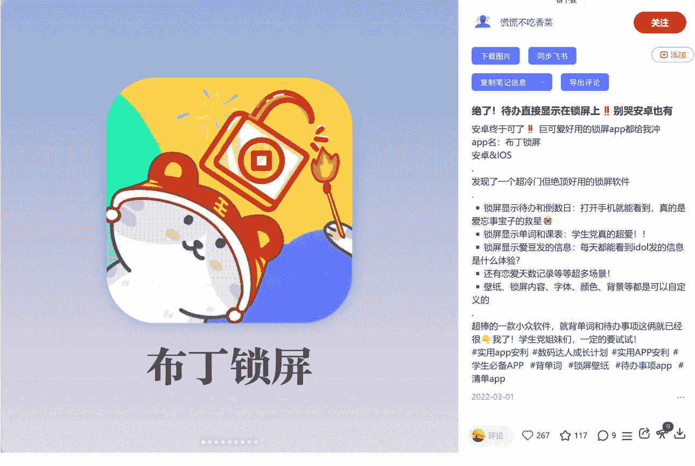
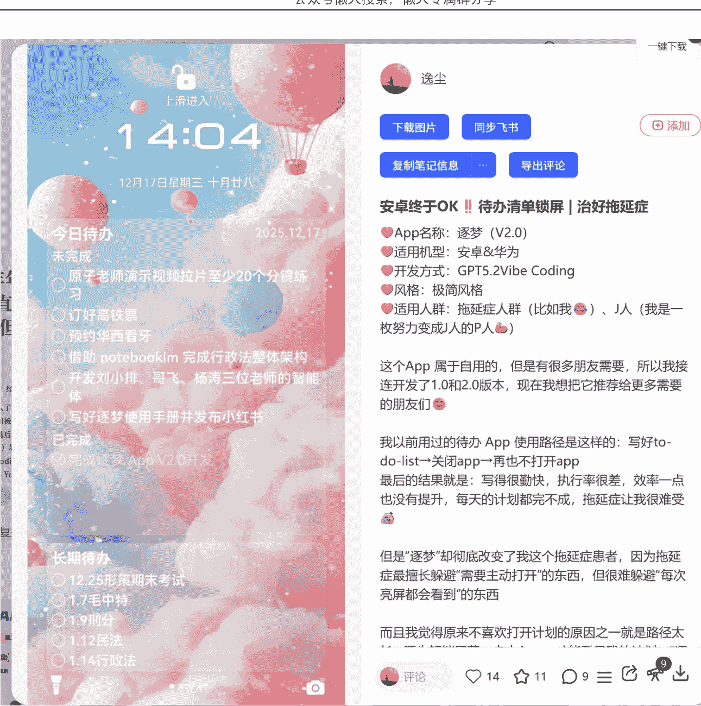

# 通过小红书最快验证产品 MVP 闭环

260106 副业 SC 精华

公众号懒人搜索，懒人专属群独享

懒人微信：lazyhelper1


微信：lazyhelper1

hello 大家好，我是逸尘。今天来给大家分享一下我“抽空随手”做的一个小项目，从想收费到赚钱不到 24 个小时。完全是兴趣使然，没有十分严格地遵循一个合格的产品创作路线，但是相信大家能从我略微有些杂乱的思路中略有收获。

## 一、闭环逻辑

将开发的安卓 APP 的 APK 打包到夸克网盘，然后把夸克网盘链接上传到小红书的“个人售卖”，关联笔记，就可以直接获得两份收益——小红书个人售卖款项；夸克网盘拉新。

为什么是小红书的“个人售卖”而不是“个人店铺”？

小红书的“个人售卖”仅收取 0.5% 服务费，而“个人店铺”的软件类要收取 2% 手续费；而且“个人售卖”能免费设置自动发货，睡后收入无忧；“个人售卖”不会显示销量、差评这些，避免了售后的那些麻烦。

### 本方法的优越之处在哪？

相比于其他 AI 编程的变现手段（iOS 应用商家苹果商店 99 美元开发者年费；web 网站上 adsense 最少得买个域名还涉而且变现周期很长；web 工具站还得接入登录订阅系统十分有技术难度【Cream、stripe 等】；编程社群不是大 IP 很难做），但是小红书个人售卖安装包只需要有一个功能完整的软件即可（不接入 AI 功能这种，后期可以逐步迭代，也可以通过让用户自己获取秘钥的方式添加 AI 功能实行买断制或者自己接入 AI 实行订阅制），而且变现周期非常短，小红书笔记发出去一个小时甚至就可以变现。

因为本来是自用的，没想过直接大规模商业变现，所以没有花费精力拓展其他变现路径，但是我的一些延伸思考会在后文记录。

## 二、产品的起源

去年去听了一场涛哥的线下分享会，其中涛哥讲的一个点特别吸引我——把每天需要做的事情记录在锁屏屏保上面，可以极大地提高工作效率。但是我觉得需要慢慢去绘图还要去更换，太麻烦了，就没有直接实践，但是我把这个 idea 写进了灵感库。

在某天 vibe coding 奴役 AI 跑代码的空隙，我就随手翻了翻灵感库，就打算把这个 idea 试着实现一下（当时 gpt5.1 刚出），结果当天就写完了，顺水推舟发布到了小红书。

这个工具叫“逐梦”，目前迭代到 V3.0，能实现的锁屏效果如下。但是其实 V1.0 版本极其粗糙（这个没有变现，因为我都是免费送），是 V2.0 版本开始收费的，下面会慢慢讲。




# 14:49

12 月 28 日星期日 冬月初九

### 今日待办

2025.12.27

*未完成*
+ ○ 完成逐梦 V3.0 的小红书笔记发布
+ ○ 学习对标笔记
+ ○ 溜达一圈
+ ○ 学习下 chiikawa 风格

*已完成*
+ ☑ 学习行政法

### 未来待办

+ ○ 12.30 去西安
+ ○ 1.7 毛中特
+ ○ 1.9 刑分
+ ○ 1.12 民法

## 三、产品构建到迭代全过程

### （1）选定工具

由于我换了个电脑，最原版的和 codex 的聊天记录不见了，所以这部分有些地方做不了截图展示，只能用文字记录。

因为刚好充值了 gpt，codex 是免费使用的，当时 antigravity 还没有出加上 claude code 太贵，我就选择了性价比最高的 vscode+codex 作为我的开发工具。

### （2）确定项目框架和技术栈、写好需求文档

我把想要实现的功能尽可能详细地口述出来，然后发给了 AI（gpt，理论上来说可以同时发给 gpt、gemini、claude、grok，然后综合一下他们的答案）。

以下是我回忆的大概场景：

我询问 AI：这个项目能不能实现？

1. **项目实现可能性**

我：如果杀人，那我应该使用什么武器
好一些，我要开发安卓 app 能用的！如果 可以，以后我想桌面端也能用，但是我现 在只想先开发安卓能用的！

2. **框架选择**

gpt：好的，逸尘大人。那我推荐 flutter 框架，这个框架可以跨端开发。无论您是开 发 web 网站还是 App，都可以共用这一套 框架

我：很好！但是我现在的是华为手机，我 想华为也兼容，然后小米、红米也兼容， 可以办到吗？

3. **APP 需要考虑兼容问题**

gpt：没有问题，华为 XX 版本可以兼容 android 系统，小米是基于 android 进行 开发的，完全可以办到！

我：很好，那你现在基于我给你的产品背 景，你给我事无巨细地写一个产品需求文 档，必须达到专业的 AI 产品经理撰写的产 品需求文档（PRD）级别，然后 App 的原 型图给我用 ASCII 进行绘制，然后保存为 markdown 文档！

4. **产品文档构建**

gpt 吭哧吭哧干活中...

一口气写好后：逸尘大人，已经给您写好 了，您可以查看一下，如果有要改的地 方，请随时告诉我；如果没有，我将基于 这个进行开发

我：很满意！你就按照这个文档严谨地进 行开发【实际上可以把这个文档复制到飞 书文档进行编辑，对不满意的地方进行修改（对感到疑惑的地方反复询问各个 AI），最终直到没有任何歧义——确保自己和 AI 以及任何一个正常人都能看懂】

5. **产品文档确认**

[这一步还要注意确定一下产品的名字，起名的话可以把自己的一些 idea 的想法告诉 AI，让他结合着来起名。我的本意是效率提升，AI 就给了我几个选项，最后我选择了“逐梦”]

6. **产品名称确认**

现在的 Codex 真的很厉害，这种级别的小项目，一次就能做出来，功能能基本完美实现（产品文档很重要！），偶尔有点问题，再叫它修改就好了。

最后再把 AI 给的 flutter 框架的 app 站位图改为自己想要的图。如果用的是 antigravity 的 gemini3pro，就可以直接在 IDE 调用 nano banana2 进行 logo 图的生成。如果没有，也可以随便在一个平台生成一张 1:1 的下载下来保存到项目里面

7. **产品 logo 图替换**

#### 3）V1.0 开发成功，在自用和免费分享 阶段寻找迭代需求

我的 1.0 版本十分粗糙，展示如下：只有最基础的功能，壁纸也是固定的，不可更改。


## 逐梦

2025.10.13

* 今日待办
- 发布懒人松公众号招募贴
- 优化逐梦功能
- 继续 post Reddit
- Debug Verso AI
- 做好竞品分析 修改落地页

* 已完成
*   ✓ 学习行政法

### 未来待办

* 1.7 毛中特
* 1.9 刑分
* 1.12 民法

所以我也没打算直接变现，我就免费分享给了涛哥群聊里面的圈友，结果有几十个圈友来找我要，还有圈友用完之后表达赞赏以及提后续优化建议。

```
"杨涛"邀请"鱼儿游四方"加入了群聊

涛哥之前说把 to-do-list 弄成屏保，我就没事手搓了一个写了 to-do-list 自动保存为屏保的 app，有没有人想用，免费发你 apk
```


### （4）借鉴同行优秀产品进行 V2.0 版本的开发——验证市场

升级 V2.0 版本的时候，就想着能不能顺便发到小红书上赚点零花钱，所以到了这一步就要发过去验证这是不是一个有真实需求的产品。直接小红书搜索“锁屏待办 APP"“待办”等关键词，会发现这是一个足够大、需求足够多的市场，而“锁屏待办”只是其中的一个细分类型。



就会找到相当多的竞品，但其实很多都不是竞争关系，这个时候我就去找了一个最厉害的不是竞品（她是 iOS 的）的对标进行学习。



学习了布局、玻璃液态效果。

### 原子老师演示视频拉片至少 20 个分镜练习

### 订好高铁票

### 预约华西看牙

### 借助 notebooklm 完成行政法整体架构

### 开发刘小排、哥飞、杨涛三位老师的智能体

### 写好逐梦使用手册 并发布小红书

### 自定义锁屏

#### 选择锁屏壁纸

从相册选择

精美壁纸

更换锁屏壁纸


**今日待办**

*未完成*
- 原子老师演示视频拉片至少 20 个分镜练习
- 订好高铁票
- 预约华西看牙
- 借助 notebooklm 完成行政法整体架构
- 开发刘小排、哥飞、杨涛三位老师的智能体
- 写好逐梦使用手册并发布小红书

*已完成*
✓ 完成逐梦 App V2.0 开发

*长期待办*
- 1.7 毛中特； 1.9 刑分； 1.12 民法；

+ 今日待办
+ 未来待办
+ 自定义锁屏
+ 日志管理
+ 调整方向

### （5）对标竞品，AI 模仿文案进行发布

然后在小红书发布了我的笔记：



**布丁锁屏**

**绝了！待办直接显示在锁屏上！！别哭安卓也有**

安卓终于可了！！巨可爱好用的锁屏 app 都给我冲

app 名：布丁锁屏

安卓&IOS

发现了一个超冷门但绝佳好用的锁屏软件

* 锁屏显示待办和倒数日：打开手机就能看到，真的是爱忘事宝子的救星🌟
* 锁屏显示单词和课表：学生党真的超爱！！
* 锁屏显示爱豆发的信息：每天都能看到 idol 发的信息是什么体验？
* 还有恋爱天数记录等等超多场景！
* 壁纸、锁屏内容、字体、颜色、背景等都是可以自定义的

超棒的一款小众软件，就背单词和待办事项这俩就已经很美了！学生党姐妹们，一定的要试试！
#实用 app 安利 #数码达人成长计划 #实用 APP 安利 #学生必备 APP #背单词 #锁屏壁纸 #待办事项 app #清单 app



然后直接进行模仿就行，微改动增强活人感。

### （6）用网盘添加 apk 安装包，添加个人售卖关联笔记进行变现

我问了 AI，AI 帮我找到 apk，告诉我，这个发给别人，别人下载了就能用。

添加个人售卖的时候注意添加自动发货！会增加转化率！

关于小红书合规，不懂直接问客服！

我当天发布，过了一两个小时，就有人下单了，给我震惊了，这个速度，虽然钱不多，但是还是很开心。

##### 公众号懒人搜索，懒人专属群分享

**逸尘**

小红书号：nianming6666

IP 属地：重庆

不要定义自己，不要固化自己
不必追赶 AI，做好一个普通人
日拱一卒，在自己的领域发光发热

重庆渝北

西南政法大学

关注 
79

粉丝 
437

获赞与收藏 
3643

编辑资料

个人售卖

去管理中心

创作灵感

学创作找灵感

浏览记录

看过的笔记

### 我的商品和服务

全部>

可在私信中发送或挂载在笔记中售卖

...

逐梦 V2.0|待办锁屏安卓 App

无需邮寄

已关联笔记

已设置自动发货

¥9.99

发笔记

编辑

...

逐梦 V3.0|将重要事情焊在屏保

无需邮寄

已关联笔记

已设置自动发货

¥9.99

发笔记

编辑

创建商品/服务

20 / 32

## 社区官方客服

4.日记管理，配合 一键归档，方便回顾自己的华([]) 豪华战绩 ([])

5.方向调整，由于各个手机锁屏权限不同，特意设计此功能保证文字方向正确(脸红)[^😅]

J 人的生活 #拖延症 #锁屏 #锁屏启动 App #锁屏待办 #小众 APP #效率 #vibecoding #AIchannel

合集 | 逐梦 App

群聊 | 逐梦 App 天使用户内测群 (21)

咨询 | 和 @逸尘 聊聊

^个人售卖^ 逐梦 V3.0 | 将重要事情焊在屏保上 ￥9.9

编辑于 2025-12-29 重庆 公开可见

已声明原创 > ④ 内容为自主拍摄

评论 9 = 赞和收藏 25

^爱评论的人运气都不差^

> how to obtain it Lost

> This note is bound to ^personal pendulum^ oh, if may not ^Little Red Book version has no update

### （7）一鱼多吃，顺便做下网盘拉新

变现不是特别多，大概是销售额的百分之三左右。

### （8）记得在网盘里面上传操作手册

建议用 word，因为如果是飞书文档，还必须记录在 txt 文档里面，再跳转一次，会增加用户使用难度。

操作手册尽量保姆级别，一步也不要跳，这样就可以少很多售后（我至今都只遇到过一次售后，效果很好）。

| 文件名 | 最近操作 | 大小 | 操作时间 |
| :--- | :--- | :--- | :--- |
| 逐梦 V3.0 使用手册及注意事项.docx | PC 上传 | 476.8KB | 2025/12/28 13:46 |
| 逐梦 V2.0 使用手册及注意事项.docx | PC 查看 | 1.8MB | 2025/12/28 13:19 |
| 逐梦 v3.0.apk | PC 上传 | 119.3MB | 2025/12/27 23:11 |
| downloadfile.bin | 云收藏 | 29B | 2025/12/23 17:26 |
| 逐梦 v2.0.apk | PC 上传 | 101.9MB | 2025/12/17 15:42 |

### （9）小红书建个群聊，及时收集用户反馈，承诺更新

要点一下这个“自动同步”

10:32

我这个是一直开着的

10:38

有几秒的延迟滴。你再试试呢，不行的话麻烦把具体情况截图给我一下呢，我看看啥情况 @可爱多（减肥版）

okok，明天我再弄一下，今天已经同步了

好的 (·´o·)ok!!!!，什么情况欢迎随时反馈

还真是

麻烦了 那我以后就用默认吧

锁屏的话，把动态壁纸关掉，用静态默认的（app 内部可以修改）。桌面那些理论上不影响，可以试试。

### （10）迭代 V3.0，提高单价

根据用户的反馈（不是所有反馈都要采纳），以自己的产品经理视角进行审视，严格控制每次需要修改的东西，进行迭代。然后有了 V3.0:

### 2025.12.28 星期日

# 写下今天要做的事...

### 未完成

+ - [ ] 完成逐梦 V3.0 的小红书笔记发布
+ - [ ] 学习对标笔记
+ 闹钟 16:32
+ - [ ] 学习下 chiikawa 风格
+ - [ ] 溜达一圈

### 已完成

+ - [x] ~~学习行政法~~

### # APP 内部 UI 大幅提升，可以高度自定义壁纸，功能整合简化

虽然看起来比之前的版本少了很多东西，其实这些都是多了几个二级入口，把一级入口简化了。这个就是做产品的极致利用用户思维，要简化用户的操作难度和理解难度，增强上手的能力。

简洁、干净、漂亮、自由度高，这一个版本我很满意。

怎么做到的呢？答案是 antigravity 的 gemini 3 pro！

这个模型在优化前端方面非常之强，直接告诉他：

我要优化当前项目的前端 UI，把繁琐的功能尽可能合并，你给我想一个好的优化方案

然后自己略微修改后就让他直接开始修改，最后再让 gpt 5.2 进行 bug 修复即可。

然后我就把这个产品的单价从 8 提高到了 9.99，但是一点不影响出单率（虽然都很低哈哈），因为有一个逻辑就是这个产品目前几乎没啥竞品（因为市场小，对应的粉丝画像是极小一部分需要高工作效率的人群），就算有也是 iOS 那边的，非 iOS 用户基本都是我的客户。

以上就是开发全流程啦！

下面讲讲如何更大得商业化（虽然我不是很想去弄）。

## 四、提高收入的路径

### （1）流量入手

流量越多，出单率越多，自然收入越高。

# 抢夺流量的方法

1. 发笔记 2. 投流 3. 截流 4. 合作

- **1. 发笔记**：筛选一下对标高赞笔记，加入自己的东西模仿一下，标题那些尽量变动少一些，核心不能动！偷懒的话每次版本更新发一篇，如果是长期投入，就每天换不同角度去发笔记（看对标）。

唯一需要注意的就是小红书内部的 SEO 要做好，在标题里面埋入足够多的关键词。

- **2. 投流**：不建议，本来就赚不了几个钱。但是想要快速验证市场，不失为一个好办法，针对有资本的玩家。

- **3. 截流**：就是从别的对标竞品的评论区的“求安卓”“安卓有无”进行私信（注意每天只有十次机会），但是也可以直接在别人评论区回复（最好私信一下相关博主，找没有直接竞争关系的，避免被删评论）。

[img/36adba5d6489b28bd96a954c32baeea9_28_0.png]

- **4. 合作**：还有一种就是良性的流量互补——合作。我就是直接和上面的那个 iOS 竞品进行了合作，我俩互相引流，我们的伙伴一发一波。

2025-12-17 10:50  
哈哈哈，已经开发完 2.0 了，但我也学习过你的 APP，安卓没有快捷指令，不知道用户能不能接受吧

2025-12-17 10:51  
我们倒是可以合作，到时候我发安卓的，如果有要用 IOS 的，我就推荐给你  
可以呀  
等我发笔记，还在写使用说明  

## (2) app 粉丝画像升级

把这个升级成一个超级大的“时间管理”APP，但是意味着竞争对手更多，说实话，比较难，周期也比较长。这种基本上就是奔着拿投资那种去做

## (3) 对接后端产品

我的粉丝画像基本上是沿海地区的年轻人，大多数偏科技、生活类型（后台数据总结），那么大概率就是有一些认知和收入还可以的人群，来添加好友到后端，进行生财拉新等等的变现（所以笔记可以不只发这种产品，还可以塑造一些个人 IP，但其实这种就是做 IP，卖产品反而是做 IP 的一个分支）

## (4) 出海

看一下外国各个国家的 Reddit 社区，有没有相关的需求，可以的话，直接用 iOS 进行开发，上架到苹果商店进行变现，也是可以的

感谢大家的时间！希望大家都能有所收获！

最后，安利小懒的付费群：

## 懒人专属群（介绍）

[img/36adba5d6489b28bd96a954c32baeea9_30_0.png]

这是你对抗信息过载的护城河。

已稳定运行 6 年，累计拆解、研读  
3000+ 个互联网商业实战案例与行业前沿内参和时政/宏观文章。

我们不仅搬运垃圾，只做高价值信息的筛选器与放大镜。

## 懒人专属群更新记录：

[https://hk57gvlx7u.feishu.cn/docx/H0kRdZbSb0lBR0xkaXt_cuVE0nTg](https://hk57gvlx7u.feishu.cn/docx/H0kRdZbSb0lBR0xkaXt_cuVE0nTg)

【免责声明】本资料归档于社群内部知识库，仅供成员课题研究与学术交流，请在查阅后 24 小时内删除。