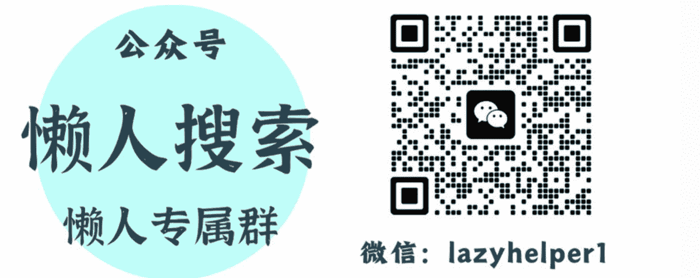

# 伊朗爆发大规模抗议，会不会成为下一个委内瑞拉？

260106 文/卢克文工作室嘉宾 朱染
整理：公众号懒人搜索，懒人专属群精选
懒人微信：lazyhelper1

从 12 月 28 日开始，伊朗发生了大规模抗议活动，成千上万的抗议者走上街头，高喊反神权、反政权的口号，并发生了流血冲突。其声势之大，甚至超过了 2022 年库尔德女孩阿米尼之死引发的那场抗议。

马杜罗刚刚完蛋，许多人担心，伊朗会不会是下一个委内瑞拉？哈梅内伊，又是不是下一个马杜罗？

## 01
事情还得从这次伊朗抗议活动的导火索——通货膨胀说起。

严格来说，从 1979 年伊斯兰共和国建立，到此时此刻，伊朗经济都处于高通胀状态，就没有几年不处在高通胀状态下。

但在过去，伊朗依靠石油贸易，能获得一笔稳定的收入，用来缓解压力，甚至还在本世纪头十年油价高企的时候利用石油财富，对内带动了自身的工业、教育、科技和城市化发展，对外维持了区域强权的形象。

这种情况下，虽然伊朗的通胀率常年维持 20% 以上，但国家的总体经济状况，和民众的生活状态还过得去。

从 2018 年开始，情况发生了改变。

当年，特朗普单方面撕毁了《伊朗核协议》，对伊朗施加制裁，导致伊朗的石油出口变得艰难，外汇收入下降。这种情况下，伊朗的各种日用商品价格不断上涨，老百姓手中的“里亚尔”贬值连连。

2018 年至 2019 年，伊朗的通胀率从 18.01% 涨到了 39.91%，其官方货币里亚尔与美元的实际汇率，从 37000:1，降到了 200000:1，为了缓解危机，伊朗被迫用新的货币“土曼”替换“里亚尔”。（与里亚尔按照 1:10000 兑换）

2020 年以后，尽管白宫的主人换成了拜登，但美国对伊朗的制裁没有停止，加上新冠疫情的冲击，伊朗的通胀率还是很难看。到 2025 年 12 月，伊朗的通胀率达到了 42.2%，美元兑土曼的实际汇率变成了 1:1450000。

由于伊朗大部分商品需要进口，因此，伊朗的物价水涨船高。比如，食品价格同比上涨了 72%，医药同比涨价 50%，民生之严峻不言而喻。

世界银行发布的《伊朗国民收入调查》显示，2025 年，大部分伊朗民众的月收入在 1.7 亿至 7 亿里亚尔之间（约 117 美元至 550 美元之间）。

大半的伊朗人要为温饱发愁，很多家庭的收入根本无法养家糊口。

伊朗的民生形势已经到了火烧眉毛的地步，其景象和当年国党金圆券贬值有几分相似。

这种情况下，个体商户首当其冲，带头抗议。

先是 12 月 28 日，德黑兰的几个巴扎市场商户集体关门，抗议货币不稳定，让他们没法做生意了。

次日，德黑兰更多的商贩关门抗议，更多的民众加入了抗议队伍，抗议者的诉求也从一开始的经济议题，变成了“推翻哈梅内伊”，甚至“支持巴列维回归”的政治口号，矛头直指伊朗的神权体系。

等到 30 号以后，大量的高校学生、上班族也加入抗议队伍，抗议活动随之蔓延到全国。伊朗 31 个行省中有 21 个受到了波及。

就连“圣城”库姆，也出现了军警与抗议者对抗的画面。

要知道，库姆是许多什叶派教士的修学圣地，也是霍梅尼、哈梅内伊等人学经书的地方，此地风尚一向保守，连这里都出现了抗议活动，可见这次抗议浪潮非同一般。

## 02
抗议者毫不掩饰他们对于宗教当局、安全部门和文官政府的怨恨。破坏街道上的哈梅内伊肖像、高喊反政权口号是伊朗抗议活动常见的行为，但像这次一样直接冲击安全机构的情况，还是不多见。

抗议发生后，洛雷斯坦省的抗议者冲击了当地的巴斯基民兵基地，拿走了里面的一卡车的枪支弹药。

在库姆，伊朗出动了特种部队和巴斯基民兵。

在克尔曼沙阿省和伊拉姆省，街头出现了手持枪支与巴斯基民兵交战的武装人员，目前至少有 1 名巴斯基民兵在对抗中丧命。

抗议者攻击的对象不仅仅是领导人肖像、旗帜、建筑物、这些政权“象征”，而是已经影响到了警察、巴斯基民兵乃至革命卫队等强力部门。上一次出现这种情况，还是 2022 年的阿米尼抗议活动。

对于抗议者的指责和攻击，伊朗当局将其定义为“外部势力的又一次破坏”，并指责美国和以色列参与其中。

问题来了，这次伊朗抗议活动，有没有外部势力的影响呢？

答案是肯定的，抗议发生后，美国和以色列都对抗议表达了支持。

以色列摩萨德也表示，他们对伊朗抗议者的支持“不会停留在远处口头上”。此前发生在西部边境克尔曼沙阿省和伊拉姆省的街头冲突中，伊朗方面认定，反政府武装人员所拿的自制炸弹和枪支，是由摩萨德运进来的。

然而，外部影响并非引爆局势的关键因素，伊朗当局的责任，才是主要。

对内来看，从 1979 年以来，伊朗的经济发展就受到了各类宗教基金会、革命卫队和官僚阶层的垄断制约。尤其是前两者，他们旗下的机构和企业往往享有不纳税、不接受审计和监督的特权。

他们还掌握了包括能源、土建、交通运输、通讯在内的，最能赚钱的行业。

而民间资本和普罗大众，从中分到的蛋糕份额少的可怜。

以往油价高企，伊朗还能对外公开卖石油，高层通过分配石油收入，缓解一下矛盾。但如今，伊朗石油只能不停地走转口贸易，利润微薄，蛋糕越分越少，民众“患不均”的心理自然会愈发严重。更别说伊朗社会长期积累的教权与世俗权力之争了。

这种“不均”反应到货币贬值上，就是伊朗民众日常要按照 1 美元比 145 万土曼的实际汇率去购买越来越贵的商品，而垄断资本和依附者却可以依靠政府的汇率补贴政策，按 1 美元兑 4.2 万的官方汇率行事，左右倒腾，大发横财。

伊朗近年来不断失误的外部战略，也让抗议活动的声势越来越大。

尤其是在苏莱曼尼被美军袭杀，以色列空袭伊朗本土之后，革命卫队、教士阶层的虚弱性展露无遗，谁都明白伊朗当局对内压制的手段被削弱了。这也是伊朗抗议者敢袭击安全部门，敢和军警民兵对线的重要原因。

眼下，局势还没有恶化到无可救药的地步，革命卫队和巴斯基民兵完全有能力平息这场抗议活动，伊朗当局很可能会像 2022 年那样，使用强硬手段。

最高领袖哈梅内伊 1 月 2 日对这次抗议的性质定了调，他表示会尊重商户们的利益，但有人利用了商户们的旗号，煽动骚乱，进行危害国家安全的活动，完全不能接受。

这代表了教士集团的基本态度，即承认经济出了问题，但坚持用强硬手段平息。

宗教势力有强硬意愿，枪杆子也使唤得动。巴斯基民兵因为配备枪支弹药，且身为革命卫队的外围组织，政治上可靠度高，他们现在已经冲在了第一线，是哈梅内伊压制抗议活动的主力军。

革命卫队则从 12 月 29 日就展现出了支持强硬压制的态度。在这两套枪杆子的配合下，哈梅内伊完全有能力平息事端。

以佩泽希齐扬为代表的世俗官僚，实际上也不支持抗议活动。

佩泽希齐扬对于抗议活动的态度很暧昧，他在 12 月 30 日还告诉各地的政府部门应该倾听抗议者的诉求，他还成立了一个沟通小组，试图与德黑兰的抗议者交流。

但抗议人群并不买账。

许多抗议者 2023 年支持他当总统，主要是因为他改革派的背景。但他上台以来，并没有解决多少民众期待的经济与世俗化问题，佩泽希齐扬本身也不支持抗议者“推翻哈梅内伊”之类的激进主张。

抗议蔓延后，佩泽希齐扬的内阁班子也出现了人事波动。伊朗央行行长穆罕默德·法尔金，总统政治顾问梅赫蒂·萨纳伊先后下台，第一副总统阿雷夫也交上了辞呈。

这些人或辞或免，显然有安抚抗议活动的意思。

理论上，哈梅内伊挺过这道坎，是没问题的，但要注意，12 月末，内塔尼亚胡和特朗普举行了“迈阿密峰会”。峰会的主要内容之一，就是讨论再次打击伊朗。目前的伊朗局势，对美以而言是绝好机会。

美以想必不会轻易放过。

同时，即便哈梅内伊能迈过这道坎，未来的路也不好走。

外有美国极限施压，以色列虎视眈眈，内有经济疲敝，类似的大规模抗议乃至动荡，伊朗以后恐怕少不了。

最后，安利小懒的付费群：

懒人专属群（介绍）

这里是你对抗信息过载的护城河。
已稳定运行 6 年，累计拆解、研读 3000+ 个互联网商业实战案例与行业前沿内参和时政/宏观文章。

我们不搬运垃圾，只做高价值信息的筛选器与放大镜。

懒人专属群更新记录：

https://hk57gvlx7u.feishu.cn/docx/H0kRdZbSb0lBR0xkaXtcuVE0nTg

【免责声明】本资料归档于社群内部知识库，仅供成员课题研究与学术交流，请在查阅后 24 小时内删除。