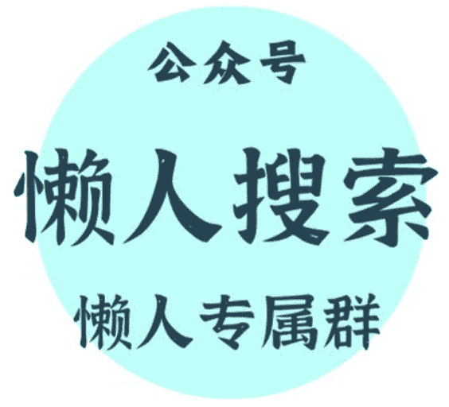

# 2026，学历还有用么？

## 260106 圆方你怎么看

整理：公众号懒人搜索，懒人专属群精选

懒人微信：lazyhelper1

### 01

“夫殷忧所以启圣，多难所以兴邦，势有必然，理无或爽。钦惟皇帝陛下践阼以来，勤求治道，惟日孜孜者三十年矣，然而治效未彰、外患日亟，意者因时制宜之道或有未尽欤...

然臣谓理财于今日，节流不如开源之尤要，盖自通商以来，利源外溢，虽百计节省而无救于贫。开源之道在振兴实业，中国神皋沃壤幅员纵横寥廓，且地处温带之下，百物皆宜，则当讲求农事，振兴工艺，扩充商务，如此则野无旷土，市无游民，精华日呈，然后利权可挽..

今日浮荡之士，未窥西学已先有毁裂名教之心。故欲正人心、端士习，必以明伦为先，欲明伦理必以尊经为首，此即国粹保存之义。皇上倡明文教，必以经学正其趋，此不得不因时制宜者四也...”上面这些内容，是中国最后一名状元，刘春霖在殿试时所写的策问。

1904 年的紫禁城，保和殿内烛火通明，三十岁的刘春霖伏案疾书，笔下馆阁体工整无一笔涂改。

他应答光绪帝的策问，字里行间皆是经世致用的灼见。

那时的他，却不知这份答卷将成为千年科举的绝响。

当光绪三十年公布甲辰科的殿试榜单，刘春霖的名字被钦点为第一甲第一名，他身着状元红袍，在紫禁城的宫墙下叩谢皇恩，全然不知自己已是延续千年科举制度的最后一位状元郎。

彼时的中国，正陷在风雨飘摇的困局里。

列强的军舰游弋在沿海港口，租界的洋楼在通商口岸拔地而起，铁路矿山尽被外人把持，朝廷的岁入大半用于赔付庚子赔款。

朝堂之上，守旧的王公大臣抱着祖宗之法不肯松手，维新的呼声被压制后，立宪的闹剧又粉墨登场。

民间的苛捐杂税层层加码，流民遍野，起义的烽火在各地隐隐燃烧，古老的王朝像一艘千疮百孔的大船，在时代的浪潮里摇摇欲坠。

### 02

就在刘春霖高中状元的 1904 年，世界正被第二次工业革命的浪潮席卷。

美国的莱特兄弟在北卡罗来纳州的旷野里反复试验飞行器，金属骨架的滑翔机一次次掠过草地，人类飞向天空的梦想即将照进现实。

德国的工厂里，内燃机的轰鸣声取代了蒸汽机的低吟，汽车的雏形穿梭在城市街巷，改变着人们的出行轨迹。

英国的电力系统愈发成熟，电灯照亮了伦敦的夜晚，电报与电话让远隔重洋的人们得以互通音讯。化学工业的突破则让染料、药品的量产成为可能。

这些日新月异的科技成果，与中国私塾里朗朗的四书五经诵读声，构成了两个截然不同的世界图景。

仅仅一年之后，清廷一纸诏令，宣告科举制度废除。

这个消息像惊雷般炸响在无数读书人的耳畔，那些浸淫四书五经数十载的士人，骤然失去了安身立命的路径。

他们中有人抱着圣贤书痛哭流涕，认定世道崩坏，从此闭门不出，守着旧学的残垣断壁了此残生。

有人在迷茫中辗转，最终放下笔墨纸砚，走进新式学堂，从头学习外语、算学、格致之学，试图在变局里寻一条新路。

光绪二十年恩科状元张謇，比刘春霖早了整整十年折桂，他高中之后没有流连翰林院的清闲光景，反而看清了朝堂的腐朽与民生的凋敝。

眼见洋布洋纱倾销内地，农家织户纷纷破产，他毅然辞官归乡，在南通创办大生纱厂。

建厂之初缺资金少技术，他顶着乡绅的质疑与洋商的排挤，四处奔走筹措股本，亲自勘察厂址，甚至把状元匾额挂在厂房里以安人心。

后来他又陆续开办垦牧公司、轮船公司、师范学校，将“实业救国”的理想一点点浇筑成现实。他曾说士大夫当为天地立心，为生民立命，这份初心，让他从科举状元变成了近代民族工业的先驱。

光绪十八年进士蔡元培，登科时不过二十六岁，少年得志却未曾耽于功名。

他在翰林院供职时，便偷偷接触西学译著，卢梭的民权思想、培根的科学理念，都让他窥见了古老中国之外的新天地。

科举废除的消息传来时，他没有半分惋惜，反而觉得这是打破思想禁锢的契机。

他先是在上海创办爱国学社，收纳那些不愿再读四书五经的青年，教他们算学、理化、西洋史，后来又执掌北京大学，提出“思想自由，兼容并包”的治学理念。

他邀请陈独秀、胡适等新文化运动干将讲学，也容得下辜鸿铭这样的旧学宿儒授课，让一所旧式学堂变成了思想碰撞的高地。这位进士出身的学者，用教育的火种，点燃了一代青年的觉醒之路。

还有光绪二十九年的举人宋教仁，登科时科举的丧钟已隐隐敲响。他没有像前辈那样求一份安稳的官职，反而东渡日本研习政法。

在东京的留学生公寓里，他日夜伏案翻译西方宪政著作，立志为积贫积弱的中国寻一条民主共和的出路。归国之后，他参与组建同盟会，奔走于长江流域的革命党人之间，为推翻帝制的起义秘密联络力量。

武昌起义的炮火打响时，他正在上海草拟《中华民国临时约法》，试图用法律的框架约束权力，让共和的理念落地生根。

刘春霖的人生轨迹，也因科举的废除而转向。他曾入翰林院任职，后被派往日本留学，研习政法之学。

归国后，他亲历了清王朝的覆灭与民国的建立，在乱世里辗转任职。晚年的他隐居北平，面对日伪政权的拉拢，始终以一介文人的风骨坚守气节，拒不出山。

这位末代状元的一生，恰似那个大变革时代的缩影，而那些与他一同被时代浪潮裹挟的读书人，或沉沦或奋起，或守旧或革新，都在历史的长卷上，写下了属于自己的乱世行舟记。

### 03

圆方今天这篇“知识教育人才秩序重构”是圆方 2026，世界会更好么？系列的第六篇

- 2026，天下大乱，形势大好讲了全球地缘战略秩序重构
- 2026，中美谁能攀登技术之巅？讲了技术革命产业秩序重构
- 2026，你的城市还有机会么？讲了城市发展能级秩序重构
- 2026，还有人结婚么？讲了婚姻、家庭关系秩序重构

如果说前四篇，聊的更多的是整个社会结构化的变化，我们个人只需要去选择，去适应就好。

那么今天知识教育人才秩序重构这个话题，或许需要我们自己躬身入局，去努力，去学习。

其实，回顾过去几年。

圆方觉得，中国知识教育体系的重构，比圆方过去预想的要来得更慢一些。

在 2022 年，圆方就开始思考学校教育，在 AI 时代将要面临的冲击。

2022 年，圆方写了《算算教育投资的账》文章里面说：

- 你算算账，高等教育的投入和时间成本，再加上为了上大学花的补习什么的费用。这个账，未来 40 年，算的过来不...

2023 年，圆方写了《别鸡娃，要“认”命！》文章里面说：

- 在一个变动的时代，“认命”也就是“认清命运的方向”，是比盲目的鸡娃要重要得多的事。

  那么什么是这个变动时代，孩子应该具备的素质呢？

  在价值和态度维度：
  - 需要有使命感
  - 有雄心壮志
  - 有清晰的自我认知和效能感
  - 有战胜困难的韧劲
  - 有面对失败的勇气
  - 以科学探索为乐趣
  - 严谨，求实，勤奋，自律，自信，不惧权威等..

  在能力和素养维度：
  - 需要广阔的国际视野
  - 丰富的人文素养
  - 宽厚的知识储备
  - 持久的好奇心
  - 严谨的逻辑思维
  - 敏锐的系统性思维
  - 扎实的理论抽象能力
  - 灵活的知识迁移能力
  - 高超的领导力
  - 坚强的执行力等..

2024 年，圆方写了：《真要为孩子好，就别“放弃“》什么文章里面说：

- 孩子成长的路上，孩子真正需要的是榜样，而不是保姆。父母也是独立的个体，他们有自己的梦想和追求。如果一味地为了孩子而放弃自己的个人发展，最后反而有可能会影响到孩子的价值观和人生选择。

2025 年，圆方写了《今天让孩子周末补课的家长，没有看到十年后..》文章中说：

- 十年后的社会，不会问你的孩子考了多少分，上了什么大学，而是会问：他能否在困境中开辟新路？
- 能否在人群中看见他人？能否在变化中坚守价值？

大家可以看到，其实在过去四年，圆方一直在大声的疾呼，教育需要被改变！也应该被改变！

但是认真想，过去这 4 年来教育真的变化很大吗？其实也没有。

不过我们可以确定的是，当我们把目光放到 2035 年，那个时候的教育一定跟今天是翻天覆地的变化。

随着 AI 更深度的嵌入到我们的生活工作当中教育的内容会变！

教育的形式会变！

教育的目标也会变！！

今天我们就来推演一下，到 2035 年，知识教育人才秩序重构，会演化到什么样的情况？

以及在 2026 年，我们又会感受到哪些具体的变化，又应当让自己，让孩子如何做好准备去适应这种变化？

### 04

当历史的指针拨转到 2035 年，那个时候回望现在，我们会发现，今天的自己正置身于一场比一百多年前废除科举更为剧烈的变革中心。刘春霖当年在保和殿写下的文字，是农耕文明向工业文明转型时最后的叹息。

而在今天，我们面临的是工业文明的教育逻辑在人工智能冲击下的彻底瓦解。

这种瓦解是全方位的，它触及了知识的本质、学习的路径以及人才的定义。

教育内容的变化首先表现在对知识记忆价值的否定。

在过去的几千年里，博学是一个人才最核心的标签，谁能背诵更多的经史子集，谁能在脑海中储存更多的公式、定理和案例，谁就能在社会协作中占据高位。

但是到 2035 年，这种以存储为导向的教育内容已经失去了存在的土壤。人工智能已经能够扮演比任何专家都要博学的角色，它不仅拥有人类历史上所有的文字记录，还能在瞬间完成逻辑建模和方案推演。

这就意味着，花费十几年的青春去死记硬背那些标准化的知识点，已经变成了一种低效率的浪费。

课程体系将从知识传授转向能力锻造。学生们需要掌握的课程内容，主要集中在如何与智能系统进行深度对话，如何对复杂的海量信息进行批判性审核，以及如何在缺乏数据支撑的未知领域进行直觉性判断。

教育的重点将从标准答案的复刻，转向对未知问题的定义。

### 05

这种内容的转变会进一步催生教育形式的巨变。过去那种集中式的、统一进度的学习方式，实际上是资源匮乏时代的产物。

因为老师的数量有限，教学设施有限，社会只能把几百个孩子关进教学楼，按照统一的铃声、统一的教材、统一的进度进行灌输。这种模式在本质上是把人当成了工业流水线上的产品。

到 2035 年，人工智能可以为每一个学生提供完全个性化数字导师。

这个导师能通过实时生理数据和交互反馈，洞察每一个学生的认知盲区和兴趣方向。

如果你在逻辑推理上有天赋，系统会为你自动加速数学的进阶过程。如果你在语言感知上存在短板，系统会通过各种生活场景的模拟，为你进行润物无声的补偿。

考核评价的方式也会发生根本性的颠覆。那种依靠一张试卷定终身的模式会消失，取而代之的是全过程的、游戏化的综合评估。

学习的过程就是闯关的过程，学生在解决实际问题的任务中展现出来的韧性、协作能力以及创造力，会被系统实时捕捉并转化为能力画像。

这种评估是立体的，它不再关注你某一次的发挥，而是在意你长期的成长轨迹。

### 06

与此同时，教育的目的将完成从筛选劳动者到发现创造者的转型。

在工业化时代，教育的一个隐性目标是筛选出能够听从指令、适应高强度重复性工作的标准化人才。

那些成绩好的学生，往往也是最能适应既定规则的人。

但是在 2035 年的社会秩序中，这种标准化的人才最容易被自动化系统取代。

未来的社会需要的是那种能够开辟新赛道、能够赋予技术以温度的人才。

人才的筛选标准将从合规性转向独特性。社会评价一个人是否成功，不再看他拥有什么样的学历标签，而是看他曾经解决过什么样的复杂问题，以及他能够动员多少资源去实现一个改变世界的想法。

这种筛选机制的重构，会彻底打破所谓的名校神话。

当教育的资源已经变得触手可及，学校的围墙就不再是阶级流动的阻碍。

个人的自驱力和好奇心将成为唯一的入场券。

我们需要意识到，这种秩序的重构并不遥远，事实上，今天它已经在我们的脚下悄然开始。

### 07

刘春霖在写状元策问时，他无法预测科举制会在一年后废除。

今天的家长如果依然沉迷于让孩子通过刷题来换取一个名牌大学的录取通知书，实际上就是在让孩子学习一种即将被时代淘汰的底层技能。

到 2035 年，知识本身已经不再是力量。驾驭知识、驾驭知识、创造新知的能力，才是真正的力量。

我们需要培养的孩子，应该是那种在面对困境时能够迅速调整策略的人，是在面对各种诱惑时能够坚守人类核心价值的人。

这种变化也要求教育者和家长完成角色的重构。

老师不再是知识的垄断者，而应该转化为学生成长道路上的教练和向导。

家长的责任也不再是监督孩子完成多少作业，而是应该成为孩子的榜样，通过自己的终身学习来展现对这个世界的好心。

我们要明白，未来的教育竞争不是在智力维度的竞争，而是在生命力维度的竞争。

谁能保持更长久的好奇心，谁能拥有更加强大的抗挫折能力，谁就能在 2035 年那个高度智能化的社会中找到自己的位置。

### 08

当然，教育变了，人才秩序也会变。

到 2035 年，所谓的人才秩序将变得更加扁平。过去那种依靠文凭建立起来的职业壁垒会逐渐瓦解。

一个拥有强大创造力的年轻人，即使没有传统的学历证明，也可以通过他在开源社区、在虚拟任务中所积累的声誉值，直接进入最高端的协作体系。

这种流动性会极大地激发社会的活力。

在这种重构下，那些能够顺应这种趋势的人，会发现这是一个最好的时代，因为每个人都有机会根据自己的天赋去定制自己的人生。

而那些依然抱残守缺、试图寻找安稳路径的人，则会感到前所未有的挫败。

这种重构的本质是人类在技术进步面前的一次主动觉醒。

我们终于意识到，教育的目的不是为了把人变成机器，而是为了让人更像人。

当机器承担了所有的逻辑运算和数据存储之后，人类可以腾出更多的精力和时间去关注情感、关注审美、关注哲学、关注那些无法被算法穷尽的领域。

这才是 2035 年知识教育人才秩序重构的真正意义所在。

### 09

如果我们把视野从 2035 拉回到 2026 的当下，就会发现当前的教育体系正处于一种极其尴尬的惯性之中。虽然技术已经发生了翻天覆地的变化，但很多学校的考核标准依然停留在上个世纪。这种脱节导致了巨大的社会焦虑，也造成了人才的大量浪费。

2026 年是一个关键的转折点。从这一年开始，我们会看到越来越多的新式教育形态涌现出来。

这些形态不再强调固定的校园，不再强调统一的教材，它们散落在社区、企业和虚拟空间里，构建出一个全时空的学习网络。

其实不光是教育，在教育背后的人才需求上，2026 年也正在以一种近乎野蛮的方式向我们展示这个新旧交替的节点。

走在街头或者浏览职场社交平台，你会发现那种曾经让中产阶级感到安稳的确定性正在加速崩塌。

在 2026 年，我们首先会感受到一种职场价值的剧烈错位。那些曾经需要名校毕业生熬夜一周才能完成的行业深度分析报告，现在只要一个普通职员向 AI 输入准确的指令，几分钟之内就能生成一份逻辑更严密、数据更详实的初稿。这意味着初级白领的技能正在迅速贬值，那些依靠信息差和熟练度生存的职位正面临灭顶之灾。

我们会看到大批在传统评价体系里非常优秀的职场新人，在入职后感到前所未有的迷茫，因为他们发现自己过去二十年苦练的逻辑梳理和文字表达，在算法面前显得如此笨拙。

这种变化会带来一种普遍的社会焦虑，那种只要努力读书就能换取一份安稳工作的职场契约，已经在这一年被彻底撕毁。

### 10

与此同时，我们也就会发现，教育领域的虚假繁荣也将迎来一场无声的爆破。在 2026 年的校园里，老师和家长会陷入一种前所未有的博弈。

学生们可以利用随手可得的 AI 工具生成完美的课后作业，甚至可以写出具有个人风格的文学创作。

传统的纸笔测验和期末考试开始变得像是一种滑稽的形式主义，因为学校无法通过作业来判断一个学生是真正掌握了知识，还是仅仅掌握了使用工具的技巧。我们会发现，那些依然坚持刷题和死记硬背的学习模式，正在把孩子引向一条死胡同。

很多家长会惊讶地发现，自己花费重金为孩子购买的补习课程，在 AI 时代的实战场景种几乎毫无用武之地。

### 11

我们自己该如何开始适应这种变化呢？最核心的一点是我们要完成从执行者到决策者的身份转型。

在过去，我们的价值体现在完成任务的质量和速度上。而在 2026 年以后的世界里，AI 承担了所有的执行环节，人类的价值将锁定在提问的能力和审美的判断力上。

我们需要有意识地去培养自己的系统性思维，学习如何在一个复杂的局势中找到那个最关键的问题。如果我们依然在追求把一件具体的事情做得比别人快，那么注定会输给机器。

我们应该尝试把自己当成一个项目的制作人，而把 AI 当成我们的技术团队。我们需要做的不再是亲自下场拧螺丝，而是思考这个产品到底要解决什么样的痛点，以及它应该呈现出什么样的灵魂。

这种转变要求我们重新建立自己的知识体系。我们不再需要做一个百科全书式的学习者，而应该做一个链接型的学习者。

我们需要跨出自己的专业舒适区，去了解心理学、社会学、哲学等那些关于人的底层逻辑的学科。

当算法逻辑统治了生产力，关于人的感受、情感和意义的洞察就会变得极其昂贵。

我们可以尝试在业余时间去参与一些需要深度协作和情感投入的项目，比如组织一次社区公益活动，或者发起一个跨学科的研究小组。

在这些过程中，我们所磨练出来的沟通、共情和领导力，正是 AI 最难模仿的领域。

对于我们的孩子，适应变化的方式更需要一种推倒重来的勇气。家长首先要做的就是停止对分数的过度迷恋，转而保护孩子那份极其珍贵的好奇心和生命意志。

在 2026 年，一个只会听从指令的孩子是没有任何竞争力的。我们需要鼓励孩子去尝试那些没有标准答案的挑战。

比如让他们去策划一场旅行，从预算规划到行程安排，再到应对路上的突发状况，这种全流程的掌控感能培养出孩子真正的决策能力。

我们要让孩子学会如何与 AI 共生，而不是把 AI 当成作弊工具，应该引导他们去思考如何利用工具来辅助自己的创意实现。

在孩子的教育中，我们要大幅度增加体育和艺术的比重。

因为体育锻炼的不仅是体魄，更是挫折教育和团队精神，这种在真实物理世界中的碰撞和竞争，是虚拟网络永远无法替代的。

艺术教育的重点在于审美和表达，它能让孩子在算法生成的千篇一律的模板中，保持那份属于人类的独特感知。

一个能在自然中感受到落日之美，并在球场上懂得如何与同伴配合的孩子，在 2035 年的社会中一定会比一个只会做数学卷子的孩子走得更远。

我们还需要培养孩子的使命感和价值观。

当技术变得无所不能，一个人拥有什么样的底线和追求，就决定了他会把世界带向何方。

我们要让孩子明白，知识只是工具，而如何使用工具去创造价值，如何在这个变动不居的世界里做一个有温度的人，才是他们终身学习的目标。

这种价值观的养成无法通过课本实现，只能通过父母的言传身教，通过家长在面对时代变革时展现出的那份坦然与进取。

### 12

其实，面对这种变化，我们不应该感到恐惧，而应该感到兴奋。

这意味着每一个普通的孩子，只要他拥有足够的热爱和专注，都有可能在某个细分领域成为不可替代的存在。

这种秩序的重构会给每个人提供更广阔的舞台，让那种单一的、扁平的人才观彻底走向多元和立体。

到那个时候，教育将真正实现其最初的理想，那就是让每一个灵魂都能自由地绽放。

而我们自己也需要学会一种新的生存心态，那就是长期保持一种半熟练的状态。

在过去，我们希望在一个领域成为专家，从此一劳永逸。但在 2026 年，知识的迭代速度已经不允许我们停留在任何一个舒适区。

我们必须习惯于作为一个新手去面对不断涌现的新技术、新平台。这种不断推倒自己认知围墙的能力，将成为未来十年最重要的核心素养。

2026 年是一个分水岭，它把那些依然沉睡在旧梦里的人和那些已经醒来开始布局的人彻底分开。

在这个阶段，所有的恐慌其实都源于对旧秩序的依恋。当我们意识到那些繁琐的、枯燥的、压抑人性的教育和工作模式终将被技术粉碎时，我们应该感到一种解脱。

在这场教育和人才秩序的重构中，没有谁是绝对的权威。我们和孩子都在同一条起跑线上，共同面对一个前所未有的智能时代。

这种同步成长的过程，本身就是一种极佳的教育契机。

我们可以放低姿态，承认自己也有盲区，向孩子学习他们对新技术的直觉，同时也把我们对人性的深刻理解传递给他们。

而这种深度的情感联结和智慧交换，将成为未来家庭最核心的资产。

当知识不再是奢侈品，当筛选不再是紧箍咒，人类的智慧将迎来一次真正的解放。

适应变化的过程注定是辛苦的，但这种辛苦是在为未来种下希望。

我们要做的不是预测未来，而是去创造未来。每一个在 2026 年选择主动进化的家庭，都将在十年后的秩序重构中收获属于自己的果实。

## 最后，安利小懒的付费群:

### “懒人专属群 (介绍)”

## 这里是你对抗信息过载的护城河。

已稳定运行 6 年，累计拆解、研读 3000+ 个互联网商业实战案例与行业前沿内参和时政/宏观文章。

我们不搬运垃圾，只做高价值信息的筛选器与放大镜。

- 懒人专属群更新记录：
- https://hk57gvlx7u.feishu.cn/docx/HOkRdZbSbolBR0xkaXtcuVE0nTg

> 【免责声明】本资料归档于社群内部知识库，仅供成员课题研究与学术交流，请在查阅后 24 小时内删除。