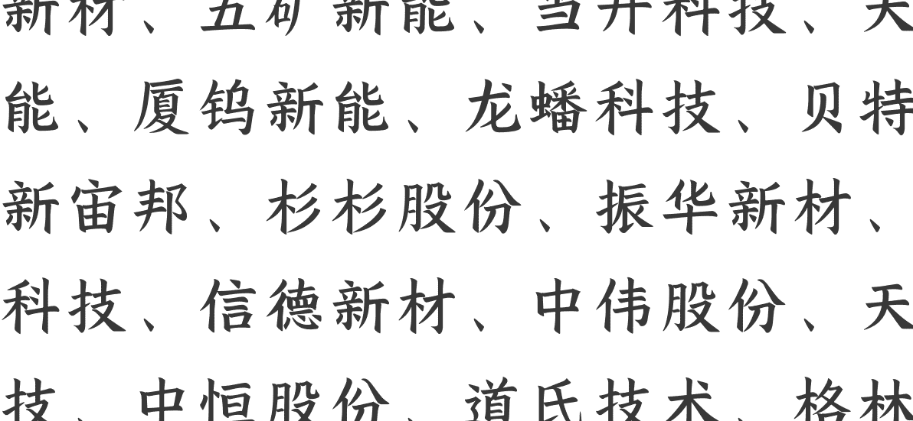
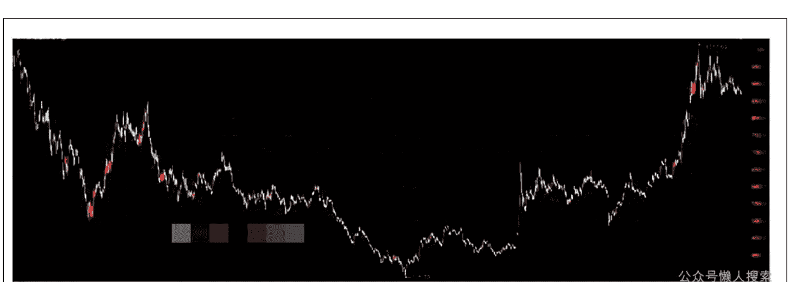
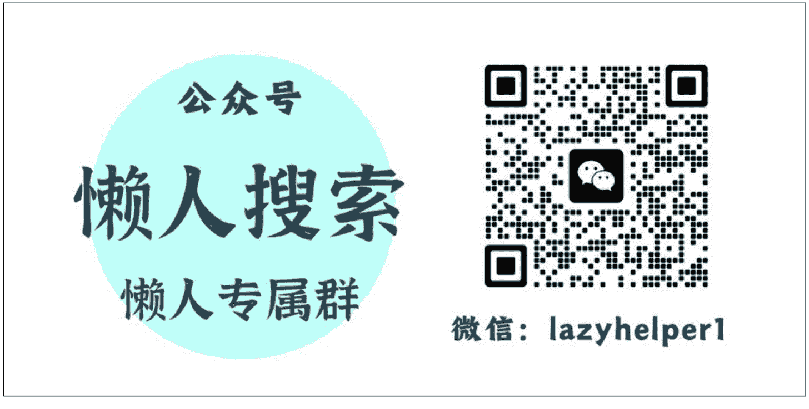

# 2026 年，这条产业链确定高成长

260104 安民深度分析

整理：公众号懒人搜索，
<u>懒人专属群</u>精选

懒人微信：lazyhelper1

这篇文章，团队花了太多的时间，前前后后有两个多月，累得想吐。之所以写这篇 3 万多字的大文章，是因为去年 7 月 1 日和 8 月 2 日的文章，效果不错，好些粉丝都找到了不错的标的，然后投资效果也不错。

因此，我们再次采用全景扫描的方式，从全局上研究眼前这条产业链。因为 2026 年，它是确定性的高成长。

## 一、涉及到至少 10 大行业，其中有 3 个行业是 10 万亿级别

还有一半以上是万亿级别。至少有 3 个新兴行业。所以行业空间大，增长空间也大。这是行业理由。

我们做投资，主要是投资高成长行业，高增长 + 低估值，是我们重点研究的对象。而 2026 年，这条产业链是确定性地高增长。因为它涉及到好多个行业，产业链也比较长。

为什么讲这条产业链会高增长呢？因为它涉及到多万亿级别大行业，3 个十

万亿级别的超大行业，还有多个千亿级别的行业，而且多数是高增长行业，更有不少还是长期增长行业。行业超大 + 长期高成长 +2026 年确定性高成长，是我们看中这条产业链的理由。

我们一个个来讲吧。

- 其次，涉及到通信行业（如手机到基站），都会要用到它，这是 10 万亿级别的大行业。
- 其次，涉及到很多电子产品（如台式电脑和平板）、电动工具产品，一般都要用到。而且这通信、电子和电动工具，这 3 个行业都是它原来的旧的应用领域，是它们最初起家和看家的领地。这 3 个领地，原本都是很大的产业，很大的市场。
- 再次，以大疆为代表的无人机，后来的无人飞行器。这个行业也是它后来发展出来的新的应用领域，算无人机和无人飞行器为一个行业吧，这是第四个大行业。

到底，讲最新的行业，它也涉及。比如飞行汽车，比如人形机器人，比如 AI 数据中心的建设，是配套的硬件建设，这 3 个行业有的已经开始应用了，有的将要开始应用。特别是 AI 数据中心，这是近几年才开始被大家广泛关注的；而飞行汽车，产品还没有在社会上推广或将要在社会上推广；而人形机器人，国内人形机器人最正宗的公司，还没有怎么上市。当然，产品开始在社会上推出了。这 3 个行业是当红炸子鸡，热得很烫手。

我们知道，这 3 个行业都是未来的大行业，其中机器人是超级大行业。

第五，其次是光伏，一个是风电。这两个行业都涉及到我们所要讲的这条产业链。而这两个行业，都是万亿级别的大行业。将这些行业加在一起，就是 9 个。

第五，次新一点的行业，还有两个。一个是光伏，一个是风电。（*注：根据上下文，此处“第五”及后文逻辑重复，将列表逻辑整理为连续编号*）
1. 光伏
2. 风电
这两个行业都涉及到我们所要讲的这条产业链。而这两个行业，都是万亿级别的大行业。将这些行业加在一起，就是 9 个。

第六，再次新一点的行业，就是新能源汽车。我们知道，新能源汽车是个 10 万亿级别的行业，一个超大级别的行业。

第七，同样新一一点的是行业，可穿戴设备，头显 VR CR，可穿戴运动计数器械、医疗检测器械等等。2024 年全球可穿戴电子设备产值 417 亿美元，人民币是 3000 亿元。这个规模不是很大，但放到市场上比，也是比较大的。其中增长最快的是腕戴设备。2025 年前三季度全球腕戴设备市场出货 1.5 亿台，同比增长 10.0%。中国市场累计出货量为 5843 万台，同比增长 27.6%。看看年产量，就足够吓人。

第八，其他新的行业，未来还会有拓展。这个我们后面会讲到。

总体则，这条产业链涉及到 10 个或 11 个大行业或超大级别的行业，其中 10 万亿级别的行业有 3 个，万亿级别中占 1/3，剩下是千亿级别的行业。！这个数据，这条产业链很庞大，也很长，未来定会岀不少 牛的。

第九，强调 一点，去年夏天，我们用产业链调研的办法研究了锂电池和它的上游资源，结果很好。好多投资者选了很好个股，我们个人也有非常好的投资效果。因此，这次仍然采用这一办法，看一家一家地看公司。就是既研究产业链，也研究产业链条上的公司。本文之所以让团队累得想吐，就在于它一篇文章扫描了 50 多家公司。

讲的是基础投资的。收入=销量*平均价格：价格在处于历史高位还是底部时价，这上游有色涨价牛市，会推动中下游和下游涨价。销量取决于产量的。产能和产量增长率，还王在来产能相关。

毛利= (收入 - 成本)/ 收入* 100%，涨价一般能提高毛利率。当上游推动中下游涨价时，中游会提高毛利率选当；当中游带动下游涨价时，下游会进入高... 毛利率选择。当然，这只是普遍的情况。有时候当后面的企业话语权特别强时，前面的企业毛利率就会压低，大是上游涨价，中游或下游被迫涨价，毛利率或许也会走低的。

## 二、产业链需求

考虑了毛利率以后，再考虑费用率。企业一旦越过了盈亏平衡线，利润就会高速增长，特别是在产能增长产量和销增长量，价格提升，毛利率提高的情况下，如果费用率控制很好，这样企业利润就会迎来至少是戴维斯双击，我们认为是三击，即销量增长、毛利率提升、费用率下降。如此，则利润超高速增长，股价也高增长。
2026 年我们做这条产业链，要做的就是这个规律。

### 1. 光伏和风电行业对它的刚性需求

这一部分讲产业链需求及其内在逻辑，从中我们得出结论，即为什么 2026 年它具有确定的高成长性。

> （免责声明：本文只为开拓视野、引导思路，并非择时，亦非荐股，股市有风险，入市需谨慎。本文为产业链研究，仅为对产业链和相关行业个股的全景式扫描，不构成任何投资建议或意见，不对读者依据本文做出的任何投资与决策承担责任，请大家注意风险）

我们先从这里讲起，因为它是刚性需求。这条产业链是储能产业链，它与锂电池和钠电池产业链有交叉。

2025 年 9 月 12 日，国家发改委与能源局发布了《新型储能规模加快建设专项行动方案（2025-2027 年）》，明确到 2027 年新型储能装机规模需达到 1.8 亿千瓦以上，并提出创新多场景应用模式，聚焦工业园区、算力设施、商业综合体、光储充放一体化充电站、分布式光伏和通信基站等场景，为光伏和风电项目配套储能提供直接政策支持。

这一政策的发布，导致集中式储能和分布式储能成为储能就近灵活选择的两种模式。其中分布式储能成为新能源就近消纳的关键，2025 年工商业配储占比达 68.70%，同时虚拟电厂模式通过聚合分布式储能参与电网调频调峰，提升系统灵活性；集中式储能则通过大型招标项目推动规模化应用。

我们看个图片。这是中部某省份下面一个乡镇储能电站的一角，就是它开始延伸到乡镇一级了。左边那 5 排高大的柜子，里面放的就是储能电池。当然，因为是乡镇一级，尽管这是局部的图片，但它的规模并不大。

目前，除了美国速度比较慢外，全球都在推进新能源建设，特别是欧洲，因为白左和绿党的推动，德国炸毁了自己在全球发电效率都很高的燃煤发电站，舍弃核电站，因此，全球风光发电正在高速推进中。中国更不用说了，2030 年碳达峰，2060 年碳中和的目标早已经定下了，后面不会改变方向。而且十五五规划也已经指明了方向。

因此，光伏和风电只会大面积铺开，而不会停滞。这个大势，导致以光伏和风电建设为主的碳达峰会如期实现。特别是光伏电站的建设，有助于改良西北国土风貌，导致土壤从原来的沙化开始返绿，这就导致中国一定会长期推进光伏建设。因为改良国土的事情，是利国利民，筑基千秋万代的大好事。

所以，一个是中国产业发展对新能源建设的需要，再一个是改造国土，就导致新能源建设是中国的大局。这个大局最后的目标就是以新能源取代传统的以石油为代表的能源，推动中国能源成本在全球先，推动中国产业成本在全球竞争中领先。

中国当年力推光伏风电且被最高决策层所认可的原因，就在于光伏和风电的投资，只投资设备就可以了。煤电和油气都要用到煤、石油和天然气，就是要资源，这就涉及到成本，而光伏和风电用的是太阳和风，不需要成本，是零成本。

这里补充一下这方面的知识点，为什么光伏和风能在中国能够被推动发展起来。除了上面能源战略的原因，还有两个原因，地缘的原因和区域产业布局的原因。

从地缘战略上来看，是中国进口石油的依存度太高了，早就超过 70% 了，2020 年最高达 73.62%，如果爆发战争，把霍尔木兹海峡和马六甲海峡一封锁，中国能源就出问题。能明白吗？中国当年决定开发中巴经济走廊，包括后来准备建设中缅经济走廊，瞄准的都是油气，为了不走马六甲。因为美国在新加坡有驻军，明白吗？缅甸政变背后搞事情的就是美国，而美国瞄准的就是中缅经济走廊。美国当年怂恿印度，包括打阿富汗，也都是侧面夹击中巴经济走廊。这是地缘战略的原因。

而区域布局的原因，在于中国的地理经济。胡焕庸线是条 400 毫米等降水线，在它的东面，是中国人口和经济最发达的区域，改革开放以来，越是沿海经济越发达，越是它的西北部越贫穷。

这个状况如果持续下去，可能几十年上百年以后，中国西部北部边疆人口都被吸引到东南和西部少数的大城市，如此，则西藏、新疆、内蒙漫长的边境线上就没有人居住，这会中国的边境地区不再安全，危及国家安全。所以，雅鲁藏布江水电站为什么要开发？川藏铁路为什么要修建，新藏铁路、滇藏铁路为什么已经实质性动工？原因就在这里。

不仅如此，西部和北部有那么多可以开发风光资源的地方，建有那么多的光伏电站和风电站，中国新能源电力政策一推行，电价一波动，国家就会推动两种变化产生，一种是发电侧、用户侧和电网侧储能建设，二是并进一步以超低的电价和地价，吸引高耗电行业在西北部地区建工厂，吸引年轻人到那里就业。

比如内蒙，现在建有很多新能源就地消纳的工厂，将风光这些很便宜的电转化成绿氢，绿醇和绿氨；同样还有无人机，那里的土地太便宜了，现在有一些高耗能企业搬去了，电价也非常便宜，冬天气温低，省成本，因此全国好些数据中心就开始建设在新疆。

但是，那些地方太偏远，青年人去不了，因此就开高工资，住宿舍不要钱，吃饭不要钱，刚毕业的大学生，工资 8000、9000 往上走，是内地的一倍以上。那里的人怎么应对呢？要聚餐开车或步行到十公里开外的馆子去，有钱也花不出去，就存起来，然后 30 岁出头就到西安买房，想办法在系统内调到西安工作。

这种大变化，只有像我们这种生活经验充足的老油条看了就觉得很自然。

一些没有家庭背景的年轻人，22 岁去哈密工作，30 多岁到西安买房结婚，就是他们很现实的选择。就像中海油服，他们好些年轻人的工作是在海上石油钻井平台，上 40 天班，休 40 天。那 40 天，海上平台，除了手机通信费，您有钱也花不出去，休息时在家里。所以能存钱。我侄儿 36 岁，就在那里工作，收入在同龄人中很不错，因为在那上有这补贴那补贴，工资高了，自然就有人愿意去。我侄儿他在杭州安家，长辈接济一点，两套房都买了，尽管便宜，可也是两套房。这跟在哈密工作的人差不多。他们就是没有娱乐，但过得很实惠。

回到光伏和风电。光伏和风电因为不稳定，因此需要将不稳定的能源供给转化为稳定的能源供给。所以，就有种种储能措施，包括抽水蓄能，也包括前面讲的储能电站，比如电网侧储能，就是电网建储能电站；发电侧储能，就是风光发电站建储能设施；还有用户侧储能就是用电大户建储能设施；还有社会储能即第三方储能，是社会资本纯粹建储能电站，电力足电价低时充电，用电高峰电价高峰时放电；还有家庭储能，这个在中国农村有，城市不多见，但在全球很普遍，因为中国电力充足稳定基本用不着，外国电力不稳定的地方，家庭储能比较多。

当去年 9 月 12 日发改委公开发布《新型储能规模建设专项行动方案（2025—2027 年）》以后，就决定了国内储能电站会高速发展，因为它是储能的主要模式，差不多八九成的储能，都是采用这个模式。所以，这种需求是刚性需求。

### 2. AI 数据中心储能

我们知道，中美 AI 竞争，美国的主要方向是大模型，大模型的基础是 AI 数据中心。但这年把有一句话很流行，即 AI 的竞争，最后竞争的是电力。因为美国电力系统为私营公司建设和运营，停电是比较常见的事情，前些年的新闻中，我们经常听到美国大范围的停电事故。而且美国电力系统的建设比较老旧，一般都有些年头，比较容易出故障。

所以，美国的电力供应主要是两个问题，一个是电力不足，一个是电力不稳定。而一个大模型运行起来，所需电力相当于一个中型城市一年的电力需求量。比如 GPT-3，在训练期间耗电量约为 1287 兆瓦时（即 128.7 万千瓦时），相当于 120 个美国家庭一年的用电量。训练阶段耗电比较多，推理阶段耗电量要少些，但如果考虑到使用人数的大规模增加，那么情况就是另外的样子。ChatGPT 每日耗电量约 50 万千瓦时，相当于 1.7 万个美国家庭的用电量。使用人数越多耗电量越大。故而如果将推理能耗折算到全年，那些用户基数庞大的模型，总耗电量就非常大，甚至有可能达到某些中型城市的年用电量水平。

而从用电的稳定性来讲，大模型使用时，如果断电，哪怕只有几秒，就出问题了。

大模型在训练阶段如果断电，会出现什么损失呢？第一，数据丢失与损坏。断电时未保存的训练状态如模型参数、优化器状态会丢失，因为检查点通常按固定间隔保存，断电可能使得这些一时无法恢复；此外，存储设备在断电瞬间写入可能中断，导致检查点文件损坏或数据库不一致。

第二，硬件风险。突然断电可能引发电压波动，损坏电源、GPU 或内存等关键组件，尤其在高算力数据中心，功率瞬时飙升会加剧供电系统压力，增加硬件故障概率。

第三，训练中断与恢复挑战。断电会导致训练进程立即停止，恢复时若无完整检查点，需从最近保存状态重启，可能因初始化震荡影响收敛性；即使有检查点，加载损坏文件也可能触发错误，需手动清理或回滚至前序版本。

第四，经济损失。训练中断可能造成比较大的损失，如数周的 AI 大模型训练进度丢失，需重新训练；硬件损坏维修或更换成本高昂，同时算力资源闲置直接增加运营开支。

大模型在推理阶段遇上断电，会引发一系列连锁反应，从硬件层面到软件层面均可能受损，具体影响取决于断电瞬间的系统状态、模型规模、数据持久化机制及硬件特性。
第一，硬件层面。断电可能导致物理损坏或数据丢失，例如服务器电源或硬盘在断电瞬间受损，或未完成的写入操作导致存储数据损坏；GPU 等组件因断电可能无法正常复位，需等待 30 秒以上再重启以避免二次损伤。
第二，软件层面。断电会直接中断推理进程，造成服务不可用，如果模型未加载完成或处于中间状态，可能触发崩溃或异常退出，需重启服务；而断电有可能让中断处理机制出现异常，导致服务程序中断，无法及时响应设备事件，引发主机绑定问题，即 CPU 因频繁中断而效率低下，即使利用率不高也会出现计算空泡。
第三，数据完整性方面。断电风险包括内存数据丢失和存储损坏，例如知识库元信息或向量库内容可能因未持久化而清零，需依赖数据库备份恢复；检查点机制若未定期保存，会丢失推理进度，需从头开始。
而恢复过程涉及硬件检查、服务重启和数据验证，需确认电源和硬盘状态正常，使用 Docker 等工具自动重启服务，但可能因卷挂载失败或端口冲突需手动干预；随后需验证知识库和模型文件完整性，避免冷启动时误判服务异常。

## 3. 光伏、风能和 AI 数据中心必然要有储能建设做配套

所以，海外为了降低断电对 AI 数据中心的影响，一般采取预防措施，就是配置不间断电源，保障平稳关机，启用自动重启策略，并优化中断绑定以减少 CPU 抢占。其中重要一项，就是自建光伏发电站及配套储能电站，然后响应速度达到毫秒级。

当然，也有自建核电站的计划，不过速度很慢，没有 5 年时间搞不定。还有自建天然气发电站，需要使用燃气轮发电机。目前核电和天然气电站，建设时间都比较长，而且成本都比较高。相对而言，光伏电站建设周期短，发电成本也低。

所以，海外的 AI 数据中心，普遍有自建光伏或风力发电站然后配套储能电站的需求。这个需求是很庞大的。

也即国外数据中心到最后，都必然要建储能电站。国内一样，要有储能电站做备用。尽管国内数据中心的储能电站一时半会儿用不着，但保不齐会出问题，比如哪里挖坑，把供电线路挖断了。这在我们原来上班的大楼并不鲜见，有时一年几次，有时几年一次。

## 4. 上面 3 个行业都是大行业

其中一个新兴行业，两个次新。它们是储能产业链需求和高增长的底气。

## 5. 动力电池和新能源汽车

2025 年，国内动力电池装机，78.5% 是铁锂电池，小部分是三元电池。2025 年前 11 个月，国内新能源汽车产量 1490.7 万辆，增长 31.4%；销售 1478 万辆，增长 31.2%，仍然是高速增长。当然，以后不排除会转入中高速增长和中速增长。前期我们对中国新能源汽车在最高峰时的产销量有判断，大家可以复习一下以前的文章。
关键是新能源汽车行业是个超级大行业，10 万亿以上的级别。除了家用汽车，货车和客车都是电池消耗大户。

一辆货车的电池使用量是家庭用车的 N 多倍，而货车之所以能够用电池取代柴油发动机，除了环保的原因外，更重要的是电价便宜，成本低得多。

## 6. 人形机器人和飞行汽车

未来以半固态和固态电池为主。这方面也可以复习我们以前的文章。其中人形机器人是个超级大行业，10 万亿以上的级别。

## 7. 无人机

这个行业用的是锂聚合物电池。锂聚合物电池因其高能量密度、轻量化和大电流放电特性而成为主流选择，尤其适用于对重量和体积敏感的消费级和工业级无人机。特别是，高倍率锂聚合物电池能提供稳定的高功率输出，满足多旋翼无人机的动力需求。

## 8. 通信机站、手机、电脑、平板、电动工具

这些是传统的领域，需求稳定，也比较大。它们是 10 万亿级别的市场。

## 9. 可穿戴设备

2024 年为 417 亿美元，2029 年预计为 800 亿美元，超过 5000 亿人民币。这一块未来会拓展出不少的新产品，形成大市场。

## 10. 其他新增的市场

如无人艇，再如内河或沿海短途货运船舶，也开始在使用电池做前进的动力，特别是无人艇，未来极有前途。而货运船舶用电池做动力，一艘船舶用到的电池，那个量会比电动汽车大很多倍，也比货车大很多倍。而军工领域的储能，如电磁炮用的是高倍率的电容，瞬间释放出巨大的能量，除此之外，很多军工设备也需要用到电池，而且要进行储能建设，特别是储备电源和热管理。这方面未来会涉及到很多行业，市场很大。

所以，储能产业链近三年高速增长成定局，它背后是锂电，这个行业涉及到太多的大行业和新兴行业，锂电长期增长也成定局。

## 三、2026 年怎么投资储能和锂电池产业链？

去年我们投资这条产业链，短线和中线都挣钱不少。今年继续，因为储能高增长是定局。当然，今年我们以短线的心态介入，在大盘或个股或板块见顶时坚决抛出。

### （一）中游

为什么投资中游？因为两个原因：一是中游开始涨价，二是中游位置还不高。

中游有个专业指数，881264 电池化学品指数，里面涉及 40 家个股，分别是：海科新源、华盛锂电、丰元股份、天际股份、恩捷股份、星源材质、万润新能、容百科技、湖南裕能、天赐材料、德方纳米、石大胜华、盟固利、安达科技、滨海能源、璞泰来、瑞泰新材、五矿新能、当升科技、天力锂能、厦钨新能、龙蟠科技、贝特瑞、新宙邦、杉杉股份、振华新材、尚太科技、信德新材、中伟股份、天奈科技、中恒股份、道氏技术、格林美、翔丰华、芳源股份、中科电气、超频三、壹石通。这是 38 只，剔除中国宝安和一只 ST 个股。

下面是周 K 线图:

## 1. 生产锂电隔膜的有：恩捷股份、璞泰来、星源材质、沧州明珠、中材科技。
为什么先讲隔膜，大家应该知道我们之前的那篇分析文章，不清楚的建议去读读，肯定是有益无害的。

这种分析只能是扫描，尽管有消化，并不能保证能挖出公司深埋藏着的东西来。问题

## 2. 正极前驱体
生产正极前驱体的公司有 6 家，中伟股份、华友钴业、格林美、容百科技、道氏技术、芳源股份。我们一家家看。

### （1）恩捷股份。
2025 年三季度已经转为盈利，特别是扣非净利润已经盈利，表明产品价格有所上升。公司上半年收入 576288.11 万，成本 486767.46 万，毛利率 15.534%；三季度收入 378040.36 万，放量明显，成本 315833.22 万，毛利率 16.455%，提升了 0.921 个百分点，要么是压上游成本，要么是产量大导致的规模效应，效果不错。然后 2025 年 12 月份，市场有传言隔膜大厂要提价。

12 月 15 日，新浪财经官方账号转电池中国网报道，锂电产业链涨价潮持续蔓延。碳酸锂涨价，六氟磷酸锂涨价，隔膜也在涨价！12 月初，国内某头部隔膜企业发布调价通知书，“近期受电池隔膜上游原材料成本上涨，及市场供需格局变化的影响，我司面临较大的成本压力”，宣布将对湿法隔膜产品售价上调 30%。而 2024 年底，公司的产能规模为 60 亿平方米，2025 年上半年为 75 亿平方米，同时因为并购的原因，公司 2026 年出货量会上升到 140 亿平方米甚至以上。

### （2）璞泰来
公司 2025 年半年度业绩中高速增长，扣非后增速近 30%。前三季度业绩超高速增长；三季度扣非净利润增速超过 60%。股权激励三年复合增速不低于 30%。主营业务包括隔膜、负极材料、PVDF 及粘结剂、纳米氧化铝及勃姆石、铝塑包装膜及复合箔，以及电池生产的自动化装备和涂膜加工。公司负极材料出货量 25 万吨，涂覆隔膜出货 130 亿平米，基膜出货 20 到 25 亿平米，PVDF 出货量超 4 万吨。

公司 2025 年上半年涂覆隔膜销量达 47.73 亿平米，同比增长 63.85%；占同期国内湿法隔膜出货量 112 亿平米的 42.62%。当然，公司还有电解质、负极材料、PVDF 树脂、粘结剂、金属复合膜、各种箔，这些是公司的新能源电池材料与服务业务，其中并没有单独分出锂膜。

2025 年上半年，这些业务收入 537784.40 万元，成本 364114.25 万元，毛利率 32.294%。难怪公司扣非净利润远好于恩捷股份。

公司还有一块是电池生产设备（2025 年上半年，公司设备业务新接订单规模超过 24 亿元，但三季度合同负债平稳），销售收入 184416.45 万，成本 137546.10 万元，毛利率为 25.4155%。

公司上半年全部业务的毛利率为 32.096%，第三季度全部业务收入为 374216.77 万，成本 250312.3 万，有点放量；毛利率为 33.110%，毛利率提升 1.014 个百分点。

### （3）星源材质
主产品就是隔膜。2025 年第三季度扣非净利润转负，亏损 2770.47 万元。上半年销售收入 189804.73 万元，成本 142174.48 万元，毛利率 25.094%；三季度销售收入 105982.08 万元，成本 86816.55 万元，毛利率 18.084%，下滑 7.011 个百分点。三季度公司销售没什么放量，毛利率下滑 7.011 个百分点，表明公司节奏滞后，是跟在后面拖的。然后费用率也高，前三季度为 21.969%，肯定亏损。2025 年全年估计出货 50 亿平米左右，满产满销。只是公司成本和费用控制力比较弱。不占便宜，可以淘汰。

### （4）中材科技
公司主要业务为玻璃纤维、风电叶片、锂电隔膜、AI 数据中心用的特种纤维布，今年炒起来的主要原因就是用于 AI 服务器的电子布。半年报中，公司讲：拥有居世界领先水平的核心自主知识产权，全面掌握低介电超细纱及超薄布、低膨胀纤维布、超低损耗低介电纤维布等多种特种纤维关键制备及产业化技术，是国内特种纤维布领域的龙头企业。

公司业绩超高速增长。其中玻纤及电子纤维布业务，上半年归母净利润增长 262%，收入 43.5 亿，上半年均价上涨 14%。

风电叶片业务，上半年销售增长 84%，收入 52 亿元，归母净利润 3.7 亿，增长 258%。

锂电隔膜，2025 年上半年，国内锂电池隔膜产量 136.2 亿平米，同比增长 49%。公司对外销售锂电池隔膜 13 亿平米，同比增长 60%，增速不错。收入 92748.65 万元，同比增长 22%，成本 91578 万元，毛利率 1.262%。聊胜于无。也即公司的隔膜产品在市场

价格竞争力和成本控制方面是不足的。尽管前两项业务都是超高速增长，但从锂电隔膜的角度来看，公司可以淘汰。从隔膜的角度选不了它，因为即使隔膜涨价，它的毛利涨幅也比较有限。

### （5）沧州明珠
公司的主营业务为三个方面：一是 PE 管道，就是家里水管材料；二是 BOPA 薄膜，属于包装材料；三是锂电隔膜。2025 年上半年，锂电隔膜销售收入 34463.94 万元，成本 28749.10 万元，毛利率 16.582%。2025 年上半年隔膜产能 6 亿平米，远期规划产能 24.9 亿平米。上半年全部业务收入为 131946.16 万元，成本 114952.21 万元，毛利率 12.879%。锂电隔膜销售收入占比为 26.12%，不高。可以淘汰。

12. 正极前驱体
生产正极前驱体的公司有 6 家，中伟股份、华友钴业、格林美、容百科技、道氏技术、芳源股份。我们一家家看。

### （1）中伟股份
业务主要为正极前驱体和正极材料。2025 年上半年，公司实现镍、钴、磷、钠四系产品出货量正向增长，产品销售量超 18.8 万吨，同比增长 33.91%。其中磷系和钠系是针对铁锂电池和储能电池的。电池材料的产能是 26.97 万吨，其中磷酸铁产能 10 万吨。能源金属产能，96833.29 万吨，在建 3 万吨，主要是锂、钴、镍等金属材料加工。
公司的正极材料前驱体业务，以三元前驱体业务为主。2025 年上半年，收入 749086.57 万元，成本 613851.44 万，毛利 135235.12 万元，毛利率 18.053%。其次是四氧化三钴，收入 145194.34 万元，成本 107624.34 万，毛利率 25.876%；再次就是磷酸铁，收入 67007.46 万元，成本 71928.30 万元，毛利率 -7.344%。这块业务太小，因此储能业务市场扩张对它影响很小。公司还有 92.73 亿新能源金属业务，主要是镍钴等金属业务，还有收入 241740.08 万元的其他主营业务，主要为新能源金属贸易、技术服务、政府补助、资产处置等。
比较公司 2025 年上半年和三季度的收入和毛利率，数据如下：

上半年，收入 2132254.72 万，成本 1874180.12 万，毛利率 12.103%；第三季度，收入 1197491.36 万，成本 1046627.81 万，毛利率 12.599%；毛利率提高了 0.496 个百分点。

不过，因为磷酸铁业务很小，储能市场扩张对它影响很小，故而可以淘汰掉它。当然，再强调一句，从储能的角度淘汰掉的公司，可能会因为其他业务很好而高增长，股价也高增长。本文只侧重从储能角度选公司。

### （2）华友钴业
公司的主要业务有三类，一是资源类，包括镍、钴、锂、铜等有色金属采选业务。钴产品出货量 2.08 万吨，同比下降 9.89%，镍产品出货量 13.94 万吨，同比增长 83.91%。二是三元前驱体和镍、钴、锂新材料产品业务。2025 年上半年，三元前驱体出货量 4.21 万吨。三是正极材料业务。2025 年上半年，三元正极材料出货量 3.96 万吨，同比增长 17.68%。

华友钴业的正极前驱体业务，2025 年上半年收入 195303.16 万，成本 159581.52 万，毛利率 18.290%；这个量并不大，且不是用于生产储能电池正极的。

还有就是镍中间品业务，主要生产和销售镍湿法冶炼中间品如 MHP，混合氢氧化物沉淀，具体涉及从红土镍矿中提取镍化合物，用于制造硫酸镍，进而作为锂电池三元正极材料的核心原料。2025 年上半年，收入 554255.90 万，成本 483302.95 万，毛利率 12.801%。这也不是用于生产储能电池的。

正极业务，2025 年上半年，收入 605252.50 万，成本 546411.34 万，毛利率 9.722%。应该以三元正极为，铁锂为辅。因此储能业务对它影响也不会大。

公司涉及储能电池的业务是锂，相当于资源业务。2025 年上半年，收入 155297.51 万，成本 139573.35 万，毛利率 10.125%。子公司友山新材料科技，在贵州毕节建成年产超 14 万吨磷酸铁锂产能（2024 年数据），并规划总产能超 100 万吨，覆盖印尼、摩洛哥、湖北宜昌等全球多基地。但估计业务数据体现在正极业务中，真正扩产到位需要时间。

属于资源业务的，还有钴、铜、镍业务。钴业务，2025 年上半年，收入 123696.95 万，成本 83801.64 万，毛利率 32.252%。

铜业务，2025 年上半年，收入 221319.04 万，成本 158938.65 万，毛利率 28.186%。
镍业务，2025 年上半年，收入 1283699.79 万，成本 1013054.43 万，毛利率 21.083%。
此外还有贸易业务，2025 年上半年，收入 578114.12 万，成本 543044.46 万，毛利率 6.066%。
所以，公司的主营业务，以有色金属为主，相当于一只有色股。其中最大的是镍，其次是铜，再次是锂，再次是钴。
当然，正极业务量也不少，有 60.53 亿，但毛利只有 5.88 亿。镍中间品也有 55.43 亿，毛利 7.10 亿；正极前驱体业务不大，只有 19.53 亿。公司总体上更受有色涨价影响，受储能电池材料增长的影响短期看比较有限，长期则不然。所以我们可以不看。当然，从其他如有色的角度炒作是可以的，但那跟本文的主题无关。其他很多公司一样。公司前三季度费用率为 7.377%，比较低。

### （3）格林美
格林美主要通过废旧电池和废旧车辆的回收和拆解并重新提取镍、钴、锂、钨、铜、锰、金、银、铂、锗、镓、铪等 20 余种金属等，建成全球最大的镍、钴、钨关键金属资源回收利用产业基地，年循环再生的钴资源超过中国原钴开采量的 350%，镍占中国原镍开采量的 20%，钨占中国原钨开采量的 10%。公司处理全国 10% 的废旧电池，2025 年上半年，回收拆解的动力电池达到 2.24 万吨，同比增长 37%。所以它可以看成是一家有色金属回收、开采和新能源材料再生产公司。

公司“镍资源一前驱体一正极材料”的镍资源新能源全产业链，动力电池用三元前驱体、三元正极材料与 3C 数码电池用四氧化三钴材料、再生碳酸锂等新能源材料。其中涉及到储能电池业务的，主要是再生碳酸锂。另外，公司在印尼建有 15 万吨的镍资源产能，2025 年上半年，公司印尼镍资源项目镍金属出货 43977 吨（含参股产能），同比增长 112%。

2025 年上半年，三元前驱体出货量 8.60 万吨，居全球第二；四氧化三钴出货 14590 吨，同比增长 39%；正极材料高端产能释放，出货 12399 吨，同比增长 74%。

资源业务方面，2025 年上半年，镍资源收入 276150.38 万，成本 223417.2 万元，毛利率 19.096%；钴回收业务，2025 年上半年，收入 118387.15 万，成本 101980.86 万元，毛利率 13.858%；钨回收业务，2025 年上半年，收入 105482.13 万，成本 97864.40 万元，毛利率 7.222%；有色贸易业务，2025 年上半年，收入 146711.01 万，成本 145221.71 万元，毛利率 1.015%；以上 4 项是资源循环再利用业务。2025 年上半年，收入 646730.68 万，成本 568484.16 万元，毛利率 12.099%；废旧电池业务，2025 年上半年，收入 53811.49 万，成本 48357.99 万元，毛利率 10.134%；报废车业务，2025 年上半年，收入 32885.53 万，成本 31863.34 万元，毛利率 3.108%；以上两项是动力锂电池循环利用业务。2025 年上半年，收入 86697.02 万，成本 80221.33 万元，毛利率 7.469%；三元前驱体业务，2025 年上半年，收入 679550.82 万，成本 583440.36 万，毛利率 14.143%；正极材料业务，2025 年上半年，收入 127461.30 万，成本 115898.70 万，毛利率 9.071%；四氧化三钴业务，2025 年上半年，收入 215634.04 万，成本 188898.99 万，毛利率 12.398%；以上 3 项为新能源电池材料业务，2025 年上半年，收入 1022646.17 万，成本 888238.05 万，毛利率 13.143%。

公司前面的有色回收业务，基本相当于有色金属采矿业，但没有矿业的高毛利率。中间的动力电池回收和汽车回收业务，涉及锂和碳酸锂等不多。后面的正极和正极前驱体，目前以三元业务为主，铁锂量不大。所以，涉及锂业务、磷酸铁锂正极的业务量相对有限，淘汰。

当然，有人可以利用公司的业务构成，在炒作某些业务方面参与炒作。比如我们前期研究的某人形机器人新材料公司，这次炒作是 6G 通信和航天，炒这个炒起来的。还有碳纤维，也是炒航天炒起来的。

### （4）容百科技
公司主要从事三元材料（2025 年上半年销售 5 万吨）、磷酸铁锂材料、磷酸锰铁锂材料、钠电材料及多元前驱体业务。很显然，磷酸铁锂材料、钠电材料是与储能高度相关的。

2025 年上半年，公司全部业务销售 624842.10 万元，成本 571310.87 万元，毛利率 8.567%；其中正极材料销售收入 603729.02 万元，成本 557267.32 万元，毛利率 7.696%；正极材料中，三元材料占比超过 96%，所以，这块业务跟储能相关性很小。淘汰。

### （5）道氏技术
主要业务是三种材料，陶瓷材料，锂电材料，碳材料，还有量比较大的其他即铜钴等资源业务。先看 2025 年上半年和三季度的业务情况：

2025 年上半年，全部业务收入 365382.86 万，成本 290425.56 万元，毛利率 20.515%。第三季度收入 234703.36 万，有放量；成本 182124.60 万，毛利率 22.402%，提升了 1.887 个百分点。收入和毛利率均向好。

再看公司上半年的收入结构：收入占比最多的是其他主营业务，这类业务在一般公司往往是比较小的。道氏技术将它列为公司未来的战略性业务，实际上是铜和钴矿产业务。

2025 年上半年，其他业务收入 173355.13 万，成本 125655.65 万元，毛利率 27.515%。当然，跟其他采矿业公司比，这个毛利率并不高。

第二高的是锂电材料，收入 126778.13 万，成本 114668.88 万，毛利率 9.552%。

第三项为碳材料，收入 32900.12 万，成本 26818.34 万，毛利率为 18.486%；第四项为陶瓷材料，收入 32349.47 万，成本 23282.70 万，毛利率 28.028%。

陶瓷材料就不用解释了。碳材料为碳纳米管、石墨烯纳米管，它们都是导电剂。这两种材料跟储能相关。再就是硅碳负极，是固态电池的一种负极材料。

公司的锂电材料占比第二大，到底是些什么产品呢？仔细查阅，发现主要是三元前驱体，还有氯化钴、碳酸钴和硫酸钴等。这样将产品深挖下去，公司在储能赛道高增长时，受益不会大，做有色来炒倒是有理由。因此淘汰。如果炒有色，炒碳材料等题材时，那是可以的。但储能不合适。

### （6）芳源股份
公司产品主要有锂电池三元正极材料前驱体、锂盐即电池级碳酸锂、硫酸盐、镍电池正极材料、高纯电子化学产品等产品。2025 年上半年，公司产品销售收入为 89983.44 万元，成本 92568.54 万，毛利率为 -2.873%；从三季报来看，毛利率转正，但费用率仍然高达 11.594%，表明在现有规模下至少要涨价 12% 才有净利润。上半年公司碳酸锂销售收入为 12659.47 万，成本 14917.44 万，毛利率 -15.136%，规模小，竞争力弱，在总体收入中占比为 14.07%。碳酸锂在制造储能电池材料中有作用，但因为体量小，毛利率太低，费用率太高，因此影响有限。可以淘汰。

13. 正极材料主要有湖南裕能、厦钨新能、当升科技、德方纳米、龙蟠科技等，有十好几家。我们一家家来看。

2025 年上半年，磷酸铁锂正极全国出货量 161 万吨。

### （1）湖南裕能
公司的主要业务就是正极材料，而且是磷酸盐正极为王，铁锂全球市占率第 1，符合要求。2025 年前三季出货量 78.49 万吨，有贵州黄家坡磷矿建设，还在西班牙和马来西亚建设 14 万吨正极产能。

那我们需要看看公司各季度收入、成本和毛利率。

2025 年一季度，收入 676214.12 万元，成本 638885.14 万元，毛利率 5.520%；二季度，收入 759563.59 万，成本 691148.87 万，在放量，毛利率 9.007%，有提升。三季度，收入 886843.50 万元，成本 808747.57 万元，进一步放量，毛利率 8.806%，估计是上游涨价影响了毛利率。上半年，公司磷酸盐正极收入 1407651.32 万元，占全部营业收入的 98.041%；成本 1309602.83 万元，毛利率 6.965%。公司前三季度费用率为 6.446%，全部业务的毛利率为 7.915%，越过盈亏平衡线不久。如果涨价，利润就会高速增长。

所以，公司符合要求。

### （2）当升科技
公司主要供应正极材料，包括三元正极、铁锂和钠电正极、消费电池正极。其中铁锂和钠电正极材料是受储能业务影响很大的，这两类产品符合要求。

2025 年上半年，公司全部业务销售收入 443249.77 万元，成本 384417.24 万元，毛利率 13.273%；三季度收入 296675.17 万元，放量明显，成本 260932.17 万元，毛利率 12.048%，下滑了 1.225 个百分点，跟上游涨价相关。前三季度费用率为 6.848%，有利润。

其中多元正极销售收入 269620.32 万元，成本 219910.39 万元，毛利率 18.437%；这块业务与储能无关。

钴酸锂正极也与储能无关，用于消费电池。2025 年上半年收入 32989.29 万元，成本 30285.98 万元，毛利率 8.195%。

铁锂和钠电正极材料跟储能电池高度相关，2025 年上半年收入 130160.52 万元，成本 126235.28 万元，毛利率 3.016%；收入占比为 29.365%，30% 弱。

公司符合要求，只是铁锂钠电正极占比不到 30%，不及湖南裕能。

### （3）厦钨新能
公司的主要业务为钴酸锂（消费电池正极材料）、三元材料、磷酸铁锂、氢能材料等。与储能正极材料高度相关的是磷酸铁锂。2025 年上半年，公司锂电正极材料销量为 6.07 万吨（前三季度 9.99 万吨），同比增长 35.50%。其中钴酸锂销量 2.88 万吨，同比增长 56.64%（国内钴酸锂产量为 5.37 万吨，同比增长 27.8%）；
动力电池正极材料（含三元材料、磷酸铁锂等）销量 3.19 万吨，同比增长 20.76%；氢能材料销量 1974.61 吨，
同比增长 6.16%。

2025 年上半年，全部业务收入 753,370.35 万元，成本 678,083.63 万元，毛利率 9.993%；
第三季度，全部业务收入 552,551.57 万元，成本 497,273.36 万元，毛利率 10.004%。
三季度有比较明显的放量。

我们看公司业务构成，因为中报没有披露收入结构，因此看 2024 年年报的情况：2024 年全年，钴酸锂收入 669,059.05 万元，成本 595,822.47 万元，毛利率 10.946%；三元正极（含铁锂）收入 610,202.75 万元，成本 562,124.65 万元，毛利率 7.879%；氢能材料收入 40,837.22 万元，成本 35,172.14 万元，毛利率 13.872%。然后通过种种途径查了下公司铁锂的销售情况，2024 年收入为 2.28 亿，占比极小。

所以，从储能的角度，这家公司可以淘汰。

## (4) 德方纳米

公司主要产品为纳米磷酸铁锂、磷酸锰铁锂和补锂增强剂。产品适合。2025 年上半年，收入 386,462.98 万，成本 396,447.83 万元，毛利率 -2.134%，亏着成本在卖。三季度收入 215,449.57 万，相对有所放量，成本 209,629.61 万元，毛利率 2.701%，转正了。符合要求。但前三季度管理费用率为 8.843%，所以要在消化上游材料涨价的基础上，再涨价 7% 左右盈利才能转正。
根据 2024 年年报，公司产能 306,250 吨，在建 148,750 吨，今年半年报显示，在建产能 8 万吨。全球市占率第 2。

## (5) 万润新能

公司主要业务为磷酸铁锂和磷酸铁，产品正合适。上半年磷酸铁锂出货 14.83 万吨，增长 90.23%，全球市占率第 3，10% 左右。
2025 年上半年，收入 443,589.04 万元，成本 436,052.53 万元，毛利率 1.699%。
第三季度收入 289,978.11 万元，放量了；成本 278,306.71 万元，毛利率 4.025%，提升了 2.326 个百分点。
公司上半年的收入构成如下：2025 年上半年，磷酸铁锂收入 428,019.92 万元，成本 464,595.42 万元，毛利率 -8.00%。磷酸铁收入 1,828.41 万元，成本 1,671.49 万元，毛利率 8.582%。
副产品收入 12,562.78 万元，成本 8,981.01 万元，毛利率 28.511%。

前三季度，公司费用率为 8.884%，在消化上游涨价后，再涨价 6% 到 7% 就有利润。如果只考虑三季度的数据，则消化上游涨价后，再涨价 3% 到 4% 就有利润。

## (6) 龙蟠科技

公司主营业务为磷酸铁锂正极材料和车用环保精细化学品两类，前者符合我们要寻找的范围。
上半年铁锂出货 7.8 万吨，碳酸锂出货 7,066.34 吨。
2025 年上半年，收入 362,188.01 万元，成本 312,068.62 万元，毛利率 13.838%。
第三季度收入 220,350.20 万元，有放量；成本 190,660.19 万元，毛利率 13.474%，下滑了0.364 个百分点。前三季度的费用率为 16.112%，这个费用比较高，在消化上游涨价成本的基础上，估计要涨价 3 个点才有利润。

公司各部分业务构成如下：磷酸铁锂，2025 年上半年收入 235,917.54 万元，分部利润即减去成本（后亏损 18,582 万元，要涨 8 个点左右才利润；碳酸锂及原材料加工收入 28,280.68 万元，分部利润即减去成本费用后为 2,034.09 万元，也要涨 7.5 个点左右才有利润；其他业务 23,847.1 万元，分部利润即减去成本和费用后为亏损 287.11 万元；车用精细化学品收入 95,605.09 万元，分部利润即减去成本和费用后为 12,405.64 万元，要涨价 13 个点以后才有利润；只是我们找不到它上半年毛利率的数据。这方面公司没有披露。

与储能电池高度相关的磷酸铁锂和碳酸锂业务，占上半年全部业务收入的 72.945%，这个比例还是比较高的，可以。但是要注意它的盈利线比较高，特别强调基本面的人，可以不管它。

## (7) 五矿新能

公司主要产品为锂电池正极材料，且主要为三元正极材料及其前驱体，也有磷酸铁锂，但占比不大，估计可能在 10% 左右。因此，储能高增长跟公司关联度不大，淘汰。

## (8) 丰元股份

公司的业务主要为锂电池正极材料及草酸。公司的锂电池正极材料，既包括磷酸铁锂，也包括三元正极，其中有常规三元正极和高镍三元正极。
公司正极材料已建成及在建产能为 31.5 万吨，其中建成投产 24 万吨，包括磷酸铁锂 22.5 万吨，三元 1.5 万吨；在建产能 7.5 万吨。很显然是以铁锂为主，符合要求。

2025 年上半年，收入 72,344.41 万元，成本 85,461.25 万元，毛利率 -18.131%。
第三季度收入 44,898.55 万元，放量较明显；成本 49,921.23 万元，毛利率 -11.187%，提升了 6.944 个百分点。不过离盈利还有不小的距离。
公司的正极材料，2025 年上半年收入 67,118.28 万元，成本 80,329.49 万元，毛利率 -19.683%；草酸产品，2025 年上半年收入 5,163.45 万元，成本 5,131.76 万元，毛利率 0.614%；两项业务毛利率都低。
对这类公司，最好要慎重。查了公司费用，上半年占销售收入的比例达到 17.054%，意味着产品要涨价近 37% 才能盈利。这家公司成本高，费用控制力不强，如果不扩大业务销量，竞争就处于劣势。这类公司，即使短线有机会也最好不碰。

## (9) 安达科技（在新三板上市，不研究）

## (10) 天力锂能

公司产品包括三元材料、磷酸铁锂、碳酸锂等，以三元材料为主导。
2025 年上半年，收入 96,629.63 万元，成本 91,792.16 万元，毛利率 5.006%。
第三季度收入 56,867.55 万元，有所放量；成本 54,668.29 万元，毛利率 3.867%，下滑了 1.139 个百分点。
三元正极，上半年收入 79,519.14 万元，成本 75,177.58 万元，毛利率 5.460%；磷酸铁锂，上半年收入 11,000.90 万元，成本 11,084.01 万元，毛利率 -0.755%。
前三季度的费用率为 9.458%，在消化上游涨价的基础上，产品要涨价 10% 到 11% 才有利润。只是铁锂量很小，故淘汰。

## (11) 振华新材

公司的主要产品为锂电池和钠电池正极材料。
核心产品为应用于新能源汽车动力电池及数码电池领域的一次颗粒大单晶镍钴锰酸锂三元正极材料。
同时，公司积极推进钠离子电池正极材料，已掌握层状氧化物与聚阴离子两大主流技术路线的核心制备工艺，为布局下一代电池技术奠定基础，表明目前尚无规模性的钠电池正极材料生产。所以从核心业务来看，淘汰。
我们再看一下公司的毛利率和费用率。
2025 年前三季度，公司收入 106,674.32 万元，成本 122,862.47 万元，毛利率为 -15.175%，费用率还有 16.688%，因此在现有规模条件下，需要涨价 32% 以上才有利润。因此，公司成本高，费用也高，竞争力很弱，淘汰。

## (12) 盟固利钴酸锂及三元正极材料，与储能电池相关性弱，淘汰。

公众号懒人搜索，懒人专属群分享

当然，2025 年上半年，国内钴酸锂市场还是中高速增长，增速 27.8%，三元正极增速 7.3%，不做储能的话，适当的时候可以从钴酸锂增长的角度考虑。
公司上半年正极材料产量达 10,499.30 吨，产能利用率近 80%，较 2024 年上半年同比增长 22.93%。
上半年，公司钴酸锂收入 43,787.68 万元，成本 37,926.32 万元，毛利率 13.386%；三元正极收入 55,470.35 万元，成本 55,450.98 万元，毛利率 0.035%。三元正极竞争力弱。

## (13) 超频三

公司主要从事锂离子电池材料、电子产品新型散热器件、LED 产业链相关业务。其中锂离子电池材料业务，拥有从“废旧锂离子电池材料综合回收利用⟶前驱体/碳酸锂⟶正极材料”完整产业链优势，主要产品包括碳酸锂、正极材料（三元材料、钴酸锂、锰酸锂等）及前驱体。其中从储能的角度来看，有价值的是碳酸锂。
而公司锂离子电池材料 2025 年上半年销售收入为 21,984.98 万元，成本 21,133.85 万元，这应该包括前驱体、碳酸锂和正极材料 3 项，因此，这块收入很小，而且上半年公司总体收入也只有 47,436.61 万元，成本为 40,316.44 万元。
公司 2017 年就上市了，才做到这么个规模，成长性很差。因为公司 2017 年全年收入是 4.11 亿，今年前三季度才做到 6.3079 亿。每股净资产 1.25 元，所以，可以淘汰。

## (14) 科恒股份
公司的主业是新能源正极材料及智能装备，还有就是稀土功能材料。但 2025 年三季度每股净资产为 -0.31 元，扣非净利润为 -1.4471 亿，因此，淘汰。

### 4. 负极材料

2025 年上半年，我国负极材料出货量 129 万吨，同比增长 37%，其中人造石墨负极材料出货量 117 万吨，同比增长 47%，占总出货量比重达 91%，天然石墨出货量 10.6 万吨。

### (1) 贝特瑞

负极龙头之一，主要产品为负材材料和正极材料，有天然石墨负极、人造石墨负极、硅基负极、三元正极、固态电解质等产品。在新三板上市。
上波牛市涨得特别好，且因为是深宝安旗下的公司，因此就看看公司的业务。其中负极材料是锂电池和钠电池都要用到的。前三季负极销售超 26 万吨，正极销售超过 1 万吨，已经投产的负极产能 57.5 万吨，正极产能 7.3 万吨。
海外，印尼有 16 万吨负极产能，一期已建成，二期在建；摩洛哥在建 5 万吨正极产能和 6 万吨负极产能。

2025 年上半年，收入 783,764.62 万元，成本 606,665.09 万元，毛利率 22.596%。第三季度收入 454,680.80 万元，放量；成本 362,958.46 万元，毛利率 20.173%，下滑了 2.423 个百分点。
前三季度公司的费用率为 13.579%。

储能影响不小的是负极。上半年，负极收入 627,927.00 万元，成本 467,267.69 万元，毛利率 25.586%；上半年，三元正极收入 141,767.07 万元，成本 125,174.35 万元，毛利率 11.704%，不过三元正极与储能没有多大的关系。还有其它主业，估计是战略性的业务，如固态电解质等，上半年收入 6,436.89 万元，成本 10,295.14 万元，毛利率 -59.94%。只有战略性的产品，才会这样大亏损也要大搞。公司还是不错的。

### (2) 滨海能源

公司产品为负极材料。产品符合要求。
2025 年上半年，产销量分别达到 2.57 万吨、2.34 万吨，同比增长 58%、35%，收入增长 17.77%。

2025 年上半年，收入 23,479.95 万元，成本 23,950.88 万元，毛利率 -2.006%。
第三季度收入 13,894.65 万元，有所放量但不明显；成本 13,685.59 万元，毛利率 1.505%，提升了 3.510 个百分点。
前三季度公司的费用率为 11.761%。表明在现有的规模下，要涨价 11% 以上才可能有利润。
公司竞争力弱，规模很小，成本比较高，特别是每股净资产 0.49 元，淘汰。

### (3) 尚太科技

公司的产品主要是人造石墨电池负极和碳素制品。产品符合要求。
2025 年上半年，公司负极材料销售达 14.12 万吨，同比增长超 65%。
2025 年上半年，收入 338,783.99 万元，成本 251,785.92 万元，毛利率 25.680%。第三季度收入 211,778.34 万元，放量；成本 175,082.21 万元，毛利率 17.328%，下滑了 8.352 个百分点。相比贝特瑞，第三季度成本影响大一些。
前三季度公司的费用率为 5.984%，明显强于贝特瑞。
上半年，负极收入 310,216.67 万元，成本 237,706.74 万元，毛利率 23.374%；
上半年，碳素收入 16,297.65 万元，成本 13,984.94 万元，毛利率 14.190%。

总体上来看，除了三季度毛利率，没啥大毛病。公司费用控制力强，短线可以找机会，中长线则需要深入研究。涨了不少，也不能激进。

### (4) 翔丰华

公司业务就是做锂电池负极，且坚持人造石墨与天然石墨并重的技术路线。产品完全符合要求。
2025 年上半年，公司负极材料销售达 47,929 吨，产能 54,640 吨，在建产能 5 万吨。

2025 年上半年，收入 68,759.14 万元，成本 60,208.64 万元，毛利率 12.435%。
第三季度收入 44,330.77 万元，有所放量；成本 38,106.69 万元，毛利率 14.040%，抬升了 1.605 个百分点。
前三季度公司的费用率为 13.835%，快接近盈亏平衡线了，但费用率总体上还是有点高。
2025 年上半年，负极收入 68,412.20 万元，成本 59,962.41 万元，毛利率 12.351%。接近盈亏平衡线，有可能给一个惊喜。每股净资产 17.24 元，市净率不高，可以关注。

### (5) 中科电气

公司主要业务是锂电负极，还有一项是磁电装备业务。
中国负极材料产量 128.1 万吨，同比增长 34.56%，全球占比 98.35%。公司负极出货量 15.70 万吨，同比增长 70.47%。产能 29.9 万吨，在建 5.76 万吨。

2025 年上半年，全部业务收入 361,283.45 万元，成本 284,285.47 万元，毛利率 21.312%。
第三季度收入 229,130.52 万元，放量；成本 197,015.28 万元，毛利率 14.016%，下降了 7.296 个百分点。
前三季度公司的费率为 9.397%。
2025 年上半年，负极收入 334,848.92 万元，成本 265,084.48 万元，毛利率 20.835%。电磁设备收入 16,637.91 万元，成本 6,553.65 万元，毛利率 60.610%。
需要关注的是毛利率，下滑太厉害，没有搞清楚原因前，最好回避。

### (6) 信德新材

公司业务主要是锂电池负极包覆材料，主要是包覆剂和粘结剂，也开始涉足沥青基碳纤维生产。副产品是炭黑原料油和裂解萘馏分。产品范围符合要求。
公司北方基地原有 2 万吨锂电池负极包覆材料，当前基准产能为 7 万吨/年。

2025 年上半年，全部业务收入 50,990.72 万元，成本 45,237.96 万元，毛利率 11.282%。
第三季度收入 33,230.60 万元，放量；成本 29,797.65 万元，毛利率 10.331%，下降了 0.951 个百分点。

前三季度公司的费用率为 8.671%。扣非净利润过了盈亏平衡线不久。
公司的负极包覆材料，2025 年上半年收入 21,978.18 万元，成本 19,598.33 万元，毛利率 10.828%。
碳黑原料油业务，上半年收入 11,090.9 万元，成本 10,035.68 万元，毛利率 9.514%。
裂解萘馏分业务，上半年收入 17,505.4 万元，成本 15,011.71 万元，毛利率 14.245%。
碳纤维制品业务，上半年收入 268.84 万元，成本 501.45 万元，毛利率 -86.524%。
后面两项业务与储能电池没啥关系，看看就成。每股净资产 26.73 元，短线可以关注。

### (7) 杉杉股份

公司是双主业，一是锂电池负极材料，包括人造石墨、天然石墨和硅基负极，业务符合要求。二是偏光片业务。
2025 年上半年，负极在人造石墨领域出货量占比 21%，居行业第 1。
2025 年上半年中国负极材料出货量 129 万吨，同比增长 37%。
同时在大尺寸 LCD 偏光片（包括 LCD 电视/显示器/笔记本电脑用偏光片）出货面积份额约 34%，全球第 1。其中 LCD 电视用偏光片、LCD 显示器用偏光片市场份额均为全球第 1。
2025 年上半年，全部业务收入 985,848.43 万元，成本 824,922.51 万元，毛利率 16.324%。
第三季度收入 495,061.32 万元，没有放量；成本 409,717.64 万元，毛利率 17.239%，提高了 0.915 个百分点。
前三季度公司的费用率为 13.40%。

公司的负极材料业务，2025 年上半年收入 411,822.91 万元，成本 324,084.27 万元，毛利率 21.305%。
偏光片业务，上半年收入 573,303.53 万元，成本 500,552.47 万元，毛利率 12.690%。
每股净资产 9.75 元，市净率不高，但市盈率很高。可以关注做短线。

### 5. 电解液

电解液及相关产品有几家，如海科新源、华盛锂电、石大胜华、瑞泰新材、新宙邦、天际股份、天赐材料，类似的多氟多。

### (1) 海科新源

公司是全球锂电池电解液溶剂龙头企业，生产碳酸酯系列锂电池电解液溶剂、添加剂，这类产品符合要求。
此外还生产食品级和医药级丙二醇，主要应用于食品行业、医药行业和日化行业作为保湿剂、软化剂、溶剂等。
2025 年上半年，全部业务收入 231,623.22 万元，成本 223,340.33 万元，毛利率 3.576%。
第三季度收入 133,718.98 万元，有所放量；成本为 133,834.51 万元，毛利率 -0.086%，下降了 3.662 个百分点，这么低的毛利率还降价。
前三季度公司的费用率为 6.540%。
公司的电解液溶剂即碳酸酯系列业务，2025 年上半年收入 168,838.5 万，成本 164,193.9 万，毛利率 2.751%。
丙二醇类业务，上半年收入 40,395.55 万元，成本 38,744.72 万元，毛利率 4.087%。
公司前两年从最低 10.83 元涨到最高 88 元，估值过高，即使涨价，能有多少利润？这类股票注意风险，看戏就好。淘汰。

### (2) 华盛锂电

公司主要产品为电解液添加剂，是碳酸亚乙烯酯和氟代碳酸亚乙烯酯市场领先的供应商，还有双草酸硼酸锂；年产能 1.4 万吨。
另兼营特殊有机硅。
正准备扩产 6 万吨碳酸亚乙烯酯，一期 3 万吨。
另在全力推进“年产 20 万吨低能耗高性能锂电池负极材料项目（一期 5 万吨）”、“新建年产 500 LiDFOB、2000 吨 MMDS 项目”以及“年产 3000 双氟磺酰亚胺锂项目”的建设工作。
2025 年前三季 VC 出货量在 8657 吨，增长超 70%，FEC 5531 吨，增长超 160%。VC 价格从最低 4.5 万元涨到 17.8 万/吨。

2025 年上半年，全部业务收入 34,985.28 万元，成本 35,709.3 万元，毛利率 -2.069%。
第三季度收入 18,870.25 万元，跟上半年相比，略有增长；成本 19,392.69 万元，毛利率 -2.769%，下降了 0.699 个百分点，毛利率低，还降价，是上游涨价所致。

这种情况下肯定亏损，涨价效应滞后。
前三季度公司的费用率为 22.15%，很高。
碳酸亚乙烯酯，2025 年上半年收入 23,630.7 万元，成本 20,767.59 万元，毛利率 12.116%。
氟代碳酸乙烯酯，上半年收入 9,450.95 万元，成本 12,550.45 万元，毛利率 -32.796%，这么亏损还得往外卖，的确是的。
其他业务，上半年收入 1,903.63 万元，成本 2,391.26 万元，毛利率 -25.616%，的确活久见。
公司 2024 年 8 月最低 14.15 元，2025 年 11 月 17 日最高 155 元，炒涨价的结果。看戏。

### (3) 石大胜华

公司产品有三：一是电解液，符合储能行业要求。不过若是从固态电池的角度，可以不炒它。二是碳酸酯类，与六氟磷酸锂、添加剂一起用于生产锂离子电池电解液，也符合储能行业要求。三是 MTBE（甲基叔丁基醚），在精细化工中主要扮演汽油添加剂和化工原料。
2025 年上半年，全部业务收入 301,086.71 万元，成本 286,769.5 万元，毛利率 4.755%。
第三季度收入 162,440.3 万元，略有增长;成本 155,785.41 万元，毛利率 4.097%，下降了 0.658 个百分点，同样也是毛利率低，还降价。
前三季度公司的费用率为 7.608%，比上面讲到的两家好得多，但仍然亏损。

公司的碳酸二甲酯类产品，2025 年上半年收入 125991.14 万，成本 115689.13 万，毛利率 8.177%。MTBE 即汽油添加剂和化工原料业务，上半年收入 55370.21 万，成本 53772 万，毛利率 2.886%。其他产品，上半年收入 77393.19 万，成本 77576.78 万，毛利率 -0.237%。还有贸易产品，上半年收入 37667.5 万，成本 36227.06 万，毛利率 3.824%，并有少量的液化气，影响很小，就不用看了。

公司每股净资产 20.77 元，市净率并不高，后面就看产品涨价的弹性。不过，这波牛市最低 25.89 元，最高 110.56 元，涨了很多。可以看戏。短线炒这个，有可能比较冒险。

### （4）瑞泰新材

公司产品主要有两类，一是锂电池电解液及其添加剂，超级电容器电解液和光学材料等。这类产品符合要求。二是有机硅。公司规划总产能超 150 万吨，2024 年底产能 56 万吨。

2025 年上半年，全部业务收入 97457.26 万，成本 78410.62 万元，毛利率 19.544%。第三季度收入 50740.38 万，环比略有增长；成本 40443.59 万，毛利率 20.293%，提升了 0.750 个百分点。前三季度公司的费用率为 12.623%。

### （5）新宙邦

公司的电子品化学产品，就是第一类。2025 年上半年收入 92412.61 万，成本 75635.09 万，毛利率 18.155%。另外还有 4000 多万的有机硅，收入和成本没有披露，但毛利率要高一些。公司每股净资产 9.87 元，市净率并不是很高，然后这轮牛市只从后复权 11.53 元炒到最高 27.79 元，
如果跌下来了，是可以根据 881264 的指数，结合公司来炒短线的。这个要看未来产品的涨价情况，涨价幅度大，那就会大炒，涨价幅度小，就有可能小炒。

公司核心业务包括锂离子电池电解液、电解液材料主要是有机氟化学品，这两类产品都是储能锂电池所需要的。还有一类是电子信息化学品，主要包含电容化学品和半导体化学品。

2025 年上半年，全部业务收入 424826.78 万，成本 318403.01 万元，毛利率 25.051%。第三季度收入 191813.69 万，环比有下滑；成本 181079.81 万，毛利率 5.596%，下滑了 19.455 个百分点。六氟磷酸锂那么涨价，公司三季度的毛利率那么大的下滑，显然是电解液被下游电池厂压价导致的，还有就是六氟磷酸锂上游成本在先的缘故。前三季度公司的费用率为 13.355%。上半年费用率为 12.901%。所以公司三季度是亏损的。
这个要跟踪产品价格情况，是下滑还是提价。

公司的电池化学品，2025 年上半年收入 281523.61 万，成本 254199.07 万，毛利率 9.706%。有机氟化学品即六氟磷酸锂类，上半年收入 72183.54 万，成本 26853.17 万，毛利率 62.799%。电子信息化学品，上半年收入 67917.74 万，成本 35437.25 万，毛利率 47.823%。涨幅不大，择机做短线还是可以的。公司六氟磷酸锂产能 3.6 万吨，这个值得注意。

### （6）天际股份

公司主要产品为六氟磷酸锂及相关氟化工产品、次磷酸钠及相关磷化工产品，这些产品是跟储能相关的，符合要求。还有就是小家电系列产品。

公司六氟磷酸锂产能 3.7 万吨，在建 1.5 万吨。

2025 年上半年，全部业务收入 106789.02 万，成本 97003.58 万元，毛利率 9.163%。第三季度收入 71796.36 万，环比有较为明显的放量；成本 68259.73 万，毛利率 4.926%，下滑了 4.237 个百分点。前三季度公司的费用率为 13.231%。

季度毛利率下滑，主要是上游涨价导致，而六氟磷酸锂涨价效应会有滞后。

公司的六氟磷酸锂，2025 年上半年收入 71819.39 万，成本 67448.54 万，毛利率 6.086%。次磷酸钠上半年收入 13671.61 万，成本 14391.58 万，毛利率 -5.266%。小家电等，上半年收入 21298.02 万，成本 15163.46 万，毛利率 28.803%。

六氟磷酸锂年初 4.7 万元/吨，12 月突破 17.3 万元/吨。这是最大的变数。但是，上游也涨价，因此，毛利率不太好估计。2024 年 9 月 18 日，公司股价最低 5.45 元，2025 年 11 月最高 51.25 元，已经涨得很高了。因此，这只股票我们只会看戏。

### （7）天赐材料

公司业务主要是两类：第一类是锂电池材料，如电解液和正极磷酸铁锂；还搭配它们的关键原料，如六氟磷酸锂、新型电解质、添加剂、磷酸铁、碳酸锂加工以及锂辉石精矿。这类产品符合储能要求。第二类是日化材料及特种化学品，主要有表面活性剂、硅油、水溶性聚合物、阳离子调理剂、有机硅及橡胶助剂材料等。

2025 年电解液出货 72 万吨，2026 年产能 100 万吨。正极全年出货 13 万吨。六氟磷酸锂产能 11 万吨，2026 年新产能 3.5 万吨。

2025 年上半年，全部业务收入 702873.01 万，成本 571505.58 万元，毛利率 18.690%。第三季度收入 381383.51 万，环比有所放量；成本 317335.2 万，毛利率 16.794%，下滑了 1.896 个百分点。前三季度公司的费用率为 12.763%。

| 2025 上半 | 三季报 | 纯三季 | 电池材料 | 日化材料及特种品化学 | 其他 |
|---|---|---|---|---|---|
| 702873.01 | 1084256.52 | 381383.51 | 630192.42 | 61391.53 | 11289.07 |
| 571505.58 | 888840.78 | 317335.2 | 522773.92 | 42808.11 | 5923.55 |
| 131367.43 | 195415.74 | 64048.31 | 107418.5 | 18583.42 | 5365.51 |
| 18.690 | 18.023 | 16.794 | 17.045 | 30.270 | 47.528 |
| | | -1.896 | | 5.984 | |

公司的电池材料，2025 年上半年收入 630192.42 万，成本 522773.92 万，毛利率 17.045%。日化材料和特种品化学上半年收入 61391.53 万，成本 42808.11 万，毛利率 30.270%。其他业务，上半年收入 11289.07 万，成本 5923.55 万，毛利率 47.528%。

上半年扣非净利润为 23460.34 万，前三季度为 37317.37 万，年度业绩预告为 10.5 亿到 15.5 亿，而 2024 年全年为 38180 万。超高速增长。按 10.5 亿算市盈率为 84.47 倍，按 15.5 亿算为 57.22 倍。按预告的股东净利润上下限算，市盈率分别为 80.63 倍和 55.43 倍。当然，估计它明年业绩还能高增长。

因为涨幅还好，可以择机做短线，不过也只能做短。

### 6.其他材料公司

余下的公司，我们一家一家来看：

### （1）天奈科技

天奈科技的主营业务就是碳纳米管，包括碳纳米管粉体、碳纳米管导电浆料以及碳纳米管导电母粒，主要应用于锂电池、导电塑料等领域，是一种导电剂。可以增加活性物质之间的导电接触，提升锂电池中电子在电极中的传输速率，从而提升锂电池的倍率性能和改善循环寿命。动力电池也好，储能电池也好，要想储放更多的电量，就要使用到它。因此，它可以用于储能电池。符合要求。

公司在碳纳米管导电浆料领域的产能及出货量均为全国第一。2022 年至 2024 年，市场占有率分别为 40.3%、46.7% 和 53.2%。

我们看看公司业务情况：

2025 年上半年，收入 65360.23 万，成本 42456.64 万元，毛利率 35.042%。第三季度收入 34730.67 万，放量不明显；成本 20778.64 万，毛利率 40.172%，提升了 5.13 个百分点。

主要产品碳纳米管导电浆料，2025 年上半年，收入 64067.77 万，成本 41619.90 万，毛利率 35.038%；次要产品碳纳米管粉体，上半年收入 1240.48 万，成本 820.09 万，毛利率 33.889%。因为无法判断它的涨价幅度和趋势，因此观望。

### （2）壹石通

公司主要业务是先进的无机非金属复合材料，主要产品分为无机功能粉体材料和聚合物材料两大类。无机功能粉体材料主要包括勃姆石、二氧化硅粉体、球形氧化铝粉体等产品；产品符合储能电池要求。聚合物材料主要包括纳米复合阻燃材料、陶瓷化硅橡胶阻燃材料等产品，均为保障新能源锂电池主动安全、热管理安全以及电子通信安全的关键材料。

2025 年中国锂电池勃姆石用量有望达 7.4 万吨，同比增长 25%。2024 年行业前三市占率达 73%，公司市场份额稳居全球第一。

2025 年上半年，收入 27150.4 万，成本 21839.42 万元，毛利率 19.561%。第三季度收入 16328 万，同比有放量；成本 12344.02 万，毛利率 24.400%，提升了 4.838 个百分点。前三季度管理费用率达到 32.111%，这个太高了，亏损必然。

主要产品无机功能粉体材料，2025 年上半年，收入 24703.51 万，成本 20157.73 万，毛利率 18.401%；次要产品聚合物材料，上半年收入 2320.67 万，成本 1612.32 万，毛利率 30.524%。公司每股净资产 10.86 元，股价 28.98 元，市净率 2.67 倍，并不高。2024 年股价最低 11.9 元，去年最高 37.27 元，随着储能电池的高增长，市场应该有机会做短线。只是那么高的费用率，这样的股票我们一般回避。

## 7.锂电池和储能电池公司

上游和中游涨价，对锂电池业务不利，但估计公司会向下游转嫁成本。所以，未来关键还是看成本转嫁能力。然后这个板块股价刚好在调整，可以趁调整之机，寻找低点拿货。

下图是锂电池指数 881263，左边是上波牛市的高点，右边是这次的高点，最高点在 10 月 9 日，创历史新高。

### （1）宁德时代

全球动力电池和储能电池龙头。产品符合要求。

2025 年上半年，收入 1788.86 亿，成本 1341.24 亿元，毛利率 25.023%。第三季度收入 1041.86 亿，环比有放量；成本 773.03 亿，毛利率 25.803%，提升了 0.780 个百分点。前三季度管理费用率为 7.254%，规模效应明显。

公司的动力电池业务，2025 年上半年，收入 1315.73 亿，成本 1020.85 亿，毛利率 22.412%；储能电池业务，上半年收入 284.00 亿，成本 211.53 亿，毛利率 25.518%。储能电池毛利率明显高于动力电池。锂电池回收业务，2025 年上半年，收入 788737.9 万，成本 580391.5 万，毛利率 26.415%；上游开矿业务，上半年收入 336124 万，成本 305650.6 万，毛利率 9.066%。

上游和中游涨价，对锂电池业务不利，但估计公司会向下游转嫁成本。所以，总体上应该没有多大的问题。2026 年还是增长。

### （2）亿纬锂能

锂电池龙二，业务和宁德稍有差别，没有锂电池回收和矿业，有消费电池。符合要求。

2025 年上半年，收入 2816956.4 万，成本 2328902.27 万元，毛利率 17.326%。第三季度收入 1683195.42 万，环比有放量；成本 1453256.17 万，毛利率 13.661%，下滑了 3.665 个百分点。估计是上游涨价因素影响的结果。公司毛利率明显低于宁德时代。前三季度管理费用率为 11.616%，上半年为 12.709%，显然是毛利率降低后在缩减费用支出。

公司的动力电池业务，2025 年上半年，收入 1274827.13 万，成本 1050419.83 万，毛利率 17.603%；储能电池业务，上半年收入 1029768.7 万，成本 905925.06 万，毛利率 12.026%。和宁德时代刚好相反，表明公司很可能是以低价抢市场。消费电子电池业务，2025 年上半年，收入 507910.12 万，成本 372424.12 万，毛利率 26.675%，毛利率最高，储能电池占比也比较高，这点很好。

### （3）欣旺达

欣旺达以消费电池起家，业务结构跟亿纬锂能差不多。产品符合要求。不过储能电池占比不大，所以从储能的角度，它比亿纬锂能要差一些。

2025 年上半年，收入 2698518.1 万，成本 2272304.92 万元，毛利率 15.794%。第三季度收入 1654856.67 万，环比有放量；成本 1348042.25 万，毛利率 18.540%，提升了 2.746 个百分点。公司前三季度管理费用率为 15.698%，上半年为 15.440%，毛利率不错，费用就比较松。

公司的动力电池业务，2025 年上半年，收入 760405.88 万，成本 686111.23 万，毛利率 9.770%，比较低；储能电池业务，上半年收入 100443.59 万，成本 80097.52 万，毛利率 20.256%。储能电池占比 3.722%，影响很小。上半年消费电池业务最大，收入 1389028.68 万，成本 1116355.44 万，毛利率 19.630%，毛利率还可以。主营业务中还有其他，收入 448639.94 万，成本 389740.74 万，毛利率 13.128%。可以淘汰。

### （4）国轩高科

国轩高科没有消费电池业务，以动力电池和储能电池为主，还有点输配电业务和其他主业。产品符合要求。
2025 年上半年，收入 1939353.55 万，成本 1620948.05 万元，毛利率 16.418%。略高于欣旺达。第三季度收入 1011444.22 万，环比略有放量；成本 833660.13 万，毛利率 17.577%，提升了 1.159 个百分点。公司前三季度管理费用率为 15.437%，上半年为 14.875%，表明三季度毛利率有提升，但费用仍然比较松，费用率高。

公司的动力电池业务，2025 年上半年，收入 1403431.75 万，强于亿纬锂能，成本 1203528.79 万，毛利率 14.244%，比亿纬锂能低；储能电池业务，上半年收入 456211.43 万，成本 367934.52 万，毛利率 19.350%。储能电池占比 23.523%，还可以。

输配电业务，2025 年上半年，收入 24664.63 万，成本 20207.73 万，毛利率 18.070%。主营业务中还有其他，收入 55045.74 万，成本 29277.01 万，毛利率 46.813%。这两块都不大。

### （5）蔚蓝锂芯

公司主要从事锂电池、LED 芯片及金属物流配送三大业务。锂电池主要是圆柱动力电池，产品主要应用于电动工具、园林工具、智能家居、智能出行、后备电源、eVTOL、AI 机器人等，聚焦于偏消费类的小型动力系统。目前产品，有适合储能应用场景的，特别是后备电源。同时，公司有钠电池技术储备。

蔚蓝锂芯其实业务不错，数据也比较好。只是公司储能电池业务量不明显，在半年报中基本没有提及储能电池，因此我们将它淘汰掉。

### （6）德赛电池

公司锂电池产品主要应用于消费类电子产品，包括智能手机、笔记本和平板电脑、智能穿戴设备、电动工具、智能家居和出行等产品。锂电池业务也立足于电源管理系统及封装集成业务，也有战略布局储能电芯和 SIP 先进封装业务。就是公司的电池估计应用于储能的可能性不大，但电源管理系统可以，战略布局的储能电芯业务，估计要赶上储能业务也比较晚。2025 年上半年，收入 976175.97 万，成本 886241.43 万元，毛利率 9.213%。毛利率是比较低的。第三季度

### （7）维科技术

度收入 634173.03 万，环比有放量；成本 579848.08 万，毛利率 8.566%，下滑了 0.647 个百分点。公司前三季度管理费用率为 7.542%，上半年为 8.150%，表明三季度毛利率下滑，公司在费用方面开始收紧。公司的消费电池业务，2025 年上半年，收入 771389.93 万，被欣旺达压制，成本 695353.7 万，毛利率 9.857%，比较低；储能系统业务，上半年收入 104726.1 万，成本 106589.46 万，毛利率 -1.779%。储能系统收入占比 10.728%，占比不高，但因为毛利率为负，因此估计仍然是战略性的业务，这一块应该存在业绩弹性。如果储能这一块的毛利率达到 10%，全年有望超过 2 亿的毛利，如果考虑业绩增长因素，因此有增长潜力。主营业务中还有其他，收入 100059.95 万，成本 84298.27 万，毛利率 15.752%。公司市净率不高，去年以来涨得也少，也许有可能会有一些收获。也许有人喜欢这类公司，不过我们选择看戏。

公司的主要业务是消费类电池，包括聚合物电池、铝壳电池，还有小动力电池，包括两辆车电池、电动工具电池，也有少量铁锂电池用于储能，以及钠电的户用储能、工商业储能、储能电站等。后面的业务符合要求。不过公司的储能电池还在投入阶段。

2025 年上半年，收入 63782.82 万，成本 56053.01 万元，毛利率 12.119%。毛利率不高，稍好于德赛。

第三季度收入 39059.42 万，环比有放量；成本 33406.4 万，毛利率 14.473%，提升了 2.354 个百分点。

公司前三季度管理费用率为 17.985%，上半年为 19.237%，三季度费用率有所下降。

公司的聚合物电池业务，2025 年上半年，收入 48481.19 万，成本 42847.6 万，毛利率 11.620%，也比较低；铝壳电池业务，上半年收入 2197.52 万，成本 1842.6 万，毛利率 16.151%。

小动力电池业务，收入 9042.39 万，成本 8275.05 万，毛利率 8.486%，很低。还有就是战略投入期的储能业务，收入 1289.86 万，成本 1487.99 万，毛利率 -15.361%，战略性亏损。公司市净率不高，2.267 倍，去年以来涨得也不多，但是前 6 年中，扣非净利润一直亏损。也即上一波锂电的高峰他也没有赶上，因此，这波储能业务，估计也是后知后觉，有点够呛。淘汰。

### （8）鹏辉能源

2025 年上半年，公司储能电芯出货量稳居全球前九，小储（含户用储能、工商业储能）电芯出货量稳居全球前三，产品符合要求。公司的主要业务是锂电池（用于储能、新能源汽车、轻型动力、3C 消费等）、一次电池（用于电动工具）及钠电池（用于储能和轻型动力）业务。

2025 年上半年，收入 430069.03 万，成本 376375.11 万元，毛利率 12.485%。毛利率不高。第三季度收入 328017.02 万，明显放量；成本 268750.57 万，毛利率 18.068%，提升了 5.583 个百分点。公司前三季度管理费用率为 12.20%，上半年为 12.758%，三季度费用率降了 0.558 个百分点。

公司的电池业务，2025 年上半年，收入 390009.05 万，成本 350624.65 万，毛利率 10.098%，比较低；其他电子元器件业务，上半年收入 33677.01 万，成本 22249.73 万，毛利率 33.932%。公司 2024 年年报和 2025 年半年报中是明确将储能电池当做重点来讲的，因此可以找机会做短线。只是定位比较高，这个一定要注意。

### （9）华宝新能

公司的主要产品为不同场景的和不同规格的便携储能、他区储能及光伏产产品。其中家庭储能产品符合储能行业的要求。

2025 年上半年，收入 163734.03 万，成本 95374.05 万元，毛利率 41.751%。毛利率比较高。第三季度收入 130465.33 万，环比明显放量；成本 82079.13 万，毛利率 37.087%，下滑了 4.663 个百分点，估计跟上游涨价有关。公司前三季度管理费用率为 37.07%，上半年为 36.463%，前三季度费用率提高了 0.608 个百分点。费用率高的原因，在于销售费用，因为它是面向家庭销售的，很分散，是 ToC；不像其他产品是面向公司销售，是 ToB；所以毛利率高，费用也高，这是一个特殊情况。但如果毛利率再降，就会影响到公司的净利润。

公司的便携储能业务，2025 年上半年，收入 126830.54 万，成本 74466.23 万，毛利率 41.287%；光伏太阳能板业务，上半年收入 34117.63 万，成本 18864.66 万，毛利率 44.707%。其他主业，上半年收入 2785.87 万，成本 2043.16 万，毛利率 26.660%。公司市净率不高，涨幅也还好。后市注意产品的毛利率，这个数据只要稳定，适时做做短线还是可以的。

## (10) 派能科技

（一）行业领先的储能系统提供商，专注于磷酸铁锂的储能系统、电池管理、储能系统等业务。公司的产品可以发、输、配、用等环节以及通信基站、车载储能、移动储能、轻型动力等场景。产品符合要求。

2025 年上半年，收入 114934.17 万，成本 93734.77 万元，毛利率 18.445%。毛利率还可以。第三季度收入 86321.99 万，环比明显放量；成本 68124.22 万，毛利率 21.081%，抬升了 2.636 个百分点。公司前三季度管理费用率为 19.439%，上半年为 18.762%，前三季度费用率提高了 0.770 个百分点。

公司的储能电池系统业务，2025 年上半年，收入 110764.96 万，成本 79321.12 万，毛利率 28.388%；其他主业，上半年收入 13369.56 万，成本 14020.4 万，毛利率 -4.868%。公司上市以来，从前复权最高 362.74 元跌到去年 9 月最低 32.08 元，跌了 91.156%，再涨到 10 月 9 日最高 76 元。年前收盘 56.82 元，每股净资产 37.27 元。这只个股的关键在两点，一是未来产品能否放量，二是毛利率。总体上来说，可以关注，也可以做短线。估计弹性应该还可以。

### （11）孚能科技

公司主要从事动力电池及电池系统业务，并积极研发储能技术。公司聚焦于先进大软包叠片电池的电芯、模组和电池包，已成为全球三元软包动力电池的领军企业之一。具备高镍三元、磷酸铁锂、钠离子等多种材料体系和液态、固态等多种电池类型的商业化交付能力。公司依托自主研发的大叠片工艺平台与创新型金属软包结构技术，成功研制出超大容量的储能电芯。这一点符合要求，但估计产品量比较少。

2025 年上半年，收入 435316.14 万，成本 378787.45 万元，毛利率 12.986%。毛利率比较低。第三季度收入 221102.28 万，没有放量；成本 208619.31 万，毛利率 5.646%，下降了 7.40 个百分点。公司前三季度管理费用率为 17.175%，上半年为 16.156%，前三季度费用率提高了 1.019 个百分点。很显然，公司在动力电池领域被大企业拖着跑，很吃力。

公司的动力电池系统业务，2025 年上半年，收入 419959.39 万，成本 368810.99 万，毛利率 12.179%；其他业务，上半年收入 15356.75 万，成本 9976.46 万，毛利率 35.035%。公司年前收盘 15.65 元，每股净资产 7.87 元，市净率并不高。只是储能业务发展滞后，从储能的角度来看，明年极可能错过机会。淘汰。

### （12）海博思创

主要业务是电化学储能系统，为传统发电、新能源发电、智能电网、终端电力用户及智能微网等“源—网—荷”全链条行业客户提供全系列储能系统产品，提供储能系统一站式整体解决方案，简单地说就是做大型储能系统和系统控制类产品。产品正好符合要求。

2025 年上半年，收入 452227.04 万，成本 372907.23 万元，毛利率 17.540%。第三季度收入 339030.29 万，环比放量明显；成本 275826.38 万，毛利率 18.643%，提升了 1.103 个百分点。公司前三季度管理费用率为 8.557%，上半年为 9.091%，费用率控制比较合理。

公司的储能系统业务，2025 年上半年，收入 451174.22 万，成本 371861.34 万，毛利率 17.579%；新能源车租赁业务，上半年收入 463.05 万，成本 339.63 万，毛利率 26.654%。技术服务业务，2025 年上半年，收入 265.83 万，成本 544.08 万，毛利率 -104.672%。不过影响不大。

公司净资产 24.88 元，股价 250.04 元，市净率有些高。上市以来，最低价 55.9 元，是 2025 年元月份的价格，最高 426.1 元。如果选中它做短线，还是要有很强技术水平。没有短线技术能力的，注意风险，主要是前期涨得太多了。我们一般不选这类标的。
总体上，这次调整下来，刚好可以低吸。

## 四、其他值得关注的环节

如下环节值得高度关注：

- 第一，设备企业，可以参见我们 7 月份分析行业分析四。
- 第二，上游锂资源，可以参见 8 月 2 日的《再次布局战略投资》。
- 第三，高度关注磷矿资源股。大家可以先研究，我们以后会再研究的。
- 第四，还可以关注铜箔股。
- 第五，电池管理系统，可以参看公司分析 18 和 21；第六，功率转换系统，龙头阳光电源。以后再研究。
- 第七，能量管理系统，龙头固德威，以后再研究。
- 第八，系统集成，科士达，数据中心储能系统集成龙头；科华数据，通信基站储能集成龙头。
- 第九，关注钠电池，以后再研究。

> （免责声明：本文只为开拓视野、引导思路，并非择时，亦非荐股，股市有风险，入市需谨慎。本文为产业链研究，仅为对产业链和相关行业的扫描，不构成任何投资建议或意见，不对读者依据本文做出的任何投资与决策承担责任，请大家注意风险）

最后，安利小懒的付费群：

### 懒人专属群（介绍）

这里是你对抗信息过载的护城河。
已稳定运行 6 年，累计拆解、研读 3000+
个互联网商业实战案例与行业前沿内参和时令/宏观文章。

我们不搬运垃圾，只做高价值信息的筛选器与放大镜。

懒人专属群更新记录：
https://hk57gvlx7u.feishu.cn/docx/H0kRdZbSbolBR0xkaXtcuVE0nTg

【免责声明】本资料归档于社群内部知识库，仅供成员课题研究与学术交流，请在查阅后 24 小时内删除。