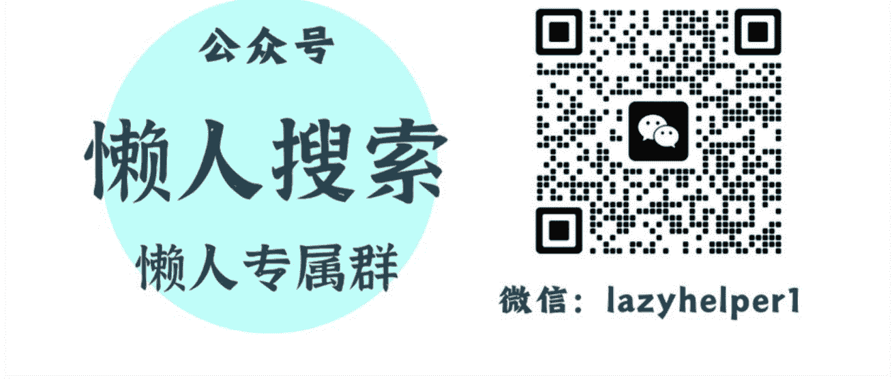
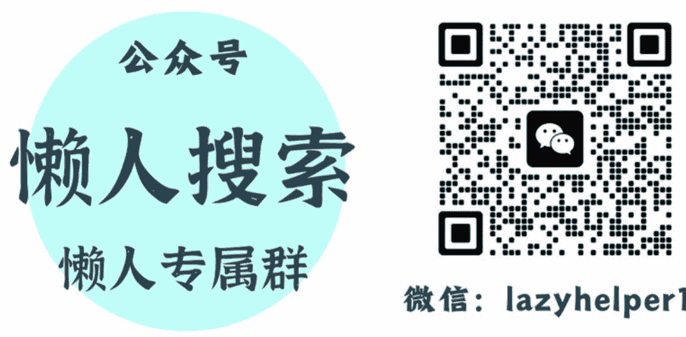

# 曾经的教育“副产品”，正在变为成长的“主产品”

260107 整理：公众号懒人搜索，懒人专属群精选 懒人微信：lazyhelper1

今天我们要关注的领域是，教育。最近，教育专家沈祖芸老师，有个很特别的观察。她说，今天的学校，正在经历一次“操作系统升级”，从“流水线”，升级成“孵化器”。

传统学校，更像一条工厂流水线，统一的时间表、标准化的课程、整齐划一的评价。但下一代学校呢？可能更像一个创业孵化器，有灵活的空间、个性化的节奏、真实的项目体验。

比如，北京第一实验学校有个教学设计，让学生们开公司。其中，有十个初一学生开了家保洁公司，叫“洁悦保洁”。后来因为经营不善，公司倒闭。既然倒闭了，大家总得做个复盘吧？没错，重点就在于这个复盘的过程。毕竟，开公司并不简单，对成年人尚且如此，何况学生？

学生公司的重点，不是为了让孩子们赚钱，而是为了让他们体验，如何面对责任，如何面对选择，以及如何面对失败。

就比如这个学生保洁公司，在复盘时，有个学生说，以往，他总想要和好朋友一起做事，大家在一起自由自在的很开心，因此公司也没有设立任何制度来约束大家。但开公司之后他才明白，“没有制度和规则的自由，最后会变成所有人的不自由。”据说，这位同学还把这句话，写进了他开的下一家公司的章程里。

那么，今天的学校为什么要做这些尝试呢？为什么要做“系统升级”呢？

> 沈祖芸老师说，因为 AI 技术，正在对人的能力提出新要求，而学校有必要让孩子们提前培养这些能力。

2025 年，有一份来自专业机构的调查，显示美国 13 到 17 岁青少年在学校作业中使用 ChatGPT 的比例，一年内从 13% 升到 26%。相当于，每四个学生里，就有一个在用 AI 写作业。于是，学生提交的作业看起来越来越好，甚至好得“惊人”。他们能更轻松地完成各类学习任务，甚至能“完美毕业”。

但问题是，他们对“在真实世界里摔倒、承担后果、重新站起来”，对这些事却变得越来越陌生。

说白了，AI 越擅长制造完美的“成绩”，学校就越应该把重心转向 AI 暂时难以介入的领域。过去，学校最核心的主产品是学生的成绩，而对失败的思考，在协作过程中的共情能力，在关键时刻承担责任的魄力，这些被很多人看成成绩的“副产品”。

而在 AI 时代，这些能力正在成为学校最需要培养的“主产品”。

那么，面对这个目标，学校可以做出哪些转变呢？沈祖芸老师说，有这么三个关键。

## 第一个关键，空间去中心化。

传统教室，更像一个只为讲授服务的“车间”：一块黑板，一个讲台，底下一排排课桌。但下一代学校的空间呢？需要能在多种学习形态之间切换。

比如，芬兰的一些学校已经这么做了。他们用活页墙作为教室隔断，可以随时打破班级和年级界限。桌椅都带轮子，师生可以根据需要灵活移动和组合。同一个空间，既能支持安静自学，也能方便小组讨论。

再比如，瑞典有所学校叫 vitra Telefonplan，被称为“没有教室的学校”。他们把工厂车间式的教室改造成新型学习空间：有楼梯中的“洞穴”，供学生独立思考；还有“实验室”，可以做科学和艺术探究；还有营地、水吧、展示区。

英国索尔福德大学研究了 27 所小学、153 间教室、3766 名学生，发现教室环境科学化可以使学生成绩进步 16%。这些积极影响，主要来自这么几方面因素，自然光、学生对教室的拥有感、空间的复杂性和色彩。

## 第二个关键，时间可编排。

传统学校里，时间是常量。所有人在同样的年级、同样的课堂上同样的节课，必须“齐步走”。下一代学校呢？需要把这个逻辑倒过来：时间变成变量，能力目标变成常量。

比如，过去的一个学期，就是完整的 18 周。而现在，可以让 6 周、12 周或 18 周为单位，把一个学期拆分成一个个学习模块，像“积木”一样可以组合。每个模块，都对应着一个特定的能力目标。

这方面芬兰已经在实践了。在一些学校里，学生不需要在固定时间准时入学与上课，每天上下学时间弹性安排。还有，美国有所学校叫 Summit，他们干脆放弃了传统的“老师课堂授课”方式，把课程全部录制成播放列表，让学生自己设定目标、决定学习进度、掌控学习节奏、确定学习时间分配。

沈祖芸老师说，这些手段的目的都是，为每个学生设计专属的“成长跑道”。

## 第三个关键，教师角色的转型。

沈祖芸老师说，未来的教师，大概率上需要和 AI 紧密协作。

AI 负责的是依靠算力和数据的工作。比如，“算”和“找”，“练”和“评”，方案生成和快速迭代。教师可以把精力放在，和学生建立关系与信任上，引导学生找到自己的禀赋。

比如，美国有所学校叫 High Tech High，他们完全采用项目制学习，没有教科书，没有考试，但大学录取率高达 98%，英语和数学成绩比加州平均分高出 10%。

他们培训教师的方式是，所有新教师入职前要参加一个 7 天的项目。前两天，教师要完成一个“小项目”，重新变成学习者，充分体验跨学科学习项目如何运作。然后参加“项目调试”和“检视学生作品”培训。

换句话说，他们对未来教师的定位，不再是知识传授者，而是学习教练。

同时，他们也要像一个"AI 主管”一样，统筹各种工具的输出，但对最后的方向、标准和边界负责。

沈祖芸老师曾经讲过一个例子，北京第一实验学校有个学生公司，叫“造船公司”。这门课从一开始就锚定了双重目标：第一重是显性的学科目标，包括浮力原理、材料科学、工程技术等等。第二重目标，是公司化运作与社会情感学习，包括市场调研、商务沟通、职业素养提升和产品思维养成。

而课程真正的价值，在于把学生推向校园围墙之外，让他们直接面对真实商业世界的复杂。

比如，最开始，学生们兴致勃勃地带着图纸去海边推销，却被渔民一次次拒绝，理由很明确：“学生造的船，不敢坐。”再比如，最“扎心”的一次经历，来自一次微信沟通。一笔眼看就要成交的生意，因为有同学记错了客户的姓氏，在微信上错把李总叫成张总，刚刚建立起来的信任瞬间清零，合作当场告吹。

但这些商业上的挫折不是课程的终点，反而是课程升级的起点。学生们开始认真搭建公司的基本架构：设立 CEO、CFO，把同学分进技术部、市场部、财务部等不同小组，让每个人既发挥所长，又对各自板块的结果负责。

那么，AI 在其中扮演什么角色？它成了一个强大的盟友，接手那些认知负荷不高，却又必不可少的工作。比如，帮“造船公司”快速搜集材料科学的资料，起草第一版市场调研问卷，自动生成项目管理时间线等。

而在整个过程中，教师的角色也发生了根本性的变化。他们不再是灌输知识的人，而是学生成长的教练和引导者。他们不着急给出标准答案，而是通过一系列有针对性的问题，引导学生回头看自己走过的路。

最后，我们回到主题，学校的“系统升级”。前面说了这么多案例，这背后的课程设计，涉及这么几个统一的要素。

第一个要素，是让学生对真实用户负责，而不只是对老师布置的作业负责。“洁悦保洁”也好，“造船公司”也好，核心都是这一条。

第二个要素，是把真实世界中必须经历的角色请进学习过程。比如，造船公司要请到渔民，糖果公司要找到顾客，这些真实用户的反馈，比老师的评分更有力量。

第三个要素，是让 AI 接手那些认知负荷不高的工作。比如，调研、资料搜集、方案初稿生成，把学生的精力解放出来，用在真正需要人类判断和情感投入的环节。

第四个要素，是把风险设计成“可逆”的。公司可以倒闭，可以重来。

第五个要素，是通过看得见的产品与服务，建立一套从“会做题”到“会解决问题”的评价体系。

你会发现，这些要素背后，其实是一套新的教育逻辑：不是让学生在无风险的环境里追求完美，而是让他们在可控风险的环境里学会承担。

就像前面说的，下一代学校更像一个创业孵化器。每个学生都是创业者，目标是找到自己的成长路径。

## 最后，安利小懒的付费群：

懒人专属群（介绍）

❉ 这里是你对抗信息过载的护城河。
已稳定运行 6 年，累计拆解、研读 3000+ 个互联网商业实战案例与行业前沿内参和时政/宏观文章。

---

我们不搬运垃圾，只做高价值信息的筛选器与放大镜。

懒人专属群更新记录：

https://hk57gvlx7u.feishu.cn/docx/H0kRdZbSbolBR0xkaXtcuVE0nTg

【免责声明】本资料归档于社群内部知识库，仅供成员课题研究与学术交流，请在查阅后 24 小时内删除。