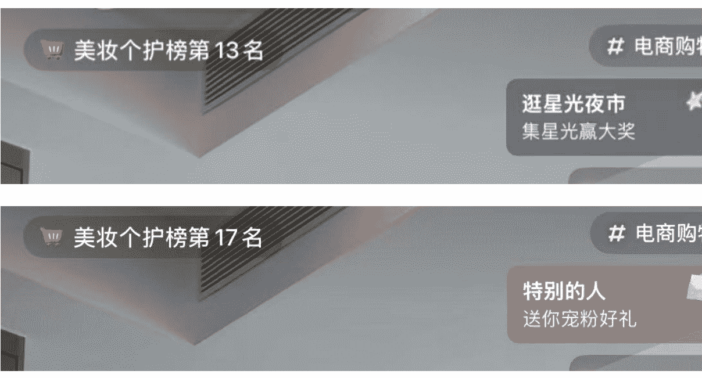
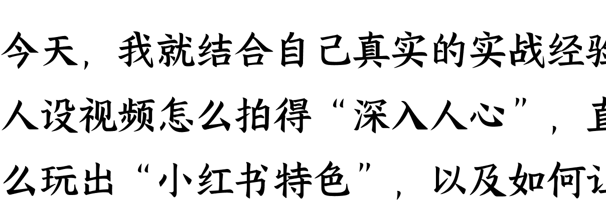
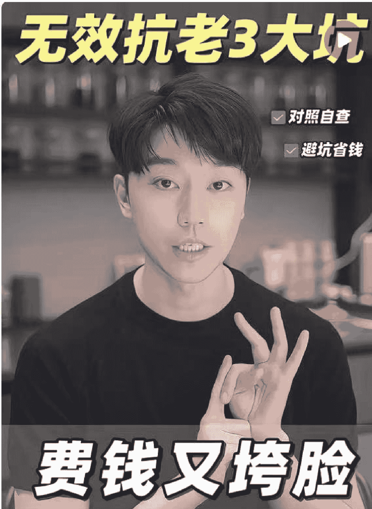
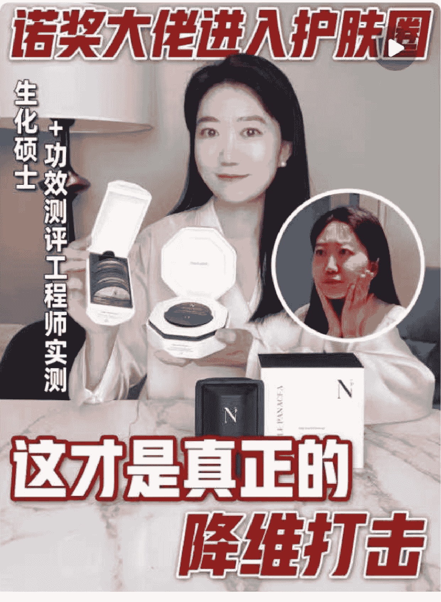
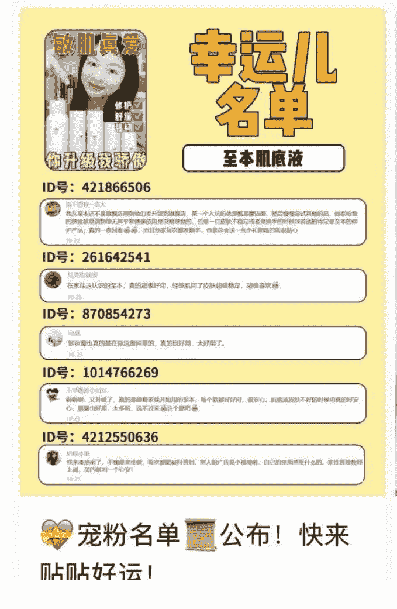
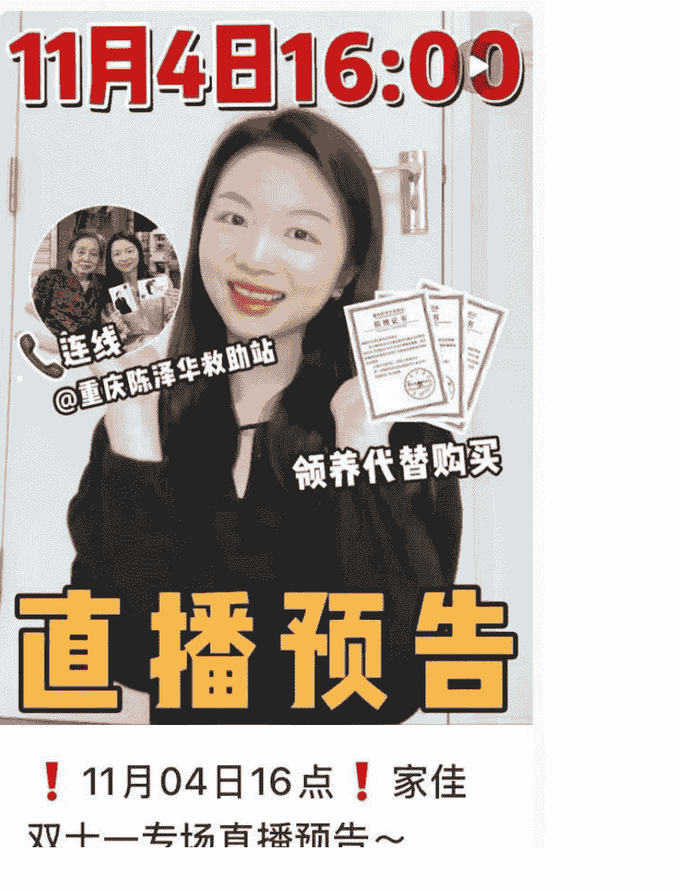

# 深耕小红书：人设视频打造秘籍 + 直播玩法拆解，内容串联涨粉变现双丰收

260107 副业 SC 精华

公众号懒人搜索，[懒人专属群] 独享

懒人微信：lazyhelper1

大家好，我是 Kammy，一个 30+、爱护肤的三胎妈妈。我之前在别的平台有 16 万粉丝，但真正让我找到“变现闭环”感觉的，是在小红书。身边很多朋友问我，护肤赛道这么“卷”，你是如何快速做到站稳脚跟的？我最大的体会是：在护肤这个重度依赖信任的赛道，“人设”就是你的核心竞争力。用户先信你这个“人”，才会信你推荐的东西。同时，小红书的视频笔记和直播绝不是两个孤立的岛屿，让它们联动起来，才能形成流量的永动机。

说实话我在小红书的开播时间并没有太久，稳定开播是从 2024 年 11 月中旬开始，目前是固定一周三播的频率，也体验到直播对销售带来的助力。之后应该会做一个日播的调整。开直播能让粉丝对人设的真实性可以更近距离感受。也因此成交的客户引流到私域的成功率高达 80%。

今天，我就结合自己真实的实战经验，把人设视频怎么拍得“深入人心”，直播怎么玩出“小红书特色”，以及如何让笔记和直播打配合战的心得和大家分享。

## 一、人设视频打造：找对方法，让用户记住并信任你

做人设视频不是简单拍日常，而是要通过内容传递清晰的“你是谁、能给用户什么、和别人有啥不一样”。我的人设很具体：“30+ 爱护肤的三胎妈妈，专注高端小众护肤品”。这个人设不是凭空编的，它源于我的真实生活和状态，也让我的内容有了比较高的辨识度和信任基础。尤其是在我所处的高依赖人设赛道，每一条视频最好都能做到为“强化人设”去实现效果最大化和粉丝尽可能精准。具体我是从以下从这三个方面入手的。

### 1、前期筹备：先找准人设定位，避免模糊不清

人设不要凭空想象，最好还是结合自身真实情况和优势、赛道需求和用户痛点的精准匹配。我一开始也走了弯路，打造的标签有些泛，结果内容没有一目了然的侧重点，用户对我根本没有记忆点。后来经过复盘，总结出了 3 个定位技巧：

先做“自我盘点”找出自己的标签特色：列出自己的核心优势（比如擅长穿搭搭配、懂母婴避坑、租房低成本改造）、性格特点（活泼开朗、沉稳专业、幽默毒舌）、独特经历（比如从职场妈妈到创业博主、踩过 100 个护肤坑后总结经验），这些是人设的基础和标签，避免人设和自身脱节，也不要夸大化，粉丝都是聪明的一眼看过去会觉得不真实。做真实的自己这样的分享才能持久，也不会前后矛盾不一。我很喜欢一句话叫“真诚是永远的必杀技”。

自我盘点这个过程会花费一些时间，但这个动作很重要，标签也不要多。于我而言，30+ 爱护肤的三胎妈妈就是我最真实最强大的信任背书。

结合赛道痛点找差异化：开始之前可以我会先刷我要做的这个赛道的博主们特别是同赛道头部博主的内容，总结他们的人设类型（比如“专业干货型”“亲和闺蜜型”“吐槽避坑型”），然后找他们没覆盖到的缺口。比如母婴赛道大多博主走“温柔宝妈”路线，如果你是个职场宝妈，那是不是可以打造“职场妈妈高效带娃”人设会更吸睛些？标签主打“省时、省力、不踩坑”，一下子就和与其他博主区分开了。

明确能提供给用户的价值：粉丝关注你，本质是能获得好处。你的人设要清晰传递出“关注我能得到什么”——是学干货、找共鸣、获情绪价值，还是 get 专属福利？比如我的人设核心是“分享自己的护肤抗老经验，当妈后也可以自信美美的，帮 30 岁左右的宝妈们一起变美保持好的皮肤状态”，每一条视频都围绕这个价值展开，用户一看就知道“关注她有用”，我也想变成她这样子。

这里有个小讲究：人设不用太复杂，聚焦 1-2 个核心标签即可，比如“职场妈妈 + 高效带娃”“学生党 + 平价护肤”，标签越多越模糊和泛，用户记不住。小红书本身讲究精准和垂直属性，越精准越垂直用户粘性越高。抓住 1-2 个标签不停打深入就好。

### 2、内容创作：细节拉满，让人设“立得住”

定位好之后，每一条笔记的内容就是人设的展现形式。每一条视频的脚本、画面、风格和调性最好和人设保持一致，不要一天一个风格飘忽不定，容易让看的人混淆。说到风格调性这块，从账号的长远性来看，结合同赛道的其他博主，最好确定出一个适合自己的一个风格。

像我的话一开始想过做沉浸式，沉浸式在小红书的数据都蛮好的。但这类场景需要非常精致的画面，但这于我的日常生活风不相符，我也没法坚持在每条视频里呈现出来精致，所以一开始我就直接 pass 这类风格。

主要可以从以下这三方面展开：

#### (1) 脚本设计：开头抓眼球，中间给价值，结尾强人设

小红书用户刷视频节奏快，3 秒内抓不住注意力就会划走，所以脚本我都是有固定的几个模板：

**开头 3 秒**：用痛点、疑问或反差感吸引观看。比如我常说“当妈后是不是经常熬夜容易垮脸断崖式衰老，但三胎妈妈的我现在皮肤状态好到发光发亮”“同样是宝妈而且是三胎妈妈，你到底是怎么护肤保养的，直接戳中宝妈们特别是 30 岁这个年龄段的宝妈们的核心痛点，让她们产生好奇愿意继续看。

**中间部分**：精准输出价值，同时融入人设特点。比如分享三胎妈妈忙碌的日常，被挤满的时间表如何高效护肤，有限的时间 内如何精准高效专业护肤，让自己 的皮肤状 态保持在线，让和我年龄类似或者差不多情况的宝妈们看到和感受“原来当妈了我也可以这样”。既给了干货，又强化了“三胎妈妈 + 高效护肤”的人设。

**结尾部分**：要么引导互动，要么再次强调人设。比如“每天只需 3 分钟你也可以轻松 get 小 V 脸，姐妹们评论区一起来打卡吧~ 也欢迎预约直播间我和姐妹们好好分享 35 岁宝妈最该投资的第一件护肤单品是什么，加深用户对人设的印象。”

给大家看下这三个视频都是做得比较好的，无论是从选题还是数据来看：

# ***

## 三、视频案例展示

### 这些抗老方法，你纯粹在浪费钱

#### # # 花了好几万护肤没效果，你踩中了 3 大抗老误区

该知道了！！这些做的越多脸垮的越快

### # 花了好几万护肤没效果，你踩中了 3 大抗老误区

这三个视频的共同点：先提出痛点，再说出对比反差，同时封面也有面部松垮和紧致的效果对比图——为什么我一直在做抗老却没有效果？我日常这么努力做抗老脸反而没紧却越来越松垮？我是踩了哪些坑 哪些动作做错了吗？很多人的潜意识里觉得我花了贵价买高端护肤品=有效抗老，但真的是这样吗？引发观众的点击和观看。

#### (2) 笔记风格：统一调性和封面风格，让用户一眼认出你

每条视频我都会尽量把人设外在体现出来，比如穿搭、妆容、固定的拍摄场景、笔记的封面和字体保持统一风格。

**拍摄场景**：我主要围绕护肤这个事情，所以场景我一般选在浴室，卧室或者家里的客厅，既能贴合“三胎妈妈护肤时间”的人设，又能和观看者拉近距离有代入感。

**穿衣妆容**：拍摄以简约自然妆容或者素颜好气色为主，符合三胎妈妈的亲和但又不失精致的形象，让用户看到第一反应就是原来三胎妈妈也可以保持这么精致和好状态的形象，而不是想象中的蓬头垢面和暗垮脸。

**封面和字幕**：封面统一用“文字 + 我出镜”的形式，文字突出核心内容，比如“面部提拉紧致 2min 跟练版”，封面颜色我固定 2 个颜色一种字体；别人一点进去我的账号，看起来就比较舒服，也能快速 get 重点。

给大家举两个例子看看更好地感受：

*](img/aeaeb585ab018fd1ab2a70c213dde8f9_9_0.png)

这个账号的封面排版做得比较好的地方就是每个封面都是真人出镜，要么带精简妆容展示符合小红书平台的审美调性，要么就是状态对比图更有视觉冲击性引发观看兴趣。每个封面字体统一，白色是主色调，小字部分采用粉色颜色，干净又显高级，整个账号的调性就上来了。

养出厚脸皮 换季泛红 发痒紧绷 懒人养厚城墙皮攻略 敏皮自救 3 招
分享 3 个摆脱敏感肌的懒办法，越懒皮肤越好！ 徐晔医生 1145

毛孔粗大 缩毛孔全攻略！一篇搞定 只要你有大毛孔，这条干货视频就值得你看
徐晔医生 1.1 万

### 低成本变美 10 个邪修技巧 10 个低成本变美小技巧，普通人一学就会！ 徐晔医生 4398

一部用过 100+ 本能 淡泪沟
徐晔医生 3005

这个账号的封面排版也是真人出镜，要么单人图要么四宫格图都是小红书平台比较青睐的封面风格。每个封面字体统一，主要是黄色和白色这两个色调，整个账号的风格一看就很统一。

说到视觉风格，很多人可能觉得需要高大上才行，但其实所谓的视觉风格不用追求也不是你脑海里第一反应飘出来的“高大上”，但一定要“统一”，这样别人刷到你的视频不用看账号名称，也能通过画面认出你，这点对强化人设还蛮有用的。

#### (3) 语言风格：符合人设，真实地表达

每个脚本的输出和笔记的正文我用的都是
我日常生活的真实语气和说话风格。
我打造的是“三胎妈妈 + 高效护肤”人设，
语言风格就以亲切、自然、接地气为主的
宝妈口吻，我不会说太多专业术语，一些
专业的成分和技术我会打比喻，用宝妈好
理解的做菜和辅导孩子做作业做题目等方
式来类比。这样很多护肤小白或者认知没
那么深的宝妈们就通俗易懂多了。

比如不说“护肤成分小分子渗透技术”，
而是说“护肤品成分的单位越小越容易钻
到我们皮肤底层去输送营养成分”；偶尔
也会分享自己熬夜带娃的小崩溃，比如
“昨天熬夜带娃到半夜，今天一起床一整
个暗沉垮脸，真的快扛不住了”，传递真
实的情绪，让用户觉得“她不是完美的，
和我一样有当妈后的各种日常烦恼”，从
而产生共鸣，加深信任。

### 3、后期优化：根据数据调整，强化人设优势

人设不是一成不变的，或者用户喜欢看的
点不是一成不变的。这个过程需要根据用
户反馈和数据不断优化。比如我一开始分
享的内容有如何瘦腿，后来发现用户更关
注的是“如何让面部紧致提升”和“如何
淡化黑眼圈和眼部抗老”，这类笔记数据
也更好，就调整了内容比例，重点分享面

部和眼周的提拉紧致和抗老，同时保留三胎妈妈的视角，让人设更聚焦。

又比如有观众评论“有好用的面部精华油和防晒霜推荐吗，纯干货固然能提供实用和情绪价值。但带货才是我的最终目的。我就适当增加了日常好用爱用的护肤品推荐比例，强化“三胎妈妈如何保养用什么护肤品抗老保持好状态”的人设。

优化不是否定你原来定好的人设，而是在你核心标签不变的前提下，调整内容方向和呈现比例，让人设更贴合你的粉丝需求，会更有吸引力，增加精准性和粘度。

## 二、小红书直播经验：找准平台特性，实现流量和变现双提升

在开始做小红书之前，其实我先对比过其他几个平台，包括直播这块。我发现小红书直播和其他平台差异还是挺明显的，而且小红书的笔记发布和直播是强关联的，能起到笔 直联动的效果，增加直播间流量。接下来我就从直播准备、小红书平台的差异、笔直联动三个方面分享我的直播实操经验。

### **1、小红书直播前期准备：精准铺垫，提升开播转化率**

小红书用户更偏向“种草”和“信任消费”，所以直播前期的铺垫很重要，最主要是要让粉丝知道“你要直播什么、能获得什么好处”来提升开播的观看人数和互动率。

**提前用视频笔记预热**：开播前 3-5 天，我会发布 1-2 条预热视频，内容可以是“预告直播主题 + 直播间福利”，比如“本周五晚 8 点直播！分享三胎妈妈高效如何高效护肤，直播间送宝妈护肤秘籍电子手册”，视频里左下角可以加上直播时间，引导用户点击“预约直播”。

像这个账号每次开播前都会发直播预告比较，从封面可以清楚看到直播的日期和具体时间，直播的福利和本场直播的亮点，基本信息都比较一目了然。感兴趣的观众就会点开进一步观看甚至预约直播。

**粉丝群精准触达**：把直播预告发到粉丝群里，和粉丝互动，比如“宝妈们有什么护肤难题，都可以在直播时问我，我会 1 对 1 解答”，提升粉丝的期待感，同时提醒粉丝开播时间，避免错过。

**准备好直播内容和福利**：小红书直播会更看重“内容价值”，不能单纯卖货，要先给粉丝提供有用的信 息。我每次直播都会提前列好内容大纲，比如“先分享 3 个护肤技 巧，再解答粉丝疑问，最后分享专属福利”；福利方面，除了抽奖送小样，还会  直播间专属限时秒杀价，提升粉丝的独 特殊体验感和参与度。另外我在直播间 分享的护肤抗老内容，让粉丝觉得“直 播内容干货和平时的视频一样有价值”，从 而愿意预约下一场直播和观看。

另外就是我会提前准备 3-6 个直播间封面，可以在小红书搜封面爆款对标去拍，在直播的时候根据封面的点击率一个个来测试，直播间再有干货和福利也得先让人进来才有可能实现，直播间点击率高的封面是这扇门。

### 2、小红书直播与其他平台的核心差异：找准特性，避免踩坑

做小红书账号前我就已经做好开直播的打算，也先提前对比了几下主流平台，我的性格和风格可能不太适合太吵闹快节奏特别接地气的直播风格，另外就是小红书平台的直播强度相对没那么卷和累，可能坐下来和一帮宝妈们姐妹们聊聊天也比较符合我这个高客单价高端的护肤品赛道，这个圈子的姐妹们不会特别喜欢太过吵闹和喧嚣的风格。你想维护好这个客户群体，你得让自己的风格是差不多的，大家才第一感觉会是舒服的，不排斥的。

总结下来，小红书平台的直播主要有以下这 3 个方面的差异：

#### （1）用户需求差异：更看重“价值种草”，而非“低价引流”

其他平台的直播可能更偏向“低价引流”，靠低价商品和赠送 N 多的免费小样吸引用户下单；但小红书用户更看重“价值”，她们是因为信任你的人设、认可你的内容才来观看直播，更愿意为“有用的信息”和“符合自身需求的好物”买单，而不是单纯追求低价。

在小红书直播，我会先分享 30 岁这个年龄段特别是宝妈们忙碌的日常得先进行哪些方面的重点护肤，我自己平时用哪些护肤

品可以达到高效抗老和改善”，先给用户
提供使用价值，再介绍产品优势，这样下
单率反而更高。当然我也有准备了 1-3 款
相对低价的引流品，但都是正装的小样，
是给刚接触我的粉丝一个尝鲜体验价，体
验好了，你对我的推荐认可了我希望你
下次来为客单价高的正装买单。

#### （2）流量来源多方面：来自粉丝、笔记、首页推荐和直播间上下滑

其他平台的直播可能会有较多的公域流量
推荐，比如平台会把直播推给非粉丝用
户；但小红书直播的流量有来自“私域”
（你的粉丝）和笔记（你的直播预告和日
常发布的笔记），另外一个流量主要是来
自首页推荐和直播间上下滑。所以在小红
书的直播间你不仅要维护好已经进来的粉
丝，进一步增加她们的粘性和深度，也要
有节奏的有安排性地在直播间不断强化你
的人设，以及你能给新进来的用户提供什
么价值让他们产生共鸣或抓住她们的痛
点，尽可能让她们留下来继续观看或者互
动甚至预约下一场直播。

由于小红书平台推荐具有精准性，不要小
看你直播间的每一位粉丝。我觉得小红书
的算法还是蛮强大的，能刷到我的直播进
来我直播间的用户，我是相信根据小红书
的算法推荐，进来的人的某一方面需求跟
我能提供给她的价值肯定是有某一方面的

需求匹配度，这一点在最近的直播间得到好几次验证。

比如最近两次直播有进来一个姐妹，我对她有印象是因为她最近几天都是抽奖环节进来的。于是我想着随便 celebrity 一下，这一 cue 这个姐姐和我说了她的年龄和护肤遇到的问题。结果这个姐姐还是个贵妇姐姐，砸了不少钱在护肤品上！好多大牌明星产品和国外高端小众品牌她都一一试过，小六位数是肯定有的！！于是她问我为什么用了这么多效果好像一般。我说我帮你分析完后你觉得你当下最需要解决的一个核心问题是什么呢。她恍然大悟，一直把贵的各类产品往脸上堆，有些看似有些用但是皮肤状态还是勉勉强强没有达到预期。引流到私域加了微信后这个姐姐又一直在和我聊让我给她做推荐。

这个小细节真的深深感受到了小红书算法的精准性！！所以无论是不是我的粉丝甚至是抽奖环节才进来的我都是抱着真诚分享和交朋友心态。在这个过程中我不会特别心急或者急功近利去把她能不能成为我的客户或成交放在首位（当然有成交最好），做 IP，做人设是一个不断吸引和筛选的过程，有时慢慢来比较快。

#### （3）互动风格差异：更偏向“亲切交流”,而非“热闹吆喝”

其他平台的直播可能需要主播大声吆喝、
营造热闹的氛围，吸引用户停留；但小红
书用户更偏爱“亲切、自然”的互动风
格，就像和朋友聊天一样，太夸张的吆喝
反而会让用户反感。

我在小红书直播时，会先和粉丝或者经常
来我直播间的“朋友”打招呼，聊聊最近
天气的变化皮肤会不会变得敏感干燥之
类，比如“最近广东的天气像做过山车一
样时冷时热”，拉近和粉丝的距离；鼓励
她们在评论区和我说说她们的肤质，最近
遇到的皮肤问题之类，了解多一些护肤干
货。解答粉丝疑问时，也会耐心细致，甚
至是一对一的护肤问题解答。

**直播时我前半段只讲干货不卖货**：我会先
用 20-30 分钟，把这个主题下的护肤原
理、成分，配方和技术、如何挑选产品讲
透。比如讲抗老，我会先分析各个不同年
龄段的干纹、细纹、松弛的区别和应对成
分。用户觉得“学到了”，信任感有了，
这时候再拿出我自己日常真实在用的对应
护肤品，她们会觉得“你是在帮我”，而
不是“在一味卖我东西。而且这个过程我
会真实分享自己的使用感受，同一个单品
我可能会介绍我在用的几款，在一堆瓶瓶
罐罐里面经过层层筛选出来我一直在用空
瓶回购的，并且介绍这几款产品的各自优势，这样粉丝也不会觉得你只硬推一款，她们是有选择空间和对比空间的，这也让粉丝感觉更真实可信。

## **3、视频笔记与直播的串联：形成闭环，提升整体效果**

小红书的视频笔记和直播不是孤立的，做好这两个的联动，能起到"1+1>2"的效果，让笔记为直播间引流，为直播间打开多一个流量入口形成流量闭环。我的直播间主题跟发布的笔记主题一样精准：我不会开一个什么都卖的直播间。我的直播间主题非常明确，比如"30+ 三胎妈妈护肤抗老坦白局”、“小众贵妇品牌闭眼入清单”。这和我发布的笔记紧扣的选题，人设标签是一致的。日常我主要用以下这 3 个联动方式：

#### **（1）视频笔记为直播预热：精准引流，提升预约率**

这是最常见也是最有效的联动方式。开播前 2-3 小时发布预热视频，不仅要预告直播时间和主题，给出直播间能提供的价值，比如“直播会分享我平时用的抗老护肤步骤，还有专属粉丝价格”“直播会解答大家平时问得最多的‘熬夜宝妈如何护肤抗老’等之类的问题”，引导粉丝点击“预约直播”。

## 直播预告与人设保持一致

而且直播预告的内容要和人设保持一致，比如我还是以熬夜带娃的宝妈视角，分享直播的核心内容，让粉丝觉得“直播内容和平时的视频一样有价值”，从而有兴趣预约和观看。比如我上次直播分享30岁宝妈抗老的5个单品是什么，提前发布了一条“30+宝妈熬夜抗老的护肤清单的直播预告视频，视频里展示了5个清单内容，结尾预告“直播间会分享更多抗老护肤单品和组合用法，吸引了一些粉丝的直播预约。

#### （2）直播内容反哺笔记选题：丰富素材，提升笔记选题热度

直播过程中会有一些姐妹的高频疑问，比如干敏肌如何先维稳再去解决干皮以及抗老等问题，这些都可以作为下一条笔记的选题，整理成干货视频发布，既能丰富笔记内容，又能吸引新粉丝关注。

比如我上次直播时，好几个姐妹同时问到宝妈长期熬夜有黑眼圈怎么护肤抗老，我在直播中详细解答了这个问题，还分享了黑眼圈的一个本质是什么原因，一个护肤要点和核心是什么，可以结合一些什么样的按摩手法和护肤品。直播结束后，我把这部分内容整理成了一条如何淡化熬夜的黑眼圈的视频笔记，发布后获得了很多点赞和收藏，还吸引了不少新粉丝关注，她们看到笔记后，又会去看我的其他视频，甚至预约下次直播（注意在所有笔记关联你的下一场直播的预约可以提升进直播间的人数）。

#### （3）直播间评论区粉丝的好评和正向反馈可以在笔记展示出来增加真实性，吸引潜在粉丝

把直播间评论区粉丝的好评和正向反馈，比如有姐妹反馈“这个眼霜很好用，空瓶又来回购了，姐姐是怎么护肤的皮肤超好，听你的分享蛮有收获”等这些可以截图作为笔记发布的内容，属于是客户和粉丝的好评，这些既真实又有说服力，也有进一步增强的人设，又能吸引新粉丝关注，扩大账号的影响力。不要浪费任何能展示你好的一面有公信力一面的任何素材，在这个越来越卷的时代，有时酒香也怕巷子深，特别是护肤这个卷的赛道～有时成绩是需要一点点积累出来的，一点点积累不是你脑海中想象那些高难度和高大上的画面与动作，有时就是这么细微不足道的动作慢慢积累和撬动的。

## 三、总结：人设是核心，笔记联动是关键，坚持是基础

在我所处的护肤赛道，人设是账号的核心竞争力，只有打造出清晰、真实、有价值的人设，才能让粉丝清楚知道她们能获得什么价值。第二个就是你依附于哪个平台，一定要熟悉所在平台的特性和特点。

比如小红书的笔记联动，以“价值种草”和“朋友般的亲切互动”的风格；同时还有粉丝的精准性，这也时刻提醒你的人设和标签一定要精准和垂直。这样才能提升整体的流量和变现效果。

其实做小红书账号没有什么捷径，无论是人设的打造，还是直播的实操，都需要不断尝试、复盘、优化。比如我一开始拍人设视频，数据并没有很好，刚开始每发布一条笔记我就会观察数据，让数据说话来不断调整我的选题，内容方向，呈现方式乃至一个场景和一个光线的优化，才慢慢找到适合自己的风格和调性；直播也是一样，从一开始的紧张畏难，到现在的开播是一个正常的日常，开播了能和粉丝轻松互动，都是靠一次次的实操积累的经验。

而且每一场直播甚至每一场直播过程我都会看实时数据，封面点击率够不够高，需要立刻换提前备好的爆款封面继续测点击率。这一场直播的互动率和停留时间有多久，这两个数据暴露的是哪方面的功夫没做到位需要下一场继续优化等等。如何抓住机会让每一个进来直播间的人为你“贡献”一份力量，关注也好，加入粉丝群也好，评论区的互动也好，分享直播间也好等等，不要浪费和小看这些动作，这些动作决定你的直播数据和效果。

直播需要时间和经验的积累。慢慢在这个过程找到适合自己的也相对舒服的方式和风格。进来的人看到你是舒服的，自然真实的状态，比起不断说你赶紧买，你不要要走要停留在我的直播间等话术来得更有力得多。关于直播间的优化，我要感谢申铭教练，虽然从未谋面，但是每一次我的请教他都很用心超详细的解答，也是在这个过程让我明白直播做得好不好不是和做账号一样不是玄学，而是真的可以实打实的去标准化每一个动作，动作做正确会反馈到数据和产出，每一场一点点去优化，慢慢你的信心会越来越足。

最后有感触的一点就是坚持去做，持续去做，打磨基本功。别把这件事想得太复杂，日复一日去完成量变到质变的过程。当你真诚地分享，专业有干货地输出，并把各个模块有效地联动起来时，惊喜或许就在不远处等着你。

## 致谢

做小红书的过程我要深深感谢我的导师——无敌老师!!每次遇到什么问题她都倾囊相授知无不言，我记得她说过一句我现在还记得的话——“超越常人的坚持”。有时会有想偷懒的时候，灰心想放弃的时候但一想到这句话我还是会鸡血满满。很多事情真的贵在坚持，要拿结果也贵在坚持。无敌姐日常也是个温暖的姐姐般，让我也想像她一样成为一个温暖有力量的人儿。大家日常在小红书方面有什么问题也可以咨询无敌老师。

希望我的这些经验能给正在做小红书的你带来一些启发，如果你也在做IP、做小红书直播，或者有相关的疑问，欢迎在评论区交流，我们一起成长进步！最后感谢生财，虽然加入生财的时间很短，但在短暂的时间里我遇到很多给予我帮助的可爱人儿，有些甚至没有见过面，但是这种帮助，温暖之余也给我指引了一个方向——有一天我希望我也可以给别人带来帮助和温暖。

最后，安利小懒的付费群：

## **[懒人专属群](http://mp.weixin.qq.com/s/xpae4O47o8aFpHNapsYMyQ)**

https://hk57gvIxC7U.feishu.cn/docx/H0kRdZbSboIBR0xkaXtcuVE0nTg

这里是你对抗信息过载的护城河。

已稳定运行6年，累计拆解、研读3000+个互联网商业实战案例与行业前沿内参和时政/宏观文章。

## 懒人专属群规则与说明

详见是一张管家
(OTA 是 4 外 (是 为 的 下 0 极 0

---

### 免责声明

本资料归档于社群内部知识库，仅供成员课题研究与学术交流，请在查阅后 24 小时内删除。