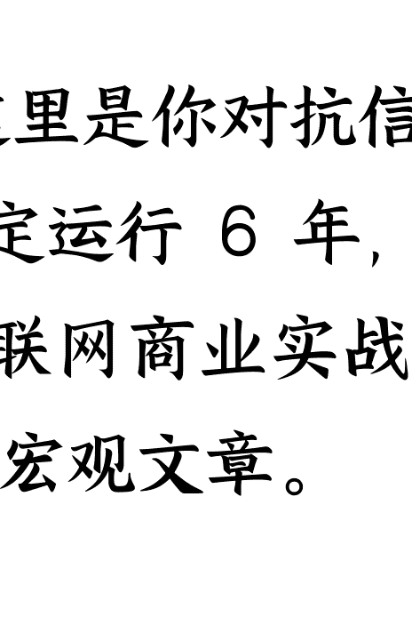
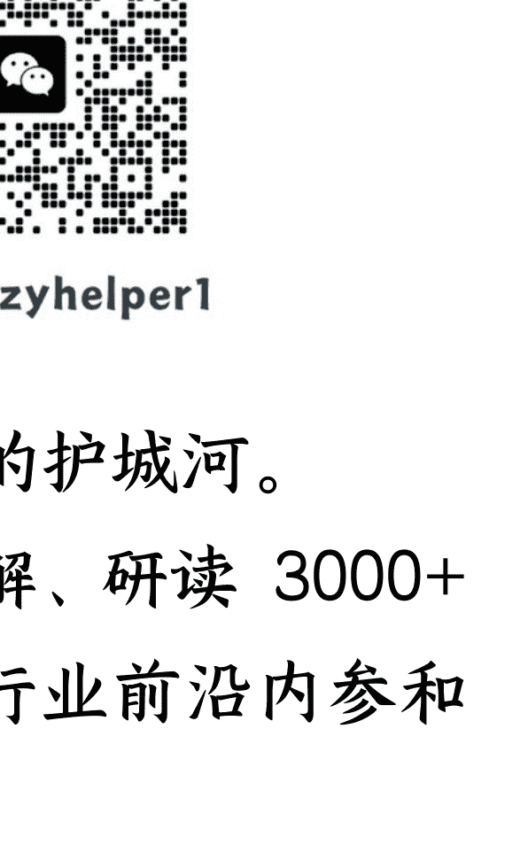

# 2026，中美谁能攀登技术之巅？

*260107* 圆方你怎么看

整理：公众号懒人搜索，<u>懒人专属群</u>精选

懒人微信：lazyhelper1

+ **01**

昨天，圆方写了 2026，世界会更好么？系列的第二篇 2026，天下大乱，形势大好。

重点论述了一下，全球地缘战略重构，对我们未来十年的影响。在开篇的时候，圆方讲了 1971 年中美秘密谈判时的一个故事。之所以那个时候中美能够完成谈判以及建交，一方面来自于我们的努力和准备，但更重要的是美国自身内外的处境和国际局势的演化。

那个时候（1971 年）的美国，内外交困

从国际上看，美苏争霸进入关键转折期，同年美国第一次出现了自 1893 年以来历史上的贸易逆差，同时越南战争成为了美国沉重的包袱。

从国内来看，反战浪潮席卷美国社会，美国经济陷入滞胀，布雷顿森林体系瓦解。正是因为有了内外的压力，所以那时候美国特别需要中国来制衡苏联，重新平衡世界的局势，也才有了后续的变化。

不过在介绍当年大国博弈和全球地缘战略重构的时候，圆方留了一个“扣儿“没讲完。

"同时我们也要看到，在 1971 年，有一道暗线正在慢慢延展，草蛇灰线，伏脉千里。"

而正是这道暗线，长期看最终决定了整个美苏两方的命运和结局！这道暗线，就是技术

## **02**

1971 年 11 月 15 日，英特尔公司正式推出世界上第一款商用微处理器 Intel4004。

Intel4004 集成了 2250 个晶体管，采用 4 位体系架构，最大主频 740kHz，每秒可执行约 6 万次运算，成本不到 100 美元。

它将中央处理器、内存和输入输出控制等核心组件集成在一个微小的硅片上，首次实现了单片处理器的商业化。

这也为后来的个人电脑、移动设备和嵌入式系统奠定了基础，标志着计算机从大型机时代向微型化、普及化时代的跨越。

同样是 1971 年，美国 BBN 技术公司工程师雷·汤姆林森为 ARPANET（互联网前身）开发了电子邮件系统。

这一次，他不仅实现了不同主机用户之间的跨网络消息传递，还创造性地将“@”符号引入电子邮件地址，用来区分用户名和主机名，这一设计至今仍在全球广泛使用。

汤姆林森发送了世界上第一封电子邮件，这一发明改变了人类的通信方式，为后来的互联网社交、电子商务和远程协作铺平了道路，成为数字时代信息交流的基石。

1971 年的苏联，其实技术上差距距离美国其实并不没有那么大的。

从 60 年代起，苏联就尝试打造自己的“硅谷”——泽列诺格勒。

这个城市在俄语中意为“绿色城市”，它被设计成科学天堂。有研究实验室和生产设施，还有学校、日托所、电影院、图书馆和医院。半导体工程师所需的一切都能在这里找到。靠近市中心的是一所大学，莫斯科电子技术学院，这是比照斯坦福而建的大学。

泽列诺格勒市陆续建成了一大批的微电子工厂，到 1971 年初，将近 1.3 万人在泽列诺格勒的微电子领域工作。

1971 年 5 月 15 日，苏联成功发射首枚配备机载计算机的重型运载火箭，使用 Argon 系列计算机进行自动导航与控制系统。

只是和美国不同，苏联在计算机的发展上选择另外一条截然不同的道路。

苏联则选择了大型机兼容和集中式计划的发展路径。计算机产业集中于大型机和军用领域，民用市场发展缓慢。

这个路线虽然在行政资源的堆砌下，短期内不计成本的提升了单机的计算能力，但长期来看丧失了持续迭代创新的能力。

最终在信息技术革命中被边缘化，为苏联后期的技术落后和经济困境埋下伏笔。

## **03**

到了 1981 年，苏联在计算机技术领域已全面落后美国，从核心硬件到软件生态再到应用普及形成全方位代差。

技术层面，美国 1981 年 8 月推出 IBMPC，搭载英特尔 8088 处理器（4.77MHz 主频），采用微软 MS-DOS 系统，标志着个人计算机时代正式到来，同时英特尔发布 80186/80188 处理器，施乐推出首款 WIMP 界面商用系统 Star8010。

而苏联此时仍停留在对西方早期芯片的仿制阶段，1981 年刚推出 K1801VEI（仿制英特尔 8080），性能仅为美国

同期产品的 1/5 到 1/3，且良品率不足 30%。

存储技术差距尤为明显，美国 1981 年已量产 1MB DRAM 芯片，苏联主流产品还是 16Kb 内存，差距达 64 倍。

计算机普及率方面差距悬殊，1981 年美国每百万人拥有约 5000 台个人计算机，而苏联全国个人计算机总量不足 1 万台，每百万人仅 1-2 台，且多为科研机构专用，民用市场几乎空白。

软件生态更是苏联的短板，美国已形成从操作系统到办公软件、工业软件的完整产业链，而苏联缺乏自主操作系统，主要依赖对西方软件的破解和修改，兼容性差且功能受限。

大型机领域苏联同样落后，1981 年美国超级计算机运算速度已达每秒亿次级别，苏联最快计算机仅为每秒千万次，且体积庞大、能耗高、可靠性低。

与此同时 1981 年之后，国际局势在发生重大转折，美苏关系从缓和重新走向全面对抗。

1981 年 1 月里根就任美国总统，推行强硬的对苏政策，提出“以实力求和平”战略，大幅增加国防开支。苏联则在 1979 年入侵阿富汗后陷入战争泥潭，1981 年 9 月举行人类历史上规模最大的军事演习“西方 -81"，出动近 20 万兵力、1500 辆坦克、600 架战机，进一步加剧西方阵营的警惕。

美苏两极对峙后，西方通过巴黎统筹委员会进一步加强向苏联的技术封锁，严禁向苏联出口先进计算机和半导体设备，这使得苏联计算机技术与西方的差距持续扩大，最终形成难以逾越的鸿沟。

## **04**

不知道小伙伴们看到了 1971-1981 年美苏的计算机竞争是一种什么感觉。

圆方觉得，可能今天，全球的竞争和博弈又一次到了“技术决定命运”的阶段了。

其实今天全球的竞争，或者更具体的说中美之间的竞争，放在 2026 来看，可能有 100 个，1000 个博弈点。

但如果我们把目光放眼到 10 年后，我们就会意识到，这一次中美之间的博弈，最终的结果，其实很大限度取决于：

看谁能够在这次技术革命当中，率先完成“新质生产力的升级”

关于“先进生产力”，中国人是有执念的。

从 1840 年开始，“落后就要挨打”这六个字，已经深深的烙印在每个中国人的心中。

其实并不是所有国家，也并不是所有民族都认可“落后就要挨打”这句话的。

这个世界上落后的国家很多，都挨打了么？

并不是。但是这些没挨打的国家，失去了一些更重要的东西。

中国，作为一个有着深厚历史文明的国家，我们是永远不会屈服于任何一个其他的国家，其他的文明。

而这这就要求我们，会始终对于最新的技术，保有最坚定的追求。

所以，中国人对于"先进生产力"这个事情是有执念的。

这也就意味着，面对这一轮以"AI"为代表的新一轮技术革命，中国一定是全球最激进的，投入最大的。

而未来这几十年的技术革命，大概会分为两个阶段：

第一个阶段是以真正让普通人使用的“ChatGPT”开启，为代表的 2023-2037 年的软 AI 时代。

第二个阶段是以真正让普通人使用的“具身智能”应用，为代表的 2033-2048 年的硬 AI 时代。

可能有小伙伴会觉得“硬 AI"离今天比较远。但是 openAI 是成立于 2015 年的，成立的时候，就收到了马斯克，黄仁勋的的投资。

同样的道理，到 2033 年能够震惊世界的“具身智能”的公司，大概也会在 2025 年受到关注。

那今天我们就从“软 ai"和“硬 ai"来推演一下 2035 年，技术革命产业秩序重构会演化到一个什么样的阶段呢？

而在 2026 年，我们又会有哪些机会可以把握？

## **05**

如果站在 2035 年的历史节点，我们回望 2023-2025 年 AI 时代开启的那段剧烈波动，会发现那是一个旧世界的黄昏，更是一个新世界的黎明。

这种感觉就像 1971 年那些坐在实验室里观察微处理器诞生的工程师，他们当时可能意识到自己正在改变世界，却很难想象这种改变会彻底颠覆人类文明的底层逻辑。

到了 2035 年，技术革命已经完成了从量变到质变的惊人跨越。

如果说 2026 年大家还在争论 AI 是否会取代人类，那么 2035 年的争论已经变成了人类该如何定义自己在全智能化社会中的价值。

而对于我们绝大多数人而言，这一阶段的核心命题已经从如何获取信息，提升能力，演变成了如何分配和应用这种近乎无限的智能。

我们首先来看一下 AI 对生产力的极致重塑

在 2035 年，AI 已经从一种工具演化成了社会的 基础设施，就像电能和自来水一样无处不在。

大模型在此时，已经进化到了完全的通用人工智能阶段。此时的 AI 不仅具备逻辑推理能力，更拥有了自主的科学发现能力。

在研发领域，AI 不再是辅助科学家写论文的助手。它能够在几秒钟内模拟出数亿种蛋白质的折叠方式，或者在虚拟实验室里完成成千上万次材料配比实验。

这意味着人类的科技进步速度从线性的攀升变成了指数级的爆发。

过去需要十年研发的新材料，现在只需要几个月就能从实验室走向生产线。

这种生产力的提升打破了人类大脑生理极限对知识积累速度的限制。

而我们每一个企业，每一个家庭，甚至每一个人都拥有属于自己的智力中枢。

这种智力密度的提升，直接导致了社会组织形态的重构。

传统的科层制管理模式在瞬间完成决策的 AI 面前显得臃肿且多余。社会生产的边际成本在智能化管理下无限趋近于零。

而如果说软 AI 时代是灵魂的重塑，那么 2033 年左右爆发的具身智能革命则是肉身的重构。

在 2035 年的工厂、街道乃至家庭，具身智能机器人已经成为了标准配置。

这些机器人不再是过去那种只能执行单一程序的机械臂，而是拥有敏锐感知、复杂规划和精细操作能力的数字劳动者。

它们能够像人类一样理解模糊的指令，能够处理非标准化的环境。

这种技术突破，也将彻底解决了困扰东亚乃至全球的劳动力短缺和老龄化问题。

当数以亿计的具身智能机器人进入生产领域，物质产品的极大丰富成为了现实。

过去昂贵的个性化定制产品，在机器人工厂里能够以极低的价格大批量产出。

这种硬 AI 的普及，让生产力从人的生物属性中剥离了出来。劳动不再是生存的唯一手段，而是变成了一种创造性的选择。

而圆方推测，中国凭借全球最完整的工业供应链，将会在这一轮具身智能革命中占据了绝对的主动权。

因为到那个时候，我们不仅拥有最先进的算法，更拥有将算法转化为硬件实体的庞大制造集群。

2035 年的中国，实际上已经成为了全球的智能制造中心。

这种竞争优势已经从单纯的成本优势，升级成了技术生态的代差优势。

就像 1981 年苏联在个人电脑领域面对美国时的无力感，2035 年那些没有完成具身智能升级的经济体，只能在全球产业链的边缘徘徊。

## **07**

当然，智能的运行需要消耗巨大的能量，而新能源技术的突破则是支撑这场革命的坚实底座。

2035 年，能源技术与 AI 技术完成了深度耦合。

在这一阶段，可控核聚变技术可能已经走出了实验室，进入了示范堆运行的关键期。

更重要的是，基于钙钛矿等新材料的高效率太阳能转化技术和全固态电池技术已经完全普及。这意味着人类获得能源的成本出现了断崖式下跌。

在 2026 年，或许我们还在为算力的电力消耗感到焦虑。但在 2035 年，分布式能源网络和智能电网实现了对能源的完美调度。

新能源不仅提供了清洁的动力，更因为其极低的边际成本，支撑起了 AI 和

这种能源革命与智能革命的共振，创造出了人类历史上从未有过的生产力高峰。这种高峰不仅体现在工业生产，更深刻地体现在生物技术的突破上。

AI 在 2035 年已经完全破解了大量人类基因组的密码。

生物制药进入了定制化时代。过去被视为绝症的疾病，现在可以通过精准的基因编辑或 AI 设计的靶向药物在早期得到治愈。

人类的平均寿命预期在这一时期出现了显著的跳跃。而这种生命质量的提升，本质上也是一种新质生产力的体现。更健康、长寿的国民群体，本身就是社会创造力的重要源泉。

## **08**

2006-2035 回顾这段历程，我们会发现 1971 年到 1981 年的十年，是美国通过微处理器和信息技术拉开与苏联差距的十年。

而 2026 年到 2035 的十年，则是中国通过新质生产力的全面爆发，实现全球产业秩序重构的十年。

这种重构背后的深层逻辑，是生产力要素的根本性置换。

在旧的秩序里，核心要素是自然资源、人口红利和金融霸权。但在 2035 年的新秩序里，核心要素变成了算法

密度、算力规模以及将智能转化为物理现实的工程能力。

我们在 2022-2025 年所经历的种种阵痛，其真实面貌是旧动能枯竭与新动能酝酿之间的交替。

这种交替必然伴随着地缘政治的摩擦和国际局势的动荡。

那些固守旧秩序的国家，就像当年沉迷于大型机和计划体制的苏联，虽然表面上依然强大，但其生产力的底层逻辑已经落后于时代。

而中国人对技术的执念，在这一刻展现出了巨大的战略价值。

我们对于 AI 的激进投入，对于具身智能的全面布局，对于新能源转型的坚定不移，都是在为 2035 年的生产力飞跃做准备。

这种准备是系统性的，是举国体制与市场活力相结合的产物。

当我们在这个时间点展望未来，会看到一个全新的文明形态正在成型。

在这个形态中，人类的创造力与机器的执行力完美融合，能源的匮乏不再是发展的掣肘，生物的极限不再是进化的终点。

这场跨越十年的大变局，其终局或许是人类文明整体生产力水平的跨代升级。

只是在这个过程中，那些率先掌握了新质生产力密码的民族，将会在未来的百年里拥有定义世界秩序的话语权。

## **09**

那站在 2026 年的当下，我们又会又会有哪些机会可以把握呢？

首先我们会发现 2026 年这一年，将是新旧范式彻底交替的元年，这种变化带给我们的冲击力将远远超过 2023 年 ChatGPT 最初亮相时的惊艳。

在 2026 年，我们首先会感受到的最显著变化是人工智能从对话框里的智者进化成了现实世界里的行动者。过去我们习惯于向 AI 提问并获得答案，但在 2026 年，AI Agent 也就是智能体将全面接管我们的数字化生活。比如前段出现的豆包手机，其实就是一个信号

大量重复性的、基于流程的脑力劳动在这一年将失去原有的价值，而能够定义问题、具备系统性思维的人将获得前所未有的杠杆效应。

## **10**

与此同时，2026 年将成为具身智能走进工厂的试水之年。

我们在 2024 年和 2025 年看到的那些蹒跚学步的人形机器人原型，在 2026 年将开始成规模地进入特定行业的生产线。

这在制造业的历史上具有划时代的意义。

这些机器人，它们具备了初步的视觉语义理解能力，可以在非标准化的环境中完成抓取、组装甚至简单的质量检测。

中国作为全球制造业的中心，在这一年将展现出极其恐怖的产业进化速度。这种机会不仅属于那些制造机器人的企业，更属于那些能够利用机器人技术重新定义生产流程的创新者。

在 2026 年，新能源技术的突破将正式跨过成本的奇点。全固态电池的商业化进程在这一年将达到一个关键的爆发点。我们会发现电动汽车的续航焦虑和补能速度问题在技术层面得到了根本性的解决，这不仅会彻底终结燃油车的时代余晖，更重要的是，高能量密度的存储技术将直接赋能具身智能。

人形机器人能够脱离线缆持续工作更长的时间，这为它们走出工厂、进入物流甚至家庭服务领域扫清了物理上的障碍。

能源的供给结构也会在 2026 年发生微妙而深刻的变化。

由于光伏和风电的度电成本持续下降，结合大规模储能系统的成熟，能源将从一种稀缺的资源逐渐向一种廉价的基础工业品转化。

这种能源成本的下行会反过来支撑算力的疯狂扩张。

在 2026 年，我们会看到更大规模的算力集群在中国的中西部地区拔地而起。这种比特与原子的深度融合，构成了新质生产力的骨架。

对于普通人来说，2026 年的机会隐藏在这些宏大叙事的裂缝之中。

当 AI 接管了基础的逻辑输出，当机器人接管了基础的物理劳动，社会的财富创造逻辑将发生偏移。

在这一年，情感价值、审美能力以及复杂的跨学科综合判断力将变得极度稀缺。

教育领域会经历一场前所未有的震荡，传统的知识灌输式教育在 2026 年将显得苍白无力。 （关于这个问题，圆方将会在 1 月 5 号的文章来系统论述）

我们会开始意识到，与 AI 协作的能力 以及保持好奇心和创造力的素质才是 未来的硬通货。

这种变革虽然痛苦，但也为那些敢于 打破思维定势的年轻人提供了实现阶层 跃迁的窄门。

我们可以预见的是，2026 年的竞争将 异常残酷，这种残酷体现在对旧有利 益格局的推倒重来。

那些依赖信息差获利的传统商业模式 将面临灭顶之灾。

因为在 AI 无处不在的时代，信息差正 在消失，取而代之的是算力差和认知 差。

国家之间的博弈也会在 2026 年进入白 热化阶段。这种博弈不仅体现在贸易 额的增减，更体现在对未来技术标准 和伦理规范的定义权。

对于中国而言，2026 年是考验韧性的 关键时刻。

我们需要在技术封锁的压力下完成底 层的自主创新，同时又要在内需转型 的过程中寻找新的增长点。

好在我们的执念足够深，我们的投入 足够大。这种举国上下对技术进步的 极致追求，让我们在面对 2026 年的 “天下大乱”时，依然能够看到形势 大好的曙光。

## **12**

所以，当我们置身于 2026 年的变局中，每个人都需要重新审视自己的职业坐标。

这一年最危险的状态是依然试图用旧时代的勤奋去对抗新时代的算法。

机会往往垂青于那些能够理解技术底层逻辑并将其应用于解决实际痛点的人。

如果你能深刻理解 AI 如何改变一个行业的效率，或者你能敏锐捕捉到新能源带来的成本优势如何重塑一个产品的竞争力，那么 2026 年就是你财富积累的起点。（圆方也计划在今年推出 5~10 个相关的产品）

这种变化是全方位的，从我们社交的方式到我们工作的状态。远程办公和分布式协作在 2026 年将因为智能体的介入而变得极其高效。地理位置对个人发展的限制将进一步弱化。

所以站在 2026 年的门槛上，我们感受到的不仅仅是技术的冰冷，更有时代洪流中那股不可阻挡的温热。

这种温热来自于人类不断挑战边界的野心，来自于我们对美好生活的向往。每一个时代的转折点都会有阵痛，但这种阵痛往往是新生儿诞生的前奏。

我们需要做的是保持敏锐，保持学习，并在这种动荡中寻找自己的生态位。

2026 年注定不会是一个平静的一年，它充满了意外、冲突和颠覆。

但只要我们意识到技术演进的逻辑是不可逆的，意识到新质生产力的升级是唯一的出路，我们就能在 2026 年的风暴中找到自己的锚点。

2026 年最重要的个人素质，其实就是一种极度开放的适应力和一种基于常识的定力。

在各种真假信息和技术神话的包围下，能够看穿事物本质，并坚定地向未来下注，这将决定你在 2035 年站在哪里。

而这种对未来的笃定，源于我们对历史规律的洞察，也源于我们对当下每一个细节的精准把握。

2026 年正在走来，它带着挑战，也带着足以改变命运的巨大红利，就看我们是否已经做好了迎接它的准备。

## 最后，安利小懒的付费群：

### 懒人专属群（介绍）

**这里是你对抗信息过载的护城河**。

已稳定运行 6 年，累计拆解、研读 3000+ 个互联网商业实战案例与行业前沿内参和时政/宏观文章。

我们不搬运垃圾，只做高价值信息的筛选器与放大镜。

### 懒人专属群更新记录：

https://hk57gvlx7u.feishu.cn/docx/H0kRdZbSbolBR0xkaXtcuVE0nTg

> **【免责声明】** 本资料归档于社群内部知识库，仅供成员课题研究与学术交流，请在查阅后 24 小时内删除。