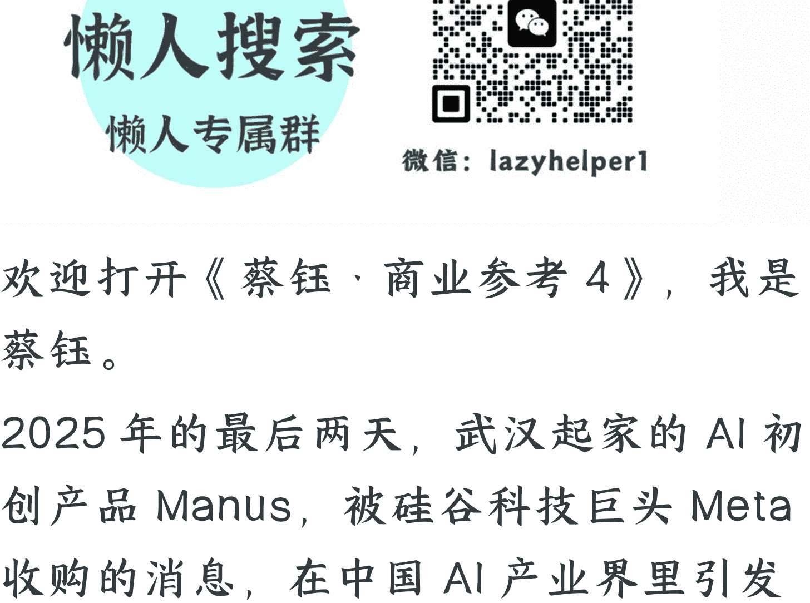
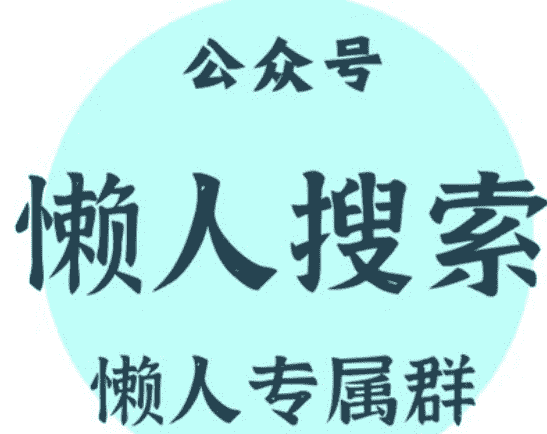

# 199 | Manus 收购案，为何让 AI 产业界轰动

260108

整理：公众号懒人搜索，懒人专属群精选
懒人微信：lazyhelper1



欢迎打开《蔡钰 · 商业参考 4》，我是蔡钰。

2025 年的最后两天，武汉起家的 AI 初创产品 Manus，被硅谷科技巨头 Meta 收购的消息，在中国 AI 产业界里引发了轰动。一时之间，不少创业者和投资人纷纷发言，祝贺 Manus 的“上岸”。

## 交易详情

这是怎样一笔交易呢？

Manus 这个产品，我们在 33 讲（《红杉资本：AI 进入赚工资的助理时代》）介绍过，它 2025 年 3 月才发布，号称是“全球第一个通用 AI 助理”，只需要简单的指令，就能帮你搭建网站、设计产品、做复杂研究。这个产品刚发布不到两个月，就被美国顶级 VC Benchmark 看中，拿到了 Benchmark 的 7500 万美元投资，估值拉到了接近 5 亿美元。

### 这次引发轰动的收购案又是怎么回事呢？

- 首先，交易定价可能超过了20亿美元。按照各方媒体的统计，这成了Meta成立以来规模第三大的收购案。
- 其次，这次收购的谈判推进速度极快，Meta与Manus从初步接触到最终签协议，十来天就办完了。Meta CEO扎克伯格还说，自己是Manus的老用户。
- 第三，交易完成后，Manus的CEO肖弘将会出任Meta副总裁，负责领导Meta在通用AI智能体方向的全球业务。Manus的100人的团队整体打包加入Meta。

十几天，超过20亿美元，你看看这个速度与价格。这是引发产业界轰动的关键所在。

其他创业者和投资人在祝贺Manus时纷纷用了“上岸”这个词，言下之意有三层。

### 一层是常规意义上的羡慕。

Manus的母公司“蝴蝶效应”2022年才成立，仅仅3年，就成功把公司卖给了硅谷巨头。创始人团队的快速财富自由就不说了，它的投资人回报也相当可观：真格基金全程参与了4轮融资，预计回报在10倍以上。4月才进场的Benchmark更夸张，8个月就赚了4、5倍。

这在当下的 AI 创业环境里，唤起的是 AI 同行们对“退休资格”的羡慕。

### 第二层则有点特殊。

你知道，2025 年以来，华尔街和硅谷对“AI 泡沫”的担心都越来越重。在泡沫破裂前能够变现离场，这唤起的是同行们对“逃顶能力”的羡慕。

### 第三层，是感激。

因为 Manus 的这笔收购交易，为其他 AI 创业公司稳住了估值基准。2025 年 12 月，Manus 的年度经常性收入 ARR 突破了 1 亿美元，按照 20-30 亿美元的收购价格来估算，对应的估值倍数在 16-24 倍 ARR，这给了其他 AI 创业公司一个乐观的融资锚点。

## 泡沫预破灭期

但你品出来了吗？这些羡慕和感激背后，更深层的情绪是焦虑。2025 年，整个 AI 行业都在担心一件事：泡沫会不会破，什么时候破？

2025 年，AI 成了美股和美国经济的核心命题，政府出巨资砸 AI 基建，美股 7 姐妹的总市值超过了 20 万亿美元。2025 年的未上市 AI 公司里，OpenAI 一家就融了 400 亿美元。它估值已经达到了 5000 亿美元，但年亏损 50 亿美元。

这也就罢了，硅谷一些 AI 创业公司，比如 OpenAI 前首席科学家伊利亚创建的公司、OpenAI 前 CTO 米拉创建的公司，还没有推出任何产品呢，就分别拿到了上百亿美元的估值和 10 亿、20 亿美元巨额融资。这种盲目，甚至还被合理化了，被硅谷称为“人才定价权”和“愿景溢价”。

但另一方面，麻省理工学院的研究显示，95%的企业 AI 项目投资回报率为零。AI 公司们的收入迟迟无法闭环、能源配套也跟不上、中国这边又不断推出便宜开源的模型竞品，这都加剧了全球对美国 AI 泡沫的担忧。

美国 AI 泡沫一旦破灭，就会牵一发动全身，打击到全球所有 AI 产业的市场、估值和融资。

## 抢时间过冬

所以，我们要把视线拉开一点，你会发现 2025 年底、2026 年初的中国 AI 产业界，也有几个动作，跟 Manus 的出售是呼应的。

- 首先，中国的“大模型六小虎”当中的创业公司智谱 AI，在 2025 年 12 月 30 日启动了全球招股，计划 10 天后的 2026 年 1 月 8 日就在港交所挂牌上市，当上“全球大模型第一股”。预计它按照 511 亿港元的市值，募资大概 43 亿港元。
- 其次，在智谱身后，“六小虎”当中的另一家——MiniMax，也在 2025 年 12 月 31 日发出了招股书，也要在 10 天后的2026年1月9日在港交所上市。
- 再来，“六小虎”当中的第三家，创业公司月之暗面，也就是Kimi的母公司，虽然没有跟着发招股书，但创始人杨植麟也在2025年最后一天发了一封内部信，宣布说：

> “公司近期完成了5亿美元C轮融资且大幅超募，当前现金持有量超过100亿元。相比于二级市场，我们判断还可以从一级市场募集更大量资金，事实上，我们B/C轮融资金额就超过绝大部分IPO募资及上市公司的定向增发。所以我们短期不着急上市。当然未来我们计划将上市作为手段来加速AGI，择时而动，主动权掌握在我们手中。”

怎么理解这三家公司着急上市与晒账本的行为？

你看啊，有人在二级市场融资筹备过冬，有人在一级市场融资筹备过冬。大家对“过冬”的预期都在增强，都在跟AI泡沫破灭的预期抢时间，给自己囤粮，也给市场和投资人吃定心丸。

这我们就能理解了，为什么Manus被收购的消息一出，中国AI圈会发出相当整齐的“恭喜上岸”的赞叹。

## Meta的焦虑

那话说回来，Manus 代表了 AI 行业的“逃顶焦虑”，收购者 Meta 为什么要往泡沫里冲呢？

Meta，其实也很焦虑。但它的角色和体量决定了它没法逃顶，而是要靠填充泡沫，来扭转自己掉队的命运。

对 Meta 来说，收购 Manus 根本算不上大手笔。它整个 2025 年都在 AI 战场上疯狂试错。

Meta 先是在 2025 年 4 月，发布了自家大模型 Llama 4，但市场反应不达预期。这之后，它就开始另找出路了。

它干了些什么呢？我给你讲几个标志性的动作：

- 2025 年 6 月，它斥资 140-148 亿美元，收购了一家名叫 Scale AI 的公司 49% 的股权。
- 这家公司干嘛的呢？做数据标注与 AI 训练服务的。创始人名叫 Alexandr Wang，是个 28 岁的年轻华裔。Meta 给他砸了钱，让他加入 Meta，当上了 Meta 的首席人工智能官。
- 所以这笔交易，你可以说，Meta 是在补自己的数据短板，也可以说，是在买顶尖人才团队。
- 到了 2025 年 7 月，Meta 接着砸巨资挖人。先是用超过 2 亿美元的薪酬总包，挖走了苹果公司基础模型团队的负责人；再用 3 亿美元的薪酬包，从 OpenAI 挖走了两位顶级研究员。请注意，这三位 AI 人才中的两位都是华裔。
- 这之外，Meta 还在硅谷到处开高价抢人，用明显高出 OpenAI、Google 的薪酬包，来网罗 AI 工程师们，打造自己的超级智能实验室。
- 再来，到了 2025 年 11 月、12 月，有消息说，Meta 的新模型 Avocado，采取闭源策略，未来要替代 Llama 成为 Meta 的核心 AI 模型了。
- Avocado 不但转向闭源，训练过程中还 “蒸馏” 了多个第三方模型，把谷歌的 Gemma、OpenAI 的 GPT-o1 和阿里巴巴的 Qwen 通通借鉴了一遍。这在 2025 年底的硅谷和全球 AI 圈引发了巨大的震动和争议。但即便如此，扎克伯格还是保持了沉默，照用不误。

所以啊，补数据、抢人才、转闭源、抄模型，为了不掉队，Meta 已经有点不择手段了。相比之下，12 月底掏几十亿美元收购中国创业团队 Manus，简直就是小意思。

Manus 对 Meta 有什么作用呢？

### 业界有一种共识是，Meta 看上的是 Manus 团队让 AI 干活的能力。

Manus 从推出到现在，一直被质疑的是 “套壳”，而不是硬核模型能力。但 “套壳” 恰恰是它的核心能力所在。这种模型微调能力，也就是把GPT、Claude、Qwen等主流模型，调教成AI助手的能力。这听起来不够“硬核”，但却能帮着Meta把Facebook、WhatsApp、Instagram等软件的大几十亿用户服务好，避免他们在需要用到AI时，离开Meta的社区。

这种执行层的能力，加上Meta的社交数据，也许能帮Meta跳过模型层的被动，进入“最后一公里”的AI服务竞争。

Manus团队自身技术不强，也能在AI应用市场里站稳，这种能力如果可以复用，当然也就缓解了Meta的掉队焦虑。

## 小结

好，我们聊了Manus被收购引发轰动的原因。这桩商业收购，实际上反映了整个AI行业的深层焦虑：创投界担心泡沫破裂，着急上岸；巨头公司担心掉队，疯狂补血。

扎克伯格一直挺激进的。他戴着口罩在天安门跑步时，没有想过这不足以让Facebook进入中国；把Facebook改名“元宇宙”时，也没有想到元宇宙会凉。这次收购，对Manus团队来说，无论如何都很划算，但会给Meta带来多大变化？不知道你有什么看法。

而我们还有一个问题没有解决：为什么 Manus 不卖给中国公司、不在中国上市，而是选择了 Meta？

这背后，涉及到一个更复杂的话题——中美科技竞争下，中国 AI 公司的生存策略。

下一讲我们继续。

最后，安利小懒的付费群：

懒人专属群（介绍）




🎒 这里是你对抗信息过载的护城河。

已稳定运行 6 年，累计拆解、研读 3000+ 个互联网商业实战案例与行业前沿内参和时政/宏观文章。

我们不搬运垃圾，只做高价值信息的筛选器与放大镜。

懒人专属群更新记录：
```
https://hk57gvix7u.feishu.cn/docx/H0kRdZbSbolBR0xkaXtcuVE0nTg
```

【免责声明】 本资料归档于社群内部知识库，仅供成员课题研究与学术交流，请在查阅后 24 小时内删除。