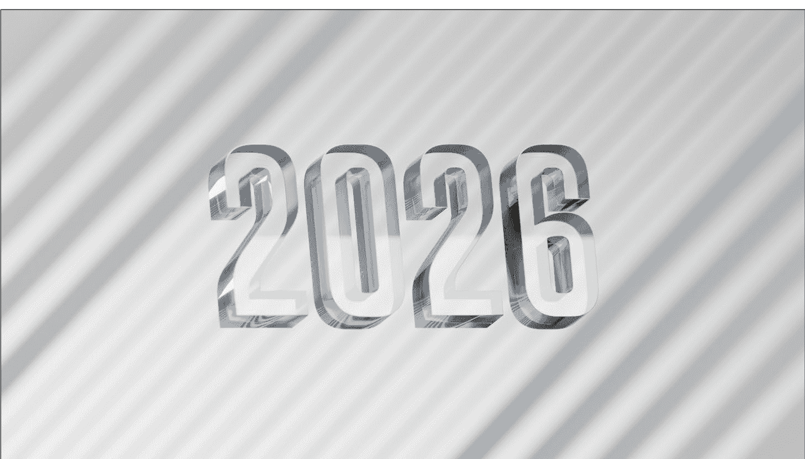

# 预测 2026 (下)

## 260108 新闻实验室

整理：公众号懒人搜索，懒人专属群精选
懒人微信：lazyhelperl

在一个人们不再知道该相信什么的时代，新闻业最大的服务就是提供清晰的声音。

本期会员通讯，延续上期的主题，为大家介绍尼曼实验室“预测2026年新闻业”专题的重点内容。

### 政治风暴与新闻业的战斗姿态

2025年对于美国来说，显然是新闻自由大幅度倒退的一年。此前的多期通讯介绍的事件都已经说明了这一点。2026年，情况恐怕只会更糟。

面对持续极化的政治环境和对新闻自由的威胁，不少预测者呼吁美国新闻业放弃传统的“客观性”姿态，采取更具战斗性的立场——“若一方明显在说谎，我们绝不会假装双方平等。”

蒙特克莱尔州立大学副教授 Carrie Brown 呼吁记者们在 2026 年团结起来，展开反击。在她看来，面对催泪瓦斯、逮捕和法律威胁，美国的记者们温和地坚持“我们一贯的做法”已经行不通了。她建议成立某种形式的新闻自由联盟，不仅是防御，更要主动在法庭上和舆论场中捍卫新闻权。WTVF-NewsChannel 5 的首席调查记者 Phil Williams 也持相同观点。他认为，面对那些旨在非人化记者和取消新闻合法性的攻击，传统的新闻本能所划定的界限已经失效。2026 年可能是新闻业利用反诽谤法进行反击的一年——就像 Dominion 投票系统公司起诉福克斯新闻（详见会员通讯 669 期）那样，新闻机构也应该起诉那些恶意造谣的极端分子。

### DEI 的挽歌与身份政治的寒蝉效应

在对 2026 年的预测中，弥漫着一种关于多元化（DEI，diversity equity inclusion）承诺破灭的悲观情绪。如果说 2020 年是种族觉醒的一年，那么 2026 年被视为这种觉醒彻底消退的一年。

HuffPost 前主编 Danielle C. Belton 用“DEI 死于黑暗”来形容这一趋势。她敏锐地指出，随着媒体预算的紧缩，首当其冲被裁撤的往往是黑人女性领导者。她列举了 Rashida Jones 离开 MSNBC、Nekesa Mumbi Moody 离开《好莱坞报道》等案例，指出这不仅是个人职业生涯的挫折，更是一种系统性的清洗。Belton 认为，许多新闻编辑室对多样性的承诺充其量只是“伤口上的创可贴”，一旦政治风向转变或经济压力增大，这些仅仅为了“不被公众罚款”而存在的举措就会被迅速抛弃。

这种倒退不仅体现在人事上，更体现在报道内容上。Axios Local 的 Delano Massey 将这种现象诊断为新闻业的“慢性复发病”：每当国家的种族、历史或结构性真相浮出水面时，新闻媒体就会本能地撤退。他预言，2026 年新闻机构将不再假装自己已经改变，而是会恢复那种已有 200 年历史的习惯——放弃讲述这个国家的基础性故事，转而将种族问题视为偶尔的危机而非制度的根源。

对于跨性别群体而言，这种环境更为恶劣。The Objective 的联合总监 Tames Salanga 严厉批评了主流媒体（如《纽约时报》、《大西洋月刊》）将跨性别者的生存权视为“政治辩论”的做法。他指出，虽然反跨性别的立法和行政命令正在升级，但资源丰富的新闻机构却在报道中系统地排除了跨性别者的声音，甚至让顺性别者来充当跨性别议题的专家。他呼吁顺性别记者在 2026 年停止将跨性别者的存在本身作为辩论议题，而是去报道政策对具体生命的残酷影响。

### 心理防线：从职业创伤到“错过的快乐”

新闻业的危机不仅是财务和政治的，更是心理和情感的。La Converse 的创始人 Lela Savic 分享了一个令人心碎的细节：在一次于加拿大举行的关于“新闻业的未来”的会议上，几位备受尊敬的独立新闻媒体领导者笑着承认，他们幻想的工作其实是在渡轮上、花园里，或者在一家面包店工作。

这并非玩笑，而是揭示了独立媒体的领导者们在缺乏基础设施支持的情况下承担了过重的情感和运营负担。Savic 警告说，如果不解决这种结构性的脆弱，行业将面临严重的人才流失，因为那些最植根于社区的领导者正在悄然离场。

在新闻的世界里，受创伤的不仅仅是生产者，也是消费者。其实，受众的心理状态已经在发生微妙变化。西北大学梅迪尔新闻学院教授 Stephanie Edgerly 提到了一个新概念：TOMO（Toy of Missing Out，错过的快乐，相对于“FOMO-错过的恐惧”而言）。研究发现，人们回避新闻不仅仅是因为新闻让人焦虑，更是因为“不看新闻”能带来实实在在的积极情绪和自我关怀感。这意味着新闻机构面临的对手不再仅仅是冷漠，而是一种积极的、为了心理健康而做出的“断连”选择。

面对这种普遍的创伤，The Self-Investigation 的运营总监 Paula Montaña 建议，全球北方（Global North）的媒体应该向全球南方（Global South）学习应对危机的技能。她列举了缅甸和泰国的灵活休假政策、尼日利亚的同伴支持网络、以及秘鲁摄影记者的集体疗愈空间。

2026 年，媒体的领导人必须在创伤这个话题方面接受培训，这将不再是可有可无的福利，而是生存的必需品。

### 流亡与在地：全球视角的重构

过去几年，由于战乱、威权等因素，不少记者流亡他国。

对于流亡记者来说，2026 年将是决定性的一年。阿富汗研究与媒体研究所的创始人 Faisal Karimi 以亲身经历指出，流亡并不是危机的结束，只是危机的转移。从阿富汗撤离四年后，他发现流亡媒体面临着从人身安全威胁向制度性、经济和法律不确定性的转变。他警告说，如果资助者继续将流亡新闻视为“临时项目”而非全球新闻自由的永久组成部分，许多重要的独立声音将在 2026 年悄然消失。

elTOQUE 的主编 Tosé T. Nieves 进一步指出，流亡媒体必须在 2026 年彻底摆脱“捐赠款依赖症”。随着美国国际开发署（USAID）资金的冻结和欧洲各国预算的削减，依靠国际援助生存的日子已经屈指可数。流亡媒体必须转向多元化的商业模式，例如向离散社区提供付费产品、开发技术工具（如 VPN）或举办活动。这被视为一种“信息汇款”（information remittances），即身处安全地带的离散群体通过付费来支持家乡的真相传播。

### 基础设施建设：从“预新闻”到公共档案

在另一个维度上，西方世界的故事和全球南方的视角必须结合起来，而科技和政治这两个看起来并不相近的领域也必须结合起来。《Wired》西班牙文版的编辑内容负责人 Mael Vallejo 提醒我们，如果不报道科技巨头，就不存在所谓的政治新闻。特别是在拉丁美洲，科技公司对民主、环境和经济的影响已经超过了许多政治领导人。从阿根廷的加密货币丑闻到数据中心加剧的水资源短缺，科技报道必须成为全球南方媒体的核心任务，因为当地政府往往对此视而不见。

除了内容生产，新闻业的基础设施也在经历深刻变革。AppliedXL 的联合创始人 Francesco Marconi 预测，“预新闻系统”（Pre-news systems）将成为主流。新闻室将利用 AI 工具监控监管机构的数据库、临床试验注册表、大规模裁员通知等，捕捉那些在新闻稿发布之前就已经存在的微弱信号。这种能力将改变新闻的生产流程，从被动反应转变为主动预测。

马里兰大学的讲师 Derek Willis 则看到了地方新闻档案的巨大价值。他认为，本地新闻机构积累的数十年档案不仅是历史记录，更是训练 AI 模型和回答社区问题的关键数据源。与其让科技公司免费抓取，不如将其视为一种高价值的资产进行出售或授权。

更进一步，PRX 的 CEO Kerri Hoffman 呼吁公共媒体建立共享的数字基础设施。面对联邦资金的削减，单一的地方电台无力独自承担现代化的技术堆栈。她提议建立“公共媒体基础设施”（Public Media Infrastructure），像公用事业一样为所有电台提供托管、广告技术和数据分析服务，从而让电台能专注于内容和社区服务。

总体来看，2026 年的新闻业预测照旧充满张力。一方面是技术带来的无限可能（Vibe Coding、AI Agents），另一方面是技术造成的混乱（Slop、Deepfakes）；一方面是宏大叙事的消亡，另一方面是微小、具体、基于社区的行动（Events、Mutual Aid）的兴起。

最后选一则预测结束本期吧——正如 National Press Foundation 的主席 Anne Godlasky 所言，2026 年是对“清晰度”（Clarity）的呼唤。在一个人们不再知道该相信什么的时代，新闻业最大的服务就是提供清晰的声音：调低戏剧性的音量，直白地说明已知和未知，用人性化的署名和透明的流程来对抗算法的冷漠。这不仅是生存策略，更是新闻业在混乱世界中重建信任的唯一途径。

最后，安利小懒的付费群：

懒人专属群（介绍）

📖 这里是你对抗信息过载的护城河。

已稳定运行 6 年，累计拆解、研读 3000+个互联网商业实战案例与行业前沿内参和时政/宏观文章。

我们不搬运垃圾，只做高价值信息的筛选器与放大镜。

https://hk57gvlx7u.feishu.cn/docx/HOkRdZbSbolBR0xkaXtcuVE0nTg

【免责声明】本资料归档于社群内部知识库，仅供成员课题研究与学术交流，请在查阅后 24 小时内删除。