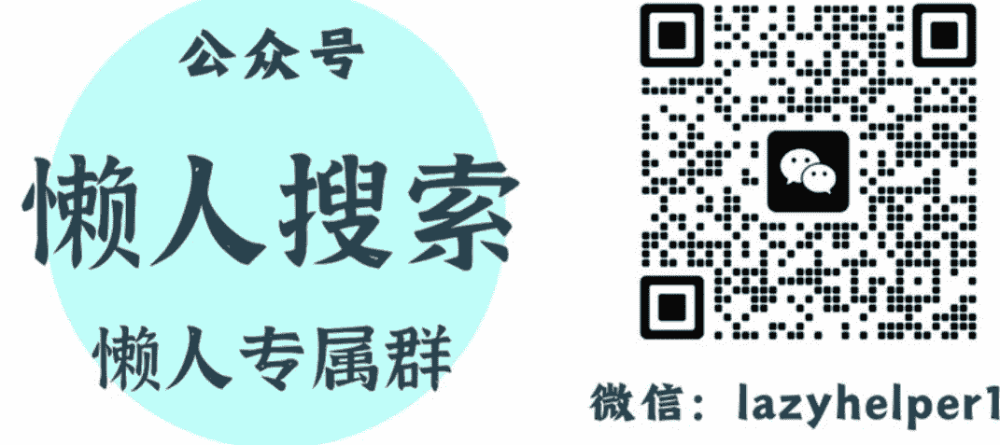
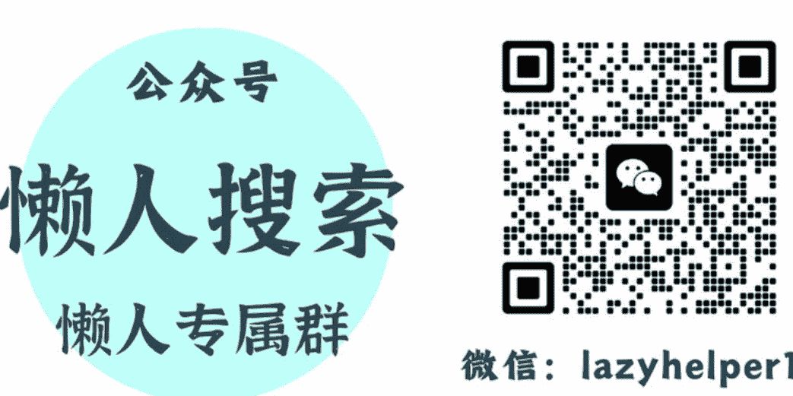

# 东大：耐人寻味的态度

260108 猫哥

整理：公众号懒人搜索，懒人专属群精选

懒人微信：lazyhelperl

委内瑞拉事件引发轩然大波，但是真正对这个事能发挥影响力的只有一个国家，这个国家就是东大，但是东大的态度却非常值得品味。

首先引用一下1月6日东大外交部的官方表态：

> 美方无视委内瑞拉总统马杜罗的国家元首身份，公然在国内法院起诉并进行所谓“审判”，严重侵犯委内瑞拉的国家主权，严重破坏国际关系的稳定。任何国家都不能将本国的规则凌驾于国际法之上。中方呼吁美方立即释放马杜罗总统和夫人，并确保他们的人身安全。

这个表态可以拆解为两个部分。

第一部分是对事件的定性，这个东大非常明确的态度就是，美国你做得不对！

这表态是必须有的，因为东大过去一直强调，我们属于发展中国家，会永远为发展中国家说话。

所以对于委内瑞拉事件，东大的态度就是要站在发展中国家立场表态——老美你做错了！这点毫不含糊。

真正耐人寻味的第二点，关于释放马杜罗总统和夫人的问题，这是委内瑞拉事件最核心的问题，对此东大选择使用的外交辞令是“呼吁”。

“呼吁”在外交辞令中属于最柔和的表述，属于劝诱型表态，只表示期待，没有任何强制性意味。

相比“呼吁”，外交辞令中更强烈的表述有一大堆，按照强度递增分别如下：

- 呼吁/期待：最柔和的表述，属于劝诱型表态，只表示期待，没有任何强制性意味。
- 敦促/强烈要求——促请/要求——立即纠正/立即撤回，不能无动于衷/不能置之不理：暗示如对方无回应，我方将采取行动。
- 表示严重关切/深表震惊：预示下一步可能出台制裁或报复措施。
- 谴责/强烈谴责：公开定性对方行为不可接受。
- 坚决反对/严正抗议：已接近“最后通牒”前的最高口头警告。
- 保留采取进一步措施的权利/将采取相应措施：实质上是“准军事或准制裁”预告。
- 最后通牒：设定时限，逾期即视为和平手段穷尽，是最强烈的非战措辞。

对比一下，老美对台军售，东大的外交辞令基本都是——强烈谴责、坚决反对，保留采取进一步措施的权利等等，基本仅次于最后通牒。

当然，委内瑞拉与东大远隔万里，就算是天都塌了，与东大关系也不大，除非东大有巨大利益受到损害，东大是不大可能态度上升到对台军售这个级别。

但是如果要与东大对老美这个事的定性，正常情况怎么也得来一个“敦促”或者“要求”——多少带一定强制性表述，如果是与我们关系特别好的国家，来一个“严重关切”也很正常。

但是东大的态度偏偏选择的是一个没有任何强制性最柔和的“呼吁”。

为什么？

首先应该明确的是，东大与委内瑞拉关系应该是还不错的。

2023 年，双方宣布建立“全天候战略伙伴关系”，是拉美首批获得这个定位国家之一。然后在联合国安理会层面，东大多次与俄罗斯共同否决对委内瑞拉的各种制裁提案。

虽然政治层面关系不错，但是经济层面则有些问题。东大在委内瑞拉有投资，主要集中在能源与基础设施层面，但是委内瑞拉经济太拉胯，高通胀叠加货币贬值，所以委内瑞拉对于东大的投资无法直接用货币偿还，只能用石油与基础设施经营权来还债，这就导致东大在委内瑞拉的项目执行过程中面临现金流压力。

这是东大与委内瑞拉的基本面。

现在委内瑞拉一夜变天，东大在关键问题上却选择用最柔和的“呼吁”，我觉得大概率是以下两个原因。

其 1，老美对东大在委利益做了保证，这是基础。

其 2，考虑到目前东大与老美关系还算缓和，特别是东大在实质性敲打高市早苗以及台岛势力，在这个过程中老美态度都比较暧昧，我觉得有很大概率双方形成一种默契——亚洲事务东大出手，老美不管，美洲事务老美出手，东大也不管。

比如 1 月 6 号，我们商务部官宣，加强两用物项对日本出口管制：禁止所有两用物项对日本军事用户、军事用途，以及一切有助于提升日本军事实力的其他最终用户用途出口。任何国家和地区的组织和个人违反上述规定，将原产于中华人民共和国的相关两用物项转移或提供给日本的组织和个人，将依法追究法律责任。

这个动作很大，如果高市不反制，大概率会成短命首相，如果反制，就是硬碰硬，但没得老美在后面支持，如果也来个“呼吁”、或者烈度比较低的态度，那日本够呛。

所以对日本上强度，和委内瑞拉局势息息相关，我们得品出里面门道。

我们面临百年未见的大变局，G2的世界格局正在逐步形成。

---

最后，安利小懒的付费群：

懒人专属群（介绍）

这里是你对抗信息过载的护城河。

已稳定运行 6 年，累计拆解、研读 3000+个互联网商业实战案例与行业前沿内参和时政/宏观文章。

我们不搬运垃圾，只做高价值信息的筛选器与放大镜。

懒人专属群更新记录：

https://hk57gvIx7u.feishu.cn/docx/H0kRdZbSbolBR0xkaXtcuVEOnTg

【免责声明】本资料归档于社群内部知识库，仅供成员课题研究与学术交流，请在查阅后 24 小时内删除。