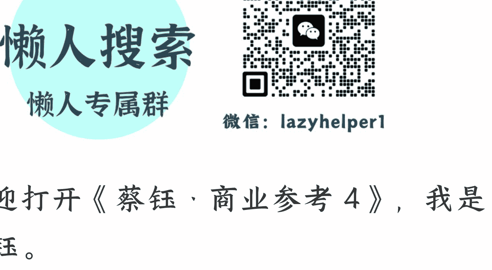
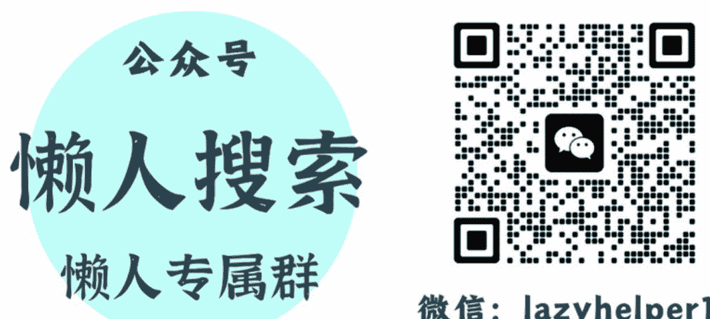

# 201 | 小米、大熊和米粉的“统战”三国杀

260109

整理：公众号懒人搜索，懒人专属群精选

懒人微信：lazyhelper1

欢迎打开《蔡钰·商业参考4》，我是蔡钰。

2026 年开年，粉丝经济的头部玩家小米公司，遇到了一场粉丝危机。

这场危机的起因，是市场传出消息，小米打算跟数码博主“@万能的大熊”签署年度框架合作协议。这种合作简称“年框”，简单来说就是给大 V 博主们进行为期一年的商业投放，借用对方的网络影响力来做营销传播。

万能的大熊，是科技圈的资深自媒体人，在微博上拥有超过 257 万的粉丝，也是不少科技公司的座上宾。从流量影响力来看，小米找他做投放无可厚非。

但消息一传出，米粉们炸锅了。

米粉大 V“@午后狂睡”当天就宣布，停止跟小米的合作以示抗议；另一位忠实米粉则威胁要卖掉自己收藏的 200 多台小米设备，“从此转黑”。

这之外，大量米粉涌入雷军等小米高管的评论区，提出质问和抗议。有机构统计说，三天内在微博的 4000 多条相关讨论中，对合作表达不满的声音占到了 60%。

一个营销投放而已，有什么好反对的？

最大的原因是，万能的大熊在米粉人群看来，是典型的“米黑”。他在过往发表过不少针对小米品牌及用户的争议性言论。最著名的两句话是“小米不会死，死的是米粉”和“米粉是负资产”。

舆情爆发后，小米公关部总经理徐洁云很快在微博上道歉，承认跟大熊有过接触，但表明立即叫停了合作，并强调说“用户、米粉朋友们的感受，的确是我们最在乎的事情”。

一天后，小米公司再次发声，宣布辞退涉事经办人员，通报批评集团 CMO 许斐、公关部总经理徐洁云，并取消两人的 2025 年年奖金。在这个声明里，小米再次对米粉们道歉，并且强调，“因为米粉，所以小米”。

从舆情爆发到给出处理结果，小米只用了不到 48 小时：快速认错，严厉追责，平息众怒。

表面上看，这是一次公关危机的教科书式处理，但它更是一场能帮我们复盘商业参考认知框架的典型案例。

这一讲，我想借这个案例，跟你讨论几个深层次的问题。

## 阵营重构

第一个问题，为什么米粉会对小米与大熊的合作，反弹如此剧烈？

因为在这件事里，米粉跟小米对共同体的认知出现了错配。小米认为的小米，就是自己，是公司；而米粉认为的小米，是“公司+米粉”，自己也是小米的一部分。

这还真不能说是米粉们的幻觉。小米多年来做粉丝经济，高喊“因为米粉，所以小米”，完全是刻意建构了核心用户共同体。米粉们在这个共同体里，不光是消费者，还是产品的测试员、品牌的宣传员，甚至是网络论战中的“自来水军”。

我们在前面专栏里讲过，“我们”这种结构的存在，既要考虑“我和你”，又要考虑“我们和他们”。

“我和你”指的是，你选择跟谁成为“我们”；“我们和他们”指的是，如何界定共同体的边界和外部关系。

站在小米的视角，米粉是一种已经到手的“我们”资源，大熊是另一种可以转化为“我们”的资源，把朋友搞得多多的，这是统战，是消减大市场上的负面声量，是公关团队的工作业绩。

但米粉接收到的信号是：小米去团结伤害过米粉的外人，是拿米粉的情感资本，去换自己的商业利益。小米与大熊建构了新的“我们”，米粉则成了可以被忽视和伤害的“他们”。在这个瞬间，阵营被重新划分了。这是米粉人群剧烈反弹的关键原因。

## 出名是代价

第二个问题，我要跟你讨论一下，“出名”究竟意味着什么？

在传统认知里，出名，代表的是名利双收，既收获名声，又收获利益。但在流量社会里，出名，其实是把自己的名字交出去，变成一个不再受自己控制的公共意义符号。

那它受谁控制呢？受你动员起来的那个共同体的控制。

在小米共同体看来，“小米”这个名字承载的信念，不再是管理层、董事会、公司的信念，而是共同体的信念。“雷军”这个名字，代表的也不再是雷军个人，而是共同体所相信的那个“大哥”剧本。

小米被《人民日报》报道、雷军上新闻联播，从小米公司的角度，可能是为了突破圈层而做的努力；但在米粉看来，是“大哥在替我们赢”。但给“敌营”送钱，米粉没法把它解释成“大哥在替我们赢”。

前段时间，我听“斩杀线”的首创者“牢A”聊美国网红们为什么会越来越激进，也说到一句话：“当千万亿万人的意愿加之于你的时候，你就不是你了。你变成了集体意志的映射。”你看，底层逻辑一样的。

从这个角度，我们还可以理解历史上，各种权力争夺的名场面里，总要出现“奉天承运”“大楚兴，陈胜王”这一套操作。

帝王已经是权倾天下的人物，为什么还要自称天子，要强调自己做事是受命于天？

原因是，在古代，帝王与教主，已经是那个最大的“超级IP”。他面临着和今天的流量大V们一样的处境：一旦你成了公共符号，你就不再是自己，而是要承载公共情绪和意志。

所以，把名字、把自己交出去之前，先给自己赋予一个更宏大、厚重和正确的意义，有助于对冲社会当中的民意和其他意志的裹挟。

“大楚兴，陈胜王”也是类似的原理。

陈胜吴广起义时，怎么说服大家跟着他们两个小兵造反？他们创造了一个更大的正确：在鱼肚子里藏帛书，让人在夜里学狐狸叫，用“自然之声”喊出“大楚兴，陈胜王”。这也是在抢先定义天命，抢占对“大义”的解释权，来对抗可能的质疑和裹挟。

回到小米。

小米的那句“因为米粉，所以小米”，可以说是共同体的大义和天命。这个“天命”是小米最大的资产，也是它最大的枷锁。它的危险之处在于，把“天命”的解释权留给了米粉。在“因为米粉，所以小米”这个大义之下，小米必须接受，米粉有权否决它的战略自由。

所以，这次米粉们的愤怒，也可以看作一种“护教”行为。他们要求小米回归共同体“本分”，继续展现对共同体信念的忠诚和狂热。

所以啊，出名是代价。借着小米这次的案例，在流量时代，这个视角我特别想请你重视。

对企业、品牌和个人，当然都可以出名，但不要因为出名很难，就把出名当作目的本身。你需要想清楚，出名能换来什么、多大的出名程度是你愿意承受的。

## 更大的正确

第三个值得讨论的问题，叫“更大的正确”。

从事情的进展看，小米选择了回应粉丝关切。它快速道歉，听从了米粉们的要求，提起“米粉朋友们的感受”时，说的不只是尊重，而是“我们最在乎的事情”。

小米通过开除员工、惩罚高管，重新证明了自己对“因为米粉，所以小米”这个信念的忠诚。

这是一种最安全、最能快速止损的策略。它安抚了核心盘，维护了“部落”的纯洁性。

短期来看，这个选择是有效的。米粉的愤怒被平息，共同体内的情感纽带重新被确认。但某种意义上，这代表着小米在粉丝品牌和大众品牌的战略之间，选择了前者。

小米还有别的选择吗？

我想跟你探讨另一种思路：去定义“更大的正确”。

什么意思？

“外部统战”的动作仍然可以继续，但同时要向米粉证明，“化敌为友”对整个共同体的好处大于坏处。这个好处，还不光是小米公司的，米粉们也能从中获益。或者，在“化敌为友”的同时增加一些附加动作，来让米粉们感知到收益，也行。

前面我们说，米粉认为，类似的结盟是“你用我的情感资本，去换取你的商业利益”。而如果米粉们得到的回报，无论是在情感上还是利益上，能够盖过自己的情感支出，这对小米共同体这个系统来说，就是“更大的正确”。

这能帮助一个粉丝品牌，在损伤尽可能小的前提下，完成从“粉丝托举”到“产品立身”的过渡，向大众品牌转型。

不过，这又是一个更难的课题了。

## 总结

好，我们借着这次的小米粉丝反噬事件，回顾了《商业参考》此前跟你讨论过的几个认知框架：阵营消费、共同体结构、全局正确，以及一句私房话：出名是代价。

小米这次遇到的问题，在未来会是所有高粘性品牌、IP与网红们，都会反复遇到的问题。所以请教你：

如果你是小米，你会去“统战”大熊这样的对手型 KOL 吗？

如果统战和粉丝反弹都已经发生，你会怎么处理和应对？

你的思考能帮你理解当下的商业世界，也能帮你理解自己。

期待你的讨论。

再见。

## 最后，安利小懒的付费群:

懒人专属群（介绍）

微信: lazyhelper1

📚 这里是你对抗信息过载的护城河。
已稳定运行 6 年, 累计拆解、研读 3000+个互联网商业实战案例与行业前沿内参和时政/宏观文章。

我们不搬运垃圾, 只做高价值信息的筛选器与放大镜。

## 懒人专属群更新记录:

https://hk57gvIx7u.feishu.cn/docx/H0kRdZbSbolBR0xkaXtcuVEOnTg

【免责声明】 本资料归档于社群内部知识库, 仅供成员课题研究与学术交流, 请在查阅后 24 小时内删除。