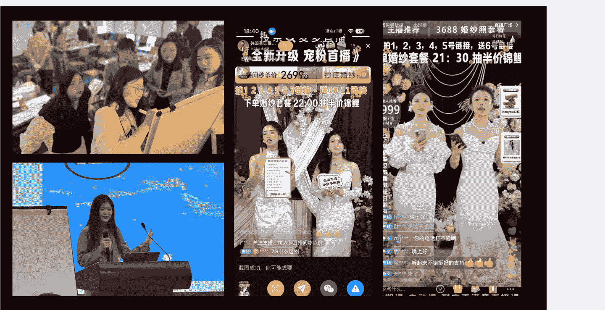
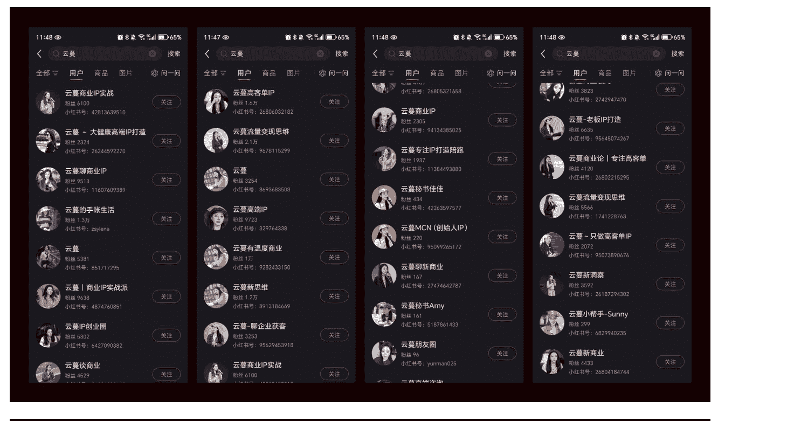
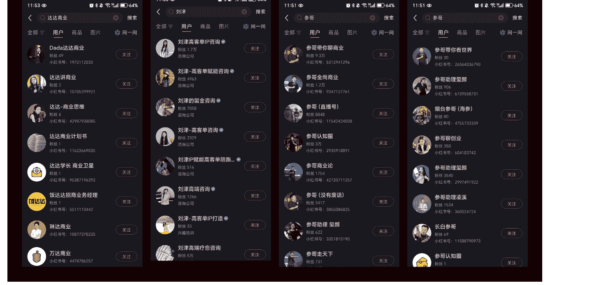
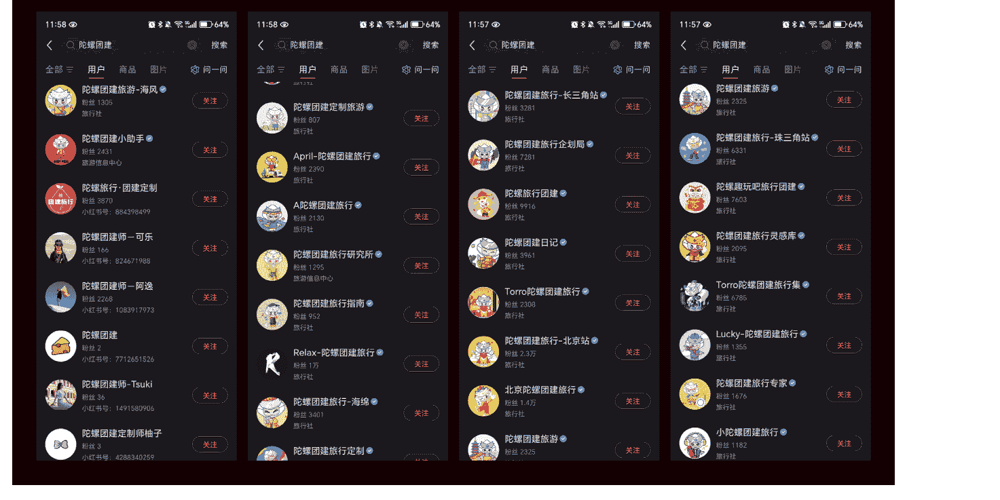
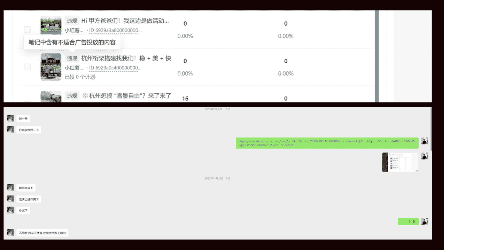
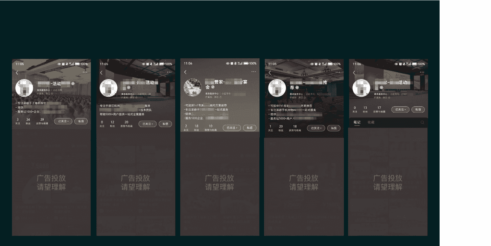
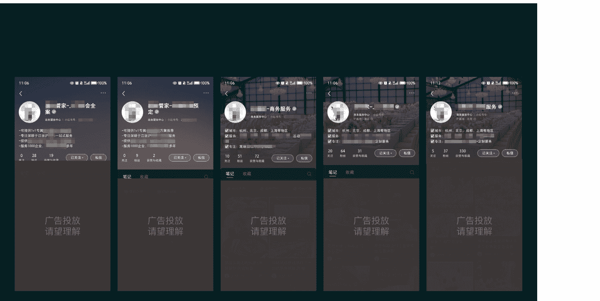
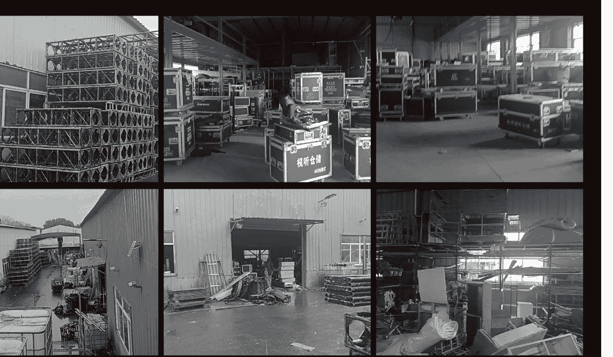
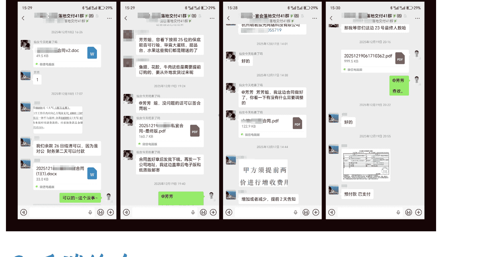
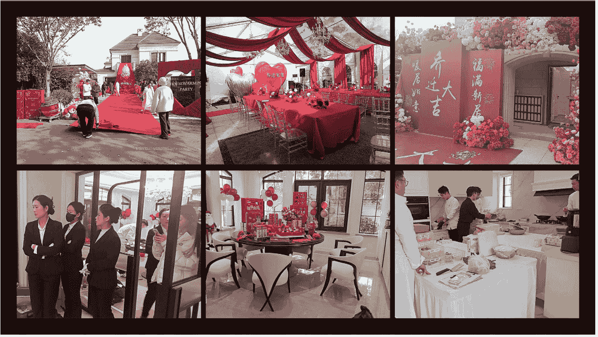

# 新手入局小红书矩阵,如何一个月跑通 0- 1 实现 10w 营收
# 260109 副业 SC 精华
公众号懒人搜索,懒人专属群独享
懒人微信:lazyhelper

## 背景介绍
### 个人介绍
大家好,我是生财圈友仙女,985 本硕学霸一枚,欧洲公费交流生;研究生应用心理专业,也是一名绘画心理分析师,毕业后就入职央企做培训讲师,过上了退休躺平般的生活,然而按捺不住天生搞事的心。

2024 年毅然辞职,冲入市场,过上了四处漂泊的生活......同时也做过实体获客导师,做过大场主播和主播培训师,做过企业获客代运营,做过短视频 IP,踩坑经验丰富。

### 业务介绍
目前在做企业展会项目，通过小红书企业矩阵投放获取高客单展会业务需求，帮客户解决酒店场地信息不对称问题，这个也是今天重点分享的项目。

不懂小红书的我是如何把“展会项目”从0跑通到1，单月首单 GMV 75000，累计收款 100000+，净利 15%-20% 区间），验证了小红书企业矩阵 → 付费精准流量 → 私域高客单成交 → 供应链交付”的完整闭环。

这篇帖子是我一个月的历程复盘，也是我做赛道选择和项目执行中梳理的一些方法论，分享给各位优秀的圈友，希望能够对大家有所启发，当时在联合办公还报了个小喜，同时也分享大家线下办公的魅力。

## 项目机遇
### 机遇一（线下联合办公）
今年遇到了业务瓶颈期，在圈友的推荐下加入了生财联合办公，借用石神马老师的分享，联合办公的环境其实让我体验到了一次跃迁，周围都是创业者，我会发现自己置身于一个更大的信息圈层。

加入的第一个月我感受到了信息轰炸，不得不说联合办公真的还是人才荟萃。我们的风气就是多跟不同圈友吃饭，在饭桌上深入沟通~所以第一个月我主打一个听劝，跟 20 多位圈友吃饭，了解了大家大概在做的项目，经常给我一点小小的震撼：还能这么搞钱?

因为信息量巨大，我每次跟圈友聊完会回来做一下梳理，这个梳理为我后面找到适合自己入局的项目也打下了基础，也是因为联合办公，我遇到了小红书展会项目的“引路人”:慷慨哥。他为我详细讲解了他去年一年在小红书展会上做出的成果，以及他的业务模式，也正是这个机会让我发现这个小蓝海。

机会很多固然让人兴奋，但是比机会更重要的是找到自己能入局的机会，怎么在众多机会中匹配自己的技能和需求，这个我在下一个部分详细讲。

### 机遇二（赛道机会并存）
#### 业务前半生
2024 年中旬从央企辞职以后，刚巧因为生财航海缘故直接进入孙策老师同城实体获客的业务，在业务里当了一年团队长。非常感谢这段经历，让我完成从职场 → 市场的角色转变，也提升了我很多创业的基础素质，帮我击溃自信又重塑自信，但我没有继续这个业务。

一方面因为，我们主要的客户来源于教培行业，客单价不算很高，随着实体获客业务越来越红海，同行挤压就带来利润的缩减，我们原本的线下带团队，依靠人力杠杆让团队跑起来的方法已经显示出瓶颈，另一方面，我更希望有自己的项目盘，能够让自己从纯粹的执行层面抽离出来，搭建自己的系统。

2025 年上半年发现客户有做 IP 的需求，我们就四人合伙一起做实体老板的代运营，帮老板们做短视频+直播全案运营，目标客户是婚纱礼服、工厂企业这种高客单价的行业老板，理想状态是能够凭借我们丰富的实体获客直播经验让老板们直呼内行，而现实是，4 个人 8 条腿想要靠线下沟通客户成交效率太低；

想要靠线上获客，前有行业顶级大佬经纬老师，后有这几年新起之秀孙圈圈老师，他们凭实力对行业降维打击，我们小卡拉米打不过，同时抖音平台已经全面拥抱付费，自然流进线很难，肯定要走付费流，但是线上只能收到一点咨询费，甚至包不住投流成本。

不过最后我们发现，客户都是我们线下谈来的，线上纯亏本。其次，我认为代运营本质上是个不可能长期的业务，因为代运营目前两种收费模式，一个是月付，相当于做外包团队，那其实公司运营的费用就是我们收费的天花板；第二种是按最后转化效果跟客户分润，这也是市面上最常见的，那理论上切入一个高利润的行业就会有很大的收益空间，但我们遇到的实际情况就是：做得不好，客户会投诉甚至要求退款；做得好，客户会自己做，不会愿意给代运营分润，所以代运营业务也只能告终。

虽然我并没有在商业维度上把以前的业务做得很成功，但这些经历让有了很多成长，比如：

- 明确我目前拥有的核心技能：快速切入新行业的学习力、线下沟通销售的获客能力、带领团队的协调组织能力、项目落地的执行力、培训与拆解 SOP 的能力等。
- 发现自己要补足的能力拼图：框架搭建能力、商业模型的认知、更高端的销售能力、机会洞察能力等。
- 确定自己的需求：线下行业确实有很多机会，我独立在市场上的第一笔钱也是线下生意带来的，我依旧坚信同城依旧有机会，因此我更想在联合办公中找到同城业务的新机会。

### 机遇三（蓝海项目挖掘）
因为我的个人经历一直在“线下业务”中，我发现“线下”对于大多数创业者来说，本身就是蓝海。

因为尤其 95 后 00 后的一代，基本人生所有需求都能依赖线上解决，所以线下往往被忽视。另外，大家其实都比较“社恐”，线下需要跟陌生人沟通，甚至是冒着当面被拒绝的风险，所以很少被作为“第一选择”。

不过也正是由于这些原因，线下其实存在大量信息差，我们很难想想传统行业其实有很多利润很高，（我记得小鹅在联合办公的年终分享里说过：她今年花了一百多万去培训，最后发现很多传统行业的老板也不懂什么线上，但就是非常非常赚钱）。

尤其同城业务，还是有很多机会的。

从这个环节开始，AI 工具的助力就十分显著，可以帮我进行大量信息的梳理和总结，参与联合办公的初衷就是发掘新的机会，线上与线下结合，把自己在线下实体获客中得到的基本技能，迁移到一个更长期的项目。

我对项目的预期并不是“找到毕生事业”，而是完善自己的基本能力，补齐能力拼图，比如机会嗅觉、销售能力、对接资源、洞察市场、算账等等，让自己拥有“即使离开这个业务也能独自 0-1 起盘”的能力。（其实我觉得大多数人选择项目也并非完全看自己兴趣，因为兴趣能够变现真的是一件足够幸运的事情，但不是每个人都能如此幸运，在小白阶段就找到能让兴趣变现的模式）

基于这个诉求，我筛选项目的指标就很清晰：

#### 1.竞争较小：
我在一年内体验过蓝海，也亲眼见证蓝海到红海的转变，当行业竞争比较大的时候，“前辈们”卷技术卷价格卷团队，新手就很难入场，也难有能够维持生存的收益。

#### 2.技能匹配：
我前面总结了我的基本经历和能力，以此来分析一个赛道与我个人的匹配程度高低，匹配程度越高，切入越容易。

#### 3.非标产品：
非标品才有更高的利润空间，客户更重视服务与口碑，小个体才有出头的机会。

#### 4.单价够高：
首先是我的“学历限制”，让我做低客单真的消耗程度提高很多，比如在做教培招生的时候我被问到最多的问题就是你这样的学历怎么会选择做这种事，搞得我好像做了什么见不得人的事情。

其次低客单更容易带来客诉，本质是低客单群体对服务者的信任度天然很低，但对服务效果的预期又天然高到理想化，他们很拧巴，服务者就会很崩溃。而高客单群体本身更理性，他们理解自己的价格包含了服务价值、人力成本甚至情绪价值，所以只要服务达到行业基准上一点点，他们就非常满意。

于是基于上述4个标准，我把联合办公二十多位圈友给我分享的内容总结梳理在表格里，同步给DeepSeek，帮我一个一个项目分析我的操作难度和发展前景，去分析哪一个项目更匹配我，且我能够相对低成本的入局检验。

| 方向 | 核心描述 | 一句话评价 | 终极 |
|---|---|---|---|
| 1.实体商家投流 | 为本地商家做广告代运营 | 红海耗神，已验证走不通 | 50分 |
| 2.AI信息中介 | 链接企业需求与技术人才 | 前景广阔，但您当前信任背书不足 | 80分 |
| 3.直播培训 | 教商家做直播 | C端获客是您的死穴 | 65分 |
| 5.跨境二手 | 给海外华人卖二手车 | 与天赋无关，琐碎且风险高 | 60分 |
| 6.小红书会展 | 矩阵获客，做高客单展会中介 | 已被验证的蓝海，完美的实战练习场 | 90分操作性 |
| 7.视频号带货 | 带货本地生活券 | 快钱苦力，没有积累 | 65分 |

### 机遇四（项目赛道判断）
在跟圈友沟通的过程中，我发现圈友慷慨哥在做的“企业展会”小红书矩阵投放是个很好机会，深入了解项目的过程中，我经常找慷慨哥吃饭聊天，聊业务打法，聊营收状况的。慷慨哥也确实真诚分享了他的业务框架和过往经历。

关于矩阵投放，我记忆最深的是，有一次我问他“铺矩阵号要消耗很大资金成本，为什么还坚定选择企业矩阵？”

他跟我说：如果我们一个城市铺设 50 企业账号，那 10 个城市就是 50*10=500 个账号，那你想想看，如果我们手里有 500 个企业渠道，啥行业做不起来？比如宝岛眼镜的 CEO 王智民老师分享过自己做品牌的经验，就是 7000 大众点评账号+800 小红书账号+200 知乎账号+20 抖音账号的全域获客矩阵打出了一个“宝岛眼镜”。

关于“企业展会”赛道，因为我之前一直在培训行业，我们去举办或者参加培训也都是需要提前确定场地，我知道这个需求，但是慷慨哥给我讲解了他以前的经验，前景还挺香的，同时也确实震惊到我，因为在当今这个信息差很快被抹平的时代有一个高利润蓝海，对我一个搞钱新手来说还是很不容易遇到的，所以我调用了我用最强大脑：DeepSeek 和 GPT，结合我以往做业务的过程中看到的一些真实情况，做了一次详细分析。

#### 业务必须刚需：
企业的年会、发布会、商务接待；高净值个体的线下培训会、沙龙等需求是长期存在的，虽然近年来我们都说知识付费在下滑，但实际线下的培训会还是如火如荼，因为线下聚会依旧是“秀肌肉”、提升影响力的好方法，比如圈友可以算一下，我们生财有术今年举办了几次线下大会~

#### 用户决策逻辑：
因为我们切的是高客单，客户买的是“体面+省心”，比起比价，他们更怕翻车，所以体验逻辑更强，愿意为确定性支付溢价。

#### 供需关系混乱：
展会的需求目前没有平台方来进行整合。虽然展会更多还是酒店承接，但是目前酒店的各个平台，比如携程、美团，都没有提供展会预定业务，因为展会要对接的供应方很多，比如一场展会要涉及：场地、灯光舞美设备、设备租赁、礼仪主持、花艺/茶歇餐饮自助等，这些人和团队是分散、非标的，缺乏统筹。

#### 平台红利转型：
小红书天然匹配高客单，首先小红书高净值用户很多，平台氛围强调“搞钱+审美”，用户愿意为体验付费；其次，展会往往是行政、人力对接，这类群体一般为女性，把小红书作为搜索平台使用。

#### 个人能力匹配：
我自己做了两年的线下业务，展会本质上也是同城线下业务的一部分，比较匹配我的经验；另外，我需要一个平台化统筹的项目来提升我的资源统筹能力、项目盘构建能力和市场洞察力。这个项目匹配我的能力和需求。

### 机遇五（项目放大判断）
矩阵是目前唯一可以解决流量确定性的方法，大家做所有平台可能都会发现，每条作品平台给的启动流量给得越来越少了，

以前我在抖音平台一条常规作品自然流在 500 左右，小红书在 200-300，但是今年下半年开始一条常规作品自然流抖音大概是 100-200，小红书在 100 以内，流量越来越少，解决方式要么提升质量，要么扩大数量，但前者还是在博概率，后者才是最稳妥的。

由于我今年刚开始把关注重心转移到线上，所以我大量搜集各种关于做流量的信息与方法，做了很多功课。最后我发现，所有拿到大结果的人，都在做矩阵，比如云蔓，她是当之无愧被众多博主认证的小红书头部博主，她是在教人做 IP，但是实际解决她流量的是她的 200+个矩阵号。

同样矩阵+付费也是目前唯一可以解决流量稳定性的方法，现在流量平台已经是 4.0 阶段，彻底是付费时期，抖音作为国内日活最高的平台，已经打响全面付费第一枪，小红书也在跟进。这就是一个明确的信号，平台新手保护期已经过了，现在是高端局，即使高质量的内容也是很难纯靠的自然流获得稳定流量。

那本着“求其上得其中”的具体原则，我们想做流量，就要学习最会做流量的一群人 MCN 公司，MCN 目前的打法是：最少同时起 5 个账号，每条账号每天发 3 条内容并各投 100 元加热，第二天看数据，跑得最好的一条继续加大投流，不断重复这个操作。

比如参哥，抖音封神的人，他自己都做了多少个矩阵，比如群响和程前采访的这么多人里，你详细去看，能在线上流量层面拿到结果的，90%都是因为矩阵，这是他们的行动，不是他们的号召。我这两年学到的最宝贵的知识之一就是：不要看大佬在说什么，要看他们在做什么。

### 机遇六（图文视频调研）
在内容方面，选择图文还是视频，是一个问题，我知道这个年代大家都更重视视频，因为视频能够呈现的信息细节更多，更有活人感，更有信任度。甚至我们一直都听到很多声音说：图文流量下滑，图文时代已经结束等等，但是我们现在依旧选择做图文，原因有 3 点：

- 成本核算：图文生成成本更低，不管是时间成本还是人力成本都远低于视频。且用 AI 生成更加方便快捷低成本，目前 AI 可以批量生成高质量图文，但生成视频很难，可以看一下在做 AI 视频的圈友们，生成成本多高。
- 平台属性：小红书本身就是靠精致女生分享美好生活的图文起家，基因就是图文，所以即使小红书以后继续发展，补充了视频部分，图文的基本属性也不会更改。小红书作为搜索平台，占据最多的内容其实也是图文。因为图文能够囊括更多关键词，当年的“郑州帮”，起家也是靠批量素人号打关键词垄断市场，人家赚钱都赚到被平台封禁了，可见图文的力量有多强大。
- 打法决定：因为展会是一个很小众的需求。所以我们选择的打法是走搜索流，我们可以思考一下如果我们自己要去举办一场展会活动我们会怎么做？是不是很多人第一想法也是打开小红书，搜索一下有没有人在做这个业务。现在小红书经常被我们当做搜索平台，所以小红书对于这种小众蓝海有一个天然的优势，就是搜索流量。通过优化 SEO，我们可以快速打完所有关键词，有需要的用户可以主动快速搜索到我们，一方面流量会很精准，都是有明确需求的；另一方面，小众赛道的关键词是可以穷尽的，理论上只要打通所有关键词，就能够占领这个市场。（此处可以参考云蔓老师在航海家大会的演讲：把行业相关的所有关键词都打完，做到断层第一）

## 案例启动
### 1.内容流量
#### 1.1 解决账号数量
我们刚决定参与项目时，就定了一个规则：一周内，每个人手里至少 10 个企业账号，原因很现实，想靠一个号跑通同城生意，不确定性太强；矩阵的意义就是把流量从“靠运气”变成“靠概率”。

下面开始分享我的踩坑经历，也就是大家的避坑指南～

矩阵的第一个门槛（坑）不是内容，是有足够的手机号。

我们一开始是用的电信的“一拖四”（一张主卡带四张副卡），楼下就有营业厅，办起来省事，月租一共一百来块。但后面我发现更划算的方式：

异地办更便宜的月租卡：比如我在上海办过电信“无忧卡”，月租只要 8 块；而在杭州办卡时，有些低月租卡渠道不开放，办不了。电商平台的“注册专用卡”也是备选：后面我们才知道，像抖音/淘宝这类平台上，有很多用于注册各类平台账号的低月租卡（大概 5~8 块/月），能把矩阵的卡号的成本压到很低。

#### 2. 账号认证流程
企业蓝 V 认证正确流程：注册账号后，先认证再发帖，否则容易触发风控。

这是我踩的最大坑：跳实名后直接注销账号，导致手机号被“永久拉黑”。我当时犯了一个新手错误：注册完，未实名，先发帖，想着“先发两篇再慢慢认证”。结果发到第二篇，小红书直接给我“跳实名”，同步给我账号提示【永封冻结账号】，要实名才能解封。

当时我已经有一个实名号了，没法再实名第二个账号。我也问了官方客服，他说认证蓝 V 不能解决永封问题。

于是我直接把账号注销了，想用同一个手机号重新注册再认证蓝 V。结果这一步直接把我废掉一个手机号：这个号码被平台拉黑，永久不能再注册小红书。

其实这里有两个解法：

先找个“路人”实名（100% 有效，100 元以内搞定一个账号），再去升级企业账号。

直接认证蓝 V（官方客服虽然说不可以，但是实际操作可以，不过我这个号废了我没办法实测，所以不能 100% 保证有效）。

但最忌讳的就是：在封控状态下直接注销，等于自己把路堵死，最保险的方法就是注册账号后，先认证再发帖。

#### 3. 不懂得“用人”
后面我们发现，我们基本都是企业蓝 V、在投放和体量上是平台的付费客户（金主），同样认证蓝 V 和投放的时候，经常会遇到笔记违规、账号被封的情况，我们就尝试直接找这个官方朋友对接，结果直接给我们把号捞回来了，也没有额外付费，所以我就懂了：平台要赚钱的，总要给付过路费的客户留条路。

在解决了上面所有问题以后，我们一周内就直接一口气铺了十来个企业蓝 V 号，先占领好生态位，这样后面内容、投放、转化才有发挥空间。

### 1.2 解决笔记内容
第二周需要解决内容问题，我以前虽然刷小红书，但没真正做过小红书，更别说图文了，所以真的是从“0”硬摸出来一条能批量跑起来的路。第一步我就被封面图片直接卡住。

毕竟我也不是设计，我都不会用【稿定设计】这个工具，进入一个完全陌生的领域，我连“什么样的封面算合格”都不知道，我的解决方法很土，但最有效：先大量找对标，“先 1:1 模仿，再超越”，我那时候几乎是“先看一百个，再动手做一个”。

这里真的要感谢慷慨哥的帮忙，他是设计出身，教我封面最核心的几个点：标题醒目，重点清楚，图片高清，排版好看，从第一张“丑东西”的产生，到现在我已经能完美复刻，甚至优化了，新技能 get。

文案内容上，我很会“抄”，但苦于“巧妇难为无米之炊”。这个项目是蓝海，同行其实非常少，而且赛道内能参考的对标质量也不高，大家基本都是随手发，粗糙但也能进线，在这种环境里只找同行对标，反而会把自己带偏。我的做法是跨行业找对标：只要关键词和人群有重叠，我就拿来参考结构，比如我做企业展会，我会去看团建赛道的账号，虽然业务不同，但它的封面逻辑、排版方式、信息密度、标题写法都很值得学，我一开始基本是“一比一模仿”，先把别人能跑通的模板复刻出来，再慢慢做自己的优化。

来到批量生产内容阶段，就从“模仿”走到“模板化”。

抄着抄着我就发现了图片和文案的共性，比如副图我就找到了一个更快的方法，大量找优质图片，两张两张盲拼，这种做法看起来“笨”，但非常适合前期铺量：你可以在短时间内生成大量看起来质感在线的图片，把账号先喂起来，把内容池先铺满。

找到共性以后，我就把内容生产流程拆分，形成了一个一周工作流水线，效率一下就起来了。

- 第一天：专门干对标和拆解；
- 第二天：只做封面模板和主图风格，把要发的那一批封面全部做完；
- 第三天：集中优化文案，把所有笔记的文案统一做完；
- 第四天：只负责上架，把内容全部铺到多个账号里；
- 第五天：集中小红书投流；

这样做有个特别大的好处：以前做一篇内容要纠结半天：封面怎么做、图怎么拼、排版怎么排、文案怎么写？现在我不会每天在“做内容这件事”上不断切换任务，精神不会被消耗掉。

那一周我们能做到上 60 篇内容，我自己都觉得挺离谱的——虽然不是纯 AI 一键生成，还是需要手动，但对于一个原来不会做图文的人来说，能一天铺满五个账号的内容，确实有种“我把这个技能打通了”的感觉。

### 一定要对投放“祛魅”，要大胆一点

投放这件事，对大多数人的第一反应都是：要花钱会有压力，还怕钱跑飞。

我之前给企业做投流的时候也是如此！尤其是刚开始做的时候，我总担心自己充完两千块广告费，平台给我一晚上全消耗完，什么都没留下，然而这个可能性很小。

甚至实际跑起来后，蓝海项目反而经常出现一个更哭笑不得的情况：我想让它快点花钱，它还花不出去，因为人群太小，系统不知道该推给谁，它需要学习期，消耗会很慢，那时候我才真正理解一个投流大佬跟我说的话：投放最怕的不是跑飞——跑飞说明你有人群、有需求、有量；真正难受的是“跑不出去”，因为跑不出去意味着系统找不到你的目标人群，你的模型还没建立起来。

等你真的走到投放这条路上，你会发现“能消耗”是一件开心的事，它代表你在被市场验证，正常搭好投放计划、按规则去跑，跑飞的概率其实很低，反而是需要去解决“无法消耗”的问题。

### 2. 后端咨询

#### 2.1 解决后端交付

第三周就开始大量跑线下，我做同城项目，最怕的其实不是“听不懂”，而是“没体感”，因为我做过线下，我知道线下业务的信息差很大，我也知道我想象中业务的情况一定会跟现实有很大的差距，所以我就只能下笨功夫：不断去现场，仓库库房、酒店会场、活动现场，能去的我都去。

- (1) 为什么要线下看库房，不看库房我不知道“交付有多重”，看了以后会有三种体感：

- 物料体感：知道租赁的各种设备到底叫什么名字、长什么样、多大、多重、数量有多少、哪些是易损件、哪些是核心件。
- 交付体感：大概知道这些设备需要怎么进场、哪些对场地“挑高”有要求、哪些设备对“门宽/电梯尺寸/卸货口”有要求。
- 商业体感：见库房老板，听他讲：他们怎么获客、怎么报价、怎么控风险、怎么避免扯皮。一方面判断这个后端靠不靠谱，能不能合作；另一方面会理解我自己应该怎么报价。

### （2）为什么要去酒店和别墅区挑选优质场地

- 第一，去看场地，是为了能够站在用户视角，理解并形成“优质场地判断标准”。看过足够多的场地，我才能对比出，什么样的场地是一眼看上去就高端体面的，比如方正无柱，层高够高，空间质感好好等。
- 第二，我能对接到场地的销售人员，知道哪些销售人员业务水平高，跟我沟通也顺畅，可以优先合作。
- 第三，我会对这些场地的卖点更清晰，能够更好地跟客户针对性推荐，才能更快促成成交。

### 3. 成交环节

#### 2.2 解决销转问题

第四周重点在销转成交，这其实是一个“先建系统、再上战场”的选择。盘子是太大了，加上细节点太多、链路太长。

一个客户背后要对接的人非常多，客户（通常是HR/行政）、不同酒店销售、不同场地、不同的宴会场地、甚至还会牵扯到工程搭建、商务茶歇等第三方。

客户问的很多细节，我作为新入行的人一开始根本没有概念：哪些属于展会业务范畴、哪些需要额外找第三方、问题应该问谁、标准答案是什么，根本没有。

我前期几乎就是“传声筒”模式：客户问我——我去问酒店销售/后端——再回来转述给客户，同时还要小心不能把供应端联系方式直接丢给客户，不然对方一旦拿到场地名字或关键联系方式，就会跳过我直接成交，我的价值立刻归零。

后来随着沟通量上来，我才逐渐明确：哪些问题我可以当场回答，哪些需要后端确认，哪些直接要引导客户补充信息，沟通压力才明显下降。

但销转中也遇到了我解决不了的问题：因为找场地的客户很多是HR或行政，他们要最大程度的降低成本，会本能地压缩中间商利润，他们是非常容易跳单的群体。

最常见的就是，当我把五六家场地信息发过去、客户选中某一家后，只要他知道了场地名字，就会直接绕过我去联系酒店拿最低价，把我当成一个免费的信息工具。

这不是话术能解决的问题，因为我一旦把信息差交出去，我就失去价值；而他们也并不认为“帮他筛选/对比/沟通”值得付费，也正因为这个结构性矛盾，我们才最终做了方向调整。

要么深度绑定少数场地变成“流量团队”，要么切到更有交付壁垒、更能拿溢价的垂类细分，让自己从“中介”变成“统筹方”，才会具有不可替代性。

### 4. 定位调整

我们一开始也不是做工程搭建的，起初想做“区域化场地平台：平台买流量、酒店做交付、我们吃差价/返佣”，但是这个模式跑了将近一个月，烧了一圈钱，进了一批客户没办法快速变现，所以选择优化定位，主打更细分的垂类项目，转型主要有三个原因：

#### 原因 1：心力跟不上

场地空间赛道单价太高导致回本周期太长，我是 11 月 15 日开始操盘这个项目，但是很多客户需求集中在年会或者发布会等，也就是1月-2月这个区间，这就意味着我可能最快也要两三个月才看到回款。

对于大多数人来说，做一个项目1个月没有正反馈，还要不断烧钱，基本就会放弃，毕竟要生活。两三个月枯等对心力的消耗太巨大了，所以我必须调整到：更快能成交、更快能交付、更快能回款的类目。

#### 原因 2：变现有漏洞

原有这套模式的结构决定了我们很难赚到钱，场地是标品，我们作为中间商，可替代性很强。场地本身信息透明、可比价，客户（行政/HR）天然就是职业比价者，他们不愿意支付中介费，会想尽办法砍掉中间商，再加上酒店销售体系不可能被我“控住”，我很难做到跟酒店“独家合作”、那就做不到“排他性”。

结果就是：这个模式中，我独自承担了获客成本，但给客户和酒店做了嫁衣，利润被大幅挤压，甚至直接跳过我。

当然，这个也是我真金白银烧出来的经验，也算给智商充值了。

#### 原因 3：资源难匹配

资源不足，难以匹配客户需求，一开始我们想打通杭州所有酒店场地资源，做到“全覆盖”，但实操下来难度极高。

一方面，想把杭州所有酒店谈下来非常需要强大自营团队，我跑不完这么多场地，一个月我只能整理出 50 家左右的场地资源，但这是远远不够的，整个杭州光是酒店场地就有几千家。

另一方面，客户进线以后，我经常因为资源不足，匹配不上客户需求，就会浪费线索，所以我必须先用手里“已整合的少量优质资源”，快速变现，先把现金流和信心拉起来。

## 四、案例优化

### 1. 调整思考

我们后来在“场地”这条业务线上也做了模式升级：不再做“全城整合型中介”，而是改成定向绑定式合作，具体就是，只选少数几家优质酒店深度合作。

我们用手上所有企业矩阵的流量能力，专注打一条原点赛道，且这个赛道必须上可通酒店下可通个体，为后续做企业培训做准备，于是我们调整为高奢宴会类目。

- 原因一：是我们少量五星级酒店合作商且关系不错。
- 原因二：我们自己全国宴会后端私域群。
- 原因三：我们有担任米其林宴会大赛评委后端，所以基于这几点需要做舍九取一，专注增长和刚需的赛道里。

另外一个关键优化是：我们不再把“企业展会”当成一个大而全的需求去卖，而是把它拆成很多可成交的细分垂类—— 比如工程搭建、酒店订餐、物料设备租赁、商务茶歇、租车运输、乐队演出、美陈气模定制等等。

先打垂直、再做组合。

这样一来，前端销转会变得更轻：客户沟通不需要把所有环节一次讲清，只要把某一个细分需求快速确认、用标准化话术完成破冰和技术销转，后端就能接住交付。

结果就是：沟通成本更低、成交路径更短、溢价权更强，也更利于我们用矩阵去做规模化复制。

### 2. 心酸历程

这一单最消耗的不是跑现场，是“流程”超出我以往的能力，在成交的最后一环里，反复修改合同真的是家常便饭，交付后确认财务细节更是司空见惯，因为客户法务、财务都要过审。

这里面很多都是我不做根本考虑不到的问题，比如：客户要什么发票类型？怎么处理税点问题？怎么在合同条款里明确双方责任？怎么确定收款方式。

我没什么法务和财务基础，这些东西一开始我都不懂，纯现学现卖。问外包财务，问律师朋友，逼着自己补齐，我现在对合同和财务的理解已经比过去强很多，甚至搞完这几单我都快成半个法务了。

### 3. 后端给力

我这次能把 7.5w 手单交付得这么稳，一个核心原因是：后端团队非常强，我合作的交付方具备很硬的业务能力和专业背书，他是多个国家官方认证的美食行业宴会团队，担任过很多美食行业赛事的评委，他的团队高端全案私宴的服务经历也很丰富。

更重要的是：他们不是“接活干完就走”的外包思维，而是真正在帮我一起把客户体验做稳。为了促成关键节点，他们甚至会和客户沟通到凌晨一两点，把方案、预算、细节一条条对齐。

结果是：客户对他们的专业度和交付都非常满意，我这边只要把前端销转+关键节点控盘做好，交付端就能把事情落到底。

### 4. 交付现场

活动当天我一定出现，哪怕走个过场也要出现，因为客户害怕翻车，甚至有一位客户，我去现场要来回4小时，但是我也坚持一定出现，因为这个过程中我真正沉淀的是“控盘能力”，客户一直跟我对接，我去现场跟客户确认当天的流程，他们会更安心。

所以我在交付这里做的不是跑腿，而是把“不确定性”变成“确定性”。像高奢宴会这种项目，最贵的不是食材，是沟通失真、现场混乱、客户焦虑、关系破裂。

我必须出现——因为我负责的是“结果”，客户信任的人是我。

活动当天我主要做4件事：

- 1.跟客户再走一遍关键点。
- 2.现场出现变动我来协调，不让客户去对接承接方。
- 3.我会做“进度播报”：让客户知道一切在掌控中，这样客户会觉得“心里有底”，会更信任我，也愿意给我转介绍。
- 4.多拍照片，既是验收，又能留下成果记录。后续作为案例使用。

而且我一定带着咖啡奶茶去，不会空手，给活动当天的对接方都带一杯，也提高配合度，降低沟通中的摩擦~

### 5. 10w 营收逻辑

很多人以为我这段时间的营收是靠投放“碰”出来的，其实我的 10w+营收主要来自 3 单高端宴会的全案运营。

逻辑非常简单：先用一单打穿信任，再用案例撬动后两单。

第一单跑出比较大的结果之后，它就不再只是“成交记录”，而是变成了一个可传播、可复用的“案例资产”。更关键的是，这一单的客户本身是抖音大 V，她在自己的大号里把宴会做成了视频，等于帮我们做了强曝光+强背书。

高端宴会天然有传播属性：画面好看、氛围高级、情绪价值强，所以当别人看到“结果长什么样”，再叠加大 V 的公开好评，选择我们这件事就会变得非常顺理成章。

后面两单之所以交付很丝滑，本质不是我突然变强了，而是信任链路被前置完成了：

客户已经看过案例、看过传播、甚至在活动现场跟我对接过，对团队的专业度和交付能力有预期，所以沟通成本极低、磨合周期极短。

你会发现高客单真正的增长打法不是“多说服”，而是“少解释”——把证据摆在前面，让客户自己完成信任。

最后呈现出来的结果就是：客户满意度高、打款积极，甚至有人是催着我们走结算流程。

这种正反馈对我特别重要，因为它证明一件事：高端活动这类项目的复利核心，不是流量本身，而是你能不能把交付做成可传播的案例，然后让案例替你继续成交。

## 五、经验总结

### 1.1 交付一定要到现场

对于宴会项目，我们作为统筹方是一定要到现场跟进的，因为我们是客户的第一对接人，是全局的把控方，所以交付真的是一把辛酸泪，在这个过程中我主要把控3个关键点。

### 控信息：防止需求在传递中变形

一是线上信息，我会把所有人拉进一个群，统一口径，避免多头沟通。

二是线下信息，在宴会进场之前，我需要跟客户明确需要宴会的点位、宴会的风格、需要注意什么以及重点细节，这些信息不到现场去看是会有很大的信息差的。比如每个场地的能够放迎宾台的位置就不一样，甚至能够承载的电压也不一样，不去现场测量是不知道的。（去现场能够发现更多蓝海，这也是线下的魅力，不去现场也是不知道的~）

因为宴会细节很多，我基本是一路都用语音转文字，客户讲完我就记在备忘录里，所以我去现场能够一定程度把减少信息的模糊，跟搭建方对接会更高效+精确，比如我的“引路人”慷慨哥，到现场是背着电脑的，跟客户对完信息直接现场做好点位图，所以细节非常详细。

### 控节点：防止时间线崩盘

一方面要控客户的节点，客户一般会提前找宴会方，因为需求沟通周期很长，我要把控客户定宴会方的节点，比如活动前x天，他们基本要选定了，我就要在这个时候催客户签合同，另一方面控宴会团队的时间节点。什么时候进场？什么时候安装完成？什么时候客户验收？都需要跟进。

### 控风险：维护客户信任

把控现场，做一位合格的“风险处理器”，最好把问题消灭在客户感知之前，另外客户最信任的人一定是一直跟他沟通对接的我，所以我在现场客户会更安心，因为我是他的“第一联系人”。

### 1.2 分享个人情世故小Tips

为了跟客户能够更顺畅的沟通，每次我们都要给客户带点“伴手礼”，这一个月的时间，光给客户和后端送的咖啡奶茶我点了都几十杯了。

不是为了成交，单纯是为了沟通更顺利，因为宴会到现场对接的也都是行政、HR或者一个负责人，我们沟通都是要层层传递，难保不会有点小意外，点一杯奶茶，让大家一开始就有一个好印象。第一，可以拉高对方配合度，对项目管理非常有利；第二，降低沟通成本，让对方愿意给你留点“人情空间”。

一个大项目出点小意外再正常不过。上一单我们交付结束以后就出现了一点小情况，事情都可大可小，但鉴于我们送了那么多次咖啡，客户也没有追究，这就是人情的力量，事实证明：没有什么是一杯咖啡/奶茶解决不了的，如果解决不了就点十杯。

### 1.3 解决细节问题能力

这个过程说来容易，但辛苦也是真的，因为要补齐基本功，比如在写这篇文章的时候，是凌晨1点，我明早6点还要起来去坐2个小时地铁去跟进现场。

甚至起初在做场地的时候我一天要去看五六个场地，跟销售沟通细节，由于久坐久站久走，喜提腰椎间盘突出和足底筋膜炎......

比如因为宴会活动基本是对B端的，对方需要很多法务、财务的细节。为了解决这些问题，我现在又学财务又学法务，销售、财务、法务咱都能上。尤其是发票的问题，有一位客户公司财务的要求比较严格，我们开票的类型不能直接匹配客户需求，我们也是紧急处理，最后给客户完美解决，同时跟客户处成朋友~

还有比如要八面玲珑：要在客户面前稳，在供应商面前硬，比如要随时跟进客户和供应方的微信沟通，要让供应方及时响应，我电话费都消耗不少（他们回微信真的很不及时），以及生怕错过消息，微信调了提示音，我手机晚上都一直响。

其实在这个过程里，我真正沉淀下来、总结出的可复制经验是一套“交付控盘框架”：信息对齐机制（建服务群+口径一致）→ 节点管理（进场-宴会布置-验收）→ 应急处理 → 优化流程 → 案例留存，很多人踩坑是因为只会找供应商，不会控盘；我分享的这套方法一定可以让你少走弯路。

分享的初衷是希望大家能够通过我的经验，找到适合自己的方向，选到更容易上手的业务，结果写完想想发现真的一路全是成长，创业者的基本功一定包含法律、财务、体能、销售、关系维护等等，在这个项目里基本全都锻炼到了。

### 1.4 入局线下业务的重点

其实梳理整篇内容，大家可以发现：真正想要入局线下业务其实只要解决3个系统。

- 1. 前端流量。解决“客户”从哪来的问题。这个也是生财圈友们最擅长的。
- 2. 后端供应链。整合资源，让流量能够被正常承接和高效交付。这个部分对于线下来说最重要，因为要控住后端，避免跳单和交付不合格的问题。
- 3. 创造平台。包括给前后端制定规则；用规则、合同等减少各方风险；确定收益模型能够跑通，让自己成为“链接点”。

只要解决这三点，基本就可以解决一个线下业务最大的框架问题。

突然发现自己真的是好厉害，坚持到终于拿到了成果！不愧是我！也祝各位圈友一起生财有术，早日暴富！

## 最后，安利小懒的付费群：

懒人专属群（介绍）

这里是你对抗信息过载的护城河。

已稳定运行 6 年，累计拆解、研读 3000+ 个互联网商业实战案例与行业前沿内参和时政/宏观文章。

> 我们不搬运垃圾，只做高价值信息的筛选器与放大镜。

懒人专属群更新记录：

https://hk57gvlx7u.feishu.cn/docx/H0kRdZbSboIBR0xkaXtcuVE0nTg

【免责声明】本资料归档于社群内部知识库，仅供成员课题研究与学术交流，请在查阅后 24 小时内删除。