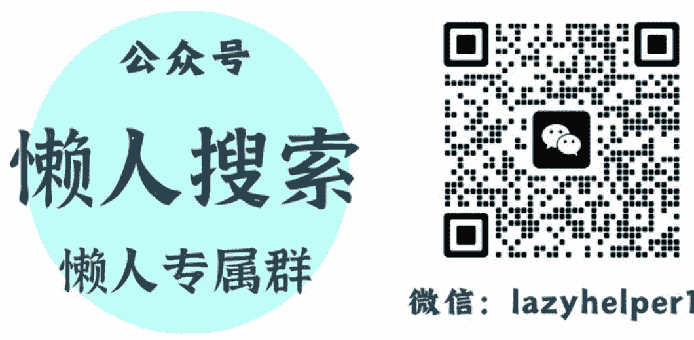
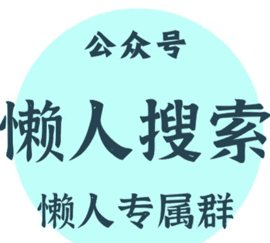

# 2026 CES 观察：你在山顶建高塔，我在平原铺大路

260112

整理：公众号懒人搜索，懒人专属群精选

懒人微信：lazyhelper1

今天我们讲讲 2026 年的 CES。CES，全称国际消费电子展，也被称为“科技界春晚”。

1 月 6 日到 9 日，2026 年的 CES 在拉斯维加斯举行，来了超过 4100 家参展商，14.2 万名参会者，覆盖全球 56 个国家和地区。

同样是创新展示，CES 和《自然》《科学》这样的学术期刊有个明显区别。简单说，学术期刊告诉你科学的前沿在哪里，而 CES 告诉你，产业的钱会往哪里流。

CES 上的展品，背后的技术原理你大概率已经听说过。比如，AI、机器人、自动驾驶，这些概念早就有了。CES 展示的是，这些技术怎么变成产品，怎么走向市场。换句话说，CES 展示的不是创新本身，而是科技公司的选择，哪些技术被选中开展商业化了，哪些产品形态被押注了。

但也要注意，CES 上的展品，不都是即将量产的成熟产品，也有很多是探索性、概念性的产品。这也是为什么总有人说，假如你想看到未来几年成功的产品，就去 CES，假如你想看到未来几年会失败的产品，也去 CES。那么，今年的 CES，有哪些值得关注的信息呢？接下来，我们就展开说说。

## 第一，今年最出圈的信息，不是具体展品，而是黄仁勋在开幕前的主题演讲。

为什么黄仁勋的开幕演讲特别受关注？

首先，这是个身份象征，谁来做开幕演讲，基本就说明了，哪家公司是当今科技界最有话语权的，至少是最有话语权的企业之一。比如，2016 年做开幕演讲的，是英特尔 CEO 科再奇，2023 年是 AMD 的 CEO 苏姿丰。而这两年，一直是黄仁勋。在黄仁勋登台的时候，英伟达的市值是 4.57 万亿美元，虽然已经不及巅峰期的 5 万亿，但依然是那一刻地球上市值最高的公司。

其次，这场演讲在一定程度上，像一枚指针，告诉你未来的趋势大致是什么。今年，黄仁勋最核心的判断是，计算产业正在经历双重平台转移。什么叫双重平台转移？第一重转移，是应用层的变化。过去，AI 只是一个应用程序，你打开 ChatGPT，跟它对话，它给你答案。

### 第二重转移，是计算层的变化。

但现在，AI 上升了一个维度，它本身变成了构建应用的平台。你可以直接使用 AI 替你编程，替你开发应用。AI 不再是工具，而是基础设施。过去软件开发靠“编程”，写代码，在 CPU 上运行。现在软件开发变成了“训练”，喂数据，在 GPU 上运行。

在演讲中，黄仁勋还发布了英伟达的新产品，Vera Rubin 六芯片平台。你可以不用记这个具体名称，只需要知道，所有英伟达的产品，核心目标都是一致的，让训练性能更高，让训练成本更低。比如这回发布的芯片平台，据说能把模型的训练成本降低 80%，原来需要 10 台服务器，使用新的芯片平台之后，只需要 2 台就够了。

当然，需要注意的是，黄仁勋毕竟是英伟达的 CEO，他的发言多少带有公司利益的考量。你看，双重平台转移这个说法，正好把英伟达的 GPU，推到了 AI 浪潮的中心位置。

但即便考虑到这层利益关系，这个判断仍然值得关注，因为英伟达确实是目前 AI 算力市场的主导者，它的战略选择，也会直接影响整个产业的走向。

但这回最让人意外的，并不是黄仁勋发布的算力产品，而是英伟达的“物理AI”战略。所谓物理AI，就是能理解现实世界的规律的AI，这个概念我们以前讲过很多次。它有很多近义词，包括，世界模型、具身智能等等。这些词虽然具体含义不同，但总体指向的都是同一个技术趋势。这就是，让AI真正理解物理世界的规律，并且在现实世界里干“体力活”。

基于这个“物理AI”战略，黄仁勋发布了两个新产品，一是英伟达自己的世界基础模型平台，Cosmos。二是自动驾驶AI模型，Alpamayo。据说奔驰的CLA，将成为首款搭载完整英伟达自动驾驶系统的量产车，2026年第一季度在美国上市。

换句话说，英伟达已经不只是一家芯片公司了。它的目标，也许是成为物理AI时代的基础设施平台。从芯片、网络、存储，到模型、开发工具，再到应用场景，建立一个完整的技术线。这也是为什么很多人说，英伟达的野心是成为物理AI时代的“Android”。

好，说完开幕演讲，再说展会上的那些值得关注的现象。

第一个现象，人形机器人，开始进入“准量产”阶段。注意，是准量产，也就是，很多厂商开始为量产做准备。

今年的展会上，有大量人形机器人公司，开始谈量产、谈部署、谈价格。

比如，波士顿动力的 Atlas，首次走出实验室公开登台。这个机器人能举起约 50 公斤重物，关节可以 360 度旋转。波士顿动力的母公司现代汽车表示，计划每年生产 3 万台。

再比如，宇树科技的 G1 人形机器人，售价 1.6 万美元。大概是一辆普通家用车的价格。开展第一天，就全都被预订了，连样机都卖完了。而下一步，这个产品的成本可能会继续降低，因为它所需要的供应链，从精密零部件到整机组装，整条产业链都在国内。这让成本能降下来，也能让迭代速度快起来。

换句话说，人形机器人这个赛道，正在从“技术竞赛”变成“工程化竞赛”。谁能把成本降下来，谁能量产，谁就有机会。

第二个现象，可持续发展渐渐从“追求”变成了“门槛”。

过去企业做环保，属于“更高追求”，而现在做环保，已经成了一些市场的“准入门槛”。

为什么？这主要与欧盟市场的变化有关。欧盟碳边境调节机制，2026 年正式开始征收。简单说，就是假如你的产品生产过程中碳排放高，出口到欧盟就要交碳税。假如你在环保上做的不到位，产品在欧洲市场就没有竞争力。

所以在今年的 CES 上，能源、电池、循环设计这些产品明显多了。

比如辉能科技展示的固态电池，能充放电 5000 多次。什么概念？普通手机电池充放电 500 次左右就开始衰减了，这个是它的 10 倍。

还有产品设计的变化。联想的笔记本电脑，USB 接口、电池、键盘、扬声器都能单独换。坏了哪个换哪个，不用整台扔掉。这种设计以前很少见，因为企业通常更希望你买新的。但现在，可修复性成了卖点。

## 第三个现象，AI 硬件从炫技走向实用。

过去的 AI 硬件是什么样？各种概念产品，看着很酷，但它的主要目的是展示探索方向，而不是解决实际问题。但是，今年不一样，产品开始越来越侧重实用功能。

比如，智能镜柜，你早上洗漱的时候，它通过光线分析你的皮肤状态。配合智能牙刷检测唾液成分，能提示你可能缺什么营养，或者有没有炎症风险。

再比如，芯片领域的竞争。英特尔、AMD、高通都在做一件事，让你的手机、电脑能在本地运行 AI 模型，而不是每次都要联网。因为联网意味着你的数据要上传到云端，本地运行意味着数据不出你的设备，更安全，反应也更快。

最后，咱们再说说今年中国企业在 CES 上的表现。

首先，最受媒体关注的是，中国企业占了 C 位。以前中央展厅最大的位置是韩国的三星，而今年，变成了中国的 TCL。但是这里有个信息需要注意，三星今年移到了威尼斯酒店的独立场馆。这个选择，三星有自己的考虑，独立场馆可以做更有针对性的技术洽谈。但从展会地位的象征意义来看，中央展厅是 CES 最核心的主舞台，谁能占据这个位置，意味着谁能拿到最大的曝光。

但更值得关注的，不是展位大小，而是中国企业在产品层面的进展。

以人形机器人为例。38 家参展机器人企业中，21 家来自中国，占比 55%。从过去一年的市场表现上看，中国公司也是这个领域最重要的参与者之一。比如，国内的智元机器人，2025 年出货量 5168 台，占全球市场份额 39%，全球出货量第一。再比如，与汽车相关的技术，比如吉利展示的 AI 座舱、小鹏的飞行汽车，都引起了很多关注。你看，这些产品的共同特点是什么？都需要软硬件紧密结合。你要让 AI 能理解你的意图，让机器人能完成精细操作，这些都需要算法、数据、工程化能力的配合。

换句话说，中国企业的优势，不在于单一的软件设计或硬件制造，而是把AI能力和硬件能力结合起来的系统能力。

过去一年，经济学家何帆老师考察了很多国内的AI公司。关于中国AI创新最核心的特点，何帆老师认为，可以用一句话概括，很多国外企业在讲“All in AI”，而中国企业是“AI in All”。

一个是押注少数巨头，在山顶建高塔。一个是普及所有行业，在平原铺大路。至于哪个策略更好，关键要看，你的技术路径，是否匹配你的市场特性。

就像何帆老师说的，技术有不同的性格，市场也有不同的性格，只有技术性格与市场性格匹配，才能释放出巨大的潜能。

## 最后，安利小懒的付费群:

### 懒人专属群(介绍)

这里是你对抗信息过载的护城河。

已稳定运行6年,累计拆解、研读3000+个互联网商业实战案例与行业前沿内参和时政/宏观文章。

我们不搬运垃圾,只做高价值信息的筛选器与放大镜。

懒人专属群更新记录:

https://hk57gvlx7u.feishu.cn/docx/HOkRdZbSbolBR0xkaXtcuVEOnTg

【免责声明】本资料归档于社群内部知识库,仅供成员课题研究与学术交流,请在查阅后24小时内删除。