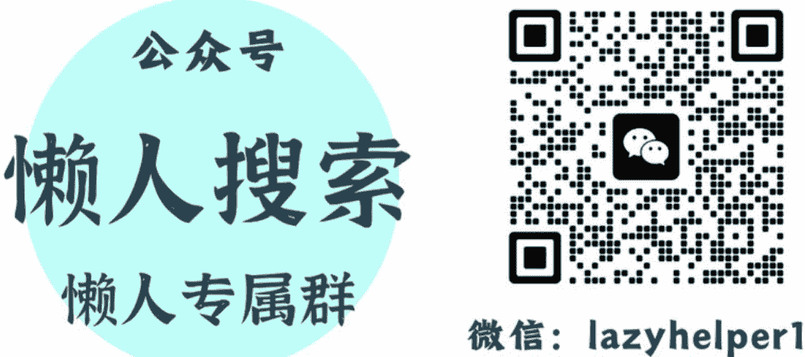
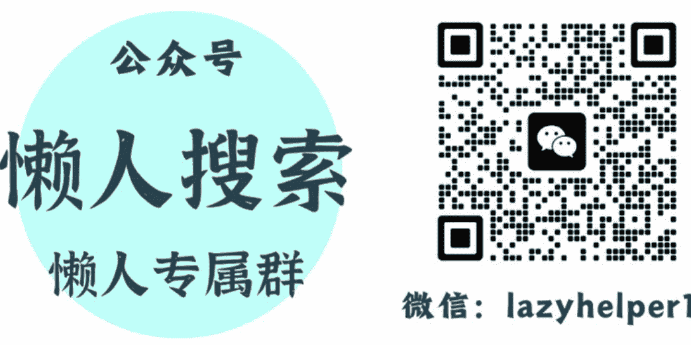

# 202 | 一颗大番茄：做“讲究人”的生意

260112

整理：公众号懒人搜索，懒人专属群精选

懒人微信：lazyhelper1

欢迎打开《蔡钰 · 商业参考 4》，我是蔡钰。

一串小番茄，1公斤售价接近40块。

前两年被盒马拒绝过5次，如今却进驻了50多家线下中高端零售卖场，还连续三年登上了天猫番茄类目的销售额榜首，成了中国番茄市场的“顶流”，年收入还站上了10个亿。

而这还只是一个2022年才成立的3岁品牌。

都说消费趋于保守，这个品牌是怎么做到逆流成势的？我们来讲讲这个故事。

## 品牌起源

这个品牌，名叫“一颗大”，暗含的意思也就是“一颗大番茄”。你在生活里没准儿也见过它的产品：成串的小番茄装在半透明的纸盒里，个头均匀，果蒂鲜嫩。在天猫超市里，一盒1公斤的一颗大番茄卖39.9块钱，妥妥是番茄里的奢侈品。

“一颗大”的创始人名叫马铁民，早年在外企当技术员，2003 年进入农业领域，开始用工业化思维生产生菜，把自己做成了肯德基等国际餐饮巨头的头号生菜供应商，在圈内被称作“亚洲生菜大王”。

马铁民起心动念想做番茄生意，是因为 2010 年在北上广深和香港的高端超市，看到了来自欧洲、以色列和日本的甜椒与番茄。这些进口蔬果，敢把价格定到普通同类蔬果的数倍，买的人还不少。

这让他意识到，中国有一部分消费者已经愿意为更好的农产品支付高溢价。而这个溢价，主要还是被进口商品赚走。像佳沛这样一个新西兰奇异果品牌，能把奇异果用 10 块钱一个的价格卖给中国消费者，一年在全球的收入能达到 180 亿元。

顺理成章，马铁民干“国产替代”的心思冒出来了。他选中的品类是樱桃番茄。小番茄这个品类，在消费者心智里介乎蔬菜和水果之间、消费标签还没有完全落定。

随后几年，马铁民一边种生菜，一边琢磨番茄。他建了个智慧温室，遍布上千个传感器，数字化控温控湿，无土栽培防重金属，每串小番茄都要用统一的尺寸和品相标准判定是不是合格。

产品倒是种出来了，但几年探索下来，马铁民发现，自己熟悉的 B 端经验完全驾驭不了 C 端市场。

换个别人，可能这时候得出的结论就是，“这个市场证伪，还是回去种生菜吧”。但马铁民觉得是自己方法不对。于是到了 2022 年底，他确定了“一颗大”这个 C 端品牌名字，狠心把公司和家都搬到了上海，开始死磕中国的高端消费人群。

品牌成立的第一年，“一颗大”倒是很快就在天猫、抖音、美团等等主流线上渠道有了些名气。但对生鲜产品来说，按照行业惯例，85%的销售得靠线下。一个全新的、高端的小番茄品牌，想要让消费者买单，得搞定线下，比如入驻盒马、麦德龙、百果园这类有口碑的零售场。

于是，最头疼的事情来了。几乎所有线下渠道对“一颗大”产品的第一反应都是：一斤番茄 30 块钱，怎么这么贵？光是盒马，就接连拒绝了“一颗大”5次。

如果真是问为什么这么贵，“一颗大”其实有不少说法：从上千颗种子里筛选一颗种子，在智慧玻璃温室用无土栽培来隔绝重金属风险，平均每 6 颗番茄才能选出一颗合格的成品，等等等等。但渠道不管这些，渠道的潜台词其实是，你售价跟品牌认知度也太不匹配了。

## 很贵但是

“一颗大”被盒马接连拒了5次以后，才开始意识到，要说服盒马们，不能只讲品质、讲标准化，而是要展示给盒马看，市场上存在买单者。

怎么找到这样的买单者呢？那就要转战小红书这个种草圣地了。“一颗大”市场部负责人杨泽利当时发现，小红书核心用户，恰好是关心产品品质，把溢价消费视为“对自己投资”的人群。他们正好也是盒马的核心人群。

在这个人群里，“一颗大”先是圈出了孕期准妈妈，把番茄的种植标准，翻译成了这个人群爱听的“能从孕期吃到生娃”的有机食品故事。再借着这个人群，搭载上了“有点贵但很值得”的消费理念。

“很贵，但是”这个消费心智，《商业参考》在2021年第一季时就陪你关注过。当时我们说，这是消费升级和消费平权之间的一个夹缝市场，它迎合的是消费者们自我犒赏的需求。

好，“一颗大”借着这个思路找到了产品定位。紧接着，团队在用户评论里发现了一个高频反馈：叫“像我小时候吃的番茄”。

哎，你看，更精细化的定位自己冒出来了。有点贵，但是值得。为什么值得？因为消费者觉得，“一颗大”番茄的味道，能够唤起小时候的记忆和感动。

自我犒赏，是需求；重温回忆，是需求之下的动机。

“一颗大”马上从善如流，又顺应这个叙事，开始进驻李诞、伊能静的直播间、跟用户聊产地溯源、种植、番茄炒蛋等等故事，借着流量的力量，登上了小红书 SPU 品类榜的第一名。

到这里，“一颗大”又转回头去找盒马采购了。这第六次见面，“一颗大”拿出了自己在小红书上的种草内容、销售成绩和平台用户数据。这次终于说服了盒马采购，在盒马上架了。

但更大的压力马上来了：盒马的选品机制是末位淘汰，新品上架后有三个月的保护期，在此期间，如果销量不如意，那就出局。盒马又是商超同行们都盯着的选手，一个品牌要是被它淘汰，也很可能被其他渠道拒绝。

怎么扛过这个“盒马试用期”？

一颗大想出的办法是，把在小红书的种草经验搬进了盒马。他们付费邀请小红书的博主去盒马探店，给上海的消费者推荐低热量的番茄健康餐，给杭州的消费者推荐自制番茄果酒，给成都的消费者推荐话梅冰镇番茄，给北方的消费者推荐冰番茄汁配火锅。

这样一来，“一颗大”的小番茄，就作为一个个生活方案的配件，在盒马站稳了脚跟，再借着盒马供应商的身份，进入了永辉、大润发、7-11 等其它的线下商超。而盒马自己也挺开心，因为“一颗大”的这套打法，也拉动了它的整店生意。

“一颗大”把这些渠道铺开后，又继续把自己的供应链翻译成故事，在小红书等平台上巩固核心用户的认同度。

## 什么故事呢？

种植端的农户，有了更高的收益；大学生毕业生，不必背井离乡也能找到体面工作；中老年工人，也可以在家门口兼顾采摘工作和家庭。这些故事，又让一颗大的消费者们感觉到“我的消费造福了同胞”，再次壮大了认同飞轮。

10 亿的年收入，就是这么来的。到了2025 年的 618 大促，“一颗大”还成了天猫、抖音等不同平台番茄类目中的第一名。

当然了，你肯定知道，这也是因为“一颗大”选中的番茄，尤其新鲜番茄赛道，原本就是个有品类、无品牌的蓝海市场。

## 总结

这是我想请你关注的，高端番茄新品牌“一颗大”，在短短三年内把自己变成市场顶流的故事。

给你讲这个故事，是因为它给到我们的提醒是，过去几年，虽然内需疲软，但传统消费行业仍然有卷价格之外的选择，仍然有高溢价的新机会，一摸就是一个 10 亿规模的市场。

什么样的市场一摸就能有 10 亿规模？“一颗大”给出的答案是，抓住任意一个细分成熟类目里的“讲究人群”。

不过，“一颗大”也没法高枕无忧。我刚才去翻盒马，就发现盒马已经上架了“一颗大”的同款平替番茄，供应商来自首农集团。

你也知道，在中国这种供应链环境里，只在产品性能上讲究，那是不可能长期稀缺，终归是要跟同行们厮杀起来的。

不过，如果把讲究往意义的稀缺性上引，它的长期红利就能稳固许多。奢侈品行业对此很有发言权。

正好，我对“如何制造稀缺性意义”也有一点小小的看法。回头单独找一讲，我专门向你汇报。

拜了个拜。

## 最后，安利小懒的付费群：

## 懒人专属群（介绍）

这里是你对抗信息过载的护城河。

已稳定运行 6 年，累计拆解、研读 3000+ 个互联网商业实战案例与行业前沿内参和时政/宏观文章。

我们不搬运垃圾，只做高价值信息的筛选器与放大镜。

## 懒人专属群更新记录：

https://hk57gvIx7u.feishu.cn/docx/H0kRdZbSbolBR0xkaXtcuVE0nTg

【免责声明】本资料归档于社群内部知识库，仅供成员课题研究与学术交流，请在查阅后 24 小时内删除。