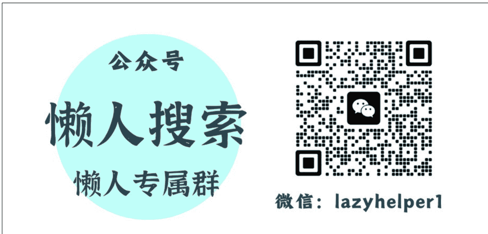

## 深耕亚马逊两年，分享做电商开品的底层思路，国内也适用，新人可参考

260112 副业 SC 精华

公众号懒人搜索，懒人专属群独享

懒人微信：lazyhelper1



大家好，我是女巫的蛋挞，一年半开发产品毛利近 70 万（不算公司给的品）。这篇主讲的是开发产品结合爆款、把品跑起来等一些自己方法。电商竞争确实非常激烈，除了选品很重要，开发产品的能力也是一个店铺的特点和竞争力。

选品的话，生财的手册和教练大佬分享的很详细很有用了，所以我主要分享我的开品经验和小红书开店产品竞争的迭代，如果想了解亚马逊选品的我后面再写一篇简短的。下面截图数据是亚马逊的。

（大家可根据目录跳过工作简介，看后面章节）

## 这个是 2025.9-11 的 70% 产品销售额

| 近3个月收入 | 近3个月收入占比 |
|---|---|
| ￥4,268,821.38 | 24.22% |
| ￥1,902,107.09 | 10.79% |
| ￥1,401,467.35 | 7.95% |
| ￥1,319,378.07 | 7.49% |
| ￥1,174,154.93 | 6.66% |
| ￥1,146,967.55 | 6.51% |
| ￥415,233.04 | 2.36% |
| ￥302,978.60 | 1.72% |
| ￥267,105.20 | 1.52% |
| ￥252,935.03 | 1.44% |

| C | D | E | F | G |
|---|---|---|---|---|
| 新品毛利润(2025年8月-2025年10月开发时间) | 老品毛利润(2025年5月-2025年7月) | 插画师制图产品新品毛利润 | 插画师制图产品老品毛利润 | 总计 |
| 104722.84 | 40918.94 | 239038.01 | 121965.66 | 506645.44 |

## 半年内新开发的产品毛利润

## 工作简介

介绍一下我 2023 年毕业，有 4 个月亚马逊铺货开发（一个美容爆款最高月销售额 10 万左右）和一年 7 个月亚马逊精品开发（月利润近 70 万）工作经验，12 月刚离职的。

最近半年有开小红书店铺，第三个月过 10 万销售额，目前下降但还是维持单日 2000 以上销售额。刚结束小红书直播航海，开播第五次 1611。有教朋友新开直播，目前也有近千，小红书对直播扶持流量很大。

作为开发，除了了解市场还要了解运营的店铺，给合适的店铺推合适的产品，开店铺对应细分类目的产品，虽然站在公司的平台有店铺和供应商基础，但是作为新开发入职我积极性较高，和各个岗位的同事沟通，和运营推广和了解她们的店铺，主观能动性非常高的把控产品的设计和后续与运营的对接。

对接的新运营偏多，积极不断的验证产品和指导新运营选产品等，这也给我带来快速又多的反馈和迭代动作。对上级的上级都表示做不了的工艺积极的不断寻找供应商做到并且一个月带来几十万的销售额。

有款产品竞对卖的好但是成本很高，我们公司又是 fba 模式（先运一批货在美国，卖不掉只能花钱扔掉），为把成本降低，不断找供应商开新工艺把有款产品的价格打下一半（离不开领导的指导）对一个产品供应商，采购，插画师，运营，店铺的选择和细节把控等。写下这些我感觉可以写的有很多，点连成面，不过回归主题分享我的开品和选品方法。

感谢生财不断鼓励我进行分享，我很乐意分享，但是担心自己写的不够好好像体现不出能月利润 70 万（感谢公司平台的托举）的水平和完美要求导致的拖延症。然而对工作和能力的总结和复盘是更快的进步，在生财看到很多大佬的分享也收获很多，感谢生财圈友间真诚的互助与启发，感觉各位教练专业和细心的指导，参加生财这么多期的航海，很多人给予了我帮助，非常感谢！！

# 一、开品方法：打造潜力爆款的实战策略

“开品”是在选品基础上进行的二次创造，不是复制，而是融合创意、工艺与市场洞察的再造过程。是打造差异化竞争优势的关键！

由于我主要从事亚马逊精品开发所以例子是亚马逊的，但是开发产品的原理也大同小异，会结合我小红书店铺产品来举例。

以下方法是你已经在一个确定的类目如何进行这个类目的开新品和选品，我在亚马逊开发的类目是手机壳，特别卷的赛道，所以要求原创比较高，不然小链接打不过大链接，亚马逊广告费非常高，占销售额一半的 sku 不少，查的特别严，动不动就侵权。

## 工艺突破法

寻找市场上销量高但因工艺复杂导致链接少的产品。主动与寻找对应供应商合作攻克工艺难题，并将此工艺与其它热卖元素结合，创造出独家产品，在工艺上面的壁垒会更晚被跟品。

我曾在亚马逊发现一款细分工艺的手机壳，单 SKU 月销可达 300，手机壳一般几十上百个 SKU。但市面基本只有纯色款。我判断若在相同工艺上加入图案，会有机会。但难点在于：市场现货很难竞争过已有爆款，而定制供应商普遍起订量高、交期长，连上级都不看好。

但我会有种一定要去攻克的兴奋，在反复沟通中确实了价格合适，起订量低但不太负责任有各种麻烦让采购和仓库都不断找我投诉的供应商。这个品在后续发展成为那位运营店铺的爆款主打品，成为爆款带动其他运营上架类似的，它的衍生等带来了月销售额几十上百万。

如何全网寻找供应商——翻遍1688、拼多多、淘宝、华强北和抖音。每找到一家，就主动沟通：先表明定制需求，若对方起订量高，可展示对标链接销售数据，说服对方现货供货；或适当夸大公司实力，争取降低起订量，持续通过微信、电话跟进。

## 元素融合、爆款二创法与简单改动爆款、嫁接

将两款或更多热销产品的优势进行结合。例如：A产品的畅销素材+B产品的畅销图案，强强联合，创造新的市场吸引力。然而这个如何创作？主观审美和细节把控很重要，结合热销图案，注入具备“网感”的审美设计。

两款热销产品的图案结合或者爆款图的重新创造：需要多一些有网感的审美——看过比较多的爆款和其神韵，虽然各花如各眼，但你这个图案设计能不能打动需求这款产品的大多数人？如果是新手，得注意背景 元素 颜色是不是有热卖的依据，看得见的每一个点都要考虑，一个可能会爆的图需很多思考和琢磨。

那改版爆款如何比原图卖的好？善用插画师或AI工具(如豆包)进行创意搭配，提升视觉效果。好的插画让你要求的排版和色彩搭配的更出彩，然后你在细节处在调整，因为插画和ai是没有爆款数据积累的。在图片创作上ai大多数时候能给你意想不到的效果，搭配水平更高，ai用豆包就行。下面是其中一个爆款产品改图的部分过程:

```
for iPhone 17 Pro Max Case Flowers Floral for iphone cases with Screen Protection]Slim Shockproof for 17 ProMax case girly Design-1
Brand: TXXO
4.6 (25) | Find specific info
Amazon's Choice
500+ bought in past month
```

图片风格为「油画」，重新生成不同风格参考：丙烯立体奶油肌理装饰插画风格，融合手绘丙烯肌理画的质感表现，整体呈现出富有层次感的装饰艺术设计感，复古色彩色调：以暖色调为主，有橙红色、橙色、浅橙色，白色花朵，花朵为红色花蕊，花瓣层次分明，刮刀肌理不规则层次感，搭配深灰、蓝灰色，灰绿色，橙黄色枝叶，背景为白色，整体色调柔和清新，充满艺术氛围感，白花5朵，花朵数量稀疏具有一定空间感距离构图视角：半幅式构图，下半部分是满版的立体简约雏菊，上半部分为纯色背景，花卉元素高低错落、层次丰富，形成强烈的视觉对比，花朵整体小，大小错落、分布均匀，形成富有层次的视觉效果，以近距离视角展现浮雕的立体质感附加细节：花朵具有明显的堆叠厚涂立体感，花瓣边缘纹理细腻有层次，哑光，以及细小的浅橙色小花和深色调枝叶点缀，整体氛围复古精致，充满艺术装饰风情，肌理质感清晰可见，全景图，3:4

我将根据你调整的小花颜色要求，重新生成丙烯立体奶油肌理装饰插画风格的图片。


> 生成四张莫奈画风的油画，画面中包含红色粉色白色调的多种雏菊，铺满屏幕，通过印象派特有的光影变幻和色彩交融，呈现自然灵动的美感。

> 好的，我将为您生成四张莫奈画风的油画，画面中红色、粉色、白色调的多种雏菊铺满整个屏幕，通过印象派特有的光影变幻和色彩交融，呈现自然灵动的美感。


> 生成四张莫奈画风的油画，画面中包含红色粉色白色调的多种雏菊菊花，铺满屏幕，通过印象派特有的光影变幻和色彩交融，呈现自然灵动的美感。

利用 AI 来做图，如果效果不满意，一般就是指令还得改进，再加上插画师的改造和拼接。这里讲爆款元素，图案的二创是复杂一点的。

简单又很有效的跟爆款还有直接增加新颜色（如多巴胺色系）尺寸或应用场景，满足更细分的用户需求。在原来基础上小改，如果没有插画作图能力的个体卖家可以找有实力的供应商改：

### 1. 增加新颜色：
我举例我的小红书店铺主要销量来源的品，这个品我也是跟爆款的，我成为第二个卖的好链接后想到了加颜色但是我主业很忙加供应商起订量要 500，就想等几个月在弄，而我下意识忽略了电商卷的程度，卖一个月左右，又一个新店铺一下子加了 6 种颜色（多了爆款颜色 玫红）加上好的图片和标题文案，10 天对方卖了 3000 多个，对方不论是努力每天更新 10 多篇笔记（我当时每天均 1.5 篇）还是其他运营方面没有短板，很快就超过我的链接。

## 题外话：新品遇见小爆笔记如何起量
我选中这个品时，它 24 小时内已有 5000 加购，虽然对方粉丝仅 1.6 万，但已有多链接在售。我结合品牌 Casetify 的产品一起拍照，通过“站在漂亮的孩子身边也更显好看”的衬托思路，提升了产品视觉。优化了产品图片，因时间与能力限制未拍视频。

为推起这个链接，我采取了一系列动作：刷单时选择竞品热卖款式，主图参考小红书高赞图片结构。首条爆款笔记发布 5 小时后，数据初显成效：点赞收藏 9 个，浏览 750 次，118 人进店，36 人加购，无人下单。此时链接只成交 2 单（刷单的）。当天晚上我找人刷销量，评论区置顶引导“宝子们这款要颜值有颜值 要品质有品质！✸ 新品狂补！前 100 单超低价 仅需：29.9 元！√ 全国包邮（除偏远地区）！最重要的下单自动享运费险！  零风险试错，不满意秒退！❤️”然后每小时在这个置顶评论下面倒计时，还剩 30 单，还剩 20 单等，

这个写来就长了，属于有潜力的新品如何起量，就这条笔记我抓住了，我的链接就起来了。这个引导可能有风险，当时我店铺没有什么销量所以我就用了后面过了一两天销量起来就删评论了，圈友要用的话先问问教练们。选品真的很重要的，我有个品两个星期用尽所有办法，费心到处拍照都卖不出去一单。

- 2. 找到遗珠后让有实力供应商改品：在已有爆款的基础上进行微改动，这个举例我亚马逊第一个爆款——美容护肤爆款（最高月销 10 万左右销售额）当时是有个亚马逊新品销量榜上的产品，没有什么类似品在卖，排名就在 60 几名，上架时间又不够新、快半年了，应该是上架一段时间慢慢卖上去的不像排在前面的产品引人注目。然后就让供应商的插画设计了包装类似的卖，就卖爆了。
- 3. 嫁接：这个比较简单，将你已经稳定在热卖的某个元素嫁接到另外一个爆品的一项新工艺或载体上。在亚马逊，版权问题很严肃，是自己随时可能踩雷的谨慎点也是保护自己产品的有力武器。有些已经有爆点的运营会想扩展新的品，但是实际你的爆款正在被很多人模仿或有可能超越，而拓展相差大的新款成功率会低一些。

若在一个成熟的、但缺乏创新的上加上新工艺载体，就是实现降维打击。

持续关注新材料、新工艺、新技术。问自己：“这项技术除了用在原来的领域，还能用来改造什么？”

- 深度衍生：洞察爆款背后的深层用户需求，并与其他新的爆点结合，有可能创造出比原爆款更受欢迎的产品。将产品在功能、设计、内容、营销等多个维度进行有机结合，再配合精准的运营策略，全方位提高成为爆款的概率。从“抄袭”到“超越”！
- 外部借鉴：与全球（全国）文化脉搏和同行顶尖公司趋势同频共振。保持对独立站、TikTok 流行趋势以及大公司，供应商新品的敏锐洞察，从中汲取灵感。TikTok、Instagram 上突然爆火的视觉元素（如 Y2K、多巴胺、美拉德风）等。

跟进全球（全国）文化活动：全球性全国性大 IP 的出来，爆款电影，电视剧中的色彩搭配，人物（人物等形象一定会侵权在亚马逊）需注意规避 IP 侵权风险，就多看色彩搭配。比如《芭比》全球热映那年，各行业服饰 手机壳 挂饰玫红色的产品销量飙升，到现在虽然下降，但是也是卖的好的颜色之一。

## 警惕 IP 侵权，关注爆款作品的色彩。

深化补充： 我们不仅要避免侵权，更要主动研究和利用“色彩心理学”和“文化符号”。芭比的“粉红色”不仅仅是一个颜色，它已经成为一种文化现象和“女性力量”、“自我表达”的代名词。当你的产品使用了这个颜色，你卖的不仅是产品，更是这种情绪和价值认同。

行业领头品牌的新品动态，提前预判趋势，围绕热点进行产品开发与布局，抢占市场先机。比如苹果手机 17 系列在 9 月份发布，在 7 月的时候就会有消息出来会在苹果 17 多出橙色这个色，那你围绕手机推出了的产品要多和橙色相关，实战证明在 17 发布后橙色相关手机配件的产品卖的很好。扫描不同领域的领头羊。

## 客户未被满足的细节

在产品链接的评论区客户的评论，在自己亲自使用的过程中，在浏览社交媒体短视频的时候要注意去收集的。

- 一、在跟爆款的时候就要去迭代功能。
- 二、空白的细分需求，绘制现有市场的产品-用户矩阵，寻找空白格。问自己：“还有哪些用户的需求被完全忽略了？”跳出现有的产品做不同的产品，这个很考验洞察力也考验你的运营，没有标签基础的店铺要把细分的好的品能推给对应的人。

## 速度决胜

很要求速度的是这个品是市场新品，规模大的供应商也有自己独立开发的能力，很多他们开出来的品都可能是市场爆款。发现一个有潜力的产品创意后，行动速度至关重要。因为同行做电商久的人都有不少共同的信息来源，快速完成开发、上架和推广，抢占流量入口。

这里你得先成为最先接触信息的那批人，不然等知道不少同行上架就慢了。我在公司时，我若感觉新出的这款创新的素材可能卖的好，我就会极力跟进各个环节，争取让上我品的运营是第一时间上架推广这款产品的。这个行动也得到结果，有个新运营就是这样抢占了一款创新的产品先机而销量大幅度上升，在她运营的其他平均水平微差，厉害的运营时，比其他人早一个星期上排名最高到了亚马逊手机壳新品榜14。其他人后上同款的链接也卖的不错，但是相差了一大截。一条成功的爆款链接让这个业务整体销量起来了。

# 二、垂直店铺的爆发力

店铺的垂直度对爆款的成长速度有显著影响，同一款有潜力的新品，在细分的垂直赛道中，新品爆发的速度远胜于泛类目店铺，流量和转化率经常会翻倍增长。细分再细分：在垂直赛道内进一步深耕细分领域。

看到亦仁老大提出“垂直小店”这个模型，我瞬间被击中了——这不正是我过去在亚马逊做手机壳类目时，亲眼所见且一直在做已被验证成功吗？我原公司做的手机壳类目，给运营开发产品和推荐产品的时候会看对方的店铺，为其店铺开发产品，在把产品推给对应的运营，基本我推的品都会被对方上架，在推品前我就会考虑的比较细然后运营上架去推就行了，在公司我属于高转化率高成功率的开发。

很多店铺就是极其的垂直，有的一个小店甚至是手机壳一种工艺的，一种素材壳，结构极简，不铺货、不杂乱，80%以上的销量都来自一条爆款链接或一个系列。这背后的逻辑与亦仁老大所说的“垂直小店”完全一致：平台里标签清晰的店铺在自然流里面更有优势，而有需求消费者也更信任专注于某个领域的“专家店”。

“垂直小店”的思维从亚马逊这样的货架电商至抖音、小红书等内容电商平台。虽然平台形态不同，但内核相通：

- 在亚马逊，垂直体现为“细分品类/工艺/素材”的深耕。
- 在内容平台，垂直则体现为“单一品类+持续内容输出”的账号。

这给了我一个更清晰的启示：“垂直”的本质，是降低平台的识别成本和用户的决策成本。 无论平台规则如何变化，这套逻辑始终有效。因此，在选品和开品时，“能否在某个细分垂类里建立认知”应成为一个关键的衡量维度。开品不再只是开发一个产品，更是为你的“垂直小店”寻找一块坚实的基石。

# 三、总结：爆款的本质是“抄、改、创”

回顾众多成功案例，爆款的本质路径可以总结为：许多爆款始于对小爆款的“改”良创新，或者在这个产品上探索到另外一个没有被满足到要求去开新品。要成就爆款，需要在借鉴的基础上，融入更优的“网感”审美（爆款积累）与运营策略，实现“创”新。

通过体系化的选品原则与灵活多元的开品方法，结合快速的执行能力与垂直化的店铺运营，能够显著提升在电商市场中成功打造爆款的确定性和提高产品成功的概率。

最终，产品的成功离不开与运营策略的紧密配合，对于运营我才开始学习，这是一个系统化的协作过程。

我的分享结束了，如果其中任何一个细节能让你觉得‘哎，这个我也能用上’，那就是我分享的最大意义。搞钱之路，祝大家越来越有钱。

## 最后，安利小懒的付费群：

## 懒人专属群（介绍）


🧊 这里是你对抗信息过载的护城河。

已稳定运行 6 年，累计拆解、研读 3000+ 个互联网商业实战案例与行业前沿内参和时政/宏观文章。

我们不搬运垃圾，只做高价值信息的筛选器与放大镜。

懒人专属群更新记录：
https://hk57gvlx7u.feishu.cn/docx/H0kRdZbSboIBR0xkaXtcuVE0nTg

【免责声明】 本资料归档于社群内部知识库，仅供成员课题研究与学术交流，请在查阅后 24 小时内删除。