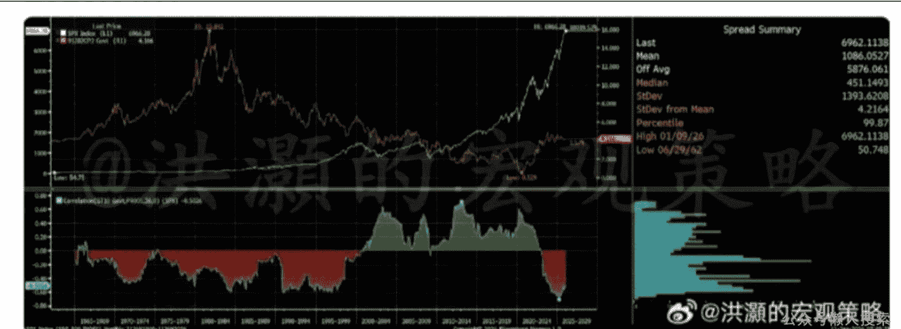

# 2025 启示录

260112 洪灝付费
整理：公众号懒人搜索，懒人专属群精选
懒人微信：lazyhelperl

2026 年天刚破晓，市场在美国乃至全球政府的财政扩张与全球央行的货币宽松的琴瑟和鸣之间不断新高。表面看来，“美联储看跌期权”在 2025 年十二月随着美联储的资产负债表重启扩张而重获生机，特朗普政府推出的财政刺激计划更承诺将美国经济油门一踩到底。眼前的舞台正在上演的这一出大戏，也是我们在去年十一月发表的展望报告和线下见面会上与读者分享预测的。

洪灝：2025 启示录

然则，作为已经穿越数轮周期的市场交易老饕，我们都深谙明斯基的那句箴言：市场的稳定性里孕育着市场动荡（stability breeds instability）。当新闻头条欢庆市场历史新高、行情如蛮牛般狂奔之际，市场波动率却是暗流涌动，市场的模式转换已正在酝酿，并逐渐发酵。市场的交易模式转换标志着资产风险定价与投资收益分配方式的根本性转变——我们将从“相关性离散”模式转变步入“相关性聚敛”模式。换言之，之前市场个股之间表现各异、分道扬镳的相关性将在未来的某一个时间点突如其来地、毫无前兆地飙升，重新聚敛。

风险管理已经不再仅仅是希腊字母 Delta、Theta、Gamma 的对冲之术。当下，美国市场走势受交易中技术性组合对冲再平衡（portfolio hedging and rebalancing）驱动，而非所谓的基本面消息。在过去一年交易美股的朋友一定会发现，交易中出现了一些传统的金融学理论无法解释的异象。

比如，科技七巨头之间的去年股价走势出现明显的分歧：英伟达一路高歌猛进，谷歌在更新了自己的大模型和 TPU 升级之后创出新高，而微软则受到了其在 OpenAI 的关联拖累；苹果在新 iPhone 问世前因为在人工智能方面毫无建树而跑输；特斯拉也因为与特朗普政府的微妙关系和中国新能源车企的竞争而遥遥落后——直到最近。这些大市值股票在标普指数权重可以占到 40%甚至更多，它们之间走势迥异的股价让“科技巨头”这个 Mag7 股票组合的隐含波动率大幅降低。同时，在它们巨大的指数权重的影响之下，整体标普指数的波动率也被扭曲压抑，使得整体的指数波动率似乎波澜不惊，即使近日委内瑞拉局势突变，标普的指数波动率却依然在历史低点徘徊。在今年十二月的和讯财经年会上，我也和老同事、重阳投资的董事长王庆以及另一位老同事、摩根斯坦利的中国首席经济学家邢自强探讨了这个问题（我的实名认证微博转发了这次对话的文字和视频实录）。

再比如，交易员一定会发现，美股的日间修复能力特别强。往往开盘势如破竹的下跌之势在亚洲盘一觉醒来之际早已烟消云散，帮助亚洲盘开红。这种盘面很可能是拜当下非常流行的 ODTE “末日期权”所赐。由于这些期权的成交量巨大，而美股的衍生品成交量已经超越了现货，发行这些期权的投行将不得不持续地进行风险对冲：它们发行一个末日期权，就要在当天把这个风险敞口对冲掉。因此，国际投行巨头的这些日间风险对冲交易自然压低了市场的波动率。

换言之，这些投行提供了一种方便市场散户投资者做空市场波动性的工具。本质上，做多市场就是做空波动性，下注市场不断上涨就等于看跌市场波动性。顺便说一下，近年来非常流行的一种投行雪球产品，让投资者在一组股票的股价在区间波动的时候可以保本并获得较高的收益率，其实就是让投资者在不自觉之间卖了一种市场下跌的保险，投资者获得保险费也就是期权权利金，但在市场暴跌跌破区间下沿的时候就要接盘，并放弃市场上涨的空间。然而，请思考一下：如果所有人都在卖市场暴跌的保险，下注市场波动率下降，那么交易的对手盘是谁？这种交易的双方，各自承担了什么样的风险？曾记否，2018 年一月的那一场“波动率的末日审判”（volmageddon）？

2025 年间，我们身处指数波动率与个股波动率剧烈分化的“相关性离散”格局。纵使标普 500 指数表面静若止水之下，个股实则暗流涌动。巨型权重股常呈现剧烈独立震荡，宽基指数的波动性却稳若泰山。这种现象源于个股走势彼此脱钩、相关性离散：当一个人工智能宠儿飙升时，另一科技巨头却若即若离、漂移不振，阻止了 VIX 的同步波动。这种市场个股相关性离散的环境给了被动投资者一种虚幻安全感，使其误将指数层面的平静等同于系统风险被牢牢地锚定。

然而，这种市场相关性离散的格局源于市场交易结构本身，而非经济基本面的健康。上述投行雪球产品和末日期权的一时风靡、持续扩张，已将市场转化为“波动率抛售机器”。压低波动率的产品和交易已经成为了一种机械的输出。量产期权供给固然能让投资者轻易地获得权利金，但也营造了市场安全的海市蜃楼，并塑造出脆弱的市场生态体系。一旦冲击降临，为回补波动率空头头寸的仓皇踩踏，很可能将引发市场价格“断层式下跌”，其速之疾将远逾任何历史模型所预测。其实，2025年4月美股波动率在“解放日”史诗级的飙升，就是一个活生生的例子。

末日期权的兴起，更将此种脆弱性推向极致，并从根本上重塑了日内市场价格的行为。市场已非基本面价值的映照，反而成为了由期权对冲交易而驱动的机器。做市商为平衡当日到期期权的巨量持仓，须持续调整对冲头寸，因此也往往导致收盘前出现股价日内“均值回归”，给投资者以“美股不可战胜”、“美股永远涨”的幻象。市场面临着极端的集中度风险：标普指数实质上已蜕变为追逐价格动量势能的基金 momentum fund。2025 年的经验表明，指数内个股相关性的“离散化”其实只如镜花水月。这种市场状态看似一往直前，实则不堪一击。

2026 年的悖论在于，旨在拯救市场的刺激政策本身——无论是特朗普政府的天量财政刺激计划，还是美联储对回购市场压力的妥协而重启扩表降息——很可能将成为美股倾覆之始。届时，那将是一个典型的“明斯基时刻”。长期的市场稳定和财政货币刺激催生了高企的杠杆水平。因此，即便经济数据略有不及预期或政策实施稍显延迟，亦将会引发美股与基本面强弱不相匹配的崩塌。简单说，基本面并不需要剧烈恶化，只需要美股市场交易结构本身就可以引发崩塌。

2025 年底，美国的短期融资市场已如疲态渐露，迫使美联储再度扩张资产负债表。此举虽然可以在短期进一步推动高风险资产价格，但价格给出的市场和基本面信号却是无本之木、无源之水。美股市场价格不再是市场有效分配资源的工具。而在通胀预期尚未得到有效控制的前提下贸然扩大货币宽松力度，那么美元信用的继续崩塌，可想而知。

展望未来，2026 年之后市场的关键交易拐点将出现在某时某处“相关性离散交易”最终逆转之时——即“相关性聚敛”时刻。典型的避险情境中，股跌债涨应该是为常态，也是所谓的风靡一时的 60/40 投资组合的理论基础；然而，在当前的机制下，我们却目睹美股美债相关性由负转正的奇观（图一）。若市场意识到特朗普财政刺激正导致美国赤字螺旋攀升、通胀于 3%-4%位置居高不下，美联储将尽失政策弹药。届时，债市很可能倒戈：即使美联储降息，长端收益率仍持续攀升——如是，那真将是权益价格逆转的噩梦。当“相关性聚敛”来临之际，个股所谓的特立独行的特性将烟消云散，而一众做空市场波动性的交易员将被迫平仓，市场的波动性将骤然飙升、一飞冲天。我常常说，“当市场风险到来之际，唯一上升的就是市场的相关性”。

图一：美股美债相关性开始逆转。

经常听到很多人说，投资要在不确定中寻找确定性云云。那真的是老生常谈。其实，在此种市场环境下，投资者应该寻求收益率的“凸性”——也就是挖掘那些下行有限、却在股票相关性骤然飙升时爆发力极强的、回报不对称的交易。传统对冲手段（如单纯买入 VIX 看涨期权）已然式微，因为波动率指数正遭受结构性压制。

投资者应该转而关注“货币保险”类资产：工业金属、黄金、白银，以及中国科技领域中那些历经去杠杆周期洗礼、具备“反内卷”特质的高质量胜出者。我们必须承认，美国资产的卓越表现恐已强弩之末，虽然其脆弱性被市场最终暴露之时无疑尚有时日。从去年以来，我们就一直逆共识地推荐配置估值和交易拥挤度都较低的非美资产，还有贵金属和有色金属。2025 年，贵金属大放异彩而开始被市场共识认可，有色金属正在接棒贵金属开始熠熠生辉，而非美资产在 2025 年大幅跑赢了美股。就连欧洲这种奄奄一息的市场，也开始令人刮目相看。这种配置的策略，已经不是可选策略，而是防御山雨欲来的必需。

总之，切莫让终端屏幕上低迷的市场波动率一叶障目。2026 年美国的中期选举和开年以来的国际政治局势的震荡皆表明，美国政治周期与经济周期正沆瀣一气。当前最大风险，在于美股市场因期权交易而形成的、对于市场波动性机械性压制而致的晏安自足。

贪欲、金钱、杠杆，是金融泡沫形成的充分要素。经济和市场的周期之力终将回归，当下的相关性离散的模式转换已渐露端倪。相关性聚敛之时，市场波动性必然飙升。虽然当下过分担心讨论风险有些为时过早，而泡沫才是创造惊人回报改运逆命之时，但现在也必须要未雨绸缪，调整配置而持守情绪中正。并非每一个小波动都要参与，每一次交易都要最低买最高卖。要铭记：持而盈之，不如其已。
当市场共识都相信美联储已根除了市场风险之时，恰是市场最为波谲云诡之刻。

最后，安利小懒的付费群:

懒人专属群(介绍)

📖 这里是你对抗信息过载的护城河。

已稳定运行 6 年，累计拆解、研读 3000+个互联网商业实战案例与行业前沿内参和时政/宏观文章。

我们不搬运垃圾，只做高价值信息的筛选器与放大镜。

懒人专属群更新记录：
https://hk57gvIx7u.feishu.cn/docx/HOkRdZbSboIBR0xkaXtcuVE0nTg

【免责声明】 本资料归档于社群内部知识库，仅供成员课题研究与学术交流，请在查阅后24小时内删除。