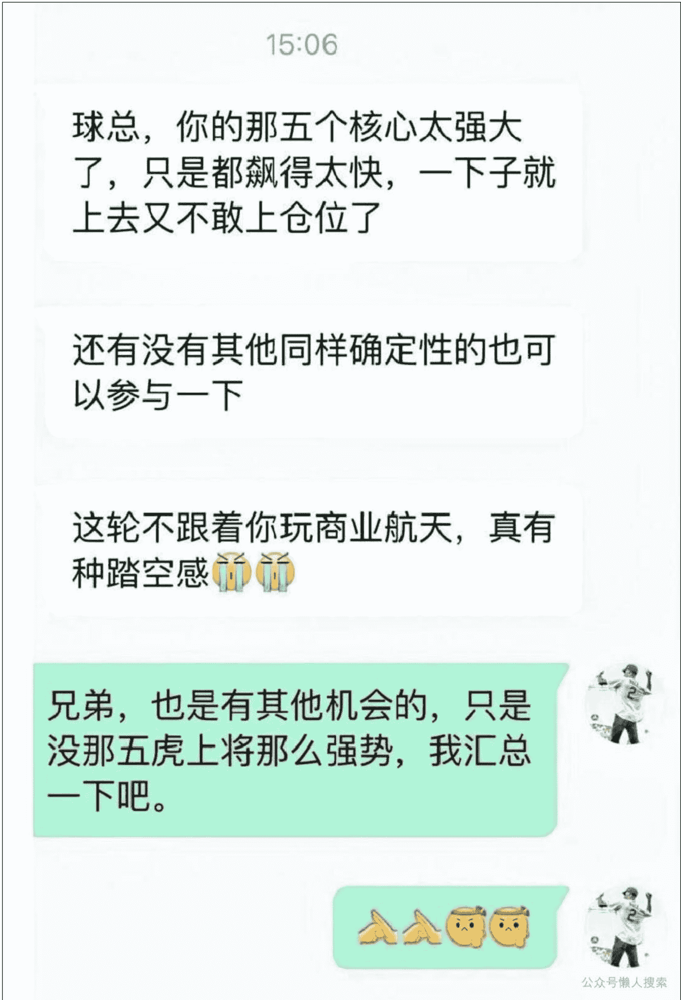

# 商业航天还有哪些值得看的机会公司

260113 击球区小能手

整理:公众号懒人搜索,懒人专属群精选

懒人微信:lazyhelper1

以下为正文:

最近就是提前一周日2026年度值得关注的新机会逻辑就挖掘好了。商业航天的五虎核心，一周时间就基本上是50%+的了，也是感恩市场，同时也有很多的兄弟姐妹在等着回调或者看着高不敢进场。也是应兄弟姐妹们的要求，我进一步筛选出 TOP10 有确定性机会的企业，让大家能多元化选择。

因为我基本上一个月都在深度调研这一部分的航天企业，五虎核心是综合评估最具弹性的，但是也知道其他同样能出业绩的企业，现在多多少少还没被挖掘到位，相对来说位置比较适中，没那么高的吓人，所以还是非常有进一步布局的机会，抓紧黄金机会：
全文大概：4300 字
正文开启：

首先就是先写我对于整个商业航天的整体看法。我是坚信一定会出 10 倍的机会在这里的，指整个航天板块，之前写的 5 个核心，“五虎上将”都是最具备出业绩的潜力和最好的弹性。那么这个阶段，毕竟都涨起来了，同样也能看到是有很多人其实是并不明白这里面的业绩增量会给到哪些企业，所以今天的 ETF 涨停其实也是一种信号，很多资金看好商业航天但是选择平铺的模式进场。所以我还是判断，这轮依然还没到第二阶段业绩线开启（会有一部分聪明的人已经在布局业绩线），但是市场的强度和演变幅度往纵深发展，情绪太好了，所以依然能够看到的是，一些靠情绪推动的公司，依然能享受到追捧。所以这也给商业航天的池子蓄下了更多的水，等第二阶段，这一些业绩线的企业会成为市场的核心中的核心。

从第一阶段切换到第二阶段必定会经历一轮调整。这里在量能的助推下，其实第一轮上来的情绪核心很多都已经在异动边缘了，那么市场资金更多的选择强势去进异动，其实也是代表了一种市场对于商业航天的看法，我的看法就是 23 年的 AI。所以之后商业航天切换肯定会是业绩线的去带头，如果出现分歧有低吸的机会就更好；如果是选择强势的节奏，那么情绪切业绩主线可能会通过剪刀差涨幅来完成，即业绩线会越来越强，情绪线的虽强但只会跟随业绩的后面，完成前排切换后排，后排真正成为带领的前排。

之前写的那 5 个就不多说了，依旧认为第一只 10 倍会从“五虎上将”这里面出现，甚至不止。对比低空经济和机器人的幅度，商业航天的强度一定会更大和更多催化出现。

接下来里面这 7 家企业，是我调研这段时间能够清晰认知到，这些企业是能从航天放量获得业绩增量的，是明确带来业绩的边际增量。但是由于鸡蛋就那么多，肯定是有五虎选五虎的，这批新的公司，是为了赶不上车、想要安全边际和心理预期的朋友打造的。他们都在我的核心池子里，可以算是商业航天的 TOP10。这批新的五虎上将同样具备业绩释放的实力，只是说由于业务比较多元，没有那么纯粹属于商业航天向，所以没有五虎那么高的弹性，所以就看各位选择吧。

## 震有科技
震有科技作为卫星互联网的中枢大脑，是优秀的星网通信系统设备和技术解决方案供应商。卫星核心网是整个卫星系统的核心，和我们之前依赖的路径是依靠地面核心网去组网，这个模式存在较大的延时限制。而目前星载和卫星之间通过激光链路互联成为了新的方向。目前震有在研激光链路的通信模块，主要配套服务的是国网方向的星间激光链路方向。目前已经是电信天通卫星地面核心网的核心供应商。同时震有已经推出了星载核心网的解决方案，可以说在资源侧绑定的大客户是未来业务持续放量的根本。这个行业就是靠强绑定，而且震有的多项核心网技术是具有壁垒的，竞争者想加入市场，需要时间和匹配到这些大客户认可。特别是星载业务，星地融合是长期趋势，未来随着 6G 的更新迭代，地面移动通信将会与卫星深度融合，实现全覆盖。所以震有在这方面释放的利润其实就是和卫星上天带来的服务量成正比。未越来越多人通过 6G，卫星通信其实就是 SpaceX 星链的模式，所以业绩释放的能见度是看得到的。同时要注意，组网选择的模式和大客户释放的通信空间，这两块业务的走向会对震有的业绩释放时间很关键。不过很明确的是，震有的业绩与卫星组网之间一定是正相关。

## 超捷股份
超捷股份是作为这个火箭制造的一环的。目前属于超捷股份的业务范畴就是整流罩业务（均价 500 万）和尾部发动机和零部件等等，未来扩展到燃料箱和发动机等业务，后期单箭甚至能去到接近 3000 万的业务量，同时目前服务于蓝箭、天兵、中科等航天企业。那么目前火箭发射数量的大幅度跃升，其实代表的就是对于火箭制造的产能持续扩展。目前超捷的产线已经满产，需要扩产才能满足客户需求。由于能够接触此业务的电气结构制造的企业较少，且该领域对制造人才有特定定位，所以有充足生产经营的企业才能够获得客户的订单，并且要是有融资途径的企业，才有途径去拿到资金扩大生产产能。未来一到两年内，订单是很充足的，行业发展速度很快，竞争对手还没来得及成长。

由于之后的火箭是可回收的技术，所以火箭就会成为多次复用的耗材。但是在一级回收的时候，火箭依然要进行返厂回收，因为发射现场不具备检修的条件，所以这一部分修复业务同样会增厚公司业绩。包括超捷主要供应的整流罩，整流罩主要用于保护卫星不受气动力、不受气动加热、解锁分离系统保证卫星整流罩顺利分离等作用，约占单火箭的 10% 成本。而且整流罩通常会在离地 100km 左右会被抛掉，SpaceX 也通过采用空中网补货技术开展了整流罩回收，但是目前主流的技术是不进行回收，所以整流罩会作为耗材而不是复用材料去看待。超捷同时还有机器人零部件和消费电子的业务，所以这一块业务的话可能会分享掉作为纯火箭企业的估值，但是这 1-2 年的订单肯定是非常旺盛的。后续持续关注这个相关可回收部分的进展，未来发射得越多的数量，肯定就是正相关的比例。

## 迈为股份
迈为股份这一个主要是 SpaceX 的合作预期，现在也是明确会供应比较大的量给到那边。目前是已经经历了前期的商务谈判，已经是拿到了订单指引而且进入了下单的节奏当中去了。目前马斯克那边要的是 HJT 光伏设备，用于 AI 数据中心储能当中，未来在太空光伏当中，P 型 HJT 电池同样会受益于放量，所以迈为光伏业务是属于一个困境反转的阶段。同时要注意的是，迈为同时也做半导体前道的设备，在珠海新投产了一个基地，未来是会去开拓半导体键合方向的设备。所以对于长期来说，迈为能做的是挺多的，半导体业务会是逐倍的增长。而且很明显看到的是，太空光伏的放量会促使迈为这一块业务的增量，主要看中的还是他和 SpaceX 合作的关系会带动未来宇宙光伏版的业务放量，设备线基本都是用的成熟方案。

## 振华股份
振华股份，其实之前也在北美缺电部分写了这一个公司，那篇文章当中把他归类为北美缺电部分，其实看仔细的朋友们也能发现，其实他也是供应火箭企业的原料供应商。未来业绩的超预期释放，主要还是看金属铬供应曲线导致的涨价，周期股的看法，其实他的这个铬盐等化工产品，才是未来的一大看点。因为受制于环保产能，其实已经是未来 1-2 年已经没有新增的供应能力了，所以但凡有新增的需求缺口，这一块就会迎来供需缺口的涨价。所以这一块金属铬由于是用于火箭当中的关键材料，耐高温，抗氧化，防腐蚀，主要用在发动机的燃烧室、涡轮叶片（应流股份），以及衔接各金属贴合件的衔接部分，类似斯瑞新材这类已经明确收到航天业务的订单，振华就是已经供应进去给斯瑞新材了。所以振华的逻辑就是绕一个弯的商业航天经济，受益于这 1-2 年的火箭制造供应缺口，所需的金属铬备料储备也会加大累计入库的量。这个公司很多人只看他那个 SOFC 和燃料电池，其实这一块业务和火箭的航空发动机是一致的同宗同源。所以振华这个需求拉上来，他的化工品铬盐涨价的预期是挺确定的。那么在调研的过程中，确实是看到了有航天企业制造商和振华的合作，所以我认为明年这个主要产品金属铬的涨价会带动振华的利润释放。可能商业航天对于他的量只占到总体业务的一部分，但是对于整体金属铬来说，商业航天拉动新需求的小缺口带来的涨价幅度和储备计划，所以理解振华对于商业航天的增量逻辑是需要绕一个弯，但是显而易见能拉动业绩增量的。

## 天银机电
天银机电是作为恒星敏感器和陀螺仪的核心供应商，是和卫星发射上天的数量呈现最直接的受益的，而且天银星际敏感器可用于火箭回收制导。目前天银的星敏感器已经应用于千帆星座。恒星敏感器的构造就是把：集成光学系统、图像系统、芯片和算法构件等集成成为一体化的精密设备，毛利率超 5 成。而且这一产品，由于头部技术壁垒和客户资源，规模化效应使得性价比由于行业内的其他产品，市场占有率超过 5 成。恒星敏感器可以用于捕捉高清图像，在这一环节当中需要保持极高的姿态控制精度来确保图像的清晰，类似未来探月，或者探火星，都需要这类高精度的精密仪器，包括登月计划等等，需要星敏感器来保证姿态控制，实现高精度的导航需求。每颗卫星需搭载大约 2-3 台星敏感器，单台的价格在 40 万元左右，那么单卫星价值量就接近约百万。以后发射卫星数量可以作为参考，按市占率 5 成去推导，这一块也是正向受益于卫星数量的放量的，业绩确定性较高。

## 国博电子与新劲刚
最后就是还是最明确看好载荷端的卫星业务，像之前的五虎，卫星载荷领域的已经成为市场的核心推动力了。由于买不进去，其实市场已经开始寻找他的延伸公司，国博电子就是市场终于挖出来的新 TR 芯片供应企业。这里还是要分两个情况，星载的 TR 芯片，寡头格局是非常明显的，地面基站供应 TR 芯片的供应商也有，这里的量也很大。

作为整个卫星载荷价值量很高的一个部分，无论是一代星，还是之后 2 代星，里面的微通道数量是快速翻倍，那么对比所需要的 TR 芯片数量是线性爆增的。例如 2 代星如按 1000-2000 通道计算，通道数量持续翻倍的同时带来的就是集成能力的提升，可能是 4 通道集成演变到 8 通道，最新预研是 16 通道，但是这里的 TR 芯片需求量一定是正相关。而且具备微波毫米级相控阵 TR 芯片研制和量产能力主要就是铖昌科技和十三所+五十五所，这些国发的都是资源高度绑定的。

而且未来一大关键战略点，一定就是地面终端的铺设覆盖，这也是星链最后商业化的闭环，同样的地面终端所需要的 TR 芯片量是非常大的。地面基站的面积更大，但是这一块 TR 芯片的性能就没星载那么高要求，所以 TR 芯片的厂家都有机会。未来这一块的业务量会作为卫星上天之后，地面基站的大规模接收铺设，类似 SpaceX，所以铖昌科技进不去的，国博电子这个逻辑也是没有问题的，未来业绩也会释放出增量，只是没有铖昌科技那么纯粹的卫星业务量。

那么这里可以同样关注新劲刚，这一个公司调研的时候也能听到这家的名字，他们确实有 TR 组件的相关产品，而且卫星载荷里面，前端射频用到的量都会很大。随着卫星等等的业务量上天，他们的订单也是会来的很快，就是他们会去采购 TR 芯片然后自己做成组件再打包给卫星制造的企业。所以如果最核心的买不到，或者觉得高，国博电子和新劲刚作为那两个核心的平替也是可以的（就等于中际旭创很强，后面的二线光模块厂同样也会受益）。

最后就是注意节奏了，各位兄弟姐妹，一定是要选适合自己的模式，毕竟都涨起来了，一定要注意节奏，代表美好未来的星辰大海，也同时代表着当下获利盘的积累。我是非常看好商业航天的长期未来的，但是同时高位多留个心眼不是坏事。

祝各位兄弟姐妹们，在商业航天的大海里遨游的快乐，寻找我们的星辰大海。

# 最后，安利小懒的付费群：
懒人专属群（介绍）

微信：lazyhelper1

📖 这里是你对抗信息过载的护城河。已稳定运行 6 年，累计拆解、研读 3000+个互联网商业实战案例与行业前沿内参和时政/宏观文章。

我们不搬运垃圾，只做高价值信息的筛选器与放大镜。

# 懒人专属群更新记录：
https://hk57gvIx7u.feishu.cn/docx/HOkRdZbSbolBR0xkaXtcuVE0nTg

【免责声明】 本资料归档于社群内部知识库，仅供成员课题研究与学术交流，请在查阅后 24 小时内删除。