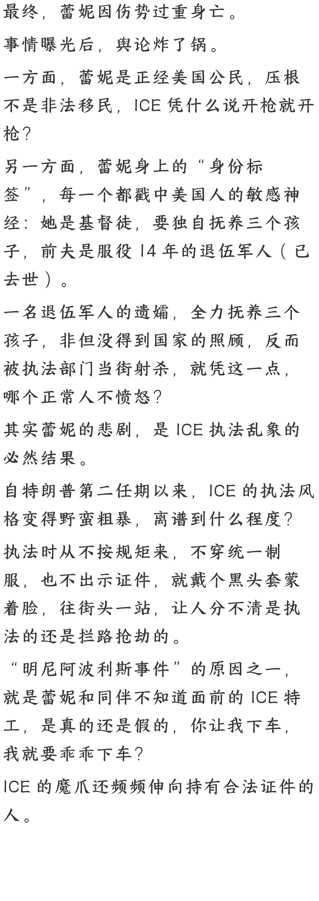

# 震动全美的枪杀案，特朗普危险了？

260113 文/卢克文工作室嘉宾 风雨如歌

整理：公众号懒人搜索，懒人专属群精选

懒人微信：lazyhelper1

当地时间2026年1月7日，美国明尼苏达州的明尼阿波利斯市，一起枪杀案震动全美。

一名美国女子，被美国海关与移民执法局（简称：ICE）特工当街射杀。民主党抓住机会引爆舆论，抗议浪潮迅速席卷全国。

刚在委内瑞拉“赢麻了”的特朗普，瞬间陷入被动。

2020年的“弗洛伊德事件”，同样发生在明尼苏达州，一名警察跪压黑人弗洛伊德致其死亡，点燃了全美怒火，最终成为特朗普输掉大选的关键。

2026年是中期选举年，“明尼阿波利斯事件”会不会再次成为特朗普的致命把柄？

## 01

1月7日当天，明尼阿波利斯市波特兰大道的东33街与34街之间，一群ICE特工设下关卡，目的很明确：拦截过往车辆和行人，排查非法移民。

37岁的美国公民蕾妮·古德驾车路过，因车辆意外熄火，停在了路中间。现场的ICE特工立刻围了上来，从曝光的视频能看到，两名特工径直走到车子左侧。

混乱就此爆发。

一名特工厉声指令蕾妮迅速离开，另一名特工则粗暴呵斥她“从车里滚下来”。蕾妮的同伴丽贝卡见状，当场和特工发生争执。

慌乱中，蕾妮想把车挪到路边，于是缓缓向右打方向。她绝不会想到，这个再正常不过的举动，会让自己丢掉性命。

站在车辆左侧的特工罗斯，心里藏着一道过不去的坎：2025年6月，他在对一名非法移民执法时，被对方驾车拖行，缝了33针，险些丧命。

蕾妮向右挪车的动作，触发了罗斯的“心理阴影”。

他误以为，对方要驾车撞向自己（其实他站在左侧，车辆拐向右侧，根本撞不到）。

没有任何犹豫，罗斯拔枪就射，对着蕾妮连开数枪。

更让人愤怒的是，蕾妮中枪重伤后，现场的ICE特工居然阻止路过的医生上前救治。

最终，蕾妮因伤势过重身亡。

事情曝光后，舆论炸了锅。

一方面，蕾妮是正经美国公民，压根不是非法移民，ICE凭什么说开枪就开枪？

另一方面，蕾妮身上的“身份标签”，每一个都戳中美国人的敏感神经：她是基督徒，要独自抚养三个孩子，前夫是服役14年的退伍军人（已去世）。

一名退伍军人的遗孀，全力抚养三个孩子，非但没得到国家的照顾，反而被执法部门当街射杀，就凭这一点，哪个正常人不愤怒？

其实蕾妮的悲剧，是ICE执法乱象的必然结果。

自特朗普第二任期以来，ICE的执法风格变得野蛮粗暴，离谱到什么程度？

执法时从不按规矩来，不穿统一制服，也不出示证件，就戴个黑头套蒙着脸，往街头一站，让人分不清是执法的还是拦路抢劫的。

“明尼阿波利斯事件”的原因之一，就是蕾妮和同伴不知道面前的ICE特工，是真的还是假的，你让我下车，我就要乖乖下车？

ICE的魔爪还频频伸向持有合法证件的人。

最典型的比如，2025年3月，ICE抓捕塔夫茨大学的土耳其女博士鲁梅伊莎·厄兹蒂尔克。

鲁梅伊莎是有合法入境证件的，只因支持巴勒斯坦，就被ICE特工当街拘捕。在法官已下令，不得将其转移出马萨诸塞州的情况下，ICE依旧我行我素。不仅连夜把鲁梅伊莎转移到红州，还吊销其学生签证。

连合法人员都能被随意处置，ICE的执法边界形同虚设。美国民众对ICE的怨气早就在积攒。

巧了，蕾妮身亡的地点，和2020年弗洛伊德身亡的地点，相距不过几公里。

这下，民众的情绪被彻底点燃。

怒火迅速蔓延全国，大小上千场抗议活动扎堆爆发，华盛顿、洛杉矶、费城等核心大城市全被席卷。单是事发地明尼阿波利斯，就有好几万人涌上街头。

面对民主党的步步紧逼，特朗普的态度半点不含糊，摆出强硬姿态应对。

对外，他一口咬死蕾妮是“国内恐怖分子”，刻意放出经过剪辑的片段，声称死者试图驾车撞击执法人员。其实，完整视频早已满天飞。

完整版视频显示，蕾妮压根没有驾车撞人的企图，特工罗斯明明站在车左侧，她缓缓把车拐向右侧，怎么看都是想挪车到路边，跟“撞人”没有半毛钱关系。

特朗普还利用蕾妮的身份标签大做文章。

根据目前曝光的信息，蕾妮的身份远比想象中复杂：她既是基督徒、三个孩子的母亲，也是LGBT群体的一员。

这在当下的美国不算新鲜事。

就像美国财政部长贝森特，也是LGBT群体，却照样支持特朗普。

蕾妮的身份细节，成了特朗普稳住基本盘的关键。

事发初期，不少MAGA还因为“退伍军人遗孀被射杀”的剧情而感到破防，可蕾妮的LGBT身份被扒出后，MAGA立马调转风向，纷纷站队特朗普。

“明尼阿波利斯”这场战役，谁都输不起。

## 02

非法移民该不该有投票权，一直是美国两党撕咬的核心议题之一。

民主党的逻辑很简单：只要来到美国，就该有投票权，管你是不是非法入境的；

共和党则咬死一条：必须是美国公民，才有投票资格。

外来移民，早就是民主党手里的核心票仓红利。

比如加利福尼亚州，80年代前还是妥妥的“铁红州”，直到里根时代，一次性赦免了300万非法移民，加州的政治底色才慢慢往“蓝”色靠。

等到2010年之后，变成了“铁蓝州”。

除了加州，另一个传统“铁红州”得克萨斯州，也因为大量移民涌入，出现了“变蓝”的趋势：2020年大选，特朗普在得州也就赢了拜登几个百分点。

非法移民问题的本质，不是什么移民问题，而是两党争夺选票的博弈。只要把非法移民的数量压下去，不就能掐掉民主党的一部分潜在票源？

这时候，美国移民和海关执法局，也就是ICE的角色，变得尤为关键。特朗普对ICE进行了“大刀阔斧”的改造，主要有两点：

- 第一，不惜血本砸钱扩能。2024年，ICE的年度经费为99亿美元，特朗普把这笔钱提至102亿美元/年，还通过《大而美法案》，额外批了300亿美元的专项经费。算下来，ICE的总经费高达402亿美元，比FBI的年度总预算还要多。有钱好办事，经费到位后，ICE不仅把人员规模扩编了一倍，从1万人扩编到2.2万人，且还要持续扩编，并采购了大批新装备，从执法车辆到侦控设备一应俱全。
- 第二，精准筛选“自己人”。退伍军人和警察这两个群体，被列为ICE扩编的重点招募对象，退伍军人群体和警察普遍认同特朗普的理念，是MAGA阵营的中坚。这次枪杀蕾妮的罗斯，就是个43岁的退伍军人。

这套组合拳打下来，效果立竿见影。2025年，ICE驱逐了约70万非法移民。对民主党来说，等于损失了70万张潜在选票，怎么可能不把矛头指向ICE?

“明尼阿波利斯”事件后，不少民主党媒体批评ICE是“特朗普的冲锋队、党卫军”，科尔特斯、桑德斯等民主党内的激进派，高喊着“废除ICE”。

喊口号容易，真要把废除ICE落到实处，难度极大，因为有两个关键内鬼：民主党参议院领袖舒默，和民主党众议院领袖杰弗里斯。

面对激进派喊破嗓子的“废除ICE”诉求，这两人的态度始终暧昧不清。

早在此前《大而美法案》审议时，党内大批激进派议员就希望废除给ICE增加经费的条款，可舒默和杰弗里斯作为党派领袖，全程无动于衷。

“明尼阿波利斯事件”后，他们依旧不同意废除ICE，只是进行了不痛不痒的批评，明眼人都能看出来，建制派就没打算跟ICE真刀真枪对着干。

为啥舒默这些建制派大佬要胳膊肘往外拐，宁愿给激进派添堵，也不帮着自家阵营实现诉求？

核心原因就一个：民主党内分裂。

2020年的时候，民主党上下还能拧成一股绳，不管是建制派还是激进派，都把“夺回政权”当成首要目标，暂时搁置了内部矛盾，异常团结。

可时过境迁，到了如今这个节点，民主党的内部裂痕已经大到无法弥补，激进派一心想把建制派拉下马，建制派不可能坐以待毙。

最典型的例子就是纽约市长选举。

建制派大佬们清一色支持建制派候选人科莫，激进派则全员站队马姆达尼，党内矛盾彻底摆到了台面上。

现在的民主党，就是当初共和党的翻版。

当年共和党内部，特朗普的MAGA派和建制派势同水火，如今民主党也陷入了这种内耗局面。

对舒默这些民主党建制派来说，党内控制权，可比对抗特朗普重要多了。他们宁可跟特朗普合作，也绝对不能容忍激进派夺走自己的权力。

既然你们激进派非要撕破脸夺权，那就别怪我们在废除ICE这种关键问题上，给你们上眼药。

内部不团结，导致民主党难以复制“弗洛伊德事件”。

遍及全美的抗议浪潮，看起来声势浩大，实则对特朗普没有太大伤害。

“明尼阿波利斯事件”初期，特朗普在舆论上很被动，连MAGA都没多少支持的声音，随着蕾妮的LGBT身份被挖出，特朗普成功在基本盘里站稳。

民主党失去了一次好机会。

特朗普拿身份政治做文章不地道，但账也不能全算在他头上。毕竟率先玩弄身份政治的，是民主党。

如今，两党陷入身份政治的恶性循环，再闹下去，没人会在乎事件本身的对错，只剩下立场的站队。

最终损耗的，不过是美国的社会根基。

# 最后，安利小懒的付费群：

懒人专属群（介绍）

📖 这里是你对抗信息过载的护城河。

已稳定运行 7 年，累计拆解、研读 3000+ 个互联网商业实战案例与行业前沿内参和时政/宏观文章。

我们不搬运垃圾，只做高价值信息的筛选器与放大镜。

懒人专属群更新记录：

https://hk57gvlx7u.feishu.cn/docx/H0kRdZbSbolBR0xkaXtcuVE0nTg

【免责声明】 本资料归档于社群内部知识库，仅供成员课题研究与学术交流，请在查阅后 24 小时内删除。