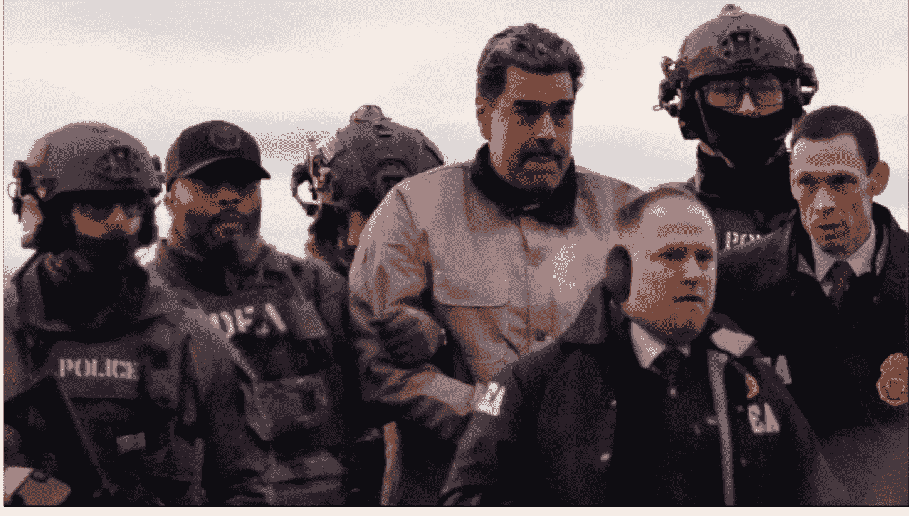

# 美军突袭委内瑞拉：几个媒体议题

260113 新闻实验室

整理：公众号懒人搜索，懒人专属群精选

懒人微信：lazyhelper1

对于委内瑞拉的记者们来说，黎明还远未到来。

1 月 2 日晚上 10 点 46 分，川普批准了一项代号为“绝对决心”（Operation Absolute Resolve）的突袭。几小时后，美军在委内瑞拉逮捕了该国总统尼古拉斯 · 马杜罗。

在这一震惊世界的开年事件中，有几个与媒体相关的议题。本期新闻实验室会员通讯，我们对这几个议题做一些介绍和讨论。

## 沉默的共谋与道德困境

第一个议题是：就在行动开始前不久，《纽约时报》和《华盛顿邮报》这两家美国最具影响力的新闻机构实际上已经获悉了这一计划。然而，在得知这一绝密情报后，这两家报社的编辑部做出了同样的决定：暂不报道这一新闻，直到行动结束后再公开报道。

## 如何理解媒体在国家军事行动面前的沉默与配合？

这种决定虽然并非法律强制——美国没有像其他国家那样拥有阻止机密信息发布法律机制——但却遵循了美国新闻界在国家安全问题上长期以来的传统，目的是为了不危及美军士兵的生命安全。

在历史上，曾经多次出现类似情况。例如，1961年《纽约时报》曾推迟报道猪湾入侵的细节。又例如，小布什总统在“9·11”恐怖袭击后，秘密授权国家安全局（NSA）直接监听美国境内人士与海外之间的电话和电子邮件，且无需申请搜查令。《纽约时报》原本掌握了这一机密，但因为害怕向恐怖分子透露美国的侦查手段，而把报道压下了一年多的时间。

最近的一个例子是，去年美国媒体也曾为了配合政府与俄罗斯进行的涉及记者埃文·格什科维奇的囚犯交换谈判而暂缓报道。

尽管国家安全和士兵生命都是极端重要的考虑因素，但是媒体的配合是无条件的吗？

首先，这场袭击并非没有代价——事实上，代价惨痛。据委内瑞拉一名高级官员透露，包括军人和平民在内，至少有40人在美军的袭击中死亡。加州大学伯克利分校的新闻学教授Mark Danner认为，这是一个非常棘手的局面。媒体的本职是发布新闻，而非压制新闻。选择压制报道，意味着媒体必须采信政府关于发布后果的说辞。实际上，当年《纽约时报》对NSA监听行为的延迟报道，就曾引发激烈批评，也让斯诺登不再信任这份报纸。

更重要的是，如《哥伦比亚新闻评论》提出的：如果《纽约时报》和《华盛顿邮报》的编辑们提前知道这次行动可能违反美国法律和国际法，那么他们到底是经过了怎样的评估，决定延迟报道的？他们有义务配合这样可能违法的行动吗？

实际上，《纽约时报》的社论版（它独立于新闻编辑部运作）事后发表文章称，川普授权的袭击是“非法且不明智的”。然而，新闻编辑室在事前却选择了沉默。

从宽容的角度看，媒体的静默可能避免了泄密导致的更多流血冲突。但从批判的角度看，这是否意味着这两家顶级大报在某种程度上默许，甚至协助了川普政府发动一场旨在推翻他国政府的非法军事袭击？

在这个案例的伦理争议中，新闻媒体找不到舒适的位置。

## 五角大楼的新闻争夺战与右翼的分裂

第二个议题是此次突袭之前就已经发生的趋势：在与美军相关的信息发布中，正在进行着激烈的争夺战。

根据《华盛顿邮报》的报道，战争部长/国防部长海格塞斯正在系统性地清洗传统媒体的影响力，转而引入一批非传统的媒体人，试图将新闻发布会从一个质询权力的场所，转变为一场政治集会。

这种转变在所谓的“自由军火库”（Arsenal of Freedom）巡回演讲中表现得淋漓尽致。海格塞斯驱逐了那些拒绝签署新保密规则的主流媒体记者，取而代之的是来自右翼网络生态的新面孔。来自 LindellTV 的 Heather Mullins 在现场并没有提出任何关于战略或预算的尖锐问题，反而因为海格塞斯在演讲中提到耶稣而高呼“Christ is King（基督是王）！”。同样，海事网站 GCaptain 的 John Konrad 公开表示，他的职责不是挖掘独家新闻，而是感谢军队。在他们眼中，记者不再是监督者，而是政府议程的“啦啦队”。

不过，这种强硬的媒体控制策略并没有在右翼阵营内部赢得一致的喝彩。相反，委内瑞拉突袭行动在 MAGA 运动内部引发了一场意见分裂。《华盛顿邮报》的报道指出了这场分裂的核心：究竟什么才是真正的“美国优先”，干涉外国还是不理会它们？

一方面，像 Gateway Pundit 这样的支持者欢呼这是川普的胜利，是对美国力量的展示。但另一方面，自由意志主义倾向的右翼人士对此感到愤怒。播客主播 Dave Smith 痛斥这次行动是川普向“深层政府”和战争鹰派的投降，称其为“无法容忍的羞辱”。他认为，干涉他国政权完全背离了“美国优先”的反干涉主义初衷。类似的，前 Infowars 主持人 Owen Shroyer 指责那些盲目支持战争的 MAGA 粉丝已经变成了“吃泔水的顺民”（slop-eating simps）。

这种裂痕也延伸到了对媒体角色的认知上。前福克斯新闻明星主播 Megyn Kelly 对她的前同事们进行了猛烈抨击。她指责福克斯新闻在报道此次行动时缺乏任何怀疑精神，完全沦为政府的扩音器，甚至将其与“俄罗斯宣传”类比。

曾经铁板一块的 MAGA 阵营，近来出现诸多裂痕。战争与干涉主义这一话题，也成了导致裂痕的议题之一。这样看来，五角大楼或许能控制发布室里的声音，但却无法平息支持者内部日益高涨的质疑浪潮。

## 委内瑞拉的新闻封锁与流亡媒体人的韧性

马杜罗被捕，不少委内瑞拉人欢庆。但是，没了马杜罗的委内瑞拉，成了一个自由国度吗？

远远没有。

在马杜罗的威权统治下，大量委内瑞拉记者流亡海外，这些流亡媒体人展现出了强大的韧性，但韧性的另一面，则是持续不断的高压。

突袭发生当晚，当加拉加斯的夜空被爆炸声和低空飞行的飞机轰鸣声撕裂。社交媒体上开始流传各种令人不安的报告。对于流亡在外的委内瑞拉记者 Luz Mely Reyes 来说，这是一个早已预演过的时刻。作为数字媒体 Efecto Cocuyo 的负责人，她迅速通过短信联系了一群同样流亡的同事。几分钟后，一个跨越国界的“虚拟新闻编辑室”开始运作，一场旨在打破信息封锁的历史性直播就此拉开序幕。这场直播最终进行了 10 小时 48 分钟。它详细记录、解释并核实了马杜罗被捕并移交美国的军事行动。这次直播在 YouTube 上的观众一度超过 30 万，不仅成为了委内瑞拉国内民众的重要信息来源，也为多家国际媒体提供了第一手资讯。这一壮举展示了委内瑞拉独立新闻业的韧性：流亡海外的资深编辑们利用其公众形象和安全环境进行播报，而身处国内的记者则作为“眼睛”，在极度危险的环境中匿名收集和核实情报。

对于这些仍留在委内瑞拉国内的记者而言，马杜罗的倒台并未立即带来自由，反而引发了新一轮的打压。

就在马杜罗被捕后的几天内，委内瑞拉当局宣布进入紧急状态，并发布法令要求搜捕任何涉嫌支持或宣传美国军事行动的人。这一法令成为了当局进一步钳制新闻自由的工具。据委内瑞拉全国新闻工作者工会（SNTP）统计，仅在1月5日德尔西·罗德里格斯宣誓就任临时总统当天，就有至少14名媒体工作者被拘留，其中绝大多数是国际媒体的雇员。虽然大部分人随后获释，但他们的手机被没收并遭到彻底搜查，通讯录、通话记录甚至加密软件中的对话都暴露在情报机构的监控之下。工会指出，这种行为不仅侵犯隐私，更直接威胁到了新闻线人的安全。

恐惧在新闻从业者中蔓延。资深记者兼安全顾问 Luis Carlos Díaz 不得不建议国内的同行们采取极端的自我保护措施：只与绝对信任的人交流，使用安全渠道，甚至在采访时要尽量伪装成普通市民，避免表现得像个记者。Díaz 警告说，任何故事都不值得付出生命的代价。这种恐惧并非空穴来风，就在哥伦比亚与委内瑞拉边境，Univision 的记者 Tuan Carlos Vélez 及其团队不仅被短暂拘留，其拍摄设备被查扣，新闻素材也遭到删除。

在这种情况下，流亡可能会继续成为委内瑞拉媒体的核心词。

马杜罗被美军抓走了，但委内瑞拉的高压政治并未发生变化，川普政府对于委内瑞拉的民主和自由也并没有展现出兴趣。一批长期被关押且下落不明的委内瑞拉记者，仍在黑暗中等待正义的降临。对于委内瑞拉的记者们来说，黎明还远未到来。

最后，安利小懒的付费群：

懒人专属群（介绍）

📖 这里是你对抗信息过载的护城河。

已稳定运行 6 年，累计拆解、研读 3000+个互联网商业实战案例与行业前沿内参和时政/宏观文章。

### 我们不搬运垃圾,只做高价值信息的筛选器与放大镜。

懒人专属群更新记录:

https://hk57gvlx7u.feishu.cn/docx/HOkRdZbSbolBR0xkaXtcuVE0nTg

【免责声明】 本资料归档于社群内部知识库,仅供成员课题研究与学术交流,请在查阅后24小时内删除。