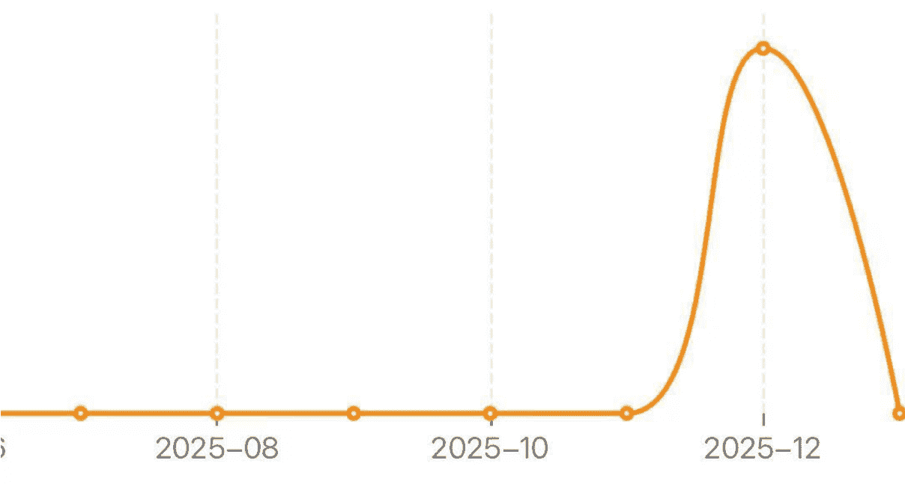
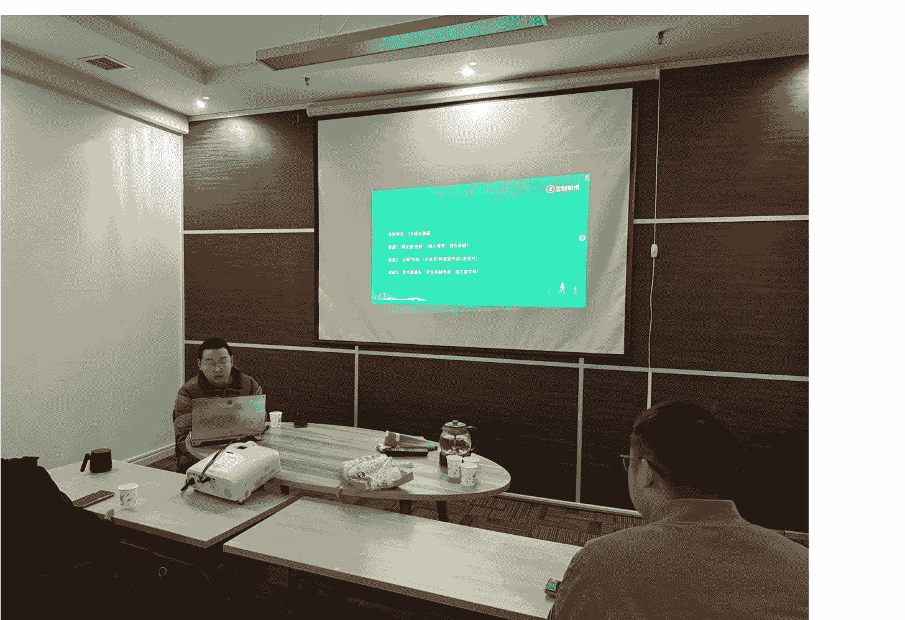
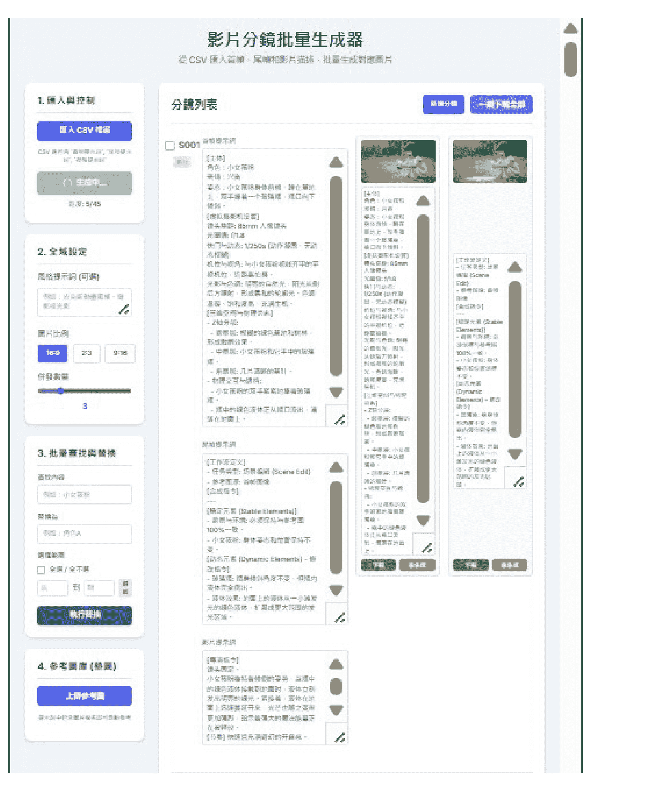
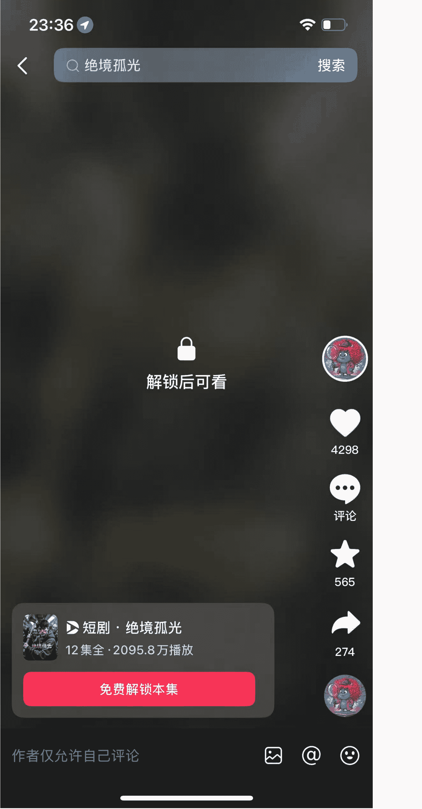
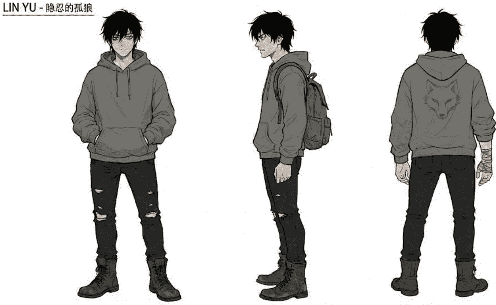
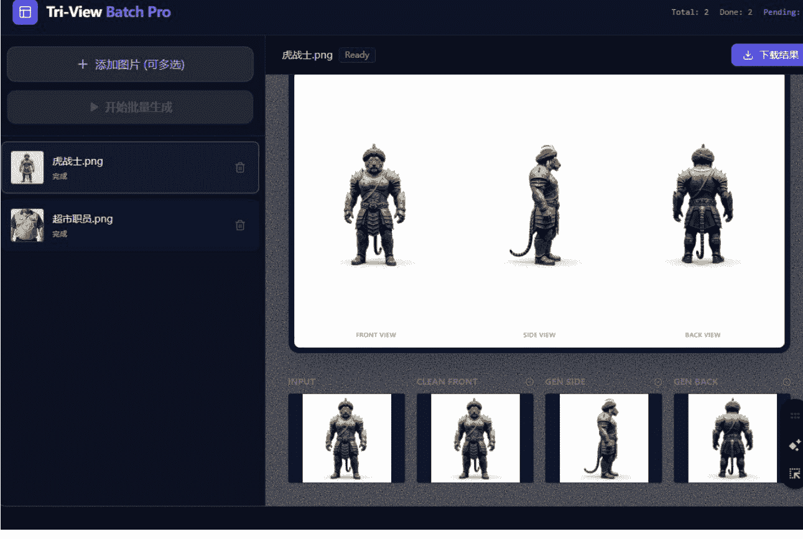
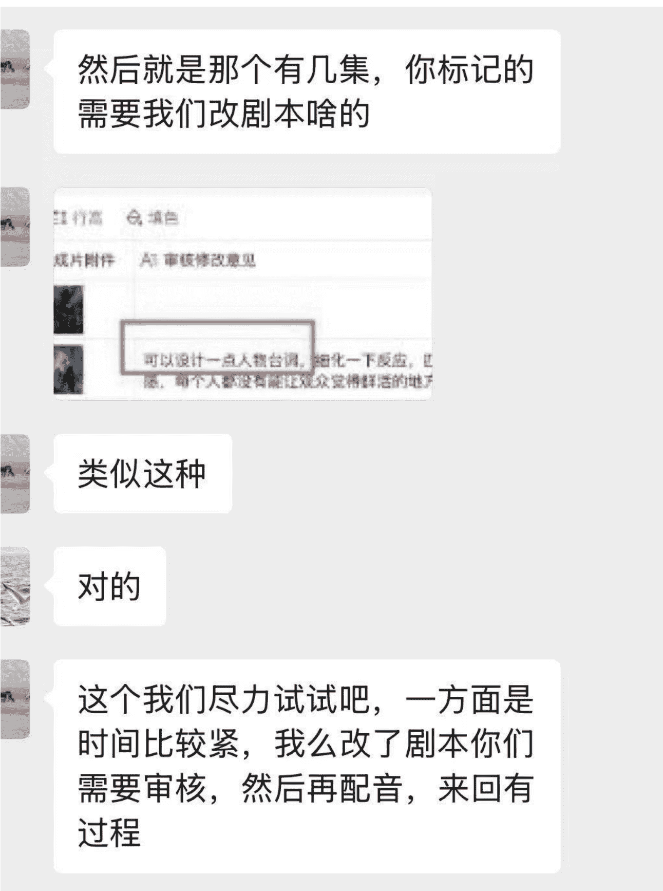
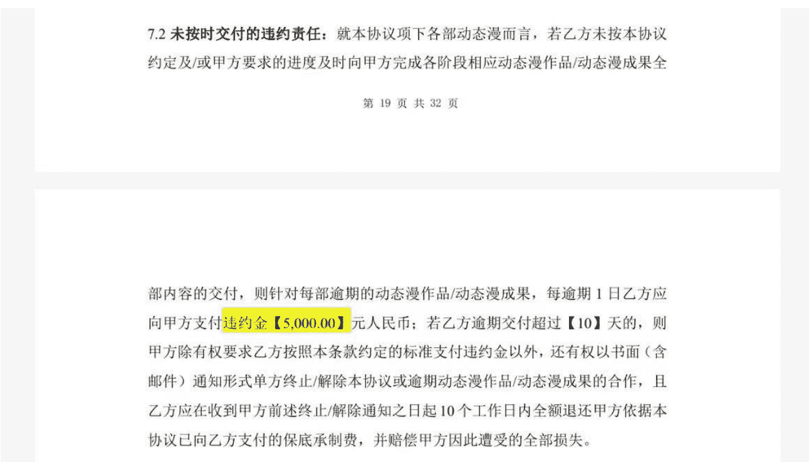

# 【AI漫剧】5人小队30天完成108集承制变现8W，深度复盘全链路拆解与13个血泪坑。

# 260115 副业 SC 精华

公众号懒人搜索，懒人专属群独享
懒人微信：lazyhelper1

微信：lazyhelper1

各位圈友大家好，我是咸鱼高。最近 AI 漫剧被吹的很火，整个市场的走向会发生什么样的变化，我也是初入者不敢妄下评论，但我和几个小伙伴确确实实已经拿到了阶段性的结果，而且我跑通之后发现，生财里很多圈友的 AI 技术水平，是完全可以搞定市面上大部分 AI 漫剧的承制的，只是缺少一些接单途径和避坑指南，这篇文章也会毫无保留的分享给大家。

先向大家汇报一个“小战绩”： 我们 5 人组成的草台班子，在 2025 年 12 月，仅用一个月时间，跑通了合同签订-试稿-交付的全流程，承制了一部 108 集总时长 203min 的 AI 长篇漫剧，承制费 8w （已收到 80%打款），外加 17%的片子盈利分润（涉及到保密协议，具体片子还无法透露，如果大卖了再来给大家报喜）。

## 服务性(收入)

2025年12月
尾号000
交易笔数：3
交易金额：¥64,001.00

- +¥1.00
- +¥24,000.00
- +¥40,000.00

交易明细 交易对手

说来也巧基本上开始制作的时候就是咱们短剧航海开始的时候，交付结束那一天也是12月24号航海结束那一天，当时我一边承制一边也是咱们航海的志愿者，这次是真的把学以致用发挥到极致哈哈，手册的提示词直接拿来在vidu上框框使用，而且有些拿不准的问题也和教练交流过，比如探讨高频角色的技能大招的一致性问题。还有就是最终参与制作的伙伴都差不多快10人，有些伙伴就是航海中的船员，聊着聊着有些伙伴也想实战体验，就用兼职模式让想参加的伙伴也尝试做起来，最终就像我开始说的那样真的验证了生财的伙伴们是真的有实力去做承制的!

目前，我们正在对接第二部承制，也欢迎圈友们一起交流共享资源和技术一起搞钱。可以说，漫剧承制这扇大门一旦推开，里面的风景远比想象中的广阔许多。

其实在几个月前，我们还是一群在AI里各自摸索的普通人。能有今天的成绩，必须先感谢生财有术，感谢亦仁，感谢七天，感谢每一位无私分享的AI精华帖作者。

这篇复盘，是我被七天在传术师群里“多分享”的建议“怂恿”出来的。作为一个平时不爱在这个圈子里冒泡的人，我决定打破自己的舒适区，把我们踩过的坑、跑通的路、用过的SOP，毫无保留地交一次作业。

再加上这周我有幸被撑起重庆半边组局江山的男人重庆-羊羊羊邀请做了线下分享，给想做漫剧的小伙伴沉浸式剧透了承制过程，也给正在做漫剧的伙伴新的灵感，我也通过这次分享自己收获了一些自己还不了解的漫剧行业信息，认识了未来可能会一起在漫剧赛道上奋战的志同道合之士。这些正反馈也加强了我对生财提倡的越分享越幸运的真理的认同!

希望这篇复盘，能帮大家在 AI 漫剧承制这条赛道上，少走弯路，多赚真金。

## Part 1 缘起：两枚“超级标”串起的故事

首先讲下团队的配置，也便于对 AI 漫剧承制感兴趣的圈友做参考。我们团队一共 5 人，都是“半路出家”，在做漫剧之前，我们是这样的：

- 1 位 AI 商业广告专家：精通市面上大部分模型搭配出图出视频，是我们的技术大腿；
- 1 位航海教练：深度 AI 用户，对各种新工具极其敏感，负责解决技术难题；
- 2 位 AI 自媒体玩家：网感好，懂流量，对画面审美有直觉；
- 1 位什么都会点点的项目统筹：也就是我，啥都会点 AI 视频，自媒体运营，AI 编程都雨露均沾但是都不精通，负责把大家拧成一股绳，搞定甲方和进度。

虽然我们各有专长，但真正把这些零散的能力“串”起来，变成一个能赚钱的商业闭环，源于生财有术的两次关键指引。

第一次是 2025 年 2 月，亦仁发了一个关于“AI 服务”的超级标。那是我第一次意识到，AI 不仅仅是生成好玩图和视频的玩具，它是可以变成实打实的“企业服务”卖出去的。从那时起，我开始对 AI 引起重视，经常在朋友圈分享一些自己的 AI 提示词，顺势接了很多 9.9，29.9 的单子，给朋友出海报、出简单的 5-10s 的视频。

第二次是 2025 年 6 月，亦仁关于“YouTube 中长视频潜力”的超级标。这个标像一道闪电，让我瞬间看清了链路。既然中长视频有潜力，那 “从提示词 -> AI 出图 -> 图生视频 -> 剪辑成片” 这套流程就是核心基建。所以我也一股脑扎进了 youtube 中视频，还搞了个用分镜提示词批量出图的小工具，不过没坚持下来，也就没拿到结果。

所以当拿到甲方试稿的剧本的那一刻，我当时信心十足，觉得这事肯定可以干，而且能干得不错。就赶紧号召了下平时联系比较多的几个圈友，大家一商讨发现各自的技能点：写提示词的、剪视频的、做运营的等都可以在承制中发挥作用，然后就直接拍板，跑通试稿马上签了合同，接下了这 100 集的大单，虽然中途状况不断，但好在最后我们没有烂尾。爱你们，我的小伙伴。

## Part 2 搞定甲方：承制的3个核心渠道

很多圈友问：在生财混技术多多少少都会些了，那么第一单从哪里来？结合我们的实战，分享3个最有效的渠道。

## 1. 朋友圈“挖坟”（我的第一单来源）

不要不好意思，大大方方在朋友圈展示你在做AI。现在AI漫剧是风口，大量的甲方和乙方入场。乙方市场鱼龙混杂，甲方也不敢轻易的把手里的本子给到一个完全没有信任基础的乙方。我就只是问了一圈身边做AI类目、做AI商单的朋友，结果惊喜地发现，他们手里还真有认识的甲方手里的剧本还没派发出去！我的第一单，就是朋友介绍的。熟人背书，双方有了这个基础达成合作的概率更高，后续遇到问题也更好处理。

小技巧：团队的任何人都可以去找资源，我们的第一单和正在对接的第二单分别来自于团队不同的小伙伴。

## 2. 公域“钓鱼”：小红书/抖音

这是我们正在发力的方向。逻辑很简单：发作品 = 发名片。把你做好的 Demo、精彩的分镜图、角色设计图发到小红书和抖音。只要流量起来，像抖音直接可以开启赚钱模式，如下图

不仅如此，甲方自然会顺着网线来找你。而且，这些作品本身也是你向平台申请承制时的最好“简历”。

## 3. 官方直通车：申请平台承制

现在的短剧/漫剧平台（如抖音、书旗等）都在招募承制方，只需要按照官方的要求进行申请即可，我们也正在申请中。其中核心门槛有两点：现成的作品集+数据/奖项背书。

避坑 TIPS：平时练习的作品，一定要保留好工程文件（SD 的参数、MJ 的 Prompt、剪映的草稿）。很多平台审核时，为了验证是否为你原创以及是否具备修改能力，会要求查看工程源文件。

| 信息源 | 内容 |
| :--- | :--- |
| 短剧版权中台成品漫剧业务介绍及合作指引 | |
| 红果短剧创作服务平台 https://www.dramaland.com/ | |
| 抖音集团短剧版权中心 https://www.shortdramas.com/ | |
| 抖音集团短剧版权中心-漫剧操作指南 | |
| 抖音集团短剧版权中心-短剧操作指南 | |
| （知乎）重磅！抖音集团短剧版权中心（番茄+抖音）入驻教程 https://zhuanlan.zhihu.com/p/1955590524573587445 | |
| 抖音集团短剧版权中心正式上线，融合番茄与抖音内容合作平台！ https://www.juduanduan.com/2025/1021/2518.shtml | |
| https://www.shuqi.com/comic/rule | 书旗漫剧 |
| https://nova.yuewen.com/coop-intro | 阅文漫剧 |

## Part 3 核心 SOP: 保姆级制作全流程拆解

这里和 part4 是我自认为干货最多的部分。很多人觉得 AI 漫剧难, 是因为没有把流程标准化。我们将整个过程拆解为试稿和制作两个阶段。

## 第一阶段: 试稿定生死

试稿是甲方的“验资”环节, 通常要求制作第一章作为 Demo。这个阶段, 哪怕通宵也要把质量拉满。

### 1. 试稿流程
试稿前沟通（甲方会看下往期作品）→甲方给出试稿要求→就甲方要求进行细节沟通→制作 demo→审核通过沟通后续承制内容→签合同

每个甲方流程可能都有细微的变化，下面详细讲下两个决定试稿生死的细节：

### 2. 借力打力，快速响应
甲方问：“有没有往期作品？” 如果你没有，千万别说“我现在做”。借力！ 找身边做 AI 视频的朋友，拉他们入伙（比如我就拉了做 AI 商业广告的大神），用他成熟的作品先“敲门”。只要门敲开了，后面就是拼执行力的时候。

### 3. 角色设计：决定胜负的第一关
试稿试什么？核心就是看你的角色是否符合剧本灵魂。 这里有一套我们的 “角色设计公式” ：

- Step 1：剧本定调 先看剧本是大女主、热血玄幻还是甜宠恋爱？可以在“快看漫画”等平台搜同类题材，找到和你剧本分类一致的本子，把里面的角色图片作为参考垫图。

- Step 2：灵魂拆解（内在+外在）外在：黑长直、泪痣、TK 裙（直接提取文本中描述作为 Prompt ）。内在：疯批、高冷、绿茶（提炼性格然后通过面相、气质展现）。

比如 DC 中的小丑女哈莉奎茵，一眼就让观众看到了角色的疯批内核。

- Step 3：避开“音色坑”
血泪教训：我们曾根据上面的 Step 2：灵魂拆解设计了一个外表粗犷的大叔，结果甲方给的配音是“小奶狗”音。画面和声音严重的违和感，直接导致返工。
SOP 优化：设计角色前，不止要参考剧本里面的人设，必须要求甲方提供配音小样！如果甲方给不出，先按常理设计，等配音给到时需要及时审核音色和角色的匹配度，遇到问题马上与甲方沟通。

## 第二阶段：制作 SOP（解决一致性与效率）

一旦合同签下，进入量产，拼的就不是创意，而是工业化流程。

- 1. 梳理剧本并建立标准的“项目库”
梳理剧本，理出出场人物，场景，道具等。我们是把剧本丢给 gemini pro 的研究模式，让他进行梳理，最终给到文档。

| 序号 | 场景分类 | 出现集数(含100集) | 共出现集数 | 总镜头数 | 时间(日/夜) | 场景类型(内/外) |
|---|---|---|---|---|---|---|
| 1 | ... | 4, 5, 6, 11, 12... | 30 | 37 | 夜/日 | 外/内 |
| 2 | ... | 5, 6, 7, 8, 9, 13... | 13 | 20 | 日 | 外/内 |
| 3 | ... | 29, 30, 31, 32, 36 | 12 | 18 | 日 | 外 |
| 4 | ... | 3, 7, 10, 38, 41... | 11 | 14 | 日 | 外/内 |
| 5 | ... | 3, 64, 65, 66, 67... | 8 | 10 | 日 | 内 |
| 6 | ... | 62, 65, 79, 89, 92 | 7 | 10 | 夜/日 | 外/内 |
| 7 | ... | 15, 16, 17, 34, 35 | 5 | 6 | 日 | 外/内 |
| 8 | ... | 58, 59, 61, 79 | 4 | 5 | 日 | 内 |
| 9 | ... | 84, 85, 86, 87 | 4 | 8 | 日 | 内 |
| 10 | ... | 43, 44, 45, 46 | 4 | 7 | 日 | 外 |
| 11 | ... | 75, 76, 77, 80 | 4 | 6 | 夜/日 | 外/内 |
| 12 | ... | 47, 72, 74, 76 | 4 | 5 | 夜/日 | 外/内 |
| 13 | ... | 49, 55, 57 | 3 | 4 | 日 | 外/内 |
| 14 | ... | 47, 60, 69 | 3 | 6 | 日 | 内 |
| 15 | ... | 70, 79, 81 | 3 | 3 | 日 | 内 |
| 16 | ... | 48, 58, 70 | 3 | 4 | 日 | 内 |
| 17 | ... | 20, 21, 23 | 3 | 3 | 日 | 内 |
| 18 | ... | 88, 89, 96 | 3 | 4 | 日 | 内 |
| 19 | ... | 22, 24, 25 | 3 | 3 | 日 | 外 |
| 20 | ... | 1, 2 | 2 | 3 | 日 | 外 |
| 21 | ... | 4, 6 | 2 | 2 | 日 | 内 |
| 22 | ... | 82, 83 | 2 | 4 | 日 | 内 |
| 23 | ... | 71, 73 | 2 | 2 | 日 | 外 |

- 推荐工具：飞书多维表格。 必建子表：
- 人物库：角色立绘、三视图（正/侧/背）。
- 场景库：主场景空镜图（不同角度）。
- 道具库：关键道具（如戒指、法杖）的独立图。
- 特效库：高频出场角色的技能招式。
- 进度表：细化到每一集抽卡和剪辑的责任人。

| 人名 | (正) | (背) | (侧) | (特) |
|---|---|---|---|---|
| 女娲 | | | | |
| 接引道人 | | | | |
| 准提道人 | | | | |
| 太清老子 | | | | |
| | | | | |

项目库易踩坑点：指派专人管理素材库，严禁多人随意上传覆盖！我们曾经因为两个人同时上传了一个场景的不同版本，导致两集画风打架，这种低级错误千万别犯。

- 2. 包干制生产流（流水线作业）
我们将团队分为抽卡组和剪辑组。
抽卡组（A/B 同学）：
- A 负责 1-10 集，B 负责 11-20 集。
- 关键动作：两人必须在交接处（第 10 集末尾）对齐，确保剧情连贯。
- 交付标准：【每个分镜】都要提供 2-3 个不同景别（特写/中景/全景）的视频素材。
- Prompt 技巧：为了保持画风高度统一，我们会在分镜提示词结尾处添加固定尾缀，比如：
- 中国动漫风格，2D 动画。如果不加尾缀，虽然大家都是用的同样的素材库，但是不限制 2D，2.5D 或者 3D，大模型有时候就会 3 种类型都给抽出来。

剪辑组（C/D 同学）：
编剪一体，拿到素材后，利用剪映进行组装、特效、音效合成。
关键动作：共享工程文件，统一转场特效、字幕字体、音效等

- 3. 100集长篇品控是关键：搞定“AI一致性”的笨办法
AI漫剧最大的痛点就是一致性问题
前期素材图片制作：用 nano banana 生成角色的三视图，以及其他道具场景素材，这是所有画面的“母本”。
由于给出角色设定+要求AI出三视图的提示词经常容易产生污染，导致AI返的三视图之间多多少少会有点差异，索性自己开发了一个小工具。

只需要批量做出正面图，然后上传，就可以批量拿到一堆角色的三视图，非常高效，再次感叹 AI 编程真的 nb（我现在也没记住几个编程知识）。
由于这次开始的比较匆忙，工作流化还不够彻底，后面会制作更多类似小工具，来提高制作的标准化和效率。
中期视频制作：我们是用的 vidu 多参，测试下来 vidu 的一致性效果和成本都是不错的。我们做的时候是从图生视频和多参生视频两种模式里面选择了第二种，这里也展开说下为什么要这么选择。
人物一致性问题：在有些运镜的过程中这种一致性就会被打破，比如我要做一个人物首次出场的镜头，我设计的镜头是，首先镜头近景特写人物的脚走路，然后镜头慢慢往上移动，最后出现人物的上半身。如果这里按照图转视频的首尾或多帧的逻辑，首帧是角色的脚，尾帧是角色的上半身，那么角色中间的部分 AI 就会自由发挥，丢失一致性。多参因为我是直接把角色三视图给到 AI 所以 AI 用全局视角来制作这种局部运镜就不会丢失一致性。
工程量问题：如果是图转视频的首尾或多帧的逻辑，那么流程大概就是分镜提示词→分镜图→图转视频提示词→视频。而多参是：分镜提示词→视频。现在漫剧承制甲方给的工期都比较赶，在这个时间就是金钱的赛道里，能够快速制作不止是大大增加单位产能，而且也能大量节约人力成本！
软件成本：vidu 成本也挺低！我们最终 4 个 vidu 旗舰号搞定！当时还是 499 一个月每日 200 次 0 积分错峰生成。
后期导演审核：导演统一审片，导演是最终的成品质量的守门人。必须有一双“火眼金睛”，能一眼看出“这集是 2D，那集怎么变 2.5D 了？”然后还要协调抽卡组重新出素材、剪辑组重新剪辑成片，确保新版本的正确。
这也分享一个小技巧：拿不准风格时，截图问 AI：“这张图是 2D、2.5D 还是 3D？”用魔法打败魔法。

这是2.5D风格的图像。画面中人物和场景具有明显的立体感和层次感，但整体仍保持二维平面的视觉效果，符合2.5D（伪3D）的表现手法。这种风格常见于游戏和动画中，通过光影、透视和细节处理营造出接近3D的视觉体验，同时保留了2D的绘制特点。

## Part 4 避坑指南

这一部分，真的句句都是血泪教训。如果早点知道这些，我们在那个煎熬的 30 天里，平均每人至少能多睡 50 个小时觉。很多问题都是经验不足导致，如果小白团队看到真能避免不少！

## 坑 1：时长和剧集标准

现象：合同写“100 集，总时长不低于 200min”，但是微信群里甲方给到的是不同的解释。由于我们看合同聚焦于看乙方不利条款，和甲方就群里的剧集时长信息进行沟通后（这里我们沟通的比较片面导致对群里信息进一步误解），以为做满100集就行，每集90-120S区间就好。

后果：做到一半（50-60集时），甲方说时长不够，必须加戏！加戏的时候后面改动的章节我们不能动，打乱了全盘节奏，耽误了1-2天工期。

对策：死抠合同，提前预估现有剧本的分钟数！在开工前，评估第一集在剧本中的制作难度，如果处于平均难度那么可以拿第一集时长做锚点（低于平均难度则换一集），乘以100，看看够不够200min。不够的话，提前规划方案，以及提前和甲方沟通是否增改剧本问题，别等到最后被动增改剧本以及返工。

### 2.6 动态漫作品要求

（1）动态漫的体量要求：就本协议项下每部动态漫作品而言，应不少于【100】集，单集动态漫（含片头、片尾）的有效时长应不超过【2】分钟，单部动态漫的总有效时长不低于【200】分钟。具体分集方式以及单集时长、单部时长以具体项目的甲方另行要求情况为准，乙方应当按照甲方不时更新要求为准进行作品交付。

- 漫剧- ...
- 长篇：200min（100集，单集2分钟左右）
- 单价：400/min（不含真人配音）
- 剧本修改：制作团队自行修改（改动幅度不超过20%，并进行留痕）
- 全集交付时间：12.24日前完成完整版、清水版、纯净版交付

## 坑2：消失的配音

现象：剧本里有角色，但角色没台词。可能是因为小说还没影视化，这样不会显得很奇怪。

后果：剪辑后发现，时间过去了几十秒，镜头变来变去，但角色只是站着一个字不说，画面极度尴尬。

对策A：利用甲方的 “剧本修改权” （通常有 20%）。遇到这种 “哑巴角色”，主动加几句台词，或者设计心理活动旁白，让画面活起来。

对策B：可以提前借用 AI 进行稿子分析，识别出【连续在多少字以上但是没有对话出现】的稿子，人工预判是否会出现尴尬场景，并及时和甲方沟通。因为即便有稿子的修改权，修改后的稿子有些甲方也会二次审核，以及你还需要人家给进行专门的配音。

## 坑3：手持道具的噩梦

现象：因为有些角色武器是常备的，所以为了方便，我们给主角设计时就直接带上了武器拿在手中。

后果：带武器的角色三视图多参生成视频很容易被污染。比如：手部状态限制：AI彻底傻了，以后不管这个主角在吃饭、睡觉还是拥抱，手里永远粘着那把剑！就像手被胶水粘住了一样。

对策：角色设计必须是“空手”的！ 武器单独做成道具图，然后交给 vidu 的多参，这样再抱拳的场合就不会尴尬的举剑抱拳了，搞得像是要刺杀谁一样。

## 坑4：合同里的“霸王条款”

现象：作为小团队，没法务，看不懂合同，后期容易踩很多坑。

对策：拿到合同的时候，就把合同喂给AI，同时也可以把我这篇帖子发给ai，让ai根据前人的经验和合同的条款，帮你找出可能存在的漏洞陷阱，规避法律风险。可以多几个AI大模型来投喂，然后对比对比，基本上问题比较大的条款就很清晰了，遇到不利条款及时和甲方沟通，就算甲方不愿意直接修改合同，也要甲方给出妥协解释，并且文字留底，后面遇到争论至少能起作用。

11.24--短篇-动态漫委托
承制服务...合同).docx
63KB
微信电脑版

帮我看下这个合同 有没有什么坑 我是乙方 逻辑清晰的帮我分析

这份合同对乙方来说，核心问题是交付压力大、收益不确定，而且所有成果都归甲方。我帮你把关键风险点拎出来了：

- 交付压力：单部作品至少60集，逾期每天违约金1万，超10天甲方可以终止合作并要你全额退款。
- 质量验收：甲方说了算，不满意就得无条件修改甚至重拍，费用自己承担。
- 收益分成：你得先抵扣甲方给的6万保底费，分成比例还没填，实际能拿多少完全看甲方运营数据。
- 知识产权：所有成片和衍生权利都归甲方，你只有署名权，不能自己用。

## 坑5：验收标准的“最终解释权”

现象：合同写“以Demo质量为准”。结果交片时，甲方希望看到的是超出demo质量的效果。还有个问题就是demo一般是第一集，第一集就不会出现很多大型打斗的场景，那么后面出现的大型打斗就没有一个衡量的标准，这种情况后面就很难扯得清楚。

对策：尽管好与不好每个人都会带有主观的判断，但是依然有一些可被量化的部分，比如 Demo 的分镜数量、画面精度、特效等级等等，可以一开始文字和甲方确认清楚，甚至写进合同附件。后续如果有少量的剧集要求超出了这个标准，也无所谓，但是如果大量的需要远超 demo 质量的交付，就需要和甲方好好沟通下了。

## 坑6：人员规划的“想当然”

现象：我们用第一集（全是文戏，只有2个人）的工作量去推算全剧，想着核心团队的5人足以应对。结果后面很多集都充满了打斗，且出场人物数量超过预期高达80人，场景也是高达40多个，工作量翻了好几倍，导致不得不临时找外援。

对策：提前梳理剧本，挑一集最难的做锚点。用最难的一集去评估产能，而不是最简单的一集，提前找好专人，毕竟不能按时交付的代价很大，我们当时签的合同，一天5000的违约金。

## 坑7：交付清单的“回马枪”

现象：交片时，甲方突然要所有角色+场景的 Prompt 清单，但一开始包括合同也没提这个要求，导致我们做的时候根本没存，最后只能对着图用 AI 反推，通宵干了一宿才补上这个文档。

对策A：用飞书表格存档。在项目开始时，就强制要求每张图必须附带Prompt才能入库，如果图片需要修改，也必须一并修改对应的提示词。

对策B：一开始就和甲方进行详细沟通，挖掘出他们的合同外交付清单，有问题好及时解决。

## 坑8：甲方给的所谓的修改权是有目的的

现象：甲方给到我们承制方20%的修改权，一是剧本有bug需要我们自己去调整，有时候角色没有铺垫就硬生生的出现在剧本里面，这里就要动用修改权去增加铺垫，二是上面也提过剧本有些地方制作成视频会出现有些集数几乎没有角色说话的情况，这里其实甲方是想让你用修改权去添加一些对话，让这一集变得自然一些。

对策：看到修改权的时候，要引起警惕，马上和甲方沟通了解修改权的使用情况。

## 坑9：收款主体的税负差异

建议：选择个体户。我们对比了自然人代开、个体户和公司三种形式。个体户只要季度控制在30万内，基本免税。如果收益超了，团队多个人注册几个个体户就行。

| 维度 | 自然人代开（劳务/经营所得） | 个体户（小规模、核定征收） | 公司（小规模/小微企业） |
|---|---|---|---|
| 核心税种 | 增值税1%（普票季度30万内免，需办理临时登记才免税，否则>500元即征）+附加税0.06%+个税（劳务20%-40%预扣/经营所得核定0.5%-1.5%） | 增值税1%（季度30万内免）+附加税0.06%+个人经营所得税（核定0.5%-1.5%） | 增值税1%（季度30万内免）+附加税0.06%+企业所得税（5%）+分红个税20% |
| 综合税负 | 劳务报酬：预扣税负高，汇算可能补税；经营所得核定：约2.8% | 核定征收下约1.56%-2.46%；季度30万内双免（增值税+个税） | 综合税负约5%-7%（未分红）；分红后约24%-26% |
| 适用场景 | 临时、小额、偶发业务，不想注册主体 | 长期、稳定、年开票≤500万的业务，可享核定优惠 | 需品牌化、融资、规模扩张，或甲方要求对公专票 |

小技巧：如果后面同时承制的剧多了，那么团队的伙伴都开上个体户就好。

## 坑10：角色设计（甲方提供配音的情况）

建议：前面角色设计哪里讲过，主要就是要注意，甲方是否给到音频，如果给到那么设计角色到时候不止考虑剧本上的元素也要把配音考虑进去，如果甲方不提供配音需要我们自己用AI或者找人配，那么就可以根据剧本元素来设计，然后根据图片来选适合的配音即可。

## 坑11：项目库的素材需要专人管理

建议：这里再建立标准的“项目库”里有提到，其实就是人多容易乱的原理，交一个人来管理较少变量，出现问题的概率就大幅度减少了。

## 坑12：甲方的审核周期

现象：甲方的审核周期过长，导致大量二修积压在最后几天，我们最后两天二修了40多集。

对策：一开始就和甲方确认审核周期，留下文字证据，最后真因为这个问题导致延期，也有理由合理延缓交期。

## 坑13：团队内部合同

建议：这里是写给出面和甲方直接签约的法人的，如果你的团队核心伙伴靠谱那么一开始就可以要求大家内部再签署一个责任分摊的合同，这样真有什么也不至于你一人去承担全部，而且合同作为外部约束对团队整体潜力的激发还是挺大的。

## Part 5 写在最后：给想入局者的心里话

做完这单，我的最大感受是：现在的AI漫剧，像极了当年的短剧。可能国内卷完了，当然国内现在也还算早期，大家自然会往国外卷。漫剧和短剧内核相似，但成本更低、产能更快，2026年-2027年大概率会迎来一波出海爆发期。

现在入局，看似是在做“苦力”承制，实则是在沉淀技术SOP、积累美术资产、打磨团队配合。等到风口真正起飞的那一刻，能接住泼天富贵的，一定是现在这些还在“吭哧吭哧”干苦活的人。

最后，再次感谢生财有术。是这里的信息差，让我们看到了机会；是这里的实战氛围，让我们敢于下场。

这8w块只是开始，希望这篇复盘，能成为你开启AI漫剧搞钱之路的第一把钥匙。

2026，漫剧必火！大家一起，顶峰相见！

## 最后，安利小懒的付费群：

懒人专属群（介绍）

微信：lazyhelper1

📖 这里是你对抗信息过载的护城河。

已稳定运行 7 年，累计拆解、研读3000+ 个互联网商业实战案例与行业前沿内参和时政/宏观文章。

我们不搬运垃圾，只做高价值信息的筛选器与放大镜。

## 懒人专属群更新记录：

https://hk57gvlx7u.feishu.cn/docx/H0kRdZbSbolBR0xkaXtcuVE0nJg

【免责声明】 本资料归档于社群内部知识库，仅供成员课题研究与学术交流，请在查阅后 24 小时内删除。