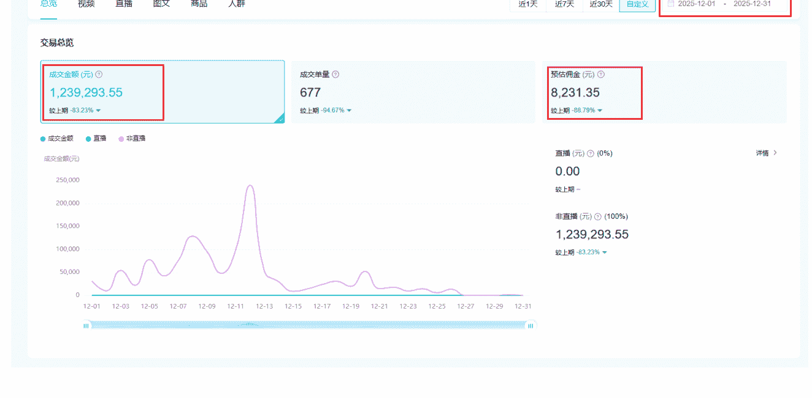
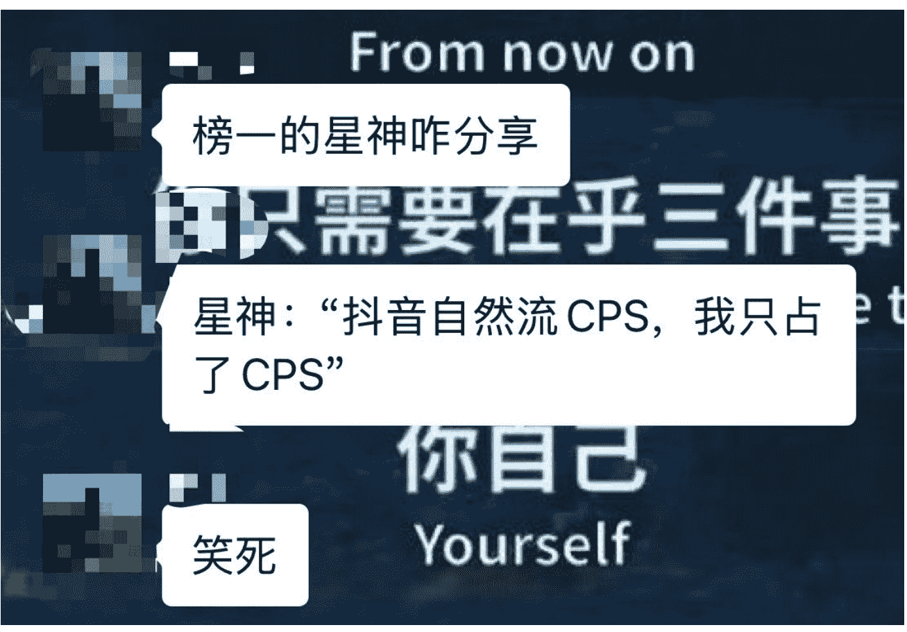
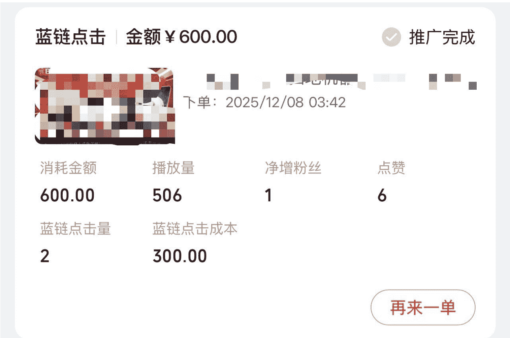
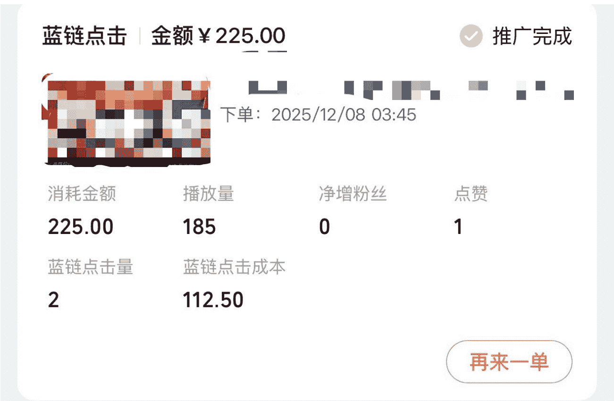
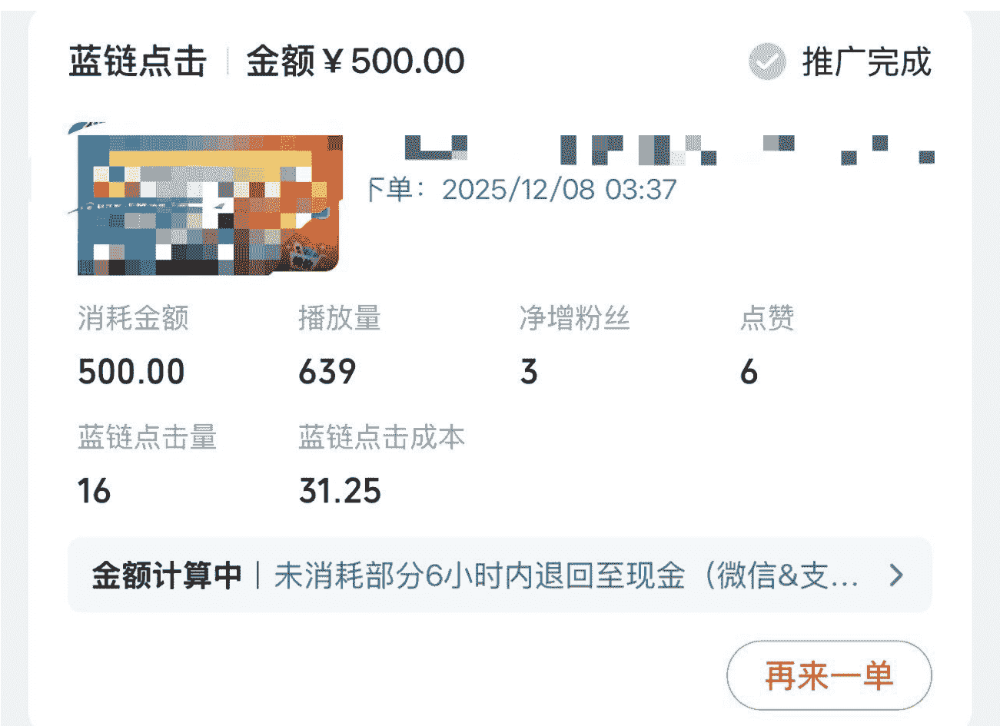
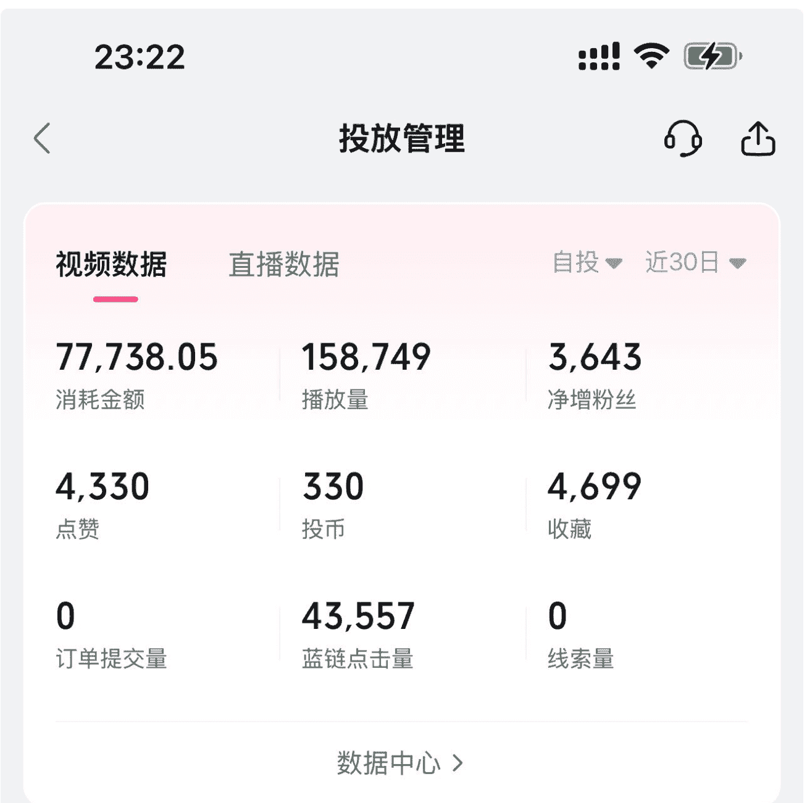
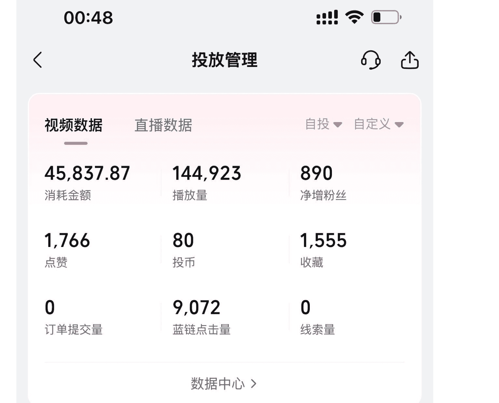
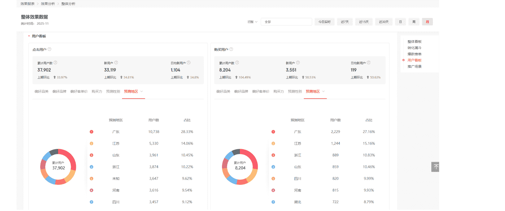

## 抖音自然流 CPS 与 B 站好物投流实战全解析：从 267 万 GMV 到长效增长的底层逻辑

### 260115 副业 SC 精华

公众号懒人搜索，<u>懒人专属群</u>独享

懒人微信：lazyhelper1

微信：lazyhelper1

大家好，我是星空海绵！

2026 年的第一场复盘分享，这不就来啦！

先跟大家同步个进度：2025 年 12 月参与的第二期抖音自然流 CPS 项目已圆满收官，第三期也正在蓄势待发。

在分享核心玩法和实战干货之前，我先把实打实的战绩摆出来作为交流的基础——这些成果，既是对过往实操的复盘沉淀，也是后面要聊的方法论的硬核支撑。

### 我的核心战绩概览：

### 平台综合表现：

定榜 GMV 排行第二，奖励佣金收益稳居第一：

抖音自然流 CPS 项目定榜 GMV 达 253 万，12 月全月万单宝平台密令成交 GMV 突破 267 万，B 站蓝链成交 GMV 123 万，加上万单宝 GMV，12 月累计 GMV 390 万。

### 收益明细：

佣金与奖励总收益 47872 元，扣除 3.5 万投流成本后，最终实际利润约 1 万元。

### 数据佐证：

万单宝平台数据看板显示，上月（12 月）有效订单数 3651 单，有效订单金额 2676087.12 元，预估佣金 24159.08 元；完成订单数 3627 单，完成订单金额 2482789.14 元，完成订单佣金 22222.93 元，叠加预估激励 15482.74 元，预估总收益 39641.82 元。

B 站后台数据，2025 年 12 月 1 日 - 12 月 31 日期间，成交金额 1239293.55 元，成交单量 677 单，预估佣金 8231.35 元。

## 抖音自然流CPS

### 航海排行榜

| NO.1 | 小明 (西斯廷7号员工) | 478.53W | GMV |
|---|---|---|---|
| 2 | 星空海绵 | 253.22W | GMV |
| 3 | L | 242.08W | GMV |
| 4 | 星辰 | 207.26W | GMV |

### 数据看板

首页 > 数据看板

| 万能转链 | 推广活动 |
|---|---|
| 创建推广位 | 推广订单 |

| 今天 | 昨天 | 7天 | 30天 | 上个月 | 自定义 |
|---|---|---|---|---|---|
| 推广位 | 全部推广位 | | | | |
| 平台 | 全部平台 | | | | |

| 有效订单数 | 有效订单金额 | 预估佣金 |
|---|---|---|
| 3651 | ¥ 2676087.12 | ¥ 24159.08 |
| 完成订单数 | 完成订单金额 | 完成订单佣金 |
| 3627 | ¥ 2482789.14 | ¥ 22222.93 |
| 预估激励 | 预估总收益 | |
| ¥ 15482.74 | ¥ 39641.82 | |

wandanbao.com

## 核心认知前提

12月实战我虽以【抖音自然流CPS】为项目名义，内核其实是一场围绕CPS模式的跨平台付费投流探索。圈友的那句调侃——“抖音自然流CPS，我只占了CPS”，精准点透核心逻辑：抖音只是流量承载平台，自然流只是流量获取的一种方式，而CPS（按成交付费）才是商业变现的本质。

无论是锚定抖音、B站这类不同属性的平台，还是选择自然流、付费投流这类差异化的流量玩法，所有动作都可以去紧扣高效达成CPS成交这个核心目标，无需被平台标签或流量形式束缚。

比如我这次的操作来说，我并没有押注自然流，而是选择了付费投流的路径。投流总成本投入3.5万元，最终落地利润差不多约1万左右。单从利润维度来看，这次投流玩法的最终效果并不算理想。不过这一结果，也和双十二大促的活动力度、以及本次制定的投放策略密切相关。抛开结果不谈，这场真金白银砸出来的实战，让我沉淀了不少实打实的投流经验。

## 1.核心玩法拆解：红包 + 投流的 B 站实战优化

我这次的 390 万 GMV，基本上都是在 B 站跑出来的数据，玩法还是沿用并优化了我之前那套玩法——红包+投流的成熟玩法。该玩法曾在双 11 期间创造 23 天 GMV 破千万、利润 7 万的战绩。

基于 12 月双十二大促场景与 B 站平台特性，本次玩法进行了针对性调整，也暴露出新的问题与解决方案。

（在抖音自然流 CPS 项目刚开始的几天，我还是榜一的时候，就有同学说，抖音自然流 CPS，我只占了 CPS，笑死。事实也确实是这样，不过这不重要，抖音只是平台，自然流也只是手段，CPS 才是本质。）

### （一）玩法基础逻辑

红包 + 投流的核心是通过红包优惠锁定用户，再以付费投流放大流量覆盖范围，最终实现成交转化。红包作为钩子，能有效提升用户点击意愿与下单冲动；投流则作为放大器，突破自然流的流量天花板，精准触达潜在消费人群。

如果对红包+投流这个玩法感兴趣的圈友，具体可以看这篇文章：《B 站好物红包 + 投流玩法操...-知识星球》

### （二）本次玩法的差异化调整

#### 1.红包类型的局限性：

这次的这个红包不同于双 11 期间的超级红包，12 月使用的红包本身力度有所下降，效果不如双 11 大促的超级红包。

#### 2.成交链路的选择与博弈:

B站成交链路可以分为密令成交与蓝链成交。蓝链成交的优势在于便捷性——用户点击即可跳转平台下单，降低操作流失；密令成交需要用户去平台手动搜索输入，操作复杂度变高。

但本次实战中，我的密令成交订单占比达2/3，蓝链成交仅占1/3，这里面有个很重要核心原因在于用户引导的重要性（那就是用户是需要引导的，用户的行为其实是你决定的）：通过视频内容、评论区话术、置顶留言等多维度引导，可以显著改变用户行为习惯。数据也印证了核心观点：用户的行为的是可以被引导的，平台流量同样如此——如果目标是家电类流量，就可以在标题、内容、标签中重点强化家电类相关文案与场景，实现流量定向聚焦。

#### 3.投流策略的迭代与试错

**初始策略：投蓝链点击。** 初衷是蓝链流量精准度高、购买转化率高，实际投放后发现成本远超预期——本次红包玩法的盈利临界点要求蓝链点击成本控制在1元以下，而实际投放成本高达2元以上，持续投放必然亏损，因此仅试投2天便果断调整。

**优化策略：改投播放量。** 核心考量是播放量投放成本较低，虽流量精准度不及蓝链，但综合成本与转化效率，最终可实现盈利。且相较于自然流，付费播放带来的流量仍具备更高精准度 —— 这也是本次我的佣金率高于其他参与者的关键原因：一方面，密令成交可享受平台激励；另一方面，B 站付费流量定向的数码家电人群，比自然流人群的消费需求更明确，转化意愿更强。

**关键说明：** 本次玩法无复杂选品策略，核心依赖红包锁佣机制 —— 通过红包优惠绑定用户下单行为，降低选品差异化对转化的影响，聚焦流量与转化效率的优化。

这次投流初期，我沿用了以往的蓝链投放策略，但很快发现蓝链的获客成本远超预期。这款红包的盈利阈值，要求单个蓝链成本控制在 1 元以内，可实际投放下来，成本一直维持在 2 元以上，完全达不到盈利标准。仅仅试投两天我就判断：继续用蓝链推这款红包，最后肯定得亏钱。

发现蓝链投放行不通后，我立刻调整方向，开始研究新的投放策略。考虑到播放量投放的成本较低，我决定尝试这条路径。因为播放是相对便宜的，但是贵的东西就是有它贵的道理，成本和效果往往是成正比的 —— 蓝链之所以成本高，它带来的流量非常精准，购买率很高；正是因为它能带来高精准度的流量，进而撬动更高的购买转化；而播放量投放虽然价格低廉，流量的精准度却大打折扣。权衡之下最后我还是选择了投播放的策略，虽然精准度不够，但是好在便宜，胜在成本可控，最后也不出现会亏本的情况。

虽然说播放量投放的流量精准度比不上蓝链，但对比自然流量，优势还是很明显的。这也是在结营那一天，怡然教练问我说：“为什么我的佣金率相对于其他人的会高一点”：核心原因其实就两点：一是我全程采用密令成交的模式，密令成交可以获得平台激励；其次是 B 站的付费流量带来的数码家电流量更精准（相对于自然流而言），所以综合起来我的佣金率更高一些。实战中这次的佣金率高一些和选品策略没有关系，因为我都是靠红包活动锁佣的，不存在选品的逻辑。

#### 4.投流试错案例与关键启示

这次实战里我也有比较失败的投流订单案例：因为扫地机器人有高佣，我就做了一个扫地机器人的视频去进行投流蓝链，结果投出了 300 一个蓝链点击的订单，600块钱买了 2 个蓝链点击，这真的太狠了~要全是这种，有多少钱都不够亏的

案例带来重要启示：不同品类的投流逻辑存在差异，家电等高价的投流成本与转化逻辑，与红包类通用流量的投流逻辑完全不同，不可直接套用过往经验。投流必然存在探索期，我现在也是一点一点去测试验证该用哪种投流策略的，通过小预算、多维度测试，逐步验证最优投流策略，探索试错是优化过程中不可避免的环节。

## 2.自然流底层逻辑：从内容到数据的全链路拆解

在咱们进入深入探讨付费投流前，需先明确自然流的核心价值与操作逻辑——自然流不仅是免费流量获取渠道，更是测试爆点、降低获客成本 的核心实验室。

先推荐做 CPS 的圈友们都可以看看老胡的这篇 没错，直播带货就是社交电商，这篇文章其实把 CPS 的本质做了清楚的解读，不管是私域还是公域。

自然流的操作需围绕“直接转化成交”展开，摒弃单纯“种草”思维。

从这篇文章出发，我们再来看看自然流与付费投流。

- 自然流：靠内容拿平台免费曝光（不稳定，但能验证爆点/降低获客成本）
- 付费流：靠投放买确定性曝光（稳定，但要求素材工程化+数据优化能力）

### 2.1 目标不是种草，而是直接转化成交

自然流短视频的第一要务：前三秒留住 + 让人相信 + 给下单理由。所以内容结构要偏广告结构而不是 Vlog 结构。

常用脚本骨架：

- 痛点开场：所有人停止买××-【直击用户核心需求】
- 立刻给结果：我用这个/这样做，X秒解决-【快速展示解决方案与效果】
- 证据：对比、过程、细节、数据、他人反馈-【增强可信度】
- 购买理由：价格/福利/限时/稀缺-【强化用户下单冲动】
- 强引导话术：想要链接/同款，看××/点击评论区蓝色链接-【明确下单路径】

### 2.2 自然流的爆点来自选题与钩子，而不是剪辑花活：

自然流最应该下功夫的是：

- 人群是否足够明确（给谁看？）
- 痛点是否足够尖（有没有“非买不可”的理由？）
- 承诺是否足够具体（3天见效/10秒去污这类）

人群明确：精准定位目标用户，回答 给谁看的问题 —— 例如 “租房党必备的小型家电” “学生党高性价比数码产品”，人群越聚焦，需求匹配度越高；

痛点尖锐：挖掘用户最迫切、最未被满足的需求，形成 非买不可的理由 —— 例如 “冬天洗袜子难晾干？这款烘干机解决你的烦恼” “熬夜赶方案？这款键盘让效率提升 2 倍”；

承诺具体：避免模糊表述，用明确数据或结果增强可信度，例如 “3 天见效” “10秒去污” “续航 48 小时”，具体承诺比“效果很好”“非常实用”等空泛表述更具说服力。

#### 钩子常见类型：

- 结果型：3 秒前后对比
- 反常识：99%的人都用错了
- 避坑型：千万别买××，除非你选这种
- 成本型：同样效果，便宜一半的方法

### 2.3 自然流的核心是“批量测试”，不是押宝一条

自然流的爆发具有一定随机性，因此核心操作逻辑是批量测试、数据筛选，将自然流视为“爆点实验室”，而非孤注一掷押宝单条视频。具体操作建议：

- 每个品至少做 10-30 条 方向不同的测试（痛点/人群/场景/对比）
- 同一条视频可以做 多个封面+不同开场版本（前 3 秒决定生死）

### 2.4 自然流重点看什么指标（用来判断值不值得放大）

自然流操作的核心是 用数据说话，通过以下指标判断内容是否具备放大价值：

完播率、前 3 秒留存、互动率（评论/收藏/转发）

评论是否出现：求链接/已下单/多少钱/在哪里买/该买哪款/up 推荐一款

### 蓝链点击率和引入UV

最关键：自然流是否有成交

自然流跑不通的内容，别急着投流放大，放大也是放大亏损。

## 3.付费投流

付费投流的本质是：把已验证有效的素材复制到更大的人群里，投流本质上投的是优质素材。付费流的优势在于 确定性曝光，但对素材工程化生产与数据优化能力有更高要求。

### 3.1 投放前筛选

- 素材在自然流里已经有成交。
- 低成本测试，测出对应的成本，例如投的蓝链，一个蓝链点击大概在几块以内可以挣钱
- 要考虑到退货的订单
- 素材验证：必须是自然流中已产生成交的素材 —— 自然流的成交数据是素材转化能力的核心证明，未经过自然流验证的素材，投流风险极高；
- 成本验证：通过小预算低成本测试，明确盈利临界点 —— 例如蓝链点击成本需控制在多少以内可盈利，确保投流成本低于盈利阈值；
- 风险预判：充分考虑退货订单的影响——投流计算收益时，需预留退货率空间，避免因退货导致实际收益低于预期。

### 3.2 投放结构：冷启动 → 跑通 → 放量 → 稳定

**冷启动期**

- 小预算多素材多定向（核心是筛素材，不是求量）
- 同一卖点做多版本：不同开场/不同人群语言/不同场景

**跑通期**

- 找到“成本稳定、转化稳定”的素材（把它当作主力弹药）
- 同时开始做“同卖点的变体素材”防疲劳

**放量期**

- 预算逐步加，不要一口气猛加（容易打乱系统学习）
- 放量的不是“账号”，是“素材模型+人群模型”

**稳定期**

- 永远维持“素材上新”节奏：旧素材衰减是必然
- 用数据看疲劳：点击率下降、转化下降、成本上升就是信号

### 3.3 付费流素材的核心：工程化生产，不是靠创作者灵感

投放型素材的生产需像“广告工厂”一样标准化、规模化，摒弃依赖创作者个人灵感的模式，具体操作如下：

一套卖点做：对比版/测评版/场景版/避坑版/清单版/口播版
同款素材做：不同人设/不同话术/不同镜头节奏
目标：每周持续上新，永远有候补素材，定时出摊有助于你的账号在系统中的权重

### 3.4 付费投流注意点

- 投流一般会有滞后性，今天投的钱往后推3天，3天都没回来，那这个素材一般就不用投了，素材质量有问题
- 单个素材投流会随着时间的推移，越投越贵，这是正常的，这时候你就需要出新的视频去做投放了，而不是还是在这个素材上猛猛投
- 投过的数据需要复盘，找到投流效果最好的那条数据，挖掘做的好可以模板化的点，后期打造成爆款模板

- 接受滞后性：投流效果通常存在3 天左右的滞后性，若投放后 3 天仍未产生有效转化，说明素材质量或投放策略存在问题，需及时止损；
- 应对成本上升：单个素材的投放成本会随时间推移逐渐上升，这是正常现象，此时需及时上新素材，而非继续加大该素材的投放力度；
- 重视数据复盘：对投流数据进行系统性复盘，挖掘效果最优数据背后的共性 ——例如标题结构、开场方式、人群定向等，将其提炼为可复制的爆款模板，用于后续素材生产与投放，形成复盘-优化-迭代的闭环。

## 4.微付费撬动自然流

### （一）流量闭环的核心流程

“以自然流为主，微付费为辅”的流量闭环——这也是我这段时间听到很多的一句话，就是说以自然流为主，然后投很少的钱，拿到很好的效果。这可以说是当前高效的增长模式——通过自然流低成本测试爆点，再以微付费放大效果，最终反哺自然流内容迭代，形成良性循环

上面的自然流和投流其实可以形成一个闭环：

- 自然流：用低成本找到能成交的卖点/脚本/人群素材
- 付费流：把这个类型的素材买流量放大
- 反哺：付费数据反推自然内容迭代，复盘优质投流素材（点击率高，成本低，转化强的素材），将优质投流素材提炼成脚本模板，后续按照模板持续产出即可。

### （二）核心原则：找到好模板，复制100遍

然后还是圈圈老师那句话：找到好的内容模板，拍100遍；而不是费力拍好100条视频。

找到好的内容模板了，直接投流买量放大就行了。

好的内容模板具备极强的复用性 —— 在B站平台，一个优质内容模板的有效周期可达2个月甚至更久。当你发现这个模板的投放利润逐渐下降时，再启动新模板的探索，形成模板复用 - 效果衰减 - 新模板探索的长效迭代节奏。

## 5.B 站投流实战：数据规律与精细化操作指南

本次 B 站好物投流的真实数据，可总结出平台投放的确定性规律与精细化操作方法，以下为核心实战经验分享（相关数据可直接下载分析，或借助 AI 挖掘关键信息）

这是我的一份真实的投流指标数据，虽然我大部分投的是红包攻略类视频，还是能从中找到一些确定性规律的。如果你们需要，可以直接下载下来自己分析，也可以丢给 AI 让 AI 分析出你想要的点。

### 5.1 投放目标选择：按需定向，聚焦核心

不同投放目标对应不同的核心需求，需根据变现目标选择最优方向：

- 核心目标：卖货拿佣金。优先选择“蓝链点击”——根据B站必火官方解读，蓝链投放的算法模型会同时匹配三类用户：对视频内容感兴趣的用户、对蓝链商品感兴趣的用户、有点击蓝链意愿的用户，因此流量精准度极高，只要控制好成本，是卖货拿佣的最优选择；
- 次要目标：引流私域。选择“投粉丝量”——通过付费涨粉积累私域用户，后续通过社群运营实现长期转化；
- 其他目标：播放、互动等指标的投放效果，远不及蓝链点击，不建议作为核心投放方向，可作为定向策略选择方向。

首先在B站投流投什么指标，如果你是要卖货，最好就是投蓝链点击，但是蓝链点击的成本相对而言较高，其次是投播放，播放的优势是便宜，但是缺点是流量精准度不够。

如果你是要引流到私域，那么你就投粉丝量，至于其他的指标我目前投下来觉得效果可能并没有很好，你们也可以自己探索。

那么B站付费流推送的底层逻辑是什么呢？这个我问过B站必火相关官方的人，他们解答过。就是如果你投放的是蓝链的的话，那么这个推送算法模型会去找不光对你视频内容感兴趣的用户，还会去找对你蓝链商品感兴趣的用户以及有可能点击你蓝链的用户，这样下来，投放蓝链带来的流量其实非常精准，只要控制好成本，卖货拿佣金的话投蓝链是最好的选择。其他指标的推送逻辑，你可以根据这个逻辑举一反三。

### 5.2 必火投放有哪些确定性的规律

卖货拿佣金投放目标优先投蓝链点击，播放/互动/涨粉等投放指标效果远不如蓝链点击带来的效果好。

投放普通的蓝链点击测出单个视频的蓝链点击成本之后，如果这个成本能赚钱，那么用放心投设置一个比测出来稍低一点的价格来跑量，将整体的成本控制住，这样整体的投放成本不用等数据跑完其实就是知道的。

想要短时间带来大量流量，比如大促晚上20:00开始，我需要20:00到24:00有大量流量进来，直接在下午17:30左右投放300块6小时的普通蓝链点击，如果消耗的快的话可能1个小时就消耗完了，那你就继续再投。

核心有购买力的人群，需要将18岁以下的流量排除掉，区域可以设置在发达区域，性别可以直接设置为男性，可以参考我上面给的数据中的自定义人群包，然后你根据你的投放经验可以逐步去优化这个自定义设置，不要把投放目标人群优化的过小，过小的话成本会提高很多，整体目标就是让投放给你带来的每一个流量，做购买的这个动作的概率加大，只要人群够精准，那么转化率自然会高。这个自定义人群包是我根据我之前的投流数据，以及京东联盟后台点击和购买数据拟合出来的，当然还有优化空间，后续我会根据后续的投放和购买数据继续优化的。

| | A | B |
|---|---|---|
| 1 | 性别 | 男 |
| 2 | 年龄 | 18~24、25~30、31岁及以上 |
| 3 | 兴趣: | 游戏、知识、科技、生活、时尚、娱乐、付费、美食、汽车、运动 |
| 4 | 行业潜在人群 | 不限 |
| 5 | 地域 | 广东、江苏、浙江、山东、四川、河南、湖北，北京、上海 |
| 6 | 推给以下UP主粉丝 | 老师好我叫何同学、极客湾Geekerwan、小白测评、科技美学、硬件茶谈、苏星河牛通、大狸子切切里、笔吧评测室、阿狸不是受、钟文泽、开箱嘤嘤怪、韭菜实验室、Mr迷瞪、Wilson学长、搞机所、超能搞机、大物是也、逆狱、影视飓风、野生的装机宅、家电侦探平雪、Super好价君、夏南去哪里呢、评测臻选、好屏如潮、远古时代装机猿、电锯爷、究极测试、大康评测、斤斤计较的包子、装机侠林BB、古一搞机研究所、单毅讲装修、船长总动员、幽灵高端电竞装机、至尊定制、谜之Helen、彪哥椅子评测、闲聊数码站、myimmortal（这个人要输入UID搜：917142，名称搜不到，不知道为什么）、陶阳家电实验室、先看评测、不寻常手机测评、蒙面it侠、大白讲数码、Flash闪电竞、短的发布会、歪设长、爱唱歌的信、超能测评Ultra |
| 7 | 可以再想想的指标，这些指标怎么融入上面的选择中，特别是行业潜在人群那个，还在研究中： | 职业：学生、白领、一般职员、个体或服务业从业者、教师、公务员、事业单位 品类：电脑办公、手机、数码、外卖，家庭清洁/纸品、家电 |

### 5.3 实战数据对比与平台红利说明

#### 数据对比

上面第1张图是我双11的投放数据，第二张图是我12月的投放数据，第三张图是京东联盟后台11月的点击购买数据分析面板。必火投放有优惠机制，达标指定消耗金额就会返回一部分，以优惠券的形式返回给你，我双11投的多，给了我很多优惠券，我双12投的基本上是打7折的，这也是为什么我上面说我的成本在3万5左右，而不是上面显示的4万5，这个活动目前还有，B站投放目前以我的视角来看，还是在红利期的，如果有一天我找到投放效果更好的素材，毫无疑问，我绝对会通投拉满的。

如果你有跑自然流跑的比较好且赚钱了的素材，建议上投流量，不要觉得投流会亏本或者拉高成本，想放量，自然流天花板是有限的。

#### 平台红利：

B站必火投放目前存在优惠机制——达标指定消耗金额后，会以优惠券形式返还部分费用。本次双11因投放金额较高，获得大量优惠券，双12投放实际享受7折优惠，这也是投流成本控制在3.5万元（而非账面显示的4.5万元）的原因。目前该优惠活动仍在持续，从实战视角来看，B站投流仍处于红利期，若能找到效果更优的素材，可果断加大投放力度，实现规模性盈利。

### 5.4 核心建议

如果已有自然流表现优异且能盈利的素材，建议果断启动投流放量——不要担心投流会亏本或拉高成本，自然流的流量天花板有限，想要实现规模增长，付费投流是必经之路。

实战中如果你有跑自然流跑的比较好且赚钱了的素材，建议上投流放量，不要觉得投流会亏本或者拉高成本，想放量，自然流天花板是有限的。

## 6. B站好物长期发展方向：品类选择与规模放大

短期 GMV 增长之外，更需明确长期发展路径 —— 从品类选择到规模放大，构建可持续的盈利模式。

### 6.1 品类选择策略

结合 B 站平台特性与盈利潜力，品类选择可聚焦以下方向：

数码家电品类：B 站数码家电人群垂直度高，是核心优势品类，但需区分两个细分方向：

数码品类：热度高、购买用户多，但佣金率较低，尤其是受京东 0.01 事件影响后，收益表现惨淡，属于 “食之无味，弃之可惜” 的品类 —— 虽能盈利，但利润空间有限；

家电品类：佣金率远高于数码品类，且若已有部分定向佣金品类的开通，一单家电的收益可抵多单数码，长期视角下更具盈利潜力；

垂直单品品类：可进一步聚焦细分单品，如扫地机器人、人体工学椅、电视、冰箱、空气净化器等，目前平台上已有成功案例，可通过垂直深耕建立竞争优势。

我们知道 B 站数码家电人群垂直度很高，数码家电是 2 个品类，数码的热度是比家电高的，购买的人也更多，但是数码的佣金率确实是不高，加上最近京东 0.01 事件，可以用惨淡来形容，但是要说放弃这个品类，肯定也舍不得，总结就是能赚，但是有时候佣金率太低了，属于食之无味，弃之可惜。

但是如果想要赚钱，我还是建议做家电品类，家电品类的佣金率不是数码品类能比的，而且如果你已经有了一些定向，一单家电顶很多单数码，从长期视角来看，做家电品类是个更好的选择，或者直接去做垂直品类，例如扫地机器人，人体工学椅，电视，冰箱，空气净化器等这种单商品类，这些也都有人在做。

潜力品类：美妆类目。该品类佣金率较高，甚至比家电品类还高，且 B 站目前做这一品类的感觉并不多，但目前尚未有大规模成功案例，属于待探索的蓝海领域，感兴趣的从业者可小预算测试。

美妆类目确实是佣金率较高的优质赛道，部分品类佣金水平完全不输家电。虽然没法直接定义 B 站是否属于绝对蓝海，但从平台生态和数据来看，这里的美妆推广潜力相当值得挖掘，有感兴趣的同学也可以尝试尝试。

### 6.2 规模放大的核心路径

当 0-1 阶段跑通后，可通过以下方式实现规模放大：

- 矩阵化运营：搭建多账号矩阵，同步输出优质内容与投放，扩大流量覆盖范围；
- 团队化运作：成立专业团队，分工负责素材生产、投流优化、数据复盘、客服售后等环节，提升运营效率；
- AI 提效：利用 AI 工具辅助素材生产（如脚本生成、文案优化、剪辑加速）、人群定向分析、数据复盘等，降低运营成本，提升规模化能力。

如果把这件事做大做强，那么逃不出固定这几个方式：一是延续前文提到的投流放量，二是搭建账号矩阵规模化系统，三是组建专属团队系统化推进，四是借力 AI 工具提效降低运营成本。

放大类的经验生财星球里有很多，有大量优质分享，尤其是许老师的相关帖子，内容干货满满，参考价值极高。

### 6.3 0-1 阶段的核心建议

需要提醒注意，如果还处于 0 到 1 的起步阶段，建议先沉下心做好内容打磨，梳理出标准化的运营流程并沉淀为知识库，等跑通完整的闭环模式后，再去探索适合自己的放大手段。

处于 0-1 阶段，无需急于放大，核心任务是：

- 做好内容：聚焦核心品类，批量测试内容方向，找到有效爆点；
- 梳理流程：将内容生产、投流测试、数据复盘等环节梳理为标准化流程；
- 沉淀知识库：将优质脚本、优质选品、优质学习资料、投流策略等核心内容沉淀为知识库，为后续规模化复制奠定基础。

## 2026 年 CPS 赛道的展望与行动建议

### （一）赛道判断

CPS 模式在 2026 年依然具备极强的可行性，我认为依然是个好赛道，仍是值得深耕的优质赛道。核心原因在于：CPS 的本质是 “按成交付费”，风险低、变现路径清晰，随着短视频平台流量生态的持续完善，无论是自然流还是付费流，都仍有大量优化空间与红利机会。

### （二）行动建议

没有想法的时候就按时出摊，按时更新，积累势能，有些事做着做着就成功了，不要急，慢慢来，路还长着呢，不在乎一朝一夕，别高估一天能做的事，也别低估一年能做的事。所有的经历都有意义，你积累的势能总有爆发的那一天，但行好事，莫问前程。一起生财有术！

- 保持稳定输出：没有明确方向时，按时出摊、按时更新是核心策略 —— 持续积累内容势能与账号权重，很多成功案例都是“做着做着就成了”，无需急于求成；
- 理性看待周期：别高估一天能做的事，也别低估一年能做的事——CPS 的成功需要长期积累，势能的爆发往往源于持续的沉淀，所有经历都将成为优化的基础；
- 坚持长期主义：但行好事，莫问前程——聚焦核心目标，持续优化内容与投流效率，构建自身的核心竞争力，长期坚持必然会收获相应回报。

最后，安利小懒的付费群：

## 懒人专属群（介绍）

📖 这里是你对抗信息过载的护城河。

已稳定运行 7 年，累计拆解、研读3000+ 个互联网商业实战案例与行业前沿内参和时政/宏观文章。

我们不搬运垃圾，只做高价值信息的筛选器与放大镜。

## 懒人专属群更新记录：

https://hk57gvIx7u.feishu.cn/docx/H0kRdZbSboIBR0xkaXtcuVEOnTg

【免责声明】 本资料归档于社群内部知识库，仅供成员课题研究与学术交流，请在查阅后 24 小时内删除。