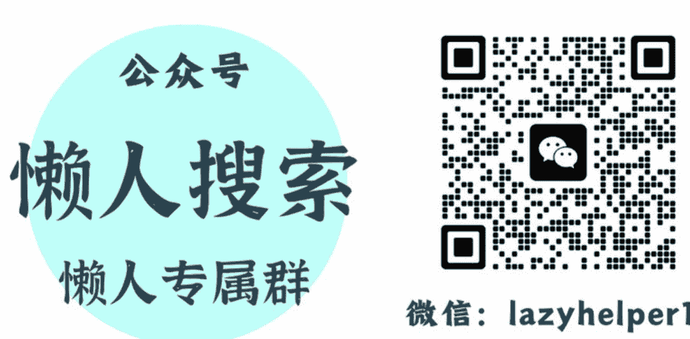

# 师夷长技以制夷，对日两用物项出口管制的妙用

260115 文/卢克文工作室嘉宾 云梦竹

整理：公众号懒人搜索，懒人专属群精选

懒人微信：lazyhelper

在过去很长一段时间内，美国围绕对华出口管制设计了一系列政策工具，根据其出口管制规则第748.10条，中国企业在采购受管制物资时，必须向美国商务部工业安全局（BIS）提交不可更改的《最终用户声明》，以换取出口许可。

这一制度的本质，不仅是贸易合规，更是一种对中国企业供应链的长期穿透式监管。

正所谓，寇可往，我亦可往。

近期，网络上开始流传新的信息：根据中国针对日本的军民两用物资出口管制相关规定，凡涉及敏感或可追踪用途的零部件出口，均要求日方企业签署《最终用户声明》，并接受中国商务部的用途约束与事后追踪。

这一做法在形式与逻辑上，几乎完整复刻了当年美方对华采取的管制路径。

区别只在于，这一次，规则的制定者换成了我们。

## 01

事实上，这一版《最终用户声明》的文本本身并不复杂，核心要求只有一条：日本进口方必须明确承诺，相关产品不得被用于任何军事活动或相关研究领域。

如果只看到这里，很多人甚至会觉得，这套制度相当“温和”。

但真正的分水岭，并不在这里，而在最后一句。

即签字赋予中方保留权利：可基于合规需要，对订单进行重新审查、要求补充说明，甚至直接拒绝供货。

这一条，才是整个《最终用户声明》中最具法律效力的那部分。

说白了，前面那一大盘饺子，都是为了这一碟醋。

前文已经提到，《最终用户声明》的本质，是一种对供应链实施长期、可持续、可追溯的穿透式监管工具。

在正常的商业逻辑中，你购买某项产品，把它用在什么系统、什么产品线、什么下游应用上，属于企业的核心商业机密，任何交易对手理论上都无权过问。

打个比方：王大爷买了一袋面粉，是做成面包、包成饺子，还是摊成披萨，都是他的私事，按理说，卖面粉的根本无权关心。

但在签署《最终用户声明》之后，规则发生了根本性变化。

一旦中方有合理理由怀疑：声明中的“最终用户”或“最终用途”存在虚假或规避，比如王大爷声称买面粉是为了包饺子，但我们却查不到任何醋、馅料的采购或进口记录。

那么对不起，根据“谁家包饺子不蘸醋”的基本常识，为了完成合规核查，你就必须提供更多信息，用以佐证你的真实用途与产品流向。

在这一制度框架下，中方并不是在打探你的商业机密，而是在履行合规审查义务，这是被规则明确赋权的正当行为。

你说你包饺子是吧？那就把买馅的记录、发票、合同一并拿出来看看。否则，这袋面粉，我可以不卖。

这样一来，中方供应商就能够深入了解日本企业的产业链结构与研发链条。而这一过程，合理、合法、合规。

如果这套规则长期执行，结果会是什么？

别说王大爷今晚吃不吃饺子，连他吃什么馅、家里几口人、锅有多大，都可以通过面粉用量慢慢推断出来。

看到这里，你或许会觉得不公平。

但必须指出的是：这种“不公平”的方式，我们默默忍受了近三十年。为什么中国企业在生产链条上利润极低，我认为，最终用途声明是有一定原因的。

除此之外，《最终用户声明》，还有一个重大作用，那就是防止出现搬起石头砸自己的脚的蠢事。

## 02

制裁或者说出口管制，从来都不是一把可以随意挥舞的重锤，而是对经济系统实施的一场高风险外科手术。

原因很简单：现代经济早已高度全球化，产业链、金融链、物流链彼此咬合。如果贸然进行出口管制，必然会给本国经济带来危害。

所以制裁就是非常考验治理水平的一件事。

在第一次现代中美贸易战爆发之初，美国方面的核心设想是：通过对中国出口商品大幅加征关税，抬高中国企业的出口成本，压缩其利润空间，从而削弱中国制造业的国际竞争力，并最终迫使中国在所谓“结构性问题”上作出让步。

然而，这一设想从一开始就建立在对中国经济制造业成本结构的误判之上。美国商务部门显然没有预料到，中国出口产品的利润率早已被压缩至极低水平，几乎不存在可供“再压榨”的空间。

根据高盛的测算，截至2025年，美国消费者预计承担了约55%的关税成本，美国企业自身承担约22%，而中国出口商通过降价等方式吸收的比例仅约18%。这意味着，加征关税所形成的价格压力，绝大部分被美国市场所承担了。

这正是第一轮中美贸易战最终难以为继的重要原因之一。

无独有偶。

2019年，美国政府在能源领域重复了类似的政策错误。当时，美国以追讨2007年委内瑞拉国有化过程中美国企业损失为由，推动对委内瑞拉实施严厉石油制裁，实质性封锁了委内瑞拉的原油出口。

然而，这一举措很快在美国国内制造了新的结构性矛盾。

位于路易斯安那州的Lake Charles炼厂和德克萨斯州的Corpus Christi炼厂，长期以来都是按照委内瑞拉重质、高硫原油进行工艺优化设计的。Citgo石油集团的首席执行官在公开表态中直言，其湾岸炼厂就是为冶炼委内瑞拉重油而设计的，现在，不得不对装置进行重新升级。

公众号懒人搜索，懒人专属群分享

这样一来，美国不但没有成功追讨损失，反而导致美国企业损失进一步增加。

类似的政策误伤还出现在对俄罗斯铝业集团（Rusal）的制裁中。当时，美国对俄制裁措施一经实施，全球铝供应链迅速收紧，价格大幅飙升，下游制造业成本被整体抬高。最终，美国方面不得不在市场压力下解除制裁，以避免更广泛的产业冲击。

这也是为什么我们要签署《最终用户声明》的关键，我们需要持续性地研究日本产业链条，以此为真正的制裁做准备，避免出现上述案例中误伤自己的情况。

## 03

《最终用户声明》的运用，标志着我方出口管制正在从临时性、应急性的行政手段，走向制度化、程序化和可复制的治理工具。这种制度一旦成型，其影响将不局限于个别案例，而会在未来的地缘博弈中持续放大。

在俄乌冲突爆发后的最初阶段，西方制裁体系的一个重要设想，就是通过对金融与资产的冻结，迫使俄罗斯的经济精英阶层对政府施压，进而动摇其战略决策基础。事实上，也确实有报道指出，一些受到损失的俄罗斯寡头，来到克里姆林宫找普京要说法。虽然最终结果未能如愿，但不能因此否认制裁的威力。

普京能够在极端制裁环境下维持政治稳定，并不意味着所有国家、所有政治人物都具备同样的承压条件。

简单来讲，普京顶得住压力，不等于高市早苗也顶得住。普京有联邦安全局这样的强力国家机器，而日本政界人物手中，未必握有同等级别的组织工具。

正因如此，当日本政界人士包括高市早苗在内，多次公开宣称“台湾有事就是日本有事”时，我们必须清醒认识到，这是潜在地缘对抗。这要求我们尽快建立起一套成熟、可控的地缘工具体系。

进一步说，制裁真正危险的地方，并不在于公开对抗，而在于它重塑了内部激励结构。为什么俄罗斯寡头频繁泄露信息，为什么伊朗内部渗透不断？

这是人性的毁灭，还是道德的沦丧？都不是。

当一个国家被制裁后，一张来自制裁方的豁免，就可能带来巨大的经济利益：企业存亡、资产解冻、经营许可，统统浓缩为规则制定者手中的一纸文件。

在巴以冲突中，抵抗者发现，处于制裁环境下的巴勒斯坦人，往往只需要一张由以色列开具的通行证，就可能出卖哈马斯。这并非个案，而是制裁逻辑的必然结果。

这便是制裁与出口管制的真正威力：只要你能提供对制裁方有价值的东西，就可能换取经济生存空间，也就不可避免地催生背叛的可能性。

这才是精确制裁的终极意义，它强于外交谴责，却又仅次于战争。

最后，安利小懒的付费群：

懒人专属群（介绍）

这里是你对抗信息过载的护城河。

已稳定运行 7 年，累计拆解、研读 3000+个互联网商业实战案例与行业前沿内参和时政/宏观文章。

我们不搬运垃圾，只做高价值信息的筛选器与放大镜。

# 懒人专属群更新记录：

https://hk57gvix7u.feishu.cn/docx/H0kRdZbSbolBR0xkaXtcuVEOnTg

【免责声明】 本资料归档于社群内部知识库，仅供成员课题研究与学术交流，请在查阅后 24 小时内删除。