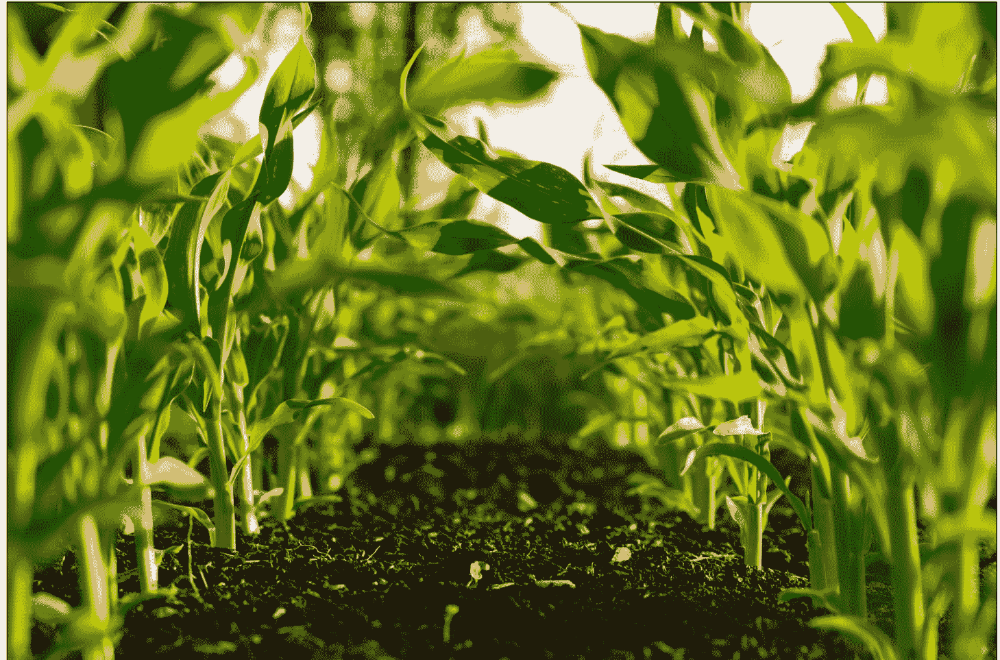
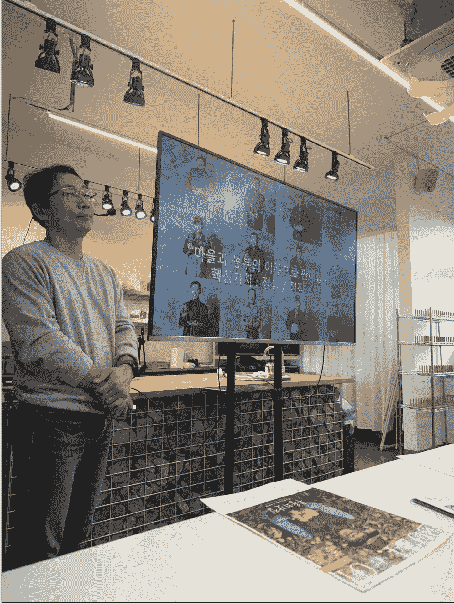

# 有觉知地生活

260116 新闻实验室

整理：公众号懒人搜索，懒人专属群精选

懒人微信：lazyhelper1

这个天鹅绒般柔软舒适的监狱，其实也是我们自己共同搭建的。

这是新闻实验室会员通讯的第 900 期。

从 2016 年 9 月到今天，我写作这份 newsletter 已近 10 年。保守估计，这 900 期的会员通讯超过三百万字，甚至可能超过四百万字。

最应该感谢的是每一位订阅会员通讯的会员。如果不是你们的支持和无形中的督促，我不可能将这项写作计划坚持这么久。

借着 900 期的契机，我想暂时抛开常规选题和内容，用给朋友写信的感觉，聊聊我最近的一些想法和感受。

提前谢谢你的聆听。

## 一

最近，因为各种机缘，我认识了一些从事农业的人。他们有一个共同的特点：都是在厌倦了大城市的生活之后，回到农田间，寻求另一种生活方式。

在韩国济州岛，我见到了几位在三四十岁选择离开首尔、从白领转型而来的农民。他们的选择固然有“逃避”的一面：不想卷了，受不了大城市的压力和节奏，想要逃离那种你死我活的竞争……但我感受到的更多是一种主动的选择：主动投身一种更好的可能性，不仅为自己，也为他人。

比如，在西归浦地区的武陵里，有一家名叫“武陵外婆家”的村落企业。与我们见面的是一位戴着眼镜、面带微笑、彬彬有礼的中年男人，他就是从韩国的大陆移居济州岛乡间的一个例子。这里不仅给他的孩子提供了更快乐的成长环境，而且让他获得了更多的意义感——武陵外婆家是一家合作社性质的企业，它连接着村里的农民，以高于市场价12%的价格收购他们生产的农产品，让好的农产品可以抵达有需要的消费者，而农民则可以获得合理的回报。

武陵外婆家最经典的一款产品是农产品“盲盒”订购——加入订购计划后，消费者每个月都可以得到一大盒内容丰富的农产品，有时候是各种蔬菜，有时候是肉类，有时候还有海鲜……最让我印象深刻的一个细节是，每个盒子里都会附上一张像报纸一样的介绍材料，而它的头版大照片，则往往是种出盒子里农产品的那位农民。

方可成摄于武陵外婆家

所以，村里的许多农民都曾被拍摄过大片一样的肖像照。和我们见面那位中年男人说，这样做，是为了让消费者知道自己吃的东西是谁种出来的，这是一种建立信任的过程，而对于农民来说，这也是一种激励和督促。

后来，在另外一家合作社，我又听到同样的说法。一个穿着朴实大叔面带自豪地说：“你们知道自己吃的东西是谁种植/养殖出来的吗？在我们这里，大家都知道！”在那家合作社的超市里，果然每一种产品都标明了生产它的农民的名字。比如，那位大叔的名字就显眼地标注在他种出的绿米标签上。

## 二

知道农民的名字和长相，真的那么重要吗？

我承认，有那么一个瞬间，我心里产生了这样的疑问。在对于食物的常见评价体系里面，我们关心的是味道、营养、安全，再多一些可能是生产过程是否符合了有机的标准，很少会想到个体的农民。

但我很快打消了这个疑问，因为我想起了“媒体食谱”这个我一直在推广的概念。

把信息（精神食粮）和食物（物质食粮）做类比，始终是最有效的媒介素养普及手段。大家都明白垃圾食品特别上瘾但不能多吃，也明白健康食品可能没那么诱人，却是保持身体良好状态的必需。所以，大家也很快就能明白“读点好的”和“吃点好的”同样重要，关心自己的媒体食谱和关心自己的三餐食谱同样重要。

而在媒介素养教育中，一个很核心的方法就是追踪和识别信息的来源。媒介素养高的人，并不是每一篇文章的内容都能细细分析，而是能找到文章是谁写作和发布的，由此形成基本的质量判断。

类比到食物，知道你吃的菜是谁种的当然重要！就好像，如果你知道自己读的报道是谁写的，甚至对ta有更多的了解，那么一定是更有利于你判断报道内容的。

曾经，很多人知道自己吃的菜是谁种的（农民自己到市场卖出自己的产品），而食品工业在很大程度上切断了这种直接的联系。同样，曾经很多人知道自己读的内容是哪家媒体发布的，甚至很清楚是哪个记者写的，但现在，以社交媒体平台为核心的内容工业也在很大程度上切断了这种直接的联系。即便是在新闻学院的课堂上，你问一句“平时读什么媒体”，得到的答案也大多是小红书、B站、抖音，而不是具体的媒体名字，更不可能是记者的人名。

工业提升了效率，也在一定程度上实现了“普惠”。但是，大众丧失了这种对食物和内容的觉知，是一件非常可惜，乃至是一件破坏性的事情。

## 三

对于社交媒体平台，我的总体评价是极为负面的，其中的一个重要原因是它对内容生态的破坏。而在这种破坏之中，又有一种尤为根本：让人的内容消费变得更加被动，从主动获取（例如订阅）变成被动投喂（feed）。

我并不是说在平台上绝无主动的可能——你当然可以主动搜索，可以通过点赞等方式调教算法，可以仔细调整自己的关注列表。但是，比起这些主动模式，被动投喂占据了绝对的主导地位。

在被动消费内容的过程中，人们日渐丧失对内容的主动选择能力，而这种能力是建立在一系列觉知的基础之上的：感知它是由谁、怎样生产出来的，感知它为什么会出现在面前，感知消费它会令谁得益……

平台喜欢无觉知的被动消费，因为这样能带来更多的利润。老大哥当然也喜欢无觉知的被动消费。所以我一直觉得，算法是权力“治理”的对象，更是共谋的伙伴。

## 四

在平台和老大哥之外，当然还有一方是喜欢无觉知的被动消费的，那就是我们每一个人。

不去关心内容背后的那些门道，只管接受那些让我们觉得爽的内容，这样的事情人人都喜欢。所以，这个天鹅绒般柔软舒适的监狱，其实也是我们自己共同搭建的。

近来，我对于中文互联网上关于“舒适”的话语有一些自己的观察。这些话语强调让自己觉得舒适是至关重要的事情，并主张识破那些要求“吃苦”背后的 PUA。

这样的话语当然有其积极意义，因为这样的 PUA 是确实存在的，无论是在公司内部，还是在更广义的社会上。

但是，关于“舒适”的话语，是否也暗藏着另外的陷阱呢？那些让我们舒服的东西，是不是也可能带有一种欺骗和利用呢？

当然是这样，社交媒体平台就是一个最好的例子——刷手机的时候舒舒服服，但浪费的是你的人生，而赚得盆满钵满的则是平台。

我做了一个 2x2 的表格来辨析几个类别。两个维度分别是：舒适和吃苦，主动性和被动性。

| | 被动性 (Passive) | 主动性 (Active) |
| :--- | :--- | :--- |
| **舒适** | **糖衣炮弹/消费陷阱** 算法推荐、短视频刷屏。用好吃的糖果引诱你，让你心甘情愿付出注意力和生命，为平台创造广告收入。 陷阱：顺从与沉溺 | **心流/真正的满足** 深度阅读、创作后的畅快。知情且主动的享受，能清晰知道选择的代价与收获。 觉知：正反馈 |
| **吃苦** | **PUA/奴役** 无意义的加班、职场打压。在倡导吃苦中训练奴性，让你变得可资剥削利用。 陷阱：被剥削 | **刻意练习/成长痛** 深度学习、锻炼、写作瓶颈期。为了获取优质信息或技能而付出的必要努力。 觉知：直面困难和痛苦 |

“吃苦”和“被动性”的格子里，就是年轻人们尖锐批判的 PUA：在倡导吃苦的过程中，训练你的奴性，让你变得更加服从和可资剥削利用。

“舒适”和“被动性”的格子里，同样是想让我们变得更加顺从、可资剥削利用的力量。只不过，它们不讲什么应该吃苦，而是用好吃的糖果来引诱你，让你心甘情愿地付出注意力和生命。

这两者虽然看上去不一样，但殊途同归，都是在降低你的觉知，让你浑浑噩噩过一生。

而另两个格子里，则是积极的、有觉知的可能性，无论是吃苦还是享受，都是处于知情和主动，都能清晰地知道自己为什么选择、选择的代价是什么。这个世界上让我们获得成长的东西本来就是有苦有甜，或者说，都是苦中带甜。比如学习，它从来不会是完全舒适的过程，但在经历困难乃至痛苦之余，许多时刻也能体会到舒适的正反馈，甚至能获得心流的状态。获取信息也是一样。我曾经说自己有一个梦想：人人获得优质信息。但获取优质信息从来不是等人把盘子装好端到眼前，它一定是一件需要付出努力、乃至经历挑战和困难的事情。所以，人人获得优质信息的前提之一，其实是人人都愿意付出努力。写作也是一样。我在写会员通讯的过程中依然会经历磕磕绊绊、不想写下去的时候，但当经历了这些困难之后，便能收获许多畅快与满足的感觉。

## 五

最近我在香港遇到的另一位从事有机食品行业的朋友，跟我提到了一个短语：conscious living。我把它翻译成，有觉知地生活。

我觉得这个短语可以很好地总结过去我做的各种事情。我总是不想就那么轻易接受被呈现在面前的选项，我想要对背后的力量有更多的觉知，然后做出更有觉知的选择。

无论是选择新闻专业、从事记者工作，是普及媒介素养、提倡健康的媒体食谱，还是转向学界、深究背后的问题，都是在这种心态的驱动下做出的选择。

最近的一个例子是，我不满于象牙塔里学术界和现实的遥远距离，想要更有觉知地和社会互动，因此在去年开启了过滤气泡工作室这个线下空间。我也是因为过滤气泡组织的活动，才有了和济州岛以及香港的几位从事农业的朋友接触的机会。

当然，这个世界非常复杂，远超个人能够了解和掌控的范围。要想过有觉知的生活，就必须常常面对渺小和无力的感觉。但是，觉知的力量又会驱使我继续行动，即便知道自己渺小和无力。因为，随波逐流会给人更大的无力感，而对水流的哪怕一点点觉知，都会让人在广袤的天地间找到一点点存在的理由。

# 与有觉知的你,共勉。

最后,安利小懒的付费群:
懒人专属群(介绍)

公众号
懒人搜索
懒人专属群

微信:lazyhelper1

📚这里是你对抗信息过载的护城河。
已稳定运行7年,累计拆解、研读3000+
个互联网商业实战案例与行业前沿内参和
时政/宏观文章。

我们不搬运垃圾,只做高价值信息的筛选器
与放大镜。

懒人专属群更新记录:
https://hk57gvIx7u.feishu.cn/docx/H0kRdZbSbolBR0xkaXtcuVE0nTg

> 【免责声明】本资料归档于社群内部知识库,仅供成员课题研究与学术交流,请在查阅后24小时内删除。