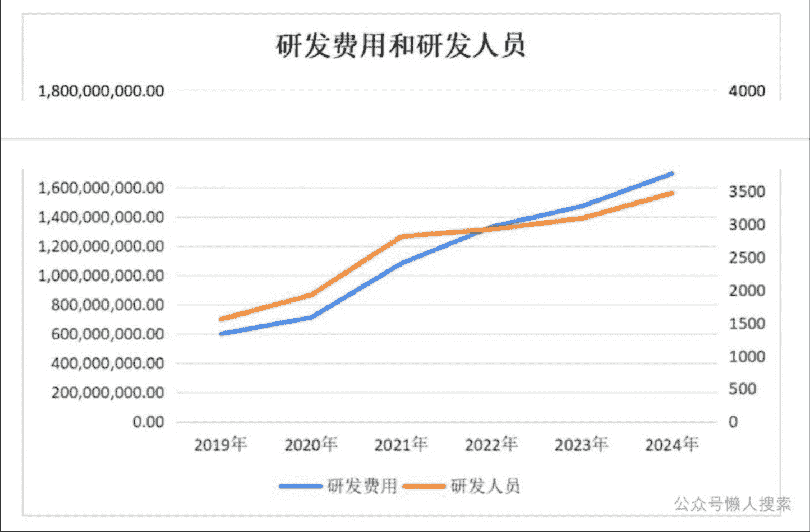
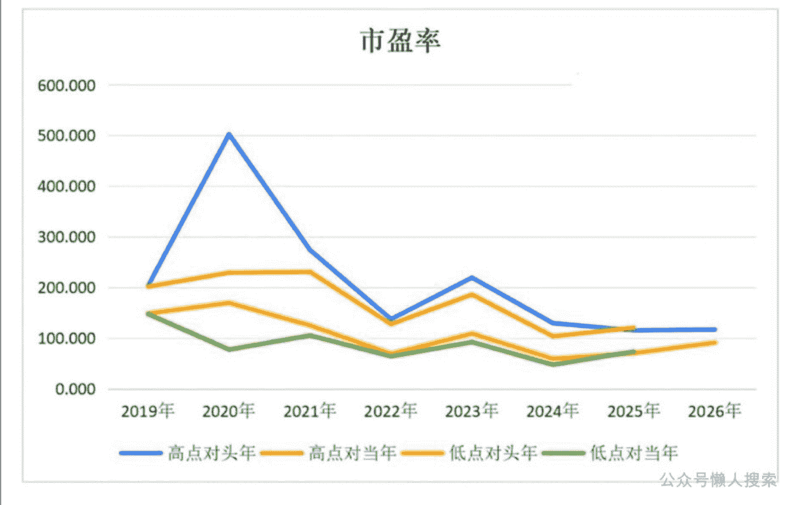
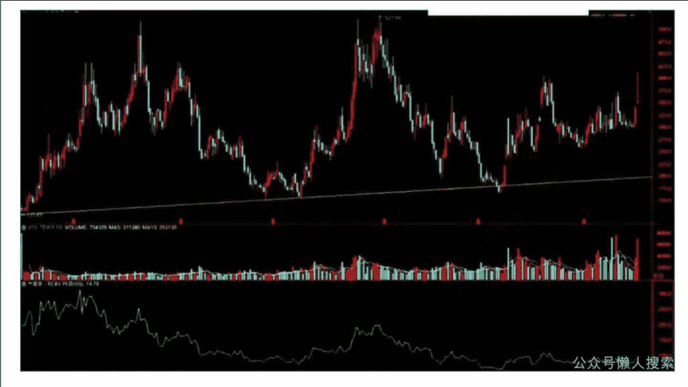
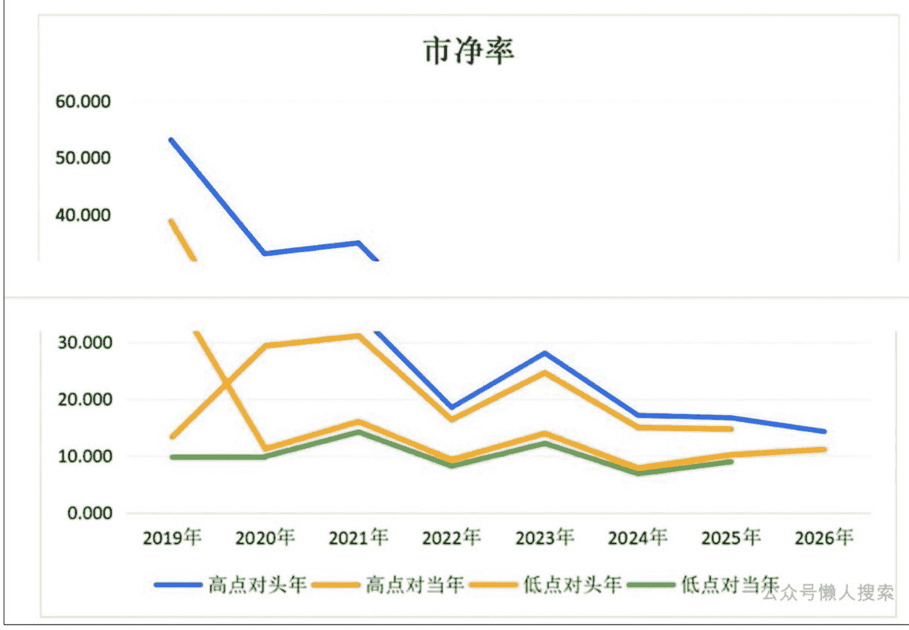
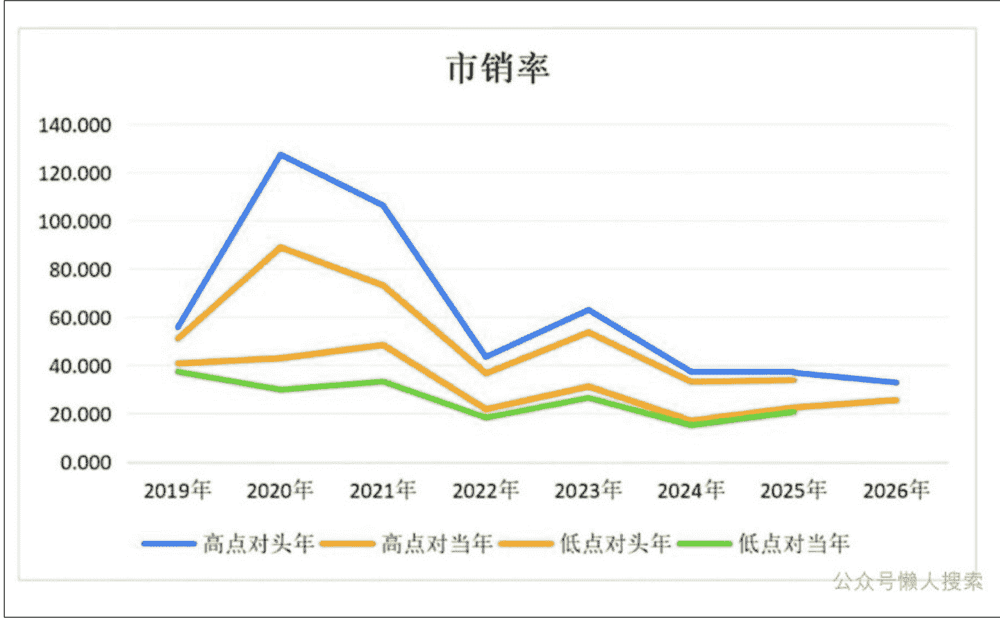

## 公司分析22：能够将AI落地的顶流软件供应商

260119 安民深度分析

整理：公众号懒人搜索，懒人专属群精选懒人微信：lazyhelperl

随着AI成为全球第四次科技革命的重要分支，2026年以前，以英伟达为代表的AI芯片、AI数据中心算力等硬件建设，成为资本市场上涨的主要推动力，国内以此诞生了寒武纪、胜宏、“易中天”、工业富联等大牛股。

但从资本市场上来看，当谷歌开始分流全球AI的注意力，市场认为2026年极有可能是AI落地的元年，各方资金从原来的炒硬件到炒AI应用和AI落地。这代表了市场方向的转变。

回顾前几年的AI概念炒作，在AI应用领域，有不少公司其实是比较虚的。虚在两点：第一，很多公司只是在强调AI已经介入了日常研发生产，但介入到什么程度，不知道；有哪些成果，不知道；用户体验，不知道。一问三不知，这是典型的无法落地。

第二，所有人都知道，纯AI业务在当前阶段极难盈利。目前市面上做民用闭源 AI 大模型的头部公司，没有盈利的，做 GPT 的 OpenAI，做 Gemini 的 DeepMind，靠自己想收支平衡根本不现实。活不下去，要么像 OpenAI 那样到处找钱，要么像 DeepMind 那样靠谷歌这类巨头输血。

总之，都知道 AI 好，但多数公司的 AI 业务要么拿不出实际的东西，要么拿出了东西，但业务太单一，让人怀疑只靠 AI 什么时候才能见到回头钱。无论中外，很多投资人心里都在打鼓。

这次分析的这家科创板 AI 应用软件公司，跟多数宣称 AI 概念的公司不同。一是它有实际的 AI 产品落地，所有人都能体验；二是公司本身有着非常靠谱的主营业务，这块业务不仅是国产替代概念，也有自己强大的竞争力，在国内竞品中早已占据行业支配地位；三是公司的财务状况非常扎实。我们翻阅它的报表时都感慨，基础不是一般地牢靠，而是钱太多了，多到根本就用不完。

公司本身就可以不靠账上的钱来运营，就是只靠每年的营收和利润，只靠每年收取使用者的订阅费用，就足够可以支撑日常经营，还有稳定的现金流进账，有很高的净利率；可公司账上硬是有一百几十亿的资金搁在那里做理财，做存款。当然，公司也在加大力度搞研发。公司的财务状况非常优良。

AI 热潮一阵接一阵地炒，市场不会只炒吹得震天响的公司，相信将来再炒到 AI 时，公司的 AI 落地+强大的主营业务+优异财务状况会是受到大资金青睐的三大基础。

我们将结合公司 2024 年年报、2025 年半年报和三季报，为大家深度分析这家公司。文章分为九个部分，包括公司业务分析、各财务环节对公司利润的影响、影响公司业绩的因素和排序、扎实漂亮的财务状况、软件国产替代的逻辑、在国内形成支配地位的逻辑、软件替代成果与后续进一步发展、公司 AI 落地得天独厚的优势、公司的市场定位。

（免责声明：本文只为开拓视野、引导思路。本文是公司分析，并非择时，亦非荐股。股市有风险，入市需谨慎。本文不构成任何投资建议或意见，不对读者依据本文做出的任何投资与决策承担责任。请大家注意投资风险）

## 一、公司业务分析

这家公司是金山办公，代码 688111，核心业务是 WPS 办公软件，比如 WORD，EXCEL，PPT 等。说起办公软件，大家更熟悉的肯定是微软的 Office，这个我们在后面会有详细说明，说明公司业务存在和扩张的理由，以及后续的发展空间。这里先看公司的业务情况。

### 1. WPS 全部业务（单位：万元）

| WPS 全部业务 | 2023 年 | 2024 年 | 增速 | 增量 |
|---|---|---|---|---|
| 收入 | 426592.78 | 498773.84 | 16.92% | 72181.06 |
| 成本 | 60596.65 | 74832.00 | 23.49% | 14235.35 |
| 毛利 | 365996.14 | 423941.84 | 15.83% | 57945.70 |
| 毛利率 | 85.80% | 85.00% | - | -0.80% |

收入中速增长，增量 7.22 亿；毛利中速增长，增量 57945.70 万。成本增速高于收入增速 6.57 个百分点，带动毛利率下滑 0.8 个百分点，负面影响毛利 3982.19 万。

公司产品的毛利率很高，达到 85%。就是公司的软件，15 块钱的成本，对外销售的价格，税后是 100 元，如果加上增值税 13%，就是 113 元。所以，公司的利润很好。

这里我们先说明一下，如果您亲自去翻公司年报，会发现没有“WPS 全部业务”这一项，因为公司自 2019 年上市以来，主营业务收入分类口径已经变了两次，2024 年是第二次变动，由商业模式分类转变为产品业务分类，所以没有 2023 年精确的同口径数据。但万变不离其宗，公司的绝对主营业务仍然是 WPS 办公软件，一切营收和成本都是围绕着 WPS 产品展开的，所以不管怎么分类，我们都可以将其归总为“WPS 全部业务”。另外，我们在后面会有针对公司的月活和订阅的分析。

公司的“WPS 全部业务”，在 2024 年被分为了三个类别：WPS 个人业务、WPS 365 业务、WPS 软件业务。

其中“WPS 个人业务”主要面对普通的个人消费者，用户会根据需要付给公司订阅费，享有一定时限内的软件进阶功能；

“WPS365 业务”主要面对大型集体，包括企业、学校等，提供更复杂专业的办公服务，如协同办公、云服务、即时通讯、视频会议等；

“WPS 软件业务”主要针对政企用户，提供 WPS 客户端、文档中台（将文档编辑能力集成到自有业务系统中）等产品与服务，主打的是一个安全可控。因为当前政企客户使用的系统和软件成分复杂，有外国的、有盗版的、有自研的，还涉及大量数据存储，总之有许多历史遗留问题，不得不针对这些问题特事特办，所以金山办公一直在努力，将这些政企客户从当前的“WPS 软件业务”转移到比较成熟、制式的“WPS365 业务”中，这有助于政企客户办公效率的全面提升和数字化转型的纵深发展。

这三类业务在 2024 年表现如下（单位：万元）：

| 业务分类 | 指标 | 收入 | 成本 | 毛利 | 毛利率 |
|---|---|---|---|---|---|
| WPS 个人业务 | 数值 | 328329.25 | 61743.71 | 266585.54 | 81.19% |
|  | 增速 | 18.00% | 12.78% | - | - |
|  | 增量 | - | - | - | 0.87% |
| WPS 365 业务 | 数值 | 43650.00 | 3859.77 | 39790.23 | 91.16% |
|  | 增速 | 149.33% | 120.14% | - | - |
|  | 增量 | - | - | - | 1.18% |
| WPS 软件业务 | 数值 | 126794.58 | 9228.52 | 117566.07 | 92.72% |
|  | 增速 | -8.56% | -1.65% | - | - |
|  | 增量 | - | - | - | -0.51% |

WPS 个人业务中速增长，收入增速高于毛利增速 5.22 个百分点。这块收入也是公司 WPS 全部业务的绝对大头，后面还有对它的相关分析；

WPS365 业务表现非常亮眼，收入增速达 149.33%，高于成本增速 29.19 个百分点。该业务体量不大，但正处于超高速增长期。前面讲了，公司也希望更多政企用户转到 WPS365 业务中来。

WPS 软件业务收入同比下降 8.56%，收入下滑速度高于成本 6.91 个百分点。一方面源于我国已经推进了好几年的政企软件安全可控，增速没过去那么快了，另一方面则是金山在推动这部分用户转到 WPS365 业务中。

2025 年中报同样是因业务口径问题，没有足够信息显示 2024 年的同比情况（单位：万元）：

| 业务分类 | 指标 | 收入 | 成本 | 毛利 | 毛利率 |
|---|---|---|---|---|---|
| WPS 个人业务 | 数值 | 174845.44 | 33900.70 | 140944.74 | 80.61% |
|  | 增速 | 8.38% | - | - | - |
| WPS 365 业务 | 数值 | 30879.53 | 2618.11 | 28261.42 | 91.52% |
|  | 增速 | 62.27% | - | - | - |
| WPS 软件业务 | 数值 | 54160.71 | 2875.84 | 51284.87 | 94.69% |
|  | 增速 | -2.08% | - | - | - |

公司在政企间力推的 WPS365 业务超高速增长 62.27%，毛利率也维持在 91.52%。

2025 三季报的信息更少，可以确认的是：
- WPS 个人业务收入 8.99 亿元，同比增长 11.18%；
- WPS365 业务收入 2.01 亿元，同比增长 71.61%，超高速增长，公司不断完善协作与 AI 条线产品，民营企业及地方国企客户覆盖进展显著；
- WPS 软件业务收入 3.91 亿元，同比增长 50.52%，速度转正，还超高速增长。报告期内党政信创招标及收入确认进度加速。也就是过去部分收入先放在合同负债中，随着时间进度慢慢确认为收入。我们前面讲公司可以不凭账上的存量巨额资金生存，原因一在业务收入确认，二在合同负债。

### 2. 其他主业（单位：万元）

| 其他主业 | 2023年 | 2024年 | 增速 | 增量 |
| :--- | :--- | :--- | :--- | :--- |
| 收入 | 28792.17 | 13172.46 | -54.25% | -15619.71 |
| 成本 | 6281.44 | 1146.51 | -81.75% | -5134.93 |
| 毛利 | 22510.73 | 12025.95 | -46.58% | -10484.78 |
| 毛利率 | 78.18% | 91.30% | - | 13.11% |

收入超高速下滑1.56亿；毛利超高速下滑10484.78万。成本降幅高于收入降幅27.5个百分点，带动毛利率提高13.11个百分点，正面影响毛利1727.26万。

此项业务的统计口径也有变动，2021年到2023年，主营业务中与WPS没有直接关系的业务叫“互联网广告推广服务及其他业务”，在2021年以前，叫“互联网广告推广”，总之这一类是与WPS业务没有直接关联的业务。它们的历年情况如下（单位：万元）：

| 年份 | 业务类别 | 收入 | 成本 | 毛利 | 毛利率 |
| :--- | :--- | :--- | :--- | :--- | :--- |
| 2016年 | 互联网广告推广及其他业务 | 24283.41 | 3016.01 | 21267.40 | 87.58% |
| 2017年 | 互联网广告推广及其他业务 | 29586.91 | 3688.40 | 25898.51 | 87.53% |
| 2018年 | 互联网广告推广及其他业务 | 38121.31 | 6379.91 | 31741.40 | 83.26% |
| 2019年 | 互联网广告推广及其他业务 | 40406.09 | 8420.73 | 31985.36 | 79.16% |
| 2020年 | 互联网广告推广及其他业务 | 34907.88 | 7681.14 | 27226.74 | 78.00% |
| 2021年 | 互联网广告推广及其他业务 | 40560.21 | 11573.91 | 28986.30 | 71.46% |
| 2022年 | 互联网广告推广及其他业务 | 30644.80 | 8696.37 | 21948.43 | 71.62% |
| 2023年 | 互联网广告推广及其他业务 | 28792.17 | 6281.44 | 22510.73 | 78.18% |
| 2024年 | 其他主业 | 13172.46 | 1146.51 | 12025.95 | 91.30% |

这里我们先记下一个结论，即广告收入大减，但有助于提升公司产品的竞争力，后面会分析。

### 3. 主营业务（单位：万元）

| 主营业务 | 2023年 | 2024年 | 增速 | 增量 |
|---|---|---|---|---|
| 收入 | 455384.95 | 511946.30 | 12.42% | 56561.35 |
| 成本 | 66878.09 | 75978.51 | 13.61% | 9100.42 |
| 毛利 | 388506.86 | 435967.79 | 12.22% | 47460.93 |
| 毛利率 | 85.31% | 85.16% | - | -0.16% |

收入中速增长，增量5.66亿；毛利中速增长，增量47460.93万。成本增速高于收入增速1.19个百分点，带动毛利率下降0.16个百分点，负面影响毛利793.79万，影响不大，占毛利增量的1.67%。

毛利率的略微下滑是由占比第二高的“WPS软件业务”增长放缓且成本下降不明显导致的。

再来看2025年上半年同比2024年上半年的情况（单位：万元）：

| 主营业务 | 2024上半年 | 2025上半年 | 增速 | 增量 |
|---|---|---|---|---|
| 收入 | 241214.60 | 265648.66 | 10.13% | 24434.06 |
| 成本 | 36351.73 | 39705.32 | 9.23% | 3353.59 |
| 毛利 | 204862.87 | 225943.34 | 10.29% | 21080.47 |
| 毛利率 | 84.93% | 85.05% | - | 0.12% |

收入两位数增长，增量 2.44 亿；毛利两位数增长，增量 21080.47 万。成本增速低于收入增速 0.9 个百分点，带动毛利率提高 0.12 个百分点，正面影响毛利 328.69 万，占毛利增量的 1.56%。

2025 上半年主营业务的毛利率开始有所回升。

### 4. 其他业务（单位：万元）

| 其他业务 | 2023 年 | 2024 年 | 增速 | 增量 |
|---|---|---|---|---|
| 收入 | 211.88 | 137.58 | -35.07% | -74.30 |
| 成本 | 105.93 | 97.68 | -7.79% | -8.25 |
| 毛利 | 105.95 | 39.90 | -62.34% | -66.05 |
| 毛利率 | 50.00% | 29.00% | - | -21.00% |

收入超高速下滑，同比减少 74.3 万元；毛利超高速下滑，同比减少 66.05 万。成本增速高于收入增速 27.28 个百分点，带动毛利率下降 21 个百分点，负面影响毛利 28.9 万，占毛利增量的 43.75%。

这个金额比较小，没什么说的。对大局没什么影响。

再是 2025 上半年同比 2024 上半年的情况（单位：万元）：

| 其他业务 | 2024 上半年 | 2025 上半年 | 增速 | 增量 |
|---|---|---|---|---|
| 收入 | 84.79 | 63.51 | -25.10% | -21.28 |
| 成本 | 40.44 | 66.68 | 64.89% | 26.24 |
| 毛利 | 44.35 | -3.17 | -107.15% | -47.52 |
| 毛利率 | 52.31% | -4.99% | - | -57.30% |

收入下滑 21.28 万元；毛利由正转负，下滑 47.52 万。成本增速高于收入增速 89.99 个百分点，带动毛利率下降 57.3 个百分点，负面影响毛利 36.39 万，占毛利下降金额的 76.58%。影响很小。

### 5. 全部业务（单位：万元）

| 全部业务 | 2023 年 | 2024 年 | 增速 | 增量 |
|---|---|---|---|---|
| 收入 | 455596.83 | 512083.88 | 12.40% | 56487.05 |
| 成本 | 66984.01 | 76076.19 | 13.57% | 9092.18 |
| 毛利 | 388612.82 | 436007.69 | 12.20% | 47394.87 |
| 毛利率 | 85.30% | 85.14% | - | -0.15% |

收入中速增长，增量 5.65 亿；毛利中速增长，增量 47394.87 万。成本增速高于收入增速 1.17 个百分点，带动毛利率下降 0.15 个百分点，负面影响毛利 787.19 万，占毛利增量的 1.66%。

2025 上半年同比 2024 上半年情况如下（单位：万元）：

| 全部业务 | 2024 上半年 | 2025 上半年 | 增速 | 增量 |
|---|---|---|---|---|
| 收入 | 241299.39 | 265712.17 | 10.12% | 24412.78 |
| 成本 | 36392.17 | 39772.01 | 9.29% | 3379.84 |
| 毛利 | 204907.22 | 225940.16 | 10.26% | 21032.94 |
| 毛利率 | 84.92% | 85.03% | - | 0.11% |

收入两位数增长，增量 2.44 亿；毛利两位数增长，增量 21032.94 万。成本增速低于收入增速 0.83 个百分点，带动毛利率提升0.11个百分点，正面影响毛利302.03万，占毛利增量的1.44%。

## 二、各财务环节对公司利润的影响

### 1. 费用环节的影响（单位：万元）

| 项目 | 2023年 | 2024年 | 增量 | 影响 |
|---|---|---|---|---|
| 税金及附加 | 3716.14 | 4917.04 | 1200.90 | -1200.90 |
| 销售费用 | 96741.45 | 99133.25 | 2391.80 | -2391.80 |
| 管理费用 | 44422.79 | 40266.29 | -4156.50 | 4156.50 |
| 研发费用 | 147229.58 | 169555.69 | 22326.11 | -22326.11 |
| 财务费用 | -9483.93 | -1581.23 | 7902.70 | -7902.70 |
| 合计 | - | - | - | -29665.01 |

2024年，费用环节一共减少营业利润29665.01万元。经过这5个环节，公司2024年的营业利润同比增加17729.86万元。

影响较大的是研发费用、财务费用和管理费用。

研发费用比2023年多了2.23亿，这很正常，高研发投入是公司的一贯特点，以下是公司历年的研发费用和研发人员情况（单位：元/人）：

| 年份 | 研发费用（万元） | 研发费用占比 | 研发人员 | 研发人员占比 |
|---|---|---|---|---|
| 2019年 | 59878.57 | 37.91% | 1552 | 68.46% |
| 2020年 | 71088.19 | 31.44% | 1923 | 70.39% |
| 2021年 | 108162.50 | 32.98% | 2811 | 66.94% |
| 2022年 | 133121.08 | 34.27% | 2922 | 68.30% |
| 2023年 | 147229.58 | 32.32% | 3087 | 67.73% |
| 2024年 | 169555.69 | 33.11% | 3473 | 66.93% |
| 复合增长率 | 23.14% | - | 17.48% | - |

以下是研发费用（主坐标轴）和研发人员（副坐标轴）的数量情况：

2019年来，研发费用的复合增长率为23.14%，研发人员复合增长率为17.48%，并且研发费用长年占公司营收1/3左右，研发人员长年占公司所有员工2/3以上，可以说公司的科研属性非常明显了。

关于研发，我们后面在讲公司的主营业务竞争时会有更多分析。

财务费用带来了7902.7万元的负面影响，主要是公司调整资金管理策略导致利息收入减少，利息收入从2023年的1.05亿降低至2463.29万元。

管理费用带来了4156.5万元的正面影响，主要源于股份支付费用从1.16亿降至9005.19万元，人员薪酬从2.54亿降至2.34亿，就是减少了给管理人员的待遇。

下面是公司2024上半年和2025上半年的费用环节（单位：万元）：

| | 2024 上半年 | 2025 上半年 | 增量 | 影响 |
|---|---|---|---|---|
| 税金及附加 | 1744.4 | 2624.75 | 880.35 | -880.35 |
| 销售费用 | 44205.64 | 47848.31 | 3642.67 | -3642.67 |
| 管理费用 | 21856.51 | 21881.6 | 25.09 | -25.09 |
| 研发费用 | 80752.73 | 95853.1 | 15100.37 | -15100.37 |
| 财务费用 | -1662.37 | -432.28 | 1230.09 | -1230.09 |
| 合计 | | | | -20878.57 |

2025年上半年，费用环节一共减少营业利润-20878.57万元。经过这5个环节，公司2025上半年的营业利润同比增加154.37万元。

影响最大的是研发费用，原因是AI研发投入增加。销售费用增加是薪酬上涨所致。

### 2. 利得和损失的影响（单位：万元）

| | 2023 年 | 2024 年 | 增量 | 影响 |
|---|---|---|---|---|
| 其他收益 | 14220.3 | 17612.31 | 3392.01 | 3392.01 |
| 投资收益 | 21916.26 | 36993.3 | 15077.04 | 15077.04 |
| 公允价值变动收益 | -262.71 | -1838.72 | -1576.01 | -1576.01 |
| 信用减值损失 | -1611.34 | -1594.96 | 16.38 | 16.38 |
| 资产减值损失 | -715.52 | -801.84 | -86.32 | -86.32 |
| 资产处置收益 | 524.25 | 18.17 | -506.08 | -506.08 |
| 合计 | | | | 16317.02 |

2024年，这6个环节共计增加营业利润16317.02万元。其中正面影响大的是投资收益，达15077.04万元。在这之中，定期存款取得的投资收益即利息，从2023年的1.37亿增长至2024年的2.22亿；权益法核算的长期股权投资收益从3433.37万上涨至7901.15万元，也就是投资的公司升值了。

至此，公司2024年营业利润增加34046.88万元。

再看公司2025年上半年同比2024上半年的情况（单位：万元）：

| | 2024上半年 | 2025上半年 | 增量 | 影响 |
|---|---|---|---|---|
| 其他收益 | 4959.34 | 6894.63 | 1935.29 | 1935.29 |
| 投资收益 | 14017.62 | 13343.92 | -673.7 | -673.7 |
| 公允价值变动收益 | -87.01 | -516.82 | -429.81 | -429.81 |
| 信用减值损失 | -729.67 | -313.12 | 416.55 | 416.55 |
| 资产减值损失 | -31.98 | -16.60 | 15.38 | 15.38 |
| 资产处置收益 | 1.83 | 48.84 | 47.01 | 47.01 |
| 合计 | | | | 1310.72 |

2025上半年，这6个环节共计增加营业利润1310.72万元，其中影响较大的是其他收益，同比增长1935.29万元，主要由增值税退税和各种补贴、奖励构成。

经过这6个环节，公司2025上半年营业利润增加1465.09万元。

## 3. 营业外收支、所得税费用和少数股东损益等（单位：万元）：

| | 2023年 | 2024年 | 增量 | 影响 |
|---|---|---|---|---|
| 营业外收入 | 147.08 | 391.86 | 244.78 | 244.78 |
| 营业外支出 | 1221.15 | -545.5 | -1766.65 | 1766.65 |
| 所得税费用 | 7537.78 | 9513.87 | 1976.09 | -1976.09 |
| 少数股东损益 | -327.54 | 1020.36 | 1347.9 | -1347.9 |
| 合计 | | | | -1312.56 |

4个环节共减少了公司的股东净利润1312.56万元。至此，2024年公司的股东净利润增加了32734.32万元。

下面是公司2025上半年同比2024上半年的情况（单位：万元）：

| | 2024上半年 | 2025上半年 | 增量 | 影响 |
|---|---|---|---|---|
| 营业外收入 | 138.07 | 508.23 | 370.16 | 370.16 |
| 营业外支出 | -582.52 | 128.39 | 710.91 | -710.91 |
| 所得税费用 | 4660.55 | 4724.85 | 64.3 | -64.3 |
| 少数股东损益 | 56.7 | -1459.92 | -1516.62 | 1516.62 |
| 合计 | | | | 1111.57 |

4个环节共增加了公司的股东净利润1111.57万元。至此，2025上半年公司的股东净利润增加了2576.66万元。

## 三、影响公司2024业绩和2025上半年业绩的因素及排序

影响公司2024年业绩的因素一共18个，其中正面影响因素7个，负面影响因素11个（单位：万元）：

| 排序 | 正面影响 | 影响额 | 负面影响 | 影响额 | 合计 |
|---|---|---|---|---|---|
| 1 | WPS全部业务 | 57945.7 | 研发费用 | -22326.11 |  |
| 2 | 投资收益 | 15077.04 | 其他主业 | -10484.78 |  |
| 3 | 管理费用 | 4156.5 | 财务费用 | -7902.7 |  |
| 4 | 其他收益 | 3392.01 | 销售费用 | -2391.8 |  |
| 5 | 营业外支出 | 1766.65 | 所得税费用 | -1976.09 |  |
| 6 | 营业外收入 | 244.78 | 公允价值变动收益 | -1576.01 |  |
| 7 | 信用减值损失 | 16.38 | 少数股东损益 | -1347.9 |  |
| 8 |  |  | 税金及附加 | -1200.9 |  |
| 9 |  |  | 资产处置收益 | -506.08 |  |
| 10 |  |  | 资产减值损失 | -86.32 |  |
| 11 |  |  | 其他业务 | -66.05 |  |
| 小计 |  | 82599.06 |  | -49864.74 | 32734.32 |

2024年，全部业务增加毛利47394.87万，其中“WPS全部业务”增加毛利57945.7万元，其他主业减少毛利10484.78万元，其他业务减少毛利66.05万。

费用一块减少营业利润29665.01万，利得和损失增加营业利润16317.02万，营业外收支、所得税费用及少数股东损益减少股东净利润1312.56万，终至全年股东净利润增加了32734.32万，存在少量因四舍五入的偏差为正常现象。

再来看公司2025上半年同比2024上半年的16个业绩影响因素，其中正面影响因素7个，负面影响因素9个（单位：万元）：

| 排序 | 正面影响 | 影响额 | 负面影响 | 影响额 | 合计 |
|---|---|---|---|---|---|
| 1 | 全部业务 | 21032.94 | 研发费用 | -15100.37 | |
| 2 | 其他收益 | 1935.29 | 销售费用 | -3642.67 | |
| 3 | 少数股东损益 | 1516.62 | 财务费用 | -1230.09 | |
| 4 | 信用减值损失 | 416.55 | 税金及附加 | -880.35 | |
| 5 | 营业外收入 | 370.16 | 营业外支出 | -710.91 | |
| 6 | 资产处置收益 | 47.01 | 投资收益 | -673.7 | |
| 7 | 资产减值损失 | 15.38 | 公允价值变动收益 | -429.81 | |
| 8 | | | 所得税费用 | -64.3 | |
| 9 | | | 管理费用 | -25.09 | |
| 小计 | | 25333.95 | | -22757.29 | 2576.66 |

2025上半年，全部业务同比增加毛利21032.94万。各项费用减少营业利润20878.57万，利得和损失增加营业利润1310.72万，营业外收支、所得税费用及少数股东损益增加股东净利润1111.57万，终至2025上半年股东净利润同比增加了2576.66万。

公司2024年和2025年业务有不足的地方是，收入扩张速度不是很高，但费用增长不少，导致从业务的角度来看，营业利润增量不大。2024年主要是靠投资收益和其他收益带来利润增长，2025年上半年主要靠其他收益和少数股东损益带来利润增长。当然，这种情况跟AI高研发投入相关，这是为未来争取更大收益的行为，可以理解；同时也与股权激励相关。

## 四、扎实的公司财务基础

当我们翻阅公司历年的资产负债表时，是感觉相当清爽的。我们挑几个数据和大家分享（单位：万元）：

| | 平均应收账款 | 营业收入 | 应收账款周转率 |
|---|---|---|---|
| 2019年 | 28585.05 | 157952.06 | 5.526 |
| 2020年 | 37156.59 | 226096.84 | 6.085 |
| 2021年 | 40481.99 | 328005.88 | 8.103 |
| 2022年 | 45416.14 | 388495.95 | 8.554 |
| 2023年 | 53186.59 | 455596.83 | 8.566 |
| 2024年 | 53575.37 | 512083.88 | 9.558 |

这是结合历年应收账款平均值和营收计算的应收账款周转率。公司2019年的应收账款周转率为5.526，其实已经还可以了，但到2024年周转率已经加快了73%，达到9.558，这是同行业里非常优异的水平。简单讲一下，应收账款周转率是看公司的回款速度指标，就是收入/应收账款平均值。这个值越大公司的回款压力越小。

再看应收账款和总资产的关系，因为数据源于资产负债表，所以我们从2019年上市起，根据年报和半年报，每半年记录一个数据（单位：万元）：

| | 应收账款 | 总资产 | 应收账款占总资产比例 |
|---|---|---|---|
| 2019年 | 34502.34 | 684399.35 | 5.04% |
| 2020半年 | 37116.19 | 723938.34 | 5.13% |
| 2020年 | 39810.85 | 851158.62 | 4.68% |
| 2021半年 | 42868.77 | 915817.7 | 4.68% |
| 2021年 | 41153.13 | 1042566.94 | 3.95% |
| 2022半年 | 45586.86 | 1092590.84 | 4.17% |
| 2022年 | 49679.15 | 1205767.66 | 4.12% |
| 2023半年 | 56115.12 | 1279883.54 | 4.38% |
| 2023年 | 56694.03 | 1397402.13 | 4.06% |
| 2024半年 | 57944.92 | 1427071.01 | 4.06% |
| 2024年 | 50456.71 | 1591288.88 | 3.17% |
| 2025半年 | 53878.77 | 1642671.48 | 3.28% |
| 2024年复合增长 | 7.90% | 18.38% | |
| 2025上半年复合增长 | 7.74% | 17.81% | |

应收账款占总资产的比重非常低，而且还在不断下降。另外从2019到2024这5年间，总资产复合增长率为18.38%，公司的应收账款复合增长率仅为7.9%；从2020上半年到2025上半年这五年间，总资产复合增长率为17.81%，公司的应收账款复合增长率仅为7.74%。综合起来，很清楚地表明公司的扩张不依赖四处赔笑脸给人赊账，没有什么潜藏的回款危机。

为什么我们可以下这个判断，前文是用资产负债表的数据说话，后面分析业务时我们还会从业务的逻辑上来讲清楚。

既然前面谈到了总资产，自然就要看一下公司的总负债和所有者权益的情况（单位：万元）：

| | 总负债 | 所有者权益 | 资产负债率 |
|---|---|---|---|
| 2019 年 | 77541.32 | 606858.03 | 11.33% |
| 2020 半年 | 94567.69 | 629370.65 | 13.06% |
| 2020 年 | 162076.29 | 689082.33 | 19.04% |
| 2021 半年 | 196249.59 | 719568.11 | 21.43% |
| 2021 年 | 264546.01 | 778020.93 | 25.37% |
| 2022 半年 | 282561.04 | 810029.8 | 25.86% |
| 2022 年 | 325928.56 | 879839.1 | 27.03% |
| 2023 半年 | 361796.51 | 918087.03 | 28.27% |
| 2023 年 | 395441.51 | 1001960.62 | 28.30% |
| 2024 半年 | 383830.27 | 1043240.74 | 26.90% |
| 2024 年 | 447631.91 | 1143656.96 | 28.13% |
| 2025 半年 | 479035.85 | 1163635.63 | 29.16% |
| 2024 年复合增长 | 42.00% | 13.51% | |
| 2025 上半年复合增长 | 38.33% | 13.08% | |

上市以来，公司的资产负债率从11.33%上涨到29.16%；总负债从2019到2024这5年间，总负债复合增长率为42.00%；从2020上半年到2025上半年这五年间，总负债复合增长率为38.33%。

只看这个数据，负债增长率比总资产百分之十七八的复合增长率和所有者权益百分之十三点几的复合增长率快了太多，虽然资产负债率仍然不高，但我们有必要细查公司大涨的负债是由什么构成的。

| | 总负债 | 合同负债 | 合同负债占总负债比例 |
|---|---|---|---|
| 2019 年 | 77541.32 |  |  |
| 2020 半年 | 94567.69 | 50269.28 | 53.16% |
| 2020 年 | 162076.29 | 83275.06 | 51.38% |
| 2021 半年 | 196249.59 | 105105.97 | 53.56% |
| 2021 年 | 264546.01 | 142087.6 | 53.71% |
| 2022 半年 | 282561.04 | 158468.32 | 56.08% |
| 2022 年 | 325928.56 | 173124.76 | 53.12% |
| 2023 半年 | 361796.51 | 170271.01 | 47.06% |
| 2023 年 | 395441.51 | 189187.41 | 47.84% |
| 2024 半年 | 383830.27 | 190270.56 | 49.57% |
| 2024 年 | 447631.91 | 213553.59 | 47.71% |
| 2025 半年 | 479035.85 | 219946.22 | 45.91% |
| 2024 年复合增长 | 42.00% |  |  |
| 2025 上半年复合增长 | 38.33% | 34.34% |  |

公众号懒人搜索，懒人专属群分享

看到这里已经很明显了，公司长期以来，有接近一半的总负债是由“合同负债”构成的。

合同负债的意思是，客户先付了钱，但公司不能立即把这笔钱确认为收入，要在将来随着服务的完成，再按时间段确认收入。

在金山办公这里，合同负债的场景大致是这样的：个人或企业客户向公司付费购买了一年或几年的服务，个人客户都是一次性预付所有金额，比如一年会员120元，公司就把这120元确认为合同负债，接下来每过一个月，公司就从中确认10元的收入，直到一年结束。企业客户会复杂一些，可能一次性付清，也可能部分预付，但核心不会变，就是无论个人还是企业，总体上都愿意先付钱，但这笔钱要细水长流地确认为收入。

当一家软件公司的一半负债是由合同负债构成时，这家公司就很难称得上有什么债务危机，因为相当一部分钱已经先收回来了。

当然，我们还可以再探究一步，看公司剩下的近一半负债中，有没有什么重要的构成要素（单位：万元）：

| | 其他非流动负债 | 其他非流动负债占总负债比例 |
|---|---|---|
| 2020 半年 | 9797.23 | 10.36% |
| 2020 年 | 8492.32 | 5.24% |
| 2021 半年 | 10508.38 | 5.35% |
| 2021 年 | 17333.98 | 6.55% |
| 2022 半年 | 24935.84 | 8.82% |
| 2022 年 | 31728.14 | 9.73% |
| 2023 半年 | 37973.60 | 10.50% |
| 2023 年 | 61263.89 | 15.49% |
| 2024 半年 | 67565.24 | 17.60% |
| 2024 年 | 94334.86 | 21.07% |
| 2025 半年 | 100187.93 | 20.91% |

如表格所示，其他非流动负债也是不容小觑的一个构成项目。2024和2025上半年，其占公司总负债的比重已近21%。

那么，这个“其他非流动负债”，它又由哪些要素构成的呢（单位：万元）：

| | 其他非流动负债 | 其他非流动负债中的合同负债 | 合同负债占比 |
|---|---|---|---|
| 2020 半年 | 9797.23 | 9797.23 | 100.00% |
| 2020 年 | 8492.32 | 8492.32 | 100.00% |
| 2021 半年 | 10508.38 | 10508.38 | 100.00% |
| 2021 年 | 17333.98 | 16691.38 | 96.29% |
| 2022 半年 | 24935.84 | 24293.24 | 97.42% |
| 2022 年 | 31728.14 | 31066.64 | 97.92% |
| 2023 半年 | 37973.60 | 37312.10 | 98.26% |
| 2023 年 | 61263.89 | 60581.09 | 98.89% |
| 2024 半年 | 67565.24 | 66882.44 | 98.99% |
| 2024 年 | 94334.86 | 94334.86 | 100.00% |
| 2025 半年 | 100187.93 | 100187.93 | 100.00% |

没错，构成公司总负债近21%的“其他非流动负债”，它的主要构成要素，仍然是“合同负债”，是一年以上的合同负债。流动资产也好，负债也好，一般都是短期的，一年以内的。非流动的一般都是一年以上的。

所以，资产负债表中的“合同负债”是流动负债，而构成“其他非流动负债”的“合同负债”是非流动负债，两者在预计履约完成的时间上有所区别。

也就是说公司总负债的百分之六七十，都是未来的收入，钱都在账上了。2024 年底，这个比例是68.78%，2025 年上半年为 66.82%。

再看公司的资产方面（单位：万元）：

| | 其他流动资产 | 定期存款及应收利息 | 定期存款及应收收益占其他流动资产比例 |
|---|---|---|---|
| 2019 年 | 1576.69 | 0 | 0.00% |
| 2020 半年 | 312.11 | 0 | 0.00% |
| 2020 年 | 783.16 | 0 | 0.00% |
| 2021 半年 | 94424.21 | 93223 | 98.73% |
| 2021 年 | 1674.95 | 0 | 0.00% |
| 2022 半年 | 146573.80 | 143412.68 | 97.84% |
| 2022 年 | 100953.08 | 96297.94 | 95.39% |
| 2023 半年 | 260844.72 | 254698.44 | 97.64% |
| 2023 年 | 229983.86 | 224920.57 | 97.80% |
| 2024 半年 | 312089.9 | 306379.17 | 98.17% |
| 2024 年 | 315072.61 | 309091.23 | 98.10% |
| 2025 半年 | 331205.85 | 323753.77 | 97.75% |
| 24 年复合增长 | 188.49% | | |
| 25 上半复合增长 | 302.86% | | |

这是公司的“其他流动资产”，已经超过了 33 亿，而追究其构成部分，发现基本都是“定期存款及应收收益”，说白了，公司光这一块，账上都躺着 33 亿现金。

下面是公司的“其他非流动资产”（单位：万元）：

| | 其他非流动资产 | 定期存款及应收利息 | 定期存款及应收收益占其他非流动资产比例 |
|---|---|---|---|
| 2019年 | 391.91 | 0 | 0.00% |
| 2020半年 | 1749.04 | 0 | 0.00% |
| 2020年 | 2135.87 | 0 | 0.00% |
| 2021半年 | 101256.82 | 100000 | 98.76% |
| 2021年 | 104114.70 | 102336.68 | 98.29% |
| 2022半年 | 108482.80 | 104254.46 | 96.10% |
| 2022年 | 114475.82 | 112323.38 | 98.12% |
| 2023半年 | 128604.26 | 126085.46 | 98.04% |
| 2023年 | 194468.05 | 191845.37 | 98.65% |
| 2024半年 | 466242.95 | 463106.79 | 99.33% |
| 2024年 | 738238.73 | 734359.14 | 99.47% |
| 2025半年 | 733602.47 | 729279.67 | 99.41% |
| 24年复合增长 | 351.86% | | |
| 25上半复合增长 | 234.60% | | 公众号懒人搜索 |

其他非流动资产已达 73.36 亿元，并且基本由定期存款及应收利息构成。也就是说，公司的长期存款已接近 73 亿元，这是个非常恐怖的数字。

不只是这些，2025 年上半年，账上有现金 107873.82 万，交易性金融资产 160584.44 万，还是理财产品。

所以，2025 年上半年，公司账上的现金和类现金资产达到 164.16 亿。具体如下表（单位：万元）：

| | 类现金的大项 | 现金和存款等 |
|---|---|---|
| 现金 | 107873.82 | 107873.82 |
| 理财 | 160584.44 | 160584.44 |
| 其他流动资产 | 331205.85 | 323753.77 |
| 其他非流动资产 | 733602.47 | 729279.67 |
| 合同负债 | 219946.22 | 219946.22 |
| 其他非流动负债 | 100187.93 | 100187.93 |
| 小计 | 1653400.73 | 1641625.85 |

再看看公司在所有者权益方面，比如“未分配利润”（单位：万元）：

| | 未分配利润 |
|---|---|
| 2019年 | 95315.36 |
| 2020半年 | 117225.59 |
| 2020年 | 168084.84 |
| 2021半年 | 195085.27 |
| 2021年 | 240817.47 |
| 2022半年 | 260518.51 |
| 2022年 | 315706.26 |
| 2023半年 | 342242.72 |
| 2023年 | 409306.28 |
| 2024半年 | 440821.03 |
| 2024年 | 530134.67 |
| 2025半年 | 563255.78 |
| 24年复合增长 | 40.94% |
| 25上半复合增长 | 36.88% |

这个数字看得真是赏心悦目。目前这56.33亿资金，无论是将来用于分红、转增股本，还是在AI这个大争之世中投入进去做研发，都是大有可为。这三者都是公司当前极具潜力的卖点，大家要多多关注公司这方面的动向。

## 五、软件国产替代的逻辑

前面聊了很多，很多是从财务方面谈的，大家都看到了公司的扎实底子。接下来我们会从业务方面深挖，一方面和财务分析互相印证，让我们更了解公司，另一方面则是让大家深刻理解金山办公存在和发展的内在逻辑。这是我们投资的基础。

金山办公的一大逻辑就是国产替代。国产替代我们聊过很多，但更多是从硬件方面。金山办公则是彻底的软件，软件能替代吗？怎么替代？今天我们由小见大把金山办公的 WPS 软件为什么能存在，以后该如何存在，一次性聊透，看 WPS 到底是不是像有些人认为的那样靠政府赏饭吃或者沾了民间盲目排外不用微软 Office 的光。

先说结论，我们认为金山办公是完美的国产替代范本，替代的动力有三个，一是中国数据安全和软件安全，二是下沉市场，三是本地化。

我们可以举两个身边的例子。

### 1. 中国数据安全和软件安全

我们一位助手有两个同学，一个在武汉央企，一个在杭州私企。

央企那位在武汉中远海运集装箱运输有限公司，是中远集团在武汉的子公司。据我们了解，仅在武汉中远，公司的办公电脑以前统一使用国外主机+Windows 系统+微软办公软件。

现在呢，主机已经改成了国产，这里我们说的国产不只是用个联想的壳子，而是更深程度的国产主机，品牌人家不认识。系统也已经国产化，和微软 Office 不太兼容，有点卡。办公软件还没有国产化，但已经确定了，至少在武汉中远这一块，不久就要全面放弃微软办公软件，正式转向 WPS。我们问了这个同学，微软 Office 软件体验如何，回答是体验相当不错。但那又如何？账不是这么算的。武汉中远的主机和系统为什么都换了，就是为了安全。这不是经济账，也不是效率账，是政治账，是安全账。大争之世，中国数据安全居选择的第一位。

以前的中美关系无论如何，双方都在底线之上博弈，在全球化的思想指导下，我们总体上还是积极和美国为首的西方阵营做嵌套，国央企这种地位敏感的组织付费购买微软正版办公软件就是例证，这既是给垄断资本输血，也是将信息安全拱手让出。因为以前虽然我们知美国政府没有道德，但多少还有些体面，所以一直算是相安无事。

但特朗普上台后以极其不体面的方式突破了底线，当对方既无道德，又不体面，中方就不得不重新思考自己的安全问题，这种思考一旦开始，还能停止吗？不可能的，因为心有余悸。想想中东恶霸是怎么说的，用了以色列的任何电子产品，都是炸弹；他们留个后门，岂不是很简单的事情，或者搞个远程锁定，那更容易。目前美国也没把中国踢出 SWIFT，但中国能因此不推动人民币结算吗？也不能。一样的道理。

底线一旦突破，那很多事情就再也不会以常规方式思考了。美西方的右转肉眼可见，今天美国能选出一个特朗普，以后就可能选出第二个第三个。某种角度看，特朗普是令中国决策层放弃幻想的推手。

所以国央企的办公软件这一块，Office的大趋势一定是被国产软件替代，不管国产好用与否，都一定要被替代。体制内国央企先行一步，基本已经替代完成，这是不由分说的替代，个体的认同与否绝不影响大潮。

当我们写到强制手段替代时，肯定有读者认为这不是市场的自发行为，是家长喂饭、根基不稳、不可长久、这不是WPS的本事云云。

这个观点我们不认同。两点，一是数据安全大于天，安全不在，整个系统就会崩塌。二是我们分析公司的目的是什么？就是看公司未来的成长性。什么叫成长性，说白了就是以后能不能挣钱，既然已经确定了WPS替代的必然性，那它挣钱就是必然。都是收入，没有贵贱之分。

更何况，WPS 还真有自己的东西，这就是我们说的第二个替代驱动力。

### 2. 下沉市场

另一位同学所在的杭州私企是做 IP 授权礼品开发的，名字就不提了。公司给员工配发办公笔记本，是苹果，但员工日常用的办公软件，并不是苹果自己的 iWork，也不是微软专门为苹果平台开发的 Office，而是 WPS。我们问了原因，不用 iWork 是因为苹果的生态过于狭窄，软件兼容性差，别人发来的文件你可能读不了，你发过去的文件别人可能也读不了。不用微软办公软件的原因也很简单，就是为了节省成本。进群加微信 pep854

看微软官网，办公软件不能免费使用。Office 有买断制的“Office 系列”和订阅制的“Microsoft 365”。买断制就是付费后永久使用，订阅制则是付个月费或年费，这样软件可以让你用一段时间，到期再续费，跟租房类似。

官网显示，买断制 748 元，仅限一人使用，软件后续没有功能更新。

一般来说，公司不会为员工一份份地去买 Office 软件，因为付费后软件使用权归个人所有，但员工是可能离职的，而且微软办公软件还绑定设备，你在公家电脑用了软件，回家时想用私人电脑加个班都不一定允许，还得用网页版 Office 操作，既麻烦，又不安全。所以为了避免账户和设备的混乱，企业一般会订阅商业版或企业版 Microsoft 365。

微软官网的订阅套餐很多很杂，复杂到过去有的公司会专门养人，就为了解决 Office 的购买和安装问题。这里我们假设各位是中小型公司的老板，为大家找出个基本的购买思路，这个思路并非罗列所有选项，而是综合了实用性的选择：

最便宜的，每年 408 元/人，但这个套餐里只能让您的员工在手机和浏览器网页上办公，太不实用了。所以假如您的公司需要员工能坐在电脑前哪怕只是打打字，那么一年的花费是 768 元/人。

其他功能，没有了。

如果您的员工们有一些坐在电脑前协同办公的需求，那么每年的订阅价格就来到了 1164 元/人。

如果在此基础上想跟上 AI 时代的步伐，在办公中应用 AI，那么每年价格就来到了 3108 元/人。

如果还想提升网络安全防护，价格就是每年 3996 元/人。

以上还只是中小企业的套餐，大企业的还没加上呢。我们粗略算了一下，大企业套餐来到 7800 元/人也有可能。

当然，可能还有其他渠道搞到便宜一些的价格，但这里我们只以官网为准。

也只有中远这样不差钱的企业，才可以眼皮不眨地大手笔给所有员工付年费。而杭州的那家 IP 授权私企，按说也是毛利相当高的轻资产企业，但它就是舍不得付这个钱。

因为杭州私企很明白，绝大多数员工都是轻办公用户，一年到头就是在 word 上写写策划和报告，再用用 excel，PPT 都很少用，只为这个使用程度为每个人莫名其妙付几百上千块，不值这个价啊。

看到这里，我们要知道两个概念，轻办公和重度办公。这并不是公认的官方定义，而是业内约定俗成的叫法。所谓轻办公就是对设备性能和软件性能要求低、对员工能力要求不高的办公行为，比如临时用手机看个报告，这是典型的轻办公，再比如用电脑写文章，只要会打字就行，也算轻办公。

相反，重度办公对设备性能和软件性能要求较高，比如有的工作会有几十上百万行的 Excel 表格，如果软件不靠谱，表格甚至可能打不开；或者较高的使用门槛，比如 SPSS 这样的分析软件，不经过学习，大多数人都不会用，大学里还有专门学 SPSS 的课程。

有人觉得，就算绝大多数员工日常都是轻办公，那么大个公司至于抠抠搜搜连几十上百个人的年费都舍不得？

那是大家没有站在中小私企老板的角度看问题。就是私企的钱怎么花，有较强的目的性。

以这家杭州 IP 授权企业为例，如果说这家公司抠，那何必要把性价比低、兼容性差的苹果笔记本作为员工标配呢？国产轻薄本在市场上可有一大堆了吧？什么苹果省电、苹果轻薄，都是说辞。就因为它作为一家经常和上下游接触的第三产业文娱公司，对外需要展示公司实力，对内需要用带有轻奢属性的标配电脑满足新一线都市白领的一些职场想象，提升员工的归属感。所以苹果的品牌力和调性刚好符合这些需求。

在这样的情况下，微软的 Office 处于什么位置呢？没有它的位置。公司知道自己绝大多数的员工以轻办公为主，几乎不用多人协同办公，只要没有这些需求，给微软多花一分钱都是冤枉，哪怕 Office 软件在苹果平台是正常售卖的。

恰好，苹果平台又不方便用微软 Office 的盗版，所以员工们干脆就用 WPS。

而 WPS 多少钱呢？官网显示，个人使用者免费，收费的是企业版，企业版会有更完善的云服务、邮箱、协同办公、线上会议等功能，和 Microsoft 365 一样按人头付费订阅，价格档位是 0 元/年，199 元/年，399 元/年，599 元/年。再强调一遍，门槛是 0。

世界就是这么奇妙，私企的出发点并不是支持国产，也不是数据安全，但事情办着办着，结果就成了支持国产软件。

为什么？因为付费习惯。在中国的互联网发展过程中，我们所有人接触电脑起，几乎都用的免费 Office 软件，它是正版还是盗版，大家不知道，也不在乎，只知道坐在电脑前打字就该免费，直到微软把手伸到我们面前。这个时候，个人不会付钱，而企业，则要掂量掂量，自己的业务是否需要那么专业的 Office 服务，否则为什么不让员工自己解决办公软件的问题呢？

所以绝大多数业务不太大、员工不太多、工作不太专业化的企业，不会指定员工用哪种办公软件。你用谁都行，但公司不会为你的软件付费。此时正版 Office 没有竞争力。

有人说，那如果别人用盗版 Office 怎么办呢？盗版不要钱，这不就抢了 WPS 的机会？

是的，市场上很多人在使用盗版 Office 软件，但有三点要注意：第一，破解 Office 需要用到一定的技术，一些用户没时间去学，破解技术在有的人眼里很简单，但再简单也不如 WPS 的官网下载；第二，下载盗版的过程中可能遇到病毒；第三，个人使用盗版 Office 可能没事，但以公司名义用盗版完全有可能被微软告侵权，真告起来，可不是赔付个软件费用就能了事的。

以上是 WPS 在费用上的优势，低费用是其在下沉市场的利器。除此之外 WPS 还有一大优势。

### 3. 强大本地化

本地化，更是中国软件的特长。

最简单的，线上协同办公，微软的个人用户网络连接非常不稳定，而且这种不稳定似乎不仅是大陆，新加坡那边也抽风，只有花了大价钱的企业用户连接顺畅。WPS 的网络就不谈了，无论个人还是企业用户，都远胜微软。

金山办公在历年年报中也都明文讲， “公司的核心技术中，数据同步及安全存储技术、基于云端的移动共享技术、办公文档多端网络分享实现技术、多平台协同编辑技术等均为云服务相关的技术，主要应用于文档云存储、移动办公和多用户协同办公应用等领域”。

说白了，就是公司在明知微软在大陆的互联网业务质量和能力都不行的情况下，猛踹瘸子的断腿，把移动互联网和云服务牢牢抓在手里，打成了王牌。

更滑稽的是，微软的协同办公需要参与者都有微软账号，假设您公司是甲方，要同时对接一群乙方，共同商定方案，那您最好期望所有乙方有微软账号。这种事的困难之处在于，多数人都不知道微软账号是啥，您知道自己的微软账号吗？而且有账号的人如果不熟悉协同办公，恨不得要用说明书一步步教才行。相比之下，WPS 线上协同办公虽然也需要有 WPS 账号，但 WPS 账号可以通过手机号、微信、QQ 登录，需要时直接通过微信小程序甩个链接过去就行，对面可以在微信小程序里编辑。

有人认为，通过微信小程序协同办公是流程不规范。岂止是微信账号可登录，真正严谨的做法是所有员工都只能用公司买的企业版 Office 或 WPS 办公，连个人版的正版软件都无权参与其中，这样才能真正做到过程可追溯，信息保密度高。但这样的软件，用户体验好吗？

我们从一开始就在强调，轻办公，这是世界上绝大多数人的工作常态。如果您是高级打工人，怎么看芸芸众生都可以；但如果您是投资者，千万不要忽视芸芸众生的需求。世界参差，鱼有鱼路，虾有虾路。我们要做的是承认、尊重大众的需求，从中找有没有投资机会。

## 六、在国内形成支配地位的逻辑

当我们聊国产替代时，潜台词都是“打破垄断”，外国企业能垄断的基础原因就是凭借技术等先发优势，占据行业支配地位。但话又说回来，不论中外，每一个商业公司的追求，其实都是占据行业支配地位，然后排除竞争，也就是垄断。

比如微信，它没有额外的政策支持，但在诸多因素影响下，拥有了我国即时通讯软件的支配地位。然后呢，到现在微信都不能直接看淘宝和抖音的链接。因为它想把用户尽可能栓在腾讯系的圈子里，这在某种程度上已经算“事实垄断”了，只不过它还没做什么更出格的行为。

从用户角度，我们希望没有垄断，但从投资者角度，我们希望自己投资的所有公司都占据市场支配地位，形成垄断。

那么，金山办公的 WPS 和 “垄断” 有关系吗？

严格说，金山办公目前和垄断搭不上边，因为微软 Office 作为全球最成功的办公软件，在我国计算机发展的多年中已经牢牢占据了用户的心智，很多用户不知道、不喜欢、不会用 WPS，无论正版盗版都优先选择微软，所以 WPS 始终面对着 Office 的竞争，不构成垄断条件。

但是，如果我们把国内外各家办公软件拎出来，看它们的用户、功能、使用场景，事情也许有所变化。

比如我们知道相当多小体量的律师事务所，根本不用 Office，也用不着企业版 WPS，全员用个人版免费 WPS，需要相关文书或 PPT 模板时，直接去 WPS 模板库里找。金山办公的“稻壳儿”网站是国内最大最成熟的模板网站之一，最多开个 10 元的订阅费。

再比如大量企业都一定经常用的 PDF 编辑或者 PDF 文件转 WORD 文件，付个 10 元左右的月费就能解决所有问题。

再比如有时文员需要临时给照片加个水印，但又没有相关技能，一样用 WPS 就行，还是 10 元月费。

这个“10 元月费”，准确说是 188 元买 2 年的会员，算下来一个月 7.83 元。有了会员，上面所有场景都可以应对。而 188 元能买到任何一款正版 Office 的基础使用权吗？

而且就算买了 Office，您还是处理不了 PDF 文件的编辑与转换，也还是不会给图片加水印。

有读者认为，转格式、加水印之类的轻办公软件，除了 WPS 以外也有很多嘛，它们会不会对 WPS 形成竞争？

我们很明确地回答：基本不会。

因为你的轻办公功能或许也好用，但你能提供比肩 WPS 的扎实、可靠，并且和 Office 互通的 Word、Excel 和 PPT 软件吗?不能。

这就是 WPS 的功力，它太擅长错位竞争了。它的价格远远比 Office 低，还有一众 Office 要么没有要么奇贵的功能，满足了轻办公的需求，错位竞争。就是国内数字安全和软件安全的需要形成了公司生存的外部政策环境，但这个还不够，是国内公司特别是众多中小公司和个人对成本费用控制的控制，他们使用类似于 Office 软件的办公习惯，导致了公司的实际市场需求。

而相比同样针对轻办公的竞品软件，WPS 又能提供非常出色的文档、表格等基础办公软件支持；就是它尊重 Office 的多种办公软件功能，开发了自己这方面的功能，并且和 Office 形成了兼容，从而在大面上尊重了国内用户的软件使用习惯，价格很便宜，以此赢得了市场。这是国内很多其他软件商做不到的。

只要你离不了 WPS 的 Word 文档，那你迟早会为了在图片上加水印给 WPS 付费。

公司的研发投入在前文有过总结，长期以来，研发人员占总员工的三分之二，研发投入占营业收入的三分之一。

以下是公司历年知识产权情况，包含各类专利，公司只有发明专利和外观设计专利，没有实用新型专利；表格中的“其他”栏目包含了作品和商标（单位：个）：

| | 发明专利 | | 外观设计 | | 软件著作权 | | 其他 | |
|---|---|---|---|---|---|---|---|---|
| | 申请数 | 获得数 | 申请数 | 获得数 | 申请数 | 获得数 | 申请数 | 获得数 |
| 2020 年 | 942 | 229 | 14 | 12 | 0 | 354 | 551 | 346 |
| 2021 年 | 1108 | 279 | 11 | 10 | 416 | 416 | 1201 | 778 |
| 2022 年 | 1070 | 338 | 18 | 12 | 637 | 637 | 1360 | 1077 |
| 2023 年 | 1180 | 452 | 25 | 18 | 720 | 720 | 2149 | 1303 |
| 2024 年 | 1238 | 657 | 32 | 26 | 833 | 833 | 2523 | 1645 |

看到这里我们要问一个问题，公司应该和哪些竞争对手比研发投入？和微软比吗？

当然不是，因为在国内，WPS 已经凭借着轻办公市场的零门槛和齐全功能、信创市场的畅通无阻，通过错位竞争，对微软形成了相对优势，现阶段还不是和微软拼个刺刀见红的时候。WPS 要做的不是比微软 OFFICE“更完美”，而是要让所有不能用、不想用微软的用户，用 WPS，所以金山办公的直接竞争对手是所有其他中小办公软件厂商。

而金山办公的研发投入、研发力量、历史积淀相比国内其他办公软件厂商而言，是无可争议的领先。

和微软比价格比功能比本地化，和其他软件厂商比体量比研发比历史积淀，结果就是你在中国如果不用 Office，就几乎可以肯定会用 WPS。我们可以认为，在国产办公市场上，WPS 占据了国产办公软件的市场支配地位。这个地位是金山办公竞争来的，而且总体上 WPS 也没有滥用支配地位。我们后面会说明。

前文我们说过，公司的扩张不依靠赔笑脸给人赊账，看到这里您就该很清楚了，金山办公虽然不像微软 Office 那样占据人们心智，但服务的大客户大政企实力足够，也不借机压款；个人使用者面对金山办公也没资格谈条件。所以金山办公在国内是低调的强者，它的应收账款从任何角度看都没理由太多。

## 七、软件替代成果与后续进一步发展

### 1. WPS 月活分析

对私人和中小企业客户，WPS 凭借零门槛和低价的轻办公功能，吃下了相当的轻办公市场。

对公方面，为了信息安全自主可控，我国当前的主流信创（信创，即信息技术应用创新，目的是自主可控）整机平台包括飞腾、龙芯、鲲鹏和兆芯等；而操作系统方面，目前常用的还有统信 UOS、中标麒麟、银河麒麟和深度 OS 等。

这些整机平台和操作系统都是紧紧围绕在 Linux 内核周围的，而微软官方没有推出过原生的、适用于 Linux 系统的 Office 软件。当然，就算有也不会用它。

WPS 开发了 Linux 版本，几乎是毫无保留地吃下了所有份额。

以下是 WPS 近年的替代成果，数据来自官方：

| | 2019年 | 2020年 | 2021年 | 2022年 | 2023年 | 2024年 |
|---|---|---|---|---|---|---|
| 产品12月月活人数/设备数 | 4.11亿 | 4.77亿 | 5.44亿 | 5.73亿 | 5.95亿 | 6.32亿 |
| 累计付费户数 | 1202万 | 1962万 | 2537万 | 2997万 | 3549万 | 4170万 |

月活是“月活跃用户”的简称，意思是在过去一个月里，至少打开一次软件的用户数量。常态下，一年中各个月的活跃用户数总体上是稳中缓升的，所以12月月活可以表现一年的用户增长成果。进群加微信pep854

但是这个月活数据还能进一步分解，看它具体由哪些构成：

| | 2019年 | 2020年 | 2021年 | 2022年 | 2023年 | 2024年 |
|---|---|---|---|---|---|---|
| 桌面版12月月度活跃数 | 1.54亿 | 1.85亿 | 2.19亿 | 2.42亿 | 2.65亿 | 2.91亿 |
| 移动版12月 | 2.48亿 | 2.82亿 | 3.21亿 | 3.28亿 | 3.3亿 | 3.41亿 |
| 金山词霸等其他软件 | 近0.1亿 | 近0.1亿 | 约0.05亿 | ? | ? | 不含词霸等软件 |

表格中打问号的地方是年报没有提及数量。

早期公司统计月活数量时，除了WPS，还会加入金山词霸等软件的数据，但随着月活数的下滑，2022年起就只计算WPS用户月活了。

这也正常，金山词霸大火的时候是零几年，那时候正兴全民学英语。现在英语热潮退坡，英语学习软件和翻译软件功能整合，百度、有道这样的翻译软件也有英语学习功能，金山词霸只有中英翻译，很难作为翻译软件使用；而在特定赛道，如托福、雅思英语学习方面，金山词霸又不及百词斩等新兴学习软件。所以金山词霸不能指望了，在年报里也几乎不被提及，它的未来就是慢慢消亡。

回到WPS。

桌面版月活和移动版月活是什么意思呢？桌面版就是电脑版，移动版就是手机和平板等设备。如果您12月在电脑端打开了1次WPS，那么月活数据+1，打开30次也只算作+1，移动端同理。如果您本月在电脑端打开了1次，在手机端打开了1次，那么桌面和移动端月活各+1，总共+2。

光看表格中年年增长的月活数大家可能没什么感觉，我们做一个比例换算，把桌面版月活数量设为1，使之与移动版数量相比：

| | 2019年 | 2020年 | 2021年 | 2022年 | 2023年 | 2024年 |
|---|---|---|---|---|---|---|
| 桌面版：移动版 | 1:1.61 | 1:1.52 | 1:1.47 | 1:1.36 | 1:1.25 | 1:1.17 |

再结合WPS年年增长的12月月活总量和付费人数，我们的结论是，WPS在站稳了轻办公类目中的移动市场后，向轻办公中的桌面传统办公有效挺进，这也是提升公司营收的重要手段。

移动办公的典型场景是这样的：手边没电脑，同事发个文件来要修改，只能用手机应急，但是微软的Office移动端非常不好用，于是下载了WPS.这就是很多人接触WPS的契机。

但是在过去，这些在手机平板上用WPS的用户并没有在日常的桌面办公中使用WPS的动力，他们要么用盗版，要么用十几年前的免费版，或者用笔记本电脑里预装好的Office软件（软件价格已包含在电脑价格中了）。

手机上应急用用WPS，电脑上正经办公时不用，这种窘境表现在数据上就是较低的桌面端与移动端比值：2019年，每1.61个移动版月活，才有1个桌面版月活；到2024年，每1.17个移动版月活，就有1个桌面版月活了。提升还是可以的，后面的数值越低越好。就是桌面版人数越接近移动版人数，效果越好，使用的人越多，付费的人就有可能更多。

作为佐证，我们看看各个月活数据和付费人次的复合增长率：

| | 2019年 | 2020年 | 2021年 | 2022年 | 2023年 | 2024年 | 复合增长率 |
|---|---|---|---|---|---|---|---|
| 产品12月月活人/设备数 | 4.11亿 | 4.77亿 | 5.44亿 | 5.73亿 | 5.95亿 | 6.32亿 | 8.99% |
| 移动版12月月度活跃数 | 2.48亿 | 2.82亿 | 3.21亿 | 3.28亿 | 3.3亿 | 3.41亿 | 6.58% |
| 桌面版12月月度活跃数 | 1.54亿 | 1.85亿 | 2.19亿 | 2.42亿 | 2.65亿 | 2.91亿 | 13.57% |
| 累计付费户数 | 1202万 | 1962万 | 2537万 | 2997万 | 3549万 | 4170万 | 28.25% |

仅从业务直觉，我们就已经能发现，桌面版月活和累计付费户数的复合增长率更相近，两者的相关性可能更高；但为了严谨，我们再取出所有月活数据和累计付费人数的同比增长率，计算出它们的皮尔逊相关系数和斯皮尔曼相关系数，如下表：

| | 皮尔逊相关系数 | 斯皮尔曼相关系数 |
|---|---|---|
| 产品12月月活人/设备数同比增长率 | 0.85 | 0.6 |
| 移动版12月月度活跃数同比增长率 | 0.77 | 0.5 |
| 桌面版12月月度活跃数同比增长率 | 0.86 | 0.7 |

两个相关系数都是越接近1，相关性越高，这里仍然显示桌面版月活和累计付费人数相关性更高。

相比手机办公，桌面端更为重要。手机办公再怎么讲，它不是深度使用，也不是全面应用。

我们找到了一条2010年的旧闻：

2010年微软大中华区董事长兼首席执行官梁念坚表示：“如果想竞争，那么你需要做得跟微软一样，建议金山等厂家不要做了。”金山软件高级副总裁兼金山办公软件CEO葛珂回击：“面对世界上最大的、拥有4亿网民的中国市场，微软仍然固守‘大而全’的传统软件思维，已经不合时宜。”

这里的金山办公说微软坚持的“大而全”是什么，就是坚持桌面端，忽视移动端。金山当时决定做的是“小而轻”，就是从移动办公切入市场，再往回杀回桌面端。

金山办公在2011年开始布局移动办公业务，先行占领移动办公市场，利用微软对移动互联网的迟钝，靠移动端APP抢下国内移动轻办公市场，再慢慢把移动端的轻办公用户转化为桌面端用户，提升付费率。

至于转化的策略，前面我们讲了很多，比如免费使用、本地化、超齐全功能。这里我们再提一个，它既是公司转化移动端用户的手段，也是公司没有滥用支配地位的证明，就是免广告。

前文我们分析过公司的广告业务，数据表明是走低的趋势。早年WPS确实存在广告多的问题。但公司2019年上市，从2020年起就一直在尽力减少广告，2024年连广告业务都不单列了，这项业务在公司已经边缘化。尽管曾经有4亿多的营收，最高3.20亿的毛利。为了提升用户体验和用户粘性，照样砍得不手软。因此，公司的盈利模式从流量变现模式转化为价值变现模式。这是公司迈向下一阶段的标志。

那么在移动端确立领先、在桌面端确立国产支配地位之后，金山办公下一步怎么做？

### 2. 鸿蒙系统的想象力

接下来我们要讲两个为将来发展提供想象力的要素，首先是华为的鸿蒙系统。

对个人使用者来说，2024 和 2025 彻底脱离安卓后，“纯血鸿蒙”独立发展了两年，虽然 APP 数量和功能仍无法和安卓、iOS 系统相比，但在 2025 年底这个时间节点，我们认为鸿蒙系统在功能方面可以适用于很多普通用户了。据 2025 年 12 月 22 日华为发布会上的数据，纯血鸿蒙系统（使用 HarmonyOS 5 或 HarmonyOS 6）的用户已超过 了 3200 万，用两年的时间进化到这个程度，进展相当不错。

鸿蒙是中国的鸿蒙。就凭这一点，它就能生存和发展。一个完全属于中国人且理念更先进的多端操作系统，非常有想象力。

保守估计，未来在中国大陆的移动端系统中，鸿蒙会有一席之地，居安卓、苹果之后；若乐观估计，华为回到巅峰期，即在国内的手机出货量占比近 40%，只要高端芯片跟得上，甚至不排除再创高峰。

这里谈鸿蒙的原因很简单，因为在鸿蒙这块处女地上，WPS 没有像样的竞争对手。以微软的迟钝，我们可以确信，微软在鸿蒙早期不可能开发适用于鸿蒙手机、电脑、平板的软件，也许在体量很大且没有美国政府干预的情况下会，但早期一定不会。

国内的一些办公软件，比如永中 Office，参加了几次华为的开发者大会，但目前还没有接入鸿蒙系统。

而当下 WPS 已经全面接入了鸿蒙系统。也就是说，不管这些鸿蒙用户以前用的啥办公软件，现在只有 WPS 用。

其意义在于，让许多没用过 WPS 的用户，真正接触一下 WPS。有多少用户还认为 WPS 卡顿频繁、大量广告？也许一些用户 5 年前 8 年前用过 WPS，被不好的体验吓退了，但以我们现在的使用体验看，没什么卡顿，也没碰到什么广告。

其实很多人的工作方式和工作内容，可能不会在乎用什么办公软件，还在用微软 Office 的原因是因为使用习惯，或者舆论影响，这个时候再用 WPS，会对它有很大的改观。以办公软件独苗的姿态登陆鸿蒙，给了 WPS 向新用户亮相的绝佳机会。

从这个角度看，不仅是鸿蒙，每多一个操作系统，我们都可以确信，WPS 会凭借强本地化和高敏捷性，把自己推向广大用户。

除了独苗身份的推广作用，有一个更重要的影响，就是鸿蒙系统加持下，移动端和桌面端边界的模糊。

以 windows 系统为例，人们日常用的手机平板要么是安卓，要么是苹果，无论哪个都和桌面端的 windows 完全不搭边，即使是同一款 WPS，开发者也不得不多端单独适配，用户也不方便，最终呈现的结果就是手机电脑各干各的，井水不犯河水。

有人说那是因为微软和苹果谷歌它们不是一个系统，只要统一了系统就很方便了。并不是。拿苹果来说，它家三款重要产品：手机、平板、电脑，虽然都是苹果公司的，但是这仨设备仍然用的是三个不同系统，手机用iOS，平板用iPadOS，电脑用MacOS，同一款软件在三个系统间不通用，功能也有差别，不同设备间的传输比微软好，但也很基础。也就是说，问题不在于“只要统一系统就能做好”，而是“为什么苹果自己的产品都不能统一系统”。

不同设备用不同系统的现状，最初是由设备形态、操作方式、供电、散热等等客观因素导致的，比如说手机屏幕小、触控为主、散热面积小、没有外接电源，所以做不了高强度工作，这很正常。

但随着设备性能的一年年提升，轻度办公所需的设备性能却没有明显上升。也就是说，一些设备，比如轻薄本的作用已经和高性能平板电脑越来越相近，轻度办公、轻度娱乐、轻度影音，平板电脑理应拥有更广泛的轻办公使用空间，但现实是没能实现，而且苹果仍然没有打通iPadOS 和MacOS 系统，为什么？

除了早年技术前瞻性不够，导致现在掉头困难之外，还有一点，是从商业上考量的。因为一旦平板电脑能胜任绝大部分轻办公，那主打轻办公的轻薄笔记本电脑的 MacBook Air 产品线大概率会崩，份额被平板电脑吃掉。大家转去买平板，并不是所谓“肉烂在锅里”，因为笔记本用户的大量流失会影响苹果在电脑端的曝光率和影响力，削弱苹果在电脑端已经被微软打得抬不起头来的话语权。

华为就没这个包袱，因为它已经没什么可失去了。笔记本产品线的系统和芯片受制裁，windows 生态没了，这宣告了华为在传统电脑行业的死刑。所以现在的华为是在打一场突围战，是没有顾忌的绝地反击。

比如相同的应用，以前在不同设备间切换时，会遇到功能缺失、操作习惯不同、文档流转不便等问题，手机平板只能作为办公辅助就是这个原因。但现在鸿蒙通过统一的架构设计和分布式技术，尽可能地减少了不同平台上软件功能的差异，并且跨平台的协作和流转也极其流畅方便，这导致平板上的 WPS 将不再是“平板版 WPS”，而是“性能稍弱且在较小屏幕上可触控的电脑版 WPS”，于是 WPS 就能在不同终端实现丝滑的连接与切换。而这个恰恰是公司软件应用的优势。

为什么我们要着重强调鸿蒙“模糊移动端和桌面端界线”，因为前面我们分析了现阶段 WPS 的付费人数和桌面版人数相关度更高，由于移动版的功能少，使用场景狭窄，所以用户没有意愿在移动端使用进阶付费功能。现在模糊了移动端和桌面端界线，也就是模糊了移动端用户和桌面端用户的身份，这是提高付费人数的契机。

2026 年 1 月 13 日工信部印发了《推动工业互联网平台高质量发展行动方案（2026——2028 年）》，其中内容有：

> “加快突破一批平台根技术，促进产业链上下游企业协同创新。引导平台企业、制造企业等共建平台开源生态，强化与开源鸿蒙等操作系统的适配。”

这说的是国家要加速推动我国的各类企业加入华为捐赠的“开源鸿蒙”生态，以自己千行百业的活水滋养自己的系统。

所以未来无论是开源鸿蒙，还是华为基于开源鸿蒙自己搭建的鸿蒙系统，在中国一定能够遍地开花，它为 WPS 提供市场想象力。这个受制于国产芯片的制程和量产能力，但解决这个问题，估计最多五六年时间。因为新凯莱等等产业链上的企业正在路上。

### 3. 国家战略扩张带来的想象力

另一个为 WPS 提供未来想象力的要素在于我国的战略扩张。

中国商务部在 2025 年第 61 号公告中要求，申请“含有中国成分的境外稀土相关物项”出口许可的境外特定出口经营者必须以中文提交有关文件，或委托境内中介（以往可以提交英文文件），公告附件（包括物项列表、《合规告知书》指引等）全部采用 WPS 格式，而非国际通用的微软 Word 或 Adobe PDF 格式。

这一规定似小实大。它就是中国在向全世界立规矩。对商家而言，没有讨价还价的余地，您只能照做。其他说什么也是多余。

稀土是我国出口产品中比较小的一类，除此之外，重型机械、光伏组件、锂电池等产品也是中国占绝对优势地位，未来都有可能随着国际局势变动成为推动 WPS 向外扩张的契机。

国家强大起来的标志之一，就是对外立规矩，这个规矩就是要不由分说地立。WPS 是 2025 年第 61 号公告的受益者。随着中国未来越来越积极的策略，未来一旦有类似的立规矩事件，受益的仍然会是 WPS。

时来天地皆同力，随着国家发展，向外输出标准、订立规矩都是迟早的事。WPS 作为国内办公软件的集大成者，是最可能因“规矩”受益的企业之一。

## 八、公司 AI 落地得天独厚的优势

### 1. 已经开启的盈利尝试

前面有言，多数公司当前并不能把 AI 概念落地，更别提直接靠 AI 赚钱乃至盈利了。但金山办公则不然。

公司对 AI 的布局很早，多数人接触 AI 是从 2023 年 ChatGPT-4 的爆火开始，但公司在 2019 年的招股说明书上就表示募资做 AI 自然语言处理平台和 AI 计算机视觉识别平台了。这两个项目正是 AI 界的经典分支。公司对 AI 的追踪和投入肯定不如百度早，但也绝对不是跟风赶浪头去搞的 AI。

公司早期对 AI 的应用集中在稻壳儿模板推送和文档翻译，从 2020 年开始将 AI 应用到用户 PDF 转化和 PPT 美化上，并且逐步将 AI 能力集成到办公软件中。2022 年已实现 AI 表格整理美化、文档排版等更广泛的工作辅助，并在生成式人工智能和大语言模型方面积极探索。2023 年公司发布基于大语言模型的智能办公助手 WPSAI，锚定内容创作、智慧助手、知识洞察三个方向，AI 全面接入各类办公软件，并且开始探索 AI 接入政企办公场景，在 2024 年做到了分别针对个人、企业、政务三个类别的 AI 版本。公司在 2024 年专门开启了 AI 会员付费，2024 年 AI 会员和大会员（包括 AI 功能）累计年度付费用户数合计超百万，WPS AI 月活用户超过 1968 万。2025 年，公司发布 WPS AI 3.0 并推出原生 Office 办公智能体，上半年 WPS AI 月活已达 2951 万。而 2024 年，“论文大纲”指令累计使用次数为 12.6 万次，“PPT 大纲生成”累计使用量为 7.2 万次；这意味着已经有人开始付费了。

所以，公司是国内率先在 AI 落地变现方面做出探索的企业之一。说落地，公司已经拿出了第三代 AI 产品，所有用户都能体验，不仅和微软一样拥有企业 AI 服务，还接入了政务版本；说变现，大量 AI 应用还不知道怎么向用户开口收费时，公司已经开始了 AI 会员付费。

现在的 AI 界有个共同的难题，就是 toC 或者说消费级 AI 难盈利，但公司并不存在这方面的问题。只要产品好，用户只要用得着，那就会付费。

### 2. 公司的流量优势

维持高昂的研发费用，这只是最基本的投入。投入的收回，靠的是收费。收费之前，你必须提前占领用户的心智，让大家知道你，多用你。从流量到变现的前提，是用户信任，信用的前提是多用，就是持续地“混个脸熟”。而流量变现约等于收入=当期付费标准*付费人数。付费相当于一道阀门，是检验公司产品好坏的门槛，过了那个门槛，大家认可了，就有人付费。而有多少人付费，则是基于公司移动端和桌面端付费用户的数量。而前面的数据表明，公司在这个数量上是具有先天优势的。

怎么混脸熟？两条路，一条是像 ChatGPT、DeepSeek、Gemini 等大模型那样，靠着率先技术突破，获得空前的流量关注，在用户脑海中打下烙印，以后它们做什么都会引得所有人的关注。

如果没有那么惊人的技术成就，第二条路也简单，就是砸钱。

做个多模态的大模型，上架各大应用商城，然后开始砸钱宣发。这方面有没有例子呢？当然有，比如腾讯的元宝、阿里的千问、蚂蚁的灵光等等。

必须强调一句，我们不是说这几家的产品不好，恰恰相反，它们每一个都相当优秀，但客观现实是，同为中国产品，这几家的流量和关注度在民间就是距离 DeepSeek 太远，所以它们不得不额外花钱解决关注度的问题。这是无奈之举。

拿蚂蚁集团的灵光来说，大概两个月前上市，广告铺天盖地，各种 APP 的开屏广告，内部的点击广告，应用商城的前排广告，都是这个灵光。你当蚂蚁集团想花这个买流量的钱啊？当然不想，但没办法。不花钱就没有流量，没流量谁下载你？不下载，将来要是变现时机成熟了，更没有后悔药吃。

现在，我在华为 4.2.0.200 系统自带的应用商城里看了，灵光的下载量是 889 万。

而手机 WPS 是多少下载量呢？是 214 亿。

差了好几个数量级，可是大家又看过几个 WPS 的广告呢？

有读者可能无法理解 214 亿次下载是什么概念，同样的应用商城中，国民级手机游戏《王者荣耀》的下载量是 47 亿。

这不是严谨的统计，我们只想展示金山办公在 AI 落地方面得天独厚的优势之一，它把持着一个成本低廉，但数量极大的 AI 流量入口，就是自家的 WPS 办公软件。

同样，我们在前文把各种月活人数翻来覆去地计算，也是为了证明，金山办公不仅是一个工作必需品，每个月几亿的活跃用户都是潜在的 AI 变现机会。尽管目前变现的数量只有几万或十几万人，但毕竟第一步已经迈出。

很多用户在比较不同 AI 应用时，会下意识地 从它们的算力、算法等硬实力出发，但忽视了流量入口的重要性。别的应用在外面为流量打生打死，金山办公只用守好自己的门就行，而且用了 WPS 的用户，只要再想使用相关的 AI，那就会比较容易使用公司的产品。

### 3. AI 使用场景的优势

另一个得天独厚的优势，是金山办公有着更具价值的使用场景与付费场景。

很多大模型没办法向用户开口要钱的原因在于，大多数多模态大模型的应用场景不严肃，大家只是用着玩儿，你要是收费我就找免费的玩儿去，所以变现困难。

而办公软件则是构建了一个强调生产力的严肃应用场景，排版、总结文本、数据分析、PPT 生成等，每一个都是办公时手边的功能，你既需要 AI 发挥作用，又不需要专门跑到外面调用 AI 工具。

此时的 WPS AI 不应该用笼统的“大模型”来形容，它更是一个聚焦于办公的“智能体”（Agent），自主感知、决策、行动，并会调用 WPS 中的各种工具来执行具体任务，如搜索引擎、代码解释器、API 等。

严肃的使用场景和抬手即用的无缝体验，还有便宜的付费，是金山办公在 AI 时代另一个得天独厚的优势。

至于“其他大模型/智能体会不会更好用，使得用户不用 WPS AI 而转用其他竞品”的担忧，我们还是坚信三点：一是金山办公拥有着极大的流量入口；二是金山办公的使用场景和与软件深度融合的 AI 体验是大家使用其 AI 服务的动力；三是相信绝大多数人的选择。

我们可以认为，如同在 WPS 办公软件中的地位，WPS AI 在 AI 领域也是个极具潜力的低调强者。

## 九、公司的市场定位

### 1. 市盈率（单位，倍）

| 市盈率 | 高点对头年 | 高点对当年 | 低点对头年 | 低点对当年 |
|---|---|---|---|---|
| 2019 年 | 202.790 | 201.396 | 148.326 | 147.307 |
| 2020 年 | 502.109 | 228.888 | 169.196 | 77.024 |
| 2021 年 | 273.511 | 230.400 | 124.733 | 104.928 |
| 2022 年 | 136.894 | 127.323 | 68.624 | 63.682 |
| 2023 年 | 218.945 | 185.627 | 108.495 | 91.855 |
| 2024 年 | 128.944 | 103.218 | 58.887 | 47.004 |
| 2025 年 | 114.903 | 120.207 | 70.022 | 73.151 |
| 2026 年 | 116.419 | | 90.823 | 公众号懒人搜索 |

我们选择每年的高点价格、低点价格、对头年的每股收益、对当年的每股收益计算市盈率，参考送红股与转增的情况。注意，2025 年的数据只有前三季度，我们把相关数据除以 3/4 或根据过往复合增长率计算，得出了 2025 年的估计值，和公司实际表现有出入，用红字标注，仅供参考。

结果如表格所示。

这可以说是公司最大的瑕疵，价格偏高，导致定位偏高，但总体而言，2024 和 2025 年，公司还是位于历史上的相对低点。

公司上市以来的云市盈率指标，大家也可以参考。1 月 16 日那周，收了根放量的长上影倒锤头，见顶明显，大家可以趁后面的 AI 应用调整之机，调整下来后，找机会低吸。当然，未必会调整到下面的横线。另外，根据大势、板块走势和个股定位的情况，这只股票不太适宜长期持有，且到大盘顶部后一定要抛。

### 2. 市净率（单位，倍）

| 市净率 | 高点对头年 | 高点对当年 | 低点对头年 | 低点对当年 |
|---|---|---|---|---|
| 2019 年 | 53.078 | 13.294 | 38.823 | 9.724 |
| 2020 年 | 33.144 | 29.321 | 11.168 | 9.867 |
| 2021 年 | 35.038 | 31.078 | 15.979 | 14.153 |
| 2022 年 | 18.465 | 16.309 | 9.256 | 8.157 |
| 2023 年 | 28.046 | 24.587 | 13.897 | 12.166 |
| 2024 年 | 17.079 | 14.953 | 7.800 | 6.809 |
| 2025 年 | 16.646 | 14.674 | 10.144 | 8.930 |
| 2026 年 | 14.211 | | 11.087 | |

很多人觉得金山办公定位过高，从市盈率看，有道理，但从市净来看却低了非常多。因为我们前面算过了，公司包括净资产在内的财务状况非常健康。

### 3. 市销率

| 市销率 | 高点对头年 | 高点对当年 | 低点对头年 | 低点对当年 |
|---|---|---|---|---|
| 2019年 | 55.768 | 51.076 | 40.790 | 37.358 |
| 2020年 | 127.339 | 88.898 | 42.909 | 29.915 |
| 2021年 | 106.229 | 73.140 | 48.445 | 33.309 |
| 2022年 | 43.457 | 36.625 | 21.785 | 18.318 |
| 2023年 | 62.981 | 53.689 | 31.209 | 26.568 |
| 2024年 | 37.295 | 33.159 | 17.032 | 15.100 |
| 2025年 | 36.913 | 33.902 | 22.495 | 20.631 |
| 2026年 | 32.834 | | 25.615 | |

（免责声明：本文只为开拓视野、引导思路。本文是公司分析，并非择时，亦非荐股。股市有风险，入市需谨慎。本文不构成任何投资建议或意见，不对读者依据本文做出的任何投资与决策承担责任。请大家注意投资风险）

## 最后，安利小懒的付费群：

懒人专属群（介绍）

📖 这里是你对抗信息过载的护城河。

已稳定运行 7 年，累计拆解、研读 3000+ 个互联网商业实战案例与行业前沿内参和时政/宏观文章。

我们不搬运垃圾，只做高价值信息的筛选器与放大镜。

## 懒人专属群更新记录：

https://hk57gvlx7u.feishu.cn/docx/H0kRdZbSbolBR0xkaXtcuVE0nTg

【免责声明】本资料归档于社群内部知识库，仅供成员课题研究与学术交流，请在查阅后 24 小时内删除。