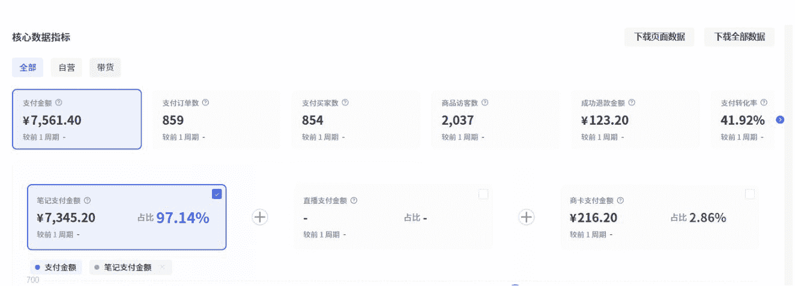
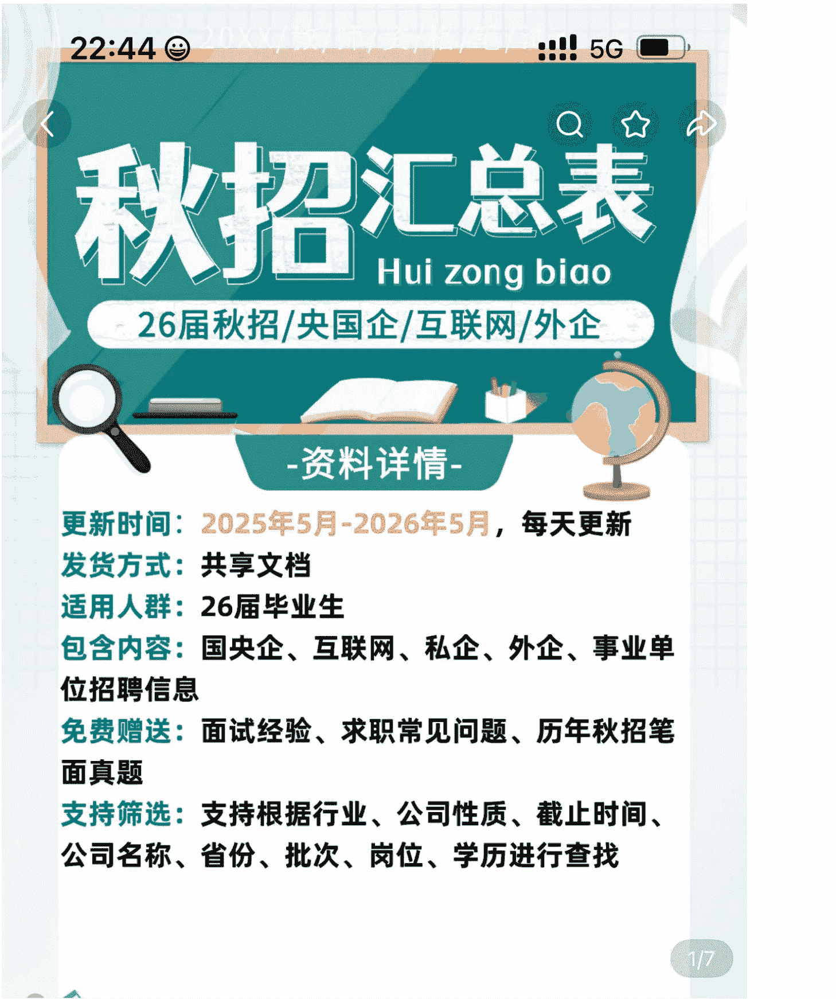

# 3个月破万单：我的虚拟赛道垂直小店单兵作战运营复盘与思考

# 260120 副业 SC 精华

公众号懒人搜索，懒人专属群独享
懒人微信：lazyhelper1

大家好，我是小加里奥。大四闲散人员一枚，加入生财一年半左右。目前主要在做小红书电商与虚拟电商，加起来约出了3万单左右。这次很高兴被我的鱼丸和小武老师邀请来做关于虚拟资料的分享。

我从大二开始接触了小红书，断断续续做到现在差不多有一年了，在今年9月份开始接触虚拟电商，3个月内拿到了10000单。GMV也到达了10W。取得过一些微不足道的成就，更重要的是一路踩过来了非常多的坑。临近毕业，最近也在经历从学生思维到创业思维的转变的阵痛，趁着小红书航海家大会之际，我也想把我虚拟资料垂直店铺上收获的经验与踩过的坑，和一些我在业务上的思考分享出来。

下图是我单月两个号的GMV。

| 核心数据指标 | 下载页面数据 | 下载全部数据 |
| :--- | :--- | :--- |
| 全部 | 自营 | 带货 |
| 支付金额 | 支付单数 | 支付 | 商品访客数 | 成功退款金额 | 支付转化率 |
| ￥57,108.20 | 较前1周期 +411.10% | 395.30% | 18,387 | ￥737.40 | 32.68% |
| 较前1周期 +343.39% | 较前1周期 +115.03% | 较前1周期 +80.38% | 较前1周期 +130 | | |

## 一、跑通虚拟资料垂直店铺的关键动作

### 1. 定赛道：高上限且熟悉

垂直顾名思义就是只围绕这个赛道进行选品，账号内可以进行本赛道的多品轮测，打爆之后也可以继续横向拓品。定赛道就变得十分关键，建议新手在刚开始无从下手的时候可以进行广筛严选，扩大你的想象力，在生财或是小红书站内手搜、第三方数据平台，找到近三个月内销量上千或是 24 小时有加购的产品，拓展出去找到他的赛道。

当你找到了 10 条左右你觉得还可以的赛道可以试着筛选：

一看：这个赛道的爆品是否适合小红书人群（年轻精致女性）

二看：这个赛道爆品数量足够多，他的每个季度，甚至是每一个月，是否能稳的产出万单一上的爆品（可以是几个链接加起来），能让你在每个阶段都有稳定的利润。

三看：产品的来源。是在别的网站上购买的、还是 AI 做的、还是一些垂直大博主的原创。看我们是否能做差不多的。所以新手可以先用自己熟悉领域的赛道来选品。但上限与利润一定是排在熟悉前面的。

### 2. 定品、测品：把握节奏、精准爆破

选好赛道后，就可以开始定品和测品的步骤。新手前期最好是跟品，找到赛道里目前 24 小时加购的品或是近两个月必爆的品类来打，这样取得正反馈的速度相对较快。建议大家尽量一开始打多品，因为单品流量不稳，而且垂直赛道，多品不会让账号权重混乱。

就拿大学生赛道来举例子，假如我是 8 月分开始打，我会选择，大学生开学的一些 PPT（近期需求）+四六级考试资料（两月后的需求）+创新创业大赛计划书（学期内长期需求），这个组合来打品，全方位覆盖，爆的可能性就越大。

这里也帮大家避雷一些不建议做的品与账号形式：

- 一、大博主（几千粉上万粉）的原创资料。资料 1:1 搬运，会被很快锁定而且也可能会有纠纷，虽然不大但是也会浪费心力。
- 二、低价且非常红海的产品 1:1 搬运，大概率流量一般而且利润空间极小。
- 三、需要十分过硬的专业能力的产品，AI 生成的内容无法判断好坏的，不仅会有退款还有可能被吃差评。
- 四、一些引流笔记的品 1:1 搬运，笔记不在同一个流量池内，用户很不精准，极有可能是无效数据。
- 五、无脑淘宝搬运几百个品，笔记内容就是详情页首图，现在红利褪去，这些内容会让路人观感很差，并且质量低下没有流量。

在养号成功以后，可以每个品每天发布 4 条左右，一个小时一条，仿写近期和去年同期的爆款模板。建议前 10 天先不考虑换品，一是因为虚拟资料起来的周期长，二是产品一定有很多“前辈”们发布的爆款模板，在前 10 天测透它们。

### 给大家分享一下我的测品节奏

- 1. 一个模板发现出单后，立刻制作三个相似的模板上架。
- 2. 如果一个需求期在 15 天后的品测了 10 天左右出了 10 单以上，那就不要放弃，坚持到需求期结束的后一天，很多产品都在需求期当天突然大爆。如果小眼睛低迷，打完所有模板不出单，或者只出一两单可以考虑减少这个品笔记的数量，加入新的品轮测，或是直接放弃。
- 3. 需求期在 30~60 天后硬需求的品坚持测，但该品的往年销量要在 10WGMV 以上，不断地去埋关键词，不断的去测爆款模板。同时学习同行的优点，不断完善产品结构。

当一篇笔记有爆款趋势，出了几十单达到大几百上千小眼睛时，应该重点关注，把评论区优势评论打到 10 条以上，介入付费投流，同时所有的账号开始批量制作这个商品的笔记，保证发布速度，在最快的时间里，吃到最大的流量，坚持到需求期结束，或者是大规模掉量为止。

### 3. 垂直赛道：胆大心细，吃干抹净

当账号坚持了一两个月打出一个爆品或是能产出稳定爆款笔记时，需要横向拓展垂直与该赛道的品，开新店或者添加子账号，扩大利润。

可以找出 10 个我们赛道的前辈，狠狠的翻他的账号，找出之后时间的去年同期爆款，把他们列到备忘录，或是直接上架店铺。开始慢慢制作笔记。每天坚持刷同赛道笔记一个小时一上，观察是否出了新品，看见有加购的可以立马跟（最好在需求期前 15 天）。

当然，现在很多品都是有版权或者 AI 制作，大家跟的时候也要多花心思，或者直接用上 AI 制作差不多类型的品。

这样我们就基本不会错过每一个好品，通过矩阵，最大程度地吃干抹净这一整年赛道的利润。

## 二、我所踩过的坑

### 1. 低价内卷

价格战我觉得这是虚拟项目里不太好的风气，我的第一个品就是 2.88 元的，笔记制作依赖 word 截屏，我手搓一个月每天搓的整个手机都是手汗和油，发了 200 条，总利润刚过 2000，这个投产比非常的不值得。

虚拟产品客单价本来就低。9.9 左右居多，经过一轮又一轮的“降价”被下拉至 2~3 元，这样不但让之前 9.9 元售卖的商家断流，就算低价商家起量利润依旧微薄，毕竟现在单品万单的概率不大。

规避低价的方式我认为有两种，一是输出差异化优质内容，拉高账号权重，提升账号爆文率；二是打出自己的产品差异化，利用 AI 来制作产品等等方法，微小的改变也能让顾客耳目一新，保护自己的利润率。

### 2. 经常换品，缺乏定力与自信

相信不止我，很多人也会出现这样的问题。小红书虚拟电商与实物实拍一样，起号周期一定要比之前的混剪长。我以前经常发几篇没有几个小眼睛就换品换赛道，一个月后看着别人打爆相同或相似的品又开始深深懊恼。

要从根源解决问题，一是筛品时候的严格程度，虚拟资料想打爆品就要做好长期战斗的准备，无论是开品还是跟品，前期一定要严格把关。

首当其冲的一点就是一定一定去打平台上有硬需求的品，如何判断呢？找到一个一定存在的需求，每年一定会有一大部分人去做，比如秋招、毕业答辩。接着看往年数据，新手最好去打商品挂链接并且同行数据过10WGMV的品。

千万不要被一些千赞的引流笔记所迷惑，他们的资料可以完善产品结构使用。干打比较容易翻车。如图1，虽然是千赞而且评论区挂车，销量只有10单，《语文园地》内容有，但是不是每个孩子都必须去复习的，学校也会发资料，并且仔细一想发现很多家长也不明白语文园地是什么，所以基本就是没单。如图2、3，秋招表格与投递工具，却非常火热。因为秋招基本是每个大学生都一定要完成的一个动作，加上资料本身很实用、就出现了硬需求。

### 四上最难的《语文园地》我强制我班学生全部吃透 考试没有丢分的
### 四上语文最难的《语文园地》吃透稳上90+
#家长收藏孩子受益 #四年级 #四年级上册语文 #小学语文怎么学 #语文知识点 #小学语文基础知识 #课文重点 #四年级语文 #知识点总结 #语文园地
文件 | 四年级语文上册...单元检测).pdf

¥19.9
已售6212

### 26届秋招信息表（赠历年校招题库）
400+人好评 1000+人加购 200+人收藏
- 平均2小时发货 | 承诺24小时内发货，晚发必赔 黑龙江哈尔滨 包邮
- 退货包运费 | 不支持无理由退换 | 晚发必赔
- 已选：26届秋招信息汇总表（一杯奶茶钱）
店铺 客服 购物车(39) 加入购物车 立即购买

### 网申投简历神器
还在为网申填简历崩溃吗？海投上百家，每家简历都要手动重填？格式五花八门，信息复制粘贴到手抽筋？担心手滑填错关键信息痛失机会？
一键解放双手！我的网申填表神器只需上传你的信息模板（我提供。）精准提取关键信息。一键填充需要填写的地方、告别复制粘贴噩梦！
兼容智联、前程无忧、BOSS直聘、实习僧、央国企及民企官网，覆盖10000家企业，求职快人一步！
支持苹果、win系统chrome or edge 浏览器使用
秋招在即，告别低效重复劳动，把时间留给重要的事
¥15.9到手价￥9.9
限时立减6元
秋招网申填写插件资料包4.0最新版（即将涨价）国企银行网申均可
300+人好评
付款后自动发货
不支持无理由退换
小熊你在干嘛呀
没开玩笑，直接2倍速秋招了好嘛都来买please中国人不骗中国人
巴啦啦能量

经过一轮又一轮的严格筛选，定完品之后，就坚定不移地打下去。可以用多品对冲概率，但千万别放弃！
在选品上多操一份心，在运营上就可以少操十份心。

### 3. 运营侧重头重脚轻

我在前期总是一往无前的发笔记，经常会忽略产品的链接设置，和笔记的干预问题。

细节决定成败，大家大部分都是在红海中厮杀的，尽量要把每一个地方做的完美。
定完品之后，把商品链接补单至 50 到 100，特别红海的可以补单到 1000，同时做 4 个左右带图好评，6 个左右不带图好评，增加客户信任。
有笔记在 24 小时内流速大于其他笔记，一定要做 5 个点赞，3 条左右评论，增加笔记权重，控制好评论区，删掉一些负面评论和拼单评论。如果爆款笔记掉量超过 50%，可以进行补单，延长爆款周期。
新出单的笔记即使加入投流计划，调整出价等等。这些看似不起眼的动作可能会使你的 GMV 翻倍。

## 最后的思考

小红书电商虽然我做了只有一年但是感觉也经历了翻天覆地的变化，从开始的混剪大爆发，到慢慢流量倾斜到优质的图文内容，我做为一个新手曾是在里面迷茫了比较久的，去年夏天很长一段时间都沉迷动漫和游戏，再到用虚拟的垂直店铺破局，我很庆幸自己没有下牌桌坚持了下来，虚拟的成功路径也给我接下来也要重新发展的实物很多灵感和经验，不得不说虚拟小店是非常好的生意。适应平台的变化，穿越周期，我觉得是每一个创业者或是生意人的必修课，胜不骄败不馁，适应变化，寻找突破。

在做爆了一组号之后，我也掌握了一些打品的底层逻辑，但是单兵作战的时间依然有限，加上我有点熬夜的习惯，每天虽然效率打满，我也很难扩大，尽管有一些工具的帮助。我觉得我今年的方向就是解放我的部分精力，适当招募店铺主理人，让我可以用更多时间在定赛道、定品这些关键动作上。

最后想对大家说，想都是问题，做都是答案，不断突破自己所认知的能力极限，这个世界只会越来越辽阔！

最后，安利小懒的付费群：

### 懒人专属群（介绍）

微信：lazyhelper1

> 📖 这里是你对抗信息过载的护城河。

已稳定运行 7 年，累计拆解、研读 3000+ 个互联网商业实战案例与行业前沿内参和时政/宏观文章。

### 我们不搬运垃圾，只做高价值信息的筛选器与放大镜。

### 懒人专属群更新记录：
https://hk57gvIx7u.feishu.cn/docx/H0kRdZbSbolBR0xkaXtcuVEOnTg

【免责声明】本资料归档于社群内部知识库，仅供成员课题研究与学术交流，请在查阅后 24 小时内删除。