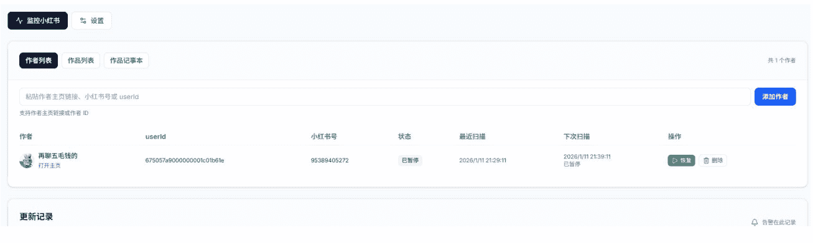
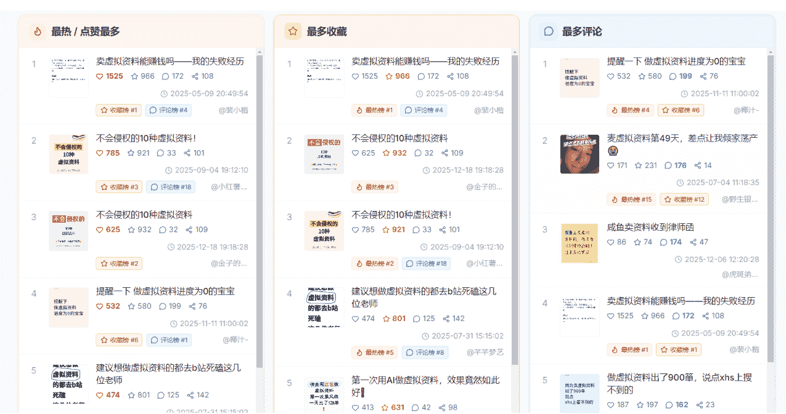
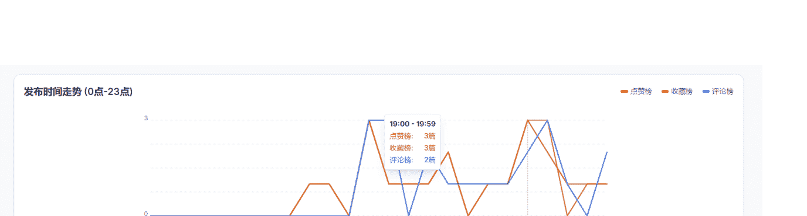
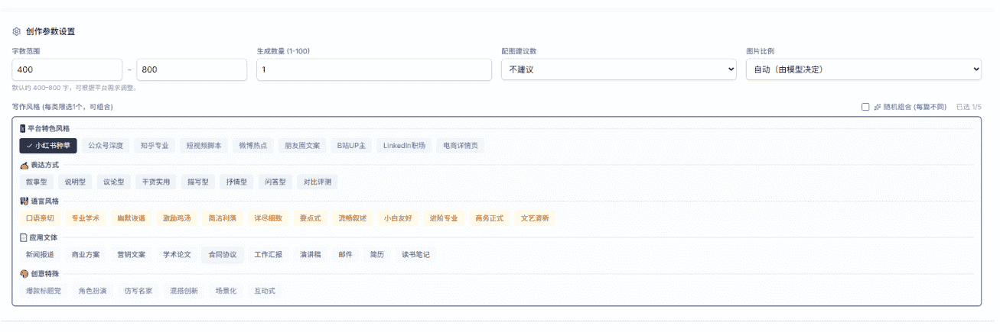
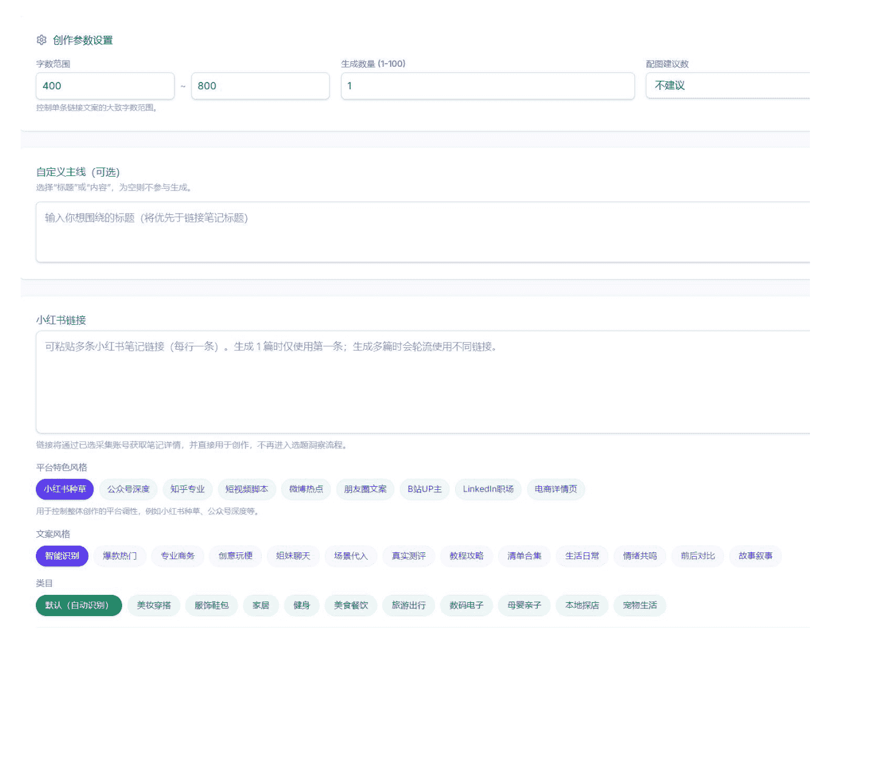
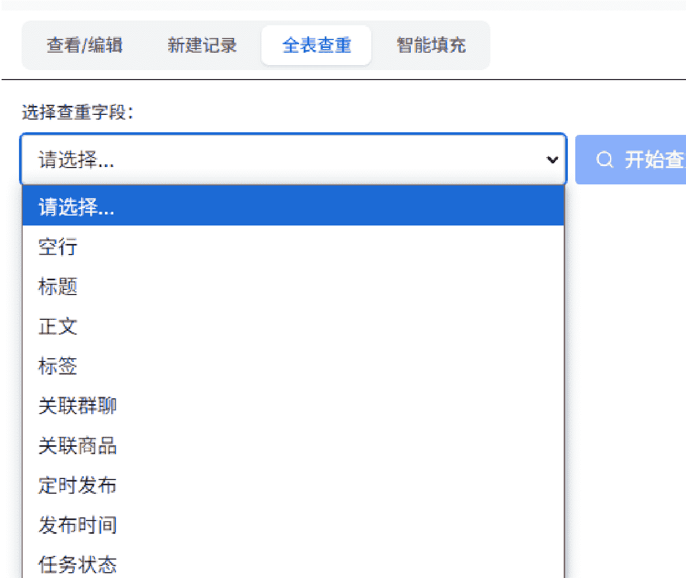
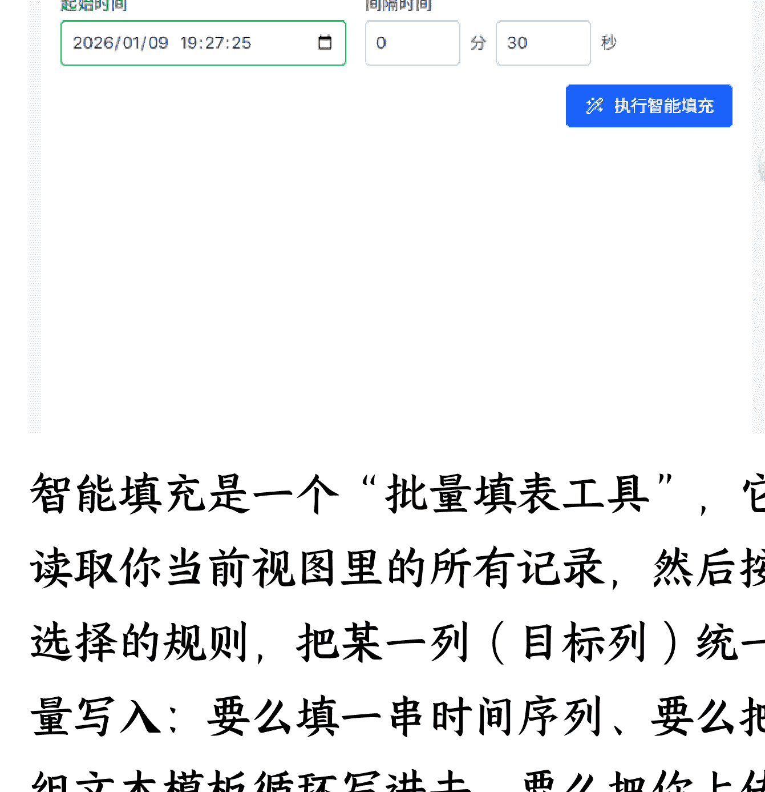

# AI 玩转小红书：零成本让小白有一支队伍的生产力，监控+采集+生成文案+批量发布

## 260120 副业 SC 精华

公众号懒人搜索，懒人专属群独享

懒人微信：lazyhelper1


前一阵和朋友工作室那边也商量打算试试小红书，也没有趁手的工具，看了不少圈友分享的内容工厂，觉得这东西对于矩阵化的玩法提效简直恐怖。监控作者、洞察热点、采集、生成文案、自动发布，全流程下来，一个人操作几十个号也没什么问题。

很多圈友分享了提示词还有各种想法，但是还是有很多朋友制作起来有难度，工具不该成为一个项目上手的门槛。

前前后后大概开发了一个多月，免费分享出来，利他既是利己。也希望各位在做小红书的老哥可以跟我多交流。

## 零成本三件套

### 1. 零成本采集小红书

因为小红书采集用第三方接口还要付费，查了一些资料找到了不需要付费的方法，所以小红书采集没有使用第三方平台接口。用自己的账号 cookie，个人使用采集完全无压力。但是不推荐一个账号 cookie 多人共用，风险自己承担。

### 2. 零成本内容生成

文本生成的 ai 大模型可以考虑硅基流动或者其他自己需求设定，硅基流动也有免费模型，THUDM/GLM-4.1V-9B-Thinking。软件内都写好了接口，填写相关密钥就可以使用。自己测试生成的文案效果，如果真的注重质量可以在考虑付费模型。

### 3. 零成本图片生成

内容生成和图片生成需要接入 AI 大模型，图片生成的 AI 大模型完全免费，每天 2000 张，个人使用完全没问题。自己注册一个魔搭社区账号，绑定实名的阿里云账号就可以。

实在不够用，多注册几个账号就行了。也就是说所有功能即使不想付费也可以跑起来。

自动发布功能自己可以接入飞书去开发，获取多维表格内容，也可以飞书侧边栏直接读表（侧边栏 TS SDK），然后通过影刀或者 Node 服务 + 调用浏览器+ Playwright 去发布。因为这个内容工厂工具本身是针对我自己需求开发的，自动发布功能接入的是一个账号矩阵管理工具，使用需要付费的，发图文挂群、挂商品都可以。不过注册免费送三天，填邀请码 7F20ID 还能再获取 3 天。

前一阵也是因为读了圈友乔川的文章，才知道飞书多维表格还有个挺好玩的玩法：侧边栏插件。以前我对“接入飞书”的印象一直是：要用就得去开发者后台建应用、开权限、拿 App ID / App Secret，然后再获取凭证。对非研发或者新手来说，这套链路门槛确实不低。

侧边栏插件这条路就轻很多：它直接跑在你正在打开的那份多维表格里，很多读写能力会继承当前用户对表格的权限，通常不需要再额外做一套应用鉴权。你只要把插件的服务地址配好，就能在表格右侧直接用。它也不是“万能替代飞书应用”，更像是给多维表格配的一个随开随用的小工具箱。缺点也有：用的时候得在飞书里打开这份表，插件不打开就用不了。但这实际上算不上一个大问题。

因为看了不少圈友的思路，感觉各有各的特点，都觉得非常好，于是想了很多方案，考虑了三天，最后敲定了下面这个，集很多优点的一个工具（主要还是圈友的思路都太强了，每一个都能给我一些启发）

整个工具可以运行在飞书侧边栏，也可以直接浏览器打开，运行在飞书侧边栏才可以使用飞书推送。其实完全可以省去 结果推送到飞书、获取飞书内容 这两步，直接网站生成内容，调用浏览器。但我还是选择把飞书（多维表格）接进来，因为它天然适合当“内容仓库”。

把采集、分析或生成后的素材，按字段统一沉淀到多维表格里，先把“数据集中”和“格式统一”这件事做好。业务侧只要发一条表格链接，团队成员就能在同一份内容池上协作：随时改标题、改文案、补标签、标注是否可发布、调整优先级，这些修改还能立刻对后续自动化加工与发布生效。相比把内容锁在内部数据库里，这种“可共享、可编辑、可追溯”的仓库形态更贴近运营协作方式，也让内容流转更透明、更可控、更容易规模化复制。

## 不只是小红书，其他平台也可以。

目前内容工厂文案生成可以选择很多平台和风格。


生成内容后直接推送飞书，想在其他平台做矩阵发布也可以直接对接飞书即可，这也是我写这个工具的用意。后面想做矩阵发布、想接公众号/知乎/微博/视频号，甚至想接任何第三方工具，都不需要每个平台都单独跟内容工厂做接口，只要统一去对接飞书这一个出口就行。

内容工厂越做越轻、飞书越用越像“标准仓库”，你再往外扩展多少工具，整体都是同一套字段、同一套流程、同一个规范，也越容易规模化。

- 系统负责「采集 + 生成」，输出到多维表格；
- 任意团队、任意技术栈，只要会调用飞书API / SDK，就可以「自助」从多维表格里取数；
- 他们可以用 Python、Node.js、Zapier、Make、飞书工作流等任何方式，自己写自动发布。

本质上，你的系统从「一个封闭工具」变成了「一个内容生产平台」。多维表格就是这个平台对外的「标准接口」。

## 目前这个工具可以通过浏览器打开已经可以实现：

### 一、监控小红书作者更新：



监控平台在整个内容工厂里更像一个“小雷达”：你把要关注的作者加进去，它就会按设置的频率自动去扫新作品，把新笔记先记到“作品记事本”里，同时对重点作品做持续盯盘，比如点赞到了阈值就触发提醒（也能走飞书/WxPusher/Server酱），还可以一键把链接推到选题分析或内容创作里继续处理，相当于把“发现—跟踪—提醒—落地”这条链路串起来。

### 二、选题分析：喂给 ai 大模型文章（三种方式）

#### 1. 关键字采集：统计出点赞、评论、收藏三个榜单。

每个榜单前 20 篇文章，再交给 AI 做归纳分析（比如标题套路、结构节奏、关键词偏好）。

- 提供三个 top 榜单：



- 画出三个榜单发布时间的趋势图作参考。

在榜单里哪个时段明显更活跃，就可以把重点内容往这个时段挪；反过来，低密度时段就不必硬刚，能省不少试错成本。因为这个“发布时间走势”看的不是你自己发了多少，而是 点赞榜/收藏榜/评论榜里这些表现更好的笔记，它们更常出现在一天的哪个小时段 ——本质上就是在帮你找“更容易出结果的时间窗口”。



#### 2. 热词推荐：

小红书还会统计关键词的相关热词展示在推荐搜索里。简单说它带来的好处：

- 一个词变一堆方向 ：丢个核心词进去，立刻给你一串相关词，选题一下就铺开了。
- 更贴近用户说话方式 ：推荐词基本就是用户的真实提问，你写标题、写开头更容易写到点上。
- 更容易找到长尾机会 ：大词太卷，推荐词里常有更细的组合词，反而更好切入。
- 不容易漏爆点 ：同一个需求换个说法可能更火，推荐词能帮你把这些“别名”一起挖出来。
- 能快速迭代 ：在项目里点一下就能继续分析，相当于“搜 → 拿词 → 再验证”，越做越准。

最后收一句： 推荐搜索热词就是平台给你的“需求导航”，帮你更快知道用户在搜什么、怎么搜，选题也更省试错。


#### 3. 自定义文本分析：自己填标题和文章内容。或者上传附件，生成洞察结果

不用先去采集一大堆数据，只要把自己写的标题和正文贴进去，或者上传一份文档，它就能把这段内容快速“捋清楚”——核心主题，以及哪些关键词和表达更值得保留，复制改写、也更方便做结构化提炼，所以用它来做选题洞察通常会更省时间、试错成本也更低。


#### 4. 批量指定小红书链接采集分析：

可以带着明确的目标去分析，把你已经收藏好的对标笔记、竞品爆款、或者你觉得有代表性的内容链接一口气贴进来，系统会自动抓取每条笔记的标题、正文和互动数据，然后直接给你做汇总洞察（比如高频词、核心主题、创作角度、适合人群等）。这样做比“用关键词去搜”更稳，因为它不会被搜索结果的噪音干扰，你想研究哪几篇就分析哪几篇，样本更可控、结论更贴近你的真实对标对象；同时也省掉了你手动一条条打开、复制、整理的时间，等于把“收集素材→整理→复盘”的流程压缩成一步。


### 三、内容创作：AI 大模型生成文案（三种方式）

#### 创作参数预览：



基于 第一步 喂给 ai 大模型文章 生成的洞察分析，配合创作参数批量生产文案：


通过上传图片给 AI，配合创作参数批量生产文案：

把图丢进去，就能把“画面里有什么、想表达什么、卖点在哪”快速转成一段能发的文案。它特别适合你手里已经有素材但懒得从零写的时候，比如产品图、穿搭照、探店照、行程照片、PPT 截图这些；一方面能帮你把关键信息补全（场景、亮点、使用感、对比点），避免文案空；另一方面写出来的结构通常更完整（标题+要点+结尾引导），省你自己搭框架的时间。还有个很实用的点是，它能让内容更一致——同一套图片风格和表达口径更统一，批量做内容的时候效率会提升很明显。

#### 直接采集小红书链接内容，配合创作参数批量生产文案

把对标笔记的链接一贴进去，它就相当于直接把那篇内容的表达方式、结构节奏、卖点顺序先“吃透”，然后帮你快速产出一篇能用的稿子。对你来说不用再从零拆标题、拆开头、拆转折，写作成本一下子被砍掉一大截。更关键的是，它不是瞎编套路，而是对着真实在平台上跑过的数据内容去对齐风格，所以生成出来更贴近小红书读者爱看的那种口吻和信息密度。你还可以一口气丢多条链接，让它给你不同角度/不同人设的版本，直接进入“多发多测”的迭代节奏。

## 公众号懒人搜索，懒人专属群分享



### 三种方式都可以添加主线（人设、角色定位、或者其他要求）生产。

先把这篇内容最核心的那条线定死——你想讲什么、按什么顺序讲、重点落在哪、最后要把读者带去哪里。这样模型生成的时候就不是“自由发挥”，而是沿着你给的主线去铺内容，跑题概率会明显降低，风格也更像你自己的表达。对实际创作来说，它特别适合做两件事：一是把同一个选题稳定地产出成系列（每篇都围绕同一套逻辑，只换案例/角度），二是把卖点和转化点提前钉在结构里（开头怎么抓人、中段怎么证明、结尾怎么收口），最后你得到的不是一篇“看起来对但不顶用”的泛文，而是一篇更贴合你目的、可控、可复用的稿子。


### 四、推送飞书内容仓库

这一步开始要在飞书文档（必须是多维表格）右上角，

#### 自定义插件 → 新增插件：


插件名称填写自己随便填。服务地址就填软件启动时的地址即可。完成后点开自定义插件下你刚添加的这个，


生成图片不符合可以重新抽卡，可以选择保存内容工厂草稿箱，也可以全选或者部分选中产出文案一键推送飞书。

### 五、内容仓库（飞书文档）接入批量发送。

内容推送到飞书之后，完全可以通过飞书侧边栏直接读表（侧边栏 TS SDK ）+Node 服务 + 调用浏览器+ Playwright 去发布 这样也可以，侧边栏 TS SDK 开发文档写得很全面，并且并不复杂。

在线文档地址在这里，里面讲的很全面，还有其他文档作参考。

### 六、批量管理内容仓库

展示台有四个功能：

#### 查看/编辑 ：


展示台会自动读取当前多维表格中“选中行”的字段数据，并以表单方式展示出来，支持直接在侧边栏内修改字段内容、预览图片/附件等信息；同时提供上一条/下一条导航，方便你在记录间快速切换与批量校对编辑。

#### 新建记录 ：


在不离开侧边栏的情况下，你可以基于当前表的字段结构快速填写表单并创建新记录；创建完成后会自动刷新记录列表并定位到新建行，形成“填表—落库—回看”的闭环。

#### 全表查重：



提供面向整张表的查重能力，你可以选择一个用于比对的字段，对全表记录进行相似度聚类与重复项定位；它帮助你快速发现重复内容、近似标题或相似文案，减少人工逐行排查的成本。

#### 智能填充 ：



智能填充是一个“批量填表工具”，它会读取您当前视图里的所有记录，然后按你选择的规则，把某一列（目标列）统一批量写入：要么填一串时间序列、要么把一组文本模板循环写进去、要么把你上传的图片批量写入到附件列。整个过程不需要逐行复制粘贴，适合运营批量发布、排期、补齐字段等场景。

## 三种填充方式分别怎么用

- 1）时间序列填充（最适合“排期/发布时间/定时发布”）
  - 你需要设置：
    - 目标列：建议选“发布时间/排期时间/执行时间”等列。
    - 起始时间：从这一刻开始写入。
    - 间隔时间（分/秒）：每一行在上一行基础上递增的间隔。
    - 填充规则（你可以这样向用户解释）：
      - 全局填充：第1行=起始时间，第2行=起始时间+间隔，第N行依次累加。
      - 账号分组填充：每个账号组都会“从起始时间重新开始排”，互不影响；例如A账号的第一条、B账号的第一条都会拿到同一个起始时间。
    - 输出格式：
      - 系统会写入类似2026-01-09 12:30:00这样的文本时间串（实现里格式化生成）。

- 2）循环内容填充（最适合“标题模板/文案模板/群名/标签”等）
  - 你需要设置：
    - 目标列：比如“标题/文案/群聊名称/标签”等。
    - 循环内容：一个多行文本框，“每行一条内容”。
    - 填充规则：
      - 它会按行号循环取值：例如你写了3行（A/B/C），记录会按A、B、C、A、B、C……这样循环填。
      - 账号分组填充：每个账号组都会从第一条内容 A 重新开始循环；这样能保证每个账号都有一致的模板序列。
      - 全局填充：整个视图作为一个序列循环。

### 实用写法建议（降低误用）

- 每行一条，不要在同一行里写逗号分隔；想要 10 个模板就写 10 行。

### 3）图片填充（最适合“批量封面/批量素材补齐”）
- 你需要设置：
  - 目标列：必须是“附件/图片列”（系统也会把目标列下拉框自动限制为附件字段）。
  - 上传图片：至少选择 1 张图片（可多选）。
  - 图片填充策略：
    - 覆盖已有图片：把目标列原来的图片清掉，统一换成你上传的图片。
    - 在已有图片后新增：保留原图，把新图追加到后面。
    - 在已有图片前新增：保留原图，把新图插到最前面。

这里是具体说明书：
https://my.feishu.cn/docx/VT2IdeGdeo2dp4xsEICcdTQLnnb?302from=wiki

## 最后，安利小懒的付费群:

### 懒人专属群（介绍）


📖 这里是你对抗信息过载的护城河。

已稳定运行 7 年，累计拆解、研读 3000+ 个互联网商业实战案例与行业前沿内参和时政/宏观文章。

我们不搬运垃圾，只做高价值信息的筛选器与放大镜。

### 懒人专属群更新记录:

```
https://hk57gvlx7u.feishu.cn/docx/H0kRdZbSbolBR0xkaXtcuVE0nTg
```

【免责声明】 本资料归档于社群内部知识库，仅供成员课题研究与学术交流，请在查阅后 24 小时内删除。