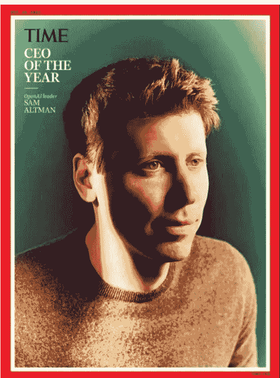
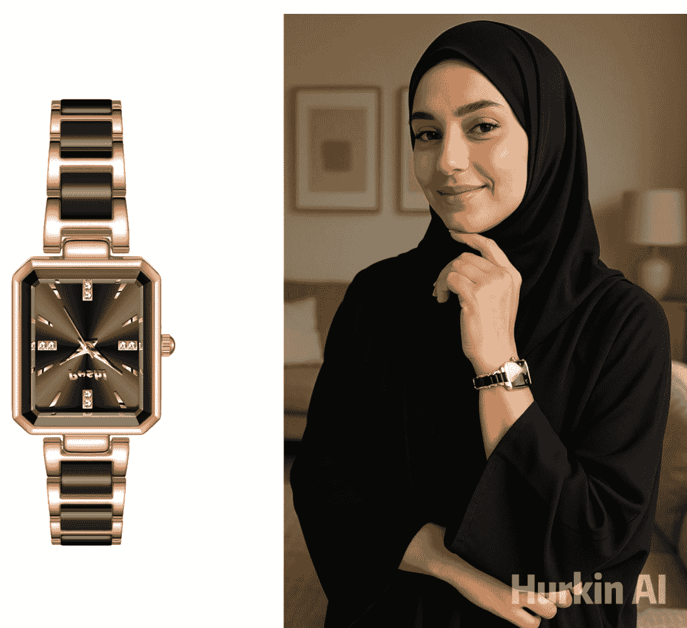
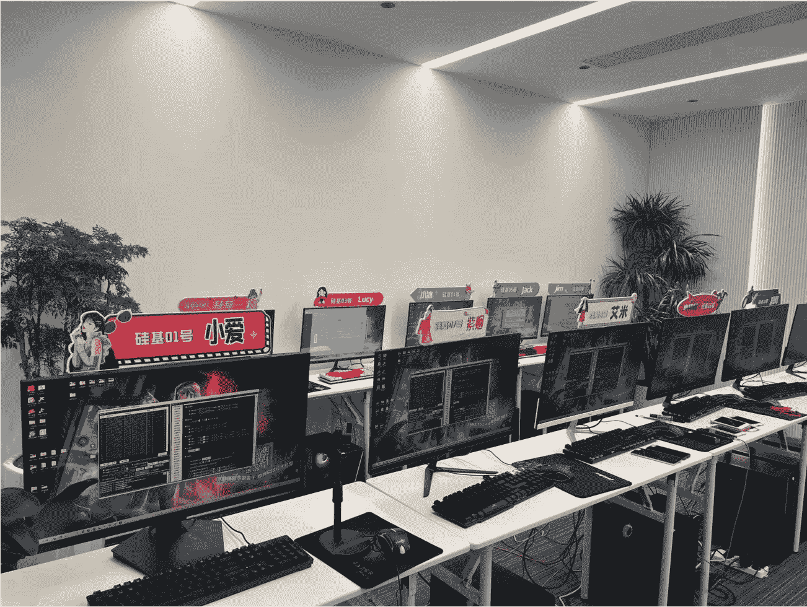
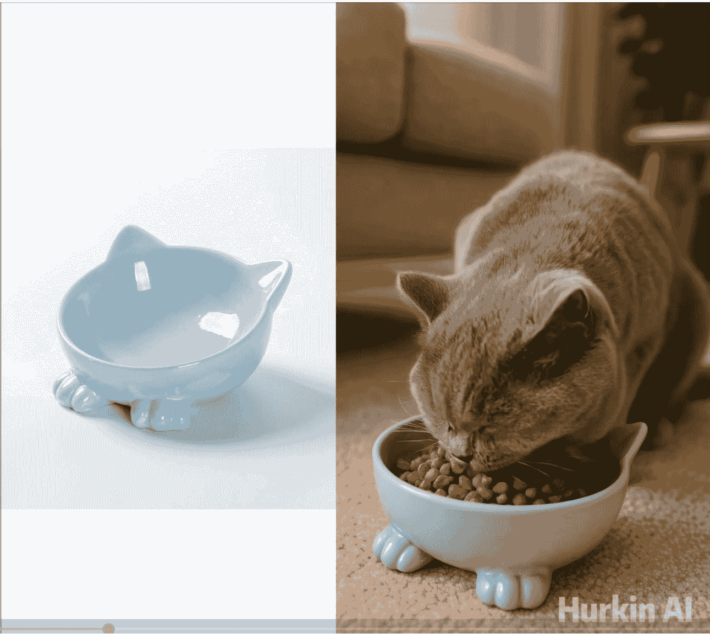
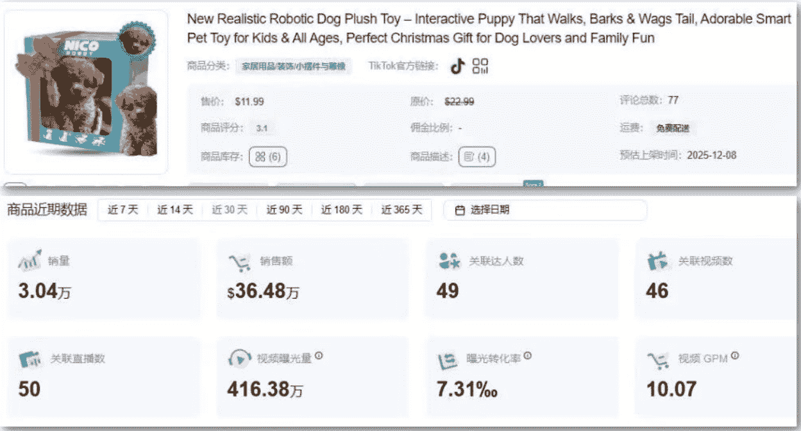
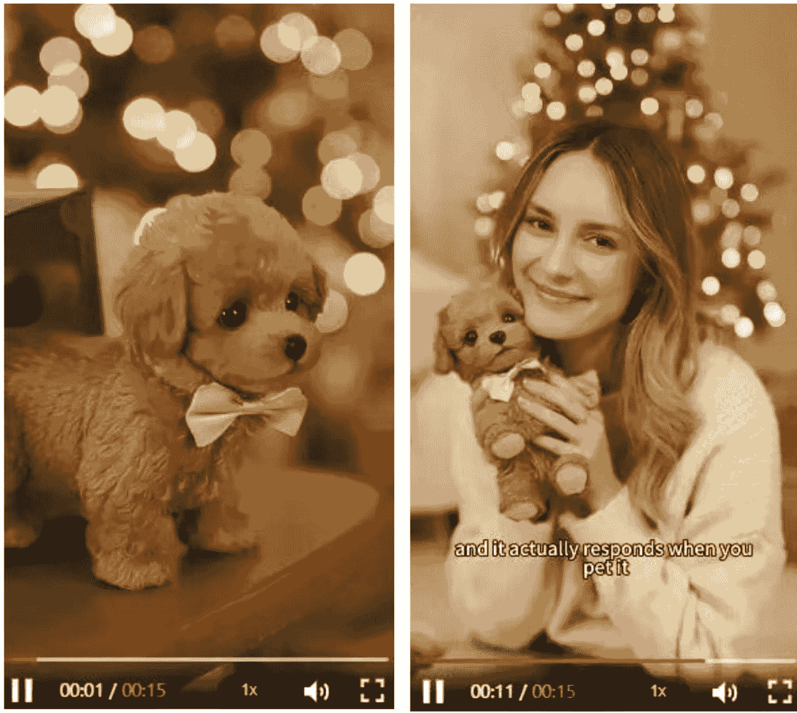
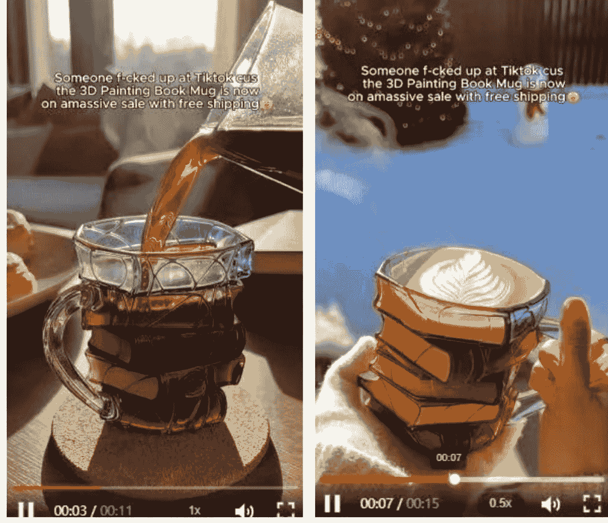
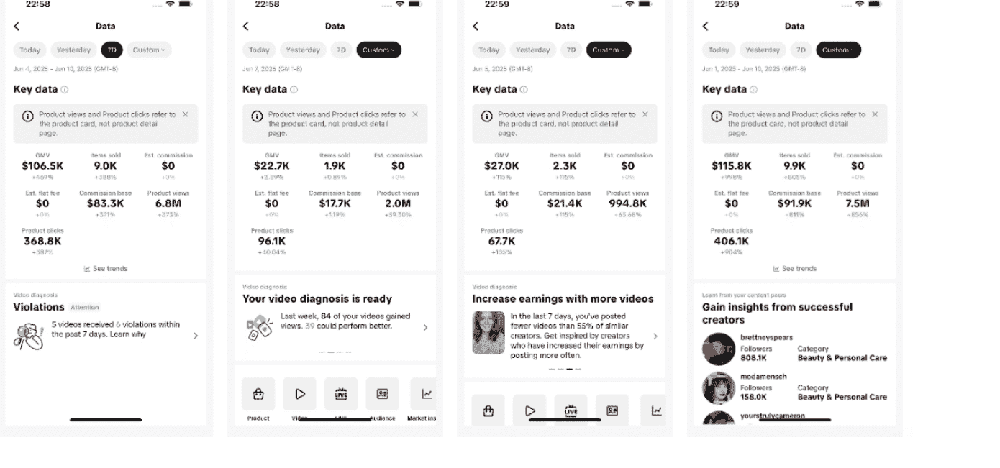

# 【AI+出海】AI小团队逆袭：靠AI短视频拿下跨境上市巨头年度大单的秘密(附全流程拆解)

260120 副业 SC 精华

公众号懒人搜索，懒人专属群独享

懒人微信: lazyhelper1

公众号 懒人搜索 懒人专属群

大家好，我是 Lisa 学姐，一个用 AI 把跨境生意做到全球的 90 后创业者，目前在深圳创业，深耕跨境领域 5 年。现在我们深度把 AI 应用在了跨境产业上，如今也取得了一些小小的成绩，拿下了跨境上市巨头年度服务大单。

很久没有在生财有术发帖了，之前写了两篇深度长文贴，这两篇文章对很多人产生了一些效用，有些圈友拿着帖子已经开始一步步操作开启了 AI 出海之旅，对此我也感到很欣慰。今天这篇帖子我会给大家深度拆解我们是如何靠 AI 短视频拿下跨境上市巨头年度大单的，希望对大家的创业或者副业方向有更多的启发和帮助。

## 一、先成为超级个体，再成为超级企业

当传统出海企业还在为跨境营销的"三座大山"——本土化成本高、内容量产难、文化隔阂深——焦头烂额时，一支来自深圳的AI小团队（也就是我的团队），却用AI重构了游戏规则：零真人出镜、零外语专才、日均量产 500 条本土化短视频，在TikTok 市场杀出重围，最终斩获了某跨境上市巨头年度服务大单。

正所谓“乱世出英雄”，正是在AI时代，所有行业都面临着重新洗牌，所有商业都在重构，所以给了我们普通人更多的机会。AI被称为“第四次工业革命”，所以我们要抓住这次机会，去找到我们可以杀出重围的那个方向，因为这个时代很有可能会诞生更多的商业奇迹。

就像 OpenAI 首席执行官萨姆·奥尔特曼 Sam Altman 所言：未来会诞生只有一人的十亿美元独角兽企业。

> 未来会诞生只有一人的十亿美元独角兽企业。
> ——ChatGPT之父 OpenAI首席执行官萨姆·奥尔特曼 Sam Altman

我经常跟大家说：先成为超级个体，再成为超级企业。所以未来的商业不是用规模定义伟大，而是用智能密度重构价值。

就像我们团队的每个成员都是"六边形战士"：既懂营销策略又能调参大模型，既能分析数据又会设计转化链路。这种复合型能力背后，是AI工具链带来的认知跃迁。

### 我是怎么成为AI跨境的超级个体的?

早期我也是一名打工人，从省广电到智能科技公司，后来入局跨境开始创业以后，我先把自己训练成了“超级个体”，一个人纯手搓做30个TikTok账号，那时候每天工作电脑面前就摆满了手机。每天的工作流程就是：找素材——剪视频——传手机——发布，这样的工作每天要重复90次，因为每个账号要发3条视频。

后来想要扩大TikTok短视频带货的规模，就只能通过招聘人的形式，因为人工上限也就是做30个账号，所以那时候最高峰招聘了20几个剪辑，每天出单量大约1000~3000单左右。但是长此以往的工作下来，发现都是机械化的剪辑工作，不仅枯燥而且眼睛也吃不消，整个团队视力急剧下降，后来才开始介入到AI。

那时候还没有超级个体的概念，只是想用AI解决生产力。

但恰恰是这个最朴素的想法，让我们无意中踏上了通往“超级个体”和“超级团队”的必经之路。我们做的第一件事，就是“把双手从重复劳动中解放出来，把大脑用于思考如何创造更多价值”。

## 二、从“人力作坊”到“AI硅基工厂”：我们的三次认知跃迁

这个过程，我们经历了三次痛苦的，也是至关重要的认知跃迁。

### 第一次跃迁：从“我要招更多人”到“我要造更多‘工具人’”

当团队视力集体滑坡，我意识到靠堆人力是条死路。招20个人，管理成本、质量波动、情绪内耗，每一项都在吞噬利润和创业热情。我们当时试用过市面上几乎所有剪辑软件，都不满意。于是，一咬牙，我们决定自己造轮子。

得益于之前在科技公司做产品架构的底子，我和合伙人锦哥带着技术小伙伴，把我们日复一日总结出的“爆款视频结构”——黄金三秒怎么切入、产品展示几秒、效果演示什么角度最抓人——全部拆解成标准模块，开发了我们第一代 AI 智能剪辑软件。

效果是震撼的。原来一个剪辑一天极限是10-20条高质量视频，用了这个工具，一个人一天可以轻松产出300-500条。而且，AI不知疲倦，不会因为剪了100条就烦躁、出错。我们第一次尝到了“硅基劳动力”的甜头。

但问题随之而来：素材从哪来？尤其是做美区，我们总不能一直用亚洲面孔的素材去混剪，平台不推荐，用户也缺乏信任感。我们陷入了“巧妇难为无米之炊”的困境。这逼着我们开始了——

### 第二次跃迁：从“寻找素材”到“创造素材”

当时我们尝试在国内请外模，难如登天，成本高、不稳定。做直播也失败了，IP不稳定，人力成本扛不住。正如我在第二篇帖子里写的，国内请外模拍一条视频可能要几百上千元，寄样到海外周期长达两个月。

“没有，就创造。”我们把目光投向了刚刚爆发的 AIGC。既然 AI 能剪辑，那能不能生成素材？我们开始疯狂测试各种 AI 生图、生视频工具。Midjourney, Stable Diffusion, Runway, 可灵……我们成了最早一批把这些工具用于电商的“淘金者”。

这个过程极其痛苦。生成的图片手指是扭曲的，产品是变形的，模特表情诡异。但我们看到了希望。因为“扭曲”是可以被“驯服”的，同时 AI 也在不断进步。 我们团队里的“模型驯兽师”，开始没日没夜地研究模型、调试参数、炼制 LoRA。我们不再满足于通用模型，我们要为“跨境电商”炼制专属模型。

终于，我们跑通了一条工作流，也打造出了自己的 AIGC 原创短视频系统，只需要一张白底图，就可以生成 TikTok 爆款短视频，模特可以是金发碧眼，也可以是拉丁裔，肤色、光影、服饰搭配，都无比自然。那一刻，我们感觉手里有了一把“金钥匙”。我们不仅解决了素材问题，更是创造了一个 “永不枯竭的数字化影棚”。

### 第三次跃迁：从“做项目”到“建 Agent 系统”

有了 AI 剪辑和 AIGC 素材，我们的产能爆炸了。我们开始服务一些跨境大卖，效果很好。但我们很快遇到了新瓶颈：项目制服务无法规模化。 每个客户的需求都要重新沟通、定制，虽然能用 AI，但依然大量依赖我们“碳基大脑”的投入。

我们问自己：能不能把我们的能力，封装成一个“即插即用”的 Agent 系统？ 让客户，甚至是那些完全没有 AI 背景的运营人员，也能像使用傻瓜相机一样，产出高质量的本地化短视频？

这个想法，促使我们开始了最艰难、也最有价值的一次升级：构建“碳硅协同”的工业化流水线。 这也正是我们后来能拿下上市公司大单的终极武器。

## 三、TikTok 市场机会：当"平台风控"遇上"成本黑洞"，AI 的破局点就出现了

说实话，当我第一次看到 TikTok 美区原创审核的严苛程度时，我整个人是懵的。那感觉就像你辛辛苦苦建了一座城堡，结果发现地基是豆腐渣工程，随时可能塌。

平台风控，是悬在美区商家头上的达摩克利斯之剑。

整个 TikTok 平台对非原创性内容的风控升级，已经到了"宁可错杀一千，不可放过一个"的地步。东南亚市场还好一点，混剪还能勉强活下来，但美区？想都别想。你就算拿着真金白银拍的原创视频，只要镜头重复使用几次，都有可能被判重。更可怕的是，只要你挂上小黄车，你的视频就会进入一个"地狱级"的审核池，一旦发现判重，小黄车直接被下掉，同时扣分。

整个橱窗总分 24 分，违规第一次扣 8 分，橱窗封禁 1 天；第二次再扣 8 分，封禁 3 天；第三次，直接永久封禁。这哪是扣分啊，这分明是"三振出局"。

所以现在美区大部分商家，只能硬着头皮自己拍。每天几十条视频的需求量，压得他们喘不过气。而且大部分都是纯拍产品，为什么？因为找不到外模出境啊。

外模拍摄，简直就是跨境电商的"老大难"问题。

在国内请外模拍摄，难如登天。北上广深这些一线城市可能还能找到一些，但当初我们在福州这种城市，找个合适的外模简直是难上加难，尤其像东南亚穆斯林这种就更难找了。

还有很多商家直接寄样到海外去拍，一次几百美金，除了贵，寄样拍摄完成再寄回来，2 个月时间就过去了。黄花菜都凉了，新品都变老品了。更气人的是，海外达人拍摄的质量普遍偏低，因为他们根本不懂什么是短视频，很难根据你的指令完成拍摄。

成本黑洞，是压垮骆驼的最后一根稻草。

样品费+达人拍摄+剪辑团队，这一套组合拳打下来，成本根本降不下来。周期长、成本高、质量不稳定，这就是传统模式的"三座大山"。

但AI的出现，就像一把锋利的刀，把所有中间环节都砍掉了。它让短视频制作成本断崖式下降，而且能做到100%原创，既解决了平台风控问题，又解决了外模拍摄的痛点。

说实话，在国内市场，AI原创短视频可能还很难完全取代传统拍摄，因为国内拍摄成本本身就低，一条视频几十块就能搞定。但跨境电商不一样，居高不下的成本就是市场的刚需痛点。AI原创短视频，就是为这个痛点量身定制的解决方案。

这就是为什么我说，AI+跨境，是未来3-5年最大的风口之一。它不是锦上添花，而是雪中送炭。它解决的，是跨境电商最痛、最刚需的问题。

## 四、AI短视频带货在TikTok上的机会：普通人也能抓住的时代红利

说真的，我经常被问到：“Lisa姐，现在做TikTok带货还来得及吗？AI来了是不是门槛更高了？”

我的答案永远是：正因为 AI 来了，现在才是普通人入局最好的时代。

你们想想，三年前我们刚做 TikTok 的时候，那才叫一个苦。每天剪视频剪到凌晨四五点，靠的就是一股蛮劲。那时候大家都在做创作者基金，搬运搬运视频就能赚钱，但我们知道那不是长久之计。后来我们 all in 带货，一个人管 30 个账号，每天发 90 条视频，眼睛都快瞎了。

但现在不一样了。AI 把最苦最累的活都干了，把门槛从"体力活"变成了"脑力活"。

TikTok 现在最缺的是什么？是内容，是优质的本土化内容。

尤其是美区，平台对原创的要求已经到了变态的程度。但需求就在这里摆着——35亿用户，每天刷着短视频，等着被种草、被转化。这个市场太大了，大到根本吃不完。

AI 给了我们普通人三把钥匙：

### 第一把钥匙：破除了"外模"和"场景"的魔咒

以前你想做美区，首先得解决模特问题。在国内找不到合适的模特，寄样到海外成本又高得吓人。现在呢？用AI，一张白底图，就能生成欧美模特在纽约公寓、加州海滩、巴黎咖啡馆的各种场景。成本从几百美金一条，降到几美金甚至更低。下面就是我做的一条原生感很足的美区带货视频，很多人看了都很震惊，说没有一点点AI感，实在太真实了。

我记得我们测试的第一个美区账号，做的是宠物用品。用AI生成了一只猫吃猫粮的视频，第一条就跑了20多万播放，第三天就出单了。那种感觉，就像突然打通了任督二脉——原来跨境可以这么做！

### 第二把钥匙：实现了"一个人就是一个团队"的可能

以前你要做一个 TikTok 带货账号，至少需要：一个选品的人，一个写脚本的人，一个拍摄的人，一个剪辑的人，一个运营的人。现在呢？有了 AI，这些事一个人全都能搞定。

用 ChatGPT 写脚本，用 Midjourney 或者 Stable Diffusion 做图，用即梦或者可灵生成视频，用剪映自动剪辑。一个人，一台电脑，一天能产出几十条高质量视频。

我们团队现在就是这样，每个人都是"六边形战士"。不是我们有多厉害，是 AI 工具让我们变得厉害。像这样的视频，一个人每天可以做几百条。

### 第三把钥匙：打开了"矩阵化运营"的新世界

做 TikTok，一定要有矩阵思维。一个账号火了是运气，十个账号火了是能力，一百个账号火了才是系统。

以前我们做矩阵，是靠堆人。招 20 个剪辑，每天剪到天昏地暗。现在靠 AI，一个人就能管理上百个账号。我们的硅基员工"小爱"，24 小时不眠不休，自动生成视频、自动发布、自动回复评论。

矩阵的意义是什么？是测试。测试哪个品能爆，测试哪种内容形式更受欢迎，测试哪个时间段流量更好。有了 AI，测试成本变得极低，试错速度变得极快。

普通人现在入局 TikTok 带货，应该怎么做？

我给三个实在的建议：

- 从东南亚开始，别一上来就碰美区。我知道美区客单价高，大家都想赚美金。但美区的门槛也高——5000 粉才能开橱窗，审核严格，竞争激烈。东南亚不一样，菲律宾 600 粉就能开橱窗，印尼、马来也就 1000 粉。而且东南亚的文化和我们更接近，更容易做出爆款。我们团队现在还有很多账号在做东南亚，不是因为做不了美区，是因为东南亚的投产比更高，更适合小白起步。
- 选对品类，比你想象中更重要。不要什么火做什么。要根据 AI 现在的能力来选品。服装、宠物用品、家居小物、车载用品——这些是 AI 视频表现最好的品类。为什么？因为不需要太复杂的动作，展示清楚就能激发购买欲。像我们之前做的一款车载香薰，用 AI 生成车子内饰，加上香薰的特写，配上舒缓的音乐，一条视频跑了 500 多万播放，直接爆单。这个品我们做了三个月，佣金收了十几万。
- 先跑通一个账号，再复制到矩阵。很多人一上来就想做矩阵，这是错的。你先用一个账号，把整个流程跑通：怎么选品、怎么写脚本、怎么用 AI 生成视频、怎么发布、怎么维护。跑通了，知道怎么出单了，再用同样的方法复制到第二个、第三个账号。我们服务跨境上市巨头就是这样。先用一个产品测试，跑通整个 SOP，然后再批量复制到其他产品线。

## 最后说点掏心窝的话。

AI 不是来抢我们饭碗的，是来给我们递工具的。三年前，我们靠熬夜剪视频，一个人做到月佣金 3 万+，觉得自己很厉害了。现在用 AI，一个刚毕业的大学生，认真做三个月，月入过万真的很轻松。

这个时代很公平——它不看你的背景，不看你的资源，只看你愿不愿意学习，敢不敢尝试。TikTok 给了我们全球 35 亿用户的流量池，AI 给了我们驾驭这个流量池的工具。

剩下的，就看你的执行力了。

## 五、实战为王：当别人还在争论“AI 视频是否限流”，我们已经跑出了百万美金 GMV

说实话，每次看到圈子里还在争论“AI 视频会不会被限流”这种问题，我都觉得挺有意思。这就好比十年前大家在讨论“电商会不会取代实体店”一样——市场早就用真金白银给出答案了，只是有些人选择闭上眼睛。

我们团队没空参与这些讨论，我们只相信数据。当别人还在纠结理论时，我们自己用纯 AI 内容跑出了单账号 10 天 GMV 破 11 万美金的成绩。

**数据看板 (Jun 1, 2025 - Jun 10, 2025, GMT-8)**

| 指标 (Key data) | 数值 | 增长率 |
|---|---|---|
| GMV | $115.8K | +998% |
| Items sold | 9.9K | +805% |
| Est. commission | $0 | +0% |
| Est. flat fee | $0 | +0% |
| Commission base | $91.9K | +811% |
| Product views | 7.5M | +856% |
| Product clicks | 406.1K | +904% |

*注：Product views and Product clicks refer to the product card, not product detail page.*

### Gain insights from successful creators

- **brettneyspears**
  - Followers: 808.1K
  - Category: Beauty & Personal Care
- **modamensch**
  - Followers: 158.0K
  - Category: Beauty & Personal Care
- **yourstrulycameron**

还有最近整个跨境圈的火爆案例，彻底印证了我们的路径没有问题。数据不会骗人：在最近的 AI 带货视频中，播放量超 500 万的有 19 条，其中 6 条破千万，最高飙到 3140 万；近 30 天，销量 1000-5000 单的 AI 视频有 33 条，销售额 5 万-10 万美元的视频也有 7 条。AI 不是在“试水”，它已经在“屠杀”榜单了。

### 看看这些杀疯了的案例：

一款保健品，用 AI 塑造了一个“愤世嫉俗的智者”形象，深刻切入健康焦虑，11 天销售额破 8 万美元。

一个机器狗玩具，上架 20 天狂卖 3 万件，255 万人民币销售额里，81%由 AI 视频直接驱动。

产品通过 AI 视频呈现机器狗“会叫能移动”的生动效果，精准凸显其高性价比优势，不仅深受达人青睐，更俘获了众多孩子的喜爱。其中一条播放量 330 万的 AI 视频，直接贡献了 23 万美元销售额。

一个 3D 书籍造型的马克杯，靠一条小号发布的、展现“清晨咖啡与书”浪漫场景的 AI 视频，7 天获 1810 万播放，20 多天卖出近 60 万美元。

还有那个经典的 LED 圣诞投影灯，一条 10 秒的 AI 短视频，7 天卖出 1.3 万单，单日 GMV 冲破 10 万美金，直接登顶美区类目榜首。

这些案例都在疯狂验证同一件事：AI 生成短视频不仅能卖货，还能卖爆，能把你送上类目第一。

为什么能爆？因为它同时解决了三个核心问题：

- 第一，是“成本与效率的革命”。 传统实拍一条视频几千块，周期 3-7 天；AI 制作成本可降至几乎忽略不计，5-10 分钟就能出片。这意味着你可以用极低成本，一天测试十几个创意方向，爆款不再是“赌”出来的，而是用海量内容“筛”出来的。
- 第二，是“想象力与场景的飞跃”。 AI 能以近乎零成本，搭建出院星空、梦幻圣诞夜、复古咖啡馆等高价值、强情绪的场景。它把普通商品从“功能属性”变成了“情绪装置”，极大地放大了购买冲动。就像那个投影灯，AI 把它嵌进了一个完美的圣诞故事里，这是实拍很难快速实现的。
- 第三，是“精准击中算法”。 我们花了三年拆解了上万个爆款，把“黄金三秒”、“情绪钩子”这些算法偏好，变成了 AI 工作流里的固定指令。AI 负责生产，但“生产什么”由我们基于对算法的深刻理解来设定。我们沉淀的“爆品脚本模型库”，每一个都经过市场验证。

所以，别再问 AI 视频能不能做了。TikTok 平台自己已经给出了态度：只要内容质量过关，它根本不在意你是实拍还是 AI 生成。平台在意的是内容是否吸引人、是否合规，而不是你的制作方式。

当然，火热的背后也要清醒。现在确实出现了一些问题，比如“货不对板”：AI 渲染得像个艺术品，实物却像地摊货；或者为了效果过度合成，导致严重误导。这纯粹是“贪心”和“短视”，是在透支信任。AI 是放大器，它放大美好，也会放大缺陷。我们一直坚持，AI 是用来高效展现产品真实美感和使用场景的，绝不是用来“造假”的。合规运营，“AI+实拍”结合展现真实质感，才是长久之道。

更关键的是产能和迭代速度。当圣诞季来临，传统团队可能还在协调外模档期，我们的 AI 系统已经能一夜之间生成几百条不同场景的测试视频，进行饱和攻击，快速筛出爆款。这种“数据导航+产能碾压”的能力，是任何传统团队无法比拟的。

市场已经给出了终局答案。那个用一条10秒AI视频冲上类目第一的案例，只是一个序幕。它宣告了一个新时代的到来：内容的生产方式、测试成本和迭代速度已被彻底重构。谁先拥抱这种重构，用AI武装自己，谁就能用最低的成本，撬动最大的流量。而犹豫不决的人，只会像当年看不起电商的实体店老板一样，被时代无声地抛在身后。

## AI带货迈入合规阶段

不少卖家担心AI生成的视频会被TikTok识别并限流。据业内实测，只要内容质量过关，TikTok不会因为是AI生成就限流。平台在意的是内容本身，而不是制作方式。这个答案，打消了很多卖家最大的顾虑。

针对AI内容的快速发展，TikTok已出台相关规范措施，为行业划定发展边界。在欧洲信任与安全论坛上，平台推出AI内容调节工具与“隐形水印”技术，实施显式与隐式双重标识机制：显式标识需让用户直观感知内容为AI生成，隐式标识嵌入文件数据便于溯源，且不得恶意删除。

同时，平台明确禁止发布高度相似的批量AI视频，严厉打击通过AI合成进行虚假宣传的行为。卖家应坚持合规运营，按要求添加 AI 内容标识，确保视频展示与实物一致；可采用“AI+实拍”混合策略，用 AI 搭建场景、用实拍补充产品真实质感，平衡效率与信任。

AI 带货是趋势，但规范是前提。优质内容与合规运营将成为核心竞争力，将成为跨境卖家出海营销的重点方向。

我们花了三年时间，拆解了 TikTok 上万个爆款视频，把“黄金三秒”、“情绪钩子”、“转化指令”这些算法偏好的结构，都内化到了 AI 生成工作流里。AI 负责生产，但“生产什么”是由我们基于对算法的深刻理解来设定的。

更关键的是产能。传统团队一天做 10 条视频，我们可以做 1000 条。当热点出现的时候，我们可以一夜之间用几百条 AI 视频进行矩阵式覆盖，快速测试、快速迭代、快速引爆。这种规模效应，是任何真人团队都无法比拟的。

现在我们已经沉淀出了一整套“爆品脚本模型库”，服装、玩具、宠物用品、时尚穿戴……无论什么品类，在我们这里都能快速找到已经验证过的盈利模型。

下一节，我将拆解我们如何用"碳硅协同"系统，并最终拿下上市公司大单。

## 六、AI 能力+TikTok 能力：拿下上市公司大单的秘密

很多人一听我们拿下了上市公司大单，第一反应是：“你们 AI 技术肯定特别牛，把人家内部 AI 部门都干趴下了。” 说真的，还真不是这样。那家大公司自己的 AI 团队，光是博士就有好几个，论模型算法、写论文，我们根本比不了。

那我们赢在哪呢？

我打个比方就明白了。他们像是一个顶级汽车工程师团队，能画出最精密的发动机图纸。但我们呢？我们是开着越野车，在丛林、沙漠、沼泽里真刀真枪跑过十万公里的老司机。我们知道哪条路能走，哪个坎会翻车，怎么用最快的速度把货从 A 点送到 B 点。

我们真正的核心，不是 AI 技术本身，而是我们把在 TikTok 上真金白银打出来的、跑通了的短视频运营能力，用 AI 给“固化”和“放大”了。他们是科学家，我们是特种兵。

我们给上市公司看的第一个“硬通货”，不是什么高深的技术 PPT，而是我们团队用 AI 做出来的、单条播放 1.4 亿的带货视频。这个东西，他们的 AI 部门永远做不出来。为什么？因为他们缺的不是技术，是刻在骨子里的“网感”，是对 TikTok 流量算法和用户心理最直接、最野蛮的理解。我们知道什么样的开头 3 秒能让人停下来，什么样的产品展示能勾起购买欲，什么样的评论区互动能把流量推向高潮——这些“手感”，是我们剪了上百万条视频，亏了无数钱才换来的。

现在，我们把这种“手感”变成了 AI 工作流程里的一个个参数和指令。这才是他们最看重的，也是任何纯技术公司永远无法复制的壁垒。

所以，我们拿下这个大单，根本不是一场技术招标，而是一次业务能力的“降维合作”。具体怎么做的呢？分三步走，这三步环环相扣，步步为营。

### 第一步，不是卖方案，而是做内训。

我们主动提出，可以以一个极低的成本，先给他们的海外短视频团队做一场内训。培训什么？就培训我们怎么用 AI 做 TikTok 爆款。这一招很关键，成本不高，但效果极好。一方面，我们展示了实打实的方法和案例，让他们的团队心服口服；另一方面，我们像“侦察兵”一样，深入了解了他们内部到底卡在哪、痛在哪。这一步，我们不是供应商，是老师、是顾问。

### 第二步，精准定制“三化”方案，直击命门。

摸清情况后，我们抛出的方案没有一句空话，就叫 “短视频账号三化建设” ：

- 品牌化：不是乱发视频，而是用内容强化他们的品牌认知。我们通过 AI 批量生产高质、风格统一的视频，快速在用户心里建立起“专业、可靠”的品牌形象，告别了之前内容杂乱无章的状态。
- AI 化：这不是喊口号，是实打实地帮他们把我们从 0 到 1 跑通的“碳硅协同”流水线，适配到他们的工作流里。让他们从“人工苦力”模式，升级为“人指挥 AI”的智能模式，产能和稳定性直接翻几倍。
- IP 化：我们甚至用 AI 为他们打造了多个虚拟品牌代言人，一个符合品牌调性的本土化面孔。这个“IP”可以 7x24 小时出现在所有视频里，不用工资、不会离职、形象永远稳定，极大地降低了他们的长期人力和明星代言成本。

这个“三化”方案，每一“化”都打在了他们现有团队的短板和老板的痛点上。他们看到的不是一堆技术名词，而是一条清晰可见的、能解决当下所有麻烦的升级路径。

### 第三步，也是最关键的一步：实战陪跑，深度捆绑。

我们签的不是一锤子买卖的合同，而是一份“年度深度陪跑”协议。我们不是在外面指手画脚，而是直接嵌入到他们的运营团队里。从账号定位、内容日历规划、热点追投，到视频发布后的数据复盘、评论区维护，我们全程参与。

他们任何关于 TikTok 的“疑难杂症”，第一时间找的不是他们的主管，而是我们的运营。小到一个标签怎么打，大到一波投放策略怎么定，我们都在群里实时响应。我们把自己从一个外部服务商，变成了他们团队的“外挂大脑”和“特种作战小组”。

所以你看，从头到尾，我们卖的不是 AI，我们卖的是“经过 AI 武装的、确定性增长的 TikTok 运营能力”。AI 是我们的“枪”，但真正值钱的，是我们这群知道往哪儿开枪、怎么开枪能百发百中的“老兵”。

上市公司买的，正是这份在炮火里验证过的、能帮他们打赢一场又一场硬仗的“实战经验”。技术可以挖人，可以买，但一整套被市场反复验证过的认知体系、作战流程和快速迭代的能力，才是他们最渴望、也最难自己长出来的东西。

## 七、砍掉 2/3 人力，GMV 反增 30%：一场由 AI 驱动的“人效革命”

自从我们那套“三化”方案跑起来，他们海外短视频部门发生了翻天覆地的变化，变化大到什么程度呢？我直接说结果：部门人员从原来的二十多人，缩减到了七八个人；但整个 TikTok 渠道的月 GMV，反而从 300 万美金涨到了 400 万美金。

你仔细品品这个数字。人砍掉了三分之二，业绩还提升了 30%。这在以前靠人海战术的时代，根本不敢想。这些都是用 AI 视频做出来的带货播放量，跑到百万以上也不是难事，核心还是要掌握 TikTok 的流量密码，以及本土人的喜好需求。

怎么做到的?其实就是把我们前面说的那套“碳硅协同”逻辑，在他们身上完整复现了一遍。

### 第一，最直观的：模特和外拍费用，直接清零。

以前他们每个月在这块的固定开支吓死人。请外模、租场地、寄样品到海外拍摄……一个月随随便便几十万人民币就出去了，这还只是基础成本，没算上时间延误和沟通损耗。现在呢?所有出镜的“模特”，都是我们 AI 生成的数字人或者虚拟形象。

需要什么场景，AI 马上生成;需要换套衣服换个国家，也就是改几个参数的事。这笔每个月几十万的固定支出，直接变成了零。光是这一项省下来的钱，就足够付我们的服务费了。

### 第二，最核心的：人效革命，从“劳动力”到“指挥官”。

原来那二十多人团队在干嘛？大部分人每天的工作就是：找参考、写文案、沟通拍摄、后期剪辑......都是非常重复、可替代的“体力活”。现在呢？留下这七八个人，全部转型成了“运营指挥官”和“内容质检官”。

他们的工作变成了：

- 定策略：分析数据，决定下个月主攻哪个品类、哪种内容形式。
- 喂素材：把产品核心卖点和市场需求，“翻译”成清晰的指令，喂给我们的 AI 系统。
- 做筛选：从 AI 批量生成的几百条视频初稿里，凭借专业眼光和网感，挑选出最有爆款潜力的那些，进行最后的微调优化。
- 玩流量：专注于视频发布后的流量维护、评论区互动和广告投放策略。

从“视频生产流水线上的工人”，变成了“驾驭一条 AI 流水线的厂长”。他们的时间价值被完全释放了，不再被琐碎的重复劳动捆绑，可以全部投入到真正能创造增长的战略性工作上。

### 第三，最底层的：产能和稳定性的指数级提升。

以前靠人工，一个团队一天最多产出十几二十条高质量视频，而且质量还会因为状态起伏。现在，AI 系统火力全开，一天轻轻松松产出几百条符合品牌调性的原创视频。他们可以同时测试几十个不同的内容方向，用海量内容去覆盖更广泛的用户，快速试错，快速找到爆点。

更重要的是“稳定性”。再也不会出现因为核心剪辑师请假，或者模特档期问题，导致内容断更、流量滑坡的情况。我们的 AI 流水线是 7x24 小时待命的“铁军”，保障了内容输出的绝对稳定，这让他们的整体营销节奏变得非常可控。

所以，这 400 万美金月 GMV 的增长，不是靠堆人堆资源硬砸出来的，而是通过“AI 赋能”实现了“人效革命”和“成本重构” 之后，自然生长出来的结果。

我们干的活，表面上看是“做视频”，实际上是在帮他们 “换引擎”。把过去那种靠人力推动的、笨重缓慢的柴油发动机，换成了一套由 AI 驱动的、精密高效的电动引擎。车还是那辆车，但核心动力系统完全变了，跑起来自然又快又省。

这个案例也再次印证了我一直坚信的一点：在 AI 时代，企业的竞争力不再取决于你拥有多少人力，而取决于你“驾驭 AI 的能力”和“人机协作的效率”。谁能先把这套新模式跑通，谁就能在下一轮竞争中，甩开对手好几个身位。

## 八、与上市公司“联营分润”：从外挂工具到内部伙伴的升级之路

这就是最有意思的部分了——合作到最后，我们都发现光靠“赋能”是走不远的。

刚开始那大半年，我们就是标准的服务商模式。卖系统、做培训、帮着解决疑难杂症。效果确实有，他们人效上去了，成本也降了。但慢慢地，问题就浮现了。

最核心的问题有两个：

一是，“教会徒弟，饿死师父”。我们把整套方法、工具、甚至运营心法都教给他们了。但人都是会流动的，我们培养出来的骨干，可能过阵子就被挖走了，或者自己出去单干了。我们花心血建起来的体系，很可能就散了。

二是， “动力不一致” 。我们收的是固定的服务费，干多干少，从我们这儿看，收入差不多。但他们想要的是业绩爆发，是 GMV 翻倍。目标没对齐，劲儿就使不到一处去。

大概合作了快大半年的时候，我们和他们 TikTok 负责人深聊了一次。我们双方都已经比较了解彼此的能力了，他们疯狂招人培训人，又不断流失，还要付工资，性价比其实不高。还不如我们深度合作，相当于我们就是他们的 AI 短视频部门。

就这样，我们一拍即合，决定换个玩法。

### 从 “AI 赋能” 升级为 “项目联营” 。

### 简单说，就是从 “甲乙方” 变成 “合伙人” 。

### 他们出什么？

- 顶级的货盘资源：他们作为上市公司，供应链优势太强了。能拿到一手好货、独家新品、还有极高的佣金权限，这是我们小团队跑断腿也拿不到的。
- 无上限的投流预算：这是我们以前最头疼的。做流量，光有自然流天花板太明显。现在他们开放了广告投放的预算池，让我们可以放心大胆地去测试、去放大。
- 最稀缺的“报白”账号：做过美区 TikTok 的都知道，带货账号的成本很高，需要 5000 粉，而且这些账号在国内做的话封号率是很高的，说白了，就是没有官方保护，动不动就无差别封号。因为想想都知道，TikTok 终极服务的是本土电商，本土达人，这样才能推动当地的普及率。但是，这些大卖就不一样了，有官方给的报白号支持，不仅可以 0 粉挂车，而且稳定不容易被封号。

### 我们出什么？

- 我们出整个“AI 短视频作战部队”。从账号搭建、内容生产、流量运营到数据复盘，全套人马和系统全包。我们不再只是外脑，而是直接变成了他们内部的、最核心的“AI 短视频事业部”。

### 怎么分钱？

- 我们不再收固定服务费了。我们一起分后端增量的利润。GMV 做高了，我们一起分得多；做不好，我们一起承担风险。

这个模式一转，整个局面全活了。就像刚过去的美国黑五大促，他们的短视频需求量是很大的，靠传统人力根本就不够，所以我们就强强合作，基本大部分的黑五带货短视频都是我们提供的，每天稳定供应。

对我们来说，想象力完全打开了。以前赚的是辛苦的“服务费”，天花板一眼能看到头。现在，我们绑定了他们巨大的供应链和资本优势，赚的是“利润分成”。只要我们有能力把流量做上去，收益是指数量级增长的。我们的利益，和他们公司的增长，彻底绑在了一起。

对他们来说，也解决了大公司的通病。他们再也不用费心去招聘、管理一个不稳定的短视频团队，也不用担心核心运营人员流失。我们就是他们最稳定、最专业、且自带进化能力（AI 迭代）的外部团队。他们把最擅长的货和钱准备好，我们把最擅长的流量和转化搞定。强强联合，各取所长。

现在回过头看，这可能是 AI 时代给小团队最好的机会。我们不用自己变成巨无霸，去建工厂、囤库存、搞资本。我们只需要把自己最锋利的那把“刀”——用 AI 驾驭流量的能力——磨到极致，然后找到那个拥有“盾”和“粮草”的巨人，和他并肩作战。

从“赋能者”到“联营者”，这条路我们走通了。它带来的不仅是更深的绑定和更高的收益，更是一种全新的、更轻盈也更牢固的商业关系。在这个快速变化的时代，或许这种基于核心能力互补的“轻型合伙”，才是未来商业的常态。

我们深耕了海外市场 5 年，现在积累下来的资源优势，再加上我们的 AI 系统，我们现在筛选了一些比较好的项目在 AI 化运作，也吸引了很多创业合伙人来到深圳和我们一起创业，一起在跑项目，我们出项目，出技术，出场地，他们只需要应用好个人能力，在我们这里就能真正实现超级个体的自由。大家既是独立的个体，又是项目合伙人。

尤其是一些曾经的程序员，AI 出现了以后，除了一些顶尖的 AI 算法工程师，AI 模型训练师，其它程序员现在面临大面积失业。但是在我们这里，可以把他们的技术能力直接应用在项目中，真正实现技术驱动的项目变现。国内现在很多行业都在面临严重的内卷，但是在海外，真正的蓝海项目还有很多，因为国家足够多，类目足够多，很多国家的发展都比我们要慢，所以很多成功的商业模式都可以放到海外再重新跑一遍。

## 写在最后：这个时代，普通人最好的活法

我经常和团队里的年轻人说，我们现在赶上了最好的时代。

以前创业，你得有厂房、有库存、有供应链、有庞大的团队。那是一场重资产的游戏，普通人连入场券都拿不到。

但现在不一样了。AI 把很多东西都打薄了、打轻了。

你看我们和上市公司的合作模式，其实就是未来“一人公司”的放大版。我们不用自己囤一仓库的货，不用操心品牌注册、质检报关那些破事，甚至都不用自已砸钱投流。

我们只做一件事：用 AI 这把最锋利的刀，专注地、极致地去砍“流量”这棵树。

产品？有大卖和品牌方备着，他们供应链成熟，品控严格。钱？有合作的资本方和品牌方的预算池托着。我们只需要把自己最擅长的事情做到极致——就是用 AI，高效地、批量化地生产出能打动人心的内容，搭建起能持续出单的账号矩阵，把好产品精准地推到需要它的人面前。

这其实就是最经典、也最稳健的“流量生意”在 AI 时代的升级版。我们赚的，是“精准连接”的钱，是“高效转化”的钱。

这可能是当下给普通人，尤其是没有雄厚资本和资源的年轻人，最好的一条路。

你不用去卷产品研发，不用去拼供应链价格，更不用去赌爆款。你要做的，就是深耕一个细分领域，用 AI 武装自己，成为一个流量手艺人。

把内容做好，把流量搞懂，把转化玩透。找到一个靠谱的供应链伙伴，绑定几个有潜力的品牌。你负责前端引流，他们负责后端履约。风险共担，利润共享。

这个模式很轻，启动很快，天花板却可以很高。它不需要你压上全部身家，它考验的是你的学习能力、对工具的运用、和对流量的嗅觉。

AI 已经把这把“刀”递到了我们每个人手里。未来，一个人就是一家公司，一种专业能力就是一个品牌。

最后，安利小懒的付费群：

## 懒人专属群（介绍）

📖 这里是你对抗信息过载的护城河。

已稳定运行 7 年，累计拆解、研读 3000+ 个互联网商业实战案例与行业前沿内参和时政/宏观文章。

我们不搬运垃圾，只做高价值信息的筛选器与放大镜。

## 懒人专属群更新记录：

https://hk57gvlx7u.feishu.cn/docx/H0kRdZbSboIBROxkaXtcuVE0nTg

【免责声明】 本资料归档于社群内部知识库，仅供成员课题研究与学术交流，请在查阅后 24 小时内删除。