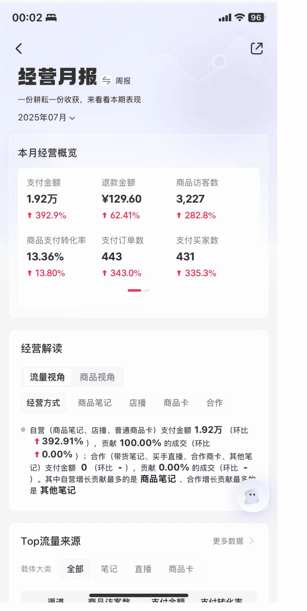
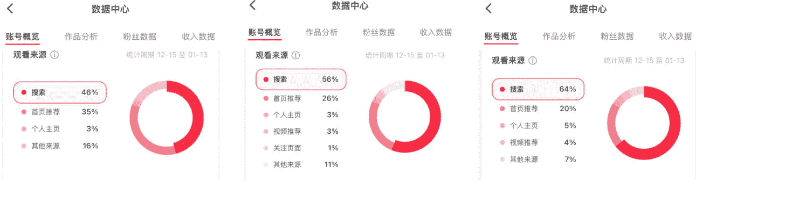
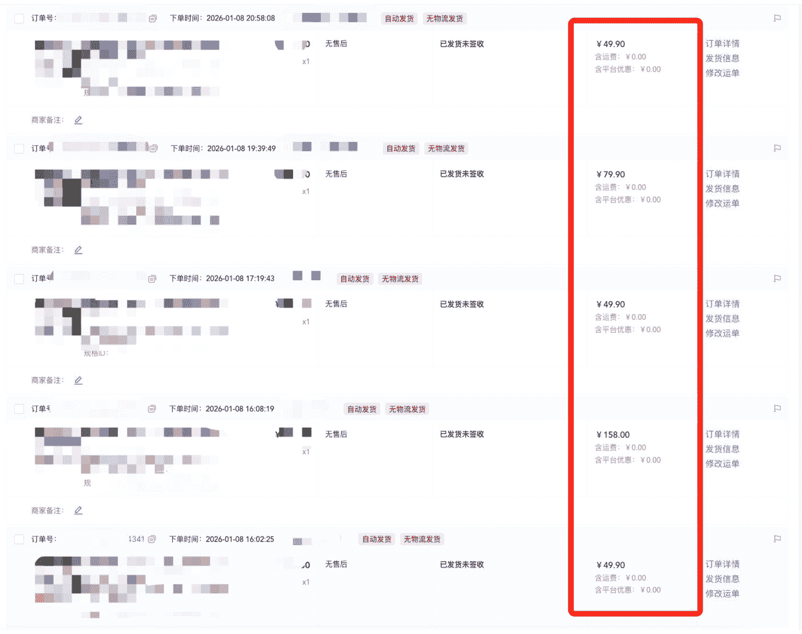
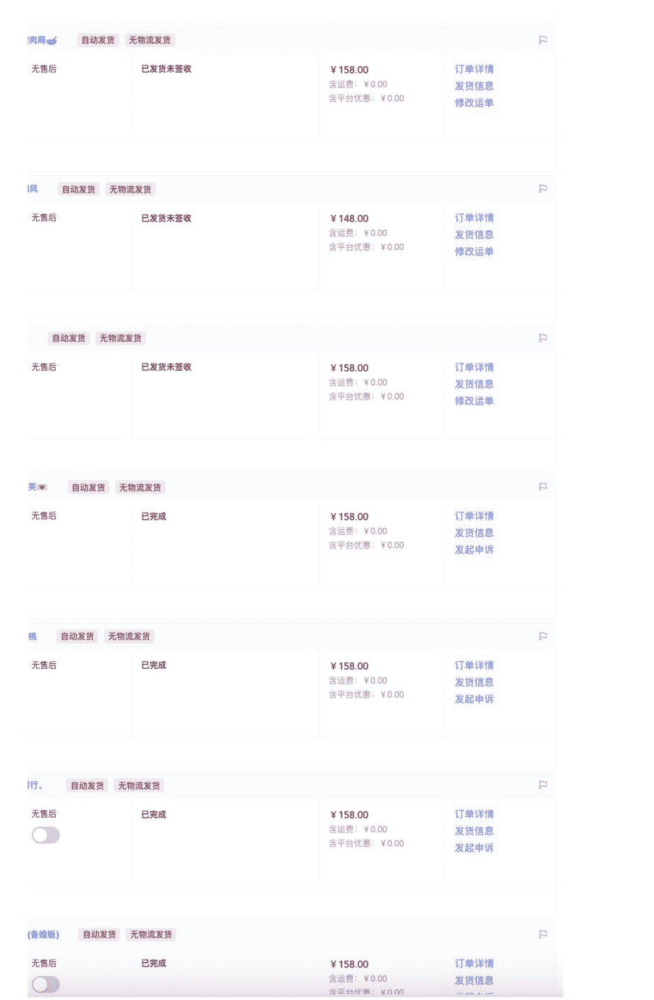
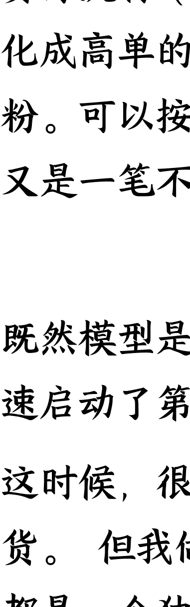
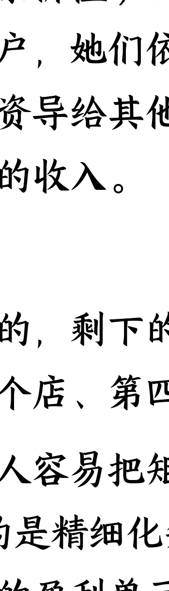
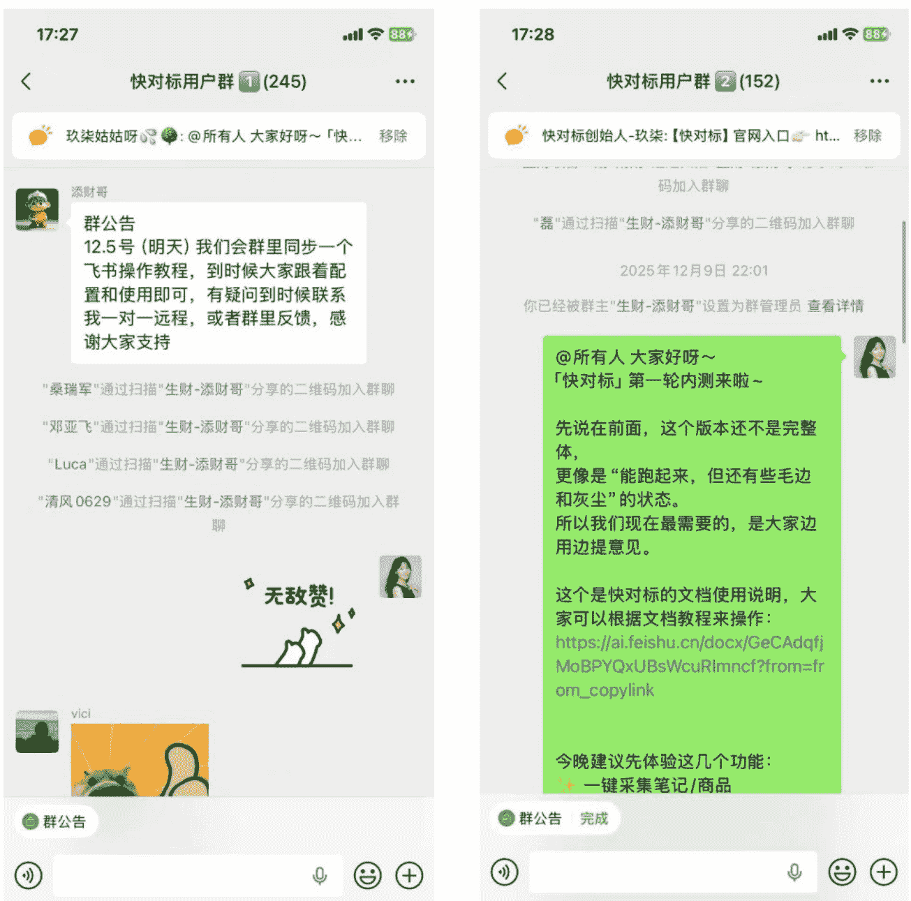

# 不卷 9.9 低价！复盘我是如何用 AI 做原创高客单虚拟产品，复制单店利润万+的矩阵模型

260120 副业 SC 精华
公众号懒人搜索，懒人专属群独享
懒人微信：lazyhelperl

## 前言：换个环境，真的不一样

抬头看了一眼时间，23:58 分。

办公室里依然灯火通明，还有好几个圈友在工位上忙碌。只有键盘的敲击声，和低声讨论业务的声音。

这是我入驻生财杭州联合办公的第 77 天。

如果不来这里，我现在大概率还在深圳守着那一亩三分地。虽然也能赚钱，日子也能过得去，但肯定没有现在这种突破极限的战斗状态。

之前的状态与其说是“困局”，不如说是“憋屈”。那种感觉就像车陷进了泥潭，油门踩到底，发动机轰鸣，轮子转得飞快，但车身就是不动。明明一身力气，却找不到让业务爆发的发力点。

我是从 2025 年 6 月中旬开始做小红书虚拟赛道的。

和很多卷低价、卖几块钱资源包的玩法不同，我走的是“AI+垂类原创+精细化运营”的路线。项目刚启动第一个月，纯自然流打法，单店利润就跑到了 2 万左右。

对于一个个体创业者来说，这算是个还不错的开局。但很多人不知道的是，这 2 万块利润的背后，是我日益枯竭的心力。

起盘容易守盘难。每天机械地重复劳动，让我感到了巨大的枯燥；偶尔遇到流量波动，心态也容易跟着起起伏伏。这种状态的不稳定，让我意识到：一直单打独斗是走不远的，我需要外部的能量来推我一把。

正是为了寻找解药，我来到了这里。现在回过头看，入驻联合办公的这两个多月，对我来说，不只是从深圳搬到了杭州，更是脑子里的思路被彻底打开了。

在这里，我不仅治好了精神内耗，找回了战斗状态，同时运营好几个店铺，把客单价拉高了 3 倍；更重要的是，还遇到了我的技术合伙人 @添财哥，跑通了属于自己的 AI 自动化工具模式。在 @许老师 的点拨下，让我离 10 倍增长的目标更近了一步。

今天这篇文章，我想把在联合办公的这两个多月里，关于“环境心力、流量变现、试错成本、合伙杠杆”这些真实的经历，摊开来和大家聊聊。

## 一、 困局：单兵作战的隐形天花板

一个人在家办公，最大的敌人是心力。

6 月份这个项目刚起盘的时候，我是兴奋的。AI 结合我的行业经验，做出第一款原创虚拟产品时，特别有成就感。第一个月利润 2 万左右，验证了我的路子是对的。

那时候我信心爆棚，觉得复制这件事太简单了。但我显然低估了长期单兵作战的隐形磨损。

我原计划 8 月份就要推新品、开二店。但我发现，这种“一人吃饱全家不饿”的模式，刚开始一两个月还行，通宵干都觉得爽。我的前三个品就是在这种打鸡血的状态下做出来的。

但时间一长，效率开始出现断崖式下跌。每天重复做图、写笔记、回消息，没人说话，没人交流。生活和工作的边界完全消失，我陷入了一种“高强度的孤独”里。这种消耗是无声的，但很致命：

- 早上：醒来明明知道该做新品了，脑子是清醒的，但身体就是不想动。
- 白天：坐在电脑前，看似在工作，其实思维是散的，做做停停，效率极低。
- 晚上：看着没动静的进度条，心里又慌又自责，陷入了“焦虑-拖延-更焦虑”的死循环。

我有整整一个多月，二店的进度完全停滞。明明手里握着赚钱的地图，但就是迈不开腿。

我深刻意识到：这不是我能力不行，是“场”不对。人是环境的产物。在家里，对抗惰性需要消耗巨大的意志力；而我需要一个纯粹的、能推着我走的“气场”，把意志力省下来去干正事。

于是，看到生财杭州联合办公 2 期招募的消息时，我没有犹豫，直接买了机票，从深圳飞到了杭州。现在回头看，这绝对是我 2025 年做出的 ROI 最高的一个战略决定。

## 二、 破圈：从加入联合办公开始

来了之后的第二天，我就觉得：来对了。这里大家都在真刀真枪地干活，那种氛围是装不出来的。平时吃饭，大家聚在一起，聊的都是项目、是流量、是搞钱。在这种环境里，你都不好意思摸鱼。看着旁边的人都在拼，你自然而然也就跟着动起来了。

### 一颗定心丸

刚到的第二天，我就找许老师咨询了一次。

我把我的困惑一股脑倒了出来。许老师听完，给了我非常清晰的建议，就像给我了一颗定心丸：

> “你的模式已经验证了，现在的核心就是复制。多开店铺，把流程 SOP 化，用好兼职团队剥离体力劳动，用好自动化工具提升效率。”

这番话听完，我感觉整个人瞬间轻松了。

那一刻我才深刻体会到，所谓“内耗”，本质上往往不是因为“不知道”，而是因为“不敢信”。

其实很多时候，我们心里早就有了答案，脑子也知道路该怎么走。但没有参照物，没人交流，所以我们不敢确信自己的判断，总担心是不是哪里想错了，于是在犹豫和反复论证中消耗了能量。

而找商业导师咨询的作用，不是给我画了一张新地图，而是帮我确认了：我手里的这张地图，是对的。

这种被确认的安全感，才是消除内耗的终极解药。既然和我推演的路径一致，那剩下的就没什么好纠结的了，只管油门踩到底，全力执行。

### 效率起飞：一周上架二店，并在高客单中验证了定价权

有了确定的方向，加上这里每个人都在拼命干活的氛围，我超强的执行力又恢复了。

在家拖了很久难产的二店，在这里我只用了一周时间，就一口气搞定了产品制作、主图详情页设计、上架商品，并直接启动了运营。

这次开二店，我没有简单地复制一店，而是做了一个大胆的价格测试。我想验证一下：在自然流打法下，高客单价产品到底跑不跑得通？

我在产品定价上做了升级。

一店：卖 40-50 元，自然流转化率在 13%。

二店：我直接把客单价拉到了 99-200 元区间，转化率 5~8%左右。

上线跑了一段时间后，数据非常有意思：虽然转化率下降到了 5~8% 左右，但结果却让我挺惊喜的，二店在轻运营的状态下，利润反而更多了。

这时候很多人可能会问：价格翻了好几倍，你的产品是不是也发生了翻天覆地的变化？

说实话，产品的本质其实没有变。资料还是那些资料，核心逻辑还是那些逻辑。但为什么我敢涨价，且用户买单？

核心就在于“原创”带来的“定义权”。

如果我是做倒卖资源的，我永远只能卷价格，因为标准是别人定的。但正因为我做的是原创，我对用户痛点的理解足够深，所以我拥有了“重新定义产品”的权力。

我可以根据用户的具体需求，去重新包装它的概念；

我可以自己设计它的服务权益；

我可以把它从“一个干巴巴的资料包”，定义成“一套解决焦虑的系统方案”。

这就是我坚持做原创的原因。原创不只是为了情怀，更是为了把定价权掌握在自己手里，不用去跟别人卷那几块钱的白菜价。

一旦掌握了这种‘定价权’，生意的逻辑就完全变了。

这次涨价的成功验证，不仅让我拿到了结果，更让我看清了虚拟电商里反直觉的三个真相：

- 第一，不要为了追求高转化率而不敢涨价。
很多人死盯着转化率看，觉得 13%一定比5%好。但在虚拟赛道，利润才是王道。
算一笔账：同样是 100 个商品访客流量，卖 40 元（13 单）销售额是 520 元；卖 158 元（5 单）销售额是 790 元。虽然转化率跌了一半，但产出却更高了。
敢于筛选客户，提升价值，是提升利润最直接的手段。

- 第二，高客单价反而能带来轻运营。
公众号懒人搜索，懒人专属群分享
这就是为什么我觉得二店运营起来更轻松。付费 99 元以上的人群，往往痛点更痛，认知更高，事儿反而更少。相反，越是低价产品，越容易遇到纠结几块钱的售后问题，消耗大量客服精力。
做高客单，本质上是在用价格过滤掉“低效的麻烦”，留出精力做更有价值的事。

- 第三，好内容的溢价空间是巨大的。
为什么涨价了还能卖得动？因为我的内容是 AI+原创，有差异化，解决了具体问题。
这再次印证了我的判断：在小红书，只要你的产品能提供确定的价值（情绪价值或实用价值），用户是愿意为“高溢价”买单的。

二店的跑通，让我放下了对“流量”的焦虑，转向了对“单客价值”的追求。

## 实战拆解：我是如何把小红书虚拟产品做成高客单价的？

在这里，给大家拆解一下我做小红书虚拟电商的核心方法论。

市面上有一个巨大的误区，觉得虚拟资料只能卷低价，卖个几块钱就算不错了。这种认知，其实是在极大地浪费小红书的流量。在我的逻辑里，“虚拟资料”这个词其实不是很准确，我觉得应该定义为“虚拟产品”，虚拟产品卖的不是资料，而是解决方案。

给大家看下我店铺后台几个品的人群画像：几乎都是中高消费人群。她们缺的不是那几块钱，而是确定的解决方案和优质的审美，或情绪价值。只要你的产品能精准解决某个痛点，她们不仅愿意付费，甚至更愿意为高价买单，因为在她们的认知里，贵=好=节省筛选时间。

我是通过以下三步，建立起我的核心方法论：

### 第一步：选赛道与选品

选品定生死。在选赛道上，我有两个核心思路，分享给大家：

#### 思路一：基于过往经验内求，做降维打击。
做你擅长的领域，你往往会比其他人做得更好，对用户的痛点把握得更精准。

举个例子：假如你是个资深 HR，那你做一套“人力资源实操百科”的知识库，大概率会比一个从来没干过 HR 的人做得更好。因为你知道 HR 真正焦虑的是什么，你需要解决的具体问题是什么。

虽然我后面的店铺也做了我不熟悉的跨领域赛道，并拿到了结果。但根据我的实战经验，有行业经验的人做内容，一定会比没经验的人更轻松，也更能抓住那个让用户掏钱的“卖点”。如果你没有相关的赛道经验，那你需要付出更多的时间去学习和研究这个赛道和用户痛点，才能做出更加打动用户的优质内容。

#### 思路二：基于市场数据外求，做信息差套利。
如果没有特别擅长的，那就跟着数据走。

跨平台对标：去查阅淘宝、闲鱼等平台的数据。有很多在其他平台卖爆了、但在小红书还没什么人卖的品，就是巨大的蓝海机会。

数据验证：不要瞎猜，直接用小红书聚光后台去查看相关关键词的搜索人数和热度趋势。有搜索就有需求。这些客观的数据，才是你选赛道最稳的依据。

### 第二步：死磕搜索流量，做精准流量

我的账号，几乎 50%以上的流量都来源于“搜索”。

这一点至关重要。因为卖产品，不需要追求大流量，要的是精准的流量。而搜索出来的人就是最精准的，他们才是想来解决问题的。后者才是产品的买单主力。

#### 我是怎么做搜索流量的？

挖词：我不会蹭热点，而是盯着下拉搜索词和长尾词。找到用户最具体的那个问题（比如，你要卖 HR 知识库，你要怎么去挖词布局？那你可以布局"hr 怎么筛选简历" "hr 怎么拒绝面试不合适的人"）。

布局：我会把这些精准的长尾词，埋进我的笔记内容里。

结果：这种流量极其精准，而且生命周期极长。

如下图，我 6 月、11 月和我 12 月发的笔记，都能够为我带来成交，到现在为止，每天还能通过搜索给我带来成交转化，这就是搜索的长尾复利。

### 第三步：价值阶梯，层层溢价

有了好产品和精准流量，如何提高利润？这里拿我的其中一个店铺举例，拆解我的打法，我设计了一套价值阶梯：

#### 第一级：产品组合（做加法，提客单）
第一个店起盘的时候，我的产品没有选择卷超低价，我的主推款是一个类目很小很垂直的赛道，做的原创产品，开始的两个月客单价主要是 39-50 元的单品。单店利润只有两万左右，这几十块就是为了筛选掉白嫖党，沉淀出认可我价值的精准粉丝。

后来我发现用户买完 A 可能会还会需要 B，于是我做了“组合套餐”。定价直接提到了 79 元，销量不仅没掉，我的平均客单价反而更高了。因为用户觉得你帮她省事了。单店利润也更高了。

#### 第二级：概念升级（做乘法，提溢价）
为了突破百元大关，提升单店利润，我做了第三次迭代。

这一次并没有直接往上直接加内容，而是把整个产品重新包装。我把原来的散装产品，换了一个更有质感的壳，重新设计了主图视觉，并且赋予了它新的概念，然后把权益从永久可看，改成了有时间限制的时长，反而让产品更有价值了。

本质：我不再卖资料，而是在卖一套成体系的解决方案。

结果：直接卖到了 99~158 元，依然跑得动。这让我明白：产品的价值不只取决于内容本身，更取决于你的“包装能力”和“定义能力”。这次又一次提升了单店的平均客单价和利润。

#### 第三级：私域升单（做复利，吃透单客价值）
前端成交只是开始，私域才是利润的大头。我把这些高净值的客户引流到私域后，做了两个动作来实现一鱼多吃：

后端升单（高利润）：针对这群人的进阶需求，我找外部机构合作，提供利润更高的后端服务。比如截图里的这个产品，我只做流量导入，不需要做重交付，每单又能分润几百块。

资源流转（剩余价值）：对于那些没有转化成高单的客户，她们依然是精准的行业粉。可以按客资导给其他需要的团队，这又是一笔不错的收入。

既然模型是对的，剩下的就是复制。我迅速启动了第三个店、第四个店......

这时候，很多人容易把矩阵误解为无脑铺货。但我做的是精细化矩阵。每一个店，都是一个独立的盈利单元，也是一个精准的流量入口。

很多人做虚拟电商，只盯着前端那 5 块、9.9 块的资源包费。而在我的视角里，前端的成交只是开始。前端几万块的单店利润，说实话，只是为了覆盖成本和维持现金流。真正的利润大头，其实在于后端的价值挖掘。

我把进店的每一个精准流量，通过产品组合拳和私域承接，把单客价值（LTV）从几块钱拉升到了几百块。

这就是为什么我认为去小红书这种高质量流量池里卷低价，就是在拿金饭碗要饭。

当你拥有了后端变现的能力，你看到的利润空间，将不再是几万块，而是倍数的增长。

## 三、怎么才能做大？

随着同时运营好几个店铺，我忙得像个陀螺。

虽然我有 AI 辅助，效率再高，我也只是一个人。我做的是原创虚拟电商，需要精细化运营。高峰期，每个账号要发 5~10 篇精细化笔记。我有好几个店，每天光是做内容、发内容，工作量巨大。

这时候，高密度的信息交流环境帮了大忙。

这里每周都有分享会，会有圈友来分享各自的项目经验，也不定期会有大咖分享。在一次分享会上，许老师说了一段让我印象特别深的话：

> “其实所有项目本质都一样。如果我们只做浅层环节，新人一入场我们就没戏了。我们一定要去思考：能让你业务产生 10 倍增长 的那个点是什么？ 要每天想，时时刻刻想。一定要利用好团队杠杆，利用好技术杠杆。”

“10 倍增长”

这四个字，真的扎进我心里了。后面的很多决策，我都是带着这句话去思考的：我不该再拼体力了，我得找杠杆。

## 四、 试错（术业有专攻，不要用短板去挑战别人的饭碗）

在遇到现在的合伙人之前，其实我走过一小段弯路。

为了解决“效率”问题，我意识到必须上自动化。但我当时的想法是：我自己学！我甚至报名了《内容工厂》的 Mini 航海，雄心勃勃地准备学习自动化。

结果呢？学了三天，我就放弃了。

真的太痛苦了。对于一个做运营、做流量、对市场敏感的人来说，让我去啃代码、去写逻辑，简直就是折磨。我坐在电脑前，看着那一堆字符，感觉脑袋都要炸了。

那三天让我深刻明白了一个道理：一个人的精力是有限的，全能就是全不能。我的强项是懂用户、懂流量、懂变现。我为什么非要用自己的短板（技术），去挑战别人的专业？

要想实现许老师说的“10 倍增长”，我不能自己死磕，我需要找一个互补的人。

## 五、落地（AI自动化工具与神仙合伙人）

非常幸运，在这个地方，我遇到了我的技术合伙人 @添财哥。

### 1、缘分源于一次推荐

我和添财哥的相识其实是经过联合办公圈友的推荐认识的，我们交流了一次，他向我咨询小红书垂类店铺的运营玩法，而我刚好在找懂技术的人请教 AI 自动化。

坐下来一聊，特别默契。他有多年的产品开发沉淀，之前还开发过一套小红书店群矩阵系统，技术底子非常厚；而我刚好在小红书这个赛道摸爬滚打了 7 年，对流量和变现太熟悉了。

虽然当时我们并没有刻意互亮底牌，但聊到业务细节时的那种同频，是能感受到的。

对于我来说，正是因为有过往那些实战的打底：不管是早年帮品牌从 0 干到小红书 350 万+GMV，还是后来自己出来做各种项目，例如通过小红书抖音引流 3 万+私域、变现 200 多万的经历……

这些实战经验形成的体感，让我能敏锐地判断出：他的技术非常扎实，而只要产品能落地，我们就很有机会去验证出一套可行的新的变现模式。

这种技术+业务的天然互补，让我们一拍即合。

我意识到：这就是我要找的杠杆。我们决定，合伙做一款真正懂小红书的 AI 自动化工具——快对标。

### 2、从“我的痛点”到“用户的刚需”

为什么要做这个？最开始，我确实是因为自己的需求。找对标、整理内容素材、自己发布笔记...全是人工手动复制粘贴，还要填表格，效率太低。

但是，当我在联合空间和大家交流，调研了一圈后，我发现：这不仅仅是我一个人的痛点，这是几乎所有做小红书的人的刚需。

大家都被繁琐的“找对标、跟踪销量、批量化自动发布....”折磨得够呛。于是，我们基于真实业务场景，开发了“快对标”。

### 现在有多爽？

- 一键采集：电脑、手机都能用，关键词、账号、笔记、热搜下拉词都能采，直接同步到飞书表格。
- 全自动：笔记进库 -> 自动仿写 -> 自动生成新笔记。
- 全功能：还能监控销量、自动生图、管理多店铺订单.....

这些功能，没有一个是凭空想象的，全是基于业务场景打磨出来的。

有很多圈友给了我们很多好的建议和反馈。在内测期间，我们非常重视大家的反馈，不停地优化迭代。正是这种“听劝”的态度，让大家对我们建立了信任。

## 六、进阶（顺势而为的代理模式）

工具做出来了，怎么卖？

这时候，我想起了十倍增长理论，要学会使用杠杆。

这让我突然一下想通了。我自己有好几个店铺要运营，如果单靠个人能力，其实是很有限的。既然工具好用，大家都有需求，我为什么要一个人卖？

我应该尝试换一个模式来玩——让更多人共享这个工具带来的好处。

两天时间我们内测群就进了 200 多个内测用户。哪怕在内测阶段，就已经很多人来问了。甚至很多人在产品价格体系还没出来的时候就问我们：“能不能代理？”

这种热情，让我们坚定了做代理分销模式的决心：

- 高分润：我们拿出 60%，甚至更高的利润分出去。

## 极简分工：代理只管卖，产品开发、售后服务，全部我们来扛。

这个产品，从想法、到落地，再到变现，仅仅用了一个月。在没有公域大力推广的情况下，我们首月利润破万。

虽然钱不算多，但这验证了一件事：这个模式是通的。它让我看到了 10 倍增长不再是一句空话，而是一个正在实践的现实。

## 七、给同路人的 3 点实战建议

这两个多月的突围，让我对搞钱这件事有了新的理解。如果你也正处于迷茫期，或者在这个赛道遇到了瓶颈，这三点真心话或许能给你一些启发：

### 关于心力：不要试图用意志力去对抗环境

很多人觉得内耗是因为自己不够自律，其实不是。

人是环境的产物。

如果你在家办公效率低，不要责怪自己懒，直接换个环境。去联合办公也好，去付费自习室也好，去一个周围人都在拼命干活的地方。场域是有能量的，把这笔钱花出去，买回来的不仅是工位，更是你值钱的专注力。

能用钱解决的环境问题，千万别消耗心力。

### 关于客单价：敢于涨价，本质是敢于重新定义产品

做小红书虚拟产品，千万别陷在“倒卖思维”里。

如果你只卖“资料”，那你只能卷 3.9 元，因为资料是标品。 但如果你卖的是解决方案，你就能卖 199 元。

怎么提升客单价？

- 做原创：只有原创，你才有定价权。
- 卖系统：把零散的资料打包成从 0 到 1 的系统方案。
- 卖服务：哪怕只是关键的点拨，对用户的价值也远超几百 G 的硬盘资料。

记住：用户买的不是资料，是消除焦虑和节省时间。

### 关于放大：从 1 到 10，必须寻找杠杆

一个个体户，能力再强，时间也是有上限的。 我之前的痛苦，就是试图用“一己之力”去对抗系统的复杂度。

想要把业务放大 10 倍，必须找到你的杠杆：

- 技术杠杆：把重复的动作交给 AI 和工具（比如我的小红书自动化系统）；
- 团队杠杆：找到互补的合伙人/团队。 不要做一个超级员工，要做一个系统的搭建者。

## 八、写在最后

回望这几个月，真的挺感慨。

说实话，在来这里之前，过去我做过的每一个项目，都能在短时间内快速跑通，快速盈利。对于“从 0 到 1”这套搞钱的打法，我非常熟悉，也从不缺生存的能力。

但我一直有个心结：我不想只停留在“赚小钱”的阶段，我一直苦苦寻找的，是一个能把业务从 1 放大到 100 的杠杆。

我是今年五月份加入生财的。有时候忍不住想，要是早两年链接到这个圈子，懂流量、懂业务的我，是不是早就起飞了？

但人生没有如果，只有结果。我无比庆幸的是，在 2025 年的关键节点，我做了一个 ROI 最高的决定——入驻杭州联合办公。

并不是说换个椅子坐就能成功，而是对于我们这种“有能力、缺杠杆”的独立创业者来说，这里补齐了我最后一块拼图。

在这里，我的运营特长遇到了技术杠杆（感谢合伙人 @添财哥）；我的商业直觉得到了高维验证（感谢 @许老师 的点拨）。

环境从来不是救世主，但环境会成为加速器。它让原本就准备好的我，跑得更快了。

2026 年，我的目标很清晰：继续深耕小红书虚拟赛道，用我最擅长的精细化运营和流量能力，结合 AI，打磨出更极致的产品。不仅自己赚钱，更要带着一些人拿到实实在在的结果。

我相信，当专业能力遇上技术杠杆和团队杠杆，10 倍+增长是必然的。

最后，安利小懒的付费群：

懒人专属群（介绍）

- 🕯 这里是你对抗信息过载的护城河。

已稳定运行 7 年，累计拆解、研读 3000+ 个互联网商业实战案例与行业前沿内参和时政/宏观文章。

我们不搬运垃圾，只做高价值信息的筛选器与放大镜。

## 懒人专属群更新记录：

https://hk57gvIx7u.feishu.cn/docx/H0kRdZbSboIBR0xkaXtcuVE0nJg

【免责声明】 本资料归档于社群内部知识库，仅供成员课题研究与学术交流，请在查阅后 24 小时内删除。