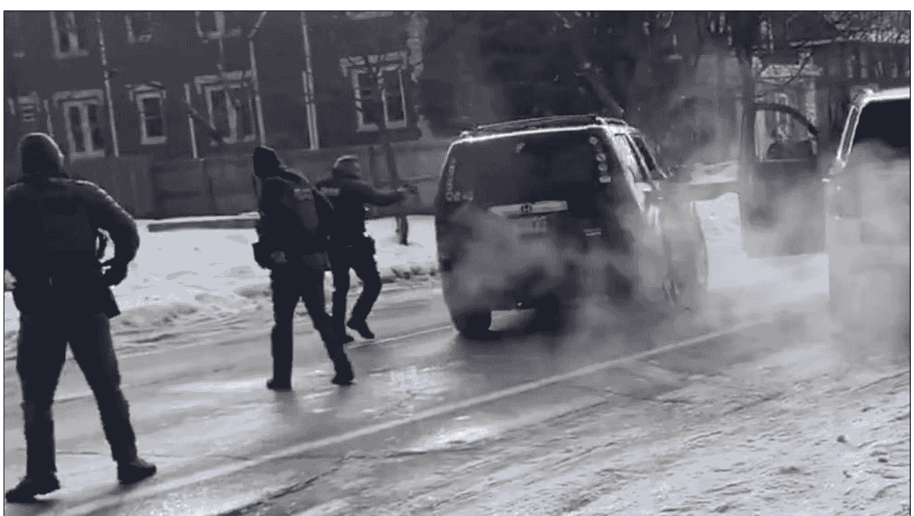

# “恶德信号”

260120 新闻实验室

整理：公众号懒人搜索，懒人专属群精选

懒人微信：lazyhelper1


> 异己者的切身痛苦，既是他们获得群体认同的黏合剂，也是他们消解现代社会孤独与疏离感的灵丹妙药。



2026 年 1 月 7 日清晨，美国移民与海关执法局（ICE）特工驾乘无标识车辆，蒙面闯入明尼阿波利斯市多个社区。迫于特朗普政府为完成遣返配额施加的压力，ICE 近期持续对移民开展大规模逮捕与驱逐行动。当天，执法人员在一所双语学校附近执法时，现场聚集了多名抗议者。37 岁的美国女性蕾妮 · 古德（Renee Good）刚送完儿子上学，见状将 SUV 横停在路中，试图阻拦执法。执法人员随即对其辱骂并勒令下车，古德则试图驾车驶离。就在此时，一名执法人员迅速拔枪击中她的头部，致其当场身亡，车辆也因失控撞毁。

这起枪击事件的全过程被其他反 ICE 抗议者从多角度记录下来，随即在全美引发舆论风暴。数千名民众聚集在美国各大城市，要求为古德讨回公道、追究相关人员责任。该市市长在新闻发布会上严厉斥责 ICE 的行为是“滥用职权的危险行径”，并要求他们“滚出这座城市”。

围绕开枪是否正当的争议迅速发酵。《纽约时报》的分析明确质疑：警员当时是否真的因古德驾车冲向自己而面临生命威胁？报道指出，事实上，当古德车辆的轮胎已偏离警员方向时，对方仍选择拔枪射击。

次日，右翼媒体“阿尔法新闻”（Alpha News）公布了涉事特工用手机拍摄的执法录像。画面显示，执法人员下车前，包括当时站在车旁的古德妻子在内的抗议者正用手机拍摄特工。古德妻子表示自己是一名美国公民和退伍军人。当警员靠近摇下车窗的古德时，她曾向警员表示：“我没有生你的气。”随后两名特工进一步逼近，古德立刻将方向盘转向与特工相反的方向加速驶离；就在这一瞬间，涉事特工将手机从左手换至右手，拔枪开火。尽管许多人认为，这段执法视频的曝光再次证实，古德当时正将方向盘转向远离警员的方向，警员根本没有面临迫在眉睫的危险；但在右翼政治媒体圈看来，这既不是他们关注的重点，也不是他们要在公共平台上大肆宣扬的内容。

这段视频广泛传播后，右翼阵营对枪击事件的态度严重分裂。包括副总统万斯在内的一部分人一面试图为枪击行为辩护，一面假意对古德表示同情，称这是她“自找的悲剧”。另一些人则态度迥异，公然为这起谋杀行径叫好。在接受采访时，白宫发言人莱维特表示古德是一个“疯子”，是“作为有组织团伙的一员，蓄意干扰并阻挠政府执法行动”，并将她的行为等同于“民主党今日所代表的立场”；而 ICE 常驻发言人则将古德称作“暴力骚乱者”，而她驾车的举动是“国内恐怖主义行为”。

极右翼脱口秀主持人、特朗普的政治盟友马特·沃尔什（Matt Walsh）则更进一步，在社交媒体上借古德的性取向大做文章，企图将其与枪击的正当性捆绑。涉事特工视角的枪击视频曝光后，他发文称：“这个女同性恋煽动者，用生命保护了智商只有 68 的索马里骗子（注：明尼阿波利斯有大量的索马里裔居民，而近期索马里社区在当地开设的福利机构涉嫌诈骗联邦拨款遭到司法调查和右翼媒体的大规模宣传），而那些骗子根本不在乎她。”他还在另一组帖文中嘲讽古德的妻子：“为什么打扮得像2003年的初中男生?”

此外,在另一处悼念现场,哀悼者们点燃蜡烛、献上鲜花,缅怀这位因暴力而猝然离世的女性时,身着国土安全部制服的警察在现场民众的手机镜头记录下,竟公然踢灭烛火,表示自己“不在乎为什么要这么做”,并威胁要逮捕抗议者。

古德的遭遇不是孤例:自特朗普再次成为总统之后,ICE除了在拘捕方式上愈加暴力之外,也增加了使用激进手段和民众爆发暴力冲突的频率,多次用荷枪实弹的武器指向抗议者并挑衅任何质疑他们执法手段的民众。自2025年7月以来,古德已经成为第13位在移民机关执法过程中遭遇致命伤害的平民。

这些行为再次凸显了特朗普第二任期内愈发常用的一项战略手段的核心逻辑——对所有被他们认定为敌人的对象直接展示暴力、歧视和残忍的行为,并以此作为身份认同的标志;随着美国民粹与极端情绪持续高涨、特朗普政治影响力不减,这种模式愈发凸显,被研究者概括为“恶德信号”(vice signaling)。

## 从“狗哨政治”到“恶德信号”,特朗普的策略为何演变?

2016 年特朗普的第一次选举胜利，让“狗哨政治”（dog whistle politics）这个词为人熟知。所谓“狗哨”，得名于一个简单的生活现象：犬类能捕捉到人类听觉范围之外的高频哨音，主人吹响这种哨声，旁人毫无察觉，只有目标犬只闻声而动。延伸到政治语境中，狗哨政治就是政客通过隐晦、双关或看似中立的表述，向特定受众群体传递排他性、煽动性的核心信号，而这些信号的真实意图往往会被普通大众或主流舆论忽略。这种话术的精妙之处在于两面性：对外，它能以政治正确的外衣规避批评；对内，它能精准唤醒目标群体的共鸣与认同，实现精准煽动而不留下明确的争议把柄。

美国民权运动的发展，让公开的种族主义政策和宣传变得更加难以被接受。为了保证自己的支持率能够得到保障，从 1970 年代开始，以总统尼克松为代表的一批共和党政治人物抓住了南方白人种族主义选民的失落感，并大规模展开“南方战略”，以“支持州权”、“反对福利依赖”和“拥护法律与秩序”等相对而言更加隐晦但在实质上依然延续制度型种族不平等的政策目标来避免被抓到把柄。这一政策被尼克松之后的历任共和党继任者一并秉持，以各种形式的政策宣传和竞选口号得到体现。通过隐晦的种族编码话语，狗哨政治旨在激发目标选民（尤其是白人男性）的情感共鸣与身份认同来作出“我们和他们”的分别，同时维持表面合理的推诿空间，以动员政治支持并巩固权力。

在分析特朗普在 2016 年大选的宣传策略时，美国国家大学心理学家布莱恩·蒂利（Brian Tilley）指出，特朗普在当时作为一个表面意义上的“反建制派”和“民粹主义者”，刻意在演讲与受访时发表争议性言论来获取受众的认同和广泛的支持；在这一过程中，他的政治言论和立场表达也变得更加极端，尤其是在移民、民主党对手及伊斯兰教相关议题上。即便如此，在特朗普第一次进入全国政治舞台的尝试中，他依然会给自己的举措披上一层合法的外衣，来换取摇摆不定的选民的支持。

例如，在摇摆州展开选举宣讲时，他会表示自己的阵营向被曾经支持奥巴马但感觉被他的政策所抛弃的选民们开放，并声称自己建立边境墙和驱逐移民等强硬举措的目的是为了“维护法律与秩序”。特朗普是第一位系统性、高频次地使用这一宣传手段的政治人物，其各类狗哨话术的使用频率，也远高于历任前辈。

在特朗普正式当选并开始将与狗哨有关的政策变为现实，例如出台穆斯林国家旅行禁令后，狗哨政治的效力便逐渐消退。美国国内大量的反对者开始主动解读他话语中的弦外之音，剖析这些隐晦话术的真实指向，以及其对受影响社群的实质影响，并利用公共平台进行扩散。每当特朗普祭出这一手段，了解其背后含义的民众都会迅速展开讨论并予以系统性驳斥，这使得他很难再通过狗哨话术，有效向立场摇摆的选民灌输观点、拉拢人心。

因此，特朗普的政治手段和政策开始不再期待获得中间派的模糊认同，而是在意图上变得愈发明确，手段也愈发残酷，常常以挑衅政治对手、向少数弱势群体施加苦难与震慑的方式，巩固基本盘的支持。

《大西洋月刊》的专栏作者 Adam Serwer 在 2018 年 10 月的一篇著名文章《残酷就是目的》（The Cruelty Is the Point）中指出，特朗普本人及其政府一系列持续不断的举措与言行，令有良知者义愤填膺，却让其支持者欢呼雀跃，其根本目的就是为了可以施加残酷并从中获得共同的快感与骄傲。作为一种建立群体纽带和彰显权力的方式，其出发点与目的，与美国内战后白人群体对黑人实施的多次公开私刑别无二致。对于已经将他的思想奉为毕生信仰的狂热支持者和特朗普本人而言，异己者的切身痛苦，既是他们获得群体认同的黏合剂，也是他们消解现代社会孤独与疏离感的灵丹妙药。

这一文章的发布标志着美国政治的一个分水岭时刻；特朗普也进一步意识到，明目张胆的残酷行径，既能有效震慑外界，又能凝聚内部力量——讽刺的是，Serwer 的文章在反特朗普阵营中大受欢迎，让“残酷就是目的”成为美国自由主义政治常用词汇的同时，却也让特朗普阵营的内部成员更加坚定了这一立场。在一个以对立、注意力和身份动员为核心的政治系统中，对方的强烈道德反应本身就可能会被当作成功信号，从而反向强化策略。

此时，“恶德信号”的概念便应运而生；与“残酷就是目的”一样，这一概念的提出，旨在以最为凝练的语言，精准界定特朗普及其支持者的行为，从而传递他们的残酷言行的实际意图。

## “美德信号”是如何变“恶”的？

想要了解“恶德信号”，就必须要先了解它的原型“美德信号”（virtue signaling）。该词由英国保守派媒体人 James Bartholomew 于 2015 年创造，用来描述那些高调标榜自身崇高的、往往是自由派的主流道德观，却不实际践行的个体和群体。这一词汇从一出现就含有强烈的贬义色彩，因为它将所有被定义为“双标”的言行统统归为“道德表演”，却未深入探究其背后的结构性与系统性驱动力，只是简单而懒惰地认为这是因为“没有人愿意付诸行动”。

“美德信号”的标签和曾经的“政治正确”一样，迅速就从针对特定的、可能矫揉造作的行为，急剧扩散为对几乎所有公共道德关怀的否定，并在右翼媒体讨论中广泛传播，成了一个能用来形容和定义他们所厌恶的一切事物的简单粗暴的万能概念。2020年，BBC更新了自己的“记者公正性指南“，其中明确禁止新闻工作人员在社交媒体账户上进行“道德标榜”式表态。

然而，随着这个概念开始愈加泛滥成灾，一些人也提出了质疑。有人认为，它加剧了人们对他人真诚度的普遍怀疑，并演化成了一种逃避实质性争论的捷径。毕竟，它的出发点就是不去辩论议题本身，而是通过预设对方的立场来全盘驳回对方的观点，以及观点所代表的群体的真实关切的合理性。

观点作家 Tane Coaston 在 2017 年表示，指责他人“美德信号”的人，自己也在进行“信号传递”——通过彰显自己务实、不天真、洞察世故的形象来在公共舆论中占据话语权制高点。2022 年，乔治城大学哲学教授 Olúfẹ́mi Táíwò 则更进一步发明了“恶德信号”这个词汇来反映这个看似是美德信号反义词的概念的真实意图：促使公共讨论从议题本身转成纯粹的情绪表演和群体反扑，陷入到“为了对抗而对抗”的修昔底德陷阱之中。

在总结 Serwer 等人点出的“目的性残酷”的最终目的时，Táíwò 教授 指出，这些极具表演性的展示看似是对公共道德关怀的彻底否定，但实际上却是美德信号的一种“特殊子集”；通过有目的地践踏某个外部群体（out-group）所珍视的道德标准，来向自己的内部群体（in-group）之中构建强烈的群体身份认同。这种行为一旦越来越成为常态，就必将打破社会原本的共识，重新定下对自己有利的规则，从而把道德舆论转化为抵抗的武器。

## “恶德”与极化政治的恶性循环

与恶德信号密不可分的，是在旧有的民主规范长期被消耗并不再被视为公理的背景下，美国乃至全球政治的极端化和劣质化的综合趋势。这一现象在社交媒体平台与算法推荐的助推下愈演愈烈：各类低俗内容正愈发侵蚀公共话语空间，究其原因，不过是这类内容能制造足够的冲击效应。许多平台管理者要么未能遏制其扩散范围，要么干脆选择坐视不理。还有些人——比如埃隆·马斯克——不仅转发相关内容，还通过修改算法提高其曝光度，公然为这类声音造势。至此，公共论坛上赤裸裸的暴戾行径，已然沦为可以肆意传播的金句片段、短视频、表情包、梗图乃至虐杀影像。

恶德信号在特朗普重返白宫后，彻底取代了原本的狗哨政治，成为了国家机器系统性运作的核心组成部分，而这样明目张胆的例子不胜枚举。除了ICE在执法过程中刻意采用的挑衅性作秀手段外，特朗普政府麾下的五角大楼也频频发布视频，数十次展示美军在加勒比海地区袭击不明船只引发爆发的监控画面。美方声称这些船只是贩毒船，却拿不出任何证据。更有甚者，视频里还记录下美军向已落水、完全丧失反抗能力的人员开火的场景。

每逢特朗普政府官员拍照留影或接受采访时，尤其是那些抱有特定政治图谋的强硬派，他们总会刻意向摄影机前用充满作秀的方式，展示自己的极致强硬。例如，2025年3月，国土安全部部长Kristi Noem到访萨尔瓦多的“反恐怖主义监禁中心”，还发布了一段视频——画面里的她站在一间挤满囚犯的大牢房前，这些囚犯身上都纹着醒目的黑帮标识。诺姆声称，这些人都是因涉嫌恐怖活动被驱逐出境的美国非法委内瑞拉移民，并以此作为在美国境内的无证移民的警戒。然而此事后来被揭穿，完全是一场刻意捏造、精心导演的**政治作秀**：这些黑帮成员实则是萨尔瓦多本地人，是在早前打击黑帮暴力的行动中被捕的，与在美国的委内瑞拉群体毫无关联。然而，被揭穿根本不重要，因为特朗普和诺姆知道，自己的的支持者完全不在乎；他们更明白这种立场既能博取核心支持者的狂热拥戴，又能激起反对者最强烈的抵制与谴责。

这已然成为一种固定模式：它不仅公然宣称当今世界秩序唯有依靠直观的暴力才能维系，更会通过将议题强行拖入暴力语境的方式，粗暴否定任何试图颠覆这一逻辑的努力，从而为自己的行为进行正当化。在接受CNN采访时，特朗普的高级政策顾问Stephen Miller **公然表示**：“你可以尽情谈论国际礼仪等等，但我们生活在现实世界中，这个世界是由力量统治的，是由武力统治的，是由权力统治的”。

在恶德信号的传播模式中，另一个极其不祥的动向是：特朗普的政府官方账号在社交媒体上，正越来越多地使用法西斯与殖民主义式的语言和美学风格。2025年8月，国土安全部发布了一幅1872年的画作，这幅画象征着“天命昭昭”运动——画面中，一位金发碧眼、体态丰腴的“进步化身”翱翔天际，从遍布船只、火车与电报线的文明东部，向蛮荒的西部进发。画作配文写道：“值得骄傲的遗产，值得捍卫的家园。”

就在“天命昭昭”思想扩张的同一时期，美国政府出资鼓励白人家庭向西迁徙扩张，此举不仅强行拆散了无数的原住民家庭，更对其族群和领地实施了系统性的铲除。历史学家后来评价这场运动：“在人类历史记载中，再也没有比这更重大的持续性种族灭绝案例了。”

同月，国土安全部还发布了一张 ICE 的招聘海报，海报上方配文“美国男人，何去何从？”——这一表述公然影射了 1978 年的白人至上主义小册子《西方男人，何去何从？》。该小册子声称：“种族意识与基于种族的歧视，对任何种族的存续而言都至关重要。这就是犹太人为何极力为自己争取种族特权，却坚决反对我们拥有同样权利；因为我们是他们既定的迫害目标。”

1月8日，国土安全部发文称“我们将重夺家园”，这句歌词出自新法西斯主义组织“骄傲男孩”（The Proud Boys）及其他白人至上主义团体所采纳的颂歌。推文下方还附带了 ICE 的招募链接。1月11日，劳工部在 X 上发文：“一个家园，一个民族，一个传承。美国人，铭记你的身份。”这一表述与纳粹德国为希特勒打造的宣传口号“一个民族，一个帝国，一个领袖！”（Ein Volk, Ein Reich, Ein Führer!）高度雷同。

随着时间推移，越来越激进的人物开始占据公共领域，那些不及时或者不够彻底拥抱特朗普及及其意识形态的人将立即被抛弃和唾弃，比如佐治亚州共和党众议员 Marjorie Taylor Greene。在 2020 年当选时，她是特朗普最为坚定的支持者，并大肆传播“深层政府”的阴谋论，并声称当年大选结果被窃取，还因发表暴力言论被暂时剥夺委员会任职资格。然而，当开始质疑特朗普与爱泼斯坦的关联后，她立刻就被特朗普被贴上了“叛徒”标签，遭到了铺天盖地的直接威胁与辱骂，最终于 1 月选择辞职。在辞职之前接受采访时，Greene 表示，“我们这个阵营已经接受过唐纳德·特朗普的训练，永远不道歉，也永远不承认自己错了。”

## 告别恶德、拥抱美德是可能的吗？

恶德信号全面胜利的舆论环境，会让特朗普之后的这代人很可能变得更加极端。副总统万斯已经因为娶了印度裔妻子而遭到众多右翼网民的激烈辱骂，被贴上“种族叛徒”的标签；而美国各州青年共和党政治团体的泄露聊天记录中则频繁出现“我爱希特勒”、反对者‘进毒气室’、“强奸很壮观”等令人不寒而栗的言论。当右翼媒体评论员 Isabella Moody 在解答如何增加关注度的观众提问时，她不假思索地直言：“多说‘黑鬼’就行了。”

当下，很难构建可行的反伪善机制以摆脱虚伪信号的桎梏。无论自由派抗议者对古德遇袭事件及特朗普政府其他不公行径的愤怒多么合理，这种愤怒都只会转变成维系特朗普所代表的反动联盟的凝聚力纽带，成为他们情感与政治满足的终极源泉。

因此有人认为，或许是时候重新评估“道德标榜”的重要性与必要性了。这一术语本身，是对“强调事件所蕴含公共价值”这一重要性的轻蔑且片面的解读；其核心观念是，世界不会向好发展，所有人都应放弃当下的努力。平等和自由应该是崇高的理想目标，即便人们努力向善却未能做到十全十美，也总要比直接放弃、并以自己能有多邪恶为乐更有价值。

仍坚信公共道德道德准则应为人的行为提供指引、划定边界，以实现扬善惩恶的人们应当明白：仅仅被贴上“美德信号者”的标签，既不会、也不可能否定善举的终极意义。指出错误、谴责恶行，体现的是对所有人的共情之心，而非道德优越感的彰显。

至少当人们传递这种信号时，我们不需要回答“杀害手无寸铁的平民是否是作恶”这种本应该属于基本常识的命题。

最后，安利小懒的付费群：

懒人专属群（介绍）


> 这里是你对抗信息过载的护城河。

已稳定运行7年，累计拆解、研读3000+个互联网商业实战案例与行业前沿内参和时政/宏观文章。

我们不搬运垃圾，只做高价值信息的筛选器与放大镜。

## 懒人专属群更新记录：

```
https://hk57gvIx7u.feishu.cn/docx/H0kRdZbSbolBR0xkaXtcuVE0nTg
```

【免责声明】本资料归档于社群内部知识库，仅供成员课题研究与学术交流，请在查阅后24小时内删除。