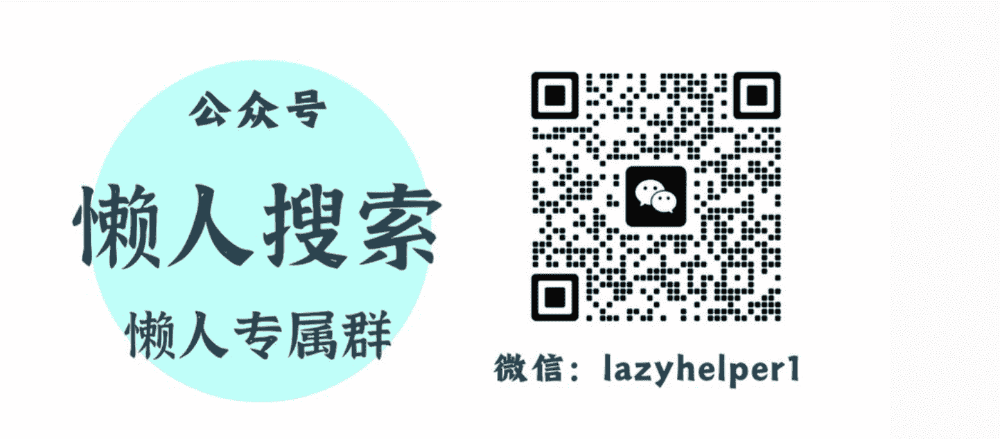

# 210 | 韩国新战略：屠榜 CES，嵌入全球产业链

2026-01-21

整理：公众号懒人搜索，懒人专属群精选
懒人微信：lazyhelper



欢迎打开《蔡钰·商业参考 4》，我是蔡钰。

虽然我们开玩笑说，CES 展越来越像华强北团建，但有另外一个奇特的玩家，在过去三年的 CES 展上，越来越显山露水。

谁呢？韩国。

每年 CES 展都会给一批产品颁发年度创新奖。2026 年这一届的 284 个创新奖获奖者中，有 168 个来自韩国企业，占比超过了 59%。神奇吧？既不是以创新著称的美国，也不是以工程取胜的中国，而是韩国。

这还不是偶然。2026 年，已经是韩国连续第三年在 CES 创新奖数量上全球领先，稳稳地主导了这个奖项。

更吓人的是，这 168 个获奖产品，有 81% 来自中小企业，而不是三星、LG 这类大集团。

而且，这 168 个获奖者还只是韩国参展阵容的一小部分。2026 年 CES 上，韩国总共去了 853 家韩国公司，其中初创企业有 470 家。

它们还不是分头去的，而是被韩国的 38 家政府机构和合作伙伴统一组织起来的。尤其是初创企业们，在 CES 的展区里统一布展，连展位设计和品牌标识都是一样的，愣是在 CES 里搭出了一个“韩国馆”。

这是因为韩国的技术创新能力全球领先吗？我去做了做功课，发现了有意思的答案。

韩国能够连续主导 CES 创新奖，当然有技术实力的原因。毕竟，韩国的存储芯片、显示面板等产业能力全球领先，再跟 AI、机器人等新技术结合，是有工程级创新能力的。

这还不算，韩国更厉害的能力是，把“拿奖”这件事当成了一个国家级的协同工程来干。

这套工程，对我们的企业出海做品牌，也有参考。怎么做到的？我们来看看。

## 把 CES 当世博会

前面说了，2026 年的 CES 展，韩国参展的初创企业多达 470 家。这 470 家企业不是各自为战，而是被韩国的 38 家机构统一组织起来的。

怎么个组织法呢？举几个例子：

- 韩国贸促公社，KOTRA，在整个过程中扮演着总协调人的角色，负责统一对外形象、媒体公关，还要在展会上促成各种商业洽谈。像这次韩国企业主导了 CES 创新奖、参展企业规模仅次于美国和中国，位列全球第三，就都是韩国贸促公社有意释放造势的。
- 韩国科学技术院等大学和研究机构，负责在开展前把技术成果快速转化成可参展的产品形态。
- 韩国政府的中小风险企业部，在这场科技奥运会里，主要负责给企业们提供展位补贴、赛前培训和商业对接。
- 首尔商务局，主导首尔馆，专门帮首尔本地的创新企业开拓全球市场，还在参展前给企业们提供两个月的“赛前咨询”服务。

你看，不但政府参与，而且是一套从中央到地方、从政府到大学、从孵化到出口的完整链条。

在这种高度组织之下，去参展的韩国企业，就像科技奥运会里的一个韩国选手，不用自己操心，跟着国家队一起出征就行。它们不但展位设计统一，品牌标识一致，就连宣传口号都是统一的，叫“韩国溢价”（Korea Premium）。

这支队伍，在 CES 的初创展区里，甚至有一个统一的展馆名字，叫 K-Startup。我知道，你肯定想起了 K-pop（韩国流行音乐）。

而这些参展的小企业，还会被韩国政府组织参加各种配套活动：韩国创新提案挑战赛、现场演示、跟沃尔玛和英特尔等跨国公司做商业交流等等。展会期间，韩国政府甚至还会向国际投资者推介韩国的创业签证、入境创业项目和创业大会。

你看，韩国简直是把 CES 当成世博会在运营。

有什么作用？

最大的作用，就是换来了 CES 主办方、国际科技圈对“韩国创新”这个品牌的深刻印象，以及对单个韩国初创企业的“高看一眼”。

这是第一招：统一品牌，集体出征。

## 从产品定义到申报的全链条打磨

第二招，是把“如何被评委认可”这件事，变成了一套可训练、可复制的策略。

- 首先，在国家战略上，韩国多个政府与半官方机构，会明确把 CES 创新奖作为国际化 KPI 来争取，送往 CES 的产品，不是只为融资或内需而设计，而是从一开始就为迎合国际评审体系而设计。
- 其次，有了产品，就进入打包运作的参展与申奖阶段了。韩国政府、地方与产业园区，会组织几十上百家初创企业集体报名参展，也集体申报 CES 的创新奖。单独哪家的胜算都不大，但在统计学上，整个盘子拿奖的命中率就拉高了。
- 第三，有了产品，确定了申报，接下来，会有大量熟悉 CES 套路的中介和顾问机构，专门教各家小企业怎么写申报材料。

比如，有家公司叫 DeepFusion AI，做的是基于雷达的自动驾驶感知系统。如果只说“我们要提升自动驾驶的安全性”，这就太笼统了，肯定入不了评委的法眼。于是，专业中介就会告诉你，要改成“我们用雷达解决恶劣天气下摄像头失效的问题，已经通过车规级测试，正在和现代汽车做集成验证”，评委就会觉得，这个痛点我也有，这个产品靠谱。

甚至，这个工作细致到，韩国的培训体系会专门教你，怎么在 3 分钟内把产品讲清楚；PPT 的哪些信息要放大、哪些要隐藏；视频演示要突出什么关键帧；甚至连展台的灯光、产品的摆放位置，都有专门的指导。不但帮你回应评委的关心，也帮你克制不该说的话。

你发现没有，这套方法论的核心，不是教你“怎么做出更好的产品”，而是教你“怎么让评委看懂你的产品有多好”。

更重要的是，当 470 家企业都接受了同样的训练，整体的展示水准就会非常整齐，评委会形成韩国公司都很专业的印象，他在看到下一个韩国产品时，印象分就已经多给了几分了。

韩国这样一群中介力量，相当于把打造 K-pop 偶像团体的功力迁移过来，当起了 CES 创新奖评审团的破壁人。

## CES 作为国家基础设施

说到这里，你可能会问：CES 创新奖每年都有，一发就几百个，好像也不是很值钱，韩国为什么要费这么大力气去组织拿奖？仅仅是为了面子工程吗？

当然不是。韩国中小风险企业部的官员就明确说过：“政府将继续支持创新公司，使它们能够利用 CES 作为跳板，向全球扩张。”

你听听这个措辞，跳板。

往哪里跳？

- 一方面，可以往全球科技巨头的供应链和并购目标名单里跳。一个产品拿了奖，就有更大几率被沃尔玛、英特尔，甚至韩国本国的现代汽车、三星等巨头，在展会上和展会后相中。
- 另一方面，往全球采购商和分销商的采购订单里跳。世界各国都把 CES 创新奖作为选品的重要参考。你拿了奖，就相当于拿到了一张全球市场通行证。

所以，你还记得前面说，总协调人 KOTRA 还要负责在 CES 上促成各种商业洽谈吗？谈的就是新的订单、投资，甚至并购意向。

所以你看，过去三年，不知不觉中，韩国已经把 CES 变成了自己的国家级战略出口平台。而这种战略性投入，又可以理解成韩国产业战略的一次重大转型。

以前提起韩国产业，我们总会想起财阀巨头，三星、现代、LG、SK 等等等等。但从这几年韩国对 CES 的参展和拿奖运作来看，我们隐约可以认为，韩国正在推动自己从大集团主导增长向初创企业引领创新转型。

## 为什么要这么转？

因为在 AI、生物科技、新能源这些赛道上，巨型财阀们的转身速度不够快，甚至你看韩国引以为傲的造船业，这两年都被中国吃掉了大半。在韩国看来，必须培养一批在全球技术赛道上能被看见、被接纳的初创企业，才能保持国家竞争力。

CES，就是它这个战略的试验场。

## 总结

要在全球市场上被看见、被接纳，韩国又刚好很擅长。它在过去十多年，把韩国娱乐 K-pop 当作国家战略来向全球推广时，已经攒下足够的经验了。

所以你会发现，前面我们提到的它打造创新产品、集体出征的路数，跟推广 K-pop 的策略一样一样的：

有工程化的偶像培养体系，也有对全球审美的揣摩押注，还有对 Billboard 榜单、奈飞版权订制的迎合。

你别说，这套打法，还真的可能在未来十年的世界消费创新版图上，创造一个 K-Product 流派呢。

你认为呢？

再见。

最后，安利小懒的付费群：

懒人专属群 (介绍)


📚 这里是你对抗信息过载的护城河。

已稳定运行 7 年，累计拆解、研读 3000+ 个互联网商业实战案例与行业前沿内参和时政/宏观文章。

我们不搬运垃圾，只做高价值信息的筛选器与放大镜。

# 懒人专属群更新记录：

```
https://hk57gvlx7u.feishu.cn/docx/H0kRdZbSboIBR0xkaXtcuVEOnTg
```

【免责声明】本资料归档于社群内部知识库，仅供成员课题研究与学术交流，请在查阅后 24 小时内删除。