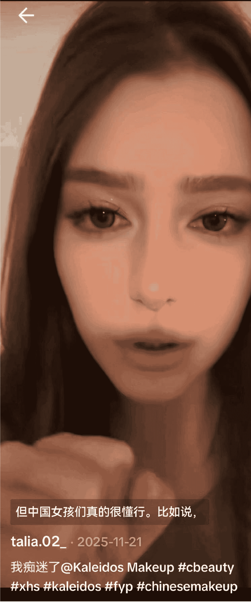

# 211 | 消费小趋势：C-Beauty 与阿迪达斯

## 新中式

2026-01-22

整理：公众号懒人搜索，懒人专属群精选
懒人微信：lazyhelper1

欢迎打开《蔡钰·商业参考 4》，我是蔡钰。

这一讲，我们来看看发生在中国与国际市场融合带的两个有趣消费信号。

## TikTok 难民的意外发现

第一个信号，叫“C-Beauty”正在海外市场成为潮流。

C-Beauty 是什么东西？它的全称是 Chinese Beauty，中式美妆风格、中式化妆品品牌的通称。在今天的 TikTok、Instagram 这类平台上，它又更加聚焦地指向抖音网红妆容：强调皮肤的无瑕感、漫画式的长睫毛大眼睛、Blingbling 的闪粉眼影、粉色腮红、娇嫩欲滴的嘟嘟嘴。

你肯定在抖音或者小红书上，见过这类典型的“纯欲风网红妆”。

这种妆容，前几年随着中国仙侠剧、古偶剧和游戏出海，已经在亚洲颇有影响力。不过，2025 年，C-Beauty 在海外的影响力加速了。怎么发生的呢？其实是 2025 年年初那波"TikTok 难民”带起来的。

你可能还记得，2025 年 1 月，美国号称要禁封 TikTok 的那几天，有 200 万美国年轻人涌入了小红书，交猫税、对账、交流生活与文化，很快发现了一个新世界：中式美妆风格和能化出这种效果的中国化妆品。

TikTok 上有个名叫 Hails 的芝加哥美妆博主，就是其中之一。她 1 月份一注册小红书，很快在自己的赛道上发现，小红书上有很多美国根本没见过的 美容秘诀：怎么打造瓷娃娃般的肤质、怎么用玫红色的脸颊和嘴唇来彰显气色、怎么刷出又长又翘的卡通睫毛。

这位博主，当时就照着中式手法给自己化了个妆，发回到自己的 TikTok 账号上。结果怎么样？30 万点赞、230 万次观看。

她马上意识到，自己挖到宝了。这之后，即便 TikTok 的禁封危机解除，她也还是一直留在了小红书社区里，时不时搬运一些中国风的美妆手法，给自己的 TikTok 粉丝涨涨见识。你要是感兴趣，她在小红书上也叫 Hails。

Instagram 上也有一个 1900 万粉丝的荷兰美妆博主，2025 年 1 月也测评过一款中国的睫毛膏，给出的评价是：“你怎么今天才出现在我生命里？”

她夸的这款睫毛膏，来自中国品牌橘朵（Judydoll），单价 14 美元，2023 年以来在全球已经卖了 800 多万支。

另一个名叫 Tenn Ze 的多伦多美妆网红，也是橘朵的用户。她的理由是，橘朵的哑光类高光修容产品，是西方美妆品牌没有的。

我们很难说这些大网红的认可背后有没有营销的成分，但确实 C-Beauty 风潮就这么在 TikTok、Instagram 等社交平台上火起来了，尤其在美国网红圈里火起来了。

于是，C-Beauty 这种审美，因为在 2025 年得到了来自文化霸主美国的重视，全球影响力飞速增强。从 Google 的搜索指数看，在 2025 年，C-Beauty 的全球搜索热度 7 月还是 44，9 月就飙升到了 100，直接超越了象征韩国美妆的 K-Beauty。

这些网络上的认同，也体现在了中国化妆品的热销里。毕竟，中式妆容要用中国品牌来化才地道。前面提到那个橘朵，海外销售额 2024 年就激增了 400%。日本作为亚洲美容的先驱市场，2025 年从中国进口的化妆品规模已经超过了美国。再看中国海关总署的数据：2025 年前 11 个月，中国化妆品出口增速 10%，总额超过 509 亿元，跟国内一年的电影票房规模相当了。

所以，国际时尚顶刊 ELLE，2025 年在一篇文章里喊出了一句阴阳怪气的赞美，说“参议员先生，我们不是中国人，但我们的妆容是中国的。”

啥意思？调侃西方政客们忙着让 TikTok 去中国化，却阻止不了 TikTok 用户们把中国风描在脸上。

这是 C-Beauty 在海外走红的故事。B 站上有不少搬运视频，是展示各种肤色的外国人如何给自己化抖音网红妆的，你感兴趣也可以去看看。

但中国女孩们真的很懂行。比如说，

talia.02_ · 2025-11-21

我痴迷了@Kaleidos Makeup #cbeauty #xhs #kaleidos #fyp #chinesemakeup

## 阿迪达斯的墙外狂热

再来看另一个有趣信号，阿迪达斯的中国风设计。

2025 年 12 月，TikTok、小红书和 Instagram 上，开始出现了一批奇怪的网友，到处发帖留言，求近期往来中国的人，帮忙代购阿迪达斯的一件运动服——一件足球明星齐达内来中国时，穿着亮相过的夹克衫。

人们求购的这件运动服，是 2025 年年底才正式上市的。它正式开售之后不到半个月，在阿迪的天猫官方店里，累计成交量就接近了 1 万件。外国游客最多的上海淮海路阿迪达斯门店里，来买这款新中式外套的顾客也有一大批来自海外。在小红书、抖音、TikTok 和 Instagram 上，关于这件外套的炫耀式穿搭和讨论，也层出不穷。

在 TikTok 的#AdidasChina 这个标签里，这件阿迪夹克、LABUBU 和《大展鸿图》的背景乐，成了视频博主们的“新中式三件套”。

是不是挺奇怪：阿迪达斯明明是个国际品牌，啥衣服非得来中国买？

这件衣服，还真只能来中国买。

这是阿迪达斯专门为中国市场设计的一件“新中式外套”。这件外套长得很像中国传统的练功服：宽松，立领，磨毛面料，开襟有 5 个中式盘口，肩臂上带有高中校服那种标志性的三道白条纹。

你一听就知道，这都是中国人熟悉的文化梗。阿迪达斯也是这么想的。它只打算在中国相关地区卖，也是只按大中华区市场预备的产能。2025 年底，它专门请了 15 位娱乐和体育明星，把这件衣服穿在身上，12 月就启动了春节营销。

但是，海外的热心网友比阿迪达斯行动更早。在这款外套开售之前，很多人已经在海外社交平台发问了：我在荷兰、澳洲、菲律宾、英国……怎么才能买到这款中国限定外套？

海外网友为什么这么灵通？

因为阿迪达斯这个设计，已经运作和改良了好几年。2025 年，海外网友们就已经在为没有抢到蛇年新春限定，而怨念了一年。

这个设计，一开始其实是阿迪为了适应中国市场国潮崛起的变化，而做的本地化努力，2022 年就启动了。当时，阿迪达斯为了迎合中国的国潮风，在它的经典款夹克胸前印上了巨大的“中国”二字。结果 1000 件测试款两周就卖完了。

阿迪达斯，感受到了“文化自信”的购买能量，马上加大了对新中式的探索：反正中国本土供应链够灵活。

2023 年的龙年春节，他们推出了一款老钱风的新中式 2.0：中式盘扣、锦缎面料、三叶草暗纹、中式翻袖和方正口袋等等。

2024 年蛇年春节，阿迪又进一步改良，推出了新中式 3.0，尝试灯芯绒面料、把袖口改回锁扣袖、口袋改回斜插袋。这次的设计算是成熟了，阿迪又请来中国演员王安宇，拍了一条新年广告片。

这下，事情正式搞大了。

2025 年正好是中美大对账、ChinaTravel、《大展鸿图》和 LABUBU 走红的大年，很多嗅觉灵敏的海外博主，纷纷想办法搞到了这件蛇年阿迪，来出片、拍视频、整活儿。而更多眼馋的普通网友，则只能在留言区里表达羡慕和不满。

但“阿迪在中国春节会发售中国限定款夹克”这个认知，算是在海外网友们心里成功种下草了。这是为什么马年春节还远远没到，网友们就开始行动起来，四方打听靠谱的转运服务。

这是阿迪达斯新中式的故事。这个马年春节，你不妨留意一下身边，有没有亲朋好友，穿着这件阿迪运动服。

## 总结

好，我们讲了两个故事：C-Beauty 在过去一年的加速走红，和阿迪达斯的中国特供运动服在海外市场引发的购买狂热。

你看是不是挺好玩的：在世界消费市场上，中国品牌从“被审视”到“被接纳”，再到 2025 年的“被向往”，跃迁得也太快了。

为什么会这样？

在东升西降的巨大变局之下，我们讲过的“反向意林红利”，正在各个维度上冒出呼应的幼苗。

但我们对这类趋势的理解，不能卡在“厉害了我的国”就止步了。我还想提醒你意识到的一个背后趋势是，中国审美，2025 年以来正在加速成为美国年轻人的“意识形态内战工具”。

什么意思？我借键政圈的一个玩笑来跟你解释：今天的小红书和中国符号，有点成为了世界民众心中的“赛博租界”。

今天中国已经可以跟美国相持，但在世界其他地区，美国仍然是那个能抓移民、绑总统、抢石油的实力霸主。对无力反抗的美国国民和其他小国国民来说，靠着“猛吹中国”，能表达一部分逆反情绪、浇胸中块垒。

所以，在今天的海外社交平台上，说中国安全、汽车好、医疗好、吃得好、中式婚姻好的网红，都很有流量。而他们是不是真的喜欢中国、理解中国，其实是无法细究的。

这就像我们夸“别人家的孩子”时，并不关心那孩子究竟是什么样子，我们的目的只是描绘一个理想符号，来敲打自家孩子罢了。别人家的孩子，就是一种意林符号。

你看，出名，就是把自己的名字交出去。对一个国家、一种文化来说，某种程度上也是这样的。

但不管怎么说，花开堪折直须折。这种反向意林红利如果对你有价值，你不妨把它用好。只要在心里留一丝清醒，让自己进退有度就行。

这是我的个人看法，供你参考。

再见。

最后，安利小懒的付费群：

懒人专属群（介绍）

🔰 这里是你对抗信息过载的护城河。

已稳定运行 7 年，累计拆解、研读 3000+ 个互联网商业实战案例与行业前沿内参和时政/宏观文章。

### 我们不搬运垃圾，只做高价值信息的筛选器与放大镜。

## 懒人专属群更新记录：

https://hk57gvlx7u.feishu.cn/docx/H0kRdZbSbolBR0xkaXtcuVEOnTg

【免责声明】本资料归档于社群内部知识库，仅供成员课题研究与学术交流，请在查阅后 24 小时内删除。