# 分享一些不同的观点，从 0 到 Top5 商家，我在小红书虚拟电商做了哪些转变？

## 260122 副业 SC 精华

公众号懒人搜索，懒人专属群独享

懒人微信:lazyhelper1


hi，大家好，

十一月初我在生财向亦仁提问的那个帖子（小红书副业 40 万是否辞职）
受到了不少圈友的关注

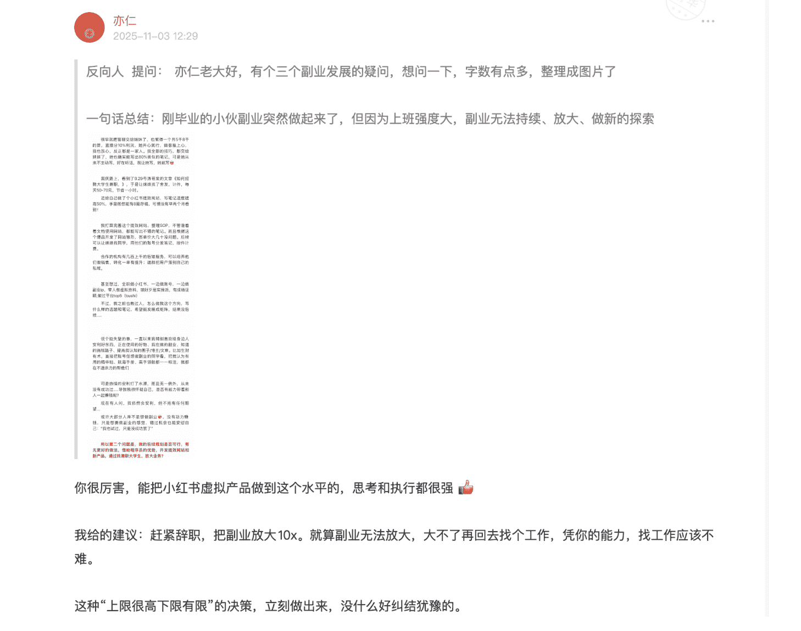

距离 8 月份发帖已经过了挺久了，当时只是在航海里好事报喜，分享了一下成绩

## 除了小红书官方榜单的 TOP5，还有千帆榜单，从前二十，到前十，再到前五，一步步走过来

| 排名 | 店铺 | 笔记阅读数 | 笔记商品点击率 | 笔记支付转化率 | 笔记成交金额（元） |
|---|---|---|---|---|---|
| 19 在榜 | | 10 万以上 | 5%-15% | 15%-25% | 1 万 -5 万 |
| 1 | | 10 万以上 | 0-5% | 0-5% | ¥ 1000-5000 |
| 2 | | 10 万以上 | 0-5% | 0-5% | ¥ 0-1000 |
| 3 | | 10 万以上 | 0-5% | 5%-15% | 5000-1 万 |
| 4 | | 10 万以上 | 0-5% | 25%-50% | 5000-1 万 |
| 5 | | 10 万以上 | 0-5% | 25%-50% | ¥ 1000-5000 |
| 6 | | 10 万以上 | 0-5% | 15%-25% | ¥ 1000-5000 |
| 7 | | 10 万以上 | 0-5% | 0-5% | ¥ 0-1000 |
| 8 | | 10 万以上 | 0-5% | 5%-15% | ¥ 0-1000 |

| 排名 | 店铺 | 笔记阅读数 | 笔记商品点击率 | 笔记支付转化率 | 笔记成交金额（元） |
|---|---|---|---|---|---|
| 8 在榜 | | 10 万以上 | 5%-15% | 15%-25% | 1 万 -5 万 |
| 1 | | 10 万以上 | 0-5% | 5%-15% | 5 万 -10 万 |
| 2 | | 5 万 -7 万 | 25%-50% | 0-5% | 1 万 -5 万 |
| 3 | | 10 万以上 | 5%-15% | 0-5% | 1 万 -5 万 |
| 4 | | 5 万 -7 万 | 5%-15% | 0-5% | 1 万 -5 万 |
| 5 | | 7 万 -10 万 | 0-5% | 0-5% | 1 万 -5 万 |
| 6 | | 1000-3000 | 5%-15% | 5%-15% | 1 万 -5 万 |
| 7 | | 1000-3000 | 5%-15% | 5%-15% | 1 万 -5 万 |

| 排名 | 店铺 | 笔记阅读数 | 笔记商品点击率 | 笔记支付转化率 | 笔记成交金额（元） |
|---|---|---|---|---|---|
| 2 在榜 | | 10 万以上 | 5%-15% | 15%-25% | 5 万 -10 万 |
| 1 | | 5 万 -7 万 | 5%-15% | 5%-15% | 10 万以上 |
| 2 | | 10 万以上 | 5%-15% | 15%-25% | 5 万 -10 万 |
| 3 | | 7 万 -10 万 | 5%-15% | 5%-15% | 1 万 -5 万 |
| 4 | | 10 万以上 | 5%-15% | 15%-25% | 1 万 -5 万 |
| 5 | | 7 万 -10 万 | 15%-25% | 0-5% | 1 万 -5 万 |
| 6 | | 5 万 -7 万 | 5%-15% | 0-5% | 1 万 -5 万 |
| 7 | | 10 万以上 | 15%-25% | 5%-15% | 1 万 -5 万 |
| 8 | | 5 万 -7 万 | 5%-15% | 0-5% | 1 万 -5 万 |

这段时间经历了挺多事情，被拆解分析，被对标，被模仿，甚至被抄袭、恶意退款
比如这种重复下单三次，然后不读消息，下单之后，秒退款……

> 有人准备找人在你们店铺准备拍了恶意退款

售后状态 待审核
售后原因 商品未收到
详细原因 未收到货，垃圾鸟人，无法查看，赶紧退

## 灵感爆棚期，通勤路上 20 分钟写笔记

今日任务：忙了一整体，差点忘了发打卡
周六日去自习室，好好学习研究

我日常通勤：说尾号，放书包，掏电脑，开热点，写文案
写完正好到公司

后天就 31 号了，目标终究是没达到，希望九月可以试一试

需要改进：研究一下乘风

整个八 ... 展开

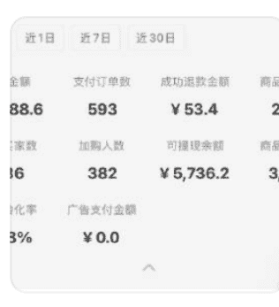

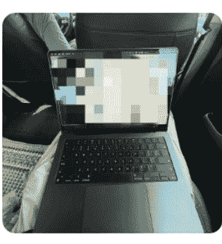

## 至少 70 篇笔记单篇销售额过千。能做到 了平均点赞几百，而且不是靠几篇爆款拉高的，是中位数就很高

| 时间 | 金额 | 阅读数 | 详情 |
| --- | --- | --- | --- |
| 14:20:09 | 1,188.00 | 15,974 | 笔记详情 |
| 13:49:01 | 1,092.00 | 9,576 | 笔记详情 |
| 13:44:31 | 1,089.00 | 16,709 | 笔记详情 |
| 10:09:53 | 1,029.60 | 27,644 | 笔记详情 |
| 23:42:21 | 970.20 | 17,910 | 笔记详情 |
| 15:21:22 | 970.20 | 10,964 | 笔记详情 |
| 13:38:42 | 960.30 | 16,161 | 笔记详情 |
| 09:47:55 | 955.50 | 5,031 | 笔记详情 |
| < 1 ... 5 6 7 8 9 ... 30 > | 跳至 页 | | |

而且不报课，纯自学，参加了一期生财的航海，看了文章，，四处捡面包屑，靠着持续输出内容 + 不断复盘优化，就这么做起来了

当时我还一边上班一边做副业，本职工作是程序员，很忙也很费脑力

2025-7-24 来自 iPhone 客户端

上班第二天，已经想辞职了🤦‍♂️

转发

1

今日任务：上班精力被榨干了，下了班缓不过来了

根本没思路和力气更新笔记，真的很佩服兼顾主业跟副业的程序员

今日任务：参加这个 sb 计划，都没空做小红书了，fuck

需要改进：晚上是确定了选题，但是 tmd 白天不给时间做，加班两天，才调休一天

早上通勤写一篇，中午午休写一篇，下班回家继续写。就这样，我做到了小红书虚拟上架官方榜单的 top5

而且我不是走投流、开通多个店铺、几十个账号、每天上百篇发笔记的玩法。而是凭借对产品足够了解、对用户足够了解，以及不断进化的原创内容能力，做到了这个成绩

所以为啥在困难模式下，能做出来

我觉得重要的不是「术」的层面，而是「道」，高维打低维，怎么打怎么赢，这次聊一聊逻辑

我在去年 6 月硕士毕业的时候，报名了生财的航海，开始学习小红书虚拟资料。看了很多帖子和文章，但总感觉有点割裂。这些内容我看了，也就看了

我当时思考：哦，这个虚拟资料挺赚钱的，但我该怎么做呢？我该从哪里开始呢？

当时主流的玩法都是：用选品软件工具监控，选品，测品，放大，对标爆款改写

但我当时刚刚毕业，没有那么多手机、账号、身份证。我就在想，小红书虚拟电商还有别的做法吗？

除了「找对标、抄爆款」，内容怎么做、运营怎么做、数据怎么复盘？

所以这篇文章，我想以自学做到 top5 商家的视角，分享一些对于小红书虚拟电商不太一样的看法

而且经过我半年的实践：其实还有另一条路！

这条路可能更适合个人玩家，尤其是那些受限于精力、没有那么多账号、借不到那么多身份证开店铺的朋友

如果大家遇到过这样的情况，可以看下去，真的很少有人分享过这个角度

## 为什么要做虚拟资料

哦对，又换了一种说法，叫小红书虚拟电商、虚拟产品。叫法一直在变，但内核、底层逻辑从来没有变过

先问大家一个问题：为什么来做小红书虚拟？

## 是看到很多人在说机会很大？还是之前就做过小红书平台？

我先说说我的原因。临毕业前我给自己定了三个选择：小红书虚拟、B 站好物、出海

为什么是这三个？因为都是我擅长的方向

22 年我就加入了生财，第一个做的副业就是小红书，所以对平台很熟悉，很了解用户的调性，知道用户爱看的笔记长什么样

B 站好物是因为我对数码很了解，身边同学买数码产品都会问我，我本身就像个导购员

出海是因为我的本职工作，本身就是程序员，网站技术上不会遇到什么问题

最后我先做了小红书虚拟，做起来了，入职后更没有时间做新的副业，就一直做小红书了

所以小红书虚拟对我来说，本身就是我擅长的——平台很熟悉，品类很了解，只多了个电商的背景

而且我当时在思考，到底是一直深耕某个平台某个方向，还是一直在找新的项目？看见某个项目，赶紧学一学，赚了几千，又陷入「找项目 - 做项目 - 做了几个月死了 - 继续找新项目」的循环？

包括蓝海的打法也是一样。蓝海没有任何护城河，迟早会被同行发现，然后变成死海。只有在项目刚起来、商家不多的时候才有机会。等一年后大家都来做这个项目，就不存在什么蓝海了

而且那种一个月卖几百单的小蓝海，不太适合我这种个人玩家

> 就像许老师说的："蓝海迟早变红海，所以这个项目最后，要看你的基本功。"

后来我决定，走原创内容，深耕的路线......

## 小红书虚拟电商的三个思维

一开始大家很容易陷入了一种思维误区：一直在说自己产品的卖点有什么，没有站在用户的角度，关注用户的买点在哪里

## 所以我的方法是：抛弃卖家思维，拥抱平台思维、用户思维、买家思维

传统的卖家思维是什么？就是站在自己角度，只想着：

- "我有什么产品要卖"
- "我有个东西，快来买"
- "我发了就有人来买"
- "我找几个兼职我就能放大"
- "然后就一直会有人买"

只看到自己能赚多少钱，但问题是：不考虑平台需要什么，不考虑用户需要什么

举个上周的例子，看到别人在小红书卖 PPT 模板，一个月能卖 600 多单，客单价 6 块 9，算下来能赚 3000 多块钱。一看就心动了，觉得"我也会做 PPT 啊，而且用 AI 做成本几乎为 0，我雇个兼职一个月 500 块钱，一个人做售前一个人做售后，我就能躺赚 2000 块"

这就陷入卖家思维了，整个思考过程全是：我能做什么，我的成本是多少，我能赚多少钱，我怎么放大规模。但没有考虑三个关键问题：平台需要什么样的内容？用户到底想要什么？凭什么用户要买我的而不是买别人的？

卖家思维有几个非常明显的特征，可以对照一下自己有没有：

第一，觉得"我发了就有人买"。觉得只要我发出来，就会有人买。只要我找几个兼职，就能放大规模。只要我一直发，就一直会有人买。这种想法的问题在于，把用户想得太简单了。实际上用户有无数个选择，凭什么选咱们？

第二，只看到别人赚钱，看不到背后的付出。就像刚才那个例子，看到别人卖了 600 多单赚了 3000 块，但没看到售后的问题。低客单价的产品，用户会特别挑剔，为了 6 块钱可能要给你改十几分钟。有的用户会说"这个图片我觉得有点丑"、"这个字体我不喜欢"、"这个颜色能不能调一下"

第三，不考虑长期发展。只想着短期赚快钱，不考虑平台会不会调整规则，不考虑用户会不会满意，不考虑能不能做长久。有些评分只有 4.1、4.2 的店铺，虽然现在还能卖，但如果平台开始重视用户体验，这些店铺可能就会遇到问题

卖家思维很容易陷入一种自嗨式的思维。以为产品很好，以为用户会买，但实际上

不了解用户需要什么，这种思维很难，即使短期能赚点钱，长期也容易遇到瓶颈

更重要的是，卖家思维会陷入价格战和同质化竞争。因为只想着“我也能做”，那别人也能做，大家都在做一样的东西，最后只能拼价格，越做越累，越做越没利润

就算内容质量一般，现在也有人买，那是因为供小于求，做的人不多。等大家都发现了这个品类，开始竞争，比谁开的店铺多、发的笔记多，作为个人玩家，能打得过吗？

所以我当时决定，抛弃卖家思维，转而拥抱平台思维、用户思维、买家思维

## 平台思维

平台思维就是要站在平台的角度想问题：平台需要什么样的商家？平台需要什么样的创作者？平台需要什么样的内容？

这个思维特别重要，因为所有的流量都来自平台。平台给流量才能赚钱，平台不给流量什么都做不了。所以要理解平台的逻辑，做平台欢迎的事情

### 核心是：不对抗平台

平台的核心目的只有一个：留住用户。不管是小红书、抖音、视频号，还是淘宝、京东，平台的本质都是要让用户在这里停留更长时间，产生更多互动，最终产生更多交易。

所以平台需要的是什么？是能提供优质内容、满足用户需求、让用户满意的创作者和商家。平台不太需要那种频繁搬运、提供同质化内容、让用户体验不太好的账号。

举个具体的例子。同样是卖 PPT 模板，有的店铺评分 4.8、4.9，有的店铺评分只有 4.1、4.2。评分 4.8、4.9 的说明用户真的满意，用户觉得物有所值，这种店铺平台会更愿意给流量。评分 4.1、4.2 的说明用户体验可能不够好，退货率相对高一些，投诉也多一些，这种店铺长期来看可能会遇到一些挑战

有了平台思维，做内容和选品的时候就会完全不一样。不会再想着"我搬运一下就能赚钱"，而是会想"我怎么做出平台欢迎的原创内容"。不会再想着"我做低价产品快速变现"，而是会想"我怎么提供高质量的产品和服务，让用户满意，让平台给我更多流量"

这种思维的好处是，做的事情是可持续的，是能做长久的。因为我和平台的利益是一致的，平台希望用户满意，也在努力让用户满意，平台自然会支持

说实话，小红书需要的不是那种批量生产、同质化严重的内容。大家扪心自问一下，那种一眼就能看出来是 AI 生成的笔记，自己会看吗？看得下去吗？

如果自己都看不下去，用户凭什么看得下去？凭什么下单买产品？

有人可能会说，就算内容质量一般，也有人买啊。这确实是事实，但那是因为现在供小于求，做的人还不够多。等大家都发现了这个品类，开始竞争，比谁开的店铺多、发的笔记多，作为个人玩家，不一定打得过工作室

所以思考一下：平台需要什么样的创作者？我们能提供什么样的价值？

### 用户思维

用户思维是最核心、最重要的，就是完全站在用户的角度去思考问题。这考验的是共情能力

这个转换听起来简单，但实际上特别难。因为人的本能就是从自己的角度出发，很难真正站在别人的角度去想问题。但这恰恰是最重要的能力，因为只有真正理解了用户，才能做出用户真正需要的东西。这也是护城河之一

比如留学赛道，如果留过学，那我就了解用户有什么需求。反观其他人，只是看到留学的品类爆了，可能连托福雅思的区别是什么都不知道，更别提用户的需求了，可能还没有用户懂得多

所以第一步，找到用户是谁。非常清楚我的目标用户是谁。比如同样是买 PPT 模板，幼儿园老师、企业白领、大学生，这三类人的买点完全不同。幼儿园老师的买点是"可爱、吸引小孩注意力"，企业白领的买点是"专业、让老板满意"，大学生的买点是"答辩能过、找工作能用"

第二步，找到用户的痛点。用户为什么需要我的产品？他遇到了什么问题？

第三步，给用户一个购买理由。用户需要的是一个理由来买单，而且这个理由最好是外部归因

什么意思？就是不让用户觉得是自己的问题，而是给他一个外部的理由。比如睡不着觉不是因为玩手机熬夜，而是窗帘透光，没法让我进入深度睡眠

### 买家思维

买家思维就是站在购买者的角度想：我凭什么从我这买？为什么不从别人那买？买点和别人的买点有什么区别？

第一，研究竞品的买点。可以去看竞争对手在讲什么买点，他们的买点有什么可以优化的地方。比如发现竞品的评分都只有 4.1、4.2，说明他们讲的买点可能没有完全兑现，用户体验还有提升空间。那我就可以在这个基础上做得更好，真正兑现我的买点，做到 4.8、4.9

第二，找到独特的买点。想清楚，能提供什么别人不太容易提供的买点

比如如果我是从不会做 PPT，到现在成为 PPT 高手，这就是独特的点。因为经历过用户的痛苦，更懂用户需要什么。这就是"美强惨"人设：以前很惨（遇到困难），但现在很强（成为高手），这种买点特别有说服力

第三，持续兑现我的买点。买点不是说说而已，真正兑现。如果说"这个 PPT 能让答辩更顺利"，那 PPT 质量就真的好，用户用了真的能顺利答辩。如果说了做不到，用户会给差评，买点就失效了

所以我一直在说，大家可以试试去做「难而正确的事」，这也是我读研时，导师指导论文一直强调的理念

什么意思？如果买点很容易被复制，那没有竞争优势。比如说"这个 PPT 很便宜"，别人也可以降价，这不是护城河。但如果买点是「我更懂用户需求，因为我经历过用户的痛苦」，这个就很难被复制，这就是护城河。

持续输出高质量、懂用户痛点的买点内容，这就是竞争壁垒。这个壁垒就是独特的买点，别人很难超越我

这四种思维不是孤立的，而是有一个正确的思考顺序，核心就是"从卖点到买点的转换":

第一步，用平台思维想：平台需要什么样的内容？平台需要的是讲"买点"的内容，

是能满足用户需求的内容，而不是自嗨式讲"卖点"的内容。

第二步，用用户思维想：用户是谁？用户的买点是什么？不讲卖点（产品有什么），讲买点（用户得到什么）。从用户的角度，用用户想听的话，讲用户关心的事。

第三步，用买家思维想：市场上已经有很多人在讲买点了，我的买点和别人有什么不同？我的买点更真实吗？更独特吗？更有说服力吗？

第四步，才用卖家思维想：在满足前三者的基础上，我如何定价？如何规模化？如何赚钱？

卖家思维不是不要，而是放在最后。只有当找到了正确的买点、建立了独特的买点、能够兑现买点之后，才去考虑怎么赚钱。这个时候赚钱是水到渠成的事情。

但大多数人都是反过来的，直接从卖家思维出发，只讲卖点不讲买点，只想着"我能赚多少钱"，结果做不起来，因为用户根本不关心卖点

## 做内容也好，做电商也好，最重要的是完成"从卖点到买点的转换"

卖点是商家想说的话，是产品有什么。买点是用户想听的话，是用户得到什么。卖家思维就是只讲卖点，用户思维就是讲买点

平台需要的是讲买点的创作者，因为只有买点内容才能满足用户需求，才能留住用户。买家会比较不同商家的买点，选择最打动他、最真实、最独特的那个

## 所以做的是：

- 抛弃卖点思维，建立买点思维
- 从"产品有什么"转换到"用户得到什么"
- 从"功能参数"转换到"使用场景"
- 从"我想说的"转换到"用户想听的"

用户需要的是一个理由来买单，而这个理由不是我的卖点，是买点。只有真正理解了用户的买点，才能做出用户真正需要的东西

做难而正确的事，持续输出高质量、懂用户痛点的买点内容，有竞争壁垒

## 理解小红书三大流量池、普通/商品笔记的区别

对于，很多人做小红书电商，笔记一挂商品链接，流量立马掉到两位数，然后就开始焦虑："是不是被限流了？是不是账号废了？"

小红书的流量分配，本质上是三个不太一样的"池子"。笔记在哪个池子里，决定了会被"谁"看见

- 1. 社区流量池——流量最大，用来种草

这是普通笔记的主战场。平时刷到的那些爆款笔记，基本都来自这个池子。社区流量池的特点是流量大、覆盖面广，但用户没有购买意愿，可能只是来看看、学习、找灵感。平台希望这些笔记能让用户多停留、多互动，丰富内容生态。

- 2. 交易流量池——流量精准，用来卖货

这是商品笔记的主战场。流量没有社区池那么大，但精准得多。点开笔记的用户，都是有购买意愿的，可能正在搜索、对比、准备下单。虽然"小眼睛"少了，但转化率高啊！社区流量池可能几百个人才有一个下单的，交易流量池大概 10 个人里就有 1 个下单。

- 3. 商业流量池——花钱买流量，更稳定

这是付费推广的地盘，通过聚光或千帆平台投放广告。自然流量通常在 48 小时达峰，7 天后开始衰退，一篇笔记的推荐流量大概维持一个月，之后主要靠搜索流量。想要持续的推荐流量？要么继续产出好内容，要么付费进商业流量池。

### 二、普通笔记和商品笔记，平台的评价标准不一样

很多人以为，笔记点赞高、收藏多，就是好笔记。但其实，普通笔记和商品笔记的评价标准完全不同

#### 普通笔记看互动指标：

- 点赞、收藏、评论、分享、关注
- 播放时长、点击率

封面标题够不够吸引人？内容有没有价值？能不能种草？

平台希望我的笔记能让用户停留更久，在小红书上花更多时间。所以互动越高，平台越愿意推

#### 商品笔记多了交易指标：

商品转化率、加购量、购买量、销量

购后评价、晒单评论

CPC（点击成本）、CVR（转化率）

平台希望笔记能带来实打实的 GMV，而且口碑好。一篇好的商品笔记，既有高互动性（让用户愿意看、愿意点赞），又有高交易指标（让用户愿意买）

这里有个关键点：如果发的商品笔记只有交易属性，没有互动指标，那它只是一篇普通的商品笔记，甚至可能达不到理想效果。但如果发了一篇同时兼顾高互动性、高交易指标的商品笔记，那在商品笔记流量池里就是嘎嘎乱杀

### 三、挂了商品链接，为什么小眼睛变少了？

很简单，笔记从社区流量池进入了交易流量池

交易流量池本身的流量盘子就没有社区流量池大。系统不再把笔记推给"随便刷刷"的用户，而是推给"有购买意愿"的精准用户。虽然"小眼睛"少了，但单次点击的转化价值更高

所以千万别陷入误区，过度追求点赞和小眼睛数。做小红书虚拟资料的重点是种草、转化、出单，不是接广告那套涨粉玩法。更应该关注的是商品点击率和支付转化率

如果笔记本身不挂商品链接（普通笔记），只在评论区回复蓝链（商品组件），它依然走的是社区流量池

总结一下挂链的逻辑：

- 笔记本身挂商品链接 → 进入交易流量池（小眼睛少，但转化高）
- 只在评论区挂蓝链 → 仍在社区流量池（小眼睛多，还能转化）

但说实话，这些操作技巧都不是最重要的。重要的是这个品怎么样，内容写得怎么样

产品是不是用户的真实需求？真的好用、有价值吗？真的懂这个品吗？

内容可以打动用户吗？是在用卖家思维还是用户思维？

因为这些技巧都不是核心因素。什么普通笔记转商品笔记，折腾来折腾去都不是关键点。内容写得不行，品一般，怎么搞都很难有好效果。别本末倒置，捡了芝麻丢了西瓜

### 该怎么发一篇既有高互动、又有高转化的商品笔记？

这同时兼顾做内容和做电商的能力

#### 懂用户：

用户有什么问题？用户在搜什么？用户的痛点是什么？

不要只堆砌产品参数，说"买点"(用户能得到什么)

不要只想着卖货，先提供价值、建立信任

#### 有原创能力和情绪营销能力：

标题有情绪词，能引起共鸣

内容有价值，不能是硬广

封面吸引人，让用户停下来

很多人以为 AI 能帮写出爆款笔记，但 AI 是没有灵魂的。AI 只是一个提效的工具，自己才是那个有灵魂的人，把灵魂赋予给 AI。AI 并不是真的懂用户，我先懂用户，然后告诉 AI 用户有哪些需求。我才是那个决策者，AI 是我的第二大脑

AI 提效是建立在我对好内容有认知的情况下！我都分不清什么是好内容，什么是一眼就能看出来的 AI 生成内容，谈什么提效呢？

AI 是提效工具，但它没有灵魂。我，作为内容创作者，才是赋予灵魂的人!

至于每天发几篇、普通笔记和商品笔记的比例？说实话，我的笔记都是随时发的，从早上八点多醒，到晚上 12 点多准备睡觉，这期间我都会发，并不会搞定时发布

| 发布时间 | 笔记支付金额 | 笔记阅读数 |
| :--- | :--- | :--- |
| 00:17:37 | 33,125.40 | 159,204 |
| 11:27:31 | 26,937.90 | 64,636 |
| 10:35:11 | 19,930.68 | 116,370 |
| 22:42:21 | 18,225.90 | 79,708 |
| 14:01:07 | 17,780.40 | 109,933 |
| 10:07:12 | 14,421.78 | 99,116 |
| 14:31:15 | 11,867.91 | 57,083 |
| 16:29:00 | 8,316.00 | 46,635 |

没有固定标准，看自己的反馈情况，因人而异

不管是普通笔记还是商品笔记，核心都是"真诚利他"。笔记好看、内容有干货、互动高。能写出用户爱看的好内容，平台绝对会给流量

所以下次说自己笔记没流量，先问问自己：写的笔记，真的是用户爱看、真诚利他的吗？平台不瞎，用户更不傻。能写出用户爱看的情绪 + 干货，流量自然会来找上门

### 该怎么选品

提到选品，大家第一时间想的都是：找对标、抄爆款

但我想分享的是「围绕自己来选品」

大家一直在跟着竞品跑，但从来没有人坐下来，耐下性子，跟用户聊一聊他们的需求。

同行不给我掏钱，他还会抢我的钱。给我掏钱的，是我的用户。我不围着用户转，天天跟在同行屁股后面干什么？

比如可以从店铺分举个例子，虚拟电商的店铺分是由品质分和服务分共同决定的，各占 50%

- 4.8-4.9 分：说明这个东西真的满足用户需求，用户觉得好才给好评
- 4.1-4.4 分：这种可能就是抱着"趁着现在有机会，先做起来"的心态。这种店铺平均 4.1 分，至少 10% 的退货率，售后纠纷相对会多一些。

如果一直找对标、抄爆款，都没有花时间去和用户交流，没有想过和用户聊聊他们到底有什么需求和痛点，不应该把更多时间给我的用户吗？

一开始做的时候，可以多看竞品，这没问题。但当我慢慢做起来之后，能做到比他们更好或者超过他们的地方，就是我和用户交流得更多，我更懂他们，所以我才有可能超过其他竞品

尤其是很多店铺，其实只有 4.1、4.0，甚至 3 点几、低于 4 的评分了，这其实就是问题所在

这说明用户对产品不够满意，打了相对低的评分。我就去跟用户聊，去找到他们为什么对产品不够满意，我有什么可以优化的地方。我能不能把商品品质做到 4.8、4.9 甚至 5.0 呢？这是我去做的地方。

我多去跟用户交流，用户的反馈才是真正的需求，而不是把大部分时间放在找对标、抄爆款上。

离用户近，我才能离钱近。离用户近，我才能走得更远。去服务用户，多去跟潜在客户交流，而不是跟着竞争对手屁股后面跑。

#### 选品围绕我这个人。我在什么地方做到过什么闪光点？我是什么样的人？

小红书还是找自己擅长、经历过、资深玩家、感兴趣、有强烈表达欲的方向，任意占一个就行。

#### 我觉得还是得有东西驱动

比如让我做什么 AI 绘画，我压根不太了解，也不知道用户的痛点，我也不是资深玩家，更不感兴趣。去做的话，包没成绩。

这样也没法驱动我，在没有正反馈的时候，很难坚持下去。

最好就是那种发烧友心态，卖不卖无所谓，释放我的表达欲就行，卖货只是顺便的事。

而且我培养一个意识：我是最懂用户的，我未来一定会做到 top 级别，「我是被参考对标的，不是参考对标别人的人」

生产满足用户痛点的内容，持续输出视频/图文/文章，用户觉得需要，自然会找上门来

在一次次创作中，锻炼原创能力、能持续不断输出、懂用户痛点，不断优化提升自己

如果实在不知道做什么，告诉大家一个判断标准，去小红书官方账号「生活研究所」


生活研究所在 25 年 4 月之前会公布虚拟商家的月 GMV 数据。虽然快隔了 10 个月，但大家大概能估摸出情况


### 关于内容

其实这也是最核心的，对内容不够重视，甚至不太花时间在内容上

好内容，自带流量，内容离钱更近

内容足够好，自身就带着流量，带着转化。而且我的内容好，广告的竞争力也更高

广告竞争力=内容质量×点击竞争力×出价竞争力×转化率

内容质量不行，投广告，竞争力也不太高

大家是因为好内容，产生点赞、收藏、评论、关注、下单的行为

我当时在想，如果做 AI 同质化内容，可能会遇到平台的一些调整，玩不了太久，半年？一年？

以后写完笔记，发布之前，我都会想一想：

有价值吗？用户爱看吗？

而且我没有用一个 prompt 走天下，没有一成不变的 prompt，没有一键直出的 prompt

如果我这样做了，就是懒，就是想省事

我的内容、我的 prompt、我的创作能力是会一直进化、提升、更新的，以周为单位。每周末复盘笔记数据，调整 prompt，优化内容

今日任务：幸好保住了日单 500

三天的日入 5k 体验卡到期后，又不满足现状了

小号还是得稳定更新，至少有一个固定日更的选题 (其实现在有两个)

打算测一测数据吧

月初还抱怨，8 月发的笔记都没有出爆款，晚上一看，有惊喜诶!

看来小红书推流，真的要晚一周，一周后才见分晓

还有一点，今天复盘数据，确定了一个潜在爆款词，而且支付转化率特别高

需要改进：优化标题，看看怎么提高标题点击率呢

就像曹大的 SB 第一定律：从没觉得自己傻逼过的，往往是不可救药的大傻逼

如果对一个月前的内容很满意，因为一个月前的 prompt 提效而沾沾自喜，本质就陷入了瓶颈，说明我这段时间没有什么提升。

平台是变的，用户也是变的，所以我也要跟着变。沉浸于过去的成绩、毫无进步，迟早会被淘汰。

至少每次跟 AI 对话，我都带着这样的意识：「我还有什么问我的，或者我补充的吗？而且可以根据我的回答继续追问，直到你有 95% 的信息理解我的真实需求和目的」（来自卡兹克的面包屑）

包括选题，我也会让 AI 给我选题建议，但不会完全信。外行人看，可能觉得选题、标题都很合理；但我做熟练了，一眼就能看出来，这种选题标题，只能大模型的瞎猜，发出来可能效果不太好

有时刷到同行笔记，一看标题，再看内容，再对一下点赞收藏，哦，那很 AI 的感觉，流量不高也很合理。

还有人问会不会选题枯竭？根本不存在。如果越写越没货，说明在啃老本，容易慢慢被平台和用户淘汰

保持跟用户聊天，跟上用户的节奏，跟上平台趋势，选题是源源不断的，干就完事了！

### 数据复盘

还有一点，很多人只发笔记，从来没有复盘过，甚至对千帆的很多功能都一知半解

只是闷头发笔记，然后没出单还来问"为什么我卖不出去"

商品点击率如何？支付转化率多少？退货率多少？

我每周末都会做一次数据复盘。比如拉出来笔记的情况，看一看哪些笔记效果好，还有什么提升的地方。下周我可以优化 prompt，提高内容质量吗？

经过晚上的数据复盘，感觉自己又上了一个台阶，找到了目标
今天最后一篇笔记的创作水平，来到了近期的巅峰！
埋钩子、引起焦虑、直击痛点、利益诱惑强化欲望、解决方案、真实案例和损失厌恶心理提高转化率
需要改进：再整体复盘一下账号情况和对标

今日任务：没想到破新高了，估计是听到了我的呼唤

但是最近一周破百赞的笔记都比较少，

数了一下 23 号之前 20 个百赞以上

最近这些天，就只有两篇

需要改进：下午在复盘每篇笔记的数据，都整理到 Excel 里面了，趁着工作日好好复盘

继续昨天的内容：

人还是要有点目标才行，能督促自己

先定个小小小目标，8.15 之前，能够再破一下新高，实现日入 5k

今日任务：再数据下跌后，又悄无声息、偷摸的破新高，来到了日单 500

最关键的是，新高是在 3.6w 阅读量的基础上破的！

之前新高可都是 4-6w 阅读量

说明转化率有进一步提升了，下了班复盘一下数据

看看是不是 xx 操作，提高的商品点击率和支付转化率

需要改进：

继续之前的话：

人还是要有点目标才行，能督促自己

先定个小小小目标，8.15 之前，还有十天，能够再破一下新高，实现日入 5k

今日任务：差点又新高了，因为自己懒狗，大号就发了两篇，小号发三篇

今天估计扑街了，实时图已经差两百了

需要改进：每天晚上就确定好明天的选题，其实只要知道做什么，怎么做是很简单的

### 包括千帆的很多模块，真的是宝藏，挨个点一遍

比如用户资产模块，店铺流量占比，是走搜索还是推荐？占比是多少？点击率和转化率差别大吗？思考过有区别吗，有没有想过做一些优化

今日任务：居然创新高了（上次是 4410）

而且支付转化率是 27%

上次是 6.4w 阅读量，这才只有 3.7w 阅读量就破了

还得是精准呀

需要改进：ok，今天休息，至少发四篇，然后把新品上架

明天计划：明天至少发三篇才行

### 我是把搜索和推荐都研究了一遍

2025-9-21 来自 iPhone 客户端

#### 日志打卡第 66、67、68、69 天

销售额：6380、6038、5253、3913

今日任务：

工作比较忙，没空发笔记，更没空发复盘了

今天看了一眼千帆，发现 50% 的搜索流量，搜索支付占了 60% gmv

不少主打搜索的笔记，商品点击率 25%，支付转化率来到了 40%

单篇笔记 gmv 已经 1.9、1.2w 了

毫无疑问目标用户很精准，而且引导读者点击商品，转化率也不错

需要改进：千帆给了一列"关联搜索词"，平时并没有考虑过标题和文案加入这种搜索词

看了一眼官方给"关键搜索词"的定义：搜索结果下，展示商品曝光人数 top3 或者有成交的词

下周发笔记可以考虑一下这些关键词，看看能不能埋进文案里

## 比如我有一篇笔记，搜索支付金额占了 2.5 万

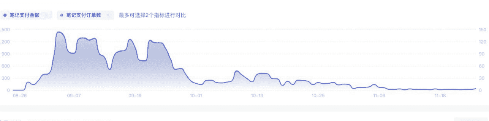

| 渠道名称 | 支付金额 | 支付订单数 | 支付转化率 (PV) |
| :--- | :--- | :--- | :--- |
| 综合搜索页 | 25,542.00 | 2,580 | 27.12% |
| 发现页 | 7,563.60 | 764 | 17.38% |
| 个人主页 | 2,296.80 | 232 | 32.04% |
| 消息页 | 148.50 | 15 | 21.13% |
| 其他 | 128.70 | 13 | 23.21% |

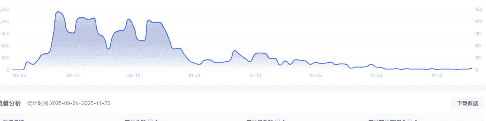

| 渠道名称 | 支付金额 | 支付订单数 | 支付转化率 (PV) |
| :--- | :--- | :--- | :--- |
| 综合搜索页 | 25,542.00 | 2,580 | 27.12% |
| 发现页 | 7,563.60 | 764 | 17.38% |
| 个人主页 | 2,296.80 | 232 | 32.04% |
| 消息页 | 148.50 | 15 | 21.13% |
| 其他 | 128.70 | 13 | 23.21% |

## 又比如做好搜索优化后，笔记可以持续不断地出单。它的商品点击率和支付转化率都可以做得很高

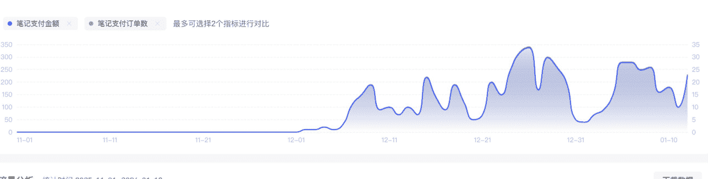

| 渠道名称 | 支付金额 | 支付订单数 | 支付转化率 (PV) |
| :--- | :--- | :--- | :--- |
| 综合搜索页 | 4,781.70 | 483 | 29.45% |
| 发现页 | 999.90 | 101 | 21.17% |
| 个人主页 | 287.10 | 29 | 50.88% |

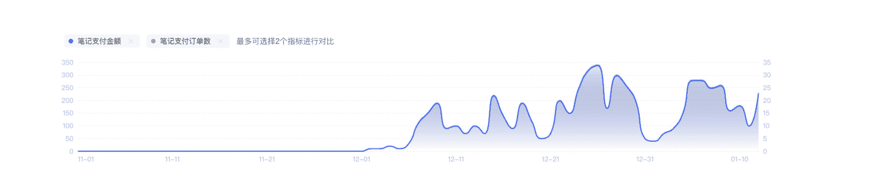

| 渠道名称 | 支付金额 | 支付订单数 | 支付转化率 (PV) |
| :--- | :--- | :--- | :--- |
| 综合搜索页 | 4,781.70 | 483 | 29.45% |
| 发现页 | 999.90 | 101 | 21.17% |
| 个人主页 | 287.10 | 29 | 50.88% |

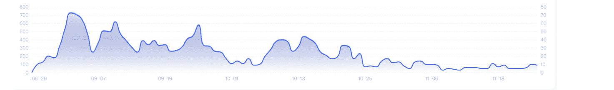

| 渠道名称 | 支付金额 | 支付订单数 | 支付转化率 (PV) |
| :--- | :--- | :--- | :--- |
| 综合搜索页 | 18,235.80 | 1,842 | 28.33% |
| 发现页 | 1,900.80 | 192 | 17.34% |
| 个人主页 | 1,138.50 | 115 | 36.62% |
| 消息页 | 118.80 | 12 | 35.29% |
| 其他 | 69.30 | 7 | 31.82% |

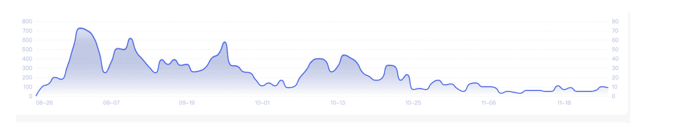

| 渠道名称 | 支付金额 | 支付订单数 | 支付转化率 (PV) |
| :--- | :--- | :--- | :--- |
| 综合搜索页 | 18,235.80 | 1,842 | 28.33% |
| 发现页 | 1,900.80 | 192 | 17.34% |
| 个人主页 | 1,138.50 | 115 | 36.62% |
| 消息页 | 118.80 | 12 | 35.29% |
| 其他 | 69.30 | 7 | 31.82% |

这背后的逻辑是什么？因为搜索流量是用户主动找过来的，他们有明确的需求。我去做好关键词布局、内容匹配度，就能持续获得精准流量

而走推荐流的笔记，生命周期通常只有一个月左右

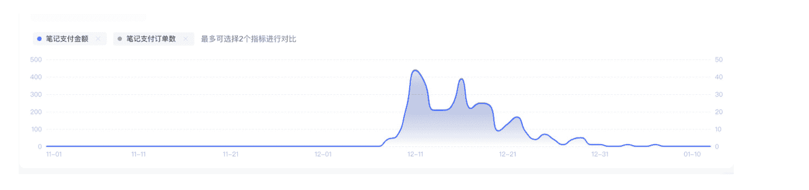

推荐流量是平台主动推给用户的，用户可能没有明确的购买意图，只是刷到了我的内容。所以推荐流量的爆发性强，但持续性相对弱一些

### 还有一种是搜索推荐五五开的流量，这种特别稳

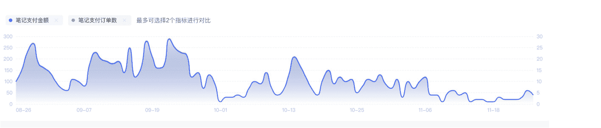

| 渠道名称 | 支付金额 | 支付订单数 | 支付转化率 (PV) |
| :--- | :--- | :--- | :--- |
| 发现页 | 4,880.70 | 493 | 20.37% |
| 综合搜索页 | 4,068.90 | 411 | 27.40% |
| 个人主页 | 722.70 | 73 | 45.91% |

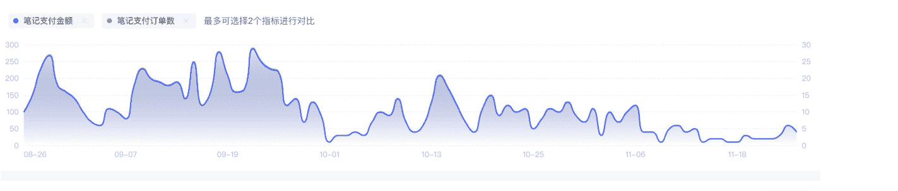

| 渠道名称 | 支付金额 | 支付订单数 | 支付转化率 (PV) |
| :--- | :--- | :--- | :--- |
| 发现页 | 4,880.70 | 493 | 20.37% |
| 综合搜索页 | 4,068.90 | 411 | 27.40% |
| 个人主页 | 722.70 | 73 | 45.91% |

为什么？因为我既有推荐流量带来的爆发和曝光，又有搜索流量带来的持续转化。这种笔记往往是质量特别好的，既能吸引平台推荐，又能满足用户搜索需求

这就是数据复盘的价值。只是发完笔记就不管了，我就去看数据，去分析背后的逻辑

为什么这篇笔记搜索流量高？是关键词布局好，还是内容匹配度高？

为什么那篇笔记推荐流量爆了？是标题吸引人，还是封面设计好？

为什么有的笔记点击率高但转化率低？是内容和产品不匹配，还是价格有问题？

## 这些都是我在思考、去优化

数据不会骗人。内容好不好，用户喜不喜欢，数据会告诉答案

关于售后，如果一个人连售后都不提，我很难相信他的真实性

售后问题被严重低估了。很多帖子都说「无售后、无退货」，但仔细看晒成绩的数据，售后都达到了 10% 左右

尤其一旦爆单，售后的烦恼会更多。并不存在“几块钱的东西用户懒得退”这种情况。以后再遇到这种说法，无疑是狼人自爆

售后比较少的核心原因很简单：东西好，用户觉得值，就没有什么售后问题。像那种 4.1 分的店铺，退货率至少 10%-20%。很多人说虚拟产品无退货、无售后，这根本不现实

如果产品质量不够好，平台指不定什么时候开始重视用户体验，到时候可能会遇到一些挑战

## 总结

其实总结一下，就是：大量输出 + 持续复盘

这 8 个字就够了，保持更新笔记，优化笔记、复盘数据，

现在回头看当初的打卡复盘，很好玩，都是一步步走来的

2025-7-16 来自 iPhone 客户端

### 日志打卡第 2 天

日志打卡第二天，14 号是 787.8，可惜没破八百

坏消息：15 号也没破 800

好消息：破 1100 了

今日任务：成功守住了 2500

如果是十天前，怎么也不可能想到日 2500 是想要保底的数据

记得刚做的时候，是想要日访客 1000，日单 150 就行的😂

2025-8-9 来自 iPhone 客户端

### 日志打卡第 25 天


今日任务：差点又新高了，因为自己懒狗，大号就发了两篇，小号发三篇

今天估计扑街了，实时图已经差两百了

继续之前的话：

人还是要有点目标才行，能督促自己

先定个小小小目标，8.15 之前，能够再破一下新高，实现日入 5k

2025-8-16 来自 iPhone 客户端

### 日志打卡第 32 天


销售额：4567

今日任务：好顺的数字，只昨天降了二百多，看实时图 8.16 应该还有戏回到 5k

我的妈呀，我在说什么，阈值不断被提高了

十天前，觉得偶尔几天达到 4k 就不错了，现在已经想着保底 4，经常 5 了

需要改进：休息日，再来一个系统性的复盘➕学习

但是小号第二篇，发了一晚上，还是 1 个小眼睛，为啥啊，笔记也正常啊

### 日志打卡第 35 天


销售额：6258

今日任务：再次破新高！距离月底目标还差七百块

需要改进：优化发布笔记的安排，不然一忙，每天只能发两篇了

再提高点要求

整个八月份保持平均日 3.5k

既然目标达成，那就再定一个：

8.31 之前，达到日 7k 的新高

2025-9-1 来自 iPhone 客户端

### 日志打卡第 46、47、48 天


销售额：4328, 3904, 4918

今日任务：打卡休息了两天，更新频率也慢下来了，好轻松

今晚解决了一个困扰很久的大问题！

洗澡，真是💡灵感迸发的时刻

还谈成了新的业务合作

算上今天，8 月份月入 15，如果加上主业，月入 20 了

记得刚上班的时候，一天 2.5 就觉得很幸福啦，能破 4，当天空气都是甜的

现在达到 4，甚至都不满意😂

人的阈值啊，预期啊，真是个奇怪的东西

2025-9-2 来自 iPhone 客户端

### 日志打卡第 49 天


销售额：8390

今日任务：九月份的第一天就达成目标

说好的 9.15 破 7，直接破 8 了

就很夸张

再算上工资，我是不是日入 1 了🤔

2025-9-3 来自 iPhone 客户端

### 日志打卡第 50 天


销售额：9580

今日任务：九月份的第二天，又破 9 了

下周想体验日入过万，求求了🙏

没啥可说的，享受流量完事了，单日阅读量五万多

2025-9-5 来自 iPhone 客户端

### 日志打卡第 52 天


销售额：10859

今日任务：达到目标啦，都赶上半个月工资了😯忙的忘截图了

数据来到了历史新高

周五下班可以准备新合作，卖高客单价产品啦

检验我打造 IP 运营群聊 获取信任的时候来啦

真诚永远是必杀技，什么搬运 抄袭 歪门邪道 奇淫巧技，都不如直接解决用户痛点，提供超预期服务

2025-9-7 来自 iPhone 客户端

### 日志打卡第 54 天


销售额：7247

今日任务：经典周六日数据回落，权当周六日休息

正好复盘笔记，从千帆 => 我的笔记，把单片笔记 400 元以上的统计出来

划分了三个标准：销售额大于一千、一个赞大于 5 块钱、10 个阅读量以内一块钱

同时符合三个条件，划分出大爆款，两个条件是包括，一个条件是小爆款

然后对这些爆款笔记的标题、文案二次分析，复盘哪些因素导致的，有什么共性

重点发大爆款和爆款笔记

为啥千帆押金从 500 变成 5000 了

2025-9-10 来自 iPhone 客户端

### 日志打卡第 57 天

销售额：10953

今日任务：还以为这天能破新高，白天都超过昨天的了
结果晚上回落了，晚上的流量会惩罚每一个没发笔记的懒狗

输出就完了，我回去看输出之后效果怎么样，不断调整。这个调整考验的是我的创作能力、生产内容的能力、机制

避免一直按同一个模板写同样的笔记。万一写完就几个赞、没人看，我应该不断调整、不断优化

#### 正反馈循环机制

- 如果没人看，说明我的输出质量可能不够高，方向或内容有需要调整的地方
- 如果用户爱看，用户会给我点赞，我就会有正反馈，就会一直想输出。而且用户会一直跟我交流，我会一直有选题库，你的灵感不会断。

学习资源建议，可以看生财的小红书爆款笔记，21 年、22 年、23 年的小红书精华帖都值得一看

师傅领进门，修行看个人。成为 top、上榜单，靠的是持续做、优化、复盘

再次强调，没有对错，只是个人选择不同。我提供一个新的思路给大家，这不一定对，只是我验证过有效的方法

## 做难而正确的事

尊重读者，不把用户当傻子，提供真正有用的产品，原创内容，持续复盘，不断优化提升自己的内容能力

最后引用一句罗永浩和何同学博客里的话结尾，强烈建议愿意真心踏实做内容的去听一听

> 「一旦你放弃这种可有可无的坚持之后，就慢慢的没有任何坚持了」

祝大家都能库库爆单

这篇主要分享小红书虚拟的思路，不知道大家对具体方法感兴趣不，例如这几个月我都做了哪些调整，怎么写出好的内容、还有如何针对性的复盘、进行调整优化

再次重申，以上仅代表我个人的观点，分享我跑通的思路，同样建议大家根据自己情况选择不同的打法和模式

最后，安利小懒的付费群：

懒人专属群（介绍）


🕯这里是你对抗信息过载的护城河。

已稳定运行 7 年，累计拆解、研读 3000+ 个互联网商业实战案例与行业前沿内参和时政/宏观文章。

我们不搬运垃圾，只做高价值信息的筛选器与放大镜。

### 懒人专属群更新记录

```
https://hk57gvlx7u.feishu.cn/docx/H0kRdZbSbolBR0xkaXtcuVE0nTg
```

【免责声明】本资料归档于社群内部知识库，仅供成员课题研究与学术交流，请在查阅后 24 小时内删除。