# 公众号懒人搜索，懒人专属群分享

# 参与 SCBI 的爆款内容 AI 动漫化，小红书一个月涨粉两万+，我的经验分享

## 260122 副业 SC 精华

## 公众号懒人搜索，懒人专属群独享

## 懒人微信: lazyhelper1

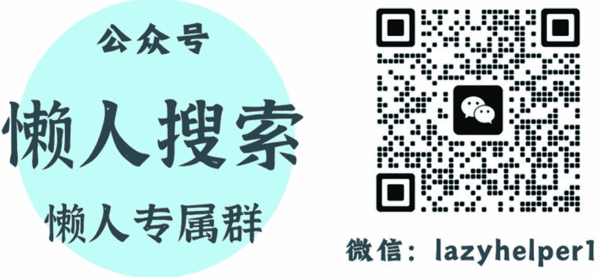

# 前言，取得的一些成果

大家好，我是浅笑，有六篇精华帖，四十多次中标。

目前在做 AI 漫画的这个赛道，一个月的时间，在小红书涨粉两万+，跑通了商单，买手计划，虚拟资料上面的变现。在抖音上面整体也有几百万的播放，公众号也有好几篇阅读量上千。

# AI 漫画的一些优势

## 漫画是一种“语言”

我觉得，漫画本身并不只是一种内容形式，而更像是一种“语言”。就像文字、视频、音频一样，它是一种用来承载和表达信息的媒介。

漫画几乎可以和任何内容结合在一起。无论是养生、科普、情绪故事、产品介绍，还是经验总结，本质上都可以被“翻译”成漫画这种表达方式。不是在创造一个全新的内容，而是在用漫画这种语言，对原有内容做一次重构：把原本可能枯燥、复杂、需要耐心阅读的东西，拆解成更轻、更直观、更容易被刷完的形式。

## 漫画的受众群体大

从传播效率的角度看，漫画这个形式最大的优势之一，就是它的受众面非常广。

漫画是一种“低门槛阅读”的内容形态：不用开声音，不用完整投入注意力，几秒钟就能扫完一页，但情绪和信息已经传达完成。

不同年龄、不同背景、不同使用场景的用户，都能用非常低的成本去消费漫画内容。它不要求用户具备某种知识背景，也不要求形成某种使用习惯，只要会刷手机，就能看懂。

从平台视角来看，这种“低理解成本、低时间成本、高完读率”的内容形态，天然就更容易被放大推荐。你不需要一开始就把自己锁死在某个非常狭窄的受众圈层里，而是可以先用漫画这种形式，覆盖尽可能大的基础人群，再在这个基础上慢慢做细分和深化。

## 工具的进步

说实话，现在用 nano banana pro 来做漫画，在实际效果层面，已经和真人绘制几乎没有本质区别了。

如果放在以前，想做这种内容，要么你自己就是专业画师，要么就必须找设计、找外包、甚至组一个小团队来配合，成本高、沟通复杂、产出速度也完全不可控。而现在，这件事已经被技术彻底改写了。现在的流程非常简单：用 nano banana pro 负责核心画面生成，用 Lovart 这一类的 agent 设计工具，做图轻轻松松。

## 漫画类型整理

### 画风

#### 分享一些参考画风

-   1. Q 版治愈系：Q 版可爱风格，日系二次元，头大身小比例，圆脸大眼睛，柔和色彩，治愈系氛围，干净背景，简洁线稿，温暖日常插画风格，角色风格统一，高质量，适合漫画分镜
-   2. 萌宠拟人/动物日常：可爱动物拟人风格，Q 版比例，圆润造型，大眼睛，简单表情，治愈系插画，日常生活场景，色彩柔和，背景简洁，卡通漫画风格，角色形象统一
-   3. 温柔少女漫/情绪插画风：日系少女漫画风格，画面干净，色彩柔和，光线温暖，情绪感强，人物表情细腻，背景虚化或简化，治愈系插画，适合情绪表达
-   4. 轻 3D 卡通/潮玩风：3D 卡通风格，类似皮克斯或潮玩手办，圆润造型，可爱比例，柔和打光，干净背景，玩具质感，角色居中，适合 IP 形象展示

### 万能法

#### 图就是提示词

将你目标的图片放入 lovart，然后后面加上提示词，

> image 参考这张图片的风格和画风，人物换成一个小男孩，内容为：我好像一直都不太会表达自己

生成对比图如下，基本复刻，现在生成图片，最好的提示词就是图，很多图的细节是无法用语言表达的，语言表达有瑕疵，有误解，但是图不会。

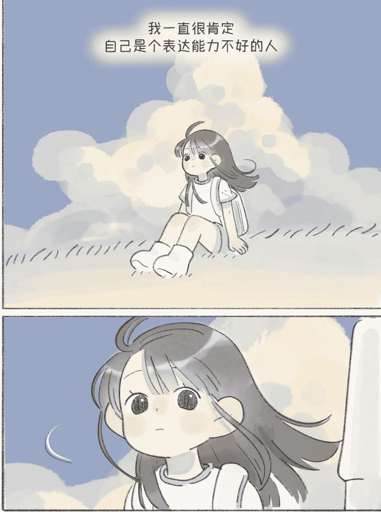


#### 反推法

如果你还是喜欢用提示词的话，那就把这张图片发给 AI，
我是一个漫画创作者，我现在给你这张图，帮我将这张图背后的提示词反推出来。

> 我是一个漫画创作者，我现在给你这张图，帮我将这张图背后的提示词反推出来。

要反推出这张图的提示词 (Prompt)，我们需要从画风材质、构图排版以及叙事氛围三个维度进行拆解。

这张图属于典型的治愈系/清新叙事漫画，其排版被称为“电影感长条漫 (Vertical Webtoon Style)”。

以下是为您整理的提示词建议：

-   1. 核心关键词 (Core Keywords)
    -   画风 (Style): watercolor texture(水彩质感), hand-drawn style(手绘感), soft cel-shading(柔和赛璐璐阴影), minimalist aesthetic(极简美学).
    -   媒介 (Media): digital illustration(数字插画), manga panel(漫画分镜), webtoon(条漫).
    -   光影 (Lighting): soft natural lighting(柔和自然光), gentle sunlight(温和阳光),

### 排版分类

#### 上下排版


上小学的时候忘戴红领巾


#### 四格排版


#### 上下四格排版


#### 一格漫画

#### 我活的非常轻松，因为我 #
妈对我没有任何期待。

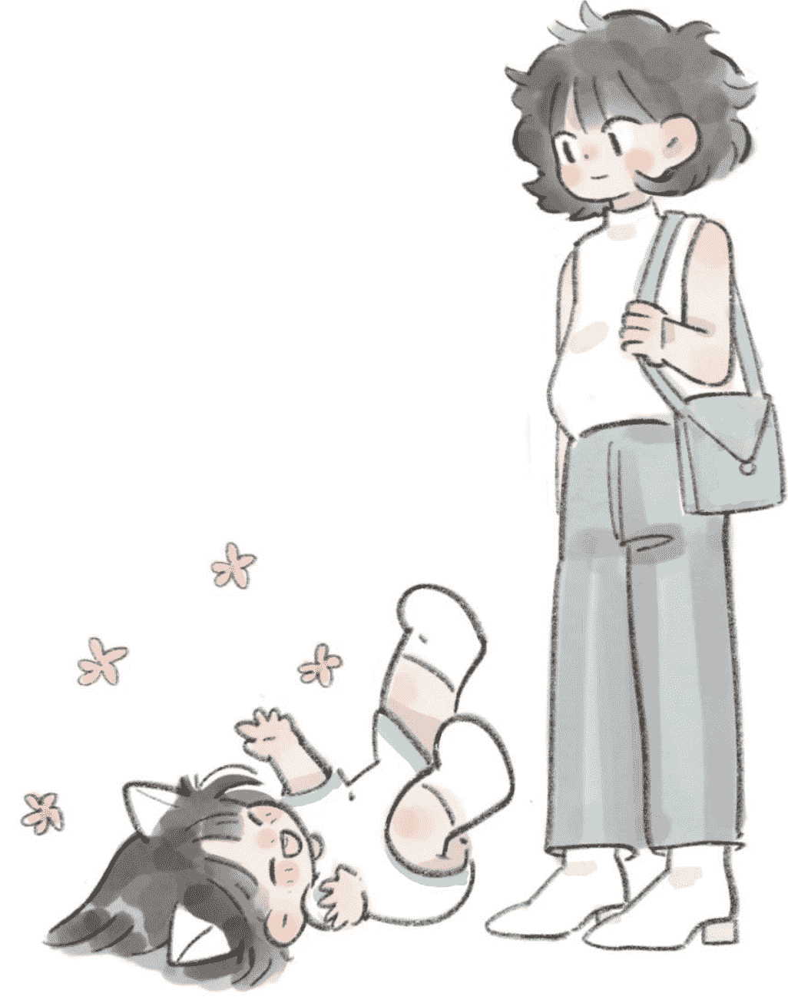

#### 三格

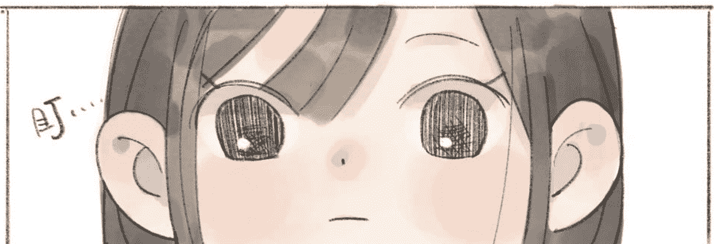

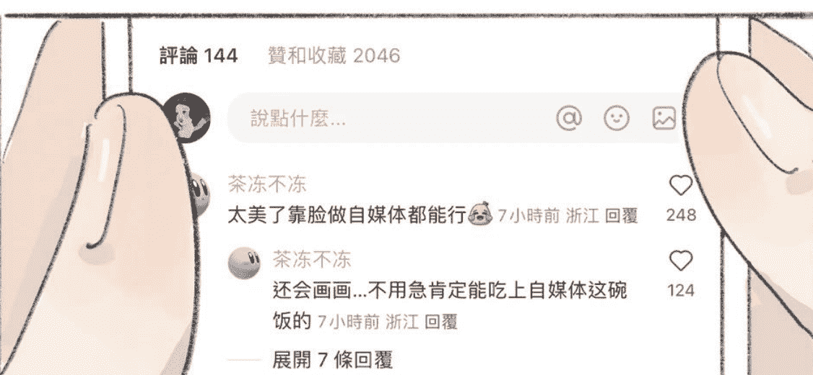

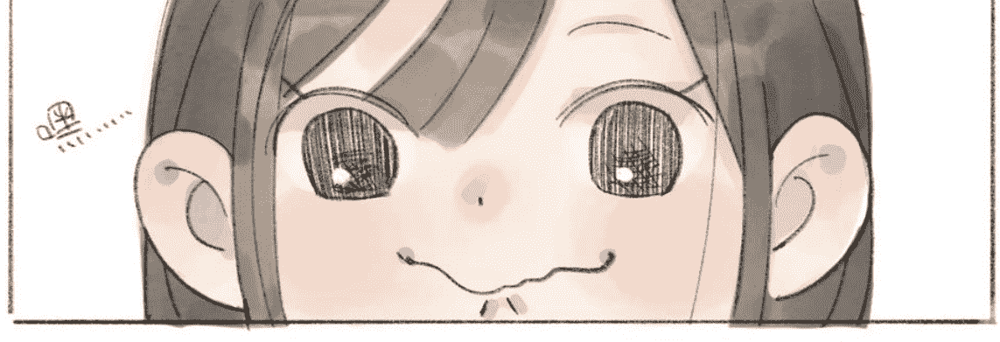

#### 生活碎片风

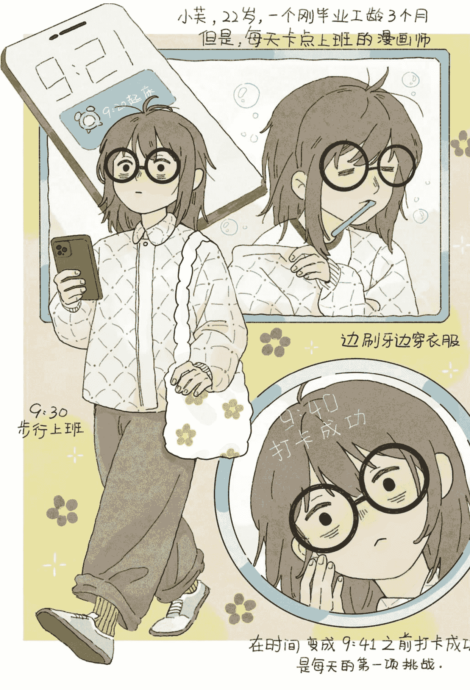

#### 斜向分镜排版无语言


#### 多格分类


# AI 怎么提效做漫画

## 用 lovart 批量生成

刚开始我是一个笔记一个的做，一次产出四五张。一个主题一个主题的去写。

后面发现 lovart 其实可以批量产出漫画，可以一下子产出二三十张，数量一下子就可以上去。

与其一条一条生成，不如一次性让 AI 直接生成几十张图，按顺序整理好，再统一发布。

这样做的好处是：你不再被“今天发什么”这件事卡住，而是进入一种“消耗素材库”的状态，创作压力会骤降，更新频率自然就上去了。

我一般是二十张一组，每组是五张漫画，一次生成的就可以发四个小红书笔记。

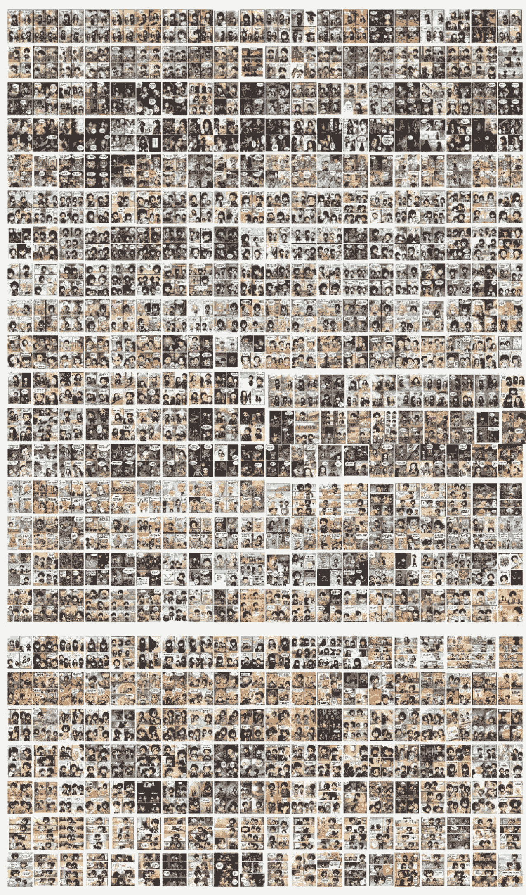

提示词：
二十话，Q 版彩色漫画，四宫格，不加标题，漫画当中的文字不可以出现英文，全部中文，图片比例 3:4，参考图片「把你的参考图发给他」

## 用 Gemini 批量创作

在内容生产这一块，我现在基本已经完全流程化了，几乎不再靠“临时想点子”来创作。漫画的剧情和分镜，我主要是用 Gemini 来生成，而且不是一话一话地生成，而是直接用模板一次性生成一整个系列。

我的做法是：先固定一个主题和世界观，比如「除草后的午后——乌萨奇与小八的奇妙日常」，然后用一个已经调好的提示词模板。

让 Gemini 一次性输出 10 话、20 话。每一话都是标准的 4 格结构，包含清晰的动作描述、和简单对白，基本上拿来就能用。

当这些文本脚本生成好之后，直接整体丢进 Lovart 这种出图工具里，按既定画风批量生成画面。这个阶段的工作，本质上已经从“创作”变成了“生产”，生成一批图，简单筛选。

就是按节奏无脑发到小红书。因为前面已经一次性生成了 20 话的库存，所以发布阶段几乎不再消耗任何创作精力，只是在“消耗素材库”。

这套流程跑通之后，你会明显感觉到一件事：

内容不再是“每一条都要重新想”，而是变成了“我有一个源源不断出货的内容仓库”。

这是一个参考的形式，我一般是做四格。

## ☕ 主题：除草后的午后——乌萨奇与小八的奇妙日常

## ☑ 第一话：关于“硬饼干”的绝对美味

-   ● 第 1 格：小八正努力用小手掰开一块巨大的硬饼干，满头大汗。
-   • 第 2 格：乌萨奇突然跳入画面，手里挥舞着一根奇怪的树枝，对着饼干大喊：“哈？！”（Haa?!）
-   • 第 3 格：乌萨奇一记飞踢把饼干踢碎。小八愣住，小心地捡起一小块尝了尝：“诶……这个碎度……刚好方便吃呢！”
-   • 第 4 格：乌萨奇叉腰发出“呜拉——！”（Ura!）的怪叫，小八露出标志性的治愈猫咪笑。

## 第二话：讨伐后的“整理检查”

-   • 第 1 格：刚完成除草任务，小八正认真地拍打身上沾到的灰尘。
-   • 第 2 格：乌萨奇闭着眼睛，像扫描仪一样在小八周围蹦蹦跳跳，鼻子不停地嗅（嗅嗅嗅）。
-   • 第 3 格：乌萨奇突然停住，指着小八耳朵后面的一根杂草，大声发出：“噗噜噜噜噜！”（震动嘴唇的声音）。
-   • 第 4 格：小八惊慌失措地鞠躬：“对不起！我没注意到那里！”（背景是远处的吉伊在无奈地摇晃）。

## 第三话：被弄乱的刘海

-   • 第 1 格：训练中，小八跑得太快，额头上的蓝色刘海乱成了一团，挡住了圆滚滚的眼睛。
-   • 第 2 格：乌萨奇从兜里掏出一把粉色的小梳子（不知道从哪偷来的），面无表情地走近。
-   • 第 3 格：乌萨奇用极其专业但略显狂野的手法梳理小八的刘海，眼神异常认真。
-   • 第 4 格：小八的刘海被梳成了完美的对称状，小八摸着额头：“谢谢你，乌萨奇！”（乌萨奇已经翻着跟头跑远了）。

## 第四话：雷雨夜的拉面壳

-   • 第 1 格：森林里突然下起大雨，两只小可爱躲进了一个巨大的空拉面杯壳里。
-   • 第 2 格：小八抱着膝盖，听着外面的雷声，身体微微发抖。
-   • 第 3 格：乌萨奇从背后掏出一根一直藏着的烤番薯，递到小八面前，依然是那副“呀哈!”的嚣张表情。
-   • 第 4 格：小八接过热腾腾的番薯，眼角泛泪：“乌萨奇......好暖和啊。”（乌萨奇已经闭上眼睛打起了响鼾）。

# 我的一些心得

## 搭建自己的内容创作框架，持续总结

参考 V 先生那个精华帖，分成这几个类目《一页纸战略》《最小阻力流程图》《运营日记》《成就事件》《项目问答手册》

每天记录《运营日记》，记录任务、过程、数据、心得与问题点。记要点，不记琐碎。关键在于持续记，如果记录成本太高，容易半途而废。《运营日记》是自己做周总结，或者和团队开周会的真实依据，不至于“现想”、“凭记忆”、“拍脑袋”。

定期复盘，最近做得怎么样。一人单干，就写周总结，有助理或团队，就开周会。每次开会，不要漫无边际地瞎聊，而要带着问题清单，针对具体问题一个个聊，聊完正事再闲谈。就单个问题而言，设几个选项做选择题，比空白的问答题更有成效。

怎么解决每天遇到的问题点？问 AI，问网络，问人，并把问答做成一本《项目问答手册》，搞定事情，顺便也沉淀了经验。

所有碎片经验与思考，All-in-One 到这本《项目问答手册》里，不要散乱放在各处，需要用时无法快速调取。后续在做的过程中，还要根据获取的实际经验，持续更新这本《项目问答手册》，这是一种非常宝贵的知识资产。

画一张《最小阻力流程图》，梳理整个项目的工作流。去掉无效的动作，去掉不必要的工具。目的>功能>形式。越简单，越稳定；越复杂，越脆弱。

这几个方向我都有实操。

主要写的就是运营日记，成就事件和项目问答手册，对于我来说很有帮助。

里面的信息就打码了，有点乱，有点碎碎念，没有什么条理，

## 12 月 23 日

一个是将之前发过的笔记进行一下重复，差不多一个月以上吧
一个号可以打一字需 4 片放入，比如片片宅，放在一个文件夹当中，那这里面可以上传配图
今天有 Inc 的脚本 App 15.1 原，然后有了一台苹果手机，更可以
把这个单子放下
打码文件就帮我写一下内容，下笔了一下分，
然后有点击后到粘贴板这里先是出现，用语言放入商品
提取只只各三个参数取到一上，这里的字体要写的比较黑，不
算是一个好的文案逻辑但是三句也是没有人写这么比
有好多会取这糊了

打算将时造光假和台保数主起之试
小景：有是三个取拍了，此好小建文成看，好个人小回二
人了了直接还是更新火灭灭
App 一个资源，和长公头，比排物品次取的看料于 1. 可以接小红书接单

## 12 月 24 日

可以添加普通，20 几个字的版本，您厂用改入。
加代人后，我可以自己碎东西，及 1888 大范。
那就是这九了了个人要素极简设计具公买风一，家之实现。
对于《通用及 F 增长》，可以用此的思考结构，让本地人看到

## 成就事件

开通了付费功能，默认输入支付
'2H73E8￥路三干了
'7 月 20 日 起 接 五了 发布了 龙 录书世 能后，105 即将就是
我 次出土
于二我*了，有原 u 水拆了，没想要小 大百天时间
几年了，.小串’，一 x 我 g-‘有一二 i
入「我坐了.
不 Incixr 代了」月黑

## 做的一张最小阻力流程图

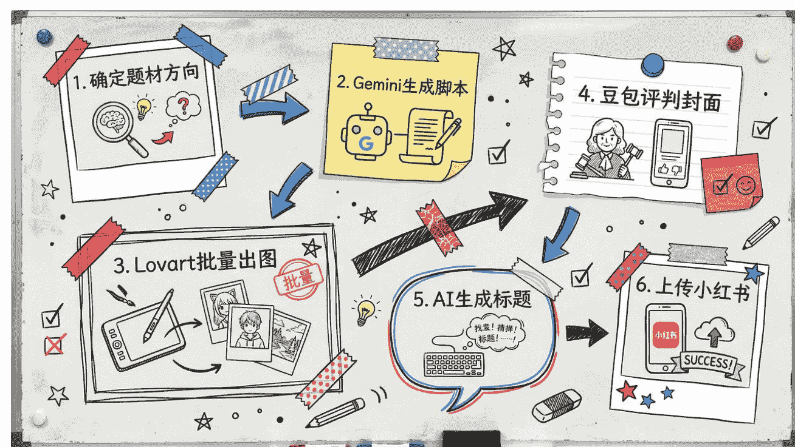

# 怎么增加关注率

在每一篇漫画的最后一张图，一定要专门留一页作为“引导关注页”，不要舍不得这一页。

这一页作为转化用的功能页来设计。可以单独做一张封面式图片，画面尽量干净、醒目，主体只有一句话，比如“关注 XX 账号”之类的提示语，同时在画面里放一个明显的箭头，箭头方向对准平台的“关注”按钮所在位置，用视觉引导用户完成动作。

这样把“看完内容后的那一瞬间”直接变成一个明确的行为指令，而不是指望用户自己想起来要关注。这一页的存在，会明显提高你的关注转化率，而且几乎不影响内容本身的数据，属于非常划算、但很多人没认真做的细节优化。

这个细节不需要付出多少精力，只需要简单加上一个步骤，粉丝关注率就会提升不少。

最后的引导关注图，我是参考类似这张图，自己改了一下

最上面的字是自己的账号，右上角加一个箭头

下面大概放上自己六个数据比较好的做哦

## -欢迎阅读-
微光的养生日常
把自己重新养一遍

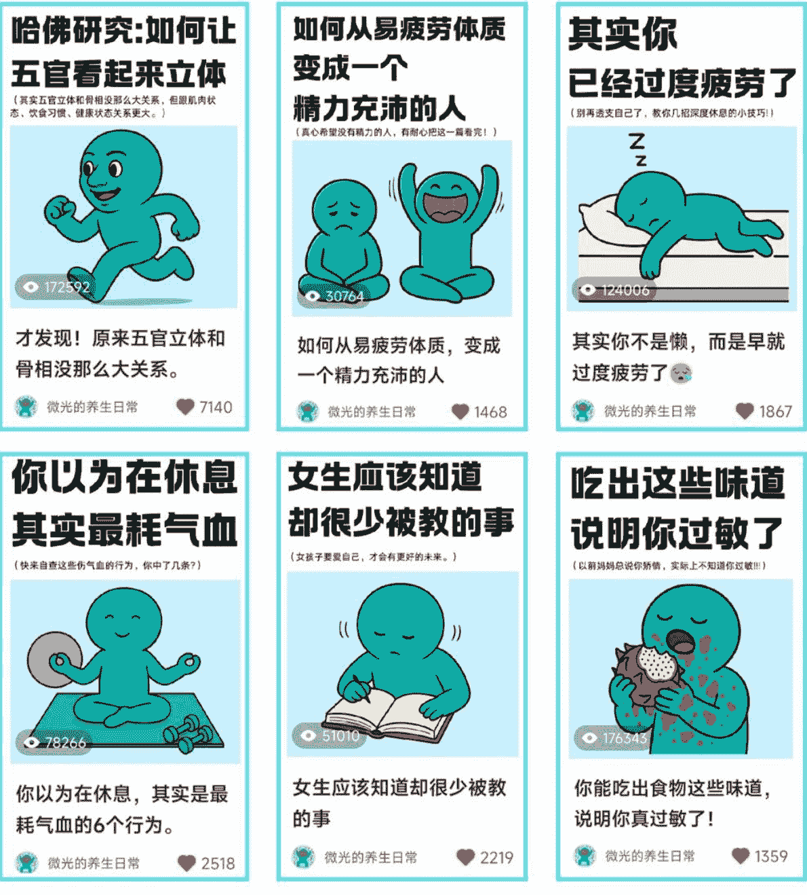

# 怎么增加点击率

封面图是从产出的四五张漫画当中，根据自己的网感，或者是直接截屏问 AI，让他给我一个建议去发。

## AI 选封面提示词

你是 5 年小红书动漫同人运营经验的资深封面优化师，针对 4-5 张动漫同人封面，结合小红书正方形、小图预览特性，从视觉、文字、受众吸引力维度评测，仅选出点击率最高的最优封面，并简要说明核心选中理由。

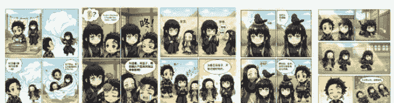

```
你是 5 年小红书动漫同人运营经验的资深封面优化师，针对 4-5 张动漫同人封面，结合小红书正方形、小图预览特性，从视觉、卖点、文字、受众吸引力维度评测，**仅选出点击率最高的最优封面**，并简要说明核心选中理由。
```

我会选择 **第二张图（左上起第二格）** 作为最优封面✅

## 核心选中理由

-   1. **视觉冲击力**：时透无一郎的超大特写表情极具张力，搭配炭治郎的惊讶脸，在小图预览下辨识度极高，视觉焦点明确。
-   2. **卖点与情绪**：对话框的英文台词 + “咚！”的拟声词，制造了悬念和戏剧感，能瞬间抓住动漫爱好者的好奇心，引发点击欲。
-   3. **受众适配**：Q 版画风 + 高人气角色组合，精准贴合小红书动漫同人的受众审美，色彩对比鲜明，在首页流中非常醒目。

# 保持爆款形式

还有一个非常重要、但很多人容易忽略的点：一旦某一种封面形式和标题结构，已经被数据验证“能稳定拿到流量”，就不要轻易去换。

很多人在起号阶段，容易犯一个错误：今天觉得这个封面好看，明天想换个风格，后天又想试试别的排版，结果账号一直在“重来”，平台也一直在重新认识你。

但从平台视角来看，它更喜欢的是：你在一个明确的内容结构里持续输出，而不是不停变脸。

正确的做法应该是：先用数据帮你确定一个“能跑的模板”。只要某一种封面样式 + 标题句式，已经多次跑出不错的播放和互动，那它就已经不是“灵感产物”，而是“经过验证的模型”。这个时候，你要做的不是“优化掉它”，而是围绕它不断复用、微调、放大。

可以改的，应该只是：题材细分、情绪角度、剧情切入点；

而不该频繁动的，是：封面结构、版式逻辑、标题句型。

用稳定的外壳，去承载不断变化的内容；而不是每一条内容，都重新设计一套外壳。

这样做，账号的反馈会越来越稳，平台也更容易给你持续的推荐权重。

你刷账号会发现，大部分账号都是同一个壳，换上不同的内容，然后一直产出。

# 多账号联动

一个账号成功率肯定没有三个账号成功率高，而且可以将多个账号主页相互关联。

在实际操作层面，不太建议把所有希望都押在一个账号上。因为内容平台本身就存在很强的随机性，单个账号的成败，往往掺杂着大量运气因素：有时候不是内容不行，而是起号阶段刚好没踩中平台的分发节奏；也有时候，明明是同一套模板，换一个号却突然就跑出来了。

从概率的角度看，一个账号的成功率，一定不如三个账号同时跑的成功率高。这不是投机，而是一种非常标准的“样本量对冲不确定性”的做法：用更多的测试样本，去换一个更高的命中概率。与其在一个号上死磕半年，不如用同一套方法论，同时跑多个账号，看看哪一个更容易被平台接受。

更进一步，这些账号之间还可以形成彼此导流和互相背书的关系。当其中一个账号开始跑出数据，你可以在简介把其他账号的主页关联过去，慢慢搭建一个小型的内容矩阵。这样做的好处是：一方面可以放大已经验证有效的内容模型，另一方面也可以让新账号更快获得初始关注，而不是每一个都从零开始冷启动。

从长期来看，这种“多账号并行测试 + 成熟账号互相联动”的结构，是在把内容这件事，从“赌单点爆款”，升级成“跑系统胜率”。不再依赖某一次运气，而是依赖一整套方法和规模化测试机制。

# 怎么样将卖货和产品巧妙植入到漫画中

我会在小红书的带货市集上面选择一些产品，然后将这个商品用 AI 去制作一些精美的产品图，

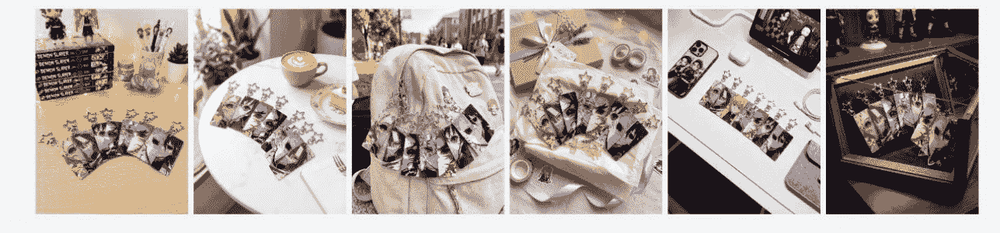

## 提示词

为这款商品生成 6 张不同场景的图片，每个场景都要营造出强烈的代入感与购买冲动。场景分别为：

-   5. 温馨治愈家居场景：商品摆放在阳光充足的北欧风客厅茶几上，周围搭配香薰、抱枕，营造慵懒放松的氛围；
-   6. 氛围感户外野餐场景：商品置于春日草坪的野餐垫上，周围有鲜花、气泡酒和闺蜜的笑脸，传递惬意的社交感；
-   7. 节日欢聚场景：商品作为圣诞/新年派对的焦点装饰，搭配彩灯、礼物和亲友的欢颜，强化仪式感与幸福感；
-   8. 精致闺蜜下午茶场景：商品摆放在法式甜品店的大理石桌面上，周围是马卡龙、手冲咖啡，凸显品质感与精致生活方式；

# 一些变现方式

SCBI 举例的几种变现方式我就不赘述了

## 公众号挂载小程序，小游戏

我在小红书上认识了一个人，他看到我的漫画内容数据还不错，就直接参考这种形式，做了一版自己的风格。和我不一样的是，他没有只把内容发在小红书，而是同步铺到了公众号。

关键的操作在后面：他在公众号的图文里，挂载了一个自己做的小程序。这样一来，同一份内容，就被他拆成了两层变现结构。

一个是小绿书给的流量主收益，另一个是公众号里的小游戏或工具型小程序带来的广告收益，用户在内容里点击、使用，就会不断产生新的广告展示。

借助 AI 编程，为动漫做一个简单的小游戏，不是一个难事，可以参考之前的 AI 编程航海手册

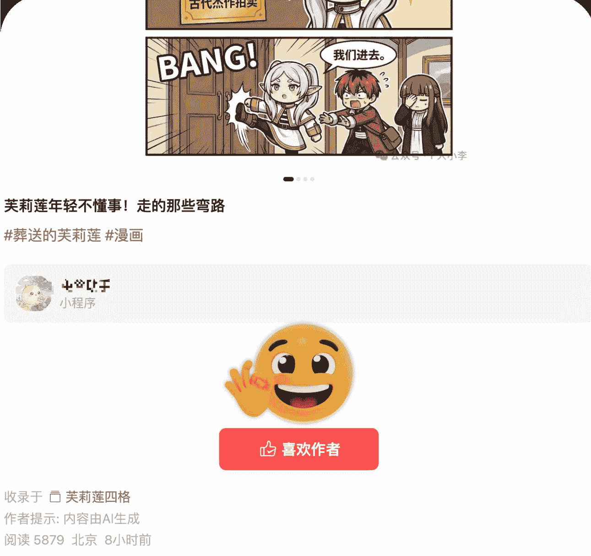

# 小红书养生漫画

从平台生态来看，养生本身就是小红书一个非常成熟、而且体量非常大的内容类目。平台还有专门的官方账号“养生薯”，这其实已经很明确地说明了一件事：这是一个长期存在、而且被平台持续重点扶持的方向。

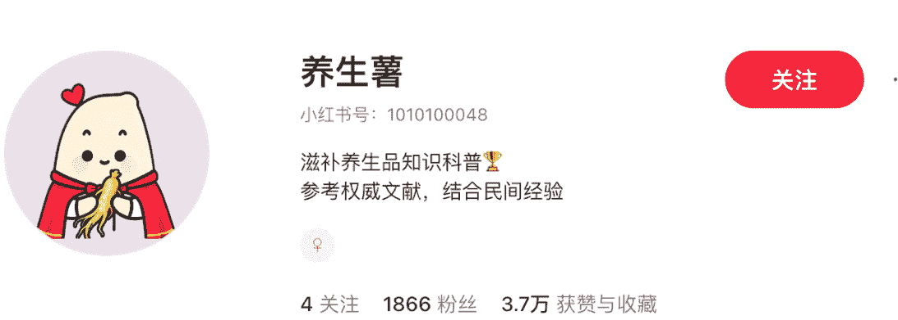

养生这个话题的受众，也在发生非常明显的变化。过去大家总觉得养生是中老年人的事情，但现在你会发现，年轻人反而成了养生内容的主力消费群体。熬夜、久坐、情绪焦虑、亚健康，这些状态几乎是普遍存在的，而“如何让自己过得健康一点、舒服一点”，已经变成了一种非常日常、也非常高频的内容需求。

从商业角度看，养生还有一个天然的优势：它和商品的结合面极其广。严格来说，几乎所有和生活有关的东西，都可以从“健康”“调理”“状态管理”的角度去重新包装和解释。吃的、喝的、用的、睡的、运动的、情绪相关的，本质上都可以和“养生”沾上关系。这也意味着，这个赛道不只是能做内容，而且变现出口非常多、而且非常自然。

我自己在观察平台的时候，也已经看到不止一个养生漫画账号，在短短一两个月内就涨到了上万粉。也是用 AI 做漫画，用一种非常轻松、易读、低负担的漫画形式，把养生知识、生活方式和情绪安慰包装成日常小故事。

## 养生方向的需求是存在的，而且内容形态正在被验证。


养生可以用 AI 漫画的形式重新做一遍。

# 一些感触

## 每一步都算数

如果再往前追溯，其实我并不是在做这个漫画项目的时候，才第一次开始认真接触 AI 作图。早在 AI 绘画刚出来的那一波，我就已经陆续尝试过非常多不同类型的内容：各种风格的图片、壁纸、表情包、头像，几乎所有“能用图承载的形式”，我都会拿 AI 跑一遍试试。

我后面又尝试了“信息表达”的图片上，比如 PPT、可视化总结图等等。这一阶段，就是头脑风暴，做一些有趣的，对别人有用的图。

这些看起来零散的尝试，也很重要。当后来真正开始切入漫画这个方向时，我并不是从零开始摸索“怎么出图”，而是已经对 AI 生成图像非常熟悉了。

可以说，这些早期大量、看似不成体系的练习，也为后面做账号有成绩铺垫了一下。这些训练不直接带来流量，但极大降低了我后来试错的成本，也让我在内容形式切换的时候很丝滑。从这个角度看，这个项目并不是突然出现的机会，而是长期积累到一个阶段之后，自然长出来的一条路径。


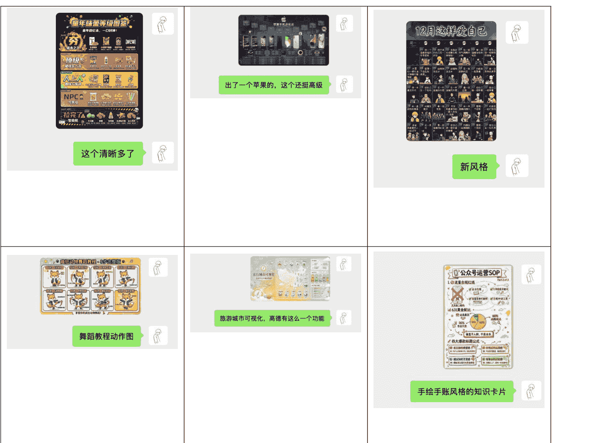

# Learning in Public

其实对于学习 AI 来说，还重要的一点就是公开表达。

其实我入局这个赛道，最初的目的也很简单，就是我在学习 AI 图片应用，我不能光自嗨，我得行动起来，公开表达起来。

我自己产出的话，我可能觉得好，但是市场不买账。我也可能觉得不好，也可能市场买账。

但某种形式的图片究竟好不好，发在社交平台上面足够多，那他的价值就终会显现。

做事情要有反馈，发在小红书上面，没反馈也是一种反馈。

# 给准备入场的人的行动建议

## 先干再说

别想那么多，先发出一个笔记再说，大部分人就是做着林黛玉的样，操着施瓦辛格的心，

这个是我收藏的几个金句，送给大家，打一下鸡血

## 先完成，再完美

先解决有无，再解决好坏

先动起来，才能听见世界的回响

听罗振宇在知行小酒馆播客里有几句话，我深有同感。他说，中年人想把路走好，最重要的方法其实很简单，就是"遇事儿解决事儿"。

这话怎么理解呢？就是你别总去琢磨那些特别抽象、特别宏大的问题。

我发现很多人，就特别爱想这些。比如：我到底要不要去做小红书博主？我究竟该不该走这条路？

你管那么多干嘛，先做起来再说。

你模仿任何人，最终也学不成别人的样子。

你只有去做了，就才能做出你自己的样子，这是一个自然而然发生的过程。

所以，关键是去解决问题，而不是总在做判断、做是非题。

现在很多人的问题就在于：想得太多，做得太少。

想得多了，无非就导致两种心态：

一种是自我为难，天天打击自己：哎呀，你看人家多棒，看人家做得多好

另一种是开启自我保护，觉得他们都是骗我的、他们都想割我韭菜，然后就是：我不上当，我不听，我不看。

最后你就天天又难受，又抱怨，又原地踏步。

我十分地坚信，如果能想在某件事上变得出色，最好的方法就是直接去做这件事，我认为这是一条被低估的的人生建议，如果能想找某件事，可能会先去培养 ABC 技能，以为这些技能在以后会派上用场，但你其实应该尽快投入到你所做的那件事上。

- Sam Altman

## 行动，反馈都不重要

就是想通了就行动

别在意脑子怎么想

大多数人的内耗，都是太把自己的脑子当回事了。

真觉得自己的想法很重要似的

再重要都没有行动重要

## 大力出奇迹

先把数量弄起来，现在 AI 制作很方便，几分钟就可以出很多图了，在起步初期，多发总是好事。

你看我在用 lovart 产出图片那节也讲过，一下子就是产出二十张图片，随随便便一天就是直接产出一百张图。

我最疯狂的一次就是一天发五十篇笔记，只要有流量，就一直发。

# 最后

最后希望大家都马上行动起来，在实操中优化进步，可以先发公众号，开通流量主之后，正反馈比较快，有阅读就有钱。

在实践当中慢慢整理出自己的项目管理手册，运营日记，多发多测试，有正反馈就记录在自己的成就事件一栏，给自己打一下鸡血。

加油!!!

最后，安利小懒的付费群：

**懒人专属群 (介绍)**

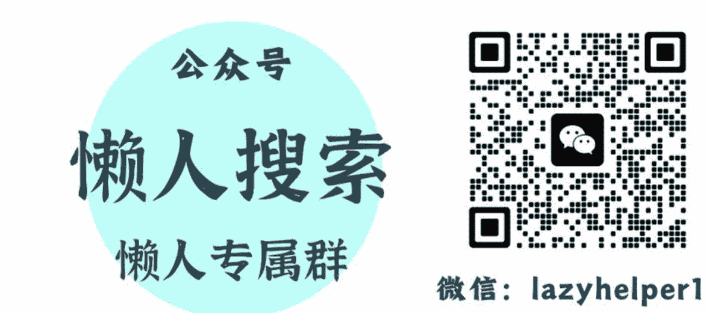

这里是你对抗信息过载的护城河。

已稳定运行 7 年，累计拆解、研读 3000+ 个互联网商业实战案例与行业前沿内参和时政/宏观文章。

我们不搬运垃圾，只做高价值信息的筛选器与放大镜。

# 懒人专属群更新记录：

https://hk57gvlx7u.feishu.cn/docx/HOkRdZbSbolBR0xkaXtcuVE0nTg

【免责声明】本资料归档于社群内部知识库，仅供成员课题研究与学术交流，请在查阅后 24 小时内删除。